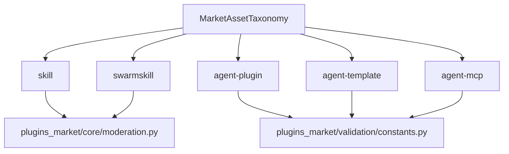
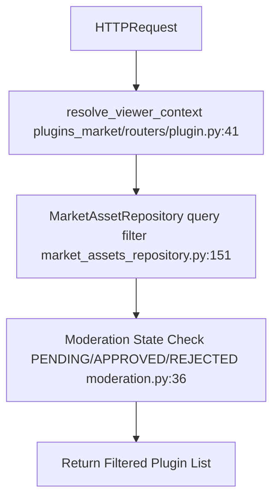

<!-- source: DeepWiki mcp.deepwiki.com · repo openJiuwen-ai/skillhub · page 6 Glossary · fetched 2026-11-02 -->

# Glossary

Relevant source files

The following files were used as context for generating this wiki page:

- [CHANGELOG.md](CHANGELOG.md)
- [docs/zh/SUMMARY.md](docs/zh/SUMMARY.md)
- [frontend/src/api/plugin.ts](frontend/src/api/plugin.ts)
- [frontend/src/components/Publish/PublishDrawer.tsx](frontend/src/components/Publish/PublishDrawer.tsx)
- [frontend/src/hooks/usePluginMarketConfigs.ts](frontend/src/hooks/usePluginMarketConfigs.ts)
- [frontend/src/locales/en-US.json](frontend/src/locales/en-US.json)
- [frontend/src/locales/zh-CN.json](frontend/src/locales/zh-CN.json)
- [frontend/src/pages/PluginMarketPage.tsx](frontend/src/pages/PluginMarketPage.tsx)
- [frontend/src/utils/pluginType.ts](frontend/src/utils/pluginType.ts)
- [frontend/src/utils/publishFieldLabels.ts](frontend/src/utils/publishFieldLabels.ts)
- [marketplace/main.py](marketplace/main.py)
- [marketplace/plugins_market/core/moderation.py](marketplace/plugins_market/core/moderation.py)
- [marketplace/plugins_market/repositories/market_assets_repository.py](marketplace/plugins_market/repositories/market_assets_repository.py)
- [marketplace/plugins_market/retrieval/daily_rebuild.py](marketplace/plugins_market/retrieval/daily_rebuild.py)
- [marketplace/plugins_market/retrieval/index_manager.py](marketplace/plugins_market/retrieval/index_manager.py)
- [marketplace/plugins_market/retrieval/search.py](marketplace/plugins_market/retrieval/search.py)
- [marketplace/plugins_market/routers/plugin.py](marketplace/plugins_market/routers/plugin.py)
- [marketplace/plugins_market/schemas/plugin.py](marketplace/plugins_market/schemas/plugin.py)
- [marketplace/plugins_market/services/plugin.py](marketplace/plugins_market/services/plugin.py)
- [marketplace/plugins_market/tests/test_agent_asset_retrieval.py](marketplace/plugins_market/tests/test_agent_asset_retrieval.py)
- [marketplace/plugins_market/tests/test_m3_agent_moderation_flow.py](marketplace/plugins_market/tests/test_m3_agent_moderation_flow.py)
- [marketplace/plugins_market/tests/test_moderated_market_asset_types.py](marketplace/plugins_market/tests/test_moderated_market_asset_types.py)
- [marketplace/retrieval/indexing/scanners/__init__.py](marketplace/retrieval/indexing/scanners/__init__.py)
- [marketplace/retrieval/indexing/scanners/base.py](marketplace/retrieval/indexing/scanners/base.py)
- [marketplace/retrieval/indexing/workflows/artifacts.py](marketplace/retrieval/indexing/workflows/artifacts.py)
- [marketplace/retrieval/indexing/workflows/index_builder.py](marketplace/retrieval/indexing/workflows/index_builder.py)

## Purpose and Scope
This document defines codebase-specific terms, architectural concepts, domain models, and system components used across the openJiuwen Agentic Hub (SkillHub) repository (`https://github.com/openJiuwen-ai/skillhub`). It provides precise code pointers, structural layouts, and data flow semantics for developers and operators working with the backend (`plugins_market`), frontend, retrieval engines, and toolchains.

Sources: `marketplace/main.py:1-63` [marketplace/main.py:1-63](), `marketplace/plugins_market/services/plugin.py:1-45` [marketplace/plugins_market/services/plugin.py:1-45]()

---

## Domain Concepts and Asset Taxonomy

### SwarmSkill (`swarmskill`)
A composite multi-agent skill or agent workflow asset type in the marketplace taxonomy. Unlike standard single-entry skills (`skill`), `swarmskill` assets coordinate multiple reasoning agents concurrently and are governed by specialized retrieval groupings and model concurrency handling.
- **Code Pointers:** `marketplace/plugins_market/core/moderation.py` [marketplace/plugins_market/core/moderation.py:1-45](), `frontend/src/locales/zh-CN.json:41-47` [frontend/src/locales/zh-CN.json:41-47]()

### Plugin Manifest (`plugin.yaml`)
The mandatory metadata declaration file located at the root of a published package. It defines the asset identifier, runtime category (`tools`, `mcp-stdio`, `restful-api`, `skill`), version, dependencies, and configuration parameters.
- **Code Pointers:** `marketplace/plugins_market/validation/plugin_yaml.py` [marketplace/plugins_market/services/plugin.py:106-110]()

### Asset Types (`plugin`, `skill`, `swarmskill`, `agent-plugin`, `agent-template`, `agent-mcp`)
Taxonomy categories classifying marketplace entries. They determine validation pipelines, UI rendering components, S3/OBS storage prefixes, and access control rules.
- **Code Pointers:** `marketplace/plugins_market/schemas/plugin.py:40-57` [marketplace/plugins_market/schemas/plugin.py:40-57](), `frontend/src/locales/en-US.json:41-47` [frontend/src/locales/en-US.json:41-47]()

*Diagram 1: Taxonomy mapping to validation and moderation modules.*
Sources: `marketplace/plugins_market/core/moderation.py:34-45` [marketplace/plugins_market/core/moderation.py:34-45](), `frontend/src/locales/zh-CN.json:41-47` [frontend/src/locales/zh-CN.json:41-47]()

---

## Governance, Security, and Moderation

### Moderation States (`PENDING`, `APPROVED`, `REJECTED`)
Workflow states governing asset version visibility in public marketplaces. Automated scan engines (`skill_review`) and manual admin reviews transition assets through these states.
- **Code Pointers:** `marketplace/plugins_market/core/moderation.py:36-39` [marketplace/plugins_market/core/moderation.py:36-39](), `marketplace/plugins_market/repositories/market_assets_repository.py:118-130` [marketplace/plugins_market/repositories/market_assets_repository.py:118-130]()

### ViewerContext (`ViewerContext`)
A security context object constructed per-request that encapsulates the current user identity, roles (`is_system_admin`, `is_market_moderation_admin`), group memberships, and asset access permissions.
- **Code Pointers:** `marketplace/plugins_market/core/viewer_context.py` [marketplace/plugins_market/services/plugin.py:57-57](), `marketplace/plugins_market/routers/plugin.py:36-42` [marketplace/plugins_market/routers/plugin.py:36-42]()

### PublishError Codes (`PublishError`)
Structured business exception codes raised during package extraction, signature verification, schema validation, or storage upload failures.
- **Code Pointers:** `marketplace/plugins_market/core/errors.py` [marketplace/plugins_market/services/plugin.py:33-33](), `marketplace/plugins_market/routers/plugin.py:55-60` [marketplace/plugins_market/routers/plugin.py:55-60]()

*Diagram 2: ViewerContext and Moderation Flow in Search Queries.*
Sources: `marketplace/plugins_market/routers/plugin.py:36-42` [marketplace/plugins_market/routers/plugin.py:36-42](), `marketplace/plugins_market/repositories/market_assets_repository.py:151-167` [marketplace/plugins_market/repositories/market_assets_repository.py:151-167]()

---

## Retrieval, Indexing, and Search Architecture

### Read-Copy-Update (`RCU`)
A concurrency pattern implemented by `IndexManager` where concurrent search threads read the active index reference lock-free, while background reload tasks atomically swap out the retriever instance upon rebuilding.
- **Code Pointers:** `marketplace/plugins_market/retrieval/index_manager.py:3-17` [marketplace/plugins_market/retrieval/index_manager.py:3-17](), `marketplace/plugins_market/retrieval/index_manager.py:60-92` [marketplace/plugins_market/retrieval/index_manager.py:60-92]()

### BuildMethod (`BuildMethod`)
Bitmask flags (`BM25`, `EMBEDDING`, `TREE`, `ALL`) controlling which retrieval indices are constructed during artifact compilation and daily rebuild workflows.
- **Code Pointers:** `marketplace/main.py:64-87` [marketplace/main.py:64-87](), `marketplace/retrieval/indexing/workflows/artifacts.py` [marketplace/retrieval/indexing/workflows/artifacts.py:31-31]()

### Content Identifier (`CID`)
A unique cryptographic content hash identifying chunks or records within the retrieval catalog, mapped back to marketplace `asset_id` entities via `_build_cid_to_asset_map`.
- **Code Pointers:** `marketplace/plugins_market/retrieval/index_manager.py:29-57` [marketplace/plugins_market/retrieval/index_manager.py:29-57]()

### Maximal Marginal Relevance (`MMR`)
A ranking algorithm used in retrieval to balance relevance against redundancy when selecting top-k search results.
- **Code Pointers:** `marketplace/retrieval/indexing/workflows/index_builder.py` [marketplace/retrieval/indexing/workflows/index_builder.py:1-1]()

### Alias Cutover (`alias cutover`)
The atomic promotion mechanism used by vector storage backends (such as Milvus offline indices) to switch production search aliases from old index segments to newly compiled versions without downtime.
- **Code Pointers:** Marketplace retrieval subsystems in `marketplace/retrieval/` [marketplace/main.py:1-63]()

Sources: `marketplace/plugins_market/retrieval/index_manager.py:60-118` [marketplace/plugins_market/retrieval/index_manager.py:60-118](), `marketplace/main.py:64-87` [marketplace/main.py:64-87]()

---

## Packaging, Validation, and Storage

### Market ZIP Layout (`market ZIP layout`)
The standardized directory structure enforced for published asset packages on S3/OBS object storage:
`{storage_root}/{publisher_id}/{asset_id}/{version}/{name}_{version}.zip`
- **Code Pointers:** `marketplace/plugins_market/retrieval/daily_rebuild.py:142-160` [marketplace/plugins_market/retrieval/daily_rebuild.py:142-160](), `marketplace/plugins_market/services/plugin.py:1-45` [marketplace/plugins_market/services/plugin.py:1-45]()

### DecompressCounter (`DecompressCounter`)
A safety guard utility that tracks cumulative uncompressed bytes and file counts during zip extraction to prevent zip bomb denial-of-service attacks.
- **Code Pointers:** `marketplace/plugins_market/validation/zip_utils.py` [marketplace/plugins_market/services/plugin.py:111-115]()

Sources: `marketplace/plugins_market/retrieval/daily_rebuild.py:142-160` [marketplace/plugins_market/retrieval/daily_rebuild.py:142-160](), `marketplace/plugins_market/services/plugin.py:111-115` [marketplace/plugins_market/services/plugin.py:111-115]()

---

## Ecosystem and Integration

### ClawHub (`ClawHub`)
A CLI compatibility router and protocol adapter enabling external ecosystem tooling and legacy clients to interact with SkillHub endpoints via standardized asset fingerprinting and publish APIs.
- **Code Pointers:** `marketplace/plugins_market/routers/plugin.py` [marketplace/plugins_market/routers/plugin.py:1-35]()

Sources: `marketplace/plugins_market/routers/plugin.py:1-35` [marketplace/plugins_market/routers/plugin.py:1-35]()