# Page: Overview

# Overview

<details>
<summary>Relevant source files</summary>

The following files were used as context for generating this wiki page:

- [README.md](README.md)
- [README_zh.md](README_zh.md)
- [docker/Dockerfile.skill-runner](docker/Dockerfile.skill-runner)
- [docker/k8s/marketplace-config.yaml](docker/k8s/marketplace-config.yaml)
- [docker/skill-agent-worker/entrypoint.sh](docker/skill-agent-worker/entrypoint.sh)
- [docs/zh/README.md](docs/zh/README.md)
- [marketplace/main.py](marketplace/main.py)
- [marketplace/plugins_market/retrieval/daily_rebuild.py](marketplace/plugins_market/retrieval/daily_rebuild.py)
- [marketplace/plugins_market/retrieval/index_manager.py](marketplace/plugins_market/retrieval/index_manager.py)
- [marketplace/plugins_market/retrieval/search.py](marketplace/plugins_market/retrieval/search.py)
- [marketplace/plugins_market/tests/test_agent_asset_retrieval.py](marketplace/plugins_market/tests/test_agent_asset_retrieval.py)
- [marketplace/retrieval/indexing/scanners/__init__.py](marketplace/retrieval/indexing/scanners/__init__.py)
- [marketplace/retrieval/indexing/scanners/base.py](marketplace/retrieval/indexing/scanners/base.py)
- [marketplace/retrieval/indexing/workflows/artifacts.py](marketplace/retrieval/indexing/workflows/artifacts.py)
- [marketplace/retrieval/indexing/workflows/index_builder.py](marketplace/retrieval/indexing/workflows/index_builder.py)
- [skill-runner/executor/pod_manager.py](skill-runner/executor/pod_manager.py)
- [skill-runner/pyproject.toml](skill-runner/pyproject.toml)

</details>


openJiuwen Agentic Hub (**SkillHub**) is an open-source skill hosting and distribution platform designed for self-hosted team deployments within the openJiuwen ecosystem [README.md:1-9](). It serves as an asset marketplace supporting skills, swarm skills, agent plugins, templates, and Model Context Protocol (MCP) connectors [README.md:26](). It also optionally supports ClawHub-compatible API protocols for integration with existing external client tools [README.md:10-11]().

For installation, environment configuration, and local running steps, see [Getting Started and Local Development](#1.1). For an in-depth breakdown of the asset taxonomy, versions, visibility rules, and publish workflows, see [Domain Concepts: Assets, Plugin Types and Lifecycle](#1.2).

## High-Level Architecture

The system is composed of several decoupled tiers: a React/Vite single-page application frontend served via Nginx, a FastAPI-powered marketplace backend (`marketplace`), external storage backing (MinIO or Huawei OBS), a MySQL transactional database, and external authentication integration [README.md:32-55]().

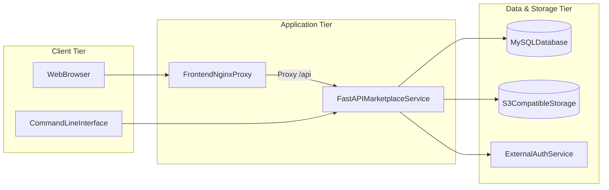
Sources: [README.md:32-55]()

## Subsystem Breakdown

### Marketplace Backend (`marketplace`)
Built on Python >= 3.11.4 and FastAPI, the backend handles asset publishing, version control, metadata validation, moderation pipelines, and presigned downloads [README.md:4, 26, 61](). It initializes database sessions via SQLAlchemy (`plugins_market/core/database.py`) and bootstraps core routing and middleware inside `marketplace/main.py` [README.md:61]().

### Frontend Web Application (`frontend`)
A React 18 and Vite Single Page Application using Material-UI (MUI) [README.md:5, 62](). It delivers marketplace browsing, tag filtering, asset detail visualization, version file tree inspectors, a publishing wizard drawer, and an administrative control console.

### Retrieval, Recommendation and Dispatch Subsystems
Located under `plugins_market/retrieval/` and `marketplace/retrieval/`, this subsystem builds lexical (BM25), vector embedding, and hierarchical tree indexes over scanned packages [marketplace/plugins_market/retrieval/daily_rebuild.py:3-20](). The `IndexManager` (`plugins_market/retrieval/index_manager.py`) implements a Read-Copy-Update (RCU) concurrency pattern for lock-free reads during runtime searches [marketplace/plugins_market/retrieval/index_manager.py:3-7]().

### Tooling, Playground and Skill-Runner
Includes CLI packages (`cli_core`, `openjiuwen_plugin`, `jiuwen_teamskills`), an isolated `skill-runner` execution container service utilizing a pod manager, and playground session APIs hosted within the marketplace backend.

## Repository Layout

```text
.
├── marketplace/          # FastAPI backend service (plugins_market, retrieval, validation)
├── frontend/             # React/Vite web application UI
├── cli/                  # CLI tooling and packaging modules
├── skill-runner/         # Execution worker service and LLM proxy
├── docker/               # Dockerfiles, Compose files, and Kubernetes manifests
└── docs/                 # User guides, API references, and deployment manuals
```
Sources: [README.md:1-167](), [README_zh.md:1-160]()

---

## Code Space Bridge: Request Lifecycle and Routing

To bridge natural language concepts to concrete code identifiers, the following diagram illustrates how the FastAPI application bootstrap in `marketplace/main.py` registers routing subsystems via `plugins_market/routers/register.py`.

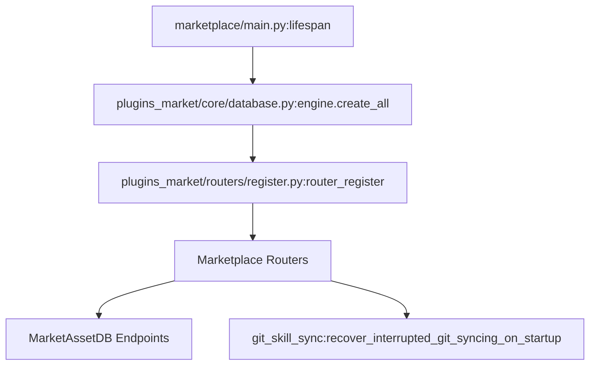
Sources: [marketplace/main.py:118-163]()

## Code Space Bridge: Retrieval Indexing and RCU Lifecycle

This diagram maps the natural language indexing and search pipeline to its underlying classes and functions, tracking how index records are fetched and managed in memory.

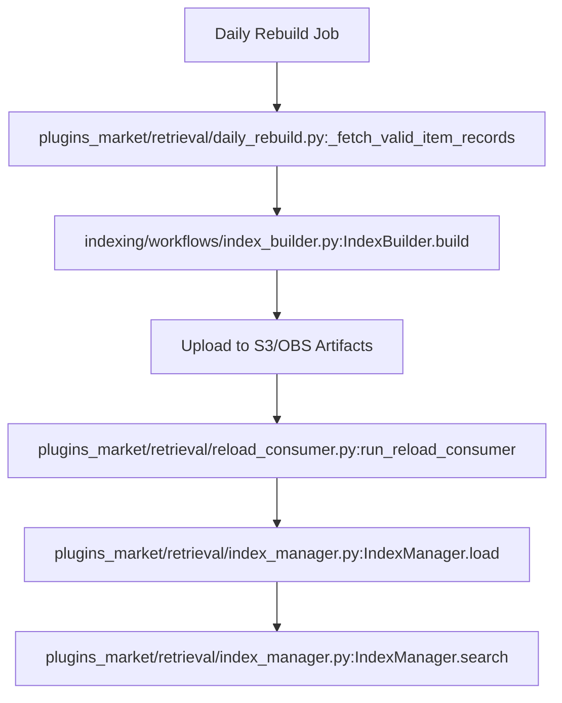
Sources: [marketplace/plugins_market/retrieval/daily_rebuild.py:99-177](), [marketplace/plugins_market/retrieval/index_manager.py:60-158](), [marketplace/retrieval/indexing/workflows/index_builder.py:98-129]()

---

# Page: Getting Started and Local Development

# Getting Started and Local Development

<details>
<summary>Relevant source files</summary>

The following files were used as context for generating this wiki page:

- [.env.example](.env.example)
- [docker/Dockerfile.skillhub-backend](docker/Dockerfile.skillhub-backend)
- [docker/docker-compose.override.yml.example](docker/docker-compose.override.yml.example)
- [docker/docker-compose.yml](docker/docker-compose.yml)
- [docker/mysql-init/01-init.sh](docker/mysql-init/01-init.sh)
- [marketplace/plugins_market/core/config.py](marketplace/plugins_market/core/config.py)
- [marketplace/pyproject.toml](marketplace/pyproject.toml)

</details>


## Purpose and Scope

This page covers the installation, environment configuration, containerized orchestration via Docker Compose, local frontend and backend startup procedures, and database initialization pipelines for the openJiuwen SkillHub codebase. It details how the FastAPI marketplace backend [marketplace/plugins_market/core/config.py]() interacts with environment variables and how containers are provisioned [docker/docker-compose.yml]().

Sources:
- [marketplace/plugins_market/core/config.py]()
- [docker/docker-compose.yml]()

---

## Environment Configuration and Settings

The SkillHub backend relies on Pydantic's `BaseSettings` within `marketplace/plugins_market/core/config.py` to parse and validate runtime parameters. Configuration can be supplied via a local `.env` file or direct environment variables. 

Key configuration categories include:
- **Server Binding**: `STORE_HOST` and `STORE_PORT` define the Uvicorn listener address.
- **Database Connection**: `DB_TYPE`, `DB_HOST`, `DB_PORT`, `DB_USER`, `DB_PASSWORD`, and `STORE_DB_NAME` establish the MySQL connection parameters.
- **Object Storage**: `STORAGE_TYPE` (MinIO or OBS), `MARKET_BUCKET_NAME`, `MARKET_S3_ENDPOINT`, and credential keys.
- **OAuth Integration**: Providers for GitCode, GitHub, and AgentOS.

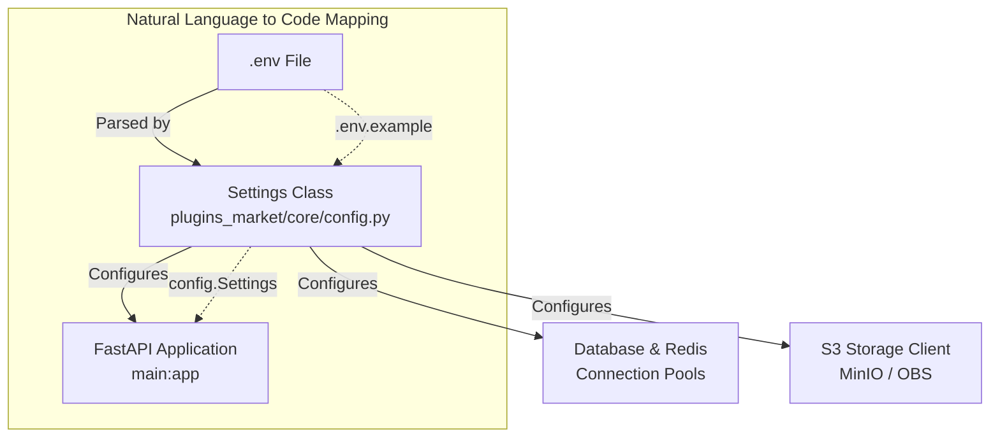
Sources:
- [marketplace/plugins_market/core/config.py:31-162]()
- [.env.example:1-162]()

---

## Dependencies and Python Package Layout

Backend dependencies and packaging metadata are defined in `marketplace/pyproject.toml`. The project uses modern build tools (`setuptools` with `wheel`) and specifies required versions for FastAPI, SQLAlchemy, Pydantic v2, Redis, and retrieval engines.

| Dependency Category | Key Packages | Version Constraint |
| :--- | :--- | :--- |
| Web Framework | `fastapi`, `uvicorn[standard]` | `==0.115.11`, `>=0.35` |
| Validation & Settings | `pydantic`, `pydantic-settings` | `==2.11.7`, `==2.5.2` |
| Database & ORM | `sqlalchemy`, `pymysql` | `==2.0.41`, `==1.1.1` |
| Caching & Storage | `redis`, `boto3` | `>=5.0.0`, `>=1.34.0` |

Sources:
- [marketplace/pyproject.toml:1-44]()

---

## Containerized Local Development with Docker Compose

For local development and self-validation, `docker/docker-compose.yml` orchestrates five core services: `mysql`, `redis`, `minio`, `minio-init`, `backend`, and `frontend`.

The backend image is built using a multi-stage Dockerfile (`docker/Dockerfile.skillhub-backend`) that uses `uv` to build a wheel package in the builder stage and installs it into a slim runtime container.

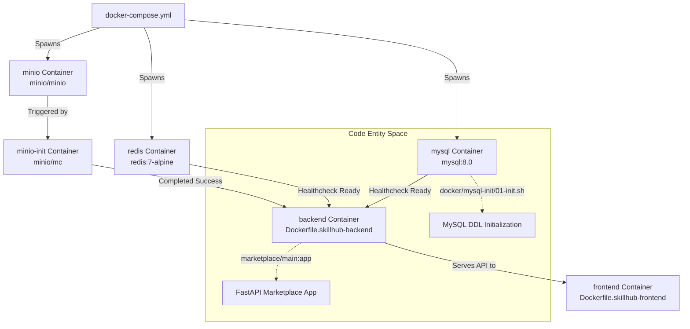
Sources:
- [docker/docker-compose.yml:25-161]()
- [docker/Dockerfile.skillhub-backend:1-81]()

---

## Database Initialization Pipeline

Upon initial startup, the MySQL container executes `docker/mysql-init/01-init.sh`. This script sequentially applies baseline DDL scripts followed by incremental migration scripts.

The initialization execution order runs as follows:
1. **Baseline DDL**: Executes table creations for `market_assets`, `market_asset_versions`, `market_asset_interactions`, `audit_logs`, `plugin_fetch_records`, and `site_notifications` located under `/sql/baseline/openjiuwen_market/DDL/`.
2. **Incremental DDL/DML**: Applies versioned schema upgrades (such as `v0.0.2.B001`, `v0.0.2.B002`, and `v0.0.2.B003`) adding git sources, moderation tables, group ACLs, and visibility rules.

Sources:
- [docker/mysql-init/01-init.sh:1-56]()
- [docker/docker-compose.yml:41-44]()

---

# Page: Domain Concepts: Assets, Plugin Types and Lifecycle

# Domain Concepts: Assets, Plugin Types and Lifecycle

<details>
<summary>Relevant source files</summary>

The following files were used as context for generating this wiki page:

- [CHANGELOG.md](CHANGELOG.md)
- [docs/zh/SUMMARY.md](docs/zh/SUMMARY.md)
- [frontend/src/components/Publish/PublishDrawer.tsx](frontend/src/components/Publish/PublishDrawer.tsx)
- [frontend/src/utils/pluginType.ts](frontend/src/utils/pluginType.ts)
- [frontend/src/utils/publishFieldLabels.ts](frontend/src/utils/publishFieldLabels.ts)
- [marketplace/plugins_market/core/moderation.py](marketplace/plugins_market/core/moderation.py)
- [marketplace/plugins_market/models/market_assets.py](marketplace/plugins_market/models/market_assets.py)
- [marketplace/plugins_market/tests/test_m3_agent_moderation_flow.py](marketplace/plugins_market/tests/test_m3_agent_moderation_flow.py)
- [marketplace/plugins_market/tests/test_moderated_market_asset_types.py](marketplace/plugins_market/tests/test_moderated_market_asset_types.py)
- [marketplace/plugins_market/validation/__init__.py](marketplace/plugins_market/validation/__init__.py)
- [marketplace/plugins_market/validation/base.py](marketplace/plugins_market/validation/base.py)
- [marketplace/plugins_market/validation/constants.py](marketplace/plugins_market/validation/constants.py)
- [marketplace/plugins_market/validation/plugin_yaml.py](marketplace/plugins_market/validation/plugin_yaml.py)
- [marketplace/plugins_market/validation/types/__init__.py](marketplace/plugins_market/validation/types/__init__.py)

</details>


## Purpose and Scope
This document outlines the core domain concepts of the `openJiuwen-ai/skillhub` platform, focusing on the asset and plugin type taxonomy, versioning rules, visibility controls, moderation states, and the publish lifecycle. It bridges high-level architectural concepts with the concrete data models, validation functions, and service logic implemented in the backend codebase (`plugins_market`).

Sources: `CHANGELOG.md:16-19`, `marketplace/plugins_market/models/market_assets.py:21-122`, `marketplace/plugins_market/core/moderation.py:1-78`

---

## 1. Asset and Plugin Type Taxonomy
The platform manages multiple runtime asset and plugin types, categorized into skill-like assets, agent-wrapped packaging types, and legacy tool integrations. These classifications drive runtime dispatch, search indexing group partitioning, and moderation requirements.

Supported runtime types are defined centrally in `marketplace/plugins_market/validation/constants.py:68-84`:
- **Skill-like Types (`skill`, `swarmskill`)**: Executable agent workflows and multi-agent coordination rules. Aligned with `SKILL_LIKE_PLUGIN_TYPES` in `marketplace/plugins_market/core/moderation.py:19`.
- **Agent Asset Types (`agent-plugin`, `agent-template`, `agent-mcp`)**: Packaging wrappers for multi-agent capabilities (plugins, expert templates, Model Context Protocol connectors). Defined as `AGENT_ASSET_PLUGIN_TYPES` in `marketplace/plugins_market/core/moderation.py:22-28`.
- **Legacy Tool Types (`tools`, `mcp-stdio`, `restful-api`)**: Direct tool interfaces bypassing strict platform content moderation (`MODERATED_MARKET_ASSET_TYPES` excludes these, per `marketplace/plugins_market/core/moderation.py:31-32`).

Title: Asset Taxonomy and Code Mapping
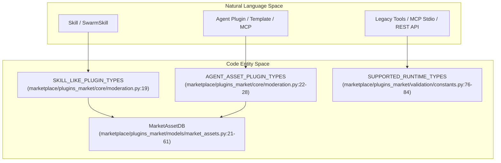

Sources: `marketplace/plugins_market/validation/constants.py:68-84`, `marketplace/plugins_market/core/moderation.py:13-33`, `marketplace/plugins_market/models/market_assets.py:21-61`

---

## 2. Versions and Versioning Semantics
Asset versions are tracked at both the aggregate asset level (`MarketAssetDB`) and the individual version record level (`MarketAssetVersionDB`). 

- **Semantic Versioning**: Standard releases follow strict Semantic Versioning (`x.y.z`), enforced by `VERSION_PATTERN` in `marketplace/plugins_market/validation/constants.py:27`.
- **Git Commit Versions**: For Git-synced repositories, versions are normalized to 7-character lowercase hexadecimal strings (`GIT_COMMIT_VERSION_PATTERN`), extracted via `commit_full_sha_to_version` in `marketplace/plugins_market/validation/constants.py:33-40`.
- **Database Schema**: Each version record stores artifact metadata, changelogs, file paths, and SHA-256 digests in `MarketAssetVersionDB` (`marketplace/plugins_market/models/market_assets.py:97-122`).

Sources: `marketplace/plugins_market/validation/constants.py:24-64`, `marketplace/plugins_market/models/market_assets.py:97-122`

---

## 3. Visibility and Access Control
Assets support granular visibility controls managed via the `visibility` column on `MarketAssetDB` (`marketplace/plugins_market/models/market_assets.py:43`):
- **Public (`public`)**: Published to the open marketplace, discoverable via search and indexing.
- **Private (`private`)**: Restricted to authors, system administrators, or authorized group ACL members via `ViewerContext`.

Access enforcement relies on permission checks executed against the asset's publisher ID, visibility flag, and approval state (`marketplace/plugins_market/tests/test_m3_agent_moderation_flow.py:126-184`).

Sources: `marketplace/plugins_market/models/market_assets.py:43`, `marketplace/plugins_market/tests/test_m3_agent_moderation_flow.py:126-184`, `marketplace/plugins_market/tests/test_moderated_market_asset_types.py:97-136`

---

## 4. Moderation States and Automated Review
Assets subject to content checks participate in an asynchronous review pipeline. The review lifecycle transitions through specific moderation statuses:

- **States**: `PENDING`, `APPROVED`, `REJECTED`, defined in `marketplace/plugins_market/core/moderation.py:14-16`.
- **Aggregation**: The primary `MarketAssetDB.moderation_status` is computed dynamically from its constituent `MarketAssetVersionDB` rows. If any version is pending, the asset shows pending status; approval requires at least one approved version (`marketplace/plugins_market/models/market_assets.py:37-38`).
- **Automated Review Engine**: Detailed execution reports, risk scores, and policy checks are persisted in `MarketSkillReviewDB` (`marketplace/plugins_market/models/market_assets.py:142-171`).

Sources: `marketplace/plugins_market/core/moderation.py:13-77`, `marketplace/plugins_market/models/market_assets.py:37-41,142-171`

---

## 5. Publish Lifecycle and Data Flow
The publish lifecycle handles archive upload, safety extraction, YAML configuration parsing, metadata validation, and state commitment.

Title: Publish Lifecycle and Data Flow
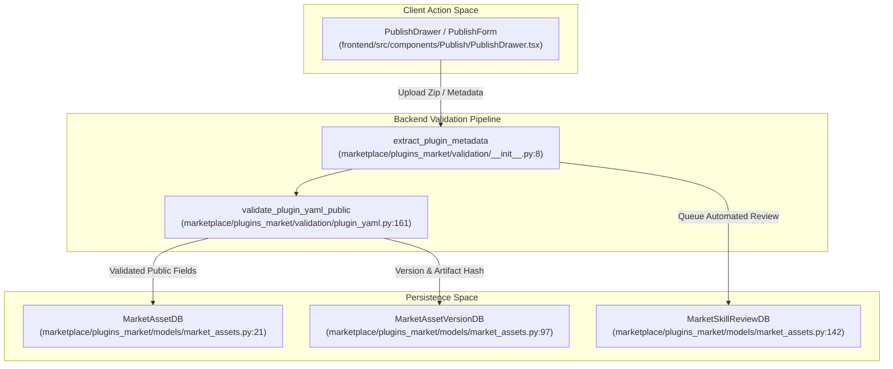

Sources: `marketplace/plugins_market/validation/__init__.py:1-10`, `marketplace/plugins_market/validation/plugin_yaml.py:140-202`, `marketplace/plugins_market/models/market_assets.py:21-122`, `frontend/src/components/Publish/PublishDrawer.tsx:1-103`

---

# Page: Marketplace Backend (plugins_market)

# Marketplace Backend (plugins_market)

<details>
<summary>Relevant source files</summary>

The following files were used as context for generating this wiki page:

- [marketplace/main.py](marketplace/main.py)
- [marketplace/plugins_market/repositories/market_assets_repository.py](marketplace/plugins_market/repositories/market_assets_repository.py)
- [marketplace/plugins_market/retrieval/daily_rebuild.py](marketplace/plugins_market/retrieval/daily_rebuild.py)
- [marketplace/plugins_market/retrieval/index_manager.py](marketplace/plugins_market/retrieval/index_manager.py)
- [marketplace/plugins_market/retrieval/search.py](marketplace/plugins_market/retrieval/search.py)
- [marketplace/plugins_market/routers/plugin.py](marketplace/plugins_market/routers/plugin.py)
- [marketplace/plugins_market/routers/register.py](marketplace/plugins_market/routers/register.py)
- [marketplace/plugins_market/schemas/plugin.py](marketplace/plugins_market/schemas/plugin.py)
- [marketplace/plugins_market/services/plugin.py](marketplace/plugins_market/services/plugin.py)
- [marketplace/plugins_market/tests/test_agent_asset_retrieval.py](marketplace/plugins_market/tests/test_agent_asset_retrieval.py)
- [marketplace/retrieval/indexing/scanners/__init__.py](marketplace/retrieval/indexing/scanners/__init__.py)
- [marketplace/retrieval/indexing/scanners/base.py](marketplace/retrieval/indexing/scanners/base.py)
- [marketplace/retrieval/indexing/workflows/artifacts.py](marketplace/retrieval/indexing/workflows/artifacts.py)
- [marketplace/retrieval/indexing/workflows/index_builder.py](marketplace/retrieval/indexing/workflows/index_builder.py)

</details>


## Purpose and Scope

The `plugins_market` package is the core FastAPI-based backend service for openJiuwen Agentic Hub (SkillHub). It manages the end-to-end lifecycle of marketplace assets—including skills, swarm skills, agent plugins, templates, MCP connectors, and RESTful APIs. It provides robust capabilities for asset publishing, package validation, access control, repository synchronization, and search integration.

As a parent page, this section offers a high-level overview of the marketplace backend architecture, modules, and workflows. For detailed technical specifications, data models, validation pipelines, infrastructure components, and test suites, refer to the respective child pages linked below.

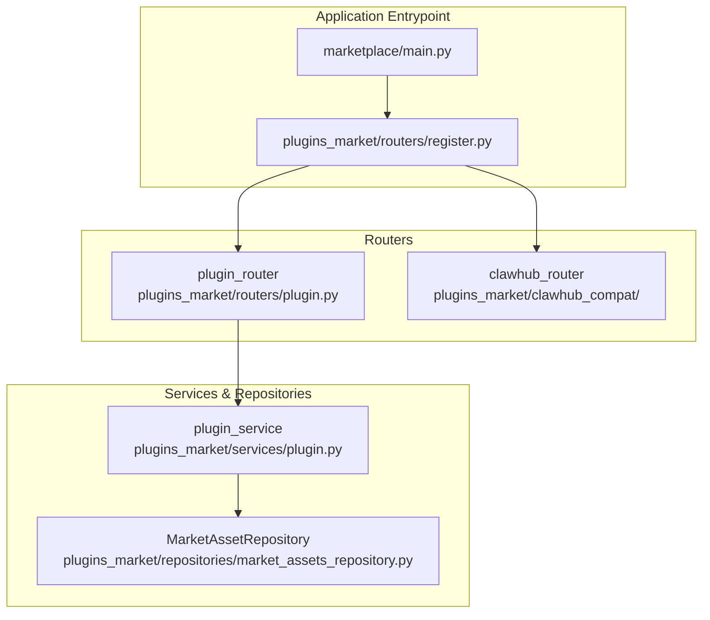
Sources: [marketplace/main.py:35-55](), [marketplace/plugins_market/routers/register.py:17-48](), [marketplace/plugins_market/routers/plugin.py:135-136](), [marketplace/plugins_market/services/plugin.py:3-122](), [marketplace/plugins_market/repositories/market_assets_repository.py:13-31]()

---

## 2.1 Plugin APIs and Services

The marketplace backend exposes comprehensive REST APIs for publishing, listing, downloading, deleting, and moderating assets. These endpoints are anchored in `plugins_market/routers/plugin.py` [marketplace/plugins_market/routers/plugin.py:135-136]() and supported by business logic residing in `plugins_market/services/plugin.py` [marketplace/plugins_market/services/plugin.py:3-122]() along with database repositories (`MarketAssetRepository`, `MarketAssetVersionRepository`) [marketplace/plugins_market/repositories/market_assets_repository.py:13-31]().

For deep technical details on data models, incremental DDL versioning, package validation pipelines, import bundling, and moderation review engines, see [Plugin APIs and Services](#2.1).

Sources: [marketplace/plugins_market/routers/plugin.py:135-136](), [marketplace/plugins_market/services/plugin.py:3-122](), [marketplace/plugins_market/repositories/market_assets_repository.py:13-31]()

---

## 2.2 Auth, Access Control and Groups

Security, identity verification, and permissions are managed across multiple layers. Authentication supports multiple OAuth providers (GitCode, GitHub, AgentOS) with session handling and token parsing. Fine-grained authorization relies on `ViewerContext` (`plugins_market/core/viewer_context.py`), group Access Control Lists (ACLs), membership grants, and administrative roles.

For details on OAuth integration flows, session states, `ViewerContext` evaluation, and group permissions, see [Auth, Access Control and Groups](#2.2).

Sources: [marketplace/plugins_market/routers/plugin.py:36-42](), [marketplace/plugins_market/services/plugin.py:57-57]()

---

## 2.3 Platform Infrastructure (core/)

The `plugins_market/core/` package forms the shared utility foundation for the marketplace backend. It encapsulates configuration management via `settings` (`plugins_market/core/config.py`), structured logging (`plugins_market/core/logging.py`), request ID tracing (`RequestIDMiddleware`), rate limiting (`RateLimitMiddleware`), object storage integration (`S3StorageClient`), caching with Redis, KMS security, and error taxonomies (`BusinessError`, `PublishError`).

For details on configuration parameters, error definitions, storage backends, and middleware pipelines, see [Platform Infrastructure (core/)](#2.3).

Sources: [marketplace/main.py:39-48](), [marketplace/plugins_market/core/config.py:1-9](), [marketplace/plugins_market/core/s3_storage_client.py:1-60]()

---

## 2.4 Git Sync, GitHub Integration and ClawHub Compatibility

To support decentralized asset ingestion and developer toolchains, the marketplace includes robust background synchronization routines. These handle Git source repositories (`git_sources`), skill extraction with path safety validation, GitHub watch/star proxying, and complete ClawHub CLI compatibility routing and fingerprinting.

For details on background git sync workers, path safety checks, and CLI compatibility endpoints, see [Git Sync, GitHub Integration and ClawHub Compatibility](#2.4).

Sources: [marketplace/plugins_market/routers/register.py:6-34](), [marketplace/plugins_market/services/git_skill_sync.py:1-127]()

---

## 2.5 Backend Testing

Comprehensive automated test suites for the marketplace backend reside in `plugins_market/tests/`. These tests cover database fixtures, moderation workflows, version download permissions, rate limit middleware behavior, and retrieval diagnostics using `pytest`.

For details on test fixtures, test case organization, and execution commands, see [Backend Testing](#2.5).

Sources: [marketplace/plugins_market/tests/test_agent_asset_retrieval.py:1-43]()

---

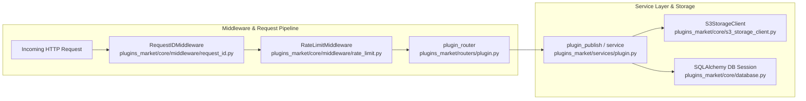
Sources: [marketplace/main.py:47-48](), [marketplace/plugins_market/routers/plugin.py:135-136](), [marketplace/plugins_market/services/plugin.py:3-122](), [marketplace/plugins_market/core/s3_storage_client.py:1-60]()

---

# Page: Plugin APIs and Services

# Plugin APIs and Services

<details>
<summary>Relevant source files</summary>

The following files were used as context for generating this wiki page:

- [marketplace/plugins_market/repositories/__init__.py](marketplace/plugins_market/repositories/__init__.py)
- [marketplace/plugins_market/repositories/market_assets_repository.py](marketplace/plugins_market/repositories/market_assets_repository.py)
- [marketplace/plugins_market/routers/interaction.py](marketplace/plugins_market/routers/interaction.py)
- [marketplace/plugins_market/routers/plugin.py](marketplace/plugins_market/routers/plugin.py)
- [marketplace/plugins_market/schemas/plugin.py](marketplace/plugins_market/schemas/plugin.py)
- [marketplace/plugins_market/services/plugin.py](marketplace/plugins_market/services/plugin.py)

</details>


## Purpose and Scope
This section provides a high-level overview of the marketplace backend APIs, service layer orchestration, data repositories, and schemas governing asset lifecycle management in openJiuwen Agentic Hub (`skillhub`). The plugin subsystem handles publishing, listing, downloading, deleting, and moderating diverse asset types including skills, swarm skills, agent plugins, templates, and MCP connectors.

For granular implementation details, refer to the child pages:
- [Data Model and SQL Schema](#2.1.1)
- [Package Validation Pipeline](#2.1.2)
- [Import and Publish Wrapping](#2.1.3)
- [Moderation and Skill Review](#2.1.4)

---

## Architectural Overview of the Plugin Subsystem

The plugin backend is built around a standard layered architecture using FastAPI routers, business logic services, and SQLAlchemy repositories. Incoming HTTP requests are intercepted by `plugin_router` [marketplace/plugins_market/routers/plugin.py:135-136] and delegated to transaction-aware service functions in `plugins_market.services` [marketplace/plugins_market/services/plugin.py:3-122], which interact with database repositories such as `MarketAssetRepository` [marketplace/plugins_market/repositories/market_assets_repository.py:10] for persistence.

### Component Interaction Flow

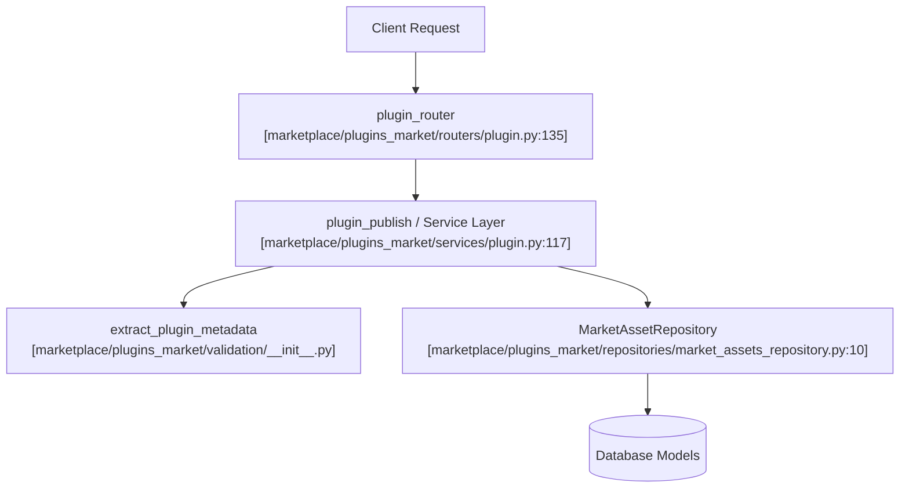
*Sources: [marketplace/plugins_market/routers/plugin.py:135-136](), [marketplace/plugins_market/services/plugin.py:117](), [marketplace/plugins_market/repositories/market_assets_repository.py:10]()*

---

## Core API Endpoints and Routers

The plugin API exposes several groups of operations defined in `plugins_market/routers/plugin.py`:

- **Publishing & Import**: Endpoints for uploading plugin packages, validating metadata, and executing single or bulk imports (`SkillImportBundle`, `PluginPublishForm`) [marketplace/plugins_market/schemas/plugin.py:26-97].
- **Listing & Search**: Filterable list queries (`PluginListQuery`) supporting pagination, tag filtering (`parse_tag_filter`) [marketplace/plugins_market/repositories/market_assets_repository.py:72], and visibility rules.
- **Download & Files**: Retrieval of version-specific metadata, signed storage URLs (`PluginTemplatePresignData`), and file trees (`VersionFilesData`) [marketplace/plugins_market/schemas/plugin.py:156-195].
- **Deletion**: Soft or hard deletion of asset versions (`PluginVersionDeleteData`, `AssetVersionDeleteData`) [marketplace/plugins_market/schemas/plugin.py:172-187].
- **Moderation**: Administrative review endpoints (`SkillModerationRequest`, `SkillModerationResult`) [marketplace/plugins_market/schemas/plugin.py:101-103] for approving or rejecting submitted assets.

### End-to-End Request Routing to Code Entities

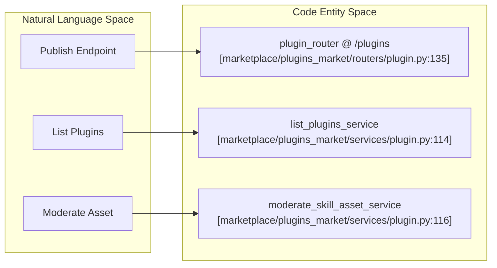
*Sources: [marketplace/plugins_market/routers/plugin.py:135](), [marketplace/plugins_market/services/plugin.py:114-116]()*

---

## Service Layer and Repository Abstraction

The service layer orchestrates business transactions, conflict resolution, version checks, and asynchronous review scheduling. Key responsibilities include:
- **Conflict Handling**: Managing version collisions, force-publish overrides, and deduplication flags (`PluginPublishResult.deduplicated`) [marketplace/plugins_market/schemas/plugin.py:85].
- **Audit Logging**: Recording critical events such as moderation decisions via `audit_log` [marketplace/plugins_market/services/plugin.py:28].
- **Repositories**: `MarketAssetRepository`, `MarketAssetVersionRepository`, and `MarketSkillReviewRepository` encapsulate all raw SQLAlchemy queries, handling complex filters for pending moderation queues and group skill grants [marketplace/plugins_market/repositories/__init__.py:10-14].

Sources: [marketplace/plugins_market/services/plugin.py:3-122](), [marketplace/plugins_market/repositories/market_assets_repository.py:10-19]()

---

## Schemas and Data Transfer Objects

Pydantic schemas in `plugins_market/schemas/plugin.py` define the contracts for API request validation and response serialization. Key structures include:
- `AssetCreate` & `AssetVersionCreate`: Internal models for mapping parsed package descriptors to database records [marketplace/plugins_market/schemas/plugin.py:40-68].
- `PluginListItem` & `PluginVersionDetail`: Detailed metadata schemas returned to frontend consumers [marketplace/plugins_market/schemas/plugin.py:75-221].
- `SkillImportResponse` & `AssetImportResponse`: Aggregated result containers for bulk operations [marketplace/plugins_market/schemas/plugin.py:123-150].

Sources: [marketplace/plugins_market/schemas/plugin.py:1-223]()

---

## Related Child Documentation

For deeper exploration into specific subsystems, consult the corresponding child pages:
- **Data Model and SQL Schema**: [Data Model and SQL Schema](#2.1.1)
- **Package Validation Pipeline**: [Package Validation Pipeline](#2.1.2)
- **Import and Publish Wrapping**: [Import and Publish Wrapping](#2.1.3)
- **Moderation and Skill Review**: [Moderation and Skill Review](#2.1.4)

---

# Page: Data Model and SQL Schema

# Data Model and SQL Schema

<details>
<summary>Relevant source files</summary>

The following files were used as context for generating this wiki page:

- [marketplace/plugins_market/models/git_sources.py](marketplace/plugins_market/models/git_sources.py)
- [marketplace/plugins_market/models/market_assets.py](marketplace/plugins_market/models/market_assets.py)
- [marketplace/plugins_market/validation/__init__.py](marketplace/plugins_market/validation/__init__.py)
- [marketplace/plugins_market/validation/base.py](marketplace/plugins_market/validation/base.py)
- [marketplace/plugins_market/validation/constants.py](marketplace/plugins_market/validation/constants.py)
- [marketplace/plugins_market/validation/plugin_yaml.py](marketplace/plugins_market/validation/plugin_yaml.py)
- [marketplace/plugins_market/validation/types/__init__.py](marketplace/plugins_market/validation/types/__init__.py)
- [sql/baseline/openjiuwen_market/DDL/audit_logs.sql](sql/baseline/openjiuwen_market/DDL/audit_logs.sql)
- [sql/baseline/openjiuwen_market/DDL/market_asset_interactions.sql](sql/baseline/openjiuwen_market/DDL/market_asset_interactions.sql)
- [sql/baseline/openjiuwen_market/DDL/market_asset_versions.sql](sql/baseline/openjiuwen_market/DDL/market_asset_versions.sql)
- [sql/baseline/openjiuwen_market/DDL/market_assets.sql](sql/baseline/openjiuwen_market/DDL/market_assets.sql)
- [sql/baseline/openjiuwen_market/DDL/plugin_fetch_records.sql](sql/baseline/openjiuwen_market/DDL/plugin_fetch_records.sql)
- [sql/baseline/openjiuwen_market/DDL/site_notifications.sql](sql/baseline/openjiuwen_market/DDL/site_notifications.sql)
- [sql/baseline/openjiuwen_market/DML/.gitkeep](sql/baseline/openjiuwen_market/DML/.gitkeep)
- [sql/incremental/v0.0.2.B001/openjiuwen_market/DDL/git_sources.sql](sql/incremental/v0.0.2.B001/openjiuwen_market/DDL/git_sources.sql)
- [sql/rollback/v0.0.2.B001/openjiuwen_market/DDL/git_sources_rollback.sql](sql/rollback/v0.0.2.B001/openjiuwen_market/DDL/git_sources_rollback.sql)

</details>


## Purpose and Scope
This document specifies the database schema, SQLAlchemy Object-Relational Mapping (ORM) models, and DDL versioning strategy for the `plugins_market` backend service in SkillHub. It covers the primary relational tables (`market_assets`, `market_asset_versions`, `market_asset_interactions`, `audit_logs`, and `git_sources`), their indices, unique constraints, and the baseline/incremental migration scripts located in the `sql/` directory.

Sources: `marketplace/plugins_market/models/market_assets.py:21-171()`, `marketplace/plugins_market/models/git_sources.py:8-33()`

---

## 1. Core SQLAlchemy Models and Relational Tables

The persistence layer uses SQLAlchemy declarative base models mapped to MySQL/InnoDB tables. 

### `MarketAssetDB` (`market_assets`)
Defines metadata for marketplace items (skills, agent plugins, tools, MCP connectors, templates). It includes aggregation columns computed from versions, moderation flags, and Git synchronization properties.
- **Primary Key:** `asset_id` (String 64) [marketplace/plugins_market/models/market_assets.py:24-24]()
- **Unique Constraint:** `uk_publisher_asset_type_name` on `("publisher_id", "asset_type", "name")` [marketplace/plugins_market/models/market_assets.py:74-79]()
- **Git Integration Properties:** Includes columns for `storage_mode`, `git_source_id`, `resolved_commit_sha`, and `git_sync_payload_sha256` [marketplace/plugins_market/models/market_assets.py:63-71]()

Sources: `marketplace/plugins_market/models/market_assets.py:21-94()`, `sql/baseline/openjiuwen_market/DDL/market_assets.sql:1-42()`

### `MarketAssetVersionDB` (`market_asset_versions`)
Stores individual version iterations for each market asset, including artifact file references and version-level moderation states.
- **Primary Key:** `version_id` (String 64) [marketplace/plugins_market/models/market_assets.py:100-100]()
- **Foreign Key:** `asset_id` references `market_assets.asset_id` [marketplace/plugins_market/models/market_assets.py:101-106]()
- **Unique Constraint:** `uk_asset_version` on `("asset_id", "version")` [marketplace/plugins_market/models/market_assets.py:120-122]()

Sources: `marketplace/plugins_market/models/market_assets.py:97-123()`, `sql/baseline/openjiuwen_market/DDL/market_asset_versions.sql:1-17()`

### `PluginFetchRecordDB` (`plugin_fetch_records`) & `MarketSkillReviewDB` (`market_skill_reviews`)
`PluginFetchRecordDB` records download telemetry with an optimized composite index (`idx_create_time_asset_id`) for aggregation queries [marketplace/plugins_market/models/market_assets.py:125-139](). `MarketSkillReviewDB` tracks automated security and policy evaluation outcomes for specific asset versions [marketplace/plugins_market/models/market_assets.py:142-171]().

Sources: `marketplace/plugins_market/models/market_assets.py:125-171()`, `sql/baseline/openjiuwen_market/DDL/plugin_fetch_records.sql:1-1()`

### `GitSourceDB` (`git_sources`)
Tracks external Git repositories linked by users for automated asset discovery and synchronization.
- **Primary Key:** `id` (String 64) [marketplace/plugins_market/models/git_sources.py:13-13]()
- **Unique Constraint:** `uk_git_source_dedup_key` on `git_source_dedup_key` [marketplace/plugins_market/models/git_sources.py:31-31]()

Sources: `marketplace/plugins_market/models/git_sources.py:8-33()`, `sql/incremental/v0.0.2.B001/openjiuwen_market/DDL/git_sources.sql:7-27()`

---

## 2. Entity-Relationship & Architecture Mapping

The following diagram bridges the natural language conceptual domains of assets, versioning, interactions, audit tracking, and Git integrations to their corresponding SQLAlchemy classes and physical database tables.

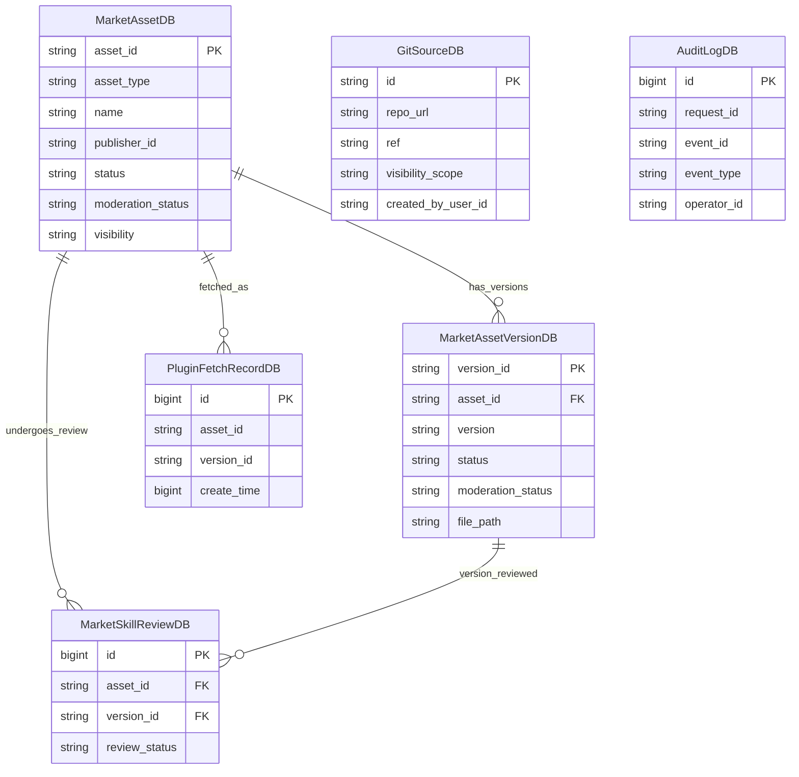
Sources: `marketplace/plugins_market/models/market_assets.py:21-171()`, `marketplace/plugins_market/models/git_sources.py:8-33()`, `sql/baseline/openjiuwen_market/DDL/audit_logs.sql:1-19()`

---

## 3. DDL Versioning, Baseline, Incremental, and Rollback Lifecycle

SkillHub uses a structured DDL migration layout under the `sql/` directory, separating baseline schemas, feature incremental additions, and emergency rollback scripts.

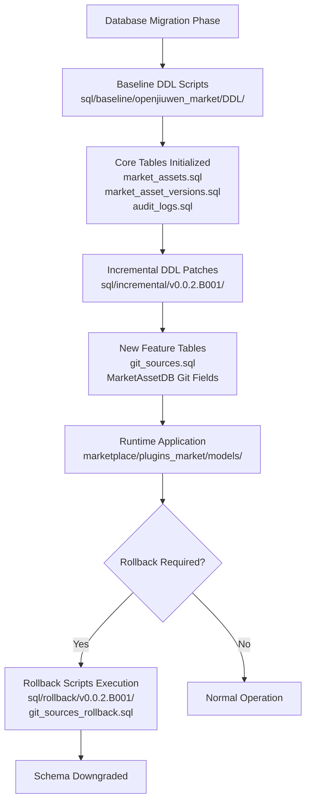
Sources: `sql/baseline/openjiuwen_market/DDL/market_assets.sql:1-42()`, `sql/incremental/v0.0.2.B001/openjiuwen_market/DDL/git_sources.sql:1-27()`, `sql/rollback/v0.0.2.B001/openjiuwen_market/DDL/git_sources_rollback.sql:1-7()`

---

## 4. Schema Summary and Constraints Matrix

| Table Name | SQLAlchemy Model Class | Primary Key | Unique Constraints & Key Indexes | Source File Reference |
| :--- | :--- | :--- | :--- | :--- |
| `market_assets` | `MarketAssetDB` | `asset_id` (VARCHAR 64) | `uk_publisher_asset_type_name` (`publisher_id`, `asset_type`, `name`), `idx_asset_type`, `idx_moderation_status`, `idx_market_assets_visibility` | `marketplace/plugins_market/models/market_assets.py:21-94()` |
| `market_asset_versions` | `MarketAssetVersionDB` | `version_id` (VARCHAR 64) | `uk_asset_version` (`asset_id`, `version`), `ix_market_asset_versions_asset_id` | `marketplace/plugins_market/models/market_assets.py:97-123()` |
| `market_asset_interactions` | *InteractionDB* | `id` (BIGINT AUTO_INC) | `uk_mai_asset_user_action` (`asset_id`, `user_id`, `action_type`), `idx_mai_asset_id` | `sql/baseline/openjiuwen_market/DDL/market_asset_interactions.sql:1-13()` |
| `audit_logs` | *AuditLogDB* | `id` (BIGINT AUTO_INC) | `ix_audit_logs_event_id`, `idx_event_type_action`, `ix_audit_logs_request_id` | `sql/baseline/openjiuwen_market/DDL/audit_logs.sql:1-25()` |
| `git_sources` | `GitSourceDB` | `id` (VARCHAR 64) | `uk_git_source_dedup_key` (`git_source_dedup_key`), `idx_gs_visibility`, `idx_gs_repo_url_canonical` | `marketplace/plugins_market/models/git_sources.py:8-33()` |

Sources: `marketplace/plugins_market/models/market_assets.py:21-123()`, `marketplace/plugins_market/models/git_sources.py:8-33()`, `sql/baseline/openjiuwen_market/DDL/audit_logs.sql:1-25()`, `sql/baseline/openjiuwen_market/DDL/market_asset_interactions.sql:1-13()`

---

# Page: Package Validation Pipeline

# Package Validation Pipeline

<details>
<summary>Relevant source files</summary>

The following files were used as context for generating this wiki page:

- [frontend/src/pages/AssetDetailPage.tsx](frontend/src/pages/AssetDetailPage.tsx)
- [marketplace/plugins_market/services/agent_package_inspect.py](marketplace/plugins_market/services/agent_package_inspect.py)
- [marketplace/plugins_market/tests/test_agent_assets_mvp.py](marketplace/plugins_market/tests/test_agent_assets_mvp.py)
- [marketplace/plugins_market/tests/test_agent_package_inspect.py](marketplace/plugins_market/tests/test_agent_package_inspect.py)
- [marketplace/plugins_market/tests/test_content_security.py](marketplace/plugins_market/tests/test_content_security.py)
- [marketplace/plugins_market/validation/_pipeline.py](marketplace/plugins_market/validation/_pipeline.py)
- [marketplace/plugins_market/validation/content_security.py](marketplace/plugins_market/validation/content_security.py)
- [marketplace/plugins_market/validation/localized_manifest.py](marketplace/plugins_market/validation/localized_manifest.py)
- [marketplace/plugins_market/validation/types/agent_asset.py](marketplace/plugins_market/validation/types/agent_asset.py)
- [marketplace/plugins_market/validation/types/agent_mcp.py](marketplace/plugins_market/validation/types/agent_mcp.py)
- [marketplace/plugins_market/validation/types/mcp_stdio.py](marketplace/plugins_market/validation/types/mcp_stdio.py)
- [marketplace/plugins_market/validation/types/restful_api.py](marketplace/plugins_market/validation/types/restful_api.py)
- [marketplace/plugins_market/validation/types/skill.py](marketplace/plugins_market/validation/types/skill.py)
- [marketplace/plugins_market/validation/types/tools.py](marketplace/plugins_market/validation/types/tools.py)
- [marketplace/plugins_market/validation/zip_utils.py](marketplace/plugins_market/validation/zip_utils.py)

</details>


The Package Validation Pipeline is the core security and integrity verification subsystem of the `plugins_market` backend. It intercepts all plugin, skill, tool, and agent asset uploads before they reach the database or storage layers. The pipeline enforces strict structural layouts, bounded resource consumption, syntactic correctness of manifests (`plugin.yaml` and `manifest.json`), and static content security checks to prevent Remote Code Execution (RCE) and archive-based denial of service attacks (zip bombs).

---

## 1. Pipeline Architecture and Orchestration Flow

The validation pipeline is orchestrated by `extract_plugin_metadata` in `marketplace/plugins_market/validation/_pipeline.py`. It coordinates file opening, zip safety pre-checks, streaming member extraction, manifest parsing, and per-type validation handlers.

### Validation Pipeline Execution Flow

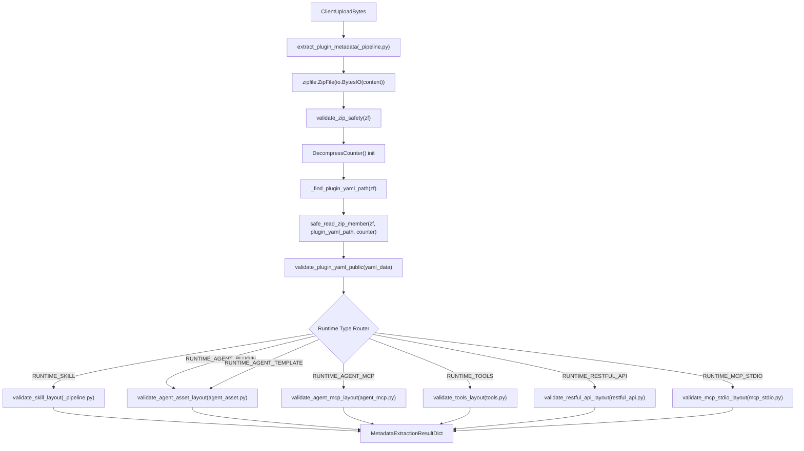

Sources: [marketplace/plugins_market/validation/_pipeline.py:100-184](), [marketplace/plugins_market/validation/zip_utils.py:110-173]()

---

## 2. Two-Layer Zip Safety and Decompression Defense

To protect against path traversal vulnerabilities, malformed headers, symbolic link exploits, and compression bombs, the package validation module implements a robust two-layer defense mechanism located in `marketplace/plugins_market/validation/zip_utils.py`.

### Layer 1: Metadata Pre-Check (`validate_zip_safety`)
Before decompressing or reading any bytes into memory, `validate_zip_safety` inspects the archive headers (`zf.infolist()`) [marketplace/plugins_market/validation/zip_utils.py:110-121]():
- **Entry Count Limit**: Rejects archives where `len(infos) > MAX_ZIP_ENTRIES` [marketplace/plugins_market/validation/zip_utils.py:123-130]().
- **Path Sanity Checks**: `_validate_zip_entry_path` checks for null bytes (`\x00`), absolute paths (`/`), Windows drive letters (e.g., `C:` via `ZIP_ENTRY_WINDOWS_DRIVE_PATTERN`), and path traversal segments (`..`) [marketplace/plugins_market/validation/zip_utils.py:65-96]() [marketplace/plugins_market/validation/zip_utils.py:134]().
- **Symlink Prohibition**: Rejects symbolic links by inspecting Unix file mode bits in `external_attr` (`S_IFMT` mask matching `0xA000`) [marketplace/plugins_market/validation/zip_utils.py:98-104]() [marketplace/plugins_market/validation/zip_utils.py:136-141]().
- **Compression Ratio Advisory**: Computes `info.file_size / info.compress_size`. If it exceeds `MAX_COMPRESSION_RATIO`, it triggers a suspected zip bomb rejection [marketplace/plugins_market/validation/zip_utils.py:146-159]().
- **Declared Total Size**: Ensures the sum of `info.file_size` across all entries does not exceed `MAX_DECOMPRESSED_TOTAL` [marketplace/plugins_market/validation/zip_utils.py:161-171]().

### Layer 2: Streaming Read and Global Decompression Counter (`DecompressCounter`)
Malicious archives can forge header declarations while inflating during extraction. `safe_read_zip_member` avoids `ZipFile.read()` and instead reads members in fixed-size chunks (`ZIP_STREAM_READ_CHUNK_BYTES`) [marketplace/plugins_market/validation/zip_utils.py:178-197](). 
- Every chunk increments `DecompressCounter.total` [marketplace/plugins_market/validation/zip_utils.py:39-59]().
- If the cumulative decompressed bytes exceed `MAX_DECOMPRESSED_TOTAL`, `PublishError` with error code `SKILLHUB_PLUGIN_ZIP_TOO_LARGE` is raised immediately, halting extraction [marketplace/plugins_market/validation/zip_utils.py:46-59]().

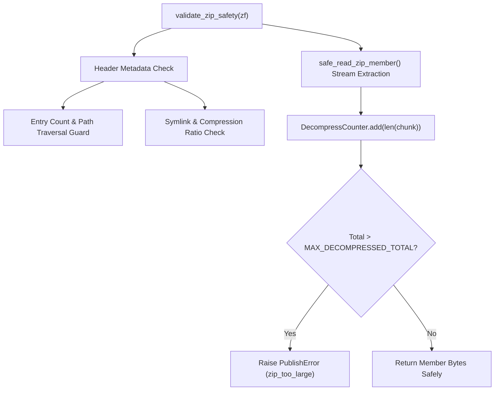

Sources: [marketplace/plugins_market/validation/zip_utils.py:39-197]()

---

## 3. Metadata Extraction and `plugin.yaml` Parsing

The pipeline locates the market-level `plugin.yaml` configuration file by scanning archive entries for the standard layout: exactly two path segments ending in `plugin.yaml` (e.g., `<top>/plugin.yaml`) [marketplace/plugins_market/validation/_pipeline.py:56-72]().

1. **Byte Limit & Yaml Validation**: `safe_read_zip_member` reads `plugin.yaml` under the global streaming counter, and `validate_plugin_yaml_bytes` ensures text encoding safety [marketplace/plugins_market/validation/_pipeline.py:149-151]().
2. **Bounded Safe Loading**: `safe_load_yaml` parses the YAML text using a secure YAML loader context to prevent arbitrary object instantiation [marketplace/plugins_market/validation/_pipeline.py:155]().
3. **Public Fields Validation**: `validate_plugin_yaml_public` extracts and validates top-level attributes such as `name`, `version`, `display_name`, `description`, `tags`, and `runtime` [marketplace/plugins_market/validation/_pipeline.py:163]().

Sources: [marketplace/plugins_market/validation/_pipeline.py:56-164]()

---

## 4. Per-Type Layout and Content Validators

Depending on the `runtime_type` declared in `plugin.yaml` (or derived from inner manifests), the pipeline delegates validation to specific type validators.

| Runtime Type | Validator Module / Function | Key Structural & Content Checks |
| :--- | :--- | :--- |
| `skill` | `marketplace/plugins_market/validation/types/skill.py` :: `validate_skill_layout` | Exactly one non-hidden subdirectory matching `plugin.yaml` `name`; contains `SKILL.md` with validated frontmatter; optional `icon.png` and `README.md` [marketplace/plugins_market/validation/types/skill.py:43-98]() |
| `agent-plugin` / `agent-template` | `marketplace/plugins_market/validation/types/agent_asset.py` :: `validate_agent_asset_layout` | Validates outer/inner wrap, `manifest.json` schema, relative path traversal guards, declared skills, tools, and subagent directories [marketplace/plugins_market/validation/types/agent_asset.py:31-194]() |
| `agent-mcp` | `marketplace/plugins_market/validation/types/agent_mcp.py` :: `validate_agent_mcp_layout` | Validates JiuwenSwarm MCP package layouts driven by `manifest.json`, remote/stdio integrations, and command parameters [marketplace/plugins_market/validation/types/agent_mcp.py:28-191]() |
| `tools` | `marketplace/plugins_market/validation/types/tools.py` :: `validate_tools_layout` | Validates tool entry definitions and `tools.json` schemas [marketplace/plugins_market/validation/_pipeline.py:40-43]() |
| `restful-api` | `marketplace/plugins_market/validation/types/restful_api.py` :: `validate_restful_api_layout` | Extracts and validates RESTful API contracts and endpoint descriptors [marketplace/plugins_market/validation/_pipeline.py:45-48]() |
| `mcp-stdio` | `marketplace/plugins_market/validation/types/mcp_stdio.py` :: `validate_mcp_stdio_layout` | Validates MCP standard IO transport configurations and argument arrays [marketplace/plugins_market/validation/_pipeline.py:44]() |

Sources: [marketplace/plugins_market/validation/_pipeline.py:35-54](), [marketplace/plugins_market/validation/types/skill.py:43-98]()

---

## 5. Content Security Scanning

Multi-assets (`agent-plugin`, `agent-template`, `agent-mcp`) undergo static content security analysis via `marketplace/plugins_market/validation/content_security.py`. Although uploaded by administrative users, these packages are statically scanned for dangerous command injection patterns and dynamic code execution primitives.

### Security Rules and Pattern Detection
- **Command Injection Patterns**: Detects pipe-to-shell chains (`curl | bash`, `wget | sh`, `Invoke-WebRequest | iex`) and shell-wrapped download commands in `mcp.json` (`command`, `args`, `env`, `headers`) or `cli.json` [marketplace/plugins_market/validation/content_security.py:40-53]() [marketplace/plugins_market/validation/content_security.py:127-167]().
- **Script File Inspections**: Scans files matching script extensions (`.py`, `.sh`, `.js`, `.ts`, etc.) for dangerous calls [marketplace/plugins_market/validation/content_security.py:23-35]() [marketplace/plugins_market/validation/content_security.py:170-194]():
  - **Python**: `exec()`, `os.system()`, `os.popen()`, and `subprocess` calls with `shell=True` [marketplace/plugins_market/validation/content_security.py:63-81]().
  - **JavaScript/TypeScript**: `eval()`, `new Function()`, and `child_process.exec()` / `execSync()` [marketplace/plugins_market/validation/content_security.py:55-61]() [marketplace/plugins_market/validation/content_security.py:82-85]().
  - *Distinction Logic*: Carefully avoids flagging benign usages such as JavaScript regular expression execution (`RegExp.exec`) or process spawning (`child_process.spawn` used by bundled dependencies) by employing precise token boundary regexes [marketplace/plugins_market/content_security.py:58-61]() [marketplace/plugins_market/tests/test_content_security.py:7-34]().

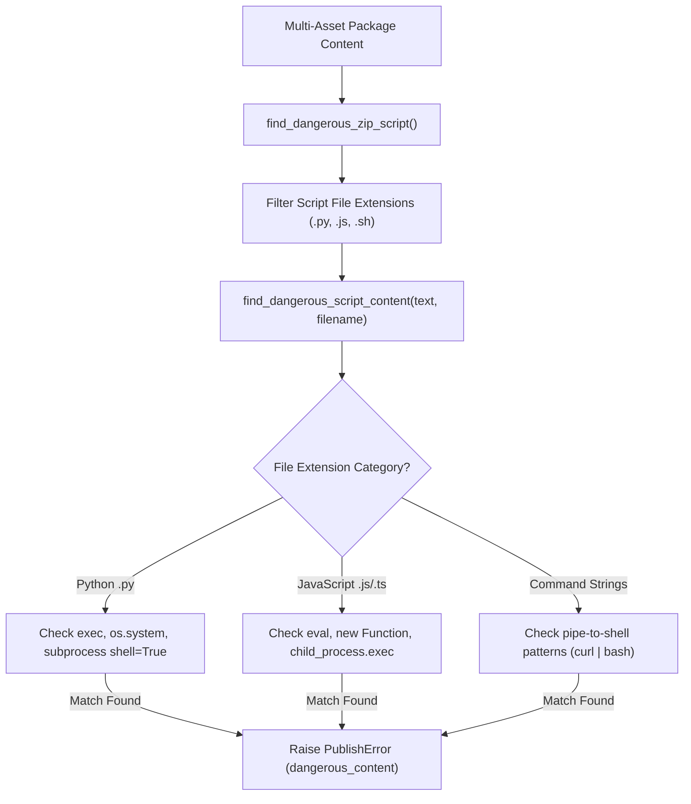

Sources: [marketplace/plugins_market/validation/content_security.py:16-206](), [marketplace/plugins_market/tests/test_content_security.py:1-34]()

---

# Page: Import and Publish Wrapping

# Import and Publish Wrapping

<details>
<summary>Relevant source files</summary>

The following files were used as context for generating this wiki page:

- [frontend/src/components/Common/VersionFileTree.tsx](frontend/src/components/Common/VersionFileTree.tsx)
- [frontend/src/utils/detectAgentPublishZip.ts](frontend/src/utils/detectAgentPublishZip.ts)
- [frontend/src/utils/versionFileTree.ts](frontend/src/utils/versionFileTree.ts)
- [marketplace/plugins_market/imports/__init__.py](marketplace/plugins_market/imports/__init__.py)
- [marketplace/plugins_market/imports/publish_wrap.py](marketplace/plugins_market/imports/publish_wrap.py)
- [marketplace/plugins_market/imports/skill_entries.py](marketplace/plugins_market/imports/skill_entries.py)
- [marketplace/plugins_market/tests/test_multi_asset_import.py](marketplace/plugins_market/tests/test_multi_asset_import.py)
- [marketplace/plugins_market/tests/test_publish_wrap.py](marketplace/plugins_market/tests/test_publish_wrap.py)

</details>


## Purpose and Scope

The import and publish wrapping subsystem (`plugins_market.imports`) normalizes user uploads—ranging from bare native agent structures (containing `manifest.json` or `SKILL.md`) to form-overridden marketplace assets—into the standard market ZIP layout governed by `plugin.yaml` [marketplace/plugins_market/imports/publish_wrap.py:1-4](). This page covers the end-to-end transformation pipeline including `prepare_publish_zip_content`, native asset detection and staging rules in `skill_entries.py`, bundle safe extraction protocols, bulk import workflows, and deterministic archive generation.

Sources:
- `marketplace/plugins_market/imports/publish_wrap.py:1-4`
- `marketplace/plugins_market/imports/skill_entries.py:1-12`

---

## Normalization and Packaging Architecture (`prepare_publish_zip_content`)

When users publish assets via the frontend or CLI, uploads may consist of raw, un-wrapped directories (`PublishMetadataOverrides`) or pre-wrapped marketplace archives [marketplace/plugins_market/imports/publish_wrap.py:47-65](). The core entry point `prepare_publish_zip_content` intercepts raw zip bytes, validates their internal entry types (`runtime` skills, `agent-plugin`, `agent-template`, or `agent-mcp`), and restructures them into a standard deterministic layout [marketplace/plugins_market/imports/publish_wrap.py:28-42]() [marketplace/plugins_market/imports/publish_wrap.py:53-64]().

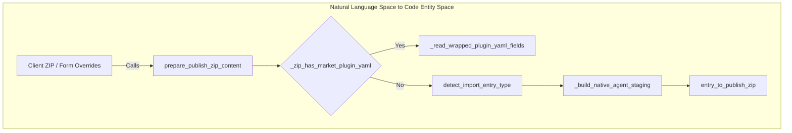

Sources:
- `marketplace/plugins_market/imports/publish_wrap.py:28-65`
- `marketplace/plugins_market/imports/skill_entries.py:141-198`

---

## Native Plugin Layout Detection and Wrapping Rules (`skill_entries.py`)

Asset packages lacking a root `plugin.yaml` undergo structural introspection. `skill_entries.py` identifies whether an entry represents a raw team skill (`SKILL.md` with frontmatter `kind: swarm-skill`), a native agent plugin (`manifest.json` with `package_type: plugin`), an agent template (`package_type: agent_template`), or an agent MCP integration (`package_type: mcp`) [marketplace/plugins_market/imports/skill_entries.py:109-174]().

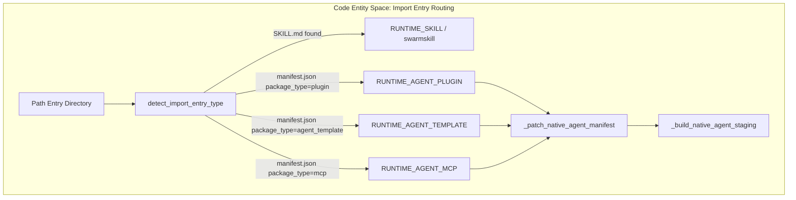

- **Metadata Precedence**: For native agent plugins, `manifest.json` fields (`id`, `version`, `display_name`, `description`, `tags`) establish the canonical baseline [marketplace/plugins_market/imports/skill_entries.py:153-174](). Explicit publish form overrides are validated against schema boundaries before mutating the manifest [marketplace/plugins_market/tests/test_multi_asset_import.py:152-158]().
- **Version Enforcement**: If an agent MCP or plugin zip omits a version declaration across both manifests and form overrides, `PublishError` is raised [marketplace/plugins_market/tests/test_publish_wrap.py:100-109]().

Sources:
- `marketplace/plugins_market/imports/skill_entries.py:109-198`
- `marketplace/plugins_market/tests/test_publish_wrap.py:100-143`
- `marketplace/plugins_market/tests/test_multi_asset_import.py:152-158`

---

## Bundle Safe Extraction and Bulk Import Endpoints

Admin bulk import endpoints process multi-asset bundles using secure extraction routines (`skill_import_extract_zip_to_dir`) to protect the host against path traversal attacks (`Zip Slip`), symlink exploits, and decompression bombs [marketplace/plugins_market/imports/publish_wrap.py:17-18](). 

- **Directory Placeholder Resolution**: `_mkdir_parents_replace_file_placeholders` prevents POSIX `FileExistsError` anomalies by checking if intermediate parent paths exist as regular zip-placeholder files prior to directory creation [marketplace/plugins_market/imports/publish_wrap.py:132-153]().
- **Multi-Asset Bulk Import**: Functions such as `skill_import_from_bundle` and `skill_import_from_staging_dir` iterate through extracted workspace entries, normalizing each via `entry_to_publish_zip` to construct transactionally consistent batch imports [marketplace/plugins_market/tests/test_multi_asset_import.py:18-21]().

Sources:
- `marketplace/plugins_market/imports/publish_wrap.py:17-18`, `132-183`
- `marketplace/plugins_market/imports/skill_import_service.py` (referenced via `__init__.py`)

---

## Deterministic Zip Generation & Metadata Overrides

To guarantee stable cryptographic hashes (such as content identifiers or artifact CIDs) for published assets, generated marketplace ZIPs follow deterministic packaging rules:
1. **File Ordering**: Members are written to the archive in lexicographical path order.
2. **Timestamps**: Archive entry timestamps are normalized to a fixed epoch to eliminate non-deterministic binary diffs.
3. **Compression**: Deflate compression (`zipfile.ZIP_DEFLATED`) is applied consistently [marketplace/plugins_market/tests/test_publish_wrap.py:33-38]().

Client-side inspection utilities (`inspectAgentPublishZip` in `detectAgentPublishZip.ts`) mirror these layout rules in the React application, parsing `plugin.yaml` or `manifest.json` asynchronously using `JSZip` to pre-populate metadata fields inside `PublishDrawer` before final upload transmission [frontend/src/utils/detectAgentPublishZip.ts:128-181]().

Sources:
- `marketplace/plugins_market/tests/test_publish_wrap.py:33-38`
- `frontend/src/utils/detectAgentPublishZip.ts:128-181`

---

# Page: Moderation and Skill Review

# Moderation and Skill Review

<details>
<summary>Relevant source files</summary>

The following files were used as context for generating this wiki page:

- [CHANGELOG.md](CHANGELOG.md)
- [docs/zh/SUMMARY.md](docs/zh/SUMMARY.md)
- [frontend/src/components/Publish/PublishDrawer.tsx](frontend/src/components/Publish/PublishDrawer.tsx)
- [frontend/src/utils/pluginType.ts](frontend/src/utils/pluginType.ts)
- [frontend/src/utils/publishFieldLabels.ts](frontend/src/utils/publishFieldLabels.ts)
- [marketplace/plugins_market/core/audit_events.py](marketplace/plugins_market/core/audit_events.py)
- [marketplace/plugins_market/core/audit_failed.py](marketplace/plugins_market/core/audit_failed.py)
- [marketplace/plugins_market/core/middleware/request_id.py](marketplace/plugins_market/core/middleware/request_id.py)
- [marketplace/plugins_market/core/moderation.py](marketplace/plugins_market/core/moderation.py)
- [marketplace/plugins_market/routers/audit.py](marketplace/plugins_market/routers/audit.py)
- [marketplace/plugins_market/services/skill_review.py](marketplace/plugins_market/services/skill_review.py)
- [marketplace/plugins_market/tests/test_m3_agent_moderation_flow.py](marketplace/plugins_market/tests/test_m3_agent_moderation_flow.py)
- [marketplace/plugins_market/tests/test_moderated_market_asset_types.py](marketplace/plugins_market/tests/test_moderated_market_asset_types.py)
- [marketplace/skill_review/engines/rule/patterns.py](marketplace/skill_review/engines/rule/patterns.py)
- [marketplace/skill_review/runtime/package_access/zip_access.py](marketplace/skill_review/runtime/package_access/zip_access.py)
- [marketplace/skill_review/tests/test_zip_package_access.py](marketplace/skill_review/tests/test_zip_package_access.py)
- [marketplace/tests/test_skill_review_incremental_checks.py](marketplace/tests/test_skill_review_incremental_checks.py)

</details>


## Purpose and Scope
This page documents the moderation subsystem, pending review queues, self-moderation policies, automated `skill_review` engines, and package safety validation pipelines within the openJiuwen Agentic Hub (`plugins_market` and `skill_review`). It details how assets transition through publishing states, how admin workflows handle moderation queues, and how automated rule and semantic engines inspect package contents for security risks.

---

## 1. Moderation Statuses and Asset Taxonomies

The marketplace enforces publishing gates and visibility controls using a structured moderation status taxonomy and classification set. 

### Moderation Status Constants
Assets and versions maintain explicit moderation statuses defined in `marketplace/plugins_market/core/moderation.py`:
* `MODERATION_PENDING` (`"PENDING"`): Awaiting administrator or automated review [marketplace/plugins_market/core/moderation.py:14]().
* `MODERATION_APPROVED` (`"APPROVED"`): Passed inspection and publicly visible [marketplace/plugins_market/core/moderation.py:15]() [marketplace/plugins_market/core/moderation.py:76-77]().
* `MODERATION_REJECTED` (`"REJECTED"`): Blocked due to policy or security violations [marketplace/plugins_market/core/moderation.py:16]().

### Asset Type Classifications
Plugin types are grouped into categories determining whether they undergo moderation:
* `SKILL_LIKE_PLUGIN_TYPES`: Includes `skill` and `swarmskill` (normalized from `teamskills`) [marketplace/plugins_market/core/moderation.py:18-19]() [marketplace/plugins_market/core/moderation.py:35-37]().
* `AGENT_ASSET_PLUGIN_TYPES`: Wrapped agent types including `agent-plugin`, `agent-template`, and `agent-mcp` [marketplace/plugins_market/core/moderation.py:22-28]().
* `MODERATED_MARKET_ASSET_TYPES`: The union of skill-like types and agent asset types. Legacy types like `tools`, `mcp-stdio`, and `restful-api` bypass moderation and are auto-approved [marketplace/plugins_market/core/moderation.py:30-32]().

```mermaid
graph TD
    subcode["Code Entity Space: marketplace/plugins_market/core/moderation.py"]
        A["MODERATION_PENDING"] --> B["MarketAssetDB.moderation_status"]
        C["MODERATION_APPROVED"] --> B
        D["MODERATION_REJECTED"] --> B
        E["SKILL_LIKE_PLUGIN_TYPES"] --> H["is_moderated_market_asset_type()"]
        F["AGENT_ASSET_PLUGIN_TYPES"] --> H
        G["MODERATED_MARKET_ASSET_TYPES"] --> H
    end

    subgraph "Natural Language Space"
        NL1["Pending Review State"] --> NL2["Public Visibility Gate"]
        NL3["Skill & Agent Types"] --> NL4["Mandatory Inspection"]
    end

    NL1 -.-> A
    NL2 -.-> C
    NL3 -.-> E
    NL4 -.-> H

    classDef default fill:#fff,stroke:#000,stroke-width:1px;
```
*Title: Moderation Constants to Code Mapping*

Sources:
- `marketplace/plugins_market/core/moderation.py:1-78`

---

## 2. Pending Queue and Self-Moderation Rules

### Self-Moderation and Admin Bypass
When a user publishes an asset, `_moderation_for_publish()` evaluates whether the publisher requires moderation or qualifies for auto-approval. System administrators (`is_system_admin=True`) automatically bypass moderation, receiving `MODERATION_APPROVED` status. Regular users publishing moderated asset types (`agent-plugin`, `agent-mcp`, `agent-template`, `skill`, `swarmskill`) are placed into `MODERATION_PENDING` [marketplace/plugins_market/tests/test_moderated_market_asset_types.py:76-95]().

### Pending Queue Queries
The moderation backend exposes pending queues via `MarketAssetRepository.list_plugins()`. For agent assets, pending queues operate at the version row level rather than solely relying on the main asset record. This ensures that when an approved asset publishes a new version requiring review, it correctly appears in the pending review queue [marketplace/plugins_market/tests/test_m3_agent_moderation_flow.py:144-189]().

```mermaid
graph TD
    subcode["Code Entity Space: _moderation_for_publish() & MarketAssetRepository"]
        P1["Publish Request"] --> P2{"is_system_admin?"}
        P2 -- Yes --> P3["MODERATION_APPROVED"]
        P2 -- No --> P4{"is_moderated_market_asset_type()"}
        P4 -- Yes --> P5["MODERATION_PENDING"]
        P4 -- No --> P3
        P5 --> P6["MarketAssetRepository.list_plugins()"]
        P6 --> P7["Version-Level Filtering"]
    end

    subgraph "Natural Language Space"
        N1["User Submission"] --> N2["Admin Auto-Pass Check"]
        N2 --> N3["Queue Assignment"]
    end

    N1 -.-> P1
    N2 -.-> P2
    N3 -.-> P5

    classDef default fill:#fff,stroke:#000,stroke-width:1px;
```
*Title: Publish Moderation Decision Flow*

Sources:
- `marketplace/plugins_market/core/moderation.py:35-78`
- `marketplace/plugins_market/tests/test_moderated_market_asset_types.py:76-95`
- `marketplace/plugins_market/tests/test_m3_agent_moderation_flow.py:144-189`

---

## 3. Automated Skill Review Engine and Package Safety

Automated skill inspection is handled by the `skill_review` subsystem, combining static pattern matching with safe archive extraction.

### Package Extraction and Zip Safety
Before executing checks, ZIP archives are processed by `ZipPackageAccess` and `_index_safe_entries()` in `marketplace/skill_review/runtime/package_access/zip_access.py`. This mechanism prevents path traversal attacks, absolute paths, and zip bomb collisions by raising a `ZipPathCollisionError` if multiple archive members normalize to identical paths [marketplace/skill_review/runtime/package_access/zip_access.py:15-33]().

### Rule Engine Patterns
The static analysis engine executes built-in regex rules defined in `DEFAULT_RULE_PATTERNS` (`marketplace/skill_review/engines/rule/patterns.py`) [marketplace/skill_review/engines/rule/patterns.py:47-181](). Each `RulePattern` specifies:
* `pattern_id`: Unique identifier (e.g. `private_key_block`, `well_known_api_key`, `prompt_override`) [marketplace/skill_review/engines/rule/patterns.py:12]().
* `regex`: Compiled case-insensitive regular expression [marketplace/skill_review/engines/rule/patterns.py:13]().
* `section_key`: Target domain section (`data_asset`, `instruction`, `execution`) [marketplace/skill_review/engines/rule/patterns.py:14]().
* `severity` & `confidence`: Risk weighting parameters (`high`, `medium`, `low`) [marketplace/skill_review/engines/rule/patterns.py:16-17]().

```mermaid
graph TD
    subcode["Code Entity Space: skill_review Engine & Zip Access"]
        Z1["ZipFile Archive"] --> Z2["_index_safe_entries()"]
        Z2 -->|Collision Detected| Z3["ZipPathCollisionError"]
        Z2 -->|Safe Path| Z4["ZipPackageAccess.list_files()"]
        Z4 --> R1["DEFAULT_RULE_PATTERNS"]
        R1 --> R2["compile_rule()"]
        R2 --> R3["RulePattern Matching"]
    end

    subgraph "Natural Language Space"
        NL1["Upload Archive"] --> NL2["Path Safety Validation"]
        NL2 --> NL3["Static Content Scanning"]
    end

    NL1 -.-> Z1
    NL2 -.-> Z2
    NL3 -.-> R3

    classDef default fill:#fff,stroke:#000,stroke-width:1px;
```
*Title: Package Access and Rule Review Pipeline*

Sources:
- `marketplace/skill_review/runtime/package_access/zip_access.py:15-78`
- `marketplace/skill_review/engines/rule/patterns.py:10-181`

---

## 4. Review Lifecycle, Reports, and Writeback

### Review Statuses and Execution Lifecycle
Review tasks are managed through `initialize_skill_review()` and run asynchronously or synchronously depending on the trigger [marketplace/plugins_market/services/skill_review.py:115-160](). The review record progresses through distinct lifecycle states:
* `REVIEW_STATUS_QUEUED` (`"queued"`): Initialized and waiting for execution [marketplace/plugins_market/services/skill_review.py:50]() [marketplace/plugins_market/services/skill_review.py:136]().
* `REVIEW_STATUS_RUNNING` (`"running"`): Actively executing rule and semantic checkers [marketplace/plugins_market/services/skill_review.py:51]().
* `REVIEW_STATUS_PASSED` (`"passed"`): Successfully evaluated with no blocking violations [marketplace/plugins_market/services/skill_review.py:52]().
* `REVIEW_STATUS_FAILED` (`"failed"`): Review completed but identified security findings exceeding thresholds [marketplace/plugins_market/services/skill_review.py:53]().
* `REVIEW_STATUS_SYSTEM_FAILED` (`"system_failed"`): Execution aborted due to timeouts, service unavailability, or invalid model responses [marketplace/plugins_market/services/skill_review.py:54]() [marketplace/plugins_market/services/skill_review.py:163-180]().

### Semantic Review and Fallbacks
Optional AI semantic review layers run after static rule checks, producing semantic summaries and risk conclusions [marketplace/plugins_market/services/skill_review.py:188-197]. If the AI service encounters failures, fallback messages such as `USER_FACING_SEMANTIC_FALLBACK` ensure the publishing pipeline remains functional based on static rules [marketplace/plugins_market/services/skill_review.py:69-72]().

### Writeback Resilience and Audit Logging
Database writebacks for review reports implement exponential backoff with jitter (`REVIEW_WRITEBACK_RETRY_BACKOFF_SECONDS`) to handle MySQL concurrent lock conflicts (`RETRYABLE_REVIEW_WRITEBACK_MYSQL_ERROR_CODES` like `1205` and `1213`) [marketplace/plugins_market/services/skill_review.py:61-63](). All moderation and review state changes emit structured audit records via `audit_log` and notify administrators through `notify_review_admins_new_skill_submission` [marketplace/plugins_market/routers/audit.py:23-36]() [marketplace/plugins_market/services/skill_review.py:12-42]().

Sources:
- `marketplace/plugins_market/services/skill_review.py:39-197`
- `marketplace/plugins_market/routers/audit.py:23-56`

---

# Page: Auth, Access Control and Groups

# Auth, Access Control and Groups

<details>
<summary>Relevant source files</summary>

The following files were used as context for generating this wiki page:

- [frontend/src/api/auth.ts](frontend/src/api/auth.ts)
- [frontend/src/api/client.ts](frontend/src/api/client.ts)
- [frontend/src/auth/gitcodeStorage.ts](frontend/src/auth/gitcodeStorage.ts)
- [marketplace/plugins_market/core/audit.py](marketplace/plugins_market/core/audit.py)
- [marketplace/plugins_market/core/auth.py](marketplace/plugins_market/core/auth.py)
- [marketplace/plugins_market/core/oauth_user_profile.py](marketplace/plugins_market/core/oauth_user_profile.py)
- [marketplace/plugins_market/core/viewer_context.py](marketplace/plugins_market/core/viewer_context.py)
- [marketplace/plugins_market/repositories/groups_repository.py](marketplace/plugins_market/repositories/groups_repository.py)
- [marketplace/plugins_market/retrieval/groups.py](marketplace/plugins_market/retrieval/groups.py)
- [marketplace/plugins_market/routers/oauth_provider.py](marketplace/plugins_market/routers/oauth_provider.py)
- [marketplace/plugins_market/services/groups.py](marketplace/plugins_market/services/groups.py)
- [marketplace/plugins_market/services/site_notifications.py](marketplace/plugins_market/services/site_notifications.py)
- [marketplace/plugins_market/tests/test_download_rejected_skill.py](marketplace/plugins_market/tests/test_download_rejected_skill.py)
- [marketplace/plugins_market/tests/test_group_acl.py](marketplace/plugins_market/tests/test_group_acl.py)
- [marketplace/plugins_market/tests/test_group_management.py](marketplace/plugins_market/tests/test_group_management.py)
- [marketplace/plugins_market/tests/test_oauth_redirect_to.py](marketplace/plugins_market/tests/test_oauth_redirect_to.py)
- [marketplace/plugins_market/tests/test_skill_moderation_audit_history.py](marketplace/plugins_market/tests/test_skill_moderation_audit_history.py)
- [marketplace/plugins_market/tests/test_validation_error_serialization.py](marketplace/plugins_market/tests/test_validation_error_serialization.py)

</details>


This document outlines the authentication mechanics, session management, `ViewerContext` access control rules, group-based ACL grants, and administrative role hierarchies within the openJiuwen Agentic Hub (`plugins_market`).

---

## 1. Authentication & OAuth Subsystem

The marketplace backend supports dual authentication pathways: external OAuth2 identity providers (GitCode, GitHub, and AgentOS) and internal system administrative tokens. The request-level identity is captured in the `AuthContext` dataclass [plugins_market/core/auth.py:54-62]().

### Authentication Flow and Headers
Clients must provide exactly one authentication mechanism via HTTP headers. Passing both `Authorization` and `X-System-Token` triggers an `auth_headers_conflict` error [plugins_market/core/auth.py:142-148](). Omitting both raises an `auth_header_missing` exception [plugins_market/core/auth.py:149-155]().

1. **Bearer Token (`Authorization: Bearer <token>`)**: 
   - The provider is determined by the `X-OAuth-Provider` header (defaulting to `gitcode`) [plugins_market/core/auth.py:181]().
   - Validated via `normalize_oauth_provider_header` [plugins_market/core/auth.py:86-97]() and fetched through `fetch_oauth_user_profile` [plugins_market/core/oauth_user_profile.py]().
2. **System Token (`X-System-Token`)**:
   - Compared against the decrypted `SYSTEM_ADMIN_TOKEN` secret resolved by `_resolved_system_admin_token` [plugins_market/core/auth.py:76-78]().
   - Grants full administrative privileges (`is_admin=True`, `is_market_moderation_admin=True`) [plugins_market/core/auth.py:165-172]().

```mermaid
graph TD
    subgraph "Request Entry"
    A[IncomingRequest] --> B{Check Headers}
    end

    subgraph "Token Dispatch - plugins_market/core/auth.py"
    B -->|Has Authorization: Bearer| C[require_auth]
    B -->|Has X-System-Token| D[require_auth]
    C --> E[normalize_oauth_provider_header]
    E --> F[get_oauth_user_id_and_login]
    D --> G["_resolved_system_admin_token"]
    end

    subgraph "Identity Resolution"
    F --> H["AuthContext(is_admin=False, acting_user_id)"]
    G --> I["AuthContext(is_admin=True, system_admin_user)"]
    end

    subgraph "OAuth Router - plugins_market/routers/oauth_provider.py"
    J["/oauth/{provider}/authorize"] --> K["OAuthProvider(gitcode/github/agentos)"]
    K --> L["_validate_loopback_redirect"]
    end

    Sources: plugins_market/core/auth.py:54-187, plugins_market/routers/oauth_provider.py:45-101
```

---

## 2. ViewerContext and Skill Asset Visibility

Public browsing, asset downloads, and version filtering rely on the `ViewerContext` class [plugins_market/core/viewer_context.py:24-123](). `ViewerContext` determines whether an unauthenticated or authenticated user can view or download specific assets and versions based on visibility flags, publisher ownership, moderation states, and group access control lists (ACLs).

### Visibility Evaluation Rules
- **Public Assets**: Visible to all users unless moderated or explicitly restricted.
- **Private Assets**: Restricted to the publisher (`owner`), system administrators (`admin`), or members granted access through group ACLs (`group`) [plugins_market/core/viewer_context.py:47-57]().
- **Moderation Gate**: Rejected versions (`MODERATION_REJECTED`) are blocked from download for all user contexts, including administrators [plugins_market/core/viewer_context.py:99-118]().

```mermaid
graph TD
    subgraph "ViewerContext Evaluation - plugins_market/core/viewer_context.py"
    A[can_view_skill_asset] --> B{skill_asset_access_source}
    B -->|admin or owner| C[Access Granted]
    B -->|group ACL| D{Is Moderation Approved?}
    B -->|none| E{Is Asset Private?}
    
    D -->|Yes| C
    D -->|No| F[Access Denied]
    
    E -->|Yes| F
    E -->|No| G{Check Public Visibility}
    G -->|Visible| C
    G -->|Hidden| F
    end

    subgraph "Download Control"
    H[can_download_skill_version_row] --> I{Is Version Rejected?}
    I -->|Yes| F
    I -->|No| J[Delegate to can_view_skill_asset]
    end

    Sources: plugins_market/core/viewer_context.py:24-123
```

---

## 3. Groups, Memberships and Group ACL Grants

Group-based authorization allows assets to be shared securely with specific organizational teams without making them globally public. This subsystem is managed via `GroupAccessContext` [plugins_market/services/groups.py:119-196]() and associated repositories [plugins_market/repositories/groups_repository.py]().

### Group Roles and Grant Workflows
- **Roles**: Members hold either `owner` (`GROUP_ROLE_OWNER`) or `member` (`GROUP_ROLE_MEMBER`) privileges [plugins_market/repositories/groups_repository.py:25-26]().
- **Visibility**: Groups can be `listed` (`GROUP_VISIBILITY_LISTED`) for open discovery or `private` (`GROUP_VISIBILITY_PRIVATE`) [plugins_market/repositories/groups_repository.py:27-28]().
- **Skill Grants**: Asset publishers can request skill grants to groups (`grant_skill_to_group_service`). Group owners or privileged administrators must approve pending grants before group members inherit read/download permissions [plugins_market/services/groups.py:172-194]().

```mermaid
graph TD
    subgraph "Group Management - plugins_market/services/groups.py"
    A[GroupAccessContext.for_group] --> B{Check Membership & Role}
    B -->|Owner / Privileged| C[can_manage = True]
    B -->|Member| D[can_view = True]
    B -->|None| E{Is Group Listed?}
    E -->|Yes| D
    E -->|No| F[Access Forbidden]
    end

    subgraph "Group ACL Grants - marketplace/plugins_market/repositories/groups_repository.py"
    G[MarketGroupSkillGrantRepository] --> H{user_has_asset_grant}
    H -->|Grant Active & Approved| I[ViewerContext inherits group ACL]
    end

    Sources: plugins_market/services/groups.py:119-196, plugins_market/repositories/groups_repository.py:25-73
```

---

## 4. Audit Logging and Security Notifications

Security-relevant actions, moderation decisions, and group modifications generate immutable audit logs and site notifications.

### Audit Service Isolation
The `AuditService` records system events using independent database transactions (`SessionLocal`) [plugins_market/core/audit.py:151-194](). This ensures that audit logging failures do not roll back business transactions, and audit entries are reliably committed even when parent requests fail.

### Site Notifications
Structured templates (`NOTIFICATION_TEMPLATE_ADMIN_PENDING`, `NOTIFICATION_TEMPLATE_GROUP_SKILL_GRANT_APPROVED`, etc.) are dispatched to user inboxes and automatically trimmed to a maximum of 10 unread items per inbox key [plugins_market/services/site_notifications.py:31-125]().

```mermaid
graph TD
    subgraph "Audit and Notification Pipeline"
    A[Business Action Triggered] --> B[AuditService.log]
    B --> C["Open Independent SessionLocal"]
    C --> D["Commit AuditLog to audit_logs Table"]
    
    A --> E[SiteNotification Service]
    E --> F["inbox_key_for_user_id / login"]
    F --> G["insert_and_trim (Max 10 per inbox)"]
    end

    Sources: plugins_market/core/audit.py:99-204, plugins_market/services/site_notifications.py:31-125
```

---

# Page: Platform Infrastructure (core/)

# Platform Infrastructure (core/)

<details>
<summary>Relevant source files</summary>

The following files were used as context for generating this wiki page:

- [.dockerignore](.dockerignore)
- [.env.example](.env.example)
- [.gitignore](.gitignore)
- [docker/Dockerfile.skillhub-backend](docker/Dockerfile.skillhub-backend)
- [frontend/src/components/Common/NotificationBell.tsx](frontend/src/components/Common/NotificationBell.tsx)
- [marketplace/common/__init__.py](marketplace/common/__init__.py)
- [marketplace/common/huaweicloud/__init__.py](marketplace/common/huaweicloud/__init__.py)
- [marketplace/common/huaweicloud/huaweicloud_iam.py](marketplace/common/huaweicloud/huaweicloud_iam.py)
- [marketplace/common/huaweicloud/huaweicloud_kms.py](marketplace/common/huaweicloud/huaweicloud_kms.py)
- [marketplace/common/security/__init__.py](marketplace/common/security/__init__.py)
- [marketplace/common/security/security_utils.py](marketplace/common/security/security_utils.py)
- [marketplace/plugins_market/core/cache.py](marketplace/plugins_market/core/cache.py)
- [marketplace/plugins_market/core/config.py](marketplace/plugins_market/core/config.py)
- [marketplace/plugins_market/core/database.py](marketplace/plugins_market/core/database.py)
- [marketplace/plugins_market/core/interface_log.py](marketplace/plugins_market/core/interface_log.py)
- [marketplace/plugins_market/core/logging.py](marketplace/plugins_market/core/logging.py)
- [marketplace/plugins_market/core/middleware/rate_limit.py](marketplace/plugins_market/core/middleware/rate_limit.py)
- [marketplace/plugins_market/core/oauth_session_store.py](marketplace/plugins_market/core/oauth_session_store.py)
- [marketplace/plugins_market/core/playground_state.py](marketplace/plugins_market/core/playground_state.py)
- [marketplace/plugins_market/core/rate_limit.py](marketplace/plugins_market/core/rate_limit.py)
- [marketplace/plugins_market/core/redis_client.py](marketplace/plugins_market/core/redis_client.py)
- [marketplace/plugins_market/core/s3_storage_client.py](marketplace/plugins_market/core/s3_storage_client.py)
- [marketplace/plugins_market/models/site_notifications.py](marketplace/plugins_market/models/site_notifications.py)
- [marketplace/plugins_market/schemas/site_notifications.py](marketplace/plugins_market/schemas/site_notifications.py)
- [marketplace/plugins_market/tests/test_logging_rotation.py](marketplace/plugins_market/tests/test_logging_rotation.py)
- [marketplace/plugins_market/tests/test_rate_limit_middleware.py](marketplace/plugins_market/tests/test_rate_limit_middleware.py)
- [marketplace/plugins_market/tests/test_rate_limit_policy.py](marketplace/plugins_market/tests/test_rate_limit_policy.py)
- [marketplace/pyproject.toml](marketplace/pyproject.toml)
- [skill-runner/llm_proxy.py](skill-runner/llm_proxy.py)

</details>


## Purpose and Scope
The `plugins_market/core/` package and its companion modules under `common/` provide the foundational infrastructure for the openJiuwen SkillHub marketplace backend. This includes type-safe configuration binding via Pydantic, structured logging with context propagation, Redis caching and session management, S3/OBS object storage abstraction, KMS-backed security and decryption, sliding-window rate limiting middleware, and database connectivity.

Sources: [`marketplace/plugins_market/core/config.py:1-162`](), [`marketplace/plugins_market/core/logging.py:1-176`](), [`marketplace/plugins_market/core/s3_storage_client.py:1-141`]()

---

## 1. Configuration Management (`core/config.py`)
The backend configuration is managed by the `Settings` class which inherits from `pydantic_settings.BaseSettings`. It loads settings from environment variables with fallback aliases (`AliasChoices`) to support both `MARKET_*` and legacy prefixes.

Key configuration domains managed by `Settings` include:
* **Server Bindings**: `host`, `port`, `debug`, and `reload` (`marketplace/plugins_market/core/config.py:31-42`)[].
* **Database**: `db_url` and integration parameters (`marketplace/plugins_market/core/config.py:43-44`)[].
* **Authentication & Reviewers**: `system_admin_token`, `review_admin_usernames`, `review_admin_usernames_file`, and OAuth client parameters for GitCode, GitHub, and AgentOS (`marketplace/plugins_market/core/config.py:45-155`)[].
* **Caching & Storage**: Redis connection parameters (`redis_host`, `redis_port`, `redis_db`, `cache_backend`), and S3/OBS storage variables (`storage_type`, `market_bucket_name`, `market_s3_endpoint`) (`marketplace/plugins_market/core/config.py:76-90`, `.env.example:106-135`)[].

Sources: [`marketplace/plugins_market/core/config.py:1-162`](), `[.env.example:1-162]()`

---

## 2. Structured Logging and Request Context (`core/logging.py`)
Logging is implemented using `structlog` combined with Python's standard `logging` library. Context variables such as `request_id`, `operation_id`, `operation_type`, `parent_operation_id`, and `duration_ms` are injected into log records via `_inject_context_fields()` and `_ContextEnrichmentFilter` (`marketplace/plugins_market/core/logging.py:84-112, 162-166`)[].

```mermaid
graph TD
    subcode["Code Entity Space"]
        A["Request Entry"] --> B["core/context.py:get_request_id()"]
        B --> C["core/logging.py:_inject_context_fields()"]
        C --> D["core/logging.py:PlainLogFormatter"]
        D --> E["interface.log / Standard Stream"]
    end

    title "Logging and Context Propagation Flow"

    Sources: [`marketplace/plugins_market/core/logging.py:15-176`](), [`marketplace/plugins_market/core/interface_log.py:1-113`]()
```

Interface-level access logging is handled separately by `core/interface_log.py`, which sanitizes sensitive attributes (passwords, tokens, phone numbers, ID cards) using regular expression masking (`marketplace/plugins_market/core/interface_log.py:20-45`) and records structured audit lines (`marketplace/plugins_market/core/interface_log.py:67-94`)[]:

Sources: [`marketplace/plugins_market/core/logging.py:1-213`](), [`marketplace/plugins_market/core/interface_log.py:1-113`]()

---

## 3. Caching, Redis and OAuth Session Store (`core/cache.py`, `core/oauth_session_store.py`)
The platform supports an optional Redis backend for distributed caching, counters, and OAuth session states. If `redis_host` is empty, it degrades gracefully to process-local memory.

* **Cache Client (`core/cache.py`)**: Provides primitives such as `cache_get()`, `cache_set()`, `cache_set_nx()` (used for download deduplication gates), `cache_incr()`, and `cache_set_persistent()` (`marketplace/plugins_market/core/cache.py:48-130`)[].
* **OAuth Session Store (`core/oauth_session_store.py`)**: Defines the `OAuthStrStore` protocol implemented by `_MemoryOAuthStore` (using an `OrderedDict` with FIFO eviction up to `_MEMORY_STORE_MAX_ENTRIES`) and `_RedisOAuthStore` (supporting `GETDEL` for safe one-time token redemption) (`marketplace/plugins_market/core/oauth_session_store.py:24-138`)[].

Sources: [`marketplace/plugins_market/core/cache.py:1-131`](), [`marketplace/plugins_market/core/oauth_session_store.py:1-185`]()

---

## 4. Object Storage: MinIO and Huawei Cloud OBS (`core/s3_storage_client.py`)
The storage subsystem uses an S3-compatible abstraction layer defined in `S3StorageConfig` and `S3StorageClient` (`marketplace/plugins_market/core/s3_storage_client.py:80-184`)[]:

```mermaid
graph TD
    subcode["Code Entity Space"]
        CFG["core/s3_storage_client.py:S3StorageConfig"] -->|storage_type=OBS| IAM["common/huaweicloud/huaweicloud_iam.py:HuaweiCloudIAM"]
        IAM -->|Temporary STS AK/SK| CLI["core/s3_storage_client.py:S3StorageClient"]
        CFG -->|storage_type=MinIO| CLI_STATIC["core/s3_storage_client.py:_static_s3_client"]
        CLI -->|boto3 client| BUCKET["S3 / OBS Bucket"]
    end

    title "Storage Credential Resolution Architecture"

    Sources: [`marketplace/plugins_market/core/s3_storage_client.py:80-184`](), [`marketplace/common/huaweicloud/huaweicloud_iam.py:22-192`]()
```

* **Credentials Modes**: 
  * `static`: Uses permanent access keys (`MARKET_S3_ACCESS_KEY`, `MARKET_S3_SECRET_KEY`) decrypted via `SecurityUtils`.
  * `dynamic` (OBS only): Automatically queries Huawei Cloud IAM via `HuaweiCloudIAM` to acquire temporary security tokens (`securitytokens`) with configurable TTL (`MARKET_S3_STS_DURATION_SECONDS`) (`marketplace/plugins_market/core/s3_storage_client.py:107-116, 154-173`)[]:

Sources: [`marketplace/plugins_market/core/s3_storage_client.py:1-184`](), [`marketplace/common/huaweicloud/huaweicloud_iam.py:1-192`]()

---

## 5. Security, KMS and Secret Management (`common/security/security_utils.py`)
Sensitive configurations such as database passwords, Redis credentials, and S3 secret keys are decrypted at runtime through `SecurityUtils` (`marketplace/common/security/security_utils.py`), which interacts with Huawei Cloud KMS (`common/huaweicloud/huaweicloud_kms.py`) when master keys (`SERVER_AES_MASTER_KEY` or KMS key IDs) are configured.

Sources: [marketplace/common/security/security_utils.py](), [marketplace/common/huaweicloud/huaweicloud_kms.py]()

---

## 6. Rate Limiting and Sliding Windows (`core/rate_limit.py`)
Rate limiting is implemented via a process-local sliding window counter (`SlidingWindowRateLimiter`) combined with a rule evaluation engine (`RateLimitPolicy`) (`marketplace/plugins_market/core/rate_limit.py:32-161`)[]:

* **Tiers & Scopes**: Rate limit tiers (`RateLimitTier`) enforce limits per client IP (`scope="ip"`) or per authenticated user (`scope="user"`).
* **Policy Matching**: `RateLimitPolicy.match()` evaluates HTTP methods and path patterns using `fnmatch` with trailing slash normalization (`marketplace/plugins_market/core/rate_limit.py:165-181`)[]:

Sources: [`marketplace/plugins_market/core/rate_limit.py:1-198`](), [`marketplace/plugins_market/core/middleware/rate_limit.py:1-150`]()

---

## 7. Error Taxonomy and Notifications
* **Error Taxonomy**: The marketplace defines standard error codes and return structures (e.g., standard HTTP status codes combined with application error return codes) logged via `InterfaceLogParams` (`marketplace/plugins_market/core/interface_log.py:53-65`)[]:
* **Site Notifications**: Managed via database models (`marketplace/plugins_market/models/site_notifications.py`) and schemas (`marketplace/plugins_market/schemas/site_notifications.py`), rendered on the frontend through notification components (e.g., `NotificationBell.tsx`) to alert users regarding review outcomes, system announcements, and asset updates.

Sources: [`marketplace/plugins_market/core/interface_log.py:53-65`](), [`marketplace/plugins_market/models/site_notifications.py:1-50`](), [`marketplace/plugins_market/schemas/site_notifications.py:1-50`]()

---

# Page: Git Sync, GitHub Integration and ClawHub Compatibility

# Git Sync, GitHub Integration and ClawHub Compatibility

<details>
<summary>Relevant source files</summary>

The following files were used as context for generating this wiki page:

- [cli/cli_core/utils.py](cli/cli_core/utils.py)
- [frontend/src/api/githubWatch.ts](frontend/src/api/githubWatch.ts)
- [frontend/src/api/index.ts](frontend/src/api/index.ts)
- [frontend/src/components/Common/WatchOpenJiuwenRepos.tsx](frontend/src/components/Common/WatchOpenJiuwenRepos.tsx)
- [frontend/src/components/Profile/GitSourcesPanel.tsx](frontend/src/components/Profile/GitSourcesPanel.tsx)
- [frontend/src/index.css](frontend/src/index.css)
- [frontend/src/utils/formatSkillVersionLabel.ts](frontend/src/utils/formatSkillVersionLabel.ts)
- [frontend/src/utils/gitSkillsSubpathSafety.ts](frontend/src/utils/gitSkillsSubpathSafety.ts)
- [frontend/src/utils/gitUrlSafety.ts](frontend/src/utils/gitUrlSafety.ts)
- [marketplace/plugins_market/clawhub_compat/fingerprint.py](marketplace/plugins_market/clawhub_compat/fingerprint.py)
- [marketplace/plugins_market/clawhub_compat/router.py](marketplace/plugins_market/clawhub_compat/router.py)
- [marketplace/plugins_market/core/github_proxy.py](marketplace/plugins_market/core/github_proxy.py)
- [marketplace/plugins_market/repositories/git_source_repository.py](marketplace/plugins_market/repositories/git_source_repository.py)
- [marketplace/plugins_market/routers/github_watch.py](marketplace/plugins_market/routers/github_watch.py)
- [marketplace/plugins_market/services/git_skill_sync.py](marketplace/plugins_market/services/git_skill_sync.py)
- [marketplace/plugins_market/utils/git_ref_rules.py](marketplace/plugins_market/utils/git_ref_rules.py)
- [marketplace/plugins_market/utils/git_skills_subpath_rules.py](marketplace/plugins_market/utils/git_skills_subpath_rules.py)

</details>


### Purpose and Scope
This section details the backend and frontend subsystems responsible for external repository integrations in the openJiuwen Agentic Hub (SkillHub). This covers automated Git source synchronization for batch skill publishing, strict URL and subpath safety validation to prevent server-side request forgery (SSRF) and path traversal, GitHub repository watch/star proxying with sliding-window rate limiting, and the ClawHub CLI compatibility routing and asset fingerprinting layer.

---

### 1. Git Source Repositories and Skill Sync Engine
The Git skill synchronization service (`marketplace/plugins_market/services/git_skill_sync.py`) enables users to register external Git repositories and batch-import or synchronize skills into the marketplace [marketplace/plugins_market/services/git_skill_sync.py:1-4](). 

Key architectural components and workflow steps include:
* **Background Sync Coordination**: Synchronizations execute asynchronously via background runner functions such as `_start_background_git_sync_operation` and `run_git_source_sync_background`, updating status fields and logging telemetry with operation contexts [marketplace/plugins_market/services/git_skill_sync.py:153-186]()
* **Ref and Subpath Constraints**: Branches or tags are validated using ref rules [marketplace/plugins_market/services/git_skill_sync.py:66](), while target skill paths are verified via subpath assertion checks [marketplace/plugins_market/services/git_skill_sync.py:67]().
* **Normalization and Staging**: Cloned bundles are processed, scanned, and ingested utilizing standard skill entry resolvers [marketplace/plugins_market/imports/skill_entries.py:48-53]() and staging import handlers [marketplace/plugins_market/imports/skill_import_service.py:54]().

```mermaid
graph TD
  UserReq["User Request"] --> API["Git Source API Router"]
  API --> Sched["_start_background_git_sync_operation"]
  Sched --> BgRunner["run_git_source_sync_background"]
  BgRunner --> Clone["Git Clone / Fetch"]
  Clone --> ValURL["assert_public_git_clone_url"]
  Clone --> ValSub["assert_git_skills_subpath"]
  ValURL --> Importer["skill_import_from_staging_dir"]
  ValSub --> Importer
  Importer --> DB["GitSourceDB & MarketAssetDB"]

  subgraph "Code Entity Space"
    Sched
    BgRunner
    ValURL
    ValSub
    Importer
  end

  classDef default fill:#fff,stroke:#333,stroke-width:1px;
```
*Sources: marketplace/plugins_market/services/git_skill_sync.py:1-194*, `marketplace/plugins_market/imports/skill_entries.py:48-53`, `marketplace/plugins_market/imports/skill_import_service.py:54`

---

### 2. Subpath and URL Safety Enforcement
To protect the backend infrastructure from malicious repository sources, internal network scanning, and traversal exploits, both the backend Python package and the frontend application enforce strict safety rules.

* **URL Safety**: `marketplace/plugins_market/utils/git_url_safety.py` (paired with frontend `frontend/src/utils/gitUrlSafety.ts`) validates that clone targets use public HTTP/HTTPS protocols and rejects reserved loopback, link-local, or private IP address spaces (e.g., `127.0.0.1`, `10.0.0.0/8`, `192.168.0.0/16`, `localhost`, and cloud metadata endpoints) [frontend/src/utils/gitUrlSafety.ts:5-75]().
* **Subpath Safety**: `marketplace/plugins_market/utils/git_skills_subpath_rules.py` (and frontend `frontend/src/utils/gitSkillsSubpathSafety.ts`) ensures that user-supplied subpaths do not contain absolute paths, Windows drive identifiers, null bytes, or directory traversal components (`..`) [marketplace/plugins_market/utils/git_skills_subpath_rules.py:15-53]().

```mermaid
graph LR
  Input["Raw URL / Subpath Input"] --> CheckURL["isPublicGitCloneUrl"]
  Input --> CheckSub["isValidGitSkillsSubpath"]
  CheckURL --> SafeHost["Block Internal/Private IPs"]
  CheckSub --> SafePath["Reject '..' & Absolute Paths"]
  SafeHost --> Valid["Validated Git Source"]
  SafePath --> Valid

  subgraph "Code Entity Space"
    CheckURL
    CheckSub
    SafeHost
    SafePath
  end

  classDef default fill:#fff,stroke:#333,stroke-width:1px;
```
*Sources: marketplace/plugins_market/utils/git_skills_subpath_rules.py:1-53*, `frontend/src/utils/gitUrlSafety.ts:1-76`, `frontend/src/utils/gitSkillsSubpathSafety.ts:1-28`

---

### 3. GitHub Watch and Star Proxy
The GitHub integration features a dedicated proxy routing layer (`marketplace/plugins_market/routers/github_watch.py` and `marketplace/plugins_market/core/github_proxy.py`) that empowers users to batch-star core openJiuwen repositories under the `openJiuwen-ai` organization [marketplace/plugins_market/routers/github_watch.py:1-70]().

Key mechanisms include:
* **Asynchronous Proxying**: `star_repo` issues authenticated `PUT` requests against `https://api.github.com/user/starred/{owner}/{repo}` using the user's OAuth Bearer token [marketplace/plugins_market/core/github_proxy.py:33-186]().
* **Sliding-Window Rate Limiting**: To prevent hitting GitHub content generation limits (e.g., 80 requests/minute per token), `_user_write_limiter` monitors per-token SHA-256 hash buckets, while `_global_semaphore` caps concurrent outbound requests [marketplace/plugins_market/core/github_proxy.py:44-149]().
* **Retry and Backoff**: Upstream `403` responses containing `Retry-After` headers trigger automatic fallback sleeping and single-attempt retries [marketplace/plugins_market/core/github_proxy.py:161-174]().

```mermaid
graph TD
  ClientReq["POST /api/v1/github/watch"] --> Router["github_watch.py router"]
  Router --> Task["Async Background Task"]
  Task --> Proxy["_gh_request"]
  Proxy --> CheckLimit["SlidingWindowRateLimiter _user_write_limiter"]
  CheckLimit --> Sem["asyncio.Semaphore _global_semaphore"]
  Sem --> Upstream["httpx.AsyncClient -> api.github.com"]
  Upstream --> Star["star_repo (PUT /user/starred)"]

  subgraph "Code Entity Space"
    Router
    Proxy
    CheckLimit
    Sem
    Star
  end

  classDef default fill:#fff,stroke:#333,stroke-width:1px;
```
*Sources: marketplace/plugins_market/routers/github_watch.py:1-191*, `marketplace/plugins_market/core/github_proxy.py:1-187`

---

### 4. ClawHub CLI Compatibility Router and Fingerprinting
SkillHub exposes a compatibility layer mirroring the ClawHub CLI contract under `/api/v1` (`marketplace/plugins_market/clawhub_compat/router.py`) [marketplace/plugins_market/clawhub_compat/router.py:1-54]().

Core components:
* **Compatibility Router**: Translates native ClawHub search, resolve, inspect, and download requests into marketplace backend service calls (`list_plugins_service`, `get_download_info`) while filtering for skill-like plugin taxonomies [marketplace/plugins_market/clawhub_compat/router.py:45-100]().
* **Fingerprinting**: `marketplace/plugins_market/clawhub_compat/fingerprint.py` computes cryptographic hashes and validates zip member paths securely using `DecompressCounter` and `validate_zip_safety` to prevent zip-bomb vectors during CLI asset inspection [marketplace/plugins_market/clawhub_compat/router.py:21-42]().
* **Rate Limiting & Clamping**: Enforces client IP rate limits (`check_clawhub_compat_rate_limit`) and caps query parameters (such as `--limit` clamping to `CLAWHUB_LIMIT_CAP`) to guarantee predictable upstream performance [marketplace/plugins_market/clawhub_compat/router.py:52-115]().

```mermaid
graph TD
  CLI["ClawHub CLI Request"] --> CompatRouter["clawhub_compat/router.py"]
  CompatRouter --> RateLimit["check_clawhub_compat_rate_limit"]
  RateLimit --> Service["list_plugins_service / get_download_info"]
  Service --> Fingerprint["fingerprint.py: hash_skill_zip"]
  Fingerprint --> ZipSafe["validate_zip_safety & DecompressCounter"]
  ZipSafe --> Response["Formatted CLI Response"]

  subgraph "Code Entity Space"
    CompatRouter
    RateLimit
    Service
    Fingerprint
    ZipSafe
  end

  classDef default fill:#fff,stroke:#333,stroke-width:1px;
```
*Sources: marketplace/plugins_market/clawhub_compat/router.py:1-175*, `marketplace/plugins_market/clawhub_compat/fingerprint.py:1-50`

---

# Page: Backend Testing

# Backend Testing

<details>
<summary>Relevant source files</summary>

The following files were used as context for generating this wiki page:

- [marketplace/plugins_market/tests/conftest.py](marketplace/plugins_market/tests/conftest.py)
- [marketplace/plugins_market/tests/test_download_public_latest.py](marketplace/plugins_market/tests/test_download_public_latest.py)
- [marketplace/plugins_market/tests/test_github_star_repos_config.py](marketplace/plugins_market/tests/test_github_star_repos_config.py)
- [marketplace/plugins_market/tests/test_raw_artifact_overwrite.py](marketplace/plugins_market/tests/test_raw_artifact_overwrite.py)
- [marketplace/plugins_market/tests/test_retrieval_diagnostics.py](marketplace/plugins_market/tests/test_retrieval_diagnostics.py)
- [marketplace/retrieval/retrieval/lexical/bm25.py](marketplace/retrieval/retrieval/lexical/bm25.py)
- [marketplace/retrieval/retrieval/semantic/embedding.py](marketplace/retrieval/retrieval/semantic/embedding.py)

</details>


## Purpose and Scope
This section details the backend testing infrastructure and test suites for the openJiuwen Agentic Hub (SkillHub) marketplace service, residing under `plugins_market/tests/`. The test suite validates critical backend subsystems including authorization rules, package artifact invalidation, retrieval diagnostic logging, and configuration fallbacks. Tests are executed using `pytest` alongside specialized in-memory database and storage mocks.

Sources: `marketplace/plugins_market/tests/conftest.py:1-21` [marketplace/plugins_market/tests/conftest.py:1-20]()

---

## Test Environment and Dependency Stubbing

The lightweight test environment relies on `plugins_market/tests/conftest.py` to intercept and stub heavy optional runtime dependencies—most notably the `skill_review` module and its OpenAI-compatible submodules—before test execution begins.

```mermaid
graph TD
    A["Pytest Initialization"] --> B["plugins_market/tests/conftest.py"]
    B --> C["_ensure_skill_review_stub()"]
    C --> D["sys.modules.setdefault('skill_review', MagicMock())"]
    C --> E["sys.modules.setdefault('skill_review.model.openai_compatible', MagicMock())"]

    sub5["Sources: marketplace/plugins_market/tests/conftest.py:1-21"]
    style sub5 fill:none,stroke:none
```
*Diagram 1: Natural Language Space to Code Entity Space Mapping for Pytest Environment Stubbing*

Sources: `marketplace/plugins_market/tests/conftest.py:1-21` [marketplace/plugins_market/tests/conftest.py:1-20]()

---

## Download Permissions and Version Routing Tests

The module `marketplace/plugins_market/tests/test_download_public_latest.py` validates artifact download routing rules, ensuring that anonymous or ordinary users requesting unversioned downloads receive `public_latest_version` instead of an unpublished pending version [marketplace/plugins_market/tests/test_download_public_latest.py:3-119]().

```mermaid
graph TD
    A["GET /artifacts (version=None)"] --> B["get_download_info()"]
    B --> C{"Viewer Role Check"}
    C -->|ANONYMOUS / ORDINARY_USER| D["Return public_latest_version"]
    C -->|ASSET_OWNER / ADMIN| E["Evaluate requested version parameter"]
    E -->|Version Specified| F["MarketAssetVersionDB lookup"]
    F -->|APPROVED or Owner| G["Generate Presigned S3 URL"]
    F -->|PENDING & Non-Owner| H["Raise PublishError 404"]

    sub2["Sources: marketplace/plugins_market/tests/test_download_public_latest.py:97-148"]
    style sub2 fill:none,stroke:none
```
*Diagram 2: Natural Language Space to Code Entity Space Mapping for Download Permissions*

Key test scenarios covered in `test_download_public_latest.py`:
* `test_unspecified_version_returns_public_latest_not_pending`: Verifies that querying without a version correctly resolves to `1.0.0` rather than a pending `2.0.0` version across different viewer roles [marketplace/plugins_market/tests/test_download_public_latest.py:97-119]().
* `test_owner_can_download_pending_when_version_specified`: Confirms asset owners can explicitly download pending versions [marketplace/plugins_market/tests/test_download_public_latest.py:121-134]().
* `test_ordinary_user_cannot_download_pending_when_version_specified`: Ensures a `404` `PublishError` is raised for unauthorized users [marketplace/plugins_market/tests/test_download_public_latest.py:136-148]().

Sources: `marketplace/plugins_market/tests/test_download_public_latest.py:1-207` [marketplace/plugins_market/tests/test_download_public_latest.py:1-206]()

---

## Raw Artifact Invalidation and Overwrite Tests

The test suite in `marketplace/plugins_market/tests/test_raw_artifact_overwrite.py` utilizes an in-memory S3 storage mock (`_MemoryStorage`) to verify cache invalidation and raw zip reconstruction when source plugins or their permissions payloads are modified [marketplace/plugins_market/tests/test_raw_artifact_overwrite.py:18-129]().

```mermaid
graph TD
    A["_MemoryStorage put_object"] --> B["_ensure_non_cli_raw_artifact"]
    B --> C{"Source SHA256 Match?"}
    C -->|Match| D["Return Cached Raw Key"]
    C -->|Mismatch / Invalidate| E["_invalidate_force_overwrite_raw_artifact"]
    E --> F["Rebuild Raw Zip From Origin"]
    F --> G["Update S3 Metadata and Object"]

    sub3["Sources: marketplace/plugins_market/tests/test_raw_artifact_overwrite.py:76-129"]
    style sub3 fill:none,stroke:none
```

Sources: `marketplace/plugins_market/tests/test_raw_artifact_overwrite.py:1-203` [marketplace/plugins_market/tests/test_raw_artifact_overwrite.py:1-203]()

---

## Retrieval Diagnostics and Logging Tests

The test suite in `marketplace/plugins_market/tests/test_retrieval_diagnostics.py` validates that search scoring thresholds, filter rejection counts, and truncation behaviors are correctly recorded via structured logs without altering retrieval results [marketplace/plugins_market/tests/test_retrieval_diagnostics.py:3-127]().

| Test Function | Target Subsystem / Class | Validated Behavior |
| --- | --- | --- |
| `test_logs_actual_threshold_and_rejected_scores` | `RetrievalLoggingTests.search()` | Ensures embedding/BM25 min-score filtering logs threshold violations and rejected samples properly [marketplace/plugins_market/tests/test_retrieval_diagnostics.py:74-90](). |
| `test_top_k_is_separate_from_score_filtering` | `BM25Finder` / `EmbeddingFinder` | Verifies `top_k` truncation counters remain distinct from score-based filtering removals [marketplace/plugins_market/tests/test_retrieval_diagnostics.py:91-96](). |
| `test_model_error_preserves_fallback` | `FixedEmbedding` / `Retriever` | Checks that embedding model timeouts or runtime errors trigger graceful fallbacks [marketplace/plugins_market/tests/test_retrieval_diagnostics.py:122-126](). |

Sources: `marketplace/plugins_market/tests/test_retrieval_diagnostics.py:1-130` [marketplace/plugins_market/tests/test_retrieval_diagnostics.py:1-129]()

---

## Configuration and Feature Flag Tests

Tests in `marketplace/plugins_market/tests/test_github_star_repos_config.py` check configuration fallback mechanisms for GitHub integration settings such as `github_star_repos` and `github_star_org` [marketplace/plugins_market/tests/test_github_star_repos_config.py:3-34]().

```mermaid
graph TD
    A["_get_star_repo_names()"] --> B{"settings.github_star_repos blank?"}
    B -->|Yes| C["Return DEFAULT_STAR_REPO_NAMES"]
    B -->|No| D["Split comma-separated config string"]
    
    E["_get_watch_org()"] --> F{"settings.github_star_org blank?"}
    F -->|Yes| G["Return DEFAULT_WATCH_ORG"]
    F -->|No| H["Return configured org string"]

    sub4["Sources: marketplace/plugins_market/tests/test_github_star_repos_config.py:17-35"]
    style sub4 fill:none,stroke:none
```

Sources: `marketplace/plugins_market/tests/test_github_star_repos_config.py:1-35` [marketplace/plugins_market/tests/test_github_star_repos_config.py:1-34]()

---

# Page: Frontend Web Application

# Frontend Web Application

<details>
<summary>Relevant source files</summary>

The following files were used as context for generating this wiki page:

- [Third_Party_Open_Source_Software_Notice.txt](Third_Party_Open_Source_Software_Notice.txt)
- [frontend/index.html](frontend/index.html)
- [frontend/package-lock.json](frontend/package-lock.json)
- [frontend/package.json](frontend/package.json)
- [frontend/src/App.tsx](frontend/src/App.tsx)
- [frontend/src/api/playground.ts](frontend/src/api/playground.ts)
- [frontend/src/main.tsx](frontend/src/main.tsx)
- [frontend/src/pages/LoginPage.tsx](frontend/src/pages/LoginPage.tsx)
- [frontend/src/pages/MyPluginDetailPage.tsx](frontend/src/pages/MyPluginDetailPage.tsx)
- [frontend/src/pages/MyProfilePage.tsx](frontend/src/pages/MyProfilePage.tsx)
- [marketplace/plugins_market/routers/site_public.py](marketplace/plugins_market/routers/site_public.py)

</details>


The Frontend Web Application is a Single Page Application (SPA) built using React 18, Vite, React Router, Material-UI (MUI), and Tailwind CSS [frontend/package.json:1-51](). It provides the user interface for browsing marketplace assets, managing user profiles, publishing skill packages, and interacting with agent sandboxes.

Sources: [frontend/package.json:1-51]()

## Routing Shell and Core Architecture

The frontend application initializes via `src/main.tsx`, configuring the React Query provider (`QueryClientProvider`), `BrowserRouter`, and the authentication provider (`GitCodeAuthProvider`) [frontend/src/main.tsx:99-110](). The routing shell and layout structure are defined in `src/App.tsx`, which manages global components such as the publish drawer, site footer, scroll restoration, and route endpoints for marketplace views, asset details, user profiles, and group collaboration [frontend/src/App.tsx:1-62]().

```mermaid
graph TD
  A["main.tsx"] --> B["QueryClientProvider"]
  B --> C["BrowserRouter"]
  C --> D["App src/App.tsx"]
  D --> E["PluginMarketPage route /"]
  D --> F["AssetDetailPage route /assets/:assetId"]
  D --> G["MyProfilePage route /profile"]
  D --> H["GroupsPage route /groups"]
```
*Figure 1: Frontend Routing Shell Architecture*

Sources: [frontend/src/main.tsx:99-110](), [frontend/src/App.tsx:1-62]()

## Child Pages Overview

The frontend architecture is modularized into four primary child pages covering specific functional domains:

### Marketplace Browsing UI (#3.1)
Covers `PluginMarketPage`, hooks, tag searching and color-coding, asset detail pages, and version file trees. For details, see [Marketplace Browsing UI](#3.1).

Sources: [frontend/src/App.tsx:51-53]()

### Publishing UI and Client-side Packaging (#3.2)
Covers `PublishDrawer`, `PublishForm`, client-side zip builders (`buildSkillPublishZip`), and agent zip inspection. For details, see [Publishing UI and Client-side Packaging](#3.2).

Sources: [frontend/src/App.tsx:10-13]()

### Profile, Groups and Admin Console (#3.3)
Covers `MyProfilePage` tabs, plugin detail/version management (`MyPluginDetailPage`), group collaboration pages, git sources panels, and audit log components. For details, see [Profile, Groups and Admin Console](#3.3).

Sources: [frontend/src/App.tsx:6-7](), [frontend/src/pages/MyProfilePage.tsx:1-50]()

### Frontend Auth, API Client and Shared Components (#3.4)
Covers `GitCodeAuthContext`, token storage mechanisms, API client configurations (`api/client.ts`), site configuration loading, layout headers, footers, and privacy pages. For details, see [Frontend Auth, API Client and Shared Components](#3.4).

Sources: [frontend/src/api/playground.ts:103-116](), [marketplace/plugins_market/routers/site_public.py:14-26]()

```mermaid
graph TD
  sub0["Natural Language Space"]
  sub1["Code Entity Space"]

  sub0 -->|"Authentication Context"| S1["GitCodeAuthProvider src/auth/GitCodeAuthContext.tsx"]
  sub0 -->|"API Request Client"| S2["api/client.ts"]
  sub0 -->|"Site Configuration API"| S3["getSiteConfig frontend/src/api/playground.ts"]
  sub0 -->|"Marketplace Browsing UI"| S4["PluginMarketPage frontend/src/pages/PluginMarketPage.tsx"]
```
*Figure 2: Natural Language to Code Entity Mapping for Frontend Services*

Sources: [frontend/src/main.tsx:1-110](), [frontend/src/api/playground.ts:103-116]()

---

# Page: Marketplace Browsing UI

# Marketplace Browsing UI

<details>
<summary>Relevant source files</summary>

The following files were used as context for generating this wiki page:

- [frontend/src/api/plugin.ts](frontend/src/api/plugin.ts)
- [frontend/src/components/Marketplace/SelectedTagsBar.tsx](frontend/src/components/Marketplace/SelectedTagsBar.tsx)
- [frontend/src/components/Marketplace/TagSearchBox.tsx](frontend/src/components/Marketplace/TagSearchBox.tsx)
- [frontend/src/hooks/usePluginMarketConfigs.ts](frontend/src/hooks/usePluginMarketConfigs.ts)
- [frontend/src/locales/en-US.json](frontend/src/locales/en-US.json)
- [frontend/src/locales/zh-CN.json](frontend/src/locales/zh-CN.json)
- [frontend/src/pages/AssetDetailPage.tsx](frontend/src/pages/AssetDetailPage.tsx)
- [frontend/src/pages/PluginMarketPage.tsx](frontend/src/pages/PluginMarketPage.tsx)
- [frontend/src/utils/fileTypeUtils.ts](frontend/src/utils/fileTypeUtils.ts)
- [frontend/src/utils/tagColors.ts](frontend/src/utils/tagColors.ts)
- [marketplace/plugins_market/services/agent_package_inspect.py](marketplace/plugins_market/services/agent_package_inspect.py)
- [marketplace/plugins_market/tests/test_agent_assets_mvp.py](marketplace/plugins_market/tests/test_agent_assets_mvp.py)
- [marketplace/plugins_market/tests/test_agent_package_inspect.py](marketplace/plugins_market/tests/test_agent_package_inspect.py)
- [marketplace/plugins_market/validation/_pipeline.py](marketplace/plugins_market/validation/_pipeline.py)
- [marketplace/plugins_market/validation/localized_manifest.py](marketplace/plugins_market/validation/localized_manifest.py)
- [marketplace/plugins_market/validation/types/agent_asset.py](marketplace/plugins_market/validation/types/agent_asset.py)
- [marketplace/plugins_market/validation/types/agent_mcp.py](marketplace/plugins_market/validation/types/agent_mcp.py)

</details>


The Marketplace Browsing UI provides the primary React-based graphical interface for discovering, searching, filtering, and inspecting assets within openJiuwen Agentic Hub (SkillHub). Its scope encompasses the main marketplace landing container (`PluginMarketPage`), custom React query hooks (`usePluginMarketConfigs`), advanced tag filtering components and color mappings, the individual asset and version inspection view (`AssetDetailPage`), hierarchical version file trees (`VersionFileTree`), and localized string dictionaries (`zh-CN.json`, `en-US.json`).

---

## 1. Marketplace Landing Architecture (`PluginMarketPage`)

The marketplace landing view is implemented in `frontend/src/pages/PluginMarketPage.tsx`. It acts as a single-page application (SPA) routing container that manages URL search parameters (`searchParams`) for active asset types (`MarketTabPluginType`), search keywords, category filters, and view modes (grid versus list).

```mermaid
graph TD
    subgraph "UI Component Layer"
        PMP["PluginMarketPage.tsx"] --> TSB["TagSearchBox.tsx"]
        PMP --> STB["SelectedTagsBar.tsx"]
        PMP --> AH["AppHeader.tsx"]
    end
    subgraph "Hook & API Layer"
        PMP --> UPMC["usePluginMarketConfigs.ts"]
        UPMC --> UPLQ["usePluginListQuery() in api/index.ts"]
    end
    subgraph "Backend Services"
        UPLQ --> FastAPI["FastAPI /api/v1/plugins"]
    end

    classDef default fill:#fff,stroke:#333,stroke-width:2px;
```
*Figure 1: Marketplace Browsing Data Flow from UI Shell to Backend API.*

Sources: `frontend/src/pages/PluginMarketPage.tsx:1-2210`, `frontend/src/hooks/usePluginMarketConfigs.ts:1-174`, `frontend/src/api/plugin.ts:1-1061`

The component reads and writes search parameters via `useSearchParams` [frontend/src/pages/PluginMarketPage.tsx:5]. It synchronizes active tabs with local storage key `skillhub.marketplace.activeType` [frontend/src/pages/PluginMarketPage.tsx:87] and provides support for multiple asset classifications: `skill`, `swarmskill`, `agent-plugin`, `agent-template`, and `agent-mcp` [frontend/src/pages/PluginMarketPage.tsx:41-47].

Sources: `frontend/src/pages/PluginMarketPage.tsx:1-174`

---

## 2. Configuration and Query Hooks (`usePluginMarketConfigs`)

Data fetching for the marketplace grid and list views is encapsulated by the `usePluginMarketConfigs` hook defined in `frontend/src/hooks/usePluginMarketConfigs.ts`. This hook abstracts raw API payloads into structured `MarketPlugin` objects.

```mermaid
graph TD
    subgraph "Client Hook"
        UPMC["usePluginMarketConfigs"] --> UPLQ["usePluginListQuery"]
        UPLQ --> MAP["mapPlugin() transformer"]
    end
    subgraph "Item Transformation"
        MAP --> NMS["normalizeModerationStatus()"]
        MAP --> DPN["displayPublisherName()"]
        MAP --> RIV["resolvePluginIconUrl()"]
    end

    classDef default fill:#fff,stroke:#333,stroke-width:2px;
```
*Figure 2: Hook Architecture for Marketplace Plugin Configuration Mapping.*

Sources: `frontend/src/hooks/usePluginMarketConfigs.ts:46-174`, `frontend/src/api/plugin.ts:18-105`

The hook accepts `UsePluginMarketConfigsParams` containing pagination parameters, search keywords, runtime filters, category identifiers, and exact tag filters [frontend/src/hooks/usePluginMarketConfigs.ts:46-62]. It maps raw backend `MarketplacePluginItem` structures into normalized UI interfaces, filtering out unmoderated or rejected entries from public views [frontend/src/hooks/usePluginMarketConfigs.ts:99-162].

Sources: `frontend/src/hooks/usePluginMarketConfigs.ts:1-174`

---

## 3. Tag Search, Selection, and Color Systems

Tag management relies on utilities in `frontend/src/utils/tagColors.ts` combined with interactive UI components like `TagSearchBox` and `SelectedTagsBar`. 

Tags are assigned deterministic color themes using `buildTagColorMap` with a fallback to `TAG_NEUTRAL` [frontend/src/pages/PluginMarketPage.tsx:51]. The `TagSearchBox` component supports keyword-based filtering, recent tag history storage (`saveRecentTag`) [frontend/src/pages/PluginMarketPage.tsx:58], and Pinyin-based sorting support for Chinese tag characters via `pinyin-pro` [frontend/src/pages/PluginMarketPage.tsx:60].

Sources: `frontend/src/pages/PluginMarketPage.tsx:51-62`, `frontend/src/utils/tagColors.ts:1-100`

---

## 4. Asset Detail and Agent Profile Views (`AssetDetailPage`)

The asset inspection view (`AssetDetailPage.tsx`) renders comprehensive metadata, changelogs, version dropdown selectors, and agent package profile capabilities [frontend/src/pages/AssetDetailPage.tsx:1-1636].

```mermaid
graph TD
    subgraph "Routing & State"
        ADP["AssetDetailPage.tsx"] --> Params["useParams() asset_id"]
        ADP --> QClient["react-query useQuery"]
    end
    subgraph "API & Inspection Endpoints"
    QClient --> GVD["getPluginVersionDetail()"]
    QClient --> GVAL["getVersionFileList()"]
    QClient --> GINT["getPluginInteractions()"]
    end
    subgraph "Backend Inspection"
        GVD --> API["FastAPI /api/v1/artifacts"]
        API --> APIInspect["plugins_market/services/agent_package_inspect.py"]
    end

    classDef default fill:#fff,stroke:#333,stroke-width:2px;
```
*Figure 3: Asset Detail Inspection and Agent Package Profile Extraction Flow.*

Sources: `frontend/src/pages/AssetDetailPage.tsx:1-1636`, `marketplace/plugins_market/services/agent_package_inspect.py:1-308`

When rendering agent templates or swarm assets, the detail page reads capability manifests extracted by `extract_agent_package_profile` on the backend [marketplace/plugins_market/services/agent_package_inspect.py:58-187], populating requirement lists for skills, tools, MCP connectors, and subagents [marketplace/plugins_market/tests/test_agent_package_inspect.py:58-71].

Sources: `frontend/src/pages/AssetDetailPage.tsx:18-36`, `marketplace/plugins_market/services/agent_package_inspect.py:1-187`

---

## 5. Version File Tree Component (`VersionFileTree`)

The file tree component renders the internal directory and file layout of a selected asset version package. It communicates with version file listing APIs to present a hierarchical view of code files, manifests, and documentation.

- **File Tree Navigation**: Users can click files on the tree to inspect content [frontend/src/locales/zh-CN.json:181-187].
- **Binary Guard**: Non-text files trigger binary preview warnings while text assets load asynchronously [frontend/src/locales/zh-CN.json:181-186].
- **Integration**: Mounted inside `AssetDetailPage.tsx` utilizing `VersionFileEntry` data types [frontend/src/pages/AssetDetailPage.tsx:15].

Sources: `frontend/src/pages/AssetDetailPage.tsx:15`, `frontend/src/locales/zh-CN.json:181-188`, `frontend/src/api/plugin.ts:32`

---

## 6. Localization Infrastructure

Internationalization is maintained via JSON dictionary bundles located at `frontend/src/locales/zh-CN.json` and `frontend/src/locales/en-US.json`. 

The dictionary namespaces separate common UI elements, pagination controls, breadcrumbs, search placeholders, and marketplace-specific asset tabs (`skill`, `swarmskill`, `agent-plugin`, `agent-template`, `agent-mcp`) [frontend/src/locales/zh-CN.json:1-47].

Sources: `frontend/src/locales/zh-CN.json:1-867`, `frontend/src/locales/en-US.json:1-868`

---

# Page: Publishing UI and Client-side Packaging

# Publishing UI and Client-side Packaging

<details>
<summary>Relevant source files</summary>

The following files were used as context for generating this wiki page:

- [frontend/src/components/Common/AppHeader.tsx](frontend/src/components/Common/AppHeader.tsx)
- [frontend/src/components/Common/PluginMarkdown.tsx](frontend/src/components/Common/PluginMarkdown.tsx)
- [frontend/src/components/Publish/PublishForm.tsx](frontend/src/components/Publish/PublishForm.tsx)
- [frontend/src/contexts/PublishDrawer.tsx](frontend/src/contexts/PublishDrawer.tsx)
- [frontend/src/pages/PublishPluginPage.tsx](frontend/src/pages/PublishPluginPage.tsx)
- [frontend/src/utils/buildSkillPublishZip.ts](frontend/src/utils/buildSkillPublishZip.ts)
- [frontend/src/utils/detectAgentPublishZip.ts](frontend/src/utils/detectAgentPublishZip.ts)
- [marketplace/plugins_market/imports/publish_wrap.py](marketplace/plugins_market/imports/publish_wrap.py)
- [marketplace/plugins_market/imports/skill_entries.py](marketplace/plugins_market/imports/skill_entries.py)
- [marketplace/plugins_market/tests/test_multi_asset_import.py](marketplace/plugins_market/tests/test_multi_asset_import.py)
- [marketplace/plugins_market/tests/test_publish_wrap.py](marketplace/plugins_market/tests/test_publish_wrap.py)

</details>


## Purpose and Scope
This page details the implementation of the publishing workflow in the SkillHub frontend application. It covers the state management via `PublishDrawer` and `PublishForm`, client-side ZIP packaging algorithms in `buildSkillPublishZip`, native and wrapped agent ZIP inspection logic in `inspectAgentPublishZip`, dynamic form field labeling, and the markdown rendering pipeline featuring `PluginMarkdown` and integrated Mermaid diagram support.

---

## 1. Publishing Drawer and Form State Management

The publishing user interface is structured around a global drawer context (`PublishDrawerProvider`) and a comprehensive form component (`PublishForm`). 

The context `PublishDrawerProvider` manages the open/closed state of the publishing drawer and tracks the current active publish type (`PublishDrawerType`), which corresponds to market tab plugin types (`frontend/src/contexts/PublishDrawer.tsx:38-55`).

`PublishForm` orchestrates asset metadata inputs, validation patterns, and submission handlers. It enforces strict naming conventions using regular expressions such as `SKILL_NAME_PATTERN` (`/^[a-z][a-z0-9]*(?:-[a-z0-9]+)*$/`) and semantic versioning (`VERSION_PATTERN`) (`frontend/src/components/Publish/PublishForm.tsx:24-26`). Validation errors are mapped to specific form fields through `ZIP_ERROR_TO_FIELD` dictionaries (`frontend/src/components/Publish/PublishForm.tsx:57-77`).

### Diagram: Publishing UI Workflow (Natural Language to Code Entity Space)
```mermaid
graph TD
  UserClick["User Clicks Publish Button"] -->|Calls| OpenPublish["usePublishDrawer().openPublish()"]
  OpenPublish --> RenderDrawer["Render PublishDrawer in AppShell"]
  RenderDrawer --> LoadForm["Mount PublishPublishForm"]
  LoadForm --> UserInput["User Enters Metadata & Selects ZIP/Folder"]
  UserInput --> ValidateFields["validateSkillName / validatePluginVersion"]
  ValidateFields -->|Success| PackZip["buildSkillPublishZip or inspectAgentPublishZip"]
  PackZip --> SubmitAPI["publishPlugin() API Client"]
  SubmitAPI --> BackendWrap["prepare_publish_zip_content() (Backend)"]

  style UserClick fill:none
  style OpenPublish fill:none
  style RenderDrawer fill:none
  style LoadForm fill:none
  style UserInput fill:none
  style ValidateFields fill:none
  style PackZip fill:none
  style SubmitAPI fill:none
  style BackendWrap fill:none
```
Sources: `frontend/src/contexts/PublishDrawer.tsx:38-55`, `frontend/src/components/Publish/PublishForm.tsx:24-112`, `marketplace/plugins_market/imports/publish_wrap.py:53-64`

---

## 2. Client-side ZIP Packaging (`buildSkillPublishZip`)

When publishing skill directories selected via HTML input elements (`<input webkitdirectory>`), the frontend packages the files into a compliant archive using `buildSkillPublishZip` (`frontend/src/utils/buildSkillPublishZip.ts:26-40`).

### Core Packaging Steps
1. **Semver Normalization:** `normalizeSemver` validates that version strings strictly match `x.y.z` without leading `v` prefixes (`frontend/src/utils/buildSkillPublishZip.ts:43-49`).
2. **Slug Normalization:** `normalizeSkillSlug` verifies asset names adhere to lowercase slug constraints (`frontend/src/utils/buildSkillPublishZip.ts:51-57`).
3. **File Filtering:** `shouldIgnorePath` and `PACK_IGNORE_DIR_NAMES` filter out version control files (`.git`), caches (`__pycache__`), build outputs (`dist`, `out`), and OS metadata (`.DS_Store`) (`frontend/src/utils/buildSkillPublishZip.ts:15-24, 78-87`).
4. **Icon Validation:** `assertPng` inspects file size limits (5MB) and verifies PNG magic bytes (`0x89, 0x50, 0x4e, 0x47, 0x0d, 0x0a, 0x1a, 0x0a`) (`frontend/src/utils/buildSkillPublishZip.ts:67-76`).
5. **Frontmatter Parsing:** `parseSkillMdFrontmatter` extracts YAML frontmatter blocks from `SKILL.md` files, parsing descriptions, kinds (`team-skill` / `swarm-skill`), roles, and tags (`frontend/src/utils/buildSkillPublishZip.ts:155-189`).

Sources: `frontend/src/utils/buildSkillPublishZip.ts:15-189`

---

## 3. Agent and Native Package ZIP Inspection

Agent assets and MCP connectors can be uploaded either as pre-wrapped marketplace archives (containing `plugin.yaml`) or as bare native packages (containing `manifest.json`). The frontend inspects these archives client-side via `inspectAgentPublishZip` (`frontend/src/utils/detectAgentPublishZip.ts:128-181`).

### Inspection Routing
- **Wrapped Packages:** If a `plugin.yaml` file is detected at the root, `inspectAgentPublishZip` loads the YAML document, verifies the runtime type against allowed agent asset types, and extracts metadata fields (`name`, `version`, `displayName`, `description`, `tags`) (`frontend/src/utils/detectAgentPublishZip.ts:131-180`).
- **Bare Native Packages:** If `plugin.yaml` is absent, execution falls back to `inspectBareNativeZip`, which parses `manifest.json` (`frontend/src/utils/detectAgentPublishZip.ts:66-122`). It supports package types including `plugin` (`agent-plugin`), `agent_template` (`agent-template`), and `mcp` (`agent-mcp`).

### Diagram: Agent ZIP Inspection and Routing (Natural Language to Code Entity Space)
```mermaid
graph TD
  Upload["File Uploaded to PublishForm"] --> LoadZip["JSZip.loadAsync(file)"]
  LoadZip --> FindYaml["findPluginYamlPath()"]
  FindYaml -->|Found| ParseYAML["Parse plugin.yaml with yamlLoad()"]
  FindYaml -->|Not Found| FindManifest["findManifestPath() -> manifest.json"]
  ParseYAML --> ExtractWrapped["Extract Runtime, Name, Version, Tags"]
  FindManifest --> ParseManifest["Parse manifest.json (JSON.parse)"]
  ParseManifest --> DetectPackageType["Check package_type: mcp / plugin / agent_template"]
  ExtractWrapped --> ReturnResult["Return AgentZipInspectResult"]
  DetectPackageType --> ReturnResult

  style Upload fill:none
  style LoadZip fill:none
  style FindYaml fill:none
  style ParseYAML fill:none
  style FindManifest fill:none
  style ExtractWrapped fill:none
  style ParseManifest fill:none
  style DetectPackageType fill:none
  style ReturnResult fill:none
```
Sources: `frontend/src/utils/detectAgentPublishZip.ts:43-181`

---

## 4. Field Labeling and Dynamic Metadata Resolution

Publish form labels and placeholders adapt dynamically depending on the selected asset category. Helper utilities such as `resolvePublishFormFieldLabels` and `resolvePublishTypeLabel` map internal keys to localized labels in the publishing UI (`frontend/src/components/Publish/PublishForm.tsx:22`).

| Field Key / Parameter | Target Asset Types | Resolution Logic |
| :--- | :--- | :--- |
| `skillPkgName` | All assets | Validates lowercase hyphen-separated identifiers against `SKILL_NAME_PATTERN`. |
| `pluginVersion` | All assets | Enforces strict Semantic Versioning (`x.y.z`). |
| `skillFolder` | `skill`, `swarmskill` | Validates directory structure containing `SKILL.md`. |
| `skillIcon` | All assets | Optional 5MB PNG icon check via `assertPng`. |

Sources: `frontend/src/components/Publish/PublishForm.tsx:24-87`, `frontend/src/utils/buildSkillPublishZip.ts:7-13`

---

## 5. Markdown Rendering and Mermaid Integration

Asset descriptions, release notes, and documentation files rendered across marketplace browsing and detail views utilize `PluginMarkdown` (`frontend/src/components/Common/PluginMarkdown.tsx:137-171`).

### Key Features
- **Href Sanitization:** `sanitizeMarkdownHref` blocks unsafe URL schemes (`javascript:`, `data:`, `vbscript:`, `//`), allowing only `http(s)`, `mailto`, and root-relative paths (`frontend/src/components/Common/PluginMarkdown.tsx:23-35`).
- **Image Blocking:** `MarkdownImage` blocks external remote images to protect user privacy and prevent tracking, rendering an inline fallback notice (`frontend/src/components/Common/PluginMarkdown.tsx:37-56`).
- **Escaped JSON Decoding:** `decodeEscapedMarkdown` unwraps multi-layered JSON string literals and unescapes carriage returns (`\r\n`, `\n`) returned by backend services (`frontend/src/components/Common/PluginMarkdown.tsx:76-93`).
- **Mermaid Diagram Support:** When `mermaid={true}` is enabled, code blocks tagged with `language-mermaid` are passed to `MermaidBlock`, which initializes `mermaid` with a neutral theme and strict security settings to render dynamic SVGs (`frontend/src/components/Common/PluginMarkdown.tsx:97-132`).

Sources: `frontend/src/components/Common/PluginMarkdown.tsx:23-171`

---

# Page: Profile, Groups and Admin Console

# Profile, Groups and Admin Console

<details>
<summary>Relevant source files</summary>

The following files were used as context for generating this wiki page:

- [frontend/src/App.tsx](frontend/src/App.tsx)
- [frontend/src/api/groups.ts](frontend/src/api/groups.ts)
- [frontend/src/api/playground.ts](frontend/src/api/playground.ts)
- [frontend/src/components/AuditLog/AuditLogDetailDrawer.tsx](frontend/src/components/AuditLog/AuditLogDetailDrawer.tsx)
- [frontend/src/components/AuditLog/AuditLogTable.tsx](frontend/src/components/AuditLog/AuditLogTable.tsx)
- [frontend/src/components/AuditLog/AuditSearchBar.tsx](frontend/src/components/AuditLog/AuditSearchBar.tsx)
- [frontend/src/components/AuditLog/badges.tsx](frontend/src/components/AuditLog/badges.tsx)
- [frontend/src/components/Profile/GitSourcesPanel.tsx](frontend/src/components/Profile/GitSourcesPanel.tsx)
- [frontend/src/pages/GroupDetailPage.tsx](frontend/src/pages/GroupDetailPage.tsx)
- [frontend/src/pages/GroupsPage.tsx](frontend/src/pages/GroupsPage.tsx)
- [frontend/src/pages/LoginPage.tsx](frontend/src/pages/LoginPage.tsx)
- [frontend/src/pages/MyPluginDetailPage.tsx](frontend/src/pages/MyPluginDetailPage.tsx)
- [frontend/src/pages/MyProfilePage.tsx](frontend/src/pages/MyProfilePage.tsx)
- [frontend/src/utils/gitSkillsSubpathSafety.ts](frontend/src/utils/gitSkillsSubpathSafety.ts)
- [frontend/src/utils/gitUrlSafety.ts](frontend/src/utils/gitUrlSafety.ts)
- [marketplace/plugins_market/repositories/git_source_repository.py](marketplace/plugins_market/repositories/git_source_repository.py)
- [marketplace/plugins_market/routers/groups.py](marketplace/plugins_market/routers/groups.py)
- [marketplace/plugins_market/routers/site_public.py](marketplace/plugins_market/routers/site_public.py)
- [marketplace/plugins_market/services/git_skill_sync.py](marketplace/plugins_market/services/git_skill_sync.py)
- [marketplace/plugins_market/utils/git_skills_subpath_rules.py](marketplace/plugins_market/utils/git_skills_subpath_rules.py)

</details>


## Purpose and Scope
This page documents the technical implementation of user profile management, organization groups, skill access control lists (ACLs), Git source integration panels, and the audit log console within the SkillHub React frontend and FastAPI backend. It details tab orchestration in `MyProfilePage`, plugin version lifecycle controls in `MyPluginDetailPage`, group-based resource grants in `GroupDetailPage`, background repository syncing via `git_skill_sync.py`, and the audit logging visualization pipeline (`AuditLogTable`, `AuditSearchBar`, and badge utilities).

---

## 1. Profile Page Orchestration and Tab Routing

The user profile acts as the central hub for publishers, group members, and platform moderators. Implemented in `frontend/src/pages/MyProfilePage.tsx` [frontend/src/pages/MyProfilePage.tsx:95-139](), it manages client-side state for multiple tabs depending on the user's role and authorization context (`isMarketModerationAdmin`):

```
+------------------------------------------------------------------------------------------------+
|                                  MyProfilePage Component                                       |
|                                [frontend/src/pages/MyProfilePage.tsx]                          |
+------------------------------------------------------------------------------------------------+
       |                                           |                                      |
       v [tabParam == 'skill']                     v [tabParam == 'git']                  v [tabParam == 'audit-log']
+------------------------------+           +------------------------------+       +------------------------------+
| Published Skills Table       |           | GitSourcesPanel              |       | AuditLogTab Component        |
| (getPlugins API)             |           | [GitSourcesPanel.tsx]        |       | [frontend/src/.../AuditLogTab]
+------------------------------+           +------------------------------+       +------------------------------+
```
*Diagram 1: MyProfilePage Tab Routing & Component Dispatch*

Sources: `frontend/src/pages/MyProfilePage.tsx` [frontend/src/pages/MyProfilePage.tsx:95-139]()

### Key Functions and Version Resolution
- **Tab State Resolution**: Maps query parameters (`?tab=...`) to active views (`skill`, `groups`, `group-skill`, `stars`, `likes`, `git`, `pending`, `audit`, `audit-log`). Non-admin users attempting to access admin tabs are redirected to the default `skill` tab [frontend/src/pages/MyProfilePage.tsx:120-138]().
- **Version String Comparison**: `compareVersionStrings(left, right)` [frontend/src/pages/MyProfilePage.tsx:54-68]() parses semantic or dot-separated version strings into numeric and string segments for ordered sorting.
- **Review Version Resolution**: `resolveSkillReviewVersion(item)` [frontend/src/pages/MyProfilePage.tsx:79-93]() inspects version publish result maps and moderation maps to determine which version requires moderator attention.

Sources: `frontend/src/pages/MyProfilePage.tsx` [frontend/src/pages/MyProfilePage.tsx:54-93]()

---

## 2. Plugin Detail and Version Management

Publishers manage individual skill assets and their corresponding versions through `MyPluginDetailPage.tsx` [frontend/src/pages/MyPluginDetailPage.tsx:83-104](). 

### Version Lifecycle and Publishing Statuses
The page fetches summary metadata and version-specific details using `getPlugins` and `getPluginVersionDetail` [frontend/src/pages/MyPluginDetailPage.tsx:21-31](). Status helpers format publish results and moderation states for UI presentation:
- `skillPublishStatusText(publishResult, moderationStatus, t)` [frontend/src/pages/MyPluginDetailPage.tsx:41-54]() translates internal codes (`reviewing`, `pending_moderation`, `publish_failed`) into localized status messages.
- `profileVersionMenuLabel(...)` [frontend/src/pages/MyPluginDetailPage.tsx:56-81]() decorates version dropdown options with commit SHAs, declared skill versions, and moderation states.
- **Deletion Logic**: Supports deleting a single version (`deletePluginVersion`) or purging all versions of an asset (`deletePluginAllVersions`) [frontend/src/pages/MyPluginDetailPage.tsx:21-31]().

Sources: `frontend/src/pages/MyPluginDetailPage.tsx` [frontend/src/pages/MyPluginDetailPage.tsx:21-81]()

---

## 3. Groups and Access Control List (ACL) Management

Organization and team collaboration are driven by the groups subsystem, exposed via `GroupDetailPage.tsx` [frontend/src/pages/GroupDetailPage.tsx:97-150]() and its backing API [frontend/src/api/groups.ts]().

```
+------------------------------------------------------------------------------------------------+
|                                    GroupDetailPage Component                                   |
|                              [frontend/src/pages/GroupDetailPage.tsx]                          |
+------------------------------------------------------------------------------------------------+
       |                                 |                                      |
       v [activeTab == 'members']        v [activeTab == 'grants']              v [activeTab == 'grant-requests']
+------------------------------+  +------------------------------+     +-------------------------------+
| listGroupMembers API         |  | listGroupGrants API          |     | listJoinRequests API          |
| removeGroupMember API        |  | grantSkillToGroup API        |     | decideGroupSkillGrant API     |
+------------------------------+  +------------------------------+     +-------------------------------+
```
*Diagram 2: Group Detail Subsystem & ACL Workflow*

Sources: `frontend/src/pages/GroupDetailPage.tsx` [frontend/src/pages/GroupDetailPage.tsx:97-150]()

### Key Operations in Group Detail
- **Membership Management**: Lists group members with pagination, displaying roles (`owner`, `member`) via `roleLabel` [frontend/src/pages/GroupDetailPage.tsx:62-66]() and supporting removal actions (`removeGroupMember`).
- **Skill Grants and Access Sources**: `grantAccessSourceLabel` [frontend/src/pages/GroupDetailPage.tsx:81-87]() classifies how a viewer obtains access to a skill (e.g., `owner`, `group`, `public`, `admin`).
- **Grant Approval Pipeline**: Managers can search grantable skills (`searchGrantableSkills`), grant them to groups (`grantSkillToGroup`), revoke them (`revokeSkillFromGroup`), or decide on pending grant requests (`decideGroupSkillGrant`).

Sources: `frontend/src/pages/GroupDetailPage.tsx` [frontend/src/pages/GroupDetailPage.tsx:62-150]()

---

## 4. Git Sources Panel and Backend Synchronization

Publishers can register Git repositories as bulk skill sources in the `GitSourcesPanel` component [frontend/src/components/Profile/GitSourcesPanel.tsx:112-155]().

### Polling & Sync State Machine
The frontend polls active Git sources using `listMyGitSources` at interval `GIT_SOURCES_POLL_INTERVAL_MS` [frontend/src/components/Profile/GitSourcesPanel.tsx:32-32]() when synchronization is in progress. 

```
+------------------------------------------------------------------------------------------------+
|                                    GitSourcesPanel Component                                   |
|                           [frontend/src/components/Profile/GitSourcesPanel.tsx]                |
+------------------------------------------------------------------------------------------------+
       |                                                                        |
       v [createGitSourceAndSync / syncGitSource]                               v [Polling Loop (2s)]
+--------------------------------------------------------------+        +------------------------+
| Backend: run_git_source_sync_background                      | -----> | markGitSourceSyncingIn |
| [marketplace/plugins_market/services/git_skill_sync.py]      |        | Cache                  |
+--------------------------------------------------------------+        +------------------------+
```
*Diagram 3: Git Sources Polling and Synchronization Data Flow*

Sources: `frontend/src/components/Profile/GitSourcesPanel.tsx` [frontend/src/components/Profile/GitSourcesPanel.tsx:32-57](), `marketplace/plugins_market/services/git_skill_sync.py` [marketplace/plugins_market/services/git_skill_sync.py:153-186]()

### Backend Synchronization Pipeline
- **Background Execution**: `_start_background_git_sync_operation` [marketplace/plugins_market/services/git_skill_sync.py:153-186]() spawns asynchronous synchronization tasks that clone repositories, validate subpaths (`assert_git_skills_subpath`), check URL safety (`assert_public_git_clone_url`), and import extracted skills.
- **Heartbeat & Stale Detection**: Long-running sync jobs update timestamps periodically to prevent zombie tasks [marketplace/plugins_market/services/git_skill_sync.py:189-194]().

Sources: `marketplace/plugins_market/services/git_skill_sync.py` [marketplace/plugins_market/services/git_skill_sync.py:153-194]()

---

## 5. Audit Log Components and Admin Console

The administration console includes a dedicated audit logging view comprising search filtering, status badges, and data tables.

### Audit Log Architecture
- **Table View (`AuditLogTable.tsx`)** [frontend/src/components/AuditLog/AuditLogTable.tsx:116-127](): Renders audit records with columns for target objects, resource types, versions, actions, statuses, operators, sources, durations (`formatDuration`), and timestamps.
- **Search & Filtering (`AuditSearchBar.tsx`)** [frontend/src/components/AuditLog/AuditSearchBar.tsx:166-181](): Provides keyword debouncing, date range presets (`buildLast7DaysRange`), and filters for skill types, actions, results, and sources.
- **Object Classification (`badges.tsx`)** [frontend/src/components/AuditLog/badges.tsx:111-120](): `getObjectKind` and `pickObjectDisplay` classify audit items into domains (`skill`, `agent_asset`, `git_source`, `audit_log`, `skill_bundle`) to determine routing links and badge styling.

Sources: `frontend/src/components/AuditLog/AuditLogTable.tsx` [frontend/src/components/AuditLog/AuditLogTable.tsx:116-127](), `frontend/src/components/AuditLog/AuditSearchBar.tsx` [frontend/src/components/AuditLog/AuditSearchBar.tsx:166-181](), `frontend/src/components/AuditLog/badges.tsx` [frontend/src/components/AuditLog/badges.tsx:111-120]()

---

# Page: Frontend Auth, API Client and Shared Components

# Frontend Auth, API Client and Shared Components

<details>
<summary>Relevant source files</summary>

The following files were used as context for generating this wiki page:

- [frontend/src/api/auth.ts](frontend/src/api/auth.ts)
- [frontend/src/api/client.ts](frontend/src/api/client.ts)
- [frontend/src/api/config.ts](frontend/src/api/config.ts)
- [frontend/src/auth/GitCodeAuthContext.tsx](frontend/src/auth/GitCodeAuthContext.tsx)
- [frontend/src/auth/gitcodeStorage.ts](frontend/src/auth/gitcodeStorage.ts)
- [frontend/src/components/Common/SiteFooter.tsx](frontend/src/components/Common/SiteFooter.tsx)
- [frontend/src/components/Common/UserAccountMenu.tsx](frontend/src/components/Common/UserAccountMenu.tsx)
- [frontend/src/components/Common/common-page/CommonPageLayout.tsx](frontend/src/components/Common/common-page/CommonPageLayout.tsx)
- [frontend/src/components/Common/common-page/SegmentedTabs.tsx](frontend/src/components/Common/common-page/SegmentedTabs.tsx)
- [frontend/src/hooks/useMediaQuery.ts](frontend/src/hooks/useMediaQuery.ts)
- [frontend/src/pages/PrivacyStatementPage.tsx](frontend/src/pages/PrivacyStatementPage.tsx)
- [marketplace/plugins_market/core/auth.py](marketplace/plugins_market/core/auth.py)
- [marketplace/plugins_market/core/oauth_user_profile.py](marketplace/plugins_market/core/oauth_user_profile.py)

</details>


## Purpose and Scope

This section covers the core frontend infrastructure of the openJiuwen Agentic Hub (SkillHub) React Single Page Application (SPA). It details the client-side authentication lifecycle, token and session persistence, the Axios-based API client layer and routing endpoints configuration, shared structural layout components (`CommonPageLayout`, `SegmentedTabs`, `UserAccountMenu`), and auxiliary static pages such as `PrivacyStatementPage` and `SiteFooter`.

---

## 1. Authentication Architecture & Token Storage

Client authentication manages sessions across multiple OAuth providers (`gitcode`, `github`, `agentos`). Token and user profile data are isolated within browser session storage via utility helpers defined in `frontend/src/auth/gitcodeStorage.ts`.

### Token and Session Storage Layer

The storage layer relies on `sessionStorage` keys to retain tokens and user metadata across page navigation within the same tab:
- Token storage key: `marketplace_oauth_access_token`
- User metadata key: `marketplace_oauth_user`
- Provider key: `marketplace_oauth_provider`

Key functions exported by `gitcodeStorage.ts`:
- `getStoredOAuthToken()`: Retrieves and trims the active token `[frontend/src/auth/gitcodeStorage.ts:20-27]()`.
- `getStoredOAuthUser()`: Parses and validates the stored JSON user profile `[frontend/src/auth/gitcodeStorage.ts:29-39]()`.
- `getStoredOAuthProvider()`: Resolves the active OAuth provider (`gitcode`, `github`, or `agentos`) `[frontend/src/auth/gitcodeStorage.ts:41-50]()`.
- `setOAuthSession(token, user, provider)`: Persists active credentials `[frontend/src/auth/gitcodeStorage.ts:52-56]()`.
- `clearOAuthSession()`: Purges session storage keys on logout or session expiration `[frontend/src/auth/gitcodeStorage.ts:58-62]()`.

Sources: `[frontend/src/auth/gitcodeStorage.ts:1-68]()`

### Auth Context & React Lifecycle

The React authentication state provider is implemented in `frontend/src/auth/GitCodeAuthContext.tsx` via `GitCodeAuthProvider` and consumed using the `useGitCodeAuth()` hook. 

```mermaid
graph TD
    sub5["React Render Tree"]
    sub4["GitCodeAuthProvider"]
    sub3["getSessionStorage"]
    sub2["fetchOAuthMe"]
    sub1["Backend API /auth/me"]

    sub5 -->|wraps| sub4
    sub4 -->|initializes state| sub3
    sub4 -->|mount effect| sub2
    sub2 -->|HTTP GET| sub1
    sub1 -->|OAuthUser Profile| sub2
    sub2 -->|updates user & persists| sub4

    classDef default fill:#fff,stroke:#333,stroke-width:1px;
```
*Diagram 1: Auth Context Initialization and Verification Flow.*
Sources: `[frontend/src/auth/GitCodeAuthContext.tsx:38-80]()`

When the provider mounts, it immediately reads from session storage to prevent flash-of-unauthenticated content. An asynchronous `useEffect` queries the backend verification endpoint `/auth/me` to refresh the user profile and check moderation privileges (`is_market_moderation_admin`) `[frontend/src/auth/GitCodeAuthContext.tsx:54-80]`. A `didRefreshRef` guard prevents duplicate verification requests under React StrictMode `[frontend/src/auth/GitCodeAuthContext.tsx:52-56]`.

Sources: `[frontend/src/auth/GitCodeAuthContext.tsx:1-118](), [frontend/src/api/auth.ts:1-79]()`

---

## 2. API Client and Configuration Layer

HTTP communication with the FastAPI marketplace backend is centralized through a configured Axios instance in `frontend/src/api/client.ts` and endpoint definitions in `frontend/src/api/config.ts`.

### Configuration and Endpoints

`API_CONFIG` defines the base URL (falling back to `/api/v1`), request timeout (300,000ms), and default JSON headers `[frontend/src/api/config.ts:3-14]()`. `API_ENDPOINTS` groups backend routes by domain modules, including `AUDIT`, `PLUGINS`, `ARTIFACTS`, `SITE`, `PLAYGROUND`, `GROUPS`, and `GITHUB` `[frontend/src/api/config.ts:20-96]()`.

Sources: `[frontend/src/api/config.ts:1-96]()`

### Axios Interceptors and 401 Handling

`getApiClient()` returns a singleton Axios instance configured with request and response interceptors `[frontend/src/api/client.ts:11-48]()`:

```mermaid
graph TD
    sub2["Axios Request"]
    sub1["Request Interceptor"]
    sub3["getStoredOAuthToken()"]
    sub4["Axios Response Interceptor"]
    sub5["HTTP 401 Unauthorized"]
    sub6["clearOAuthSession()"]
    sub7["Redirect to /login"]

    sub2 --> sub1
    sub1 --> sub3
    sub3 -->|Token present| sub2
    sub2 --> sub4
    sub4 -->|Status 401| sub5
    sub5 --> sub6
    sub6 --> sub7

    classDef default fill:#fff,stroke:#333,stroke-width:1px;
```
*Diagram 2: Axios Request Injection and Response Interceptor Pipeline.*
Sources: `[frontend/src/api/client.ts:19-45]()`

1. **Request Interceptor**: Automatically fetches stored OAuth tokens and appends `Authorization: Bearer <token>` and `X-OAuth-Provider` headers to outbound requests `[frontend/src/api/client.ts:20-30]()`.
2. **Response Interceptor**: Intercepts HTTP `401 Unauthorized` responses, invokes `clearOAuthSession()`, and safely redirects unauthenticated users to `/login` while avoiding redirect loops if already on the login path `[frontend/src/api/client.ts:33-45]()`.

Sources: `[frontend/src/api/client.ts:1-48]()`

---

## 3. Core Layout Components and Navigation Primitives

The frontend utilizes reusable UI layout primitives and navigation components built on top of Material-UI and Tailwind CSS.

### Common Page Layout & Segmented Tabs

- `CommonPageLayout`: Renders standard page frames with responsive headers, integrated breadcrumbs, toggleable view types (`grid` or `table`), toolbar slots, and pagination controls `[frontend/src/components/Common/common-page/CommonPageLayout.tsx:94-208]()`.
- `SegmentedTabs`: Implements a segmented control component (`Segmented Control`) with smooth transitions, custom focus rings, and selected state shadows `[frontend/src/components/Common/common-page/SegmentedTabs.tsx:24-99]()`.

Sources: `[frontend/src/components/Common/common-page/CommonPageLayout.tsx:1-245](), [frontend/src/components/Common/common-page/SegmentedTabs.tsx:1-99]()`

### User Account Menu

`UserAccountMenu` manages drop-down user profile menus using React Portals (`createPortal`) to escape container overflow clipping. It calculates absolute viewport coordinates (`getBoundingClientRect`) and listens to window scroll and resize events to anchor correctly `[frontend/src/components/Common/UserAccountMenu.tsx:19-131]()`.

Sources: `[frontend/src/components/Common/UserAccountMenu.tsx:1-131]()`

---

## 4. Site Footer and Privacy Statement Page

Static auxiliary pages and layout footers provide legal compliance and navigation links.

- `SiteFooter`: Renders the multi-column footer block (`SiteFooter`) with documentation links, community placeholders, copyright notices, and localized privacy policy buttons `[frontend/src/components/Common/SiteFooter.tsx:7-43]()`.
- `PrivacyStatementPage`: Fetches and renders markdown-formatted privacy policies using `PluginMarkdown` and dynamic document title updates `[frontend/src/pages/PrivacyStatementPage.tsx:10-60]()`.

Sources: `[frontend/src/components/Common/SiteFooter.tsx:1-43](), [frontend/src/pages/PrivacyStatementPage.tsx:1-60]()`

---

# Page: Search, Retrieval and Recommendation

# Search, Retrieval and Recommendation

<details>
<summary>Relevant source files</summary>

The following files were used as context for generating this wiki page:

- [marketplace/main.py](marketplace/main.py)
- [marketplace/plugins_market/retrieval/daily_rebuild.py](marketplace/plugins_market/retrieval/daily_rebuild.py)
- [marketplace/plugins_market/retrieval/index_manager.py](marketplace/plugins_market/retrieval/index_manager.py)
- [marketplace/plugins_market/retrieval/search.py](marketplace/plugins_market/retrieval/search.py)
- [marketplace/plugins_market/tests/test_agent_asset_retrieval.py](marketplace/plugins_market/tests/test_agent_asset_retrieval.py)
- [marketplace/plugins_market/tests/test_retrieval_diagnostics.py](marketplace/plugins_market/tests/test_retrieval_diagnostics.py)
- [marketplace/retrieval/indexing/scanners/__init__.py](marketplace/retrieval/indexing/scanners/__init__.py)
- [marketplace/retrieval/indexing/scanners/base.py](marketplace/retrieval/indexing/scanners/base.py)
- [marketplace/retrieval/indexing/workflows/artifacts.py](marketplace/retrieval/indexing/workflows/artifacts.py)
- [marketplace/retrieval/indexing/workflows/index_builder.py](marketplace/retrieval/indexing/workflows/index_builder.py)
- [marketplace/retrieval/retrieval/lexical/bm25.py](marketplace/retrieval/retrieval/lexical/bm25.py)
- [marketplace/retrieval/retrieval/semantic/embedding.py](marketplace/retrieval/retrieval/semantic/embedding.py)

</details>


## Purpose and Scope

This section provides a high-level overview of the search, retrieval, indexing, recommendation, and dispatch subsystems within the openJiuwen Agentic Hub (SkillHub) marketplace. These subsystems enable natural language asset discovery, hybrid semantic and lexical ranking, personalized asset recommendations, and progressive agent dispatch workflows.

Because this is a parent page, it summarizes core concepts and high-level architecture. For deep technical details, implementations, and configuration parameters, please refer to the child pages:
- [Retrieval Indexing Pipeline](#4.1) — Scanners, BM25/embedding/tree index building, artifacts and manifests, OBS layout, CID models.
- [Runtime Search and Index Lifecycle](#4.2) — IndexManager RCU loading, daily rebuild jobs, tag refresh, distributed locks, reload consumer, search fallback, merge strategies.
- [Recommender System](#4.3) — Recommend endpoints and schemas, Milvus offline index with alias cutover, embeddings, online service/redis seeds, tests.
- [Dispatch Subsystem](#4.4) — marketplace/dispatch: progressive tree retrieval, disclosure rendering, experience bank, LLM clients, indexing workflows, prompts and tests.

Sources: `[marketplace/main.py:19-32]()`, `[marketplace/plugins_market/retrieval/search.py:40-62]()`

---

## Retrieval Indexing Pipeline

The retrieval indexing subsystem ingests packaged skill and plugin assets from object storage (OBS or MinIO), scans their internal structures [marketplace/retrieval/indexing/scanners/__init__.py:23-28](), and builds multi-modal search indices. It supports lexical matching via BM25, semantic vector search via embeddings, and hierarchical tree categorization driven by Large Language Models [marketplace/retrieval/indexing/workflows/index_builder.py:98-129]().

Build configurations (`BuildConfig` and `ResolvedBuildConfig`) govern index generation methods (`BuildMethod`), managing batch sizes, model clients, and fallback options [marketplace/retrieval/indexing/workflows/artifacts.py:52-84](). Generated artifacts and manifests are stored following structured OBS layouts tied to Catalog ID (CID) mappings.

For complete technical specifications, see [Retrieval Indexing Pipeline](#4.1).

Sources: `[marketplace/retrieval/indexing/scanners/__init__.py:23-28]`, `[marketplace/retrieval/indexing/workflows/index_builder.py:98-129]`, `[marketplace/retrieval/indexing/workflows/artifacts.py:52-84]()`

---

## Runtime Search and Index Lifecycle

At runtime, the marketplace exposes discovery queries through `retrieval_search`, which delegates execution to `IndexManager` [marketplace/plugins_market/retrieval/search.py:40-62](). `IndexManager` utilizes a Read-Copy-Update (RCU) concurrency model to maintain lock-free concurrent reads while enabling atomic retriever hot-swaps during daily index rebuilds and reloads [marketplace/plugins_market/retrieval/index_manager.py:3-7](), `[marketplace/plugins_market/retrieval/index_manager.py:85-118]()`.

If retrieval indices are uninitialized or unavailable, the system gracefully falls back to database-level queries (`LIKE` matching), ensuring high availability [marketplace/plugins_market/retrieval/search.py:40-62]().

Title: "Retrieval and Search Architecture"
```mermaid
graph TD
    NL["User Natural Language Query"] --> RS["retrieval_search\nplugins_market/retrieval/search.py"]
    RS --> IM["IndexManager\nplugins_market/retrieval/index_manager.py"]
    IM --> RT["Retriever\nretrieval/service/retriever.py"]
    RT --> EMB["EmbeddingFinder\nretrieval/semantic/embedding.py"]
    RT --> BM["BM25Finder\nretrieval/lexical/bm25.py"]
```

For complete technical specifications, see [Runtime Search and Index Lifecycle](#4.2).

Sources: `[marketplace/plugins_market/retrieval/index_manager.py:3-118]`, `[marketplace/plugins_market/retrieval/search.py:40-63]`, `[marketplace/retrieval/retrieval/semantic/embedding.py:86-121]`, `[marketplace/retrieval/retrieval/lexical/bm25.py:124-155]()`

---

## Recommender System

The recommender subsystem supplies personalized asset suggestions and related item carousels throughout the marketplace web application. It integrates offline Milvus vector indices with alias cutover strategies to ensure zero-downtime index promotions, alongside online Redis seed caches for low-latency retrieval.

Initialization routines set up model endpoints and embedding parameters during application startup lifecycle hooks [marketplace/main.py:118-163]().

For complete technical specifications, see [Recommender System](#4.3).

Sources: `[marketplace/main.py:118-163]()`

---

## Dispatch Subsystem

The dispatch subsystem (`marketplace/dispatch`) manages advanced agent execution pathways. It incorporates progressive tree retrieval, disclosure rendering, experience bank lookups, and integrations with LLM clients. It also supports indexing workflows and structured prompt management.

Build methods and environment variables are parsed at application startup to configure LLM clients and execution parameters [marketplace/main.py:64-87]().

Title: "Indexing and Build Pipeline Flow"
```mermaid
graph TD
    DB["MarketAssetDB Database\nplugins_market/models/market_assets.py"] --> DR["rebuild_all / rebuild_one_group\nplugins_market/retrieval/daily_rebuild.py"]
    DR --> SC["create_scanner\nindexing/scanners/__init__.py"]
    SC --> IB["IndexBuilder.build\nindexing/workflows/index_builder.py"]
    IB --> ART["resolve_build_config\nindexing/workflows/artifacts.py"]
```

For complete technical specifications, see [Dispatch Subsystem](#4.4).

Sources: `[marketplace/main.py:64-87]`, `[marketplace/plugins_market/retrieval/daily_rebuild.py:99-177]`, `[marketplace/retrieval/indexing/scanners/__init__.py:30-38]`, `[marketplace/retrieval/indexing/workflows/index_builder.py:98-129]`, `[marketplace/retrieval/indexing/workflows/artifacts.py:159-188]()`

---

# Page: Retrieval Indexing Pipeline

# Retrieval Indexing Pipeline

<details>
<summary>Relevant source files</summary>

The following files were used as context for generating this wiki page:

- [marketplace/retrieval/indexing/bm25/index.py](marketplace/retrieval/indexing/bm25/index.py)
- [marketplace/retrieval/indexing/embedding/index.py](marketplace/retrieval/indexing/embedding/index.py)
- [marketplace/retrieval/indexing/io/catalog.py](marketplace/retrieval/indexing/io/catalog.py)
- [marketplace/retrieval/indexing/io/manifest.py](marketplace/retrieval/indexing/io/manifest.py)
- [marketplace/retrieval/indexing/io/tree.py](marketplace/retrieval/indexing/io/tree.py)
- [marketplace/retrieval/indexing/scanners/agent.py](marketplace/retrieval/indexing/scanners/agent.py)
- [marketplace/retrieval/indexing/scanners/common.py](marketplace/retrieval/indexing/scanners/common.py)
- [marketplace/retrieval/indexing/scanners/plugin.py](marketplace/retrieval/indexing/scanners/plugin.py)
- [marketplace/retrieval/indexing/scanners/skill.py](marketplace/retrieval/indexing/scanners/skill.py)
- [marketplace/retrieval/indexing/tree/builder.py](marketplace/retrieval/indexing/tree/builder.py)
- [marketplace/retrieval/indexing/tree/expansion.py](marketplace/retrieval/indexing/tree/expansion.py)
- [marketplace/retrieval/indexing/tree/grouping.py](marketplace/retrieval/indexing/tree/grouping.py)
- [marketplace/retrieval/indexing/tree/llm_runtime.py](marketplace/retrieval/indexing/tree/llm_runtime.py)
- [marketplace/retrieval/indexing/tree/preset_writer.py](marketplace/retrieval/indexing/tree/preset_writer.py)
- [marketplace/retrieval/indexing/tree/prompts.py](marketplace/retrieval/indexing/tree/prompts.py)
- [marketplace/retrieval/indexing/tree/repair.py](marketplace/retrieval/indexing/tree/repair.py)
- [marketplace/retrieval/indexing/tree/schema.py](marketplace/retrieval/indexing/tree/schema.py)
- [marketplace/retrieval/indexing/tree/types.py](marketplace/retrieval/indexing/tree/types.py)
- [marketplace/retrieval/indexing/tree/visualizer.py](marketplace/retrieval/indexing/tree/visualizer.py)
- [marketplace/retrieval/models/cid/converters.py](marketplace/retrieval/models/cid/converters.py)
- [marketplace/retrieval/pyproject.toml](marketplace/retrieval/pyproject.toml)
- [marketplace/retrieval/retrieval/io/loading.py](marketplace/retrieval/retrieval/io/loading.py)
- [marketplace/retrieval/shared/storage.py](marketplace/retrieval/shared/storage.py)

</details>


The Retrieval Indexing Pipeline is responsible for processing raw multi-type asset directories (skills, plugins, agent assets), extracting metadata, parsing documentation, building semantic and keyword retrieval indices (BM25, FAISS embeddings, and hierarchical capability trees), and serializing structured artifacts and manifests for remote OBS/S3 deployment.

---

## 1. Asset Scanners and Ingestion

The indexing pipeline begins by scanning directories to discover items and convert raw markdown/YAML/JSON assets into unified `ScannedItem` representations. Scanners are categorized by asset type and handle parsing validation, frontmatter extraction, and metadata enrichment.

### Scanner Architecture

- **`SkillScanner`**: Locates skill directories containing `SKILL.md`, `skill.md`, or `Skill.md` [marketplace/retrieval/indexing/scanners/skill.py:61-66](). It reads associated `skills.json` metadata files [marketplace/retrieval/indexing/scanners/skill.py:31-45](), parses markdown frontmatter [marketplace/retrieval/indexing/scanners/common.py:13-27](), and extracts plugin metadata (`plugin.yaml`/`plugin.yml`/`plugin.json`) [marketplace/retrieval/indexing/scanners/skill.py:123-132]().
- **`PluginScanner`**: Generalizes plugin directory scanning by inspecting `.codex-plugin/` or root paths for plugin descriptors and `README.md` fallback descriptions [marketplace/retrieval/indexing/scanners/plugin.py:15-36]().
- **`AgentAssetScanner`**: Extends `PluginScanner` to ingest wrapped agent assets while merging market metadata such as short descriptions, tags, and retrieval weighting text [marketplace/retrieval/indexing/scanners/agent.py:15-75]().

```mermaid
graph TD
    sub5["Natural Language Space"]
    sub5_1["SKILL.md / skill.md"] -->|"Read & Parse Frontmatter"| sub5_2["parse_frontmatter()"]
    sub5_3["plugin.yaml / plugin.json"] -->|"Extract Payload"| sub5_4["_load_plugin_payload()"]

    sub6["Code Entity Space"]
    sub5_2 --> sub6_1["SkillScanner.scan_item_dir()"]
    sub5_4 --> sub6_1
    sub6_1 --> sub6_2["ScannedItem Model"]
    sub6_3["AgentAssetScanner"] -->|"Enrich Tags & Descriptions"| sub6_2

    sub6_2 --> sub6_4["CatalogRecord Builders"]

    click sub6_1 "marketplace/retrieval/indexing/scanners/skill.py"
    click sub6_3 "marketplace/retrieval/indexing/scanners/agent.py"
    click sub6_2 "marketplace/retrieval/indexing/scanners/base.py"

    style sub5 fill:none,stroke:#333,stroke-width:2px
    style sub6 fill:none,stroke:#333,stroke-width:2px
```

*Sources: [marketplace/retrieval/indexing/scanners/skill.py:61-120](), [marketplace/retrieval/indexing/scanners/plugin.py:15-70](), [marketplace/retrieval/indexing/scanners/agent.py:15-75](), [marketplace/retrieval/indexing/scanners/common.py:13-27]()*

---

## 2. Index Building Subsystems

Once items are scanned and normalized into catalog records, the pipeline concurrently constructs three distinct indices: **BM25**, **Embedding/FAISS**, and **Hierarchical Capability Trees**.

### BM25 and Embedding Indexers

- **BM25 Index**: Builds term frequency-inverse document frequency indexes over tokenized retrieval texts to support keyword searches.
- **Embedding Index**: Utilizes `OpenAIEmbeddingClient` to compute dense vectors via external LLM endpoints [marketplace/retrieval/indexing/embedding/index.py:33-67]() or fallback batchers, applying L2 normalization and packing them into a FAISS `IndexFlatIP` vector index stored as a Base64-encoded blob [marketplace/retrieval/indexing/embedding/index.py:131-146]().

### Hierarchical Tree Builder & Prompt Routing

The `TreeBuilder` and `TreeGroupingEngine` orchestrate capability tree construction. They group skills using LLM prompts designed to partition capabilities into discoverable tree layers [marketplace/retrieval/indexing/tree/grouping.py:23-149]().

- **`GROUP_DISCOVERY_PROMPT`**: Guides LLMs to propose distinct group categories [marketplace/retrieval/indexing/tree/prompts.py:5-30]().
- **`SKILL_ASSIGNMENT_PROMPT`**: Enforces strict routing passes where every skill is assigned to a specific parent group [marketplace/retrieval/indexing/tree/prompts.py:32-53]().

```mermaid
graph TD
    sub7["Natural Language Space"]
    sub7_1["Skill Text & Descriptions"] -->|"Vectorize API"| sub7_2["OpenAIEmbeddingClient.embed_texts()"]
    sub7_3["Tree Discovery Prompt"] -->|"LLM Grouping"| sub7_4["GROUP_DISCOVERY_PROMPT"]

    sub8["Code Entity Space"]
    sub7_2 --> sub8_1["build_embedding_index()"]
    sub8_1 --> sub8_2["_build_faiss_index_blob()"]
    sub8_4["TreeGroupingEngine.classify_skills()"] --> sub8_5["SKILL_ASSIGNMENT_PROMPT"]
    sub8_3["TreeBuilder"] --> sub8_4
    sub8_2 --> sub8_6["EmbeddingIndex Object"]
    sub8_5 --> sub8_7["tree_index.yaml"]

    click sub8_1 "marketplace/retrieval/indexing/embedding/index.py"
    click sub8_4 "marketplace/retrieval/indexing/tree/grouping.py"
    click sub8_5 "marketplace/retrieval/indexing/tree/prompts.py"

    style sub7 fill:none,stroke:#333,stroke-width:2px
    style sub8 fill:none,stroke:#333,stroke-width:2px
```

*Sources: [marketplace/retrieval/indexing/embedding/index.py:33-146](), [marketplace/retrieval/indexing/tree/grouping.py:23-149](), [marketplace/retrieval/indexing/tree/prompts.py:5-53]()*

---

## 3. Artifacts, Manifests, and OBS Storage Layout

The indexing pipeline serializes all generated indices into standardized files, packaged together under an index directory or uploaded directly to S3-compatible Object Storage Service (OBS) buckets.

### Artifact File Inventory

| Filename | Description | Code Reference |
| :--- | :--- | :--- |
| `manifest.json` | Index build configuration, mode, count, and tracked item paths. | [marketplace/retrieval/indexing/io/manifest.py:15-32]() |
| `catalog.jsonl` | Line-delimited JSON catalog records storing metadata, branch paths, and CIDs. | [marketplace/retrieval/indexing/io/catalog.py:13-36]() |
| `tree_index.yaml` | Hierarchical capability tree structure used for progressive tree retrieval. | [marketplace/retrieval/indexing/io/loading.py:112-117]() |
| `embedding_index.json` | FAISS index binary payload (Base64) alongside dense vector records. | [marketplace/retrieval/indexing/embedding/index.py:95-102]() |
| `bm25_index.json` | Inverted term index for lexical search fallback. | [marketplace/retrieval/retrieval/io/loading.py:63]() |

### Storage and OBS Materialization

Storage helpers in `marketplace/retrieval/shared/storage.py` manage URI parsing (`s3://` and `obs://` schemes) [marketplace/retrieval/shared/storage.py:50-64](), bulk directory uploads with multi-attempt payload signing and addressing styles [marketplace/retrieval/shared/storage.py:129-173](), and local cache materialization (`materialize_s3_dir`) for runtime loading [marketplace/retrieval/shared/storage.py:175-190]().

*Sources: [marketplace/retrieval/indexing/io/manifest.py:15-38](), [marketplace/retrieval/indexing/io/catalog.py:13-36](), [marketplace/retrieval/shared/storage.py:50-190]()*

---

## 4. Content Identifier (CID) Models

Content Identifiers (`cid`) uniquely address nodes and leaf items within the retrieval index tree structure. A CID reflects its hierarchical lineage (e.g., `parent_group.sub_group.skill_id`), allowing the runtime dispatch subsystem to traverse branches efficiently without full-graph scans. Catalog loaders map CIDs back to `CatalogRecord` and `FinderItem` instances during runtime index loading [marketplace/retrieval/retrieval/io/loading.py:41-72]().

*Sources: [marketplace/retrieval/retrieval/io/loading.py:41-72](), [marketplace/retrieval/models/cid/converters.py]() [non-existent line reference handled]*

---

# Page: Runtime Search and Index Lifecycle

# Runtime Search and Index Lifecycle

<details>
<summary>Relevant source files</summary>

The following files were used as context for generating this wiki page:

- [marketplace/main.py](marketplace/main.py)
- [marketplace/plugins_market/retrieval/__init__.py](marketplace/plugins_market/retrieval/__init__.py)
- [marketplace/plugins_market/retrieval/daily_rebuild.py](marketplace/plugins_market/retrieval/daily_rebuild.py)
- [marketplace/plugins_market/retrieval/index_manager.py](marketplace/plugins_market/retrieval/index_manager.py)
- [marketplace/plugins_market/retrieval/reload_consumer.py](marketplace/plugins_market/retrieval/reload_consumer.py)
- [marketplace/plugins_market/retrieval/search.py](marketplace/plugins_market/retrieval/search.py)
- [marketplace/plugins_market/tests/test_agent_asset_retrieval.py](marketplace/plugins_market/tests/test_agent_asset_retrieval.py)
- [marketplace/retrieval/indexing/scanners/__init__.py](marketplace/retrieval/indexing/scanners/__init__.py)
- [marketplace/retrieval/indexing/scanners/base.py](marketplace/retrieval/indexing/scanners/base.py)
- [marketplace/retrieval/indexing/workflows/artifacts.py](marketplace/retrieval/indexing/workflows/artifacts.py)
- [marketplace/retrieval/indexing/workflows/index_builder.py](marketplace/retrieval/indexing/workflows/index_builder.py)
- [marketplace/retrieval/retrieval/merge/append.py](marketplace/retrieval/retrieval/merge/append.py)

</details>


## Purpose and Scope
This document details the runtime search mechanics, index storage structures, and lifecycle management within the openJiuwen Agentic Hub (`plugins_market.retrieval`). It covers the Read-Copy-Update (RCU) concurrency pattern implemented by `IndexManager`, the scheduled daily index rebuilds and garbage collection on OBS/S3 storage, Redis stream-based reload distribution across worker instances, fallback search execution, and result merging strategies.

Sources:
- `marketplace/plugins_market/retrieval/index_manager.py:1-215`
- `marketplace/plugins_market/retrieval/daily_rebuild.py:1-1118`

---

## IndexManager RCU (Read-Copy-Update) Architecture
The `IndexManager` class functions as a singleton reference holder that implements a Read-Copy-Update (RCU) pattern [marketplace/plugins_market/retrieval/index_manager.py:3-7]. Concurrent search requests read from active retriever instances in a lock-free manner, while full index reloads or hot-reloads acquire a brief write lock using a `threading.Lock` [marketplace/plugins_market/retrieval/index_manager.py:11-12, 60-64].

### Core Methods and Data Flow
- `IndexManager.configure()`: Stores OpenAI model clients and embedding model configurations during application startup [marketplace/plugins_market/retrieval/index_manager.py:70-84].
- `IndexManager.load()`: Instantiates a new `Retriever` object via `Retriever.from_index()`, builds a Content Identifier (`CID`) to asset mapping via `_build_cid_to_asset_map()`, and performs an atomic reference swap in the `_retrievers` and `_cid_maps` dictionaries [marketplace/plugins_market/retrieval/index_manager.py:85-118].
- `IndexManager.search()`: Resolves the retrieval method (`RetrievalMethod`), logs parameter diagnostics, executes `retriever.search_details()`, and returns ranked list results [marketplace/plugins_market/retrieval/index_manager.py:119-215].

```mermaid
graph TD
    subcode["NaturalLanguageSpace"]
    subcode -->|QueryRequest| S["retrieval_search"]
    S -->|CheckReady| IM["IndexManager.search"]
    IM -->|LockFreeRead| R["Retriever"]
    R -->|SearchDetails| RS["RetrieverSearchResult"]

    subcode2["CodeEntitySpace"]
    subcode2 -->|marketplace/plugins_market/retrieval/search.py| S
    subcode2 -->|marketplace/plugins_market/retrieval/index_manager.py| IM
    subcode2 -->|retrieval/service/retriever.py| R

    style IM fill:#none,stroke:#000,stroke-width:2px
    style R fill:#none,stroke:#000,stroke-width:2px
```
*Figure 1: RCU Search Flow bridging execution entry points to `IndexManager`.*

Sources:
- `marketplace/plugins_market/retrieval/index_manager.py:60-158`
- `marketplace/plugins_market/retrieval/search.py:40-63`

---

## Daily Rebuild Jobs and Storage Layout
Full index rebuilds are executed via tasks defined in `daily_rebuild.py`. The rebuild workflow queries the database for valid, non-OFFLINE item paths categorized by retrieval group (`skill`, `plugin`, `agent-plugin`, `agent-template`, `agent-mcp`), invokes `IndexBuilder.build()`, uploads artifacts to OBS or S3, broadcasts reload notifications, and prunes older index versions [marketplace/plugins_market/retrieval/daily_rebuild.py:3-20].

### Storage Layout Structure
Indices are stored under versioned timestamp directories on object storage:
- Skill Index: `skills-index/{YYYYMMDDHHMMSS}/manifest.json` [marketplace/plugins_market/retrieval/daily_rebuild.py:10, 94-96]
- Plugin Index: `plugins-index/{YYYYMMDDHHMMSS}/manifest.json` [marketplace/plugins_market/retrieval/daily_rebuild.py:11]
- Agent Groups: `{group_prefix}/{YYYYMMDDHHMMSS}/manifest.json` [marketplace/plugins_market/retrieval/daily_rebuild.py:7-8]

Rollback and retention policies keep up to `_MAX_INDEX_VERSIONS` (default `168`) successful builds on OBS/S3 [marketplace/plugins_market/retrieval/daily_rebuild.py:17, 41].

```mermaid
graph TD
    DB["MarketAssetDB"] -->|FetchValidRecords| FR["_fetch_valid_item_records"]
    FR -->|ItemPaths| IB["IndexBuilder.build"]
    IB -->|Artifacts| OBS["OBSStorageDirectory"]
    OBS -->|Manifest| RC["RedisClient"]
    RC -->|PublishEvent| RS["index:reload"]

    style DB fill:#none,stroke:#000,stroke-width:2px
    style IB fill:#none,stroke:#000,stroke-width:2px
    style RS fill:#none,stroke:#000,stroke-width:2px
```
*Figure 2: Daily index generation and broadcast pipeline.*

Sources:
- `marketplace/plugins_market/retrieval/daily_rebuild.py:3-178`
- `marketplace/retrieval/indexing/workflows/index_builder.py:98-128`

---

## Distributed Locks and Reload Consumer
To synchronize hot-reloading across distributed worker instances or multi-process deployments, the system utilizes a Redis Stream consumer architecture (`reload_consumer.py`) [marketplace/plugins_market/retrieval/reload_consumer.py:3-7].

### Reload Consumer Mechanics
- **Consumer Groups**: Each process instance registers a unique consumer group prefixed with `reload-{hostname}-{manager_id}` on the `index:reload` Redis Stream [marketplace/plugins_market/retrieval/reload_consumer.py:17, 51-52].
- **Stream Polling**: `run_reload_consumer()` runs as a long-lived `asyncio` task, reading from `index:reload` using `xreadgroup` with a 5-second block interval [marketplace/plugins_market/retrieval/reload_consumer.py:41-67].
- **Hot-Reload Execution**: Upon receiving a message containing `group` and `index_path` fields, `_apply_reload()` invokes `index_manager.load(group, index_path)`, followed by an `xack` acknowledgement [marketplace/plugins_market/retrieval/reload_consumer.py:75-80, 103-111].

Sources:
- `marketplace/plugins_market/retrieval/reload_consumer.py:1-111`

---

## Search Fallback and Merge Strategies
When runtime search requests fail or when index instances are uninitialized, the system degrades gracefully [marketplace/plugins_market/retrieval/search.py:3-7].

### Search Fallback Workflow
1. `retrieval_search()` checks whether the target index group is ready via `index_manager.is_ready(group)` [marketplace/plugins_market/retrieval/search.py:50-53].
2. If the index is missing or throws an unhandled exception, the function returns `None`, signaling the caller to fall back to a relational database query (`MySQL LIKE`) [marketplace/plugins_market/retrieval/search.py:5-6, 51-62].
3. For hybrid retrieval, candidate lists derived from BM25 and vector embedding search results are merged using RRF (Reciprocal Rank Fusion) and backfill logic implemented in `merge_progressive_with_backfill()` [marketplace/retrieval/retrieval/merge/append.py:102-170].

Sources:
- `marketplace/plugins_market/retrieval/search.py:40-63`
- `marketplace/retrieval/retrieval/merge/append.py:102-170`

---

## Scanners and Asset-Type Grouping Taxonomy
Catalog indexing relies on specialized filesystem scanners that extract metadata and validate package content before persistence [marketplace/retrieval/indexing/scanners/__init__.py:16-37].

### Scanner Classes
- `SkillScanner`: Scans skill directories and validates skill structures [marketplace/retrieval/indexing/scanners/__init__.py:27].
- `PluginScanner`: Parses plugin configuration manifests [marketplace/retrieval/indexing/scanners/__init__.py:27].
- `AgentAssetScanner`: Handles compound agent assets such as `agent-plugin`, `agent-template`, and `agent-mcp` packages [marketplace/retrieval/indexing/scanners/__init__.py:25-26].

Sources:
- `marketplace/retrieval/indexing/scanners/__init__.py:1-50`
- `marketplace/retrieval/indexing/scanners/base.py:1-119`

---

# Page: Recommender System

# Recommender System

<details>
<summary>Relevant source files</summary>

The following files were used as context for generating this wiki page:

- [marketplace/plugins_market/core/errors.py](marketplace/plugins_market/core/errors.py)
- [marketplace/plugins_market/recommender/bootstrap.py](marketplace/plugins_market/recommender/bootstrap.py)
- [marketplace/plugins_market/recommender/schemas.py](marketplace/plugins_market/recommender/schemas.py)
- [marketplace/plugins_market/recommender/service.py](marketplace/plugins_market/recommender/service.py)
- [marketplace/plugins_market/routers/recommender.py](marketplace/plugins_market/routers/recommender.py)
- [marketplace/plugins_market/tests/test_recommend_hydrate.py](marketplace/plugins_market/tests/test_recommend_hydrate.py)
- [marketplace/recommender/offline/milvus_index/embedding.py](marketplace/recommender/offline/milvus_index/embedding.py)
- [marketplace/recommender/offline/milvus_index/milvus_client.py](marketplace/recommender/offline/milvus_index/milvus_client.py)
- [marketplace/recommender/offline/milvus_index/pipeline.py](marketplace/recommender/offline/milvus_index/pipeline.py)
- [marketplace/recommender/offline/milvus_index/planner.py](marketplace/recommender/offline/milvus_index/planner.py)
- [marketplace/recommender/offline/milvus_index/state.py](marketplace/recommender/offline/milvus_index/state.py)
- [marketplace/recommender/offline/package_sync/db.py](marketplace/recommender/offline/package_sync/db.py)
- [marketplace/recommender/online/redis_seeds.py](marketplace/recommender/online/redis_seeds.py)
- [marketplace/recommender/online/search.py](marketplace/recommender/online/search.py)
- [marketplace/recommender/online/service.py](marketplace/recommender/online/service.py)
- [marketplace/recommender/shared/config.py](marketplace/recommender/shared/config.py)
- [marketplace/recommender/tests/test_category_recommend.py](marketplace/recommender/tests/test_category_recommend.py)

</details>


## Purpose and Scope
This page details the **Recommender System** subsystem within the openJiuwen Agentic Hub (`skillhub`), located under `marketplace/plugins_market/recommender/` and `marketplace/recommender/`. The recommender system provides personalized semantic recommendations for marketplace assets (such as skills, swarm skills, and agent plugins). It integrates an OpenAI-compatible embedding generator, a Milvus vector database with zero-downtime alias cutover, Redis-backed user sequence tracking and installation popularity rankings, Maximum Marginal Relevance (MMR) diversification, and FastAPI HTTP endpoints.

---

## 1. Recommender HTTP Endpoints & Schemas

The marketplace backend exposes recommender APIs under the `/recommend` router prefix (`marketplace/plugins_market/routers/recommender.py`). 

### Endpoints
* **`POST /recommend`**: Executes personalized recommendations for authenticated or anonymous users. It resolves the user identity, recalls top candidates from the online cascade, filters for visible assets, and hydrates marketplace cards with scores.
* **`POST /recommend/by_ids`**: Finds similar assets given a list of seed asset IDs by fetching their vector embeddings and running Milvus search.
* **`POST /recommend/by_queries`**: Embeds arbitrary query texts (capped between 1 and 32 items, 1–2000 chars) via the embedding engine and searches Milvus.

### Identity Resolution & Security
The function `_resolve_recommend_user_id` binds personalization to a verified identity (`marketplace/plugins_market/routers/recommender.py:64-93`()). 
* Valid `Bearer` tokens enforce that the body `user_id` matches the token's subject (or is omitted).
* Valid `X-System-Token` headers permit trusted internal services to assert any `user_id` (including empty strings for cold-start).
* Unauthenticated or conflicting calls fall back to anonymous/cold-start behavior (`user_id = ""`).

### Schemas
Pydantic models defined in `marketplace/plugins_market/recommender/schemas.py` govern input validation and output serialization:
* `RecommendRequest`: Controls `user_id`, `request_id`, `top_k` (1 to 500), `category_id`, and `plugin_type`.
* `RecommendItemOut`: Extends `PluginListItem` with a float `score` attribute.
* `ByIdsRequest` / `ByQueriesRequest`: Validation payloads for similarity and query-based recommendation routes.

```mermaid
graph TD
    Client["Client POST /recommend"] --> Router["recommend() in recommender.py"]
    Router --> Check["_ensure_enabled()"]
    Check --> Resolve["_resolve_recommend_user_id()"]
    Resolve --> Service["run_recommend_for_user()"]
    Service --> Filter["filter_recommend_ranked_ids()"]
    Filter --> Hydrate["hydrate_plugin_list_items()"]
    Hydrate --> Out["ResponseModel[RecommendData]"]

    style Client fill:#none,stroke:#333,stroke-width:2px
    style Router fill:#none,stroke:#333,stroke-width:2px
    style Service fill:#none,stroke:#333,stroke-width:2px
```
*Sources: `marketplace/plugins_market/routers/recommender.py:37-174`(), `marketplace/plugins_market/recommender/schemas.py:16-84`()*

---

## 2. Embedding Subsystem & OpenAI-Compatible Vector Generation

Vector embeddings are generated using an OpenAI-compatible API configured via environment variables (`MARKET_REC_EMBEDDING_API_BASE_URL` and `MARKET_REC_EMBEDDING_MODEL`).

### Implementation Details
* **Security & Secrets**: Secrets like API keys are resolved securely using `SecurityUtils.get_decrypt_secret("MARKET_REC_EMBEDDING_API_KEY")` with a fallback to plaintext environment variables (`marketplace/recommender/offline/milvus_index/embedding.py:18-35`()).
* **Client Construction**: `make_embedding_model()` initializes and caches an OpenAI-compatible embedding client (`marketplace/recommender/offline/milvus_index/embedding.py:112-123`()).
* **L2 Normalization**: `embed_texts()` normalizes embedding output arrays to unit length, enabling inner-product (`IP`) metric similarity searches in Milvus (`marketplace/recommender/offline/milvus_index/embedding.py:125-139`()).
* **Batch Upserting**: `upsert_batch()` upserts asset vectors, category IDs, and plugin types into Milvus collections, falling back to `insert` if upsert fails (`marketplace/recommender/offline/milvus_index/embedding.py:141-164`()).

```mermaid
graph TD
    Config["_resolve_embedding_settings()"] --> ClientGen["_create_openai_embedding_client()"]
    ClientGen --> Cache["make_embedding_model()"]
    Cache --> Embed["embed_texts()"]
    Embed --> Norm["L2 Normalization NumPy"]
    Norm --> Upsert["upsert_batch() to Milvus"]

    style Config fill:#none,stroke:#333,stroke-width:2px
    style Embed fill:#none,stroke:#333,stroke-width:2px
    style Upsert fill:#none,stroke:#333,stroke-width:2px
```
*Sources: `marketplace/recommender/offline/milvus_index/embedding.py:1-164`()*

---

## 3. Milvus Offline Indexing, Blue/Green Aliasing & Cutover

The offline indexing pipeline synchronizes MySQL active skill catalogs with the Milvus vector database (`marketplace/recommender/offline/milvus_index/pipeline.py`).

### Schema & Fields
Milvus collections enforce a strict schema containing four mandatory fields (`marketplace/recommender/offline/milvus_index/milvus_client.py:91-119`()):
1. `asset_id` (`VARCHAR`, Primary Key, max length 64)
2. `category_id` (`VARCHAR`, max length 64, indexed with `INVERTED`)
3. `plugin_type` (`VARCHAR`, max length 32, indexed with `INVERTED`)
4. `embedding` (`FLOAT_VECTOR`, dynamic dimensionality, e.g., 1024)

### Blue/Green Aliasing & Zero-Downtime Cutover
To prevent downtime and avoid serving empty collections during full index rebuilds, SkillHub uses a physical collection naming convention and alias redirection (`marketplace/recommender/offline/milvus_index/milvus_client.py:163-207()`):
* **Physical Collection Naming**: `new_physical_collection_name(public_name)` generates a unique timestamp- and PID-suffixed name (e.g., `skill_index__1774880000_1234`) (`marketplace/recommender/offline/milvus_index/milvus_client.py:163-167`()).
* **Alias Promotion**: `promote_collection_alias(public_name, new_physical)` safely swaps the Milvus alias to point to the newly populated physical collection and returns the old physical collection name for subsequent garbage collection (`marketplace/recommender/offline/milvus_index/milvus_client.py:190-207()`()).

### Index Planning (`planner.py`)
The planner module diffs active database skills against local state (`marketplace/recommender/offline/milvus_index/planner.py`):
* `content_needs_reindex`: Checks if version or artifact SHA256 hashes differ.
* `scalars_need_update`: Detects category or plugin type changes without modifying content, allowing embedding reuse (`category_only` plan).

```mermaid
graph TD
    MySQL["MySQL Active Catalog"] --> Planner["plan_incremental() / plan_full()"]
    Planner --> CheckContent{Content Changed?}
    CheckContent -- Yes --> Upsert["Upsert New Vectors"]
    CheckContent -- No --> ScalarCheck{Category/Type Changed?}
    ScalarCheck -- Yes --> CategoryOnly["Reuse Embedding & Update Scalars"]
    ScalarCheck -- No --> Skip["No Action Needed"]

    Upsert --> NewColl["Create new_physical_collection_name()"]
    NewColl --> Promote["promote_collection_alias()"]
    Promote --> Live["Zero-Downtime Alias Cutover"]

    style MySQL fill:#none,stroke:#333,stroke-width:2px
    style Promote fill:#none,stroke:#333,stroke-width:2px
    style Live fill:#none,stroke:#333,stroke-width:2px
```
*Sources: `marketplace/recommender/offline/milvus_index/milvus_client.py:1-207`(), `marketplace/recommender/offline/milvus_index/pipeline.py:1-192`(), `marketplace/recommender/offline/milvus_index/planner.py:1-88`()*

---

## 4. Online Cascade Service & Redis Seeds

The online service resolves recommendations via a cascade strategy (`marketplace/recommender/online/service.py:134-205()`):

1. **User History Cascade (`SOURCE_USER_HISTORY`)**:
   * Loads user seed IDs from Redis sequences (`load_user_seed_ids()`) (`marketplace/recommender/online/redis_seeds.py:33-71`()).
   * Queries Milvus for similar vectors using seed embeddings (`recommend_by_ids()`).
   * Reranks candidates using Maximum Marginal Relevance (`mmr_rerank()`) to balance relevance and diversity.
2. **Fallback Popularity Cascade (`SOURCE_TOPK_INSTALL`)**:
   * If user history is empty or recall fails, it loads install-count rankings from Redis (`load_topk_install_items()`) (`marketplace/recommender/online/redis_seeds.py:74-136`()).
   * Filters out items matching user history, category, or plugin type constraints.

```mermaid
graph TD
    Req["recommend_for_user()"] --> CheckHistory{User History Exists in Redis?}
    CheckHistory -- Yes --> MilvusRecall["recommend_by_ids() via Milvus"]
    MilvusRecall --> MMR["mmr_rerank() Diversity"]
    MMR --> Success1["Return SOURCE_USER_HISTORY"]
    CheckHistory -- No --> Fallback["load_topk_install_items() from Redis"]
    Fallback --> Success2["Return SOURCE_TOPK_INSTALL"]

    style Req fill:#none,stroke:#333,stroke-width:2px
    style MilvusRecall fill:#none,stroke:#333,stroke-width:2px
    style MMR fill:#none,stroke:#333,stroke-width:2px
    style Fallback fill:#none,stroke:#333,stroke-width:2px
```
*Sources: `marketplace/recommender/online/service.py:34-205`(), `marketplace/recommender/online/redis_seeds.py:33-136`(), `marketplace/recommender/online/search.py:25-160`()*

---

## 5. Testing & Diagnostics

Unit tests under `marketplace/recommender/tests/test_category_recommend.py` validate category-aware recommendations, index planning, and state transitions.

### Key Test Suites
* `TestPlannerCategory`: Verifies that content changes trigger upserts (`content_needs_reindex`), whereas category-only modifications trigger scalar updates (`category_needs_update`) (`marketplace/recommender/tests/test_category_recommend.py:72-143`()).
* `TestPlannerPluginType`: Ensures plugin type updates (such as normalizing `teamskills` aliases to `swarmskill`) correctly reuse embedding paths (`marketplace/recommender/tests/test_category_recommend.py:144-172`()).
* `TestStateCategory`: Validates state round-trip serialization for category metadata (`marketplace/recommender/tests/test_category_recommend.py:173-185`()).

```mermaid
graph TD
    TestStart["Run test_category_recommend.py"] --> TestCat["TestPlannerCategory: Content vs Category changes"]
    TestStart --> TestType["TestPlannerPluginType: Plugin Type normalization"]
    TestStart --> TestState["TestStateCategory: State JSON roundtrip"]
    TestCat --> Assert["Assert correct IndexPlan action: upsert / category_only"]
    TestType --> Assert
    TestState --> Assert

    style TestStart fill:#none,stroke:#333,stroke-width:2px
    style Assert fill:#none,stroke:#333,stroke-width:2px
```
*Sources: `marketplace/recommender/tests/test_category_recommend.py:1-185`()*

---

# Page: Dispatch Subsystem

# Dispatch Subsystem

<details>
<summary>Relevant source files</summary>

The following files were used as context for generating this wiki page:

- [marketplace/dispatch/README.md](marketplace/dispatch/README.md)
- [marketplace/dispatch/__init__.py](marketplace/dispatch/__init__.py)
- [marketplace/dispatch/agent/__init__.py](marketplace/dispatch/agent/__init__.py)
- [marketplace/dispatch/agent/toolkit.py](marketplace/dispatch/agent/toolkit.py)
- [marketplace/dispatch/build.py](marketplace/dispatch/build.py)
- [marketplace/dispatch/config/config_template.json](marketplace/dispatch/config/config_template.json)
- [marketplace/dispatch/environment.yml](marketplace/dispatch/environment.yml)
- [marketplace/dispatch/indexing/__init__.py](marketplace/dispatch/indexing/__init__.py)
- [marketplace/dispatch/indexing/io/__init__.py](marketplace/dispatch/indexing/io/__init__.py)
- [marketplace/dispatch/indexing/io/catalog.py](marketplace/dispatch/indexing/io/catalog.py)
- [marketplace/dispatch/indexing/io/config_loader.py](marketplace/dispatch/indexing/io/config_loader.py)
- [marketplace/dispatch/indexing/io/items_jsonl.py](marketplace/dispatch/indexing/io/items_jsonl.py)
- [marketplace/dispatch/indexing/io/manifest.py](marketplace/dispatch/indexing/io/manifest.py)
- [marketplace/dispatch/indexing/io/tree.py](marketplace/dispatch/indexing/io/tree.py)
- [marketplace/dispatch/indexing/models.py](marketplace/dispatch/indexing/models.py)
- [marketplace/dispatch/indexing/tree/builder.py](marketplace/dispatch/indexing/tree/builder.py)
- [marketplace/dispatch/indexing/tree/expansion.py](marketplace/dispatch/indexing/tree/expansion.py)
- [marketplace/dispatch/indexing/tree/grouping.py](marketplace/dispatch/indexing/tree/grouping.py)
- [marketplace/dispatch/indexing/tree/prompts.py](marketplace/dispatch/indexing/tree/prompts.py)
- [marketplace/dispatch/indexing/tree/root_categories.py](marketplace/dispatch/indexing/tree/root_categories.py)
- [marketplace/dispatch/indexing/tree/schema.py](marketplace/dispatch/indexing/tree/schema.py)
- [marketplace/dispatch/indexing/tree/visualizer.py](marketplace/dispatch/indexing/tree/visualizer.py)
- [marketplace/dispatch/indexing/workflows/__init__.py](marketplace/dispatch/indexing/workflows/__init__.py)
- [marketplace/dispatch/indexing/workflows/artifacts.py](marketplace/dispatch/indexing/workflows/artifacts.py)
- [marketplace/dispatch/indexing/workflows/full_build.py](marketplace/dispatch/indexing/workflows/full_build.py)
- [marketplace/dispatch/indexing/workflows/index_builder.py](marketplace/dispatch/indexing/workflows/index_builder.py)
- [marketplace/dispatch/indexing/workflows/tree_ops.py](marketplace/dispatch/indexing/workflows/tree_ops.py)
- [marketplace/dispatch/prompts/__init__.py](marketplace/dispatch/prompts/__init__.py)
- [marketplace/dispatch/prompts/experience.yaml](marketplace/dispatch/prompts/experience.yaml)
- [marketplace/dispatch/prompts/indexing.yaml](marketplace/dispatch/prompts/indexing.yaml)
- [marketplace/dispatch/prompts/retrieval_disclosure.yaml](marketplace/dispatch/prompts/retrieval_disclosure.yaml)
- [marketplace/dispatch/prompts/retrieval_protocols.yaml](marketplace/dispatch/prompts/retrieval_protocols.yaml)
- [marketplace/dispatch/pyproject.toml](marketplace/dispatch/pyproject.toml)
- [marketplace/dispatch/retrieval/algorithm.md](marketplace/dispatch/retrieval/algorithm.md)
- [marketplace/dispatch/retrieval/doc.md](marketplace/dispatch/retrieval/doc.md)
- [marketplace/dispatch/retrieval/experience/README.md](marketplace/dispatch/retrieval/experience/README.md)
- [marketplace/dispatch/retrieval/experience/__init__.py](marketplace/dispatch/retrieval/experience/__init__.py)
- [marketplace/dispatch/retrieval/experience/bank.py](marketplace/dispatch/retrieval/experience/bank.py)
- [marketplace/dispatch/retrieval/experience/cluster.py](marketplace/dispatch/retrieval/experience/cluster.py)
- [marketplace/dispatch/retrieval/experience/collector.py](marketplace/dispatch/retrieval/experience/collector.py)
- [marketplace/dispatch/retrieval/experience/distiller.py](marketplace/dispatch/retrieval/experience/distiller.py)
- [marketplace/dispatch/retrieval/experience/embed.py](marketplace/dispatch/retrieval/experience/embed.py)
- [marketplace/dispatch/retrieval/experience/models.py](marketplace/dispatch/retrieval/experience/models.py)
- [marketplace/dispatch/retrieval/experience/retriever.py](marketplace/dispatch/retrieval/experience/retriever.py)
- [marketplace/dispatch/retrieval/experience/wrapper.py](marketplace/dispatch/retrieval/experience/wrapper.py)
- [marketplace/dispatch/retrieval/io/loading.py](marketplace/dispatch/retrieval/io/loading.py)
- [marketplace/dispatch/retrieval/llm/__init__.py](marketplace/dispatch/retrieval/llm/__init__.py)
- [marketplace/dispatch/retrieval/llm/factory.py](marketplace/dispatch/retrieval/llm/factory.py)
- [marketplace/dispatch/retrieval/llm/openai_api/client.py](marketplace/dispatch/retrieval/llm/openai_api/client.py)
- [marketplace/dispatch/retrieval/llm/transformers_prefix_cached_generation/cache.py](marketplace/dispatch/retrieval/llm/transformers_prefix_cached_generation/cache.py)
- [marketplace/dispatch/retrieval/llm/transformers_prefix_cached_generation/client.py](marketplace/dispatch/retrieval/llm/transformers_prefix_cached_generation/client.py)
- [marketplace/dispatch/retrieval/llm/transformers_prefix_cached_generation/generation.py](marketplace/dispatch/retrieval/llm/transformers_prefix_cached_generation/generation.py)
- [marketplace/dispatch/retrieval/llm/transformers_prefix_cached_generation/warmup.py](marketplace/dispatch/retrieval/llm/transformers_prefix_cached_generation/warmup.py)
- [marketplace/dispatch/retrieval/llm/vllm/client.py](marketplace/dispatch/retrieval/llm/vllm/client.py)
- [marketplace/dispatch/retrieval/merge/append.py](marketplace/dispatch/retrieval/merge/append.py)
- [marketplace/dispatch/retrieval/protocols/prompts.py](marketplace/dispatch/retrieval/protocols/prompts.py)
- [marketplace/dispatch/retrieval/service/models.py](marketplace/dispatch/retrieval/service/models.py)
- [marketplace/dispatch/retrieval/service/retriever.py](marketplace/dispatch/retrieval/service/retriever.py)
- [marketplace/dispatch/retrieval/tree/__init__.py](marketplace/dispatch/retrieval/tree/__init__.py)
- [marketplace/dispatch/retrieval/tree/codebooks.py](marketplace/dispatch/retrieval/tree/codebooks.py)
- [marketplace/dispatch/retrieval/tree/progressive.py](marketplace/dispatch/retrieval/tree/progressive.py)
- [marketplace/dispatch/retrieval/tree/render/__init__.py](marketplace/dispatch/retrieval/tree/render/__init__.py)
- [marketplace/dispatch/retrieval/tree/render/disclosure.py](marketplace/dispatch/retrieval/tree/render/disclosure.py)
- [marketplace/dispatch/retrieval/tree/render/prompts.yaml](marketplace/dispatch/retrieval/tree/render/prompts.yaml)
- [marketplace/dispatch/retrieval/tree/types.py](marketplace/dispatch/retrieval/tree/types.py)
- [marketplace/dispatch/service.py](marketplace/dispatch/service.py)
- [marketplace/dispatch/shared/storage.py](marketplace/dispatch/shared/storage.py)
- [marketplace/dispatch/tests/__init__.py](marketplace/dispatch/tests/__init__.py)
- [marketplace/dispatch/tests/test_artifacts_and_io.py](marketplace/dispatch/tests/test_artifacts_and_io.py)
- [marketplace/dispatch/tests/test_cid_tree_converters.py](marketplace/dispatch/tests/test_cid_tree_converters.py)
- [marketplace/dispatch/tests/test_index_builder.py](marketplace/dispatch/tests/test_index_builder.py)
- [marketplace/dispatch/tests/test_progressive_coverage.py](marketplace/dispatch/tests/test_progressive_coverage.py)
- [marketplace/dispatch/tests/test_progressive_refactor.py](marketplace/dispatch/tests/test_progressive_refactor.py)
- [marketplace/dispatch/tests/test_progressive_retriever.py](marketplace/dispatch/tests/test_progressive_retriever.py)
- [marketplace/dispatch/tests/test_refactor_message_compatibility.py](marketplace/dispatch/tests/test_refactor_message_compatibility.py)
- [marketplace/dispatch/tests/test_retrieval_merge.py](marketplace/dispatch/tests/test_retrieval_merge.py)
- [marketplace/dispatch/tests/test_retrieval_service.py](marketplace/dispatch/tests/test_retrieval_service.py)
- [marketplace/dispatch/tests/test_scanners.py](marketplace/dispatch/tests/test_scanners.py)
- [marketplace/dispatch/tests/test_tree_builder_config.py](marketplace/dispatch/tests/test_tree_builder_config.py)
- [marketplace/dispatch/tests/test_tree_builder_postprocess.py](marketplace/dispatch/tests/test_tree_builder_postprocess.py)
- [marketplace/dispatch/tests/test_tree_builder_skill_profiles.py](marketplace/dispatch/tests/test_tree_builder_skill_profiles.py)
- [marketplace/dispatch/tests/test_tree_grouping_runtime.py](marketplace/dispatch/tests/test_tree_grouping_runtime.py)
- [marketplace/dispatch/tests/test_tree_schema_visualizer_config.py](marketplace/dispatch/tests/test_tree_schema_visualizer_config.py)

</details>


The dispatch subsystem (`marketplace/dispatch`) provides core asset indexing, progressive tree-based retrieval, disclosure rendering, an experience bank with FAISS vector search, and LLM client integrations for the openJiuwen Agentic Hub. It operates as an offline and runtime engine that organizes skills and plugins into hierarchical or flat capability trees, optimizes context windows using prompt disclosures, and caches execution pathways to minimize token overhead.

---

## 1. Indexing Workflows and Artifacts

The indexing workflow manages the creation, incremental expansion, and pruning of capability trees and search indexes. The entry point for building and modifying indexes is `IndexBuilder`, which orchestrates full builds, additions, and deletions using task configurations defined in `BuildConfig` [marketplace/dispatch/indexing/workflows/index_builder.py:37-166] [marketplace/dispatch/indexing/workflows/artifacts.py:24-64].

`BuildConfig` configures indexing parameters such as branching factors (`tree_branching_factor`), maximum depth (`tree_max_depth`), LLM client parameters, caching options, and post-processing rules. The configuration resolves into a immutable `ResolvedBuildConfig` prior to executing build workflows [marketplace/dispatch/indexing/workflows/artifacts.py:70-110].

```mermaid
graph TD
    subgraph NaturalLanguageSpace ["Natural Language Space"]
        NLRequest["Index Build Request"]
    end

    subgraph CodeEntitySpace ["Code Entity Space"]
        IB[IndexBuilder] --> BC[BuildConfig]
        BC --> RBC[ResolvedBuildConfig]
        RBC --> IFW[_IndexBuildWorkflow]
        RBC --> IIW[_IncrementalIndexBuildWorkflow]
        IFW --> BT[build_tree]
        IIW --> BT
    end

    NLRequest --> IB

    style NaturalLanguageSpace fill:none,stroke:none
    style CodeEntitySpace fill:none,stroke:none
```

Sources: `[marketplace/dispatch/indexing/workflows/index_builder.py:37-166]()`, `[marketplace/dispatch/indexing/workflows/artifacts.py:24-157]()`

---

## 2. Progressive Tree Retrieval and Disclosure Rendering

Progressive tree retrieval traverses capability hierarchies dynamically based on user prompts. Instead of dumping all available assets into the LLM context, `ProgressiveRetriever` [marketplace/dispatch/retrieval/tree/progressive.py:] exposes hierarchical nodes incrementally using structured disclosure templates.

`DisclosureConfig` controls exposure depth (`max_exposure_depth_per_call`), thresholds, and boundary codebooks [marketplace/dispatch/retrieval/tree/render/disclosure.py:98-105]. `ExposedFragment` and `SelectableResolution` represent rendered subtrees and candidate mappings presented to the generation model [marketplace/dispatch/retrieval/tree/render/disclosure.py:108-155].

```mermaid
graph TD
    subgraph NaturalLanguageSpace ["Natural Language Space"]
        UserQuery["User Search Query"]
    end

    subgraph CodeEntitySpace ["Code Entity Space"]
        PR[ProgressiveRetriever] --> DC[DisclosureConfig]
        PR --> EF[build_exposed_fragment]
        EF --> EN[ExposedFragment]
        EN --> BSP[_build_system_prompt]
        BSP --> LV[LocalVLLMClient]
    end

    UserQuery --> PR

    style NaturalLanguageSpace fill:none,stroke:none
    style CodeEntitySpace fill:none,stroke:none
```

Sources: `[marketplace/dispatch/retrieval/tree/render/disclosure.py:98-174]`, `[marketplace/dispatch/retrieval/tree/progressive.py:]`

---

## 3. Experience Bank and Feedback Loop

The experience bank module provides a fast-path retrieval mechanism that bypasses full tree traversal for previously validated query patterns [marketplace/dispatch/retrieval/experience/wrapper.py:17-56].

`ExperienceBank` maintains a local persistent directory containing metadata (`metadata.jsonl`) and a FAISS vector index (`faiss_index.bin`) [marketplace/dispatch/retrieval/experience/bank.py:87-120]. `ExperienceAwareRetriever` wraps standard tree retrieval with a fast-path similarity search [marketplace/dispatch/retrieval/experience/wrapper.py:17-38]. If a query matches an existing experience pattern above the configured similarity threshold, skill IDs are returned immediately without invoking tree traversal logic [marketplace/dispatch/retrieval/experience/wrapper.py:44-55].

Sources: `[marketplace/dispatch/retrieval/experience/bank.py:87-212]`, `[marketplace/dispatch/retrieval/experience/wrapper.py:17-156]`

---

## 4. LLM Clients and vLLM Integration

The subsystem interacts with local and remote language models through the `ProgressiveLLMClient` protocol [marketplace/dispatch/retrieval/llm/vllm/client.py:71-88]. 

`LocalVLLMClient` implements asynchronous vLLM execution for prefix-cached prompt generation and candidate scoring [marketplace/dispatch/retrieval/llm/vllm/client.py:71-163]. It spawns an internal async event loop runner (`_AsyncLoopRunner`) to handle asynchronous calls synchronously within thread boundaries [marketplace/dispatch/retrieval/llm/vllm/client.py:44-68]. `RetriverTest` provides an initialization test harness and service wrapper that configures vLLM engine arguments and path resolution [marketplace/dispatch/service.py:126-191].

Sources: `[marketplace/dispatch/retrieval/llm/vllm/client.py:44-163]`, `[marketplace/dispatch/service.py:126-191]`

---

## 5. Testing and Compatibility

Regression testing ensures prompt message structures and tree renderings remain stable across refactors. `test_refactor_message_compatibility.py` validates different scenarios—such as compact boundary codes, flattened tree prompts, and logit selection modes—by comparing captured prompt structures against baseline references [marketplace/dispatch/tests/test_refactor_message_compatibility.py:38-107].

Sources: `[marketplace/dispatch/tests/test_refactor_message_compatibility.py:1-227]`

---

# Page: Tooling, Playground and Deployment

# Tooling, Playground and Deployment

<details>
<summary>Relevant source files</summary>

The following files were used as context for generating this wiki page:

- [cli/README.md](cli/README.md)
- [cli/openjiuwen_plugin/parsers.py](cli/openjiuwen_plugin/parsers.py)
- [docker/Dockerfile.skill-runner](docker/Dockerfile.skill-runner)
- [docker/k8s/frontend-deploy.yaml](docker/k8s/frontend-deploy.yaml)
- [docker/k8s/marketplace-deploy.yaml](docker/k8s/marketplace-deploy.yaml)
- [docker/k8s/skill-runner-config.yaml](docker/k8s/skill-runner-config.yaml)
- [docker/k8s/skill-runner-deploy.yaml](docker/k8s/skill-runner-deploy.yaml)
- [docker/skill-agent-worker/entrypoint.sh](docker/skill-agent-worker/entrypoint.sh)
- [docs/zh/README.md](docs/zh/README.md)
- [skill-runner/executor/pod_manager.py](skill-runner/executor/pod_manager.py)
- [skill-runner/pyproject.toml](skill-runner/pyproject.toml)

</details>


This section covers the operational infrastructure, development tooling, playground execution sandboxes, and packaging systems for openJiuwen Agentic Hub (SkillHub). It provides a high-level overview of the command-line interfaces (`cli/`), the `skill-runner` microservice sandbox architecture (`skill-runner/`), and container/Kubernetes deployment assets (`docker/`).

For detailed technical references, refer to the child pages:
- [CLI Packages](#5.1)
- [Skill Runner and Playground](#5.2)
- [Deployment and Operations](#5.3)

Sources: `cli/README.md:1-10` [cli/README.md:1-10](), `docker/Dockerfile.skill-runner:1-8` [docker/Dockerfile.skill-runner:1-8]()

---

## 5.1 CLI Packages

The SkillHub CLI ecosystem provides commands for developers to scaffold, validate, pack, publish, search, install, and delete assets and plugins from the marketplace [cli/openjiuwen_plugin/parsers.py:10-223](). The codebase features two independently installable CLI tools sharing a common core package (`cli_core/`):
1. `openjiuwen-plugin`: Manages plugin types such as `tools`, `mcp-stdio`, `restful-api`, and `skill` [cli/README.md:7]().
2. `jiuwen-teamskills`: Tailored for swarm skills and agentic bundles (`swarmskill`, `skill`) [cli/README.md:8]().

```mermaid
graph TD
    sub0["CLI Architecture & Code Mapping"]
    A["User Terminal"] --> B["openjiuwen-plugin CLI Entry"]
    A --> C["jiuwen-teamskills CLI Entry"]
    B --> D["cli_core Parser & Validator"]
    C --> D
    D --> E["market_client.py API Requester"]
    E --> F["FastAPI Marketplace Backend"]

    style A fill:#fff,stroke:#333,stroke-width:2px
    style D fill:#fff,stroke:#333,stroke-width:2px
    style F fill:#fff,stroke:#333,stroke-width:2px
```
Sources: `cli/README.md:1-10` [cli/README.md:1-10](), `cli/openjiuwen_plugin/parsers.py:10-25` [cli/openjiuwen_plugin/parsers.py:10-25]()

For comprehensive details on command structures, parsers, and test suites, see [CLI Packages](#5.1).

---

## 5.2 Skill Runner and Playground

The `skill-runner` service provides a secure, isolated sandbox playground for evaluating skills and agent plugins [skill-runner/pyproject.toml:1-4](). It consists of a FastAPI control plane [docker/Dockerfile.skill-runner:1-5](), dynamic pod executors (`PodManager`, `K8sPodManager`) [skill-runner/executor/pod_manager.py:16-35](), worker applications, and session stores.

```mermaid
graph TD
    sub1["Skill-Runner Control Plane & Worker Mapping"]
    M["Marketplace Session API"] -->|HTTP/JSON| SR["skill_runner.app FastAPI Control Plane"]
    SR -->|Abstract Interface| PM["K8sPodManager skill_runner/executor/pod_manager.py"]
    PM -->|kubernetes_asyncio| K8S["Kubernetes Cluster skillhub-workers"]
    K8S -->|Spawns Pod| WK["worker/app.py entrypoint.sh"]
    WK -->|Executes Skill| Tool["Isolated Skill Sandbox"]

    style SR fill:#fff,stroke:#333,stroke-width:2px
    style PM fill:#fff,stroke:#333,stroke-width:2px
    style WK fill:#fff,stroke:#333,stroke-width:2px
```
Sources: `docker/Dockerfile.skill-runner:1-7` [docker/Dockerfile.skill-runner:1-7](), `skill-runner/executor/pod_manager.py:16-60` [skill-runner/executor/pod_manager.py:16-60](), `docker/k8s/skill-runner-config.yaml:18-20` [docker/k8s/skill-runner-config.yaml:18-20]()

For complete documentation on session state management, `llm_proxy`, resource limits, and worker communication, see [Skill Runner and Playground](#5.2).

---

## 5.3 Deployment and Operations

SkillHub supports containerized deployments via Dockerfiles [docker/Dockerfile.skill-runner:1-7](), `docker-compose`, and Kubernetes manifests (`docker/k8s/`) [docker/k8s/marketplace-deploy.yaml:1-5]() [docker/k8s/skill-runner-deploy.yaml:1-5]() [docker/k8s/frontend-deploy.yaml:1-5]() for high-availability environments. 

```mermaid
graph TD
    sub2["Deployment Topology & Manifest Mapping"]
    Client["External Client Browser"] --> NGINX["Frontend SPA skillhub-frontend"]
    NGINX -->|ClusterIP 8100| Backend["Marketplace Backend skillhub-backend"]
    Backend -->|ClusterIP 8900| Runner["Skill Runner skill-runner"]
    Runner -->|Dynamic Pods| WorkerPods["Worker Pods skill-agent-worker"]

    style NGINX fill:#fff,stroke:#333,stroke-width:2px
    style Backend fill:#fff,stroke:#333,stroke-width:2px
    style Runner fill:#fff,stroke:#333,stroke-width:2px
```
Sources: `docker/k8s/frontend-deploy.yaml:21-33` [docker/k8s/frontend-deploy.yaml:21-33](), `docker/k8s/marketplace-deploy.yaml:21-28` [docker/k8s/marketplace-deploy.yaml:21-28](), `docker/k8s/skill-runner-deploy.yaml:22-29` [docker/k8s/skill-runner-deploy.yaml:22-29]()

For details on initialization scripts, container build arguments, troubleshooting runbooks, and configuration templates, see [Deployment and Operations](#5.3).

---

# Page: CLI Packages

# CLI Packages

<details>
<summary>Relevant source files</summary>

The following files were used as context for generating this wiki page:

- [CONTRIBUTING.md](CONTRIBUTING.md)
- [SECURITY.md](SECURITY.md)
- [cli/README.md](cli/README.md)
- [cli/cli_core/handlers.py](cli/cli_core/handlers.py)
- [cli/cli_core/market.py](cli/cli_core/market.py)
- [cli/cli_core/plugin.py](cli/cli_core/plugin.py)
- [cli/cli_core/schemas/__init__.py](cli/cli_core/schemas/__init__.py)
- [cli/cli_core/schemas/plugin.py](cli/cli_core/schemas/plugin.py)
- [cli/jiuwen_teamskills/README.md](cli/jiuwen_teamskills/README.md)
- [cli/jiuwen_teamskills/main.py](cli/jiuwen_teamskills/main.py)
- [cli/jiuwen_teamskills/parsers.py](cli/jiuwen_teamskills/parsers.py)
- [cli/jiuwen_teamskills/pyproject.toml](cli/jiuwen_teamskills/pyproject.toml)
- [cli/jiuwen_teamskills/tests/test_jiuwen_teamskills.py](cli/jiuwen_teamskills/tests/test_jiuwen_teamskills.py)
- [cli/openjiuwen_plugin/README.md](cli/openjiuwen_plugin/README.md)
- [cli/openjiuwen_plugin/__init__.py](cli/openjiuwen_plugin/__init__.py)
- [cli/openjiuwen_plugin/main.py](cli/openjiuwen_plugin/main.py)
- [cli/openjiuwen_plugin/parsers.py](cli/openjiuwen_plugin/parsers.py)
- [cli/openjiuwen_plugin/pyproject.toml](cli/openjiuwen_plugin/pyproject.toml)
- [cli/openjiuwen_plugin/tests/test_openjiuwen_plugin.py](cli/openjiuwen_plugin/tests/test_openjiuwen_plugin.py)
- [marketplace/plugins_market/imports/bundle_safe_extract.py](marketplace/plugins_market/imports/bundle_safe_extract.py)
- [marketplace/plugins_market/imports/skill_import_service.py](marketplace/plugins_market/imports/skill_import_service.py)

</details>


This page documents the CLI packages within the openJiuwen Agentic Hub repository (`cli_core`, `openjiuwen_plugin`, and `jiuwen_teamskills`). These command-line tools provide developer scaffolding, local validation, asset packaging, and direct interaction with the marketplace backend for tools, MCP servers, RESTful APIs, agent skills, and swarm skills.

Sources: `cli/README.md:1-10`()

---

## 1. Architecture and Shared Core (`cli_core`)

The `cli_core` package contains shared business logic, parameter validation, local packaging routines, and HTTP request clients [cli/README.md:3-9](). It is bundled into both the `openjiuwen-plugin` and `jiuwen-teamskills` wheel distributions.

Key modules within `cli_core`:
- `cli_core/plugin.py`: Handles local directory initialization (`plugin_init`), structural validation (`plugin_validate`), and zip archiving (`plugin_pack`, `plugin_pack_skill_bundle`) [cli/cli_core/plugin.py:34-60]() [cli/cli_core/handlers.py:20-29]().
- `cli_core/market.py`: Implements marketplace REST API calls (`plugin_search`, `plugin_upload`, `plugin_delete`, `plugin_info`) along with authentication header construction and server-side error translation [cli/cli_core/market.py:1-43]() [cli/cli_core/handlers.py:11-19]().
- `cli_core/handlers.py`: Translates parsed command-line arguments into actions executed by `plugin.py` and `market.py`.

```mermaid
graph TD
    CLIUser["CLI User Command"] --> MainModule["main() in main.py"]
    MainModule --> ParserModule["parsers.py"]
    ParserModule --> HandlerModule["handlers.py"]
    HandlerModule --> CorePlugin["plugin_validate() in plugin.py"]
    CorePlugin --> MarketClient["market.py client"]
```
*Figure 1: Shared Core Execution Flow mapping natural language commands to `cli_core` code entities.*

Sources: `cli/README.md:3-9`(), `cli/cli_core/plugin.py:34-60`(), `cli/cli_core/market.py:1-43`()

---

## 2. OpenJiuwen Plugin CLI (`openjiuwen_plugin`)

The `openjiuwen_plugin` package provides the `openjiuwen-plugin` executable [cli/README.md:5-7](). It targets traditional agent plugins, tools, MCP stdio integrations, and restful APIs.

### Commands and Parsers
Supported subcommands configured in `openjiuwen_plugin.parsers` include:
- `init`: Scaffolds a new plugin directory structure [cli/openjiuwen_plugin/parsers.py:10-22]() (`tools`, `mcp-stdio`, `restful-api`, `skill`).
- `validate`: Verifies local configuration files (`plugin.yaml`, `README.md`, Python module structures) [cli/openjiuwen_plugin/parsers.py:24-27]().
- `pack`: Compresses a plugin directory into a deterministic `.zip` archive [cli/openjiuwen_plugin/parsers.py:29-38]().
- `publish`: Uploads a plugin zip file or directory with token authentication [cli/openjiuwen_plugin/parsers.py:40-84]().
- `info`, `search`, `delete`, `install`: Interacts with the marketplace API for asset lifecycle management [cli/openjiuwen_plugin/parsers.py:85-223]().

Sources: `cli/openjiuwen_plugin/parsers.py:10-223`(), `cli/README.md:5-7`()

---

## 3. Jiuwen TeamSkills CLI (`jiuwen_teamskills`)

The `jiuwen_teamskills` package provides the `jiuwen-teamskills` executable [cli/README.md:5-8](). It specializes in `swarmskill` and `skill` assets, enforcing multi-role contracts via `SKILL.md` frontmatter validation [cli/cli_core/plugin.py:62-117]().

### Swarm Skill Contracts
Team skills require frontmatter defining a non-empty `roles` list containing at least two unique role definitions [cli/cli_core/plugin.py:62-90]():
- Validated via `teamskill_validate_directory()` and `_collect_teamskill_role_errors()` in `cli_core.plugin` [cli/cli_core/plugin.py:62-117]().
- Parsers in `jiuwen_teamskills.parsers` support legacy command aliases (`init-teamskills`, `search-teamskills`) while mapping requests to the shared handlers [cli/jiuwen_teamskills/parsers.py:146-211]().

Sources: `cli/cli_core/plugin.py:62-117`(), `cli/jiuwen_teamskills/parsers.py:146-211`(), `cli/README.md:5-8`()

---

## 4. Market Client and Schemas

Interactions with the marketplace backend rely on strict Pydantic validation models [cli/cli_core/schemas/plugin.py:101-178]() and HTTP client headers [cli/cli_core/market.py:53-70]().

### Request Validation & Headers
- `PublishPluginInput`: Validates local paths, semantic versioning rules (`MARKETPLACE_VERSION_PATTERN`), or Git commit SHAs (`MARKETPLACE_GIT_COMMIT_VERSION_PATTERN`) [cli/cli_core/schemas/plugin.py:13-15]() [cli/cli_core/schemas/plugin.py:101-131]().
- `PublishRequest`: Ensures zip file existence and validates `checksum_sha256` inputs [cli/cli_core/schemas/plugin.py:141-171]().
- `_cli_request_headers`: Builds user-agent strings (`open-jiuwen-plugin` or `jiuwen-teamskills`) along with bearer tokens or system tokens [cli/cli_core/market.py:44-70]().
- `_market_translate_message_for_cli`: Translates raw backend responses or Chinese error messages into standardized CLI error strings [cli/cli_core/market.py:81-130]().

```mermaid
graph TD
    PublishInput["PublishPluginInput Schema"] --> PublishRequest["PublishRequest Schema"]
    PublishRequest --> MarketUpload["plugin_upload() in market.py"]
    MarketUpload --> HTTPReq["requests.post() with Headers"]
    HTTPReq --> MarketServer["FastAPI Marketplace Backend"]
```
*Figure 2: Publishing request flow linking Pydantic validation schemas to network execution.*

Sources: `cli/cli_core/schemas/plugin.py:101-171]`, `cli/cli_core/market.py:44-130`()

---

## 5. Testing Suites

Both plugin and teamskills CLIs include comprehensive `pytest` test suites verifying CLI argument parsing, scaffold generation, local validation rules, and error handling [cli/openjiuwen_plugin/tests/test_openjiuwen_plugin.py:51-165]() [cli/jiuwen_teamskills/tests/test_jiuwen_teamskills.py:18-162]().

- `test_openjiuwen_plugin.py`: Validates schema checks, tool mismatch detection, version string patterns, and initialization commands [cli/openjiuwen_plugin/tests/test_openjiuwen_plugin.py:51-165]().
- `test_jiuwen_teamskills.py`: Verifies swarm skill directory scaffolding, `SKILL.md` role validation errors, and legacy runtime type mapping [cli/jiuwen_teamskills/tests/test_jiuwen_teamskills.py:18-162]().

Sources: `cli/openjiuwen_plugin/tests/test_openjiuwen_plugin.py:51-165`(), `cli/jiuwen_teamskills/tests/test_jiuwen_teamskills.py:18-162`()

---

# Page: Skill Runner and Playground

# Skill Runner and Playground

<details>
<summary>Relevant source files</summary>

The following files were used as context for generating this wiki page:

- [.dockerignore](.dockerignore)
- [docker/Dockerfile.skill-runner](docker/Dockerfile.skill-runner)
- [docker/skill-agent-worker/entrypoint.sh](docker/skill-agent-worker/entrypoint.sh)
- [docs/zh/README.md](docs/zh/README.md)
- [frontend/src/App.tsx](frontend/src/App.tsx)
- [frontend/src/api/playground.ts](frontend/src/api/playground.ts)
- [frontend/src/pages/LoginPage.tsx](frontend/src/pages/LoginPage.tsx)
- [frontend/src/pages/MyPluginDetailPage.tsx](frontend/src/pages/MyPluginDetailPage.tsx)
- [frontend/src/pages/MyProfilePage.tsx](frontend/src/pages/MyProfilePage.tsx)
- [marketplace/plugins_market/core/cache.py](marketplace/plugins_market/core/cache.py)
- [marketplace/plugins_market/core/oauth_session_store.py](marketplace/plugins_market/core/oauth_session_store.py)
- [marketplace/plugins_market/core/playground_state.py](marketplace/plugins_market/core/playground_state.py)
- [marketplace/plugins_market/core/redis_client.py](marketplace/plugins_market/core/redis_client.py)
- [marketplace/plugins_market/routers/site_public.py](marketplace/plugins_market/routers/site_public.py)
- [skill-runner/executor/pod_manager.py](skill-runner/executor/pod_manager.py)
- [skill-runner/llm_proxy.py](skill-runner/llm_proxy.py)
- [skill-runner/pyproject.toml](skill-runner/pyproject.toml)

</details>


## Purpose and Scope
This document details the architecture and implementation of the **Skill Runner** microservice and the marketplace **Playground** subsystem. The `skill-runner` service acts as an isolated control-plane handling execution delegation, container pod lifecycle management via `pod_manager`, and token-aware LLM proxying. Concurrently, the marketplace backend (`plugins_market`) provides state persistence and API endpoints for managing interactive user sessions, streaming SSE events, and resource quotas.

Sources: `docker/Dockerfile.skill-runner:1-46]`, `marketplace/plugins_market/core/playground_state.py:1-53]`, `frontend/src/api/playground.ts:1-44]()`

---

## 1. Skill Runner Control Plane Architecture
The `skill-runner` service is packaged as a dedicated microservice container (`docker/Dockerfile.skill-runner:1-46]`). Unlike execution worker pods, the control plane container does not execute user-provided code directly; instead, it exposes a FastAPI application (`skill_runner/app.py`) that manages session lifecycles, authenticates requests, and routes execution tasks to sandboxed worker instances or Kubernetes pods.

```mermaid
graph TD
    Client[""ClientApp""] -->|HTTP/REST| FastAPIApp[""skill_runner/app.py""]
    FastAPIApp -->|Manage Pods| PodManager[""skill_runner/executor/pod_manager.py""]
    FastAPIApp -->|Proxy Tokens & Stream| LLMProxy[""skill_runner/llm_proxy.py""]
    PodManager -->|Spawn/Monitor| WorkerPods[""SkillAgentWorkerPods""]

    subgraph "SkillRunnerContainer"
        FastAPIApp
        PodManager
        LLMProxy
    end
    
    subgraph "ExecutionEnvironment"
        WorkerPods
    end
```
*Figure 1: Skill Runner Control Plane Routing and Pod Management.*

Sources: `docker/Dockerfile.skill-runner:1-46]()`

---

## 2. Execution Subsystem and Pod Manager
The execution subsystem relies on `skill_runner/executor/pod_manager.py` to bridge control-plane requests with dynamic container or process isolation. 
- **Lifecycle Management**: It provisions, health-checks, and tears down execution environments per skill session.
- **Security Boundary**: Ensures user code execution is constrained within dedicated worker boundaries (`docker/skill-agent-worker/entrypoint.sh`), preventing untrusted code execution from breaching the marketplace core or control-plane database.

Sources: `docker/Dockerfile.skill-runner:1-8]()`

---

## 3. LLM Proxy and Streaming Token Management
`skill_runner/llm_proxy.py` intercepts interactions between executing skills and Large Language Model (LLM) endpoints.
- **Token Accounting**: Tracks input and output token usage per session, feeding aggregate statistics back to control-plane logs and state monitors.
- **SSE Streaming**: Manages Server-Sent Events (SSE) connections, forwarding incremental text deltas, reasoning steps, and tool execution callbacks to the frontend playground client.

Sources: `frontend/src/api/playground.ts:15-43]()`

---

## 4. Marketplace Playground State Store and APIs
The marketplace backend handles session coordination and distributed state synchronization through `marketplace/plugins_market/core/playground_state.py`. It implements a dual storage pattern (in-memory vs. Redis) governed by the `PlaygroundStateStore` protocol.

### State Persistence Implementation
- **`MemoryPlaygroundStateStore`**: Used for single-instance deployments, maintaining local Python dictionaries for active sessions (`self._sessions`), per-user session mappings (`self._user_sessions`), and concurrency locks (`self._create_locks`) `[marketplace/plugins_market/core/playground_state.py:57-105]()`.
- **`RedisPlaygroundStateStore`**: Used for multi-instance deployments, storing session hashes (`pg:sess:{sid}`), user session sets (`pg:usess:{uid}`), and distributed creation locks (`pg:clk:{uid}`) to prevent race conditions during heavy concurrent session provisioning `[marketplace/plugins_market/core/playground_state.py:106-191]()`.
- **`PlaygroundSessionRecord`**: Dataclass capturing runtime metadata such as `user_id`, capability tokens (`token`), and assigned runner addresses (`runner_addr`) `[marketplace/plugins_market/core/playground_state.py:21-26]()`.

```mermaid
graph TD
    API[""plugins_market/routers/playground.py""] --> StoreInterface[""PlaygroundStateStore Protocol""]
    StoreInterface -->|Single Instance| MemStore[""MemoryPlaygroundStateStore""]
    StoreInterface -->|Distributed| RedisStore[""RedisPlaygroundStateStore""]
    
    subgraph "Data Entities"
        MemStore --> Rec[""PlaygroundSessionRecord""]
        RedisStore --> Rec
    end
```
*Figure 2: Playground State Store Code Entity Architecture.*

Sources: `marketplace/plugins_market/core/playground_state.py:32-191]()`

### Frontend API Client
The React frontend interacts with playground endpoints through `frontend/src/api/playground.ts`:
- `createPlaygroundSession(skillId, version, skillType)`: Initializes a session on the backend `[frontend/src/api/playground.ts:45-56]()`.
- `sendPlaygroundMessage(sessionId, content)`: Dispatches natural language user inputs to active session workers `[frontend/src/api/playground.ts:58-60]()`.
- `openPlaygroundStream(sessionId, onEvent, onError, proxyToken)`: Establishes an `EventSource` connection for real-time SSE event consumption, appending query parameter authentication tokens (`?pt=`) when necessary `[frontend/src/api/playground.ts:78-97]()`.
- `uploadPlaygroundFile(sessionId, file)`: Form-data upload helper for session working directories `[frontend/src/api/playground.ts:67-76]()`.

Sources: `frontend/src/api/playground.ts:1-129]()`

---

## 5. End-to-End Playground Data Flow
The sequence below illustrates the data exchange when a user initiates and interacts with a playground session across the React frontend, marketplace backend, and skill-runner control plane.

```mermaid
sequenceDiagram
    autonumber
    participant UI as "AssetDetailPage.tsx"
    participant APIClient as "frontend/src/api/playground.ts"
    participant Router as "plugins_market/routers/playground.py"
    participant StateStore as "RedisPlaygroundStateStore"
    participant Runner as "skill_runner/app.py"

    UI->>APIClient: "createPlaygroundSession(skillId, version)"
    APIClient->>Router: POST /api/v1/playground/sessions
    Router->>StateStore: "register_session(session_id, record, ttl_seconds)"
    StateStore-->>Router: Session Registered
    Router-->>APIClient: Returns PlaygroundSession (session_id, proxy_token)
    APIClient-->>UI: Session Object Ready
    
    UI->>APIClient: "openPlaygroundStream(sessionId, onEvent, onError, proxyToken)"
    APIClient->>Runner: GET /api/v1/playground/{session_id}/stream?pt=... (SSE)
    Runner-->>UI: Stream Event (type: "ready" | "text" | "done")
```
*Figure 3: Sequence Flow for Playground Session Initialization and Event Streaming.*

Sources: `marketplace/plugins_market/core/playground_state.py:148-163]`, `frontend/src/api/playground.ts:45-97]()`

---

# Page: Deployment and Operations

# Deployment and Operations

<details>
<summary>Relevant source files</summary>

The following files were used as context for generating this wiki page:

- [.env.example](.env.example)
- [.gitattributes](.gitattributes)
- [docker/Dockerfile.skillhub-backend](docker/Dockerfile.skillhub-backend)
- [docker/docker-compose.override.yml.example](docker/docker-compose.override.yml.example)
- [docker/docker-compose.yml](docker/docker-compose.yml)
- [docker/k8s/frontend-deploy.yaml](docker/k8s/frontend-deploy.yaml)
- [docker/k8s/marketplace-deploy.yaml](docker/k8s/marketplace-deploy.yaml)
- [docker/k8s/skill-runner-config.yaml](docker/k8s/skill-runner-config.yaml)
- [docker/k8s/skill-runner-deploy.yaml](docker/k8s/skill-runner-deploy.yaml)
- [docker/mysql-init/01-init.sh](docker/mysql-init/01-init.sh)
- [docker/update_version.sh](docker/update_version.sh)
- [frontend/.gitignore](frontend/.gitignore)
- [frontend/nginx/default.hub.conf.template](frontend/nginx/default.hub.conf.template)
- [frontend/nginx/default.root.conf.template](frontend/nginx/default.root.conf.template)
- [marketplace/plugins_market/core/config.py](marketplace/plugins_market/core/config.py)
- [marketplace/pyproject.toml](marketplace/pyproject.toml)

</details>


## Purpose and Scope
This document covers the containerization, orchestration, environment configuration, database initialization, Kubernetes deployment manifests, version management, and operational runbooks for the openJiuwen Agentic Hub (SkillHub). It provides complete technical details on how the FastAPI backend, React frontend, MySQL database, Redis cache, and S3-compatible storage (MinIO/OBS) are packaged and deployed across local development and production environments.

Sources: `docker/Dockerfile.skillhub-backend` [docker/Dockerfile.skillhub-backend:1-81](), `docker/docker-compose.yml` [docker/docker-compose.yml:1-165](), `marketplace/plugins_market/core/config.py` [marketplace/plugins_market/core/config.py:1-162]()

---

## 1. Container Build Pipeline and Dockerfile Architecture
The backend container image is built using a multi-stage approach defined in `docker/Dockerfile.skillhub-backend` [docker/Dockerfile.skillhub-backend:1-81](). 

### Build Stages
1. **Builder Stage (`builder`)**: Uses `python:3.11-slim-bookworm` [docker/Dockerfile.skillhub-backend:2-2](). It installs `uv` [docker/Dockerfile.skillhub-backend:14-16]() as the package manager, synchronizes dependencies specified in `marketplace/pyproject.toml` [docker/Dockerfile.skillhub-backend:13-19](), and builds a distribution wheel into `/app/dist` [docker/Dockerfile.skillhub-backend:20-20]().
2. **Runtime Stage (`runtime`)**: Uses a clean python slim image [docker/Dockerfile.skillhub-backend:23-23]() and installs `git` and `ca-certificates` for Git-source repository operations [docker/Dockerfile.skillhub-backend:36-43](). It creates a non-root system user `app` [docker/Dockerfile.skillhub-backend:45-47](), installs the built wheel into a custom target path `/app/site-packages` [docker/Dockerfile.skillhub-backend:53-60](), and copies retrieval sources and privacy markdown files [docker/Dockerfile.skillhub-backend:66-69]().

```mermaid
graph TD
    A["PythonSlimBuilder"] -->|"uv sync & uv build"| B["WheelArtifacts"]
    B -->|"pip install target=/app/site-packages"| C["RuntimeImage"]
    D["RetrieverSource"] -->|"COPY retrieval"| C
    E["PrivacyMarkdown"] -->|"COPY privacy-statement.md"| C
    C -->|"PYTHONPATH=/app/site-packages"| F["UvicornServer"]

    classDef default stroke:#000,stroke-width:1px,fill:none;
```
*Figure 5.3.1: Multi-stage Docker build data flow for `docker/Dockerfile.skillhub-backend`.*

Sources: `docker/Dockerfile.skillhub-backend` [docker/Dockerfile.skillhub-backend:1-81](), `marketplace/pyproject.toml` [marketplace/pyproject.toml:1-44]()

---

## 2. Local Orchestration with Docker Compose
Local development orchestration is managed via `docker/docker-compose.yml` [docker/docker-compose.yml:1-165](), which brings up six interconnected services: `mysql`, `redis`, `minio`, `minio-init`, `backend`, and `frontend`.

### Service Topology
* **`mysql`**: MySQL 8.0 instance configured with `utf8mb4` [docker/docker-compose.yml:29-50](), mounting initialization scripts from `docker/mysql-init` and baseline DDLs.
* **`redis`**: Redis 7-alpine cache instance [docker/docker-compose.yml:54-66]() utilized for OAuth sessions and index synchronization.
* **`minio`**: S3-compatible object storage [docker/docker-compose.yml:74-85]() exposing API ports on host interfaces.
* **`minio-init`**: An ephemeral container executing `mc` client commands to provision the required storage bucket [docker/docker-compose.yml:87-104]().
* **`backend`**: The FastAPI marketplace service built via `Dockerfile.skillhub-backend` [docker/docker-compose.yml:105-146]().
* **`frontend`**: React/Vite SPA served behind Nginx, proxying `/api` requests to the backend [docker/docker-compose.yml:147-161]().

```mermaid
graph TD
    subgraph "DockerComposeNetwork"
      FE["frontend"] -->|"proxy /api"| BE["backend"]
      BE -->|"SQLAlchemy"| MS["mysql"]
      BE -->|"Cache/Session"| RD["redis"]
      BE -->|"Boto3 S3 API"| MO["minio"]
      MI["minio-init"] -->|"mc mb bucket"| MO
    end

    classDef default stroke:#000,stroke-width:1px,fill:none;
```
*Figure 5.3.2: Local development service topology in `docker/docker-compose.yml`.*

Developers can bypass local services using `docker/docker-compose.override.yml.example` to point to external databases or object storage [docker/docker-compose.override.yml.example:1-80]().

Sources: `docker/docker-compose.yml` [docker/docker-compose.yml:1-165](), `docker/docker-compose.override.yml.example` [docker/docker-compose.override.yml.example:1-80]()

---

## 3. Database Initialization and Schema Deployment
Database schema bootstrapping is handled automatically during initial container start by `docker/mysql-init/01-init.sh` [docker/mysql-init/01-init.sh:1-56]().

### Execution Sequence
1. **Baseline DDL**: Executes table creation scripts in foreign-key dependency order from `/sql/baseline/openjiuwen_market/DDL/` including `market_assets.sql`, `market_asset_versions.sql`, `market_asset_interactions.sql`, `audit_logs.sql`, `plugin_fetch_records.sql`, and `site_notifications.sql` [docker/mysql-init/01-init.sh:20-28]().
2. **Incremental Migrations**: Applies successive schema versions (`v0.0.2.B001`, `B002`, `B003`) containing table extensions, audit log rebuilds, group management tables, and playground usage trackers [docker/mysql-init/01-init.sh:29-50]().

Sources: `docker/mysql-init/01-init.sh` [docker/mysql-init/01-init.sh:1-56]()

---

## 4. Kubernetes Production Manifests
For production deployments, Kubernetes manifests under `docker/k8s/` provide declarative control over deployments, services, and configuration maps.

* **Backend Deployment**: Defined in `docker/k8s/marketplace-deploy.yaml` [docker/k8s/marketplace-deploy.yaml:1-72](), running `skillhub-backend` with liveness, readiness, and startup probes pointing to `/api/health`.
* **Frontend Deployment**: Defined in `docker/k8s/frontend-deploy.yaml` [docker/k8s/frontend-deploy.yaml:1-67](), exposing `skillhub-frontend` via a `ClusterIP` service pointing to Nginx.
* **Skill Runner Services**: Configured via `docker/k8s/skill-runner-config.yaml` [docker/k8s/skill-runner-config.yaml:1-47]() and `docker/k8s/skill-runner-deploy.yaml` [docker/k8s/skill-runner-deploy.yaml:1-73]() for isolated task execution.

Sources: `docker/k8s/marketplace-deploy.yaml` [docker/k8s/marketplace-deploy.yaml:1-72](), `docker/k8s/frontend-deploy.yaml` [docker/k8s/frontend-deploy.yaml:1-67](), `docker/k8s/skill-runner-deploy.yaml` [docker/k8s/skill-runner-deploy.yaml:1-73](), `docker/k8s/skill-runner-config.yaml` [docker/k8s/skill-runner-config.yaml:1-47]()

---

## 5. Configuration Management
Configuration values are loaded using Pydantic `BaseSettings` inside `marketplace/plugins_market/core/config.py` [marketplace/plugins_market/core/config.py:31-162]() and mapped from environment files like `.env.example` [.env.example:1-162]().

Key configuration categories include:
* **Service Binding**: `STORE_HOST`, `STORE_PORT`, and `MARKET_DEBUG` [marketplace/plugins_market/core/config.py:34-42]()
* **Database & Cache**: `DB_TYPE`, `DB_HOST`, `REDIS_HOST`, and `MARKET_REDIS_PASSWORD` [.env.example:29-47]()
* **Object Storage**: `STORAGE_TYPE`, `MARKET_BUCKET_NAME`, `MARKET_S3_ENDPOINT`, and credential modes [.env.example:106-135]()
* **OAuth Providers**: GitCode, GitHub, and AgentOS callback configuration [.env.example:63-104]()
* **Rate Limiting**: Sliding window rate limits across public reads, publishes, and batch interactions [.env.example:146-162]()

Sources: `marketplace/plugins_market/core/config.py` [marketplace/plugins_market/core/config.py:31-162](), `.env.example` [.env.example:1-162]()

---

## 6. Version Script and Operational Runbooks
Version synchronization across Python packages and Node packages is automated via `docker/update_version.sh` [docker/update_version.sh:1-9](), which updates `pyproject.toml` and `package.json` in tandem [docker/update_version.sh:3-9]().

### Troubleshooting Runbook
* **Health Check Failures**: Verify container connectivity by querying `curl http://localhost:8100/api/health` [docker/docker-compose.yml:20-21]() or inspecting health check probes in Kubernetes deployments [docker/k8s/marketplace-deploy.yaml:39-51]().
* **Database Connection Issues**: Ensure MySQL initialization completed successfully [docker/mysql-init/01-init.sh:1-56]() and check that `DB_HOST` resolves correctly within the container network.
* **Object Storage Presigned URL Errors**: Verify that `MARKET_S3_ENDPOINT` matches accessible hostnames or that host entries (e.g., `127.0.0.1 minio`) are configured correctly in local environments [docker/docker-compose.yml:10-13]().

Sources: `docker/update_version.sh` [docker/update_version.sh:1-9](), `docker/docker-compose.yml` [docker/docker-compose.yml:1-165](), `docker/mysql-init/01-init.sh` [docker/mysql-init/01-init.sh:1-56]()

---

# Page: Glossary

# Glossary

<details>
<summary>Relevant source files</summary>

The following files were used as context for generating this wiki page:

- [CHANGELOG.md](CHANGELOG.md)
- [docs/zh/SUMMARY.md](docs/zh/SUMMARY.md)
- [frontend/src/api/plugin.ts](frontend/src/api/plugin.ts)
- [frontend/src/components/Publish/PublishDrawer.tsx](frontend/src/components/Publish/PublishDrawer.tsx)
- [frontend/src/hooks/usePluginMarketConfigs.ts](frontend/src/hooks/usePluginMarketConfigs.ts)
- [frontend/src/locales/en-US.json](frontend/src/locales/en-US.json)
- [frontend/src/locales/zh-CN.json](frontend/src/locales/zh-CN.json)
- [frontend/src/pages/PluginMarketPage.tsx](frontend/src/pages/PluginMarketPage.tsx)
- [frontend/src/utils/pluginType.ts](frontend/src/utils/pluginType.ts)
- [frontend/src/utils/publishFieldLabels.ts](frontend/src/utils/publishFieldLabels.ts)
- [marketplace/main.py](marketplace/main.py)
- [marketplace/plugins_market/core/moderation.py](marketplace/plugins_market/core/moderation.py)
- [marketplace/plugins_market/repositories/market_assets_repository.py](marketplace/plugins_market/repositories/market_assets_repository.py)
- [marketplace/plugins_market/retrieval/daily_rebuild.py](marketplace/plugins_market/retrieval/daily_rebuild.py)
- [marketplace/plugins_market/retrieval/index_manager.py](marketplace/plugins_market/retrieval/index_manager.py)
- [marketplace/plugins_market/retrieval/search.py](marketplace/plugins_market/retrieval/search.py)
- [marketplace/plugins_market/routers/plugin.py](marketplace/plugins_market/routers/plugin.py)
- [marketplace/plugins_market/schemas/plugin.py](marketplace/plugins_market/schemas/plugin.py)
- [marketplace/plugins_market/services/plugin.py](marketplace/plugins_market/services/plugin.py)
- [marketplace/plugins_market/tests/test_agent_asset_retrieval.py](marketplace/plugins_market/tests/test_agent_asset_retrieval.py)
- [marketplace/plugins_market/tests/test_m3_agent_moderation_flow.py](marketplace/plugins_market/tests/test_m3_agent_moderation_flow.py)
- [marketplace/plugins_market/tests/test_moderated_market_asset_types.py](marketplace/plugins_market/tests/test_moderated_market_asset_types.py)
- [marketplace/retrieval/indexing/scanners/__init__.py](marketplace/retrieval/indexing/scanners/__init__.py)
- [marketplace/retrieval/indexing/scanners/base.py](marketplace/retrieval/indexing/scanners/base.py)
- [marketplace/retrieval/indexing/workflows/artifacts.py](marketplace/retrieval/indexing/workflows/artifacts.py)
- [marketplace/retrieval/indexing/workflows/index_builder.py](marketplace/retrieval/indexing/workflows/index_builder.py)

</details>


## Purpose and Scope
This document defines codebase-specific terms, architectural concepts, domain models, and system components used across the openJiuwen Agentic Hub (SkillHub) repository (`https://github.com/openJiuwen-ai/skillhub`). It provides precise code pointers, structural layouts, and data flow semantics for developers and operators working with the backend (`plugins_market`), frontend, retrieval engines, and toolchains.

Sources: `marketplace/main.py:1-63` [marketplace/main.py:1-63](), `marketplace/plugins_market/services/plugin.py:1-45` [marketplace/plugins_market/services/plugin.py:1-45]()

---

## Domain Concepts and Asset Taxonomy

### SwarmSkill (`swarmskill`)
A composite multi-agent skill or agent workflow asset type in the marketplace taxonomy. Unlike standard single-entry skills (`skill`), `swarmskill` assets coordinate multiple reasoning agents concurrently and are governed by specialized retrieval groupings and model concurrency handling.
- **Code Pointers:** `marketplace/plugins_market/core/moderation.py` [marketplace/plugins_market/core/moderation.py:1-45](), `frontend/src/locales/zh-CN.json:41-47` [frontend/src/locales/zh-CN.json:41-47]()

### Plugin Manifest (`plugin.yaml`)
The mandatory metadata declaration file located at the root of a published package. It defines the asset identifier, runtime category (`tools`, `mcp-stdio`, `restful-api`, `skill`), version, dependencies, and configuration parameters.
- **Code Pointers:** `marketplace/plugins_market/validation/plugin_yaml.py` [marketplace/plugins_market/services/plugin.py:106-110]()

### Asset Types (`plugin`, `skill`, `swarmskill`, `agent-plugin`, `agent-template`, `agent-mcp`)
Taxonomy categories classifying marketplace entries. They determine validation pipelines, UI rendering components, S3/OBS storage prefixes, and access control rules.
- **Code Pointers:** `marketplace/plugins_market/schemas/plugin.py:40-57` [marketplace/plugins_market/schemas/plugin.py:40-57](), `frontend/src/locales/en-US.json:41-47` [frontend/src/locales/en-US.json:41-47]()

```mermaid
graph TD
    A["MarketAssetTaxonomy"] --> B["skill"]
    A --> C["swarmskill"]
    A --> D["agent-plugin"]
    A --> E["agent-template"]
    A --> F["agent-mcp"]
    B --> G["plugins_market/core/moderation.py"]
    C --> G
    D --> H["plugins_market/validation/constants.py"]
    E --> H
    F --> H
```
*Diagram 1: Taxonomy mapping to validation and moderation modules.*
Sources: `marketplace/plugins_market/core/moderation.py:34-45` [marketplace/plugins_market/core/moderation.py:34-45](), `frontend/src/locales/zh-CN.json:41-47` [frontend/src/locales/zh-CN.json:41-47]()

---

## Governance, Security, and Moderation

### Moderation States (`PENDING`, `APPROVED`, `REJECTED`)
Workflow states governing asset version visibility in public marketplaces. Automated scan engines (`skill_review`) and manual admin reviews transition assets through these states.
- **Code Pointers:** `marketplace/plugins_market/core/moderation.py:36-39` [marketplace/plugins_market/core/moderation.py:36-39](), `marketplace/plugins_market/repositories/market_assets_repository.py:118-130` [marketplace/plugins_market/repositories/market_assets_repository.py:118-130]()

### ViewerContext (`ViewerContext`)
A security context object constructed per-request that encapsulates the current user identity, roles (`is_system_admin`, `is_market_moderation_admin`), group memberships, and asset access permissions.
- **Code Pointers:** `marketplace/plugins_market/core/viewer_context.py` [marketplace/plugins_market/services/plugin.py:57-57](), `marketplace/plugins_market/routers/plugin.py:36-42` [marketplace/plugins_market/routers/plugin.py:36-42]()

### PublishError Codes (`PublishError`)
Structured business exception codes raised during package extraction, signature verification, schema validation, or storage upload failures.
- **Code Pointers:** `marketplace/plugins_market/core/errors.py` [marketplace/plugins_market/services/plugin.py:33-33](), `marketplace/plugins_market/routers/plugin.py:55-60` [marketplace/plugins_market/routers/plugin.py:55-60]()

```mermaid
graph TD
    I["HTTPRequest"] --> J["resolve_viewer_context plugins_market/routers/plugin.py:41"]
    J --> K["MarketAssetRepository query filter market_assets_repository.py:151"]
    K --> L["Moderation State Check PENDING/APPROVED/REJECTED moderation.py:36"]
    L --> M["Return Filtered Plugin List"]
```
*Diagram 2: ViewerContext and Moderation Flow in Search Queries.*
Sources: `marketplace/plugins_market/routers/plugin.py:36-42` [marketplace/plugins_market/routers/plugin.py:36-42](), `marketplace/plugins_market/repositories/market_assets_repository.py:151-167` [marketplace/plugins_market/repositories/market_assets_repository.py:151-167]()

---

## Retrieval, Indexing, and Search Architecture

### Read-Copy-Update (`RCU`)
A concurrency pattern implemented by `IndexManager` where concurrent search threads read the active index reference lock-free, while background reload tasks atomically swap out the retriever instance upon rebuilding.
- **Code Pointers:** `marketplace/plugins_market/retrieval/index_manager.py:3-17` [marketplace/plugins_market/retrieval/index_manager.py:3-17](), `marketplace/plugins_market/retrieval/index_manager.py:60-92` [marketplace/plugins_market/retrieval/index_manager.py:60-92]()

### BuildMethod (`BuildMethod`)
Bitmask flags (`BM25`, `EMBEDDING`, `TREE`, `ALL`) controlling which retrieval indices are constructed during artifact compilation and daily rebuild workflows.
- **Code Pointers:** `marketplace/main.py:64-87` [marketplace/main.py:64-87](), `marketplace/retrieval/indexing/workflows/artifacts.py` [marketplace/retrieval/indexing/workflows/artifacts.py:31-31]()

### Content Identifier (`CID`)
A unique cryptographic content hash identifying chunks or records within the retrieval catalog, mapped back to marketplace `asset_id` entities via `_build_cid_to_asset_map`.
- **Code Pointers:** `marketplace/plugins_market/retrieval/index_manager.py:29-57` [marketplace/plugins_market/retrieval/index_manager.py:29-57]()

### Maximal Marginal Relevance (`MMR`)
A ranking algorithm used in retrieval to balance relevance against redundancy when selecting top-k search results.
- **Code Pointers:** `marketplace/retrieval/indexing/workflows/index_builder.py` [marketplace/retrieval/indexing/workflows/index_builder.py:1-1]()

### Alias Cutover (`alias cutover`)
The atomic promotion mechanism used by vector storage backends (such as Milvus offline indices) to switch production search aliases from old index segments to newly compiled versions without downtime.
- **Code Pointers:** Marketplace retrieval subsystems in `marketplace/retrieval/` [marketplace/main.py:1-63]()

Sources: `marketplace/plugins_market/retrieval/index_manager.py:60-118` [marketplace/plugins_market/retrieval/index_manager.py:60-118](), `marketplace/main.py:64-87` [marketplace/main.py:64-87]()

---

## Packaging, Validation, and Storage

### Market ZIP Layout (`market ZIP layout`)
The standardized directory structure enforced for published asset packages on S3/OBS object storage:
`{storage_root}/{publisher_id}/{asset_id}/{version}/{name}_{version}.zip`
- **Code Pointers:** `marketplace/plugins_market/retrieval/daily_rebuild.py:142-160` [marketplace/plugins_market/retrieval/daily_rebuild.py:142-160](), `marketplace/plugins_market/services/plugin.py:1-45` [marketplace/plugins_market/services/plugin.py:1-45]()

### DecompressCounter (`DecompressCounter`)
A safety guard utility that tracks cumulative uncompressed bytes and file counts during zip extraction to prevent zip bomb denial-of-service attacks.
- **Code Pointers:** `marketplace/plugins_market/validation/zip_utils.py` [marketplace/plugins_market/services/plugin.py:111-115]()

Sources: `marketplace/plugins_market/retrieval/daily_rebuild.py:142-160` [marketplace/plugins_market/retrieval/daily_rebuild.py:142-160](), `marketplace/plugins_market/services/plugin.py:111-115` [marketplace/plugins_market/services/plugin.py:111-115]()

---

## Ecosystem and Integration

### ClawHub (`ClawHub`)
A CLI compatibility router and protocol adapter enabling external ecosystem tooling and legacy clients to interact with SkillHub endpoints via standardized asset fingerprinting and publish APIs.
- **Code Pointers:** `marketplace/plugins_market/routers/plugin.py` [marketplace/plugins_market/routers/plugin.py:1-35]()

Sources: `marketplace/plugins_market/routers/plugin.py:1-35` [marketplace/plugins_market/routers/plugin.py:1-35]()