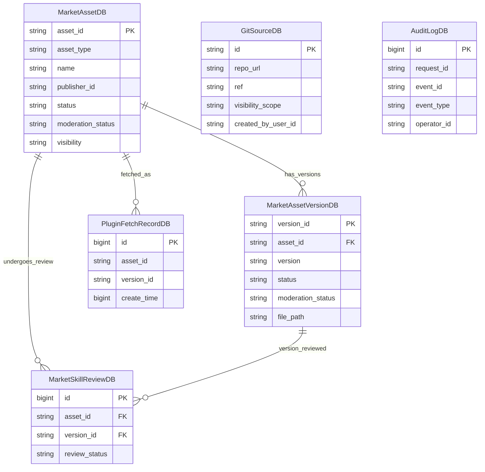
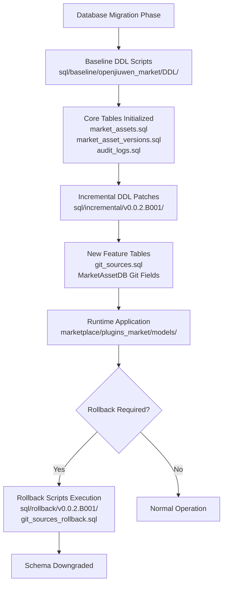

<!-- source: DeepWiki mcp.deepwiki.com · repo openJiuwen-ai/skillhub · extra page Data Model and SQL Schema · fetched 2026-11-02 -->

# Data Model and SQL Schema

Relevant source files

The following files were used as context for generating this wiki page:

- [marketplace/plugins_market/models/git_sources.py](marketplace/plugins_market/models/git_sources.py)
- [marketplace/plugins_market/models/market_assets.py](marketplace/plugins_market/models/market_assets.py)
- [marketplace/plugins_market/validation/__init__.py](marketplace/plugins_market/validation/__init__.py)
- [marketplace/plugins_market/validation/base.py](marketplace/plugins_market/validation/base.py)
- [marketplace/plugins_market/validation/constants.py](marketplace/plugins_market/validation/constants.py)
- [marketplace/plugins_market/validation/plugin_yaml.py](marketplace/plugins_market/validation/plugin_yaml.py)
- [marketplace/plugins_market/validation/types/__init__.py](marketplace/plugins_market/validation/types/__init__.py)
- [sql/baseline/openjiuwen_market/DDL/audit_logs.sql](sql/baseline/openjiuwen_market/DDL/audit_logs.sql)
- [sql/baseline/openjiuwen_market/DDL/market_asset_interactions.sql](sql/baseline/openjiuwen_market/DDL/market_asset_interactions.sql)
- [sql/baseline/openjiuwen_market/DDL/market_asset_versions.sql](sql/baseline/openjiuwen_market/DDL/market_asset_versions.sql)
- [sql/baseline/openjiuwen_market/DDL/market_assets.sql](sql/baseline/openjiuwen_market/DDL/market_assets.sql)
- [sql/baseline/openjiuwen_market/DDL/plugin_fetch_records.sql](sql/baseline/openjiuwen_market/DDL/plugin_fetch_records.sql)
- [sql/baseline/openjiuwen_market/DDL/site_notifications.sql](sql/baseline/openjiuwen_market/DDL/site_notifications.sql)
- [sql/baseline/openjiuwen_market/DML/.gitkeep](sql/baseline/openjiuwen_market/DML/.gitkeep)
- [sql/incremental/v0.0.2.B001/openjiuwen_market/DDL/git_sources.sql](sql/incremental/v0.0.2.B001/openjiuwen_market/DDL/git_sources.sql)
- [sql/rollback/v0.0.2.B001/openjiuwen_market/DDL/git_sources_rollback.sql](sql/rollback/v0.0.2.B001/openjiuwen_market/DDL/git_sources_rollback.sql)

## Purpose and Scope
This document specifies the database schema, SQLAlchemy Object-Relational Mapping (ORM) models, and DDL versioning strategy for the `plugins_market` backend service in SkillHub. It covers the primary relational tables (`market_assets`, `market_asset_versions`, `market_asset_interactions`, `audit_logs`, and `git_sources`), their indices, unique constraints, and the baseline/incremental migration scripts located in the `sql/` directory.

Sources: `marketplace/plugins_market/models/market_assets.py:21-171()`, `marketplace/plugins_market/models/git_sources.py:8-33()`

---

## 1. Core SQLAlchemy Models and Relational Tables

The persistence layer uses SQLAlchemy declarative base models mapped to MySQL/InnoDB tables. 

### `MarketAssetDB` (`market_assets`)
Defines metadata for marketplace items (skills, agent plugins, tools, MCP connectors, templates). It includes aggregation columns computed from versions, moderation flags, and Git synchronization properties.
- **Primary Key:** `asset_id` (String 64) [marketplace/plugins_market/models/market_assets.py:24-24]()
- **Unique Constraint:** `uk_publisher_asset_type_name` on `("publisher_id", "asset_type", "name")` [marketplace/plugins_market/models/market_assets.py:74-79]()
- **Git Integration Properties:** Includes columns for `storage_mode`, `git_source_id`, `resolved_commit_sha`, and `git_sync_payload_sha256` [marketplace/plugins_market/models/market_assets.py:63-71]()

Sources: `marketplace/plugins_market/models/market_assets.py:21-94()`, `sql/baseline/openjiuwen_market/DDL/market_assets.sql:1-42()`

### `MarketAssetVersionDB` (`market_asset_versions`)
Stores individual version iterations for each market asset, including artifact file references and version-level moderation states.
- **Primary Key:** `version_id` (String 64) [marketplace/plugins_market/models/market_assets.py:100-100]()
- **Foreign Key:** `asset_id` references `market_assets.asset_id` [marketplace/plugins_market/models/market_assets.py:101-106]()
- **Unique Constraint:** `uk_asset_version` on `("asset_id", "version")` [marketplace/plugins_market/models/market_assets.py:120-122]()

Sources: `marketplace/plugins_market/models/market_assets.py:97-123()`, `sql/baseline/openjiuwen_market/DDL/market_asset_versions.sql:1-17()`

### `PluginFetchRecordDB` (`plugin_fetch_records`) & `MarketSkillReviewDB` (`market_skill_reviews`)
`PluginFetchRecordDB` records download telemetry with an optimized composite index (`idx_create_time_asset_id`) for aggregation queries [marketplace/plugins_market/models/market_assets.py:125-139](). `MarketSkillReviewDB` tracks automated security and policy evaluation outcomes for specific asset versions [marketplace/plugins_market/models/market_assets.py:142-171]().

Sources: `marketplace/plugins_market/models/market_assets.py:125-171()`, `sql/baseline/openjiuwen_market/DDL/plugin_fetch_records.sql:1-1()`

### `GitSourceDB` (`git_sources`)
Tracks external Git repositories linked by users for automated asset discovery and synchronization.
- **Primary Key:** `id` (String 64) [marketplace/plugins_market/models/git_sources.py:13-13]()
- **Unique Constraint:** `uk_git_source_dedup_key` on `git_source_dedup_key` [marketplace/plugins_market/models/git_sources.py:31-31]()

Sources: `marketplace/plugins_market/models/git_sources.py:8-33()`, `sql/incremental/v0.0.2.B001/openjiuwen_market/DDL/git_sources.sql:7-27()`

---

## 2. Entity-Relationship & Architecture Mapping

The following diagram bridges the natural language conceptual domains of assets, versioning, interactions, audit tracking, and Git integrations to their corresponding SQLAlchemy classes and physical database tables.

Sources: `marketplace/plugins_market/models/market_assets.py:21-171()`, `marketplace/plugins_market/models/git_sources.py:8-33()`, `sql/baseline/openjiuwen_market/DDL/audit_logs.sql:1-19()`

---

## 3. DDL Versioning, Baseline, Incremental, and Rollback Lifecycle

SkillHub uses a structured DDL migration layout under the `sql/` directory, separating baseline schemas, feature incremental additions, and emergency rollback scripts.

Sources: `sql/baseline/openjiuwen_market/DDL/market_assets.sql:1-42()`, `sql/incremental/v0.0.2.B001/openjiuwen_market/DDL/git_sources.sql:1-27()`, `sql/rollback/v0.0.2.B001/openjiuwen_market/DDL/git_sources_rollback.sql:1-7()`

---

## 4. Schema Summary and Constraints Matrix

| Table Name | SQLAlchemy Model Class | Primary Key | Unique Constraints & Key Indexes | Source File Reference |
| :--- | :--- | :--- | :--- | :--- |
| `market_assets` | `MarketAssetDB` | `asset_id` (VARCHAR 64) | `uk_publisher_asset_type_name` (`publisher_id`, `asset_type`, `name`), `idx_asset_type`, `idx_moderation_status`, `idx_market_assets_visibility` | `marketplace/plugins_market/models/market_assets.py:21-94()` |
| `market_asset_versions` | `MarketAssetVersionDB` | `version_id` (VARCHAR 64) | `uk_asset_version` (`asset_id`, `version`), `ix_market_asset_versions_asset_id` | `marketplace/plugins_market/models/market_assets.py:97-123()` |
| `market_asset_interactions` | *InteractionDB* | `id` (BIGINT AUTO_INC) | `uk_mai_asset_user_action` (`asset_id`, `user_id`, `action_type`), `idx_mai_asset_id` | `sql/baseline/openjiuwen_market/DDL/market_asset_interactions.sql:1-13()` |
| `audit_logs` | *AuditLogDB* | `id` (BIGINT AUTO_INC) | `ix_audit_logs_event_id`, `idx_event_type_action`, `ix_audit_logs_request_id` | `sql/baseline/openjiuwen_market/DDL/audit_logs.sql:1-25()` |
| `git_sources` | `GitSourceDB` | `id` (VARCHAR 64) | `uk_git_source_dedup_key` (`git_source_dedup_key`), `idx_gs_visibility`, `idx_gs_repo_url_canonical` | `marketplace/plugins_market/models/git_sources.py:8-33()` |

Sources: `marketplace/plugins_market/models/market_assets.py:21-123()`, `marketplace/plugins_market/models/git_sources.py:8-33()`, `sql/baseline/openjiuwen_market/DDL/audit_logs.sql:1-25()`, `sql/baseline/openjiuwen_market/DDL/market_asset_interactions.sql:1-13()`

---

