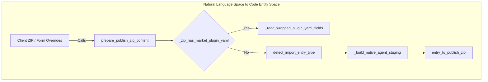
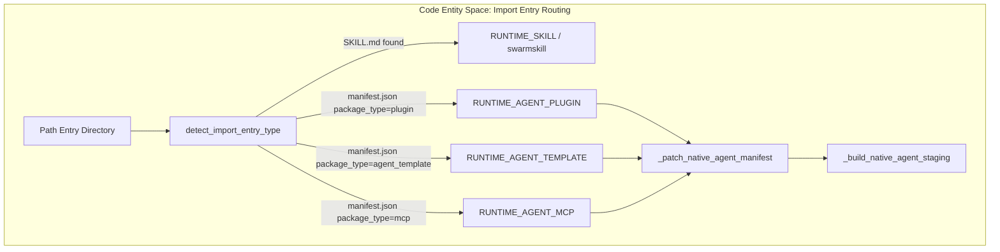

<!-- source: DeepWiki mcp.deepwiki.com · repo openJiuwen-ai/skillhub · extra page Import and Publish Wrapping · fetched 2026-11-02 -->

# Import and Publish Wrapping

Relevant source files

The following files were used as context for generating this wiki page:

- [frontend/src/components/Common/VersionFileTree.tsx](frontend/src/components/Common/VersionFileTree.tsx)
- [frontend/src/utils/detectAgentPublishZip.ts](frontend/src/utils/detectAgentPublishZip.ts)
- [frontend/src/utils/versionFileTree.ts](frontend/src/utils/versionFileTree.ts)
- [marketplace/plugins_market/imports/__init__.py](marketplace/plugins_market/imports/__init__.py)
- [marketplace/plugins_market/imports/publish_wrap.py](marketplace/plugins_market/imports/publish_wrap.py)
- [marketplace/plugins_market/imports/skill_entries.py](marketplace/plugins_market/imports/skill_entries.py)
- [marketplace/plugins_market/tests/test_multi_asset_import.py](marketplace/plugins_market/tests/test_multi_asset_import.py)
- [marketplace/plugins_market/tests/test_publish_wrap.py](marketplace/plugins_market/tests/test_publish_wrap.py)

## Purpose and Scope

The import and publish wrapping subsystem (`plugins_market.imports`) normalizes user uploads—ranging from bare native agent structures (containing `manifest.json` or `SKILL.md`) to form-overridden marketplace assets—into the standard market ZIP layout governed by `plugin.yaml` [marketplace/plugins_market/imports/publish_wrap.py:1-4](). This page covers the end-to-end transformation pipeline including `prepare_publish_zip_content`, native asset detection and staging rules in `skill_entries.py`, bundle safe extraction protocols, bulk import workflows, and deterministic archive generation.

Sources:
- `marketplace/plugins_market/imports/publish_wrap.py:1-4`
- `marketplace/plugins_market/imports/skill_entries.py:1-12`

---

## Normalization and Packaging Architecture (`prepare_publish_zip_content`)

When users publish assets via the frontend or CLI, uploads may consist of raw, un-wrapped directories (`PublishMetadataOverrides`) or pre-wrapped marketplace archives [marketplace/plugins_market/imports/publish_wrap.py:47-65](). The core entry point `prepare_publish_zip_content` intercepts raw zip bytes, validates their internal entry types (`runtime` skills, `agent-plugin`, `agent-template`, or `agent-mcp`), and restructures them into a standard deterministic layout [marketplace/plugins_market/imports/publish_wrap.py:28-42]() [marketplace/plugins_market/imports/publish_wrap.py:53-64]().

Sources:
- `marketplace/plugins_market/imports/publish_wrap.py:28-65`
- `marketplace/plugins_market/imports/skill_entries.py:141-198`

---

## Native Plugin Layout Detection and Wrapping Rules (`skill_entries.py`)

Asset packages lacking a root `plugin.yaml` undergo structural introspection. `skill_entries.py` identifies whether an entry represents a raw team skill (`SKILL.md` with frontmatter `kind: swarm-skill`), a native agent plugin (`manifest.json` with `package_type: plugin`), an agent template (`package_type: agent_template`), or an agent MCP integration (`package_type: mcp`) [marketplace/plugins_market/imports/skill_entries.py:109-174]().

- **Metadata Precedence**: For native agent plugins, `manifest.json` fields (`id`, `version`, `display_name`, `description`, `tags`) establish the canonical baseline [marketplace/plugins_market/imports/skill_entries.py:153-174](). Explicit publish form overrides are validated against schema boundaries before mutating the manifest [marketplace/plugins_market/tests/test_multi_asset_import.py:152-158]().
- **Version Enforcement**: If an agent MCP or plugin zip omits a version declaration across both manifests and form overrides, `PublishError` is raised [marketplace/plugins_market/tests/test_publish_wrap.py:100-109]().

Sources:
- `marketplace/plugins_market/imports/skill_entries.py:109-198`
- `marketplace/plugins_market/tests/test_publish_wrap.py:100-143`
- `marketplace/plugins_market/tests/test_multi_asset_import.py:152-158`

---

## Bundle Safe Extraction and Bulk Import Endpoints

Admin bulk import endpoints process multi-asset bundles using secure extraction routines (`skill_import_extract_zip_to_dir`) to protect the host against path traversal attacks (`Zip Slip`), symlink exploits, and decompression bombs [marketplace/plugins_market/imports/publish_wrap.py:17-18](). 

- **Directory Placeholder Resolution**: `_mkdir_parents_replace_file_placeholders` prevents POSIX `FileExistsError` anomalies by checking if intermediate parent paths exist as regular zip-placeholder files prior to directory creation [marketplace/plugins_market/imports/publish_wrap.py:132-153]().
- **Multi-Asset Bulk Import**: Functions such as `skill_import_from_bundle` and `skill_import_from_staging_dir` iterate through extracted workspace entries, normalizing each via `entry_to_publish_zip` to construct transactionally consistent batch imports [marketplace/plugins_market/tests/test_multi_asset_import.py:18-21]().

Sources:
- `marketplace/plugins_market/imports/publish_wrap.py:17-18`, `132-183`
- `marketplace/plugins_market/imports/skill_import_service.py` (referenced via `__init__.py`)

---

## Deterministic Zip Generation & Metadata Overrides

To guarantee stable cryptographic hashes (such as content identifiers or artifact CIDs) for published assets, generated marketplace ZIPs follow deterministic packaging rules:
1. **File Ordering**: Members are written to the archive in lexicographical path order.
2. **Timestamps**: Archive entry timestamps are normalized to a fixed epoch to eliminate non-deterministic binary diffs.
3. **Compression**: Deflate compression (`zipfile.ZIP_DEFLATED`) is applied consistently [marketplace/plugins_market/tests/test_publish_wrap.py:33-38]().

Client-side inspection utilities (`inspectAgentPublishZip` in `detectAgentPublishZip.ts`) mirror these layout rules in the React application, parsing `plugin.yaml` or `manifest.json` asynchronously using `JSZip` to pre-populate metadata fields inside `PublishDrawer` before final upload transmission [frontend/src/utils/detectAgentPublishZip.ts:128-181]().

Sources:
- `marketplace/plugins_market/tests/test_publish_wrap.py:33-38`
- `frontend/src/utils/detectAgentPublishZip.ts:128-181`

---

