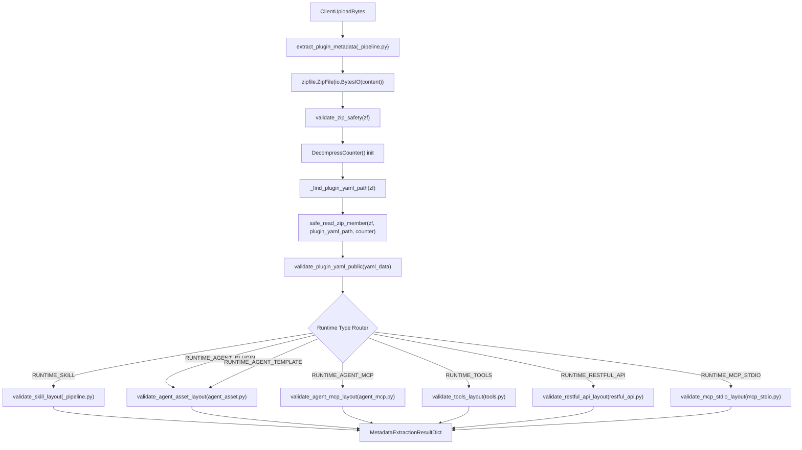
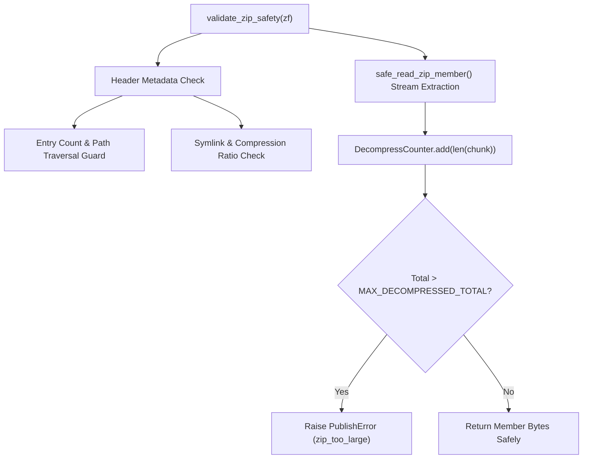
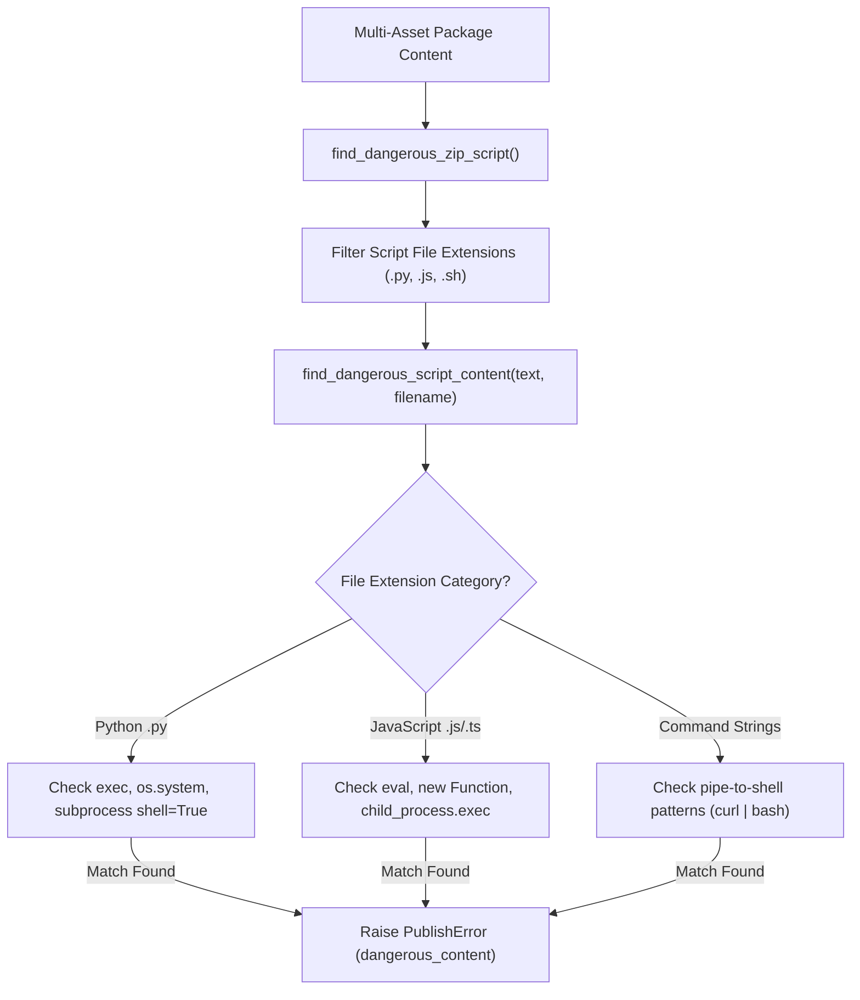

<!-- source: DeepWiki mcp.deepwiki.com · repo openJiuwen-ai/skillhub · extra page Package Validation Pipeline · fetched 2026-11-02 -->

# Package Validation Pipeline

Relevant source files

The following files were used as context for generating this wiki page:

- [frontend/src/pages/AssetDetailPage.tsx](frontend/src/pages/AssetDetailPage.tsx)
- [marketplace/plugins_market/services/agent_package_inspect.py](marketplace/plugins_market/services/agent_package_inspect.py)
- [marketplace/plugins_market/tests/test_agent_assets_mvp.py](marketplace/plugins_market/tests/test_agent_assets_mvp.py)
- [marketplace/plugins_market/tests/test_agent_package_inspect.py](marketplace/plugins_market/tests/test_agent_package_inspect.py)
- [marketplace/plugins_market/tests/test_content_security.py](marketplace/plugins_market/tests/test_content_security.py)
- [marketplace/plugins_market/validation/_pipeline.py](marketplace/plugins_market/validation/_pipeline.py)
- [marketplace/plugins_market/validation/content_security.py](marketplace/plugins_market/validation/content_security.py)
- [marketplace/plugins_market/validation/localized_manifest.py](marketplace/plugins_market/validation/localized_manifest.py)
- [marketplace/plugins_market/validation/types/agent_asset.py](marketplace/plugins_market/validation/types/agent_asset.py)
- [marketplace/plugins_market/validation/types/agent_mcp.py](marketplace/plugins_market/validation/types/agent_mcp.py)
- [marketplace/plugins_market/validation/types/mcp_stdio.py](marketplace/plugins_market/validation/types/mcp_stdio.py)
- [marketplace/plugins_market/validation/types/restful_api.py](marketplace/plugins_market/validation/types/restful_api.py)
- [marketplace/plugins_market/validation/types/skill.py](marketplace/plugins_market/validation/types/skill.py)
- [marketplace/plugins_market/validation/types/tools.py](marketplace/plugins_market/validation/types/tools.py)
- [marketplace/plugins_market/validation/zip_utils.py](marketplace/plugins_market/validation/zip_utils.py)

The Package Validation Pipeline is the core security and integrity verification subsystem of the `plugins_market` backend. It intercepts all plugin, skill, tool, and agent asset uploads before they reach the database or storage layers. The pipeline enforces strict structural layouts, bounded resource consumption, syntactic correctness of manifests (`plugin.yaml` and `manifest.json`), and static content security checks to prevent Remote Code Execution (RCE) and archive-based denial of service attacks (zip bombs).

---

## 1. Pipeline Architecture and Orchestration Flow

The validation pipeline is orchestrated by `extract_plugin_metadata` in `marketplace/plugins_market/validation/_pipeline.py`. It coordinates file opening, zip safety pre-checks, streaming member extraction, manifest parsing, and per-type validation handlers.

### Validation Pipeline Execution Flow

Sources: [marketplace/plugins_market/validation/_pipeline.py:100-184](), [marketplace/plugins_market/validation/zip_utils.py:110-173]()

---

## 2. Two-Layer Zip Safety and Decompression Defense

To protect against path traversal vulnerabilities, malformed headers, symbolic link exploits, and compression bombs, the package validation module implements a robust two-layer defense mechanism located in `marketplace/plugins_market/validation/zip_utils.py`.

### Layer 1: Metadata Pre-Check (`validate_zip_safety`)
Before decompressing or reading any bytes into memory, `validate_zip_safety` inspects the archive headers (`zf.infolist()`) [marketplace/plugins_market/validation/zip_utils.py:110-121]():
- **Entry Count Limit**: Rejects archives where `len(infos) > MAX_ZIP_ENTRIES` [marketplace/plugins_market/validation/zip_utils.py:123-130]().
- **Path Sanity Checks**: `_validate_zip_entry_path` checks for null bytes (`\x00`), absolute paths (`/`), Windows drive letters (e.g., `C:` via `ZIP_ENTRY_WINDOWS_DRIVE_PATTERN`), and path traversal segments (`..`) [marketplace/plugins_market/validation/zip_utils.py:65-96]() [marketplace/plugins_market/validation/zip_utils.py:134]().
- **Symlink Prohibition**: Rejects symbolic links by inspecting Unix file mode bits in `external_attr` (`S_IFMT` mask matching `0xA000`) [marketplace/plugins_market/validation/zip_utils.py:98-104]() [marketplace/plugins_market/validation/zip_utils.py:136-141]().
- **Compression Ratio Advisory**: Computes `info.file_size / info.compress_size`. If it exceeds `MAX_COMPRESSION_RATIO`, it triggers a suspected zip bomb rejection [marketplace/plugins_market/validation/zip_utils.py:146-159]().
- **Declared Total Size**: Ensures the sum of `info.file_size` across all entries does not exceed `MAX_DECOMPRESSED_TOTAL` [marketplace/plugins_market/validation/zip_utils.py:161-171]().

### Layer 2: Streaming Read and Global Decompression Counter (`DecompressCounter`)
Malicious archives can forge header declarations while inflating during extraction. `safe_read_zip_member` avoids `ZipFile.read()` and instead reads members in fixed-size chunks (`ZIP_STREAM_READ_CHUNK_BYTES`) [marketplace/plugins_market/validation/zip_utils.py:178-197](). 
- Every chunk increments `DecompressCounter.total` [marketplace/plugins_market/validation/zip_utils.py:39-59]().
- If the cumulative decompressed bytes exceed `MAX_DECOMPRESSED_TOTAL`, `PublishError` with error code `SKILLHUB_PLUGIN_ZIP_TOO_LARGE` is raised immediately, halting extraction [marketplace/plugins_market/validation/zip_utils.py:46-59]().

Sources: [marketplace/plugins_market/validation/zip_utils.py:39-197]()

---

## 3. Metadata Extraction and `plugin.yaml` Parsing

The pipeline locates the market-level `plugin.yaml` configuration file by scanning archive entries for the standard layout: exactly two path segments ending in `plugin.yaml` (e.g., `<top>/plugin.yaml`) [marketplace/plugins_market/validation/_pipeline.py:56-72]().

1. **Byte Limit & Yaml Validation**: `safe_read_zip_member` reads `plugin.yaml` under the global streaming counter, and `validate_plugin_yaml_bytes` ensures text encoding safety [marketplace/plugins_market/validation/_pipeline.py:149-151]().
2. **Bounded Safe Loading**: `safe_load_yaml` parses the YAML text using a secure YAML loader context to prevent arbitrary object instantiation [marketplace/plugins_market/validation/_pipeline.py:155]().
3. **Public Fields Validation**: `validate_plugin_yaml_public` extracts and validates top-level attributes such as `name`, `version`, `display_name`, `description`, `tags`, and `runtime` [marketplace/plugins_market/validation/_pipeline.py:163]().

Sources: [marketplace/plugins_market/validation/_pipeline.py:56-164]()

---

## 4. Per-Type Layout and Content Validators

Depending on the `runtime_type` declared in `plugin.yaml` (or derived from inner manifests), the pipeline delegates validation to specific type validators.

| Runtime Type | Validator Module / Function | Key Structural & Content Checks |
| :--- | :--- | :--- |
| `skill` | `marketplace/plugins_market/validation/types/skill.py` :: `validate_skill_layout` | Exactly one non-hidden subdirectory matching `plugin.yaml` `name`; contains `SKILL.md` with validated frontmatter; optional `icon.png` and `README.md` [marketplace/plugins_market/validation/types/skill.py:43-98]() |
| `agent-plugin` / `agent-template` | `marketplace/plugins_market/validation/types/agent_asset.py` :: `validate_agent_asset_layout` | Validates outer/inner wrap, `manifest.json` schema, relative path traversal guards, declared skills, tools, and subagent directories [marketplace/plugins_market/validation/types/agent_asset.py:31-194]() |
| `agent-mcp` | `marketplace/plugins_market/validation/types/agent_mcp.py` :: `validate_agent_mcp_layout` | Validates JiuwenSwarm MCP package layouts driven by `manifest.json`, remote/stdio integrations, and command parameters [marketplace/plugins_market/validation/types/agent_mcp.py:28-191]() |
| `tools` | `marketplace/plugins_market/validation/types/tools.py` :: `validate_tools_layout` | Validates tool entry definitions and `tools.json` schemas [marketplace/plugins_market/validation/_pipeline.py:40-43]() |
| `restful-api` | `marketplace/plugins_market/validation/types/restful_api.py` :: `validate_restful_api_layout` | Extracts and validates RESTful API contracts and endpoint descriptors [marketplace/plugins_market/validation/_pipeline.py:45-48]() |
| `mcp-stdio` | `marketplace/plugins_market/validation/types/mcp_stdio.py` :: `validate_mcp_stdio_layout` | Validates MCP standard IO transport configurations and argument arrays [marketplace/plugins_market/validation/_pipeline.py:44]() |

Sources: [marketplace/plugins_market/validation/_pipeline.py:35-54](), [marketplace/plugins_market/validation/types/skill.py:43-98]()

---

## 5. Content Security Scanning

Multi-assets (`agent-plugin`, `agent-template`, `agent-mcp`) undergo static content security analysis via `marketplace/plugins_market/validation/content_security.py`. Although uploaded by administrative users, these packages are statically scanned for dangerous command injection patterns and dynamic code execution primitives.

### Security Rules and Pattern Detection
- **Command Injection Patterns**: Detects pipe-to-shell chains (`curl | bash`, `wget | sh`, `Invoke-WebRequest | iex`) and shell-wrapped download commands in `mcp.json` (`command`, `args`, `env`, `headers`) or `cli.json` [marketplace/plugins_market/validation/content_security.py:40-53]() [marketplace/plugins_market/validation/content_security.py:127-167]().
- **Script File Inspections**: Scans files matching script extensions (`.py`, `.sh`, `.js`, `.ts`, etc.) for dangerous calls [marketplace/plugins_market/validation/content_security.py:23-35]() [marketplace/plugins_market/validation/content_security.py:170-194]():
  - **Python**: `exec()`, `os.system()`, `os.popen()`, and `subprocess` calls with `shell=True` [marketplace/plugins_market/validation/content_security.py:63-81]().
  - **JavaScript/TypeScript**: `eval()`, `new Function()`, and `child_process.exec()` / `execSync()` [marketplace/plugins_market/validation/content_security.py:55-61]() [marketplace/plugins_market/validation/content_security.py:82-85]().
  - *Distinction Logic*: Carefully avoids flagging benign usages such as JavaScript regular expression execution (`RegExp.exec`) or process spawning (`child_process.spawn` used by bundled dependencies) by employing precise token boundary regexes [marketplace/plugins_market/content_security.py:58-61]() [marketplace/plugins_market/tests/test_content_security.py:7-34]().

Sources: [marketplace/plugins_market/validation/content_security.py:16-206](), [marketplace/plugins_market/tests/test_content_security.py:1-34]()

---

