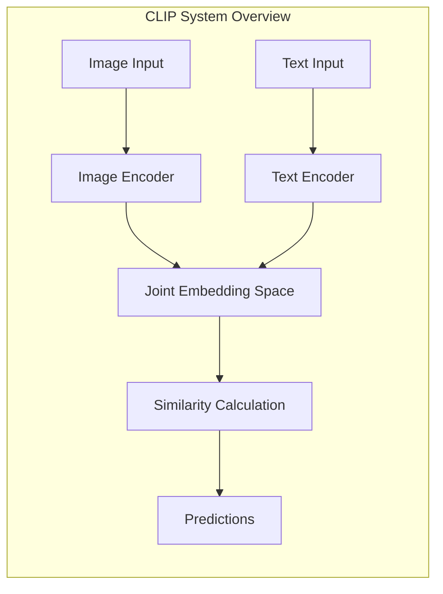
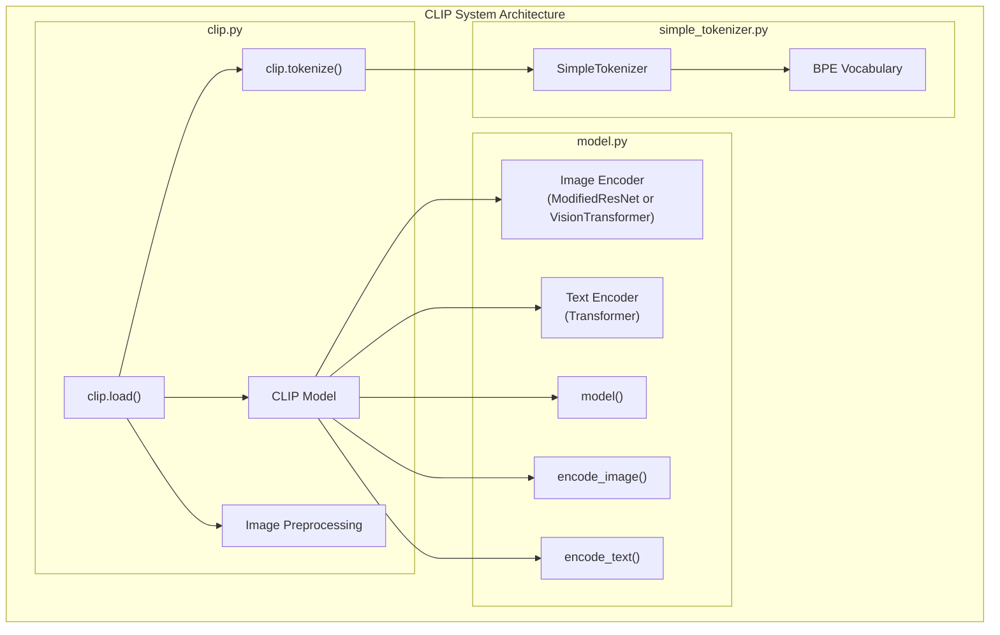
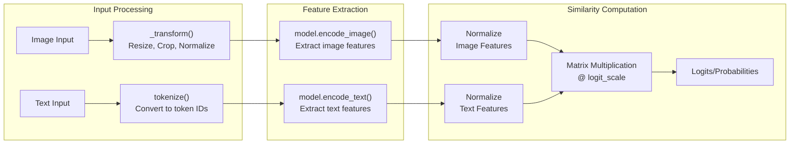
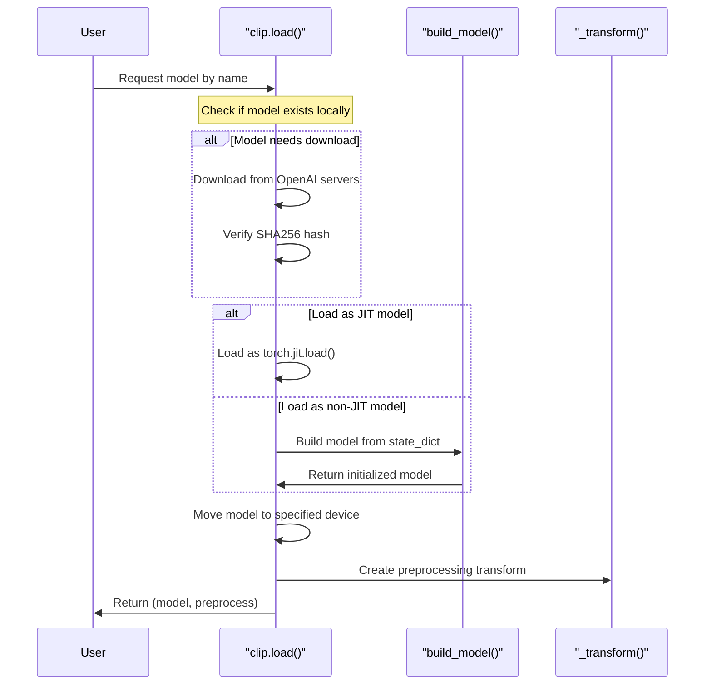
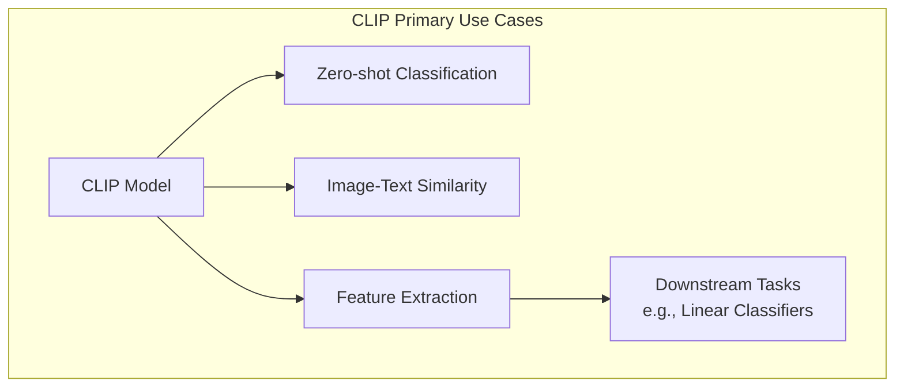

<!-- source: DeepWiki mcp.deepwiki.com · repo openai/CLIP · page 1 Overview · fetched 2026-10-26 -->

# Overview

Relevant source files

The following files were used as context for generating this wiki page:

- [README.md](README.md)
- [clip/clip.py](clip/clip.py)

This document provides a comprehensive technical overview of OpenAI's CLIP (Contrastive Language-Image Pre-Training) repository. CLIP is a neural network trained on a variety of (image, text) pairs, enabling zero-shot visual recognition through natural language supervision. This page introduces the CLIP system architecture, core components, and primary capabilities. For detailed information about the model architecture, see [CLIP Model Architecture](#2), and for usage examples, see [Examples and Usage](#4).

## What is CLIP?

CLIP is a multi-modal model that connects images and text through a jointly trained image encoder and text encoder. These encoders project images and text into a shared embedding space where related concepts are positioned close together, enabling direct comparison between visual and textual content. Unlike traditional computer vision models that are trained on fixed label sets, CLIP can perform "zero-shot" classification by comparing images against arbitrary text descriptions.

Sources: [README.md:1-7](), [clip/clip.py:93-202]()

## System Architecture

CLIP consists of three primary architectural components that work together to enable image-text matching:

Sources: [clip/clip.py:13-14](), [clip/clip.py:27-28](), [clip/clip.py:94-202]()

### Core Components and Data Flow

The CLIP system handles image and text processing through separate pipelines that converge for similarity calculation:

Sources: [clip/clip.py:79-86](), [clip/clip.py:205-245](), [README.md:42-45]()

## Model Loading and Initialization

The `clip.load()` function is the primary entry point for using CLIP. It handles model downloading, loading, and device placement:

Sources: [clip/clip.py:94-202](), [clip/clip.py:43-72]()

## Available Model Variants

CLIP provides multiple pre-trained model variants with different architectures and parameter counts:

| Model Name | Architecture | Image Size | Parameters | URL |
|------------|--------------|------------|------------|-----|
| RN50 | ResNet-50 | 224 | ~50M | OpenAI Azure endpoint |
| RN101 | ResNet-101 | 224 | ~80M | OpenAI Azure endpoint |
| RN50x4 | ResNet-50 (4× width) | 288 | ~100M | OpenAI Azure endpoint |
| RN50x16 | ResNet-50 (16× width) | 384 | ~200M | OpenAI Azure endpoint |
| RN50x64 | ResNet-50 (64× width) | 448 | ~400M | OpenAI Azure endpoint |
| ViT-B/32 | Vision Transformer (Base) | 224 | ~150M | OpenAI Azure endpoint |
| ViT-B/16 | Vision Transformer (Base) | 224 | ~150M | OpenAI Azure endpoint |
| ViT-L/14 | Vision Transformer (Large) | 224 | ~300M | OpenAI Azure endpoint |
| ViT-L/14@336px | Vision Transformer (Large) | 336 | ~300M | OpenAI Azure endpoint |

Sources: [clip/clip.py:30-40]()

## API Overview

The CLIP module provides a simple API for interacting with the model:

### Main Functions

- `clip.available_models()`: Returns a list of available model names
- `clip.load(name, device, jit)`: Loads a specified model and returns the model plus preprocessing transform
- `clip.tokenize(text, context_length)`: Tokenizes text inputs for processing by the model

### Model Methods

- `model.encode_image(image)`: Encodes images into feature vectors
- `model.encode_text(text)`: Encodes tokenized text into feature vectors
- `model(image, text)`: Calculates similarity between images and text

Sources: [clip/clip.py:89-202](), [clip/clip.py:205-245](), [README.md:49-81]()

## Usage Patterns

CLIP supports multiple usage patterns:

1. **Zero-shot Classification**: Compare images against textual descriptions to predict classes without training
2. **Image-Text Similarity**: Calculate the similarity between arbitrary images and text
3. **Feature Extraction**: Extract features from images or text for downstream tasks
4. **Linear-probe Evaluation**: Train a linear classifier on top of CLIP's image features

Sources: [README.md:85-193]()

## System Requirements

CLIP requires:
- PyTorch 1.7.1 or later
- torchvision
- CUDA-capable GPU (recommended but not required)
- Additional dependencies: ftfy, regex, tqdm

Sources: [README.md:17-25]()

---

