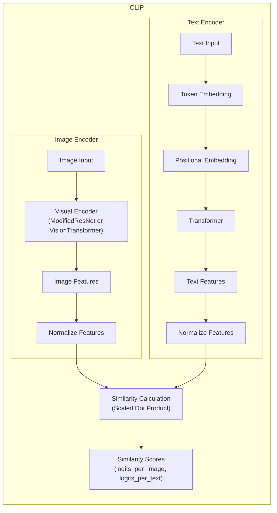
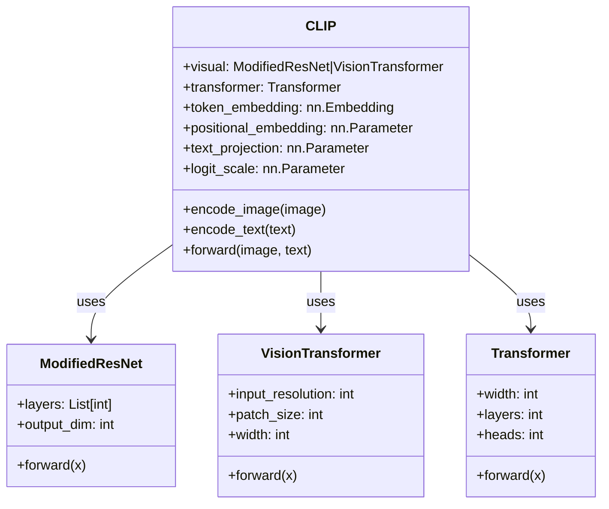
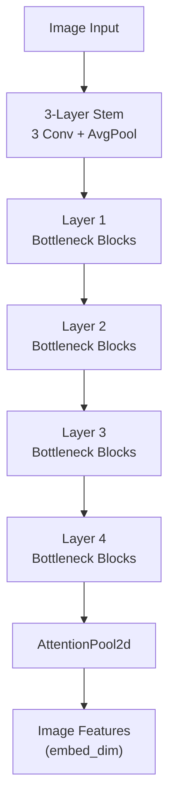
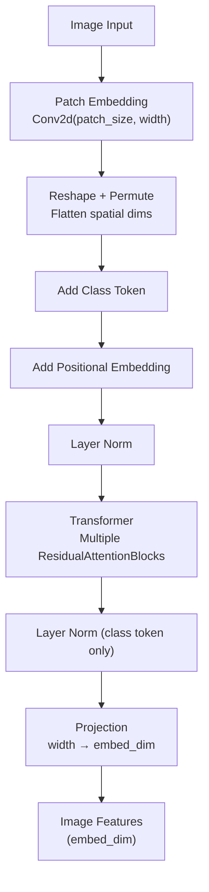
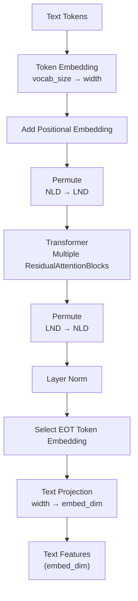
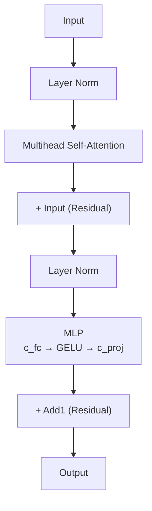
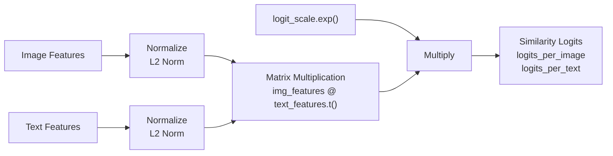
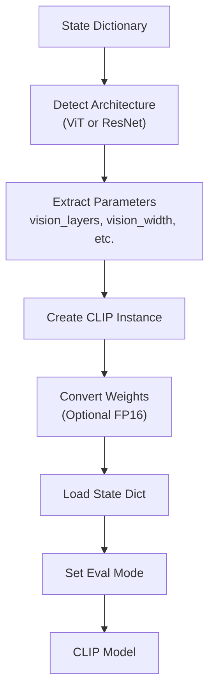
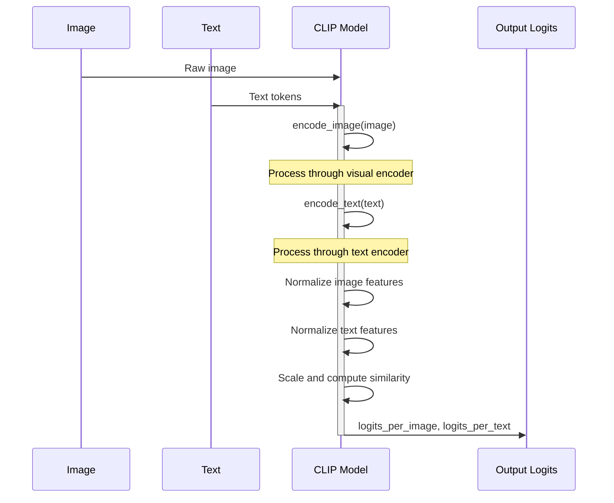

<!-- source: DeepWiki mcp.deepwiki.com · repo openai/CLIP · page 2 CLIP Model Architecture · fetched 2026-10-26 -->

# CLIP Model Architecture

Relevant source files

The following files were used as context for generating this wiki page:

- [clip/model.py](clip/model.py)

## Purpose and Scope

This document provides a detailed technical overview of the Contrastive Language-Image Pre-training (CLIP) model architecture as implemented in the OpenAI CLIP repository. It covers the dual-encoder design, image and text processing pathways, and how these modalities are aligned in a shared embedding space. For information about how to use the CLIP API, see [Loading and Using CLIP](#3.1).

## Architecture Overview

CLIP implements a dual-encoder architecture that processes images and text separately before projecting them into a shared embedding space. This design enables direct comparison between visual and textual content, allowing for zero-shot visual recognition based on natural language descriptions.

Sources: [clip/model.py:243-372]()

## Main CLIP Class

The `CLIP` class is the central component that integrates all parts of the architecture. It contains:

1. An image encoder (either ModifiedResNet or VisionTransformer)
2. A text encoder (Transformer with causal attention mask)
3. A joint embedding space where features from both modalities are compared

The model provides methods to:
- Encode images using `encode_image`
- Encode text using `encode_text`
- Calculate similarity between image and text pairs through the `forward` method

Sources: [clip/model.py:243-372]()

## Visual Encoders

CLIP offers two different architectures for image encoding:

### 1. ModifiedResNet

A modified ResNet architecture that differs from standard implementations in three key ways:

1. Uses a 3-layer stem with average pooling instead of a single convolutional layer with max pooling
2. Implements anti-aliasing in strided convolutions by prepending avgpool operations
3. Replaces the final pooling layer with an attention-based pooling mechanism (AttentionPool2d)

Sources: [clip/model.py:94-154](), [clip/model.py:10-55](), [clip/model.py:58-91]()

### 2. VisionTransformer

A Vision Transformer (ViT) implementation that:

1. Divides the input image into fixed-size patches
2. Linearly projects patches to form token embeddings
3. Adds a class token and positional embeddings
4. Processes tokens through transformer layers
5. Uses the output from the class token for the final representation

Sources: [clip/model.py:206-240]()

## Text Encoder

The text encoder is based on a standard Transformer architecture:

1. Token embeddings convert text tokens to vectors
2. Positional embeddings encode sequence position information
3. A transformer with causal attention mask processes the token sequence
4. The final-layer embedding corresponding to the end-of-text token becomes the text representation
5. A projection matrix maps the transformer output to the joint embedding space

Sources: [clip/model.py:171-204](), [clip/model.py:343-356]()

### Transformer Details

The transformer consists of multiple ResidualAttentionBlocks that contain:

1. Multi-head self-attention with residual connections
2. Layer normalization
3. MLP block (fully connected, GELU, fully connected)

Sources: [clip/model.py:171-192]()

## Joint Embedding Space

The core of CLIP's functionality is the joint embedding space where image and text features are compared:

1. Both image and text feature vectors are L2-normalized
2. The cosine similarity between these normalized vectors is computed
3. A learnable temperature parameter (`logit_scale`) adjusts the similarity scores
4. The resulting logits are used to predict the correct image-text pairs

Sources: [clip/model.py:357-372]()

## Model Initialization and Building

The CLIP model can be initialized in two ways:

1. From scratch with specific parameters for image and text encoders
2. From a pre-trained state dictionary using the `build_model` function

The `build_model` function:
1. Infers model parameters from the state dictionary
2. Determines whether to use ModifiedResNet or VisionTransformer
3. Initializes the CLIP model with appropriate parameters
4. Converts applicable weights to FP16 (optional)
5. Loads the state dictionary into the model

Sources: [clip/model.py:399-436](), [clip/model.py:375-397](), [clip/model.py:299-327]()

## Model Variants and Parameters

CLIP supports multiple model variants depending on the image encoder architecture and size:

| Model Name | Vision Encoder | Vision Layers | Vision Width | Patch Size | Output Dimension |
|------------|----------------|---------------|--------------|------------|------------------|
| RN50       | ModifiedResNet | (3, 4, 6, 3)  | 64           | N/A        | 1024             |
| RN101      | ModifiedResNet | (3, 4, 23, 3) | 64           | N/A        | 512              |
| RN50x4     | ModifiedResNet | (4, 6, 10, 6) | 80           | N/A        | 640              |
| RN50x16    | ModifiedResNet | (6, 8, 18, 8) | 96           | N/A        | 768              |
| ViT-B/32   | VisionTransformer | 12         | 768          | 32         | 512              |
| ViT-B/16   | VisionTransformer | 12         | 768          | 16         | 512              |
| ViT-L/14   | VisionTransformer | 24         | 1024         | 14         | 768              |

Each model has a corresponding text encoder with parameters matched to the vision encoder's output dimension.

Sources: [clip/model.py:399-436]()

## Data Flow During Inference

During inference, data flows through the CLIP model as follows:

Sources: [clip/model.py:340-372]()

## Summary

The CLIP architecture integrates vision and language understanding through a dual-encoder approach. It processes images and text separately using specialized encoders, then projects both modalities into a shared embedding space where they can be directly compared. This design enables powerful zero-shot capabilities by measuring similarity between visual content and textual descriptions.

The architecture's flexibility in supporting different visual backbones (ModifiedResNet or VisionTransformer) with varying capacities allows for trade-offs between performance and computational efficiency.

---

