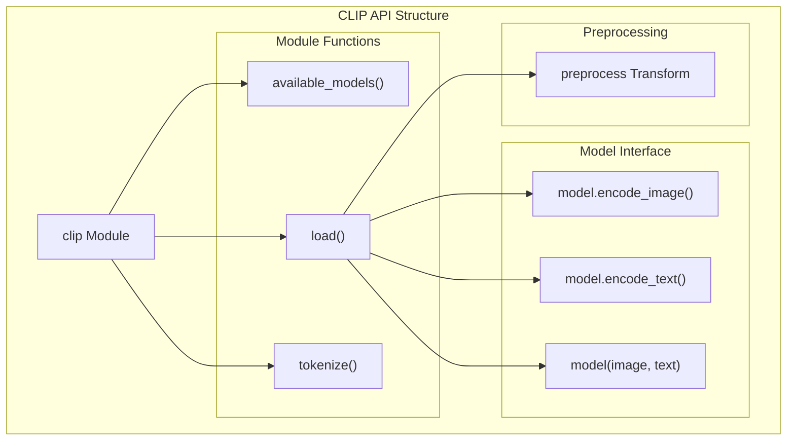
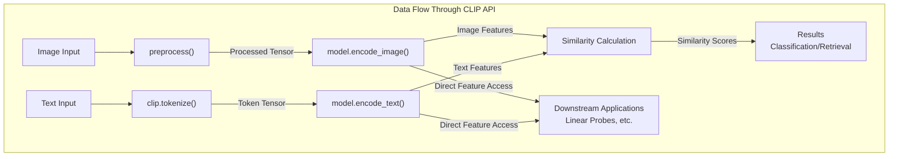
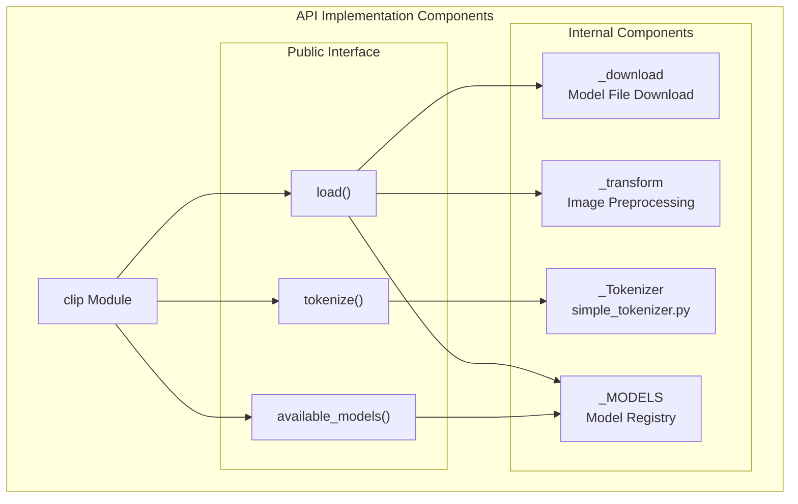

<!-- source: DeepWiki mcp.deepwiki.com · repo openai/CLIP · page 3 API Reference · fetched 2026-10-26 -->

# API Reference

<details>
<summary>Relevant source files</summary>

The following files were used as context for generating this wiki page:

- [README.md](README.md)
- [clip/clip.py](clip/clip.py)

</details>


This document provides a comprehensive overview of the CLIP API structure and its main components. It serves as a technical reference for developers who want to understand and use the CLIP system programmatically. For details about the CLIP model architecture itself, see [CLIP Model Architecture](#2).

## API Overview

The CLIP API is designed to be simple and intuitive, providing straightforward access to CLIP's powerful multimodal capabilities. It exposes a small set of core functions for loading models, transforming inputs, and generating embeddings.



Sources: [clip/clip.py:27-245](), [README.md:49-82]()

## Core API Functions

The CLIP module exposes three main functions that form the foundation of the API:

### `available_models()`

Returns a list of strings containing the names of all available pre-trained CLIP models.

```python
import clip
models = clip.available_models()
# Returns: ['RN50', 'RN101', 'RN50x4', 'RN50x16', 'RN50x64', 'ViT-B/32', 'ViT-B/16', 'ViT-L/14', 'ViT-L/14@336px']
```

Implementation in [clip/clip.py:89-91]()

### `load(name, device=..., jit=False, download_root=None)`

Loads a CLIP model and returns both the model and the preprocessing transform needed for input images.

Parameters:
- `name`: A model name listed by `available_models()` or a path to a model checkpoint
- `device`: The device to put the model on (default: first CUDA device or CPU)
- `jit`: Whether to load the JIT-compiled version of the model (default: False)
- `download_root`: Path to download model files (default: "~/.cache/clip")

Returns:
- `model`: The CLIP model (torch.nn.Module)
- `preprocess`: A torchvision transform pipeline for preprocessing images

Implementation in [clip/clip.py:94-202]()

### `tokenize(texts, context_length=77, truncate=False)`

Converts text inputs into token sequences that can be processed by the CLIP model.

Parameters:
- `texts`: A string or list of strings to tokenize
- `context_length`: Maximum number of tokens (default: 77 for all CLIP models)
- `truncate`: Whether to truncate texts that exceed the context length (default: False)

Returns:
- A tensor of token IDs with shape [number of texts, context_length]

Implementation in [clip/clip.py:205-245]()

Sources: [clip/clip.py:89-245](), [README.md:53-66]()

## Model Interface

The model object returned by `load()` provides three main methods for working with images and text:



Sources: [clip/clip.py:94-202](), [README.md:71-82]()

### `model.encode_image(image)`

Given a batch of preprocessed images, returns normalized image feature vectors encoded by the vision encoder.

Parameters:
- `image`: A tensor of preprocessed images of shape [batch_size, 3, resolution, resolution]

Returns:
- Image features with shape [batch_size, embedding_dimension]

### `model.encode_text(text)`

Given a batch of tokenized text, returns normalized text feature vectors encoded by the text encoder.

Parameters:
- `text`: A tensor of tokenized text (from `clip.tokenize()`) of shape [batch_size, context_length]

Returns:
- Text features with shape [batch_size, embedding_dimension]

### `model(image, text)`

Given batches of images and text tokens, calculates the cosine similarity between their features.

Parameters:
- `image`: A tensor of preprocessed images
- `text`: A tensor of tokenized text

Returns:
- Two tensors containing the logit scores:
  - `logits_per_image`: Similarity of each image with each text [batch_size_image, batch_size_text]
  - `logits_per_text`: Similarity of each text with each image [batch_size_text, batch_size_image]

Sources: [README.md:71-82]()

## Model Variants

CLIP is available in several model variants, each with different architecture and performance characteristics:

| Model Name | Architecture | Parameters | Image Resolution | Notes |
|------------|--------------|------------|------------------|-------|
| RN50 | ResNet-50 | 102M | 224x224 | Base ResNet variant |
| RN101 | ResNet-101 | 163M | 224x224 | Deeper ResNet variant |
| RN50x4 | ResNet-50x4 | 383M | 288x288 | 4x wider ResNet-50 |
| RN50x16 | ResNet-50x16 | 829M | 384x384 | 16x wider ResNet-50 |
| RN50x64 | ResNet-50x64 | 1.95B | 448x448 | 64x wider ResNet-50 |
| ViT-B/32 | Vision Transformer | 151M | 224x224 | ViT with 32x32 patch size |
| ViT-B/16 | Vision Transformer | 151M | 224x224 | ViT with 16x16 patch size |
| ViT-L/14 | Vision Transformer | 428M | 224x224 | Large ViT with 14x14 patch size |
| ViT-L/14@336px | Vision Transformer | 428M | 336x336 | Large ViT with higher resolution |

Sources: [clip/clip.py:30-40]()

## API Implementation Details



Sources: [clip/clip.py:27-245]()

### Image Preprocessing

The preprocessing transform returned by `load()` applies the following operations to input images:

1. Resize to the model's required resolution using bicubic interpolation
2. Center crop to create a square image
3. Convert to RGB color space (if not already)
4. Convert to a PyTorch tensor
5. Normalize with mean (0.48145466, 0.4578275, 0.40821073) and std (0.26862954, 0.26130258, 0.27577711)

Implementation in [clip/clip.py:79-86]()

### Text Tokenization

The tokenization process:

1. Adds start-of-text (`<|startoftext|>`) and end-of-text (`<|endoftext|>`) tokens
2. Uses a byte-pair encoding (BPE) tokenizer implemented in `simple_tokenizer.py`
3. Pads or truncates sequences to a fixed context length (77 tokens by default)

Implementation in [clip/clip.py:205-245]()

## Usage Example

Below is a typical usage pattern showing how the API components work together:

```python
import clip
import torch
from PIL import Image

# Load the model and preprocessing transform
device = "cuda" if torch.cuda.is_available() else "cpu"
model, preprocess = clip.load("ViT-B/32", device=device)

# Prepare inputs
image = preprocess(Image.open("image.jpg")).unsqueeze(0).to(device)
text = clip.tokenize(["a photo of a cat", "a photo of a dog"]).to(device)

# Encode inputs to get embeddings
with torch.no_grad():
    image_features = model.encode_image(image)
    text_features = model.encode_text(text)
    
    # Normalize features
    image_features /= image_features.norm(dim=-1, keepdim=True)
    text_features /= text_features.norm(dim=-1, keepdim=True)
    
    # Calculate similarity
    similarity = (100.0 * image_features @ text_features.T).softmax(dim=-1)
    
    # Alternatively, use the model directly
    logits_per_image, logits_per_text = model(image, text)
    probs = logits_per_image.softmax(dim=-1)
```

Sources: [README.md:27-46](), [README.md:91-139]()

## Batch Processing

The API is designed to efficiently handle batches of inputs:

1. For multiple images, stack preprocessed image tensors into a batch
2. For multiple text inputs, pass a list to `clip.tokenize()`
3. All encoding methods accept and return batched inputs/outputs

This is particularly useful for efficient processing in applications like:
- Zero-shot classification of multiple images
- Retrieval across large datasets
- Linear probe training

Sources: [README.md:143-193]()

---

