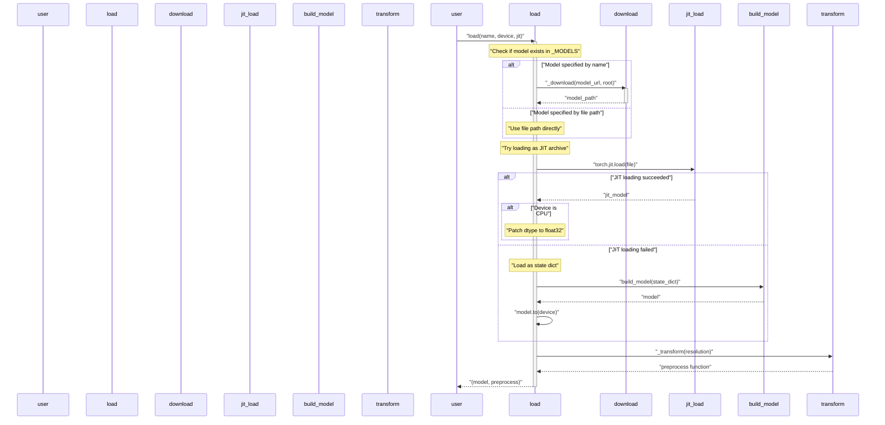
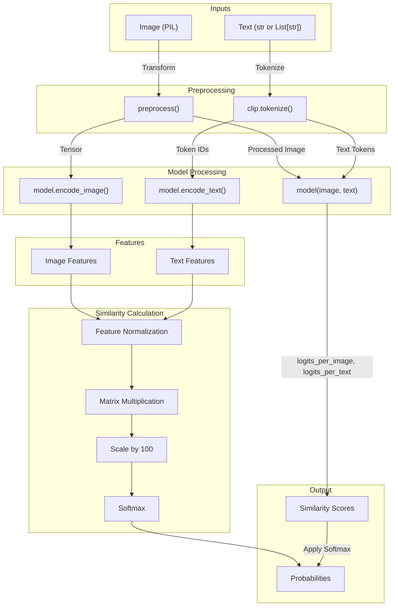
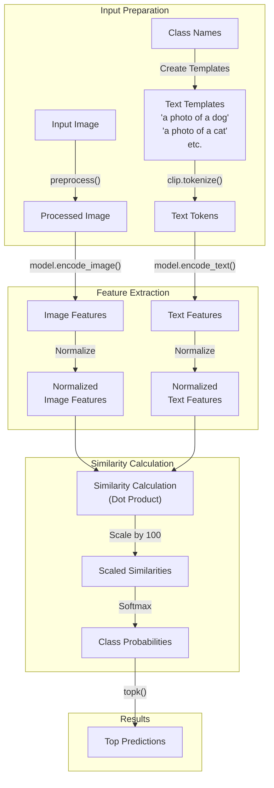

<!-- source: DeepWiki mcp.deepwiki.com · repo openai/CLIP · page 3.1 Loading and Using CLIP · fetched 2026-10-26 -->

# Loading and Using CLIP

<details>
<summary>Relevant source files</summary>

The following files were used as context for generating this wiki page:

- [README.md](README.md)
- [clip/__init__.py](clip/__init__.py)
- [clip/clip.py](clip/clip.py)

</details>


This document provides detailed instructions for loading CLIP models and using them for tasks such as image-text similarity calculation and zero-shot classification. For information about CLIP's model architecture and how it works internally, see [CLIP Model Architecture](#2).

## Overview

The CLIP (Contrastive Language-Image Pre-Training) API provides a straightforward interface for accessing and utilizing pretrained models. This page covers how to:

1. Load a CLIP model with the appropriate configuration
2. Preprocess images for model input
3. Tokenize text for model input
4. Use the model for encoding images and text
5. Calculate similarities between encoded features

## Loading a CLIP Model

The primary entry point for using CLIP is the `clip.load()` function, which returns both the model and the appropriate preprocessing transform.

```python
import clip
import torch

# Load the model
device = "cuda" if torch.cuda.is_available() else "cpu"
model, preprocess = clip.load("ViT-B/32", device=device)
```

### Function Signature and Parameters

```python
def load(name: str, device: Union[str, torch.device] = "cuda" if torch.cuda.is_available() else "cpu", 
         jit: bool = False, download_root: str = None) -> Tuple[torch.nn.Module, Callable]:
```

| Parameter | Type | Description |
|-----------|------|-------------|
| `name` | str | Model name from `available_models()` or path to a checkpoint file |
| `device` | Union[str, torch.device] | Device to place the model on (default: CUDA if available, else CPU) |
| `jit` | bool | Whether to load the optimized JIT model version (default: False) |
| `download_root` | str | Path to download model files (default: "~/.cache/clip") |

### Return Values

The function returns a tuple containing:
1. The loaded CLIP model (`torch.nn.Module`)
2. A preprocessing transform function for images (`Callable[[PIL.Image], torch.Tensor]`)

Sources: [clip/clip.py:94-202]()

### Model Loading Process



Sources: [clip/clip.py:94-202]()

### Available Models

CLIP provides several pre-trained model variants with different architectures and sizes. You can list available models using:

```python
import clip
print(clip.available_models())
```

The model variants include:

| Model Name | Architecture | Image Resolution | Parameters | Notes |
|------------|-------------|------------------|------------|-------|
| `"RN50"` | ResNet-50 | 224×224 | 102M | Base ResNet model |
| `"RN101"` | ResNet-101 | 224×224 | 182M | Deeper ResNet |
| `"RN50x4"` | ResNet-50×4 | 288×288 | 383M | Wider ResNet |
| `"RN50x16"` | ResNet-50×16 | 384×384 | 1.06B | Much wider ResNet |
| `"RN50x64"` | ResNet-50×64 | 448×448 | 3.96B | Extremely wide ResNet |
| `"ViT-B/32"` | ViT-B/32 | 224×224 | 151M | Vision Transformer with 32×32 patches |
| `"ViT-B/16"` | ViT-B/16 | 224×224 | 149M | Vision Transformer with 16×16 patches |
| `"ViT-L/14"` | ViT-L/14 | 224×224 | 428M | Larger Vision Transformer |
| `"ViT-L/14@336px"` | ViT-L/14 | 336×336 | 428M | Larger Vision Transformer with higher resolution |

Sources: [clip/clip.py:30-40]()

## Preparing Inputs for CLIP

### Image Preprocessing

When loading a CLIP model, the `clip.load()` function returns a preprocessing transform that correctly formats images for the model:

```python
from PIL import Image

# Load an image and preprocess it
image = Image.open("example.jpg")
processed_image = preprocess(image).unsqueeze(0).to(device)  # Add batch dimension
```

The preprocessing transform applies the following operations:
1. Resize to the model's required resolution using bicubic interpolation
2. Center crop to create a square image
3. Convert to RGB format (if not already)
4. Convert to a tensor with values in [0,1]
5. Normalize with CLIP-specific mean and standard deviation values

Sources: [clip/clip.py:75-86]()

### Text Tokenization

To tokenize text inputs for CLIP, use the `clip.tokenize()` function:

```python
# Tokenize text for model input
text = ["a photo of a dog", "a photo of a cat"]
text_tokens = clip.tokenize(text).to(device)
```

The function has the following signature:

```python
def tokenize(texts: Union[str, List[str]], context_length: int = 77, truncate: bool = False) -> torch.IntTensor:
```

| Parameter | Type | Description |
|-----------|------|-------------|
| `texts` | Union[str, List[str]] | Input string(s) to tokenize |
| `context_length` | int | Context length (default: 77) |
| `truncate` | bool | Whether to truncate long text (default: False) |

The tokenization process:
1. Adds start-of-text and end-of-text tokens
2. Converts text to token IDs using Byte-Pair Encoding
3. Pads with zeros to ensure a fixed-length tensor

Sources: [clip/clip.py:205-245]()

## Using CLIP Models

Once you have loaded a model and prepared your inputs, you can use CLIP in several ways:

### Encoding Images and Text

```python
with torch.no_grad():
    # Encode images to get image features
    image_features = model.encode_image(processed_image)
    
    # Encode text to get text features
    text_features = model.encode_text(text_tokens)
```

### Calculating Similarity

You can calculate similarity between image and text features in two ways:

#### 1. Using the model directly:

```python
# Get similarity scores directly from the model
with torch.no_grad():
    logits_per_image, logits_per_text = model(processed_image, text_tokens)
    
    # Convert to probabilities
    probs = logits_per_image.softmax(dim=-1)
```

#### 2. Using normalized features:

```python
# Normalize features for cosine similarity
image_features /= image_features.norm(dim=-1, keepdim=True)
text_features /= text_features.norm(dim=-1, keepdim=True)

# Calculate similarity
similarity = (100.0 * image_features @ text_features.T).softmax(dim=-1)
```

### CLIP Usage Flow



Sources: [clip/clip.py:205-245](), [README.md:27-46]()

## Zero-Shot Classification Example

One of the most powerful applications of CLIP is zero-shot classification. Here's how to implement it:

```python
import torch
import clip
from PIL import Image

# Load model and image
device = "cuda" if torch.cuda.is_available() else "cpu"
model, preprocess = clip.load("ViT-B/32", device=device)
image = preprocess(Image.open("example.jpg")).unsqueeze(0).to(device)

# Define class labels
classes = ["a dog", "a cat", "a horse", "a mountain", "a building"]
text_inputs = torch.cat([clip.tokenize(f"a photo of {c}") for c in classes]).to(device)

# Calculate features
with torch.no_grad():
    image_features = model.encode_image(image)
    text_features = model.encode_text(text_inputs)

    # Normalize features
    image_features /= image_features.norm(dim=-1, keepdim=True)
    text_features /= text_features.norm(dim=-1, keepdim=True)

    # Calculate similarity
    similarity = (100.0 * image_features @ text_features.T).softmax(dim=-1)
    
    # Get top predictions
    values, indices = similarity[0].topk(5)

# Print results
for value, index in zip(values, indices):
    print(f"{classes[index]:>16s}: {100 * value.item():.2f}%")
```

### Zero-Shot Classification Flow



Sources: [README.md:87-139]()

## Best Practices

When using CLIP, consider the following guidelines for optimal results:

### Model Selection

- **For fastest inference**: Use `"RN50"` or `"ViT-B/32"`
- **For best accuracy**: Use `"ViT-L/14@336px"` (requires more memory)
- **Balanced performance**: `"ViT-B/16"` offers a good trade-off

### Performance Optimization

- Use `torch.no_grad()` during inference to reduce memory usage
- Process images in batches when possible
- When using GPU, keep inputs and model on the same device
- Consider using the JIT model (`jit=True`) for potentially faster performance

### Text Prompting

- Use descriptive prompts like "a photo of a [class]" instead of just class names
- Experiment with different prompt templates for better results
- For fine-grained classification, use more specific descriptors
- Multiple text templates can be averaged for more robust results

### Common Issues

- If experiencing out-of-memory errors, try a smaller model or reduce batch size
- For very large images, using non-JIT models can be more memory-efficient
- If text or image is too long, use truncation options or resize appropriately
- Check that image preprocessing is applied correctly (always use the returned `preprocess` function)

Sources: [clip/clip.py:94-202](), [README.md:27-46](), [README.md:87-139]()

---

