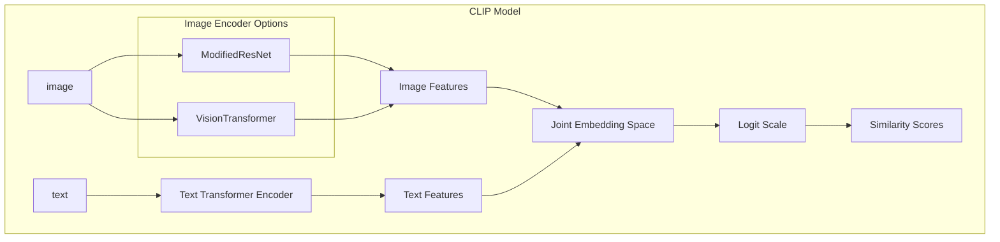
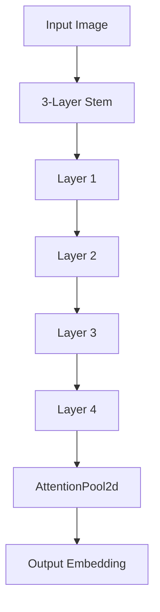
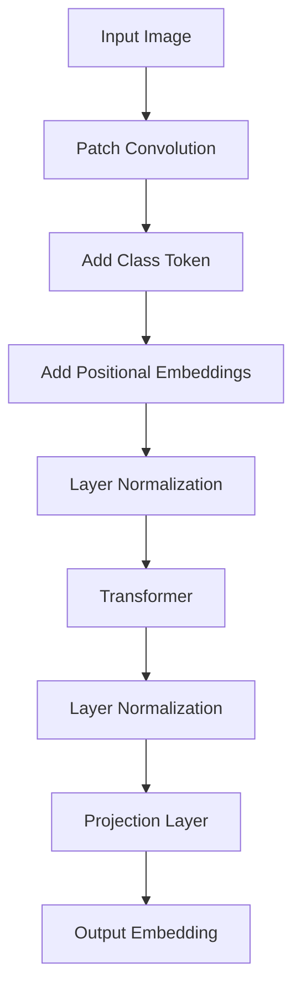
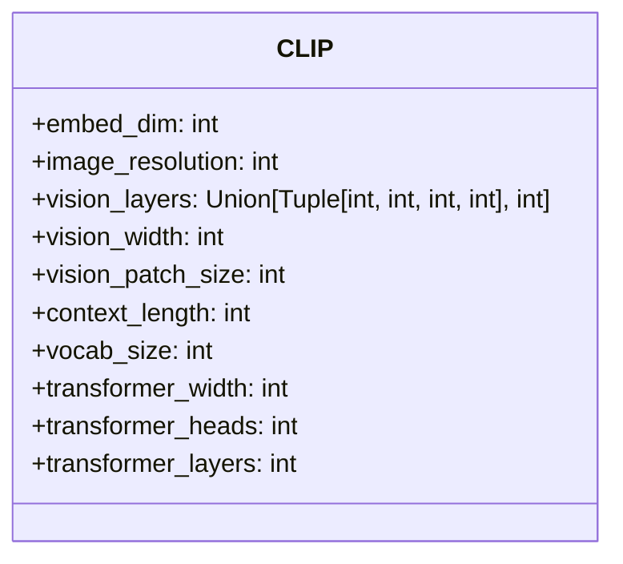

<!-- source: DeepWiki mcp.deepwiki.com · repo openai/CLIP · page 3.3 Model Variants and Parameters · fetched 2026-10-26 -->

# Model Variants and Parameters

Relevant source files

The following files were used as context for generating this wiki page:

- [clip/model.py](clip/model.py)

## Purpose

This document provides detailed information about the different CLIP model variants available in the repository, their architectures, parameters, and performance characteristics. It covers both ResNet and Vision Transformer (ViT) based models, their configuration details, and how to identify and use specific variants.

For information about loading and using CLIP models, see [Loading and Using CLIP](#3.1).

## CLIP Model Architecture Overview

CLIP (Contrastive Language-Image Pre-training) uses a dual-encoder architecture consisting of:
1. An image encoder (either ModifiedResNet or Vision Transformer)
2. A text encoder (Transformer)
3. A joint multimodal embedding space

The model maps both images and text to a shared embedding space where semantically similar content is positioned closer together.

Sources: [clip/model.py:243-372]()

## Available Model Variants

CLIP is available in several variants, differing primarily in their image encoder architecture. The model name format follows: `{architecture}-{configuration}`.

### Model Variants Overview

| Model Name | Image Encoder Type | Parameters | Image Resolution | Patch Size | Vision Width | Vision Layers |
|------------|-------------------|------------|------------------|------------|--------------|---------------|
| RN50       | ModifiedResNet    | 102M       | 224              | N/A        | 64           | [3, 4, 6, 3]  |
| RN101      | ModifiedResNet    | 167M       | 224              | N/A        | 64           | [3, 4, 23, 3] |
| RN50x4     | ModifiedResNet    | 212M       | 288              | N/A        | 80           | [4, 6, 10, 6] |
| RN50x16    | ModifiedResNet    | 772M       | 384              | N/A        | 96           | [6, 8, 18, 8] |
| RN50x64    | ModifiedResNet    | 3.0B       | 448              | N/A        | 128          | [3, 15, 36, 10] |
| ViT-B/32   | VisionTransformer | 151M       | 224              | 32         | 768          | 12            |
| ViT-B/16   | VisionTransformer | 149M       | 224              | 16         | 768          | 12            |
| ViT-L/14   | VisionTransformer | 428M       | 224              | 14         | 1024         | 24            |
| ViT-L/14@336px | VisionTransformer | 428M   | 336              | 14         | 1024         | 24            |

Sources: [clip/model.py:399-436]()

## Model Architectures Details

### ModifiedResNet Architecture

The ModifiedResNet architecture used in CLIP differs from standard ResNet implementations in several ways:

1. Uses 3 "stem" convolutions instead of 1
2. Uses average pooling instead of max pooling
3. Implements anti-aliasing strided convolutions
4. Uses QKV attention for the final pooling layer instead of average pooling

Sources: [clip/model.py:94-154]()

### VisionTransformer Architecture

The VisionTransformer (ViT) divides an image into fixed-size patches, linearly embeds each patch, adds position embeddings, and feeds the resulting sequence of vectors to a standard Transformer encoder.

Sources: [clip/model.py:206-240]()

## Parameter Details

### Model Creation Parameters

The CLIP model is initialized with the following parameters:

Source: [clip/model.py:243-298]()

### ModifiedResNet Parameters

The ModifiedResNet encoder takes these parameters:

| Parameter | Description |
|-----------|-------------|
| layers | Tuple of 4 integers defining the number of Bottleneck blocks in each layer |
| output_dim | Dimension of the output embedding |
| heads | Number of attention heads in the AttentionPool2d |
| input_resolution | Input image resolution (default: 224) |
| width | Base width parameter, controlling network size |

Sources: [clip/model.py:102-127]()

### VisionTransformer Parameters

The VisionTransformer encoder takes:

| Parameter | Description |
|-----------|-------------|
| input_resolution | Input image resolution |
| patch_size | Size of image patches |
| width | Width of the transformer |
| layers | Number of transformer layers |
| heads | Number of attention heads |
| output_dim | Dimension of the output embedding |

Sources: [clip/model.py:207-221]()

### Text Transformer Parameters

The text encoder parameters include:

| Parameter | Description |
|-----------|-------------|
| width | Width of the transformer |
| layers | Number of transformer layers |
| heads | Number of attention heads |
| attn_mask | Attention mask for causal attention |

Sources: [clip/model.py:196-203]()

## Model Detection and Building

The `build_model` function in `model.py` automatically determines the model architecture and parameters from the state dictionary:

1. Detects if the model is ViT-based by checking for "visual.proj" in the state dictionary
2. For ViT models, determines layers, width, patch size, and resolution from weights
3. For ResNet models, extracts layer counts, width, and resolution
4. Extracts text encoder parameters from the state dictionary
5. Constructs the appropriate CLIP model with the determined parameters

Sources: [clip/model.py:399-436]()

## Model Variant Performance Comparison

Different model variants offer trade-offs between accuracy, computational requirements, and memory usage:

| Model | Zero-Shot ImageNet Accuracy | Computational Requirements | Model Size |
|-------|------------------------------|---------------------------|-----------| 
| RN50 | 59.6% | Low | 102M |
| RN101 | 62.2% | Medium | 167M |
| RN50x4 | 65.4% | Medium | 212M |
| RN50x16 | 70.3% | High | 772M |
| RN50x64 | 75.5% | Very High | 3.0B |
| ViT-B/32 | 63.2% | Medium | 151M |
| ViT-B/16 | 68.3% | Medium-High | 149M |
| ViT-L/14 | 75.5% | High | 428M |
| ViT-L/14@336px | 76.2% | Very High | 428M |

## Implementation Details

### Precision Conversion

CLIP models support conversion to FP16 precision using the `convert_weights` function:

The conversion applies to:
- Convolutional layers
- Linear layers
- MultiheadAttention layers
- Projection layers

Sources: [clip/model.py:375-396]()

### Parameter Initialization

CLIP initializes parameters differently based on component type:
- Token and positional embeddings use normal initialization
- Attention pool weights in ResNet use layer-specific initialization 
- Transformer weights use layer-specific scaling for stability

Sources: [clip/model.py:299-326]()

---

