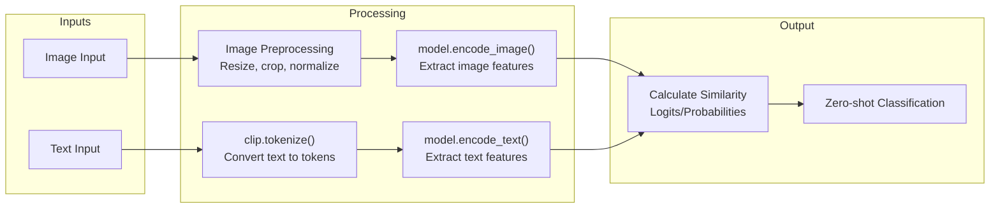
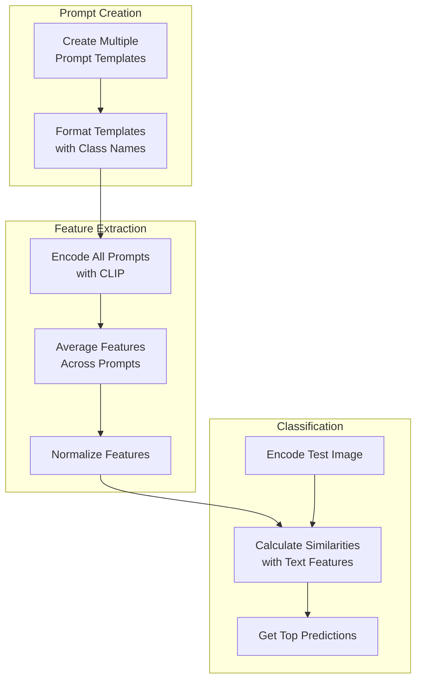
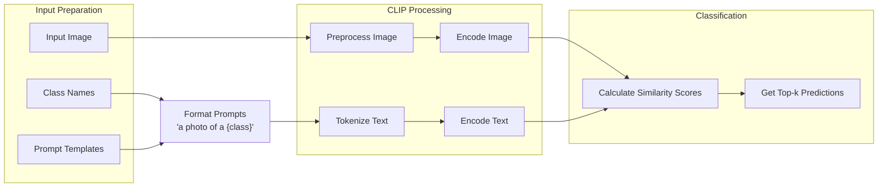

<!-- source: DeepWiki mcp.deepwiki.com · repo openai/CLIP · page 4 Examples and Usage · fetched 2026-10-26 -->

# Examples and Usage

<details>
<summary>Relevant source files</summary>

The following files were used as context for generating this wiki page:

- [README.md](README.md)
- [clip/clip.py](clip/clip.py)
- [notebooks/Interacting_with_CLIP.ipynb](notebooks/Interacting_with_CLIP.ipynb)
- [notebooks/Prompt_Engineering_for_ImageNet.ipynb](notebooks/Prompt_Engineering_for_ImageNet.ipynb)

</details>


This page provides practical examples and usage patterns for CLIP (Contrastive Language-Image Pre-Training). It demonstrates how to use CLIP for various tasks such as image-text similarity, zero-shot classification, and more advanced applications. For information about the CLIP model architecture and theory, see [CLIP Model Architecture](#2).

## Basic Usage

CLIP (Contrastive Language-Image Pre-Training) allows you to calculate the similarity between images and text. The basic workflow involves loading a model, preparing inputs, and using the model to encode images and text or calculate similarities.

### Loading a CLIP Model

First, you need to import CLIP and load a pre-trained model:

```python
import torch
import clip
from PIL import Image

# Check available models
print(clip.available_models())

# Load the model
device = "cuda" if torch.cuda.is_available() else "cpu"
model, preprocess = clip.load("ViT-B/32", device=device)
```

The `clip.load()` function returns both the model and a preprocessing function for images. The preprocessing function handles resizing, cropping, and normalizing images for the model.

Sources: [clip/clip.py:89-202](), [README.md:15-46]()

### Image and Text Encoding

CLIP can encode both images and text into a joint embedding space:

```python
# Load and preprocess an image
image = preprocess(Image.open("CLIP.png")).unsqueeze(0).to(device)

# Prepare text
text = clip.tokenize(["a diagram", "a dog", "a cat"]).to(device)

# Encode image and text
with torch.no_grad():
    image_features = model.encode_image(image)
    text_features = model.encode_text(text)
    
    # Normalize features
    image_features /= image_features.norm(dim=-1, keepdim=True)
    text_features /= text_features.norm(dim=-1, keepdim=True)
```

Sources: [README.md:27-44](), [notebooks/Interacting_with_CLIP.ipynb:500-546]()

### Calculating Similarities

Once you have encoded the images and text, you can calculate the similarities between them:

```python
# Calculate similarity scores
with torch.no_grad():
    # Method 1: Using the model directly
    logits_per_image, logits_per_text = model(image, text)
    probs = logits_per_image.softmax(dim=-1).cpu().numpy()
    
    # Method 2: Using the cosine similarity of features
    similarity = (100.0 * image_features @ text_features.T).softmax(dim=-1)
    values, indices = similarity[0].topk(5)
```

Sources: [README.md:36-45](), [notebooks/Interacting_with_CLIP.ipynb:547-567]()

## Zero-Shot Image Classification

One of the most powerful features of CLIP is its ability to perform zero-shot classification without additional training.

### Zero-Shot Classification with CIFAR-100

```python
import os
import clip
import torch
from torchvision.datasets import CIFAR100

# Load the model
device = "cuda" if torch.cuda.is_available() else "cpu"
model, preprocess = clip.load('ViT-B/32', device)

# Download the dataset
cifar100 = CIFAR100(root=os.path.expanduser("~/.cache"), download=True, train=False)

# Prepare the inputs
image, class_id = cifar100[3637]
image_input = preprocess(image).unsqueeze(0).to(device)
text_inputs = torch.cat([clip.tokenize(f"a photo of a {c}") for c in cifar100.classes]).to(device)

# Calculate features
with torch.no_grad():
    image_features = model.encode_image(image_input)
    text_features = model.encode_text(text_inputs)

# Pick the top 5 most similar labels for the image
image_features /= image_features.norm(dim=-1, keepdim=True)
text_features /= text_features.norm(dim=-1, keepdim=True)
similarity = (100.0 * image_features @ text_features.T).softmax(dim=-1)
values, indices = similarity[0].topk(5)

# Print the result
print("\nTop predictions:\n")
for value, index in zip(values, indices):
    print(f"{cifar100.classes[index]:>16s}: {100 * value.item():.2f}%")
```

This will output the top 5 predicted classes for the given image, with their confidence scores.

Sources: [README.md:87-136]()

## CLIP Workflow Diagram

### CLIP Basic Workflow



Sources: [clip/clip.py:89-202](), [README.md:15-46](), [README.md:87-136]()

## Advanced Usage

### Prompt Engineering for Better Zero-Shot Classification

CLIP's zero-shot classification performance can be significantly improved by using better prompts. Instead of simple prompts like "a photo of a {class}", more descriptive prompts can help CLIP understand the task better.

#### Zero-Shot ImageNet Classification with Prompt Ensembling

The "Prompt_Engineering_for_ImageNet.ipynb" notebook demonstrates how to improve CLIP's performance on ImageNet through prompt engineering:

```python
# Define a set of better prompts
imagenet_templates = [
    "a bad photo of a {}.",
    "a photo of many {}.",
    "a sculpture of a {}.",
    "a photo of the hard to see {}.",
    "a low resolution photo of the {}.",
    "a rendering of a {}.",
    "graffiti of a {}.",
    "a bad photo of the {}.",
    "a cropped photo of the {}.",
    "a tattoo of a {}.",
    "the embroidered {}.",
    "a photo of a hard to see {}.",
    "a bright photo of a {}.",
    "a photo of a clean {}.",
    "a photo of a dirty {}.",
    "a dark photo of the {}.",
    "a drawing of a {}.",
    "a photo of my {}.",
    "the plastic {}.",
    "a photo of the cool {}.",
    "a close-up photo of a {}.",
    "a black and white photo of the {}.",
    "a painting of the {}.",
    "a painting of a {}.",
    "a pixelated photo of the {}.",
    "a sculpture of the {}.",
    "a bright photo of the {}.",
    "a cropped photo of a {}.",
    "a plastic {}.",
    "a photo of the dirty {}.",
    "a jpeg corrupted photo of a {}.",
    "a blurry photo of the {}.",
    "a photo of the {}.",
    "a good photo of the {}.",
    "a rendering of the {}.",
    "a {} in a video game.",
    "a photo of one {}.",
    "a doodle of a {}.",
    "a close-up photo of the {}.",
    "a photo of a {}.",
    "the origami {}.",
    "the {} in a video game.",
    "a sketch of a {}.",
    "a doodle of the {}.",
    "a origami {}.",
    "a low resolution photo of a {}.",
    "the toy {}.",
    "a rendition of the {}.",
    "a photo of the clean {}.",
    "a photo of a large {}.",
    "a rendition of a {}.",
    "a photo of a nice {}.",
    "a photo of a weird {}.",
    "a blurry photo of a {}.",
    "a cartoon {}.",
    "art of a {}.",
    "a sketch of the {}.",
    "a embroidered {}.",
    "a pixelated photo of a {}.",
    "itap of the {}.",
    "a jpeg corrupted photo of the {}.",
    "a good photo of a {}.",
    "a plushie {}.",
    "a photo of the nice {}.",
    "a photo of the small {}.",
    "a photo of the weird {}.",
    "the cartoon {}.",
    "art of the {}.",
    "a drawing of the {}.",
    "a photo of the large {}.",
    "a black and white photo of a {}.",
    "the plushie {}.",
    "a dark photo of a {}.",
    "itap of a {}.",
    "graffiti of the {}.",
    "a toy {}.",
    "itap of my {}.",
    "a photo of a cool {}.",
    "a photo of a small {}.",
    "a tattoo of the {}.",
]

# Use prompt ensembling (average the results of multiple prompts)
with torch.no_grad():
    all_text_features = []
    for template in imagenet_templates:
        texts = [template.format(c) for c in imagenet_classes]
        text_inputs = clip.tokenize(texts).to(device)
        text_features = model.encode_text(text_inputs).float()
        text_features /= text_features.norm(dim=-1, keepdim=True)
        all_text_features.append(text_features)
    
    # Average text features from different prompts
    text_features = torch.stack(all_text_features).mean(dim=0)
    text_features /= text_features.norm(dim=-1, keepdim=True)
```

By averaging the results from multiple prompts, CLIP can achieve higher accuracy on classification tasks without any fine-tuning.

Sources: [notebooks/Prompt_Engineering_for_ImageNet.ipynb]()

### Linear Probe Evaluation

CLIP's image features can also be used for training a linear classifier:

```python
import os
import clip
import torch

import numpy as np
from sklearn.linear_model import LogisticRegression
from torch.utils.data import DataLoader
from torchvision.datasets import CIFAR100
from tqdm import tqdm

# Load the model
device = "cuda" if torch.cuda.is_available() else "cpu"
model, preprocess = clip.load('ViT-B/32', device)

# Load the dataset
root = os.path.expanduser("~/.cache")
train = CIFAR100(root, download=True, train=True, transform=preprocess)
test = CIFAR100(root, download=True, train=False, transform=preprocess)


def get_features(dataset):
    all_features = []
    all_labels = []
    
    with torch.no_grad():
        for images, labels in tqdm(DataLoader(dataset, batch_size=100)):
            features = model.encode_image(images.to(device))

            all_features.append(features)
            all_labels.append(labels)

    return torch.cat(all_features).cpu().numpy(), torch.cat(all_labels).cpu().numpy()

# Calculate the image features
train_features, train_labels = get_features(train)
test_features, test_labels = get_features(test)

# Perform logistic regression
classifier = LogisticRegression(random_state=0, C=0.316, max_iter=1000, verbose=1)
classifier.fit(train_features, train_labels)

# Evaluate using the logistic regression classifier
predictions = classifier.predict(test_features)
accuracy = np.mean((test_labels == predictions).astype(float)) * 100.
print(f"Accuracy = {accuracy:.3f}")
```

This approach extracts features from a dataset using CLIP, then trains a simple linear classifier on those features. It typically achieves high accuracy with much less training data than traditional methods.

Sources: [README.md:142-190]()

## Prompt Engineering Workflow Diagram



Sources: [notebooks/Prompt_Engineering_for_ImageNet.ipynb]()

## CLIP API Reference

### Main Functions

| Function | Description | Parameters |
|----------|-------------|------------|
| `clip.available_models()` | Returns the names of available CLIP models | None |
| `clip.load(name, device, jit)` | Loads a CLIP model | `name`: Model name<br>`device`: Device to put the model on<br>`jit`: Whether to load the optimized JIT model |
| `clip.tokenize(text, context_length)` | Tokenizes text for CLIP | `text`: Input text (string or list)<br>`context_length`: Max token length (default 77) |

### Model Methods

| Method | Description | Parameters |
|--------|-------------|------------|
| `model.encode_image(image)` | Encodes images into feature vectors | `image`: Batch of preprocessed images |
| `model.encode_text(text)` | Encodes tokenized text into feature vectors | `text`: Batch of tokenized text |
| `model(image, text)` | Calculates similarity between images and text | `image`: Batch of preprocessed images<br>`text`: Batch of tokenized text |

Sources: [clip/clip.py:89-245](), [README.md:50-81]()

## Available Models

CLIP comes with several pre-trained models of different sizes and architectures:

| Model Name | Architecture | Parameters | Notes |
|------------|--------------|------------|-------|
| "RN50" | ResNet-50 | 102M | Good balance of speed and accuracy |
| "RN101" | ResNet-101 | 182M | Higher accuracy than RN50 |
| "RN50x4" | ResNet-50 (4× width) | 336M | Higher accuracy, larger model |
| "RN50x16" | ResNet-50 (16× width) | 1.2B | Very large model, high accuracy |
| "RN50x64" | ResNet-50 (64× width) | 4.8B | Extremely large model |
| "ViT-B/32" | Vision Transformer | 151M | Good for general use |
| "ViT-B/16" | Vision Transformer | 151M | Higher accuracy than ViT-B/32 |
| "ViT-L/14" | ViT (Large) | 428M | Very high accuracy |
| "ViT-L/14@336px" | ViT (Large, 336×336) | 428M | Highest accuracy, larger input size |

Sources: [clip/clip.py:30-40](), [notebooks/Interacting_with_CLIP.ipynb:380-408]()

## Zero-Shot Classification Diagram



Sources: [README.md:87-136](), [notebooks/Interacting_with_CLIP.ipynb:500-567]()

## Best Practices

### Optimizing Performance

1. **Model Selection**: Choose the appropriate model size based on your computational resources and accuracy requirements. ViT-B/32 offers a good balance of speed and accuracy for most applications.

2. **Batch Processing**: When processing multiple images or texts, use batches to maximize throughput.

3. **GPU Acceleration**: CLIP models benefit significantly from GPU acceleration. If available, use CUDA devices.

4. **Prompt Engineering**: For zero-shot classification, using well-crafted prompts can significantly improve accuracy. Consider using prompt ensembling (combining results from multiple prompts).

### Common Pitfalls

1. **Input Preprocessing**: Always use the `preprocess` function returned by `clip.load()` for images to ensure proper formatting.

2. **Context Length**: CLIP models have a maximum context length (usually 77 tokens). Longer texts will be truncated.

3. **Normalization**: For comparing features, remember to normalize both image and text features before calculating similarities.

4. **Batch Size Limitations**: Very large batch sizes may cause out-of-memory errors, especially with larger models.

Sources: [clip/clip.py:89-245](), [README.md:15-136](), [notebooks/Interacting_with_CLIP.ipynb:380-567]()

## Further Resources

For more advanced applications and research using CLIP, users might want to explore:

- OpenAI's CLIP paper: "Learning Transferable Visual Models From Natural Language Supervision"
- OpenCLIP: An open-source implementation with additional models
- Hugging Face's CLIP implementation for easier integration with their ecosystem

For details about CLIP's architecture and theoretical foundations, see [CLIP Model Architecture](#2).

---

