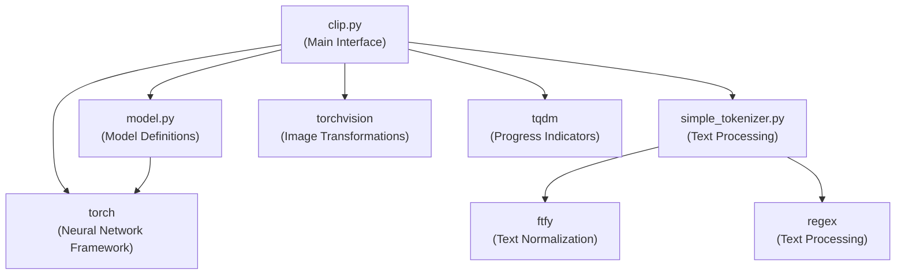
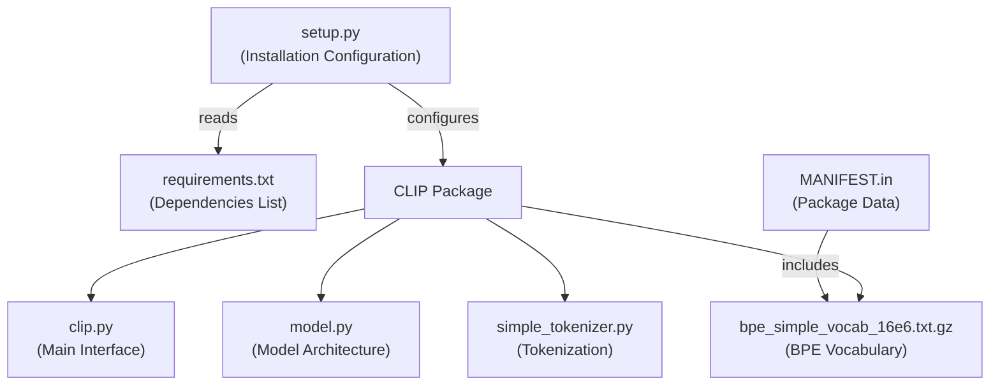
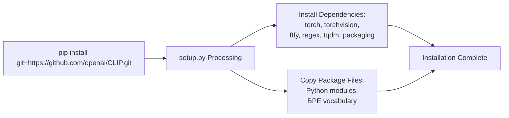

<!-- source: DeepWiki mcp.deepwiki.com · repo openai/CLIP · page 5 Installation and Requirements · fetched 2026-10-26 -->

# Installation and Requirements

<details>
<summary>Relevant source files</summary>

The following files were used as context for generating this wiki page:

- [MANIFEST.in](MANIFEST.in)
- [requirements.txt](requirements.txt)
- [setup.py](setup.py)

</details>


This document provides detailed instructions for installing the CLIP (Contrastive Language-Image Pre-training) library and outlines its system requirements. For information about using CLIP after installation, see [Loading and Using CLIP](#3.1). For details about the model architecture, see [CLIP Model Architecture](#2).

## System Requirements

### Hardware Requirements

CLIP models vary in their resource requirements depending on the model variant:

| Model Variant | Minimum VRAM | Recommended RAM | Approximate Disk Space |
|---------------|--------------|-----------------|------------------------|
| ViT-B/32      | 2GB          | 8GB             | ~340MB                 |
| ViT-B/16      | 4GB          | 8GB             | ~380MB                 |
| ViT-L/14      | 8GB+         | 16GB+           | ~890MB                 |
| RN50          | 2GB          | 8GB             | ~170MB                 |
| RN101         | 3GB          | 8GB             | ~340MB                 |
| RN50x4        | 6GB          | 16GB            | ~480MB                 |
| RN50x16       | 12GB+        | 16GB+           | ~1.2GB                 |

Note: These specifications assume inference with small batch sizes. Requirements increase with larger batches.

### Software Requirements

CLIP has the following software dependencies:

- **Python**: 3.7 or higher
- **PyTorch**: 1.7.1 or higher
- **TorchVision**: Compatible with installed PyTorch version
- **CUDA**: Compatible with PyTorch (for GPU acceleration)
- **Additional libraries**: ftfy, regex, tqdm, packaging

Sources: [requirements.txt:1-6]()

## Installation Methods

### Installation via pip

The recommended way to install CLIP is directly from the GitHub repository:

```bash
pip install git+https://github.com/openai/CLIP.git
```

This command fetches the source code and installs CLIP along with all its dependencies.

### Installation from Source

For development purposes or to modify the code:

```bash
git clone https://github.com/openai/CLIP.git
cd CLIP
pip install -e .
```

The `-e` flag installs in "editable" mode, allowing code modifications without reinstallation.

For development with testing capabilities:

```bash
pip install -e .[dev]
```

This installs additional development dependencies like pytest.

Sources: [setup.py:6-21]()

## CLIP Dependency Structure

The following diagram shows CLIP's primary dependencies and how they relate to components in the codebase:

### CLIP Dependencies and Module Relationships



Sources: [requirements.txt:1-6](), [setup.py:13-18]()

## Package Installation Structure

When installed, the CLIP package includes these key components:

### CLIP Package Organization



The BPE vocabulary file is essential for text tokenization and is included as package data via the MANIFEST.in file.

Sources: [MANIFEST.in:1](), [setup.py:6-21]()

## Installation Process

The installation workflow follows this sequence:

### CLIP Installation Workflow



Note: CLIP model weights are not downloaded during installation. They are downloaded automatically when first loaded using the `clip.load()` function.

Sources: [setup.py:6-21](), [requirements.txt:1-6]()

## Verifying Installation

To verify your installation was successful, run this simple test:

```python
import clip
import torch

# Load the model (this will download weights if needed)
model, preprocess = clip.load("ViT-B/32", device="cpu")

# If no errors occur, installation is successful
print("CLIP installed successfully!")
```

If you encounter no errors, your installation is working correctly.

## Troubleshooting

### PyTorch GPU Support

For optimal performance, CLIP should be used with GPU acceleration. If PyTorch is not detecting your GPU:

1. Verify your GPU is CUDA-compatible
2. Ensure you have installed PyTorch with CUDA support
3. Check that the CUDA toolkit version matches your PyTorch installation

### ImportError for Dependencies

If you encounter import errors for dependencies:

```bash
# Reinstall specific dependencies
pip install ftfy --upgrade
pip install regex --upgrade

# Or reinstall all requirements
pip install -r requirements.txt
```

### Model Loading Errors

If you encounter errors when loading models, check:

1. Network connectivity (required for initial model download)
2. Sufficient disk space for model weights
3. Permissions for the cache directory

CLIP models are cached in the directory specified by the environment variable `TORCH_HOME` (defaults to `~/.cache/torch`).

## Next Steps

After successful installation:
- For information on loading and using CLIP models, see [Loading and Using CLIP](#3.1)
- For understanding available model variants, see [Model Variants and Parameters](#3.3)
- For practical usage examples, see [Examples and Usage](#4)

---

