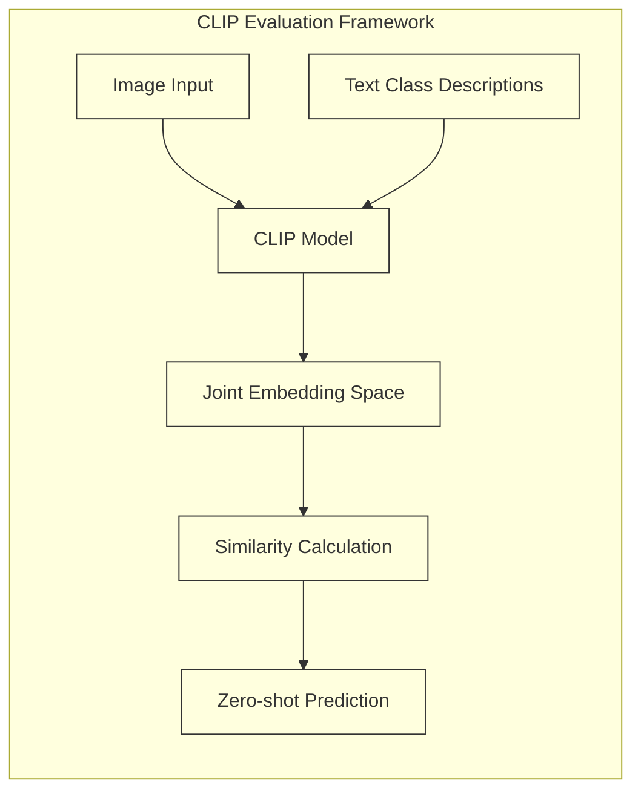
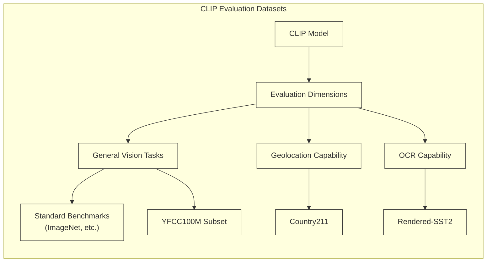
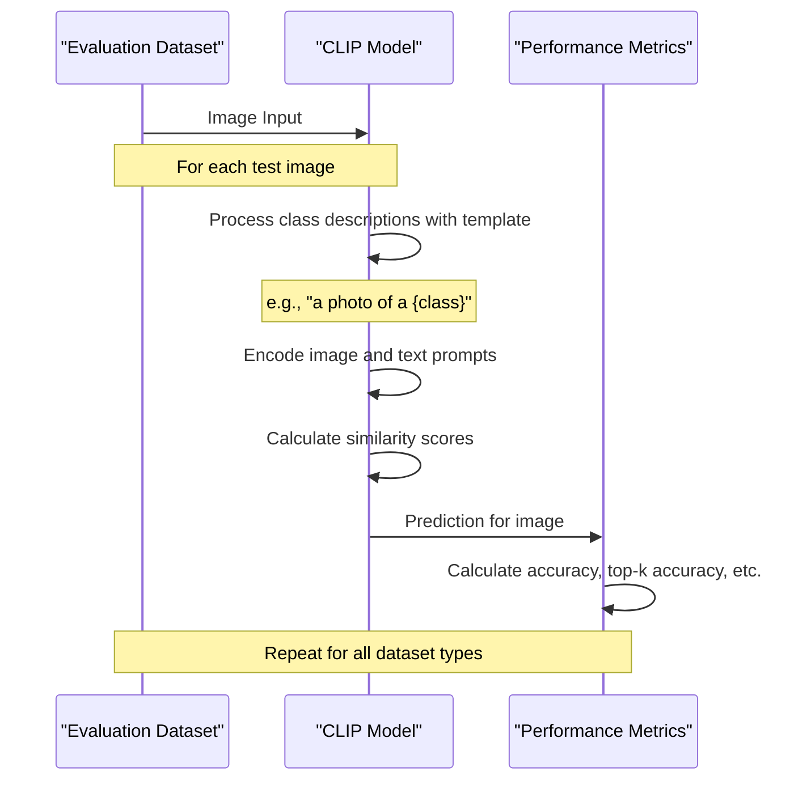

<!-- source: DeepWiki mcp.deepwiki.com · repo openai/CLIP · page 6 Evaluation and Datasets · fetched 2026-10-26 -->

# Evaluation and Datasets

<details>
<summary>Relevant source files</summary>

The following files were used as context for generating this wiki page:

- [data/country211.md](data/country211.md)
- [data/rendered-sst2.md](data/rendered-sst2.md)
- [data/yfcc100m.md](data/yfcc100m.md)

</details>


This document provides a comprehensive overview of how CLIP models are evaluated and the specific datasets used for evaluation. It covers the evaluation methodology, key evaluation datasets, and how to access these datasets. For information about testing CLIP models for consistency, see [Model Testing](#6.2).

## 1. Evaluation Methodology

CLIP (Contrastive Language-Image Pre-training) models are evaluated primarily through zero-shot prediction tasks. Unlike traditional computer vision models that require task-specific training, CLIP can perform various image classification tasks without additional training by leveraging its joint image-text embedding space.



Sources: data/yfcc100m.md, data/country211.md, data/rendered-sst2.md

### 1.1 Zero-Shot Prediction Process

The zero-shot prediction process generally follows these steps:

1. **Text Prompting**: Convert class names into natural language prompts (e.g., "a photo of a {class}")
2. **Feature Extraction**: Extract features from both the test image and the class prompts
3. **Similarity Calculation**: Calculate cosine similarity between the image features and text features
4. **Prediction**: Select the class with the highest similarity score as the prediction

This methodology allows CLIP to be evaluated on diverse tasks without task-specific fine-tuning.

## 2. Key Evaluation Datasets

CLIP is evaluated on various datasets to assess its performance across different dimensions. Three specialized datasets mentioned in the repository are particularly important for evaluating specific capabilities.



Sources: data/yfcc100m.md, data/country211.md, data/rendered-sst2.md

### 2.1 YFCC100M Subset

The YFCC100M Subset is used for dataset ablation studies to demonstrate that CLIP's performance remains robust even when trained on a smaller dataset.

**Key characteristics:**
- Contains 14,829,396 images (approximately 15% of the full YFCC100M dataset)
- Filtered to include only images with natural language titles and/or descriptions in English
- Used to evaluate how dataset size affects model performance

**Acquisition:**
```bash
wget https://openaipublic.azureedge.net/clip/data/yfcc100m_subset_data.tsv.bz2
bunzip2 yfcc100m_subset_data.tsv.bz2
```

The downloaded file contains a list of (line number, photo identifier, photo hash) for each image in the subset, corresponding to the first three columns in the dataset's metadata TSV file.

Sources: data/yfcc100m.md

### 2.2 Country211

The Country211 dataset evaluates CLIP's capability for geolocation prediction, testing whether the model can identify the country where a photo was taken.

**Key characteristics:**
- Created by filtering YFCC100M for images with GPS coordinates corresponding to ISO-3166 country codes
- Balanced dataset with 150 training images, 50 validation images, and 100 test images for each of 211 countries
- Total size: approximately 11GB

**Acquisition:**
```bash
wget https://openaipublic.azureedge.net/clip/data/country211.tgz
tar zxvf country211.tgz
```

Sources: data/country211.md

### 2.3 Rendered SST2

The Rendered SST2 dataset evaluates CLIP's optical character recognition (OCR) capabilities by testing whether it can understand text rendered as images.

**Key characteristics:**
- Created by rendering sentences from the Stanford Sentiment Treebank v2 (SST2) dataset as images
- Used to evaluate CLIP's ability to process and understand text within images
- Total size: approximately 131MB

**Acquisition:**
```bash
wget https://openaipublic.azureedge.net/clip/data/rendered-sst2.tgz
tar zxvf rendered-sst2.tgz
```

Sources: data/rendered-sst2.md

## 3. Evaluation Process

The evaluation process follows a systematic approach to assess CLIP's performance across different capabilities and tasks.



Sources: data/yfcc100m.md, data/country211.md, data/rendered-sst2.md

### 3.1 Dataset-Specific Evaluation

Each dataset evaluates different aspects of CLIP's capabilities:

| Dataset | Evaluation Aspect | Methodology | Metrics |
|---------|-------------------|-------------|---------|
| YFCC100M Subset | Model robustness to dataset size | Dataset ablation study | Performance comparison with full dataset training |
| Country211 | Geolocation capability | Zero-shot country prediction | Classification accuracy across 211 countries |
| Rendered SST2 | Optical character recognition | Image classification of rendered text | Sentiment classification accuracy |

## 4. Evaluation Results Summary

The CLIP repository doesn't directly include the evaluation results in code form, but the paper demonstrates that:

1. **CLIP achieves competitive zero-shot performance** compared to fully supervised models on many standard vision datasets
2. **Dataset size matters**: The ablation study with YFCC100M shows that performance remains relatively robust even with the subset, though the full dataset provides better results
3. **Specialized capabilities**: CLIP demonstrates capabilities in geolocation (Country211) and text recognition (Rendered-SST2) that weren't explicitly built into the training objective

## 5. Using the Evaluation Datasets

When working with these datasets, it's important to respect their licensing terms:

- **YFCC100M** and **Country211**: Both are subsets of the YFCC100M dataset. Use is subject to Creative Commons licenses chosen by the original creators/uploaders.
- **Rendered SST2**: Based on the Stanford Sentiment Treebank v2, which is an academic dataset typically used with proper attribution.

For more information about the YFCC100M dataset, visit the official website at: https://multimediacommons.wordpress.com/yfcc100m-core-dataset/

When using these datasets for your own evaluation, you may want to set up a similar pipeline to the one used by the CLIP researchers to ensure comparable results.

Sources: data/yfcc100m.md, data/country211.md, data/rendered-sst2.md

---

