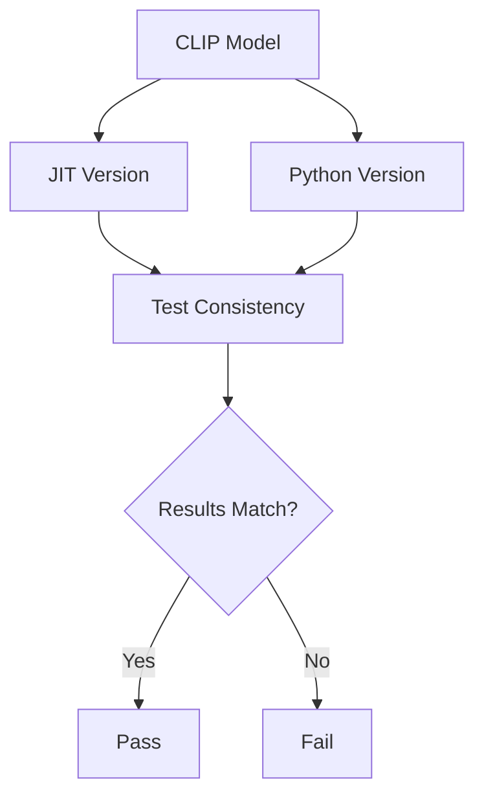
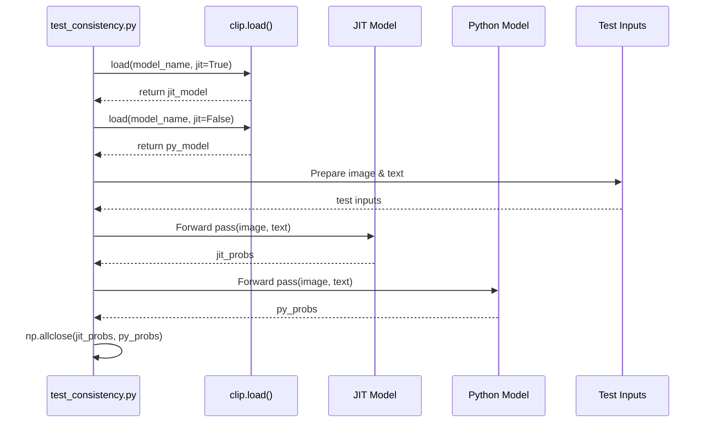
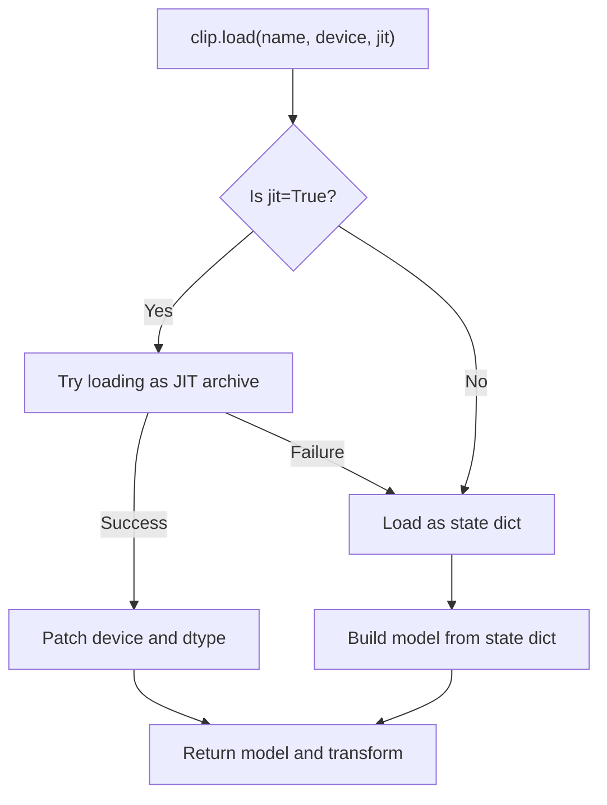

<!-- source: DeepWiki mcp.deepwiki.com · repo openai/CLIP · page 6.2 Model Testing · fetched 2026-10-26 -->

# Model Testing

<details>
<summary>Relevant source files</summary>

The following files were used as context for generating this wiki page:

- [clip/clip.py](clip/clip.py)
- [tests/test_consistency.py](tests/test_consistency.py)

</details>


This page documents the testing framework used to ensure consistency between different implementations of CLIP models, specifically focusing on validating that Just-In-Time (JIT) compiled models and Python-based models produce equivalent results. For information about the evaluation datasets used with CLIP, see [Evaluation Datasets](#6.1).

## JIT vs Non-JIT Models

CLIP provides two methods for loading models:

1. **JIT Models**: Optimized using PyTorch's JIT compiler for improved performance
2. **Non-JIT Models**: Standard Python implementation that is more hackable and easier to modify

The `load()` function in the CLIP API allows users to choose between these implementations through the `jit` parameter:

```python
model, preprocess = clip.load(name, device, jit=True|False)
```

Both implementations should produce functionally equivalent results, despite differences in their internal structure.

Sources: [clip/clip.py:94-143]()

## Testing Approach

CLIP implements consistency testing to ensure that JIT and non-JIT model versions produce equivalent results. This testing is crucial for several reasons:

- Validates that optimizations in the JIT version don't alter model behavior
- Ensures backward compatibility when changes are made to either implementation
- Provides confidence for users switching between implementations



Sources: [tests/test_consistency.py:9-25]()

## Consistency Test Implementation

The consistency test performs the following operations:

1. Load both JIT and non-JIT versions of the same model
2. Process identical inputs through both models
3. Compare outputs for numerical consistency



Sources: [tests/test_consistency.py:10-25]()

## Testing Inputs and Outputs

The consistency test uses specific inputs to validate model behavior:

| Input Type | Description | Implementation |
|------------|-------------|----------------|
| Image      | Sample image "CLIP.png" | Preprocessed using model-specific transform |
| Text       | ["a diagram", "a dog", "a cat"] | Tokenized using clip.tokenize() |

The test compares the probability distributions (softmax outputs) from both models using NumPy's `allclose` function with the following tolerance parameters:

- Absolute tolerance (atol): 0.01
- Relative tolerance (rtol): 0.1

These tolerances allow for minor numerical differences that naturally occur between implementations while ensuring functional equivalence.

Sources: [tests/test_consistency.py:15-25]()

## Automated Testing for All Models

The consistency test is automatically run against all available CLIP models using pytest's parametrize feature. This ensures that every model variant is validated:

```python
@pytest.mark.parametrize('model_name', clip.available_models())
def test_consistency(model_name):
    # Test implementation
```

This includes testing of all model architectures:
- Various ResNet variants (RN50, RN101, RN50x4, etc.)
- Vision Transformer variants (ViT-B/32, ViT-B/16, etc.)

Sources: [tests/test_consistency.py:9-10](), [clip/clip.py:30-40]()

## Common Differences Between Implementations

When comparing JIT and non-JIT models, some differences are expected and acceptable:

1. **Numerical precision**: Small floating-point differences due to optimization
2. **Memory usage**: JIT models typically use less memory but are less flexible
3. **Execution speed**: JIT models are generally faster but have longer load times

The consistency test is designed to focus on functional equivalence rather than exact numerical equality, which explains the use of tolerance parameters in the comparison.

Sources: [tests/test_consistency.py:25]()

## Running the Consistency Tests

To run the consistency tests, use pytest:

```bash
pytest tests/test_consistency.py
```

To test a specific model:

```bash
pytest tests/test_consistency.py::test_consistency[model_name]
```

Where `model_name` is one of the models returned by `clip.available_models()`.

Sources: [tests/test_consistency.py:9-25]()

## Technical Details of Model Loading

The actual process of loading models is handled by the `clip.load()` function, which has different code paths for JIT and non-JIT models:



The function tries to load the model as a JIT archive first, falling back to loading as a state dictionary if that fails. This ensures robustness when handling different model file formats.

Sources: [clip/clip.py:94-202](), [clip/clip.py:126-142]()