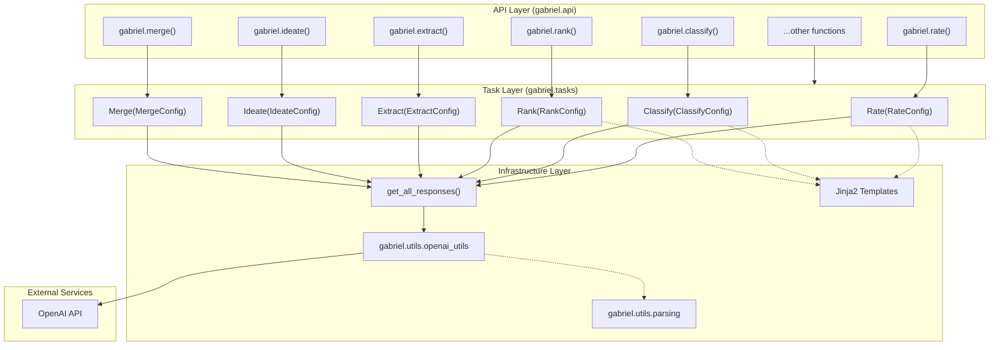
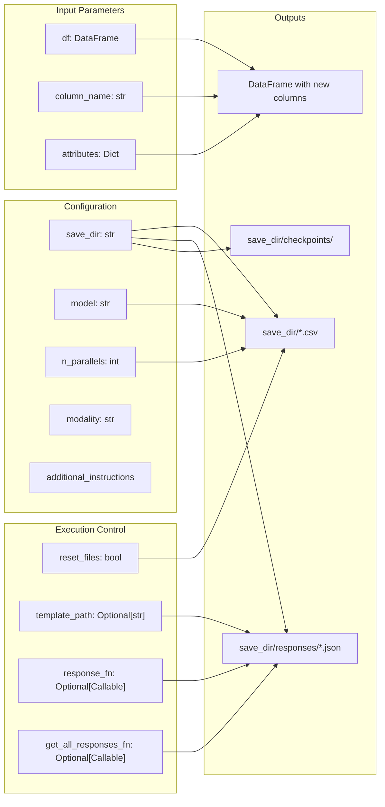
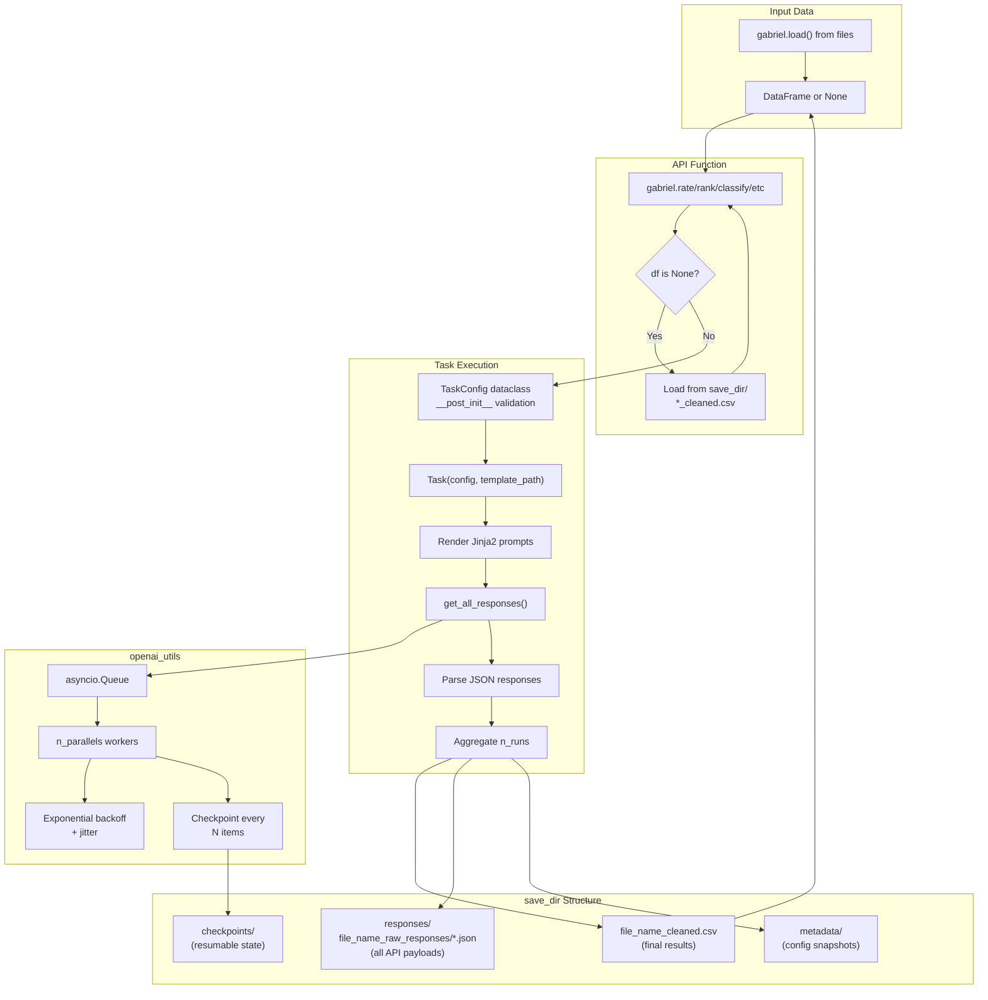
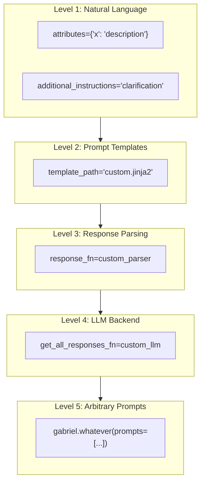

<!-- source: DeepWiki mcp.deepwiki.com · repo openai/GABRIEL · page 1 Overview · fetched 2026-10-26 -->

# Overview

<details>
<summary>Relevant source files</summary>

The following files were used as context for generating this wiki page:

- [README.md](README.md)
- [pyproject.toml](pyproject.toml)
- [src/gabriel/_version.py](src/gabriel/_version.py)
- [src/gabriel/api.py](src/gabriel/api.py)

</details>


This page provides a high-level introduction to GABRIEL (Generalized Attribute Based Ratings Information Extraction Library), its architecture, and core concepts. For installation instructions, see [Installation and Setup](#2). For detailed information about specific tasks, see [Measurement Tasks](#4), [Data Cleaning Tasks](#5), and [Helper and Composition Tasks](#6).

## Purpose and Scope

GABRIEL is a Python library that transforms unstructured qualitative data (text, images, audio, PDFs) into structured, analysis-ready datasets using Large Language Models. The library provides operational infrastructure—parallel execution, rate limiting, retry logic, checkpointing, and audit trails—so researchers can treat LLM-based measurements as reliable research instruments.

This overview covers:
- The library's purpose and design philosophy
- Three-layer architecture (API, Tasks, Infrastructure)
- Core abstractions that unify all tasks
- Task taxonomy and capabilities
- Data flow patterns

**Sources:** [README.md:1-27](), [pyproject.toml:1-46]()

## What is GABRIEL?

GABRIEL bridges the gap between qualitative social science data and quantitative analysis by providing:

| Capability | Description | Example |
|------------|-------------|---------|
| **Attribute Measurement** | Score or rank items on natural language attributes | Rate speeches for "populist rhetoric" on 0-100 scale |
| **Structured Extraction** | Extract facts into typed columns | Parse product descriptions into company, CEO, year fields |
| **Classification** | Apply categorical labels with definitions | Tag news articles into topical categories |
| **Data Cleaning** | Fuzzy matching, deduplication, filtering | Match two product catalogs with different naming conventions |
| **Feature Discovery** | Identify discriminating characteristics | Find what distinguishes 5-star vs 1-star reviews |

The library is installed via `pip install openai-gabriel` and accessed by importing the `gabriel` module. All public functions are exposed through [src/gabriel/api.py]().

**Sources:** [README.md:1-71](), [pyproject.toml:6-8]()

## Core Concept: Attributes as Measurement Instruments

The central abstraction in GABRIEL is the **attribute**: a natural language description of what to measure, paired with a name for the output column. This pattern appears across most tasks:

```python
attributes = {
    "savory taste": "How savory the dish is",
    "sweet taste": "Dessert-like sweetness",  
    "tangy taste": "Notes of tartness or acidity",
}

await gabriel.rate(df, "entity", attributes=attributes, save_dir="./output")
```

Rather than designing task-specific prompts, users express measurement intent in natural language. GABRIEL handles:
- Prompt construction via Jinja2 templates
- Batching (multiple attributes per API call via `n_attributes_per_run`)
- Response parsing and aggregation
- Multi-run consistency (via `n_runs` parameter)

This abstraction enables composition: complex tasks like `gabriel.ideate` orchestrate multiple sub-tasks (`seed` → `generate` → `rank` → `rate` → `deduplicate`), each using the same attribute-based interface.

**Sources:** [src/gabriel/api.py:109-143](), [README.md:38-47]()

## Three-Layer Architecture

GABRIEL's architecture consists of three layers that separate concerns:



**Layer 1: API Functions** ([src/gabriel/api.py]()) provide the public interface. Each function:
- Accepts high-level parameters (`df`, `column_name`, `attributes`, `save_dir`)
- Constructs a Config dataclass with validation
- Instantiates and runs a Task object
- Returns a `pandas.DataFrame` with results

**Layer 2: Task Classes** ([src/gabriel/tasks/]()) implement business logic:
- Render prompts from Jinja2 templates
- Call `get_all_responses()` for LLM interaction
- Parse and aggregate responses
- Write outputs to CSV/Parquet

**Layer 3: Infrastructure** ([src/gabriel/utils/openai_utils.py]()) provides execution guarantees:
- Parallel request batching (default 650 concurrent requests)
- Rate limit detection and dynamic backoff
- Exponential retry with jitter for transient errors
- Checkpoint-based resumability
- Response caching and logging

This separation allows users to customize at different levels: `additional_instructions` for simple tweaks, `template_path` for prompt redesign, `get_all_responses_fn` for alternative LLM backends (see [Advanced Configuration](#10)).

**Sources:** [src/gabriel/api.py:1-72](), architecture diagrams

## Task Taxonomy

GABRIEL provides three categories of tasks:

### Measurement Tasks

Tasks that quantify attributes or extract structured information:

| Function | Input → Output | Primary Use Case |
|----------|----------------|------------------|
| `gabriel.rate` | Text/image/audio → 0-100 scores | Measure rhetoric, toxicity, luxury |
| `gabriel.rank` | Items → relative z-scores | Tournament-style ranking on attributes |
| `gabriel.classify` | Items → categorical labels | Multi-label tagging with thresholds |
| `gabriel.extract` | Items → typed columns | Fact extraction (company, CEO, date) |
| `gabriel.discover` | Two labeled sets → discriminating features | Find what distinguishes classes |

See [Measurement Tasks](#4) for detailed documentation.

### Data Cleaning Tasks

Tasks that prepare, match, or filter data:

| Function | Input → Output | Primary Use Case |
|----------|----------------|------------------|
| `gabriel.merge` | Two DataFrames → crosswalk mapping | Fuzzy joins between datasets |
| `gabriel.deduplicate` | Items → deduplicated list | Collapse semantic duplicates |
| `gabriel.filter` | Items → Boolean mask | High-throughput screening |
| `gabriel.deidentify` | Text → anonymized text + mapping | PII replacement |

See [Data Cleaning Tasks](#5) for detailed documentation.

### Helper and Composition Tasks

Supporting tasks for coding, generation, and multi-stage workflows:

| Function | Input → Output | Primary Use Case |
|----------|----------------|------------------|
| `gabriel.codify` | Text → highlighted snippets | Qualitative coding |
| `gabriel.compare` | Item pairs → differences/similarities | Contrastive analysis |
| `gabriel.bucket` | Terms → taxonomy/clusters | Category discovery |
| `gabriel.seed` | Instructions → diverse entities | Initialize representative samples |
| `gabriel.ideate` | Topic → ranked theories | Scientific hypothesis generation |
| `gabriel.paraphrase` | Text → rewritten text | Consistent summarization |
| `gabriel.whatever` | Custom prompts → responses | Arbitrary prompting with infrastructure |

See [Helper and Composition Tasks](#6) and [Complex Multi-Stage Pipelines](#7).

**Sources:** [src/gabriel/api.py:51-71](), [README.md:38-71]()

## Common Abstractions and Parameters

All tasks share a consistent parameter interface:



### Core Parameters

| Parameter | Type | Purpose | Example |
|-----------|------|---------|---------|
| `df` | `pd.DataFrame` or `None` | Input data; when `None`, loads cached results | `pd.read_csv("data.csv")` |
| `column_name` | `str` | Column containing content to analyze | `"text"`, `"image_path"` |
| `attributes` | `Dict[str, str]` | Attribute name → description mapping | `{"populism": "Use of us vs them rhetoric"}` |
| `save_dir` | `str` | Output directory (supports `~` and env vars) | `"~/results/rate_run"` |

### Model and Execution Parameters

| Parameter | Type | Default | Purpose |
|-----------|------|---------|---------|
| `model` | `str` | `"gpt-5-mini"` | OpenAI model name |
| `n_parallels` | `int` | `650` | Max concurrent requests |
| `n_runs` | `int` | `1` | Repeat passes for consistency |
| `modality` | `str` | `"text"` | Input type: `text`, `entity`, `web`, `image`, `audio`, `pdf` |
| `reasoning_effort` | `Optional[str]` | `None` | `none`, `low`, `medium`, `high` |
| `reset_files` | `bool` | `False` | Overwrite existing outputs |

### Customization Hooks

| Parameter | Type | Purpose | Details |
|-----------|------|---------|---------|
| `additional_instructions` | `Optional[str]` | Append to prompt template | See [Prompt Customization](#10.1) |
| `template_path` | `Optional[str]` | Replace default Jinja2 template | See [Prompt Customization](#10.1) |
| `response_fn` | `Optional[Callable]` | Custom response parsing | See [Custom Response Parsing](#10.2) |
| `get_all_responses_fn` | `Optional[Callable]` | Replace OpenAI backend | See [Alternative LLM Backends](#10.3) |

**Sources:** [src/gabriel/api.py:105-215](), [src/gabriel/api.py:433-551]()

## Data Flow and Persistence

GABRIEL follows a checkpoint-driven data flow pattern:



### Save Directory Structure

When `gabriel.rate(df, ..., save_dir="./output", file_name="ratings.csv")` runs, it creates:

```
output/
├── ratings_cleaned.csv          # Final aggregated results
├── responses/
│   └── ratings_raw_responses/
│       ├── 00000.json          # Raw API response for item 0
│       ├── 00001.json
│       └── ...
├── checkpoints/
│   └── ratings_checkpoint.csv  # Resumable state
└── metadata/
    └── config.json             # Task configuration snapshot
```

- **Cleaned CSV**: Final DataFrame with attribute columns merged into original data
- **Raw Responses**: Full API payloads for auditing, includes tokens, latency, model version
- **Checkpoints**: Allow resumption with `reset_files=False` after crashes
- **Metadata**: Config snapshots for reproducibility

See [Save Directory Structure](#12.1) and [Checkpointing and Resumability](#12.2).

**Sources:** [src/gabriel/api.py:189-215](), architecture diagrams

## Relationship to OpenAI API

GABRIEL wraps the OpenAI Responses API with production-grade infrastructure:

```mermaid
graph TB
    subgraph User_Code["User Code"]
        call["await gabriel.rate(df, attributes=...)"]
    end
    
    subgraph openai_utils["gabriel.utils.openai_utils"]
        gar["get_all_responses()"]
        build_params["_build_params()"]
        rate_limiter["Rate limit detection"]
        worker_pool["Worker pool<br/>(n_parallels=650)"]
        error_handler["Error classifier<br/>Rate/Timeout/Connection"]
        cooldown["Global cooldown<br/>coordination"]
        checkpoint["Checkpoint manager"]
    end
    
    subgraph OpenAI_Services["OpenAI Services"]
        completions["Completions API"]
        embeddings["Embeddings API"]
        web_search["Web Search<br/>(via search_context_size)"]
    end
    
    call --> gar
    gar --> build_params
    build_params --> rate_limiter
    rate_limiter --> worker_pool
    worker_pool --> completions
    worker_pool --> embeddings
    build_params --> web_search
    web_search --> completions
    
    completions --> error_handler
    error_handler --> cooldown
    error_handler --> worker_pool
    cooldown --> worker_pool
    worker_pool --> checkpoint
```

### Infrastructure Guarantees

The `openai_utils` module ([src/gabriel/utils/openai_utils.py]()) provides:

| Feature | Implementation | Benefit |
|---------|----------------|---------|
| **Rate Limiting** | Reads `x-ratelimit-*` headers, calculates `concurrency_cap` | Avoids 429 errors, maximizes throughput |
| **Massive Concurrency** | Default 650 parallel workers via `asyncio` | 10-100x faster than sequential |
| **Retry Logic** | Exponential backoff + jitter for transient errors | Handles network issues, API timeouts |
| **Checkpointing** | Saves progress every N items to CSV | Resume multi-hour runs after crashes |
| **Background Mode** | Polling architecture for `timeout=None` | Handles requests >60 seconds |
| **Error Classification** | Rate limit → global pause; Connection → retry; Auth → fail fast | Appropriate response per error type |

For concurrency tuning details, see [Concurrency and Rate Limiting](#12.3). For error handling specifics, see [Error Handling and Retry Logic](#12.4).

**Sources:** [src/gabriel/utils/openai_utils.py](), architecture diagram 4

## Multimodal Support

GABRIEL supports six modalities via the `modality` parameter:

| Modality | Input Format | Use Case | Example |
|----------|--------------|----------|---------|
| `text` | Text strings | Long passages, documents | Speeches, articles, transcripts |
| `entity` | Short text | Names, titles, terms | Product names, technologies |
| `web` | Entities or queries | Web-augmented context | County data, company info |
| `image` | File paths or base64 | Visual content | Product photos, artwork |
| `audio` | File paths | Spoken content | Interviews, podcasts |
| `pdf` | File paths | Document scans | Research papers, contracts |

The `gabriel.load()` function ([src/gabriel/utils/file_utils.py]()) automatically detects modality and converts file directories into DataFrames. See [Data Loading and Preparation](#8) and [Multimodal Processing](#11).

**Sources:** [src/gabriel/api.py:118-164](), [README.md:161-164]()

## Extensibility and Customization Levels

GABRIEL supports five levels of customization:



1. **Natural Language Tweaks**: `additional_instructions` appends to existing templates
2. **Custom Templates**: `template_path` replaces prompt entirely while retaining infrastructure
3. **Response Parsing**: `response_fn` handles non-standard LLM outputs
4. **Backend Replacement**: `get_all_responses_fn` swaps OpenAI for alternatives (Anthropic, local models)
5. **Maximum Flexibility**: `gabriel.whatever()` accepts arbitrary prompts with full parallelism/checkpointing

See [Advanced Configuration](#10) for implementation details.

**Sources:** [src/gabriel/api.py:111-124](), architecture diagram 6

## Getting Started

For hands-on examples:
- **Tutorial Notebook**: [gabriel_tutorial_notebook.ipynb](https://colab.research.google.com/drive/1RMUeAWACpViqiUMlPMMwPTKyGU-OX756?usp=sharing) walks through complete projects
- **Installation**: See [Installation and Setup](#2)
- **Quick Start**: See README [README.md:92-134]() for minimal rating example
- **Task Documentation**: Browse [Measurement Tasks](#4), [Data Cleaning Tasks](#5), [Helper Tasks](#6)

**Sources:** [README.md:1-197]()

---

