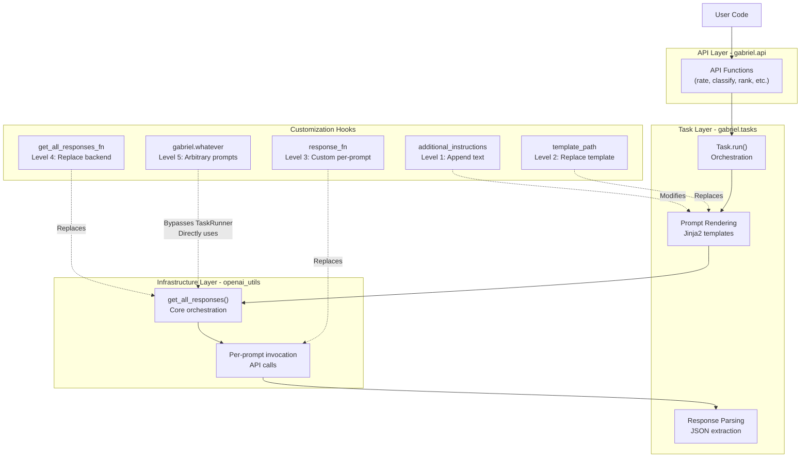
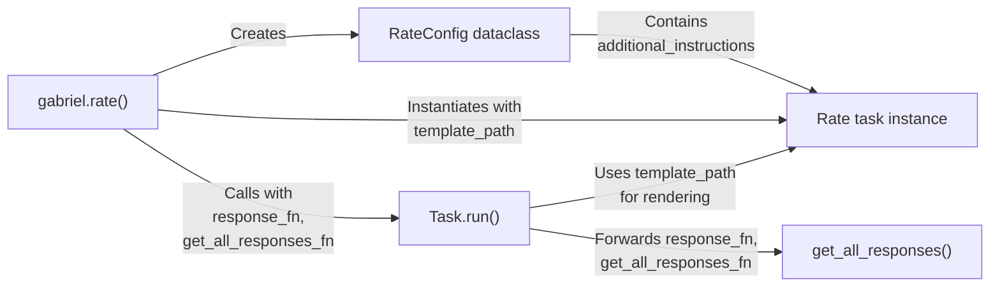
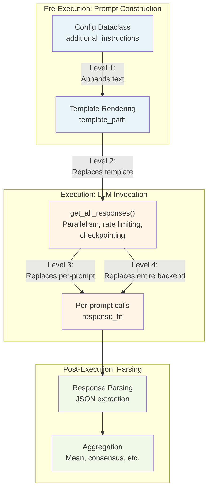
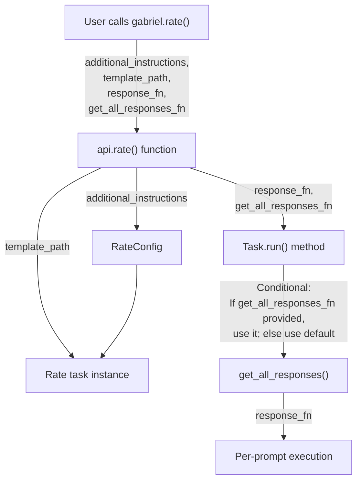

<!-- source: DeepWiki mcp.deepwiki.com · repo openai/GABRIEL · page 10 Advanced Configuration · fetched 2026-10-26 -->

# Advanced Configuration

<details>
<summary>Relevant source files</summary>

The following files were used as context for generating this wiki page:

- [README.md](README.md)
- [src/gabriel/api.py](src/gabriel/api.py)
- [src/gabriel/utils/openai_utils.py](src/gabriel/utils/openai_utils.py)
- [src/gabriel/utils/parsing.py](src/gabriel/utils/parsing.py)

</details>


This page covers GABRIEL's extensibility system for power users who need to customize behavior beyond standard parameter tuning. For basic usage with natural language parameters, see [Core Architecture](#3). For operational settings like parallelism and checkpointing, see [Operational Topics](#12).

GABRIEL provides five levels of customization, each trading simplicity for flexibility. Most users never need to leave Level 1 (natural language configuration), but when standard prompts don't fit your domain or you need to integrate non-OpenAI backends, these hooks let you modify specific components while retaining infrastructure like rate limiting, checkpointing, and parallel execution.

---

## Customization Architecture

GABRIEL's extensibility follows a layered architecture where each level intercepts the pipeline at a different point:



**Sources:** [src/gabriel/api.py:105-215](), [src/gabriel/utils/openai_utils.py:1-300]()

---

## Customization Levels

| Level | Hook | Scope | Infrastructure Retained | Use Case |
|-------|------|-------|------------------------|----------|
| **1** | `additional_instructions` | Append text to prompts | All | Add domain-specific constraints |
| **2** | `template_path` | Replace entire prompt template | All | Redesign prompt structure |
| **3** | `response_fn` | Replace per-prompt model call | Rate limiting, checkpointing, parallelism | Use streaming, custom parsing, or prompt chaining |
| **4** | `get_all_responses_fn` | Replace entire LLM backend | Only caller's checkpoint logic | Swap to Anthropic, local models, or ensemble systems |
| **5** | `gabriel.whatever` | Arbitrary prompts | All | One-off analyses, exploratory work |

Each level builds on the previous by exposing deeper control. Levels 1-3 are most common; Level 4 requires implementing the `get_all_responses` contract; Level 5 is for cases where no task abstraction fits.

**Sources:** [src/gabriel/api.py:105-215](), [src/gabriel/api.py:217-325]()

---

## Common Parameters Across Tasks

Most tasks in GABRIEL accept these customization parameters. Here's the signature pattern from `gabriel.rate` as a representative example:

```python
async def rate(
    df: Optional[pd.DataFrame],
    column_name: str,
    *,
    # ... standard parameters ...
    additional_instructions: Optional[str] = None,
    template_path: Optional[str] = None,
    response_fn: Optional[Callable[..., Awaitable[Any]]] = None,
    get_all_responses_fn: Optional[Callable[..., Awaitable[pd.DataFrame]]] = None,
    **cfg_kwargs,
) -> pd.DataFrame:
```

Similar patterns appear in [src/gabriel/api.py:217-325]() for `gabriel.extract`, [src/gabriel/api.py:433-552]() for `gabriel.classify`, [src/gabriel/api.py:823-1006]() for `gabriel.rank`, and other measurement tasks.

### Parameter Flow



The API layer creates config dataclasses, instantiates tasks with `template_path`, then calls `run()` with the remaining hooks. This separation allows template paths to affect prompt construction while `response_fn` and `get_all_responses_fn` only modify execution.

**Sources:** [src/gabriel/api.py:189-215](), [src/gabriel/tasks/rate.py:1-100]() (conceptual reference)

---

## When to Use Each Level

### Level 1: `additional_instructions`

**Use when:** You need to add constraints or clarifications without redesigning the entire prompt.

**Example scenarios:**
- "Labels must be mutually exclusive"
- "Consider only post-2020 context"
- "Use British spelling conventions"

The text is appended to the existing template, typically in a dedicated section. All tasks that accept this parameter inject it into their Jinja2 templates.

**See:** [Prompt Customization](#10.1) for detailed examples.

### Level 2: `template_path`

**Use when:** The default prompt structure doesn't match your needs, but you still want GABRIEL's execution infrastructure.

**Example scenarios:**
- Domain-specific formatting (legal citations, medical terminology)
- Non-English prompts
- Custom output schemas

You provide a Jinja2 template file that receives the same context variables as the default template. The task renders your template instead of the built-in one.

**See:** [Prompt Customization](#10.1) for template variables and examples.

### Level 3: `response_fn`

**Use when:** You need to customize the per-prompt model invocation while keeping parallelism and checkpointing.

**Example scenarios:**
- Streaming responses for real-time display
- Multi-step prompt chains (initial response → refinement)
- Custom retry logic or error handling
- Parsing non-JSON outputs

The function signature is:

```python
async def custom_response_fn(
    prompt: str,
    identifier: Hashable,
    model: str,
    json_mode: bool,
    # ... other parameters
) -> Tuple[Optional[Any], Dict[str, Any]]:
    # Returns (response_content, metadata_dict)
    pass
```

**See:** [Custom Response Parsing](#10.2) for implementation details.

### Level 4: `get_all_responses_fn`

**Use when:** You need to completely replace the LLM backend (e.g., use Anthropic, local models, or ensemble voting).

**Example scenarios:**
- Use Claude instead of GPT
- Route to multiple models and aggregate
- Use local Llama models
- Implement custom caching strategies

The function signature is:

```python
async def custom_get_all_responses_fn(
    prompts: List[str],
    identifiers: List[Hashable],
    model: str,
    json_mode: bool = False,
    # ... other parameters
) -> pd.DataFrame:
    # Returns DataFrame with columns:
    # ["Identifier", "Response", "InputTokens", "OutputTokens", ...]
    pass
```

You lose GABRIEL's built-in rate limiting and retry logic (since those are OpenAI-specific), but checkpointing at the caller level still works.

**See:** [Alternative LLM Backends](#10.3) for examples.

### Level 5: `gabriel.whatever`

**Use when:** No existing task matches your needs, or you're doing exploratory one-off analysis.

**Example scenarios:**
- Ad-hoc analyses that don't fit measurement/cleaning categories
- Prototyping new task types
- Educational use cases with custom prompts

`gabriel.whatever` accepts arbitrary prompts and still provides parallelism, checkpointing, and logging:

```python
async def whatever(
    prompts: List[str],
    *,
    save_dir: str,
    model: str = "gpt-5-mini",
    n_parallels: int = 650,
    # ... plus all openai_utils parameters
) -> pd.DataFrame:
```

**See:** [gabriel.whatever - Maximum Flexibility](#10.4) for usage patterns.

**Sources:** [src/gabriel/api.py:1776-1850]() (conceptual location for whatever)

---

## Customization Point Details

The following diagram shows where each customization hook intercepts the execution flow and which infrastructure components remain active:



- **Light blue (Pre-Execution):** Customization affects what prompts look like
- **Light orange (Execution):** Customization affects how prompts are executed
- **Light green (Post-Execution):** Parsing logic (rarely customized; use `response_fn` to return pre-parsed data)

**Sources:** [src/gabriel/utils/openai_utils.py:1-500](), [src/gabriel/tasks/rate.py:1-200]() (conceptual)

---

## Infrastructure Guarantees

When using Levels 1-3, GABRIEL guarantees:

| Feature | Level 1 | Level 2 | Level 3 | Level 4 | Level 5 |
|---------|---------|---------|---------|---------|---------|
| Rate limiting | ✓ | ✓ | ✓ | ✗ | ✓ |
| Retry with exponential backoff | ✓ | ✓ | ✓ | ✗ | ✓ |
| Parallelism (up to `n_parallels`) | ✓ | ✓ | ✓ | ✗ | ✓ |
| Checkpointing | ✓ | ✓ | ✓ | Partial* | ✓ |
| Progress bars | ✓ | ✓ | ✓ | ✗ | ✓ |
| Raw response logging | ✓ | ✓ | ✓ | Depends** | ✓ |
| Cost estimation | ✓ | ✓ | ✓ | ✗ | ✓ |
| Token usage tracking | ✓ | ✓ | ✓ | ✗ | ✓ |

\* Checkpointing works at the caller level (task saves intermediate CSVs), but not within `get_all_responses`  
\*\* Depends on whether custom backend writes to the expected CSV format

The core infrastructure in [src/gabriel/utils/openai_utils.py:1381-1650]() provides these features. When you replace `get_all_responses_fn` (Level 4), you're responsible for implementing equivalent safeguards.

**Sources:** [src/gabriel/utils/openai_utils.py:1381-1650]()

---

## Parameter Forwarding Pattern

GABRIEL uses a consistent forwarding pattern to pass customization hooks through the call stack:



Key points:
- `additional_instructions` goes into the config dataclass (affects prompt content)
- `template_path` is passed to the task constructor (affects prompt structure)
- `response_fn` and `get_all_responses_fn` are forwarded to `run()` (affect execution)

This separation ensures that prompt-related customizations happen during task initialization, while execution-related customizations happen at runtime.

**Sources:** [src/gabriel/api.py:189-215]()

---

## Debugging Custom Configurations

When customizing GABRIEL, use these patterns to debug issues:

### Enable Verbose Logging

All `get_all_responses` calls accept a `verbose` parameter:

```python
await gabriel.rate(
    df, 
    column_name,
    attributes=attrs,
    save_dir=path,
    verbose=True,  # Shows rate limits, cost estimates, example prompts
)
```

This prints the first example prompt, rate limit information, and cost estimates before execution.

**Sources:** [src/gabriel/utils/openai_utils.py:760-826]()

### Inspect Raw Responses

GABRIEL always writes raw responses to `{save_dir}/responses/` as JSON files. Each file contains:
- The full prompt
- Model response
- Token counts
- Timestamps
- Error logs (if any)

Load these files to debug prompt issues:

```python
import json
from pathlib import Path

responses_dir = Path(save_dir) / "responses"
for resp_file in responses_dir.glob("*.json"):
    with open(resp_file) as f:
        data = json.load(f)
        print(f"Prompt: {data['prompt'][:200]}...")
        print(f"Response: {data['response']}")
```

**Sources:** [src/gabriel/utils/openai_utils.py:1650-1750]() (conceptual reference for response logging)

### Test with Small Datasets

When developing custom `response_fn` or `get_all_responses_fn`, test with a 5-10 row DataFrame first. Use `reset_files=True` to force re-execution:

```python
test_df = full_df.head(10)
result = await gabriel.rate(
    test_df,
    column_name,
    attributes=attrs,
    save_dir=test_path,
    reset_files=True,  # Ignore any cached results
    response_fn=my_custom_fn,
)
```

### Use Dummy Mode

For testing logic without API calls, use `model="dummy"`:

```python
result = await gabriel.rate(
    df,
    column_name,
    attributes=attrs,
    save_dir=path,
    model="dummy",  # Returns synthetic responses
)
```

This bypasses the OpenAI API entirely and returns deterministic fake responses, useful for CI/CD testing.

**Sources:** [src/gabriel/utils/openai_utils.py:215-228]()

---

## Next Steps

- **For prompt modifications:** See [Prompt Customization](#10.1) for `additional_instructions` and `template_path` examples
- **For response parsing:** See [Custom Response Parsing](#10.2) for `response_fn` implementation
- **For alternative backends:** See [Alternative LLM Backends](#10.3) for `get_all_responses_fn` examples
- **For arbitrary prompts:** See [gabriel.whatever](#10.4) for ad-hoc analysis patterns
- **For operational tuning:** See [Operational Topics](#12) for concurrency, rate limiting, and checkpointing

**Sources:** [src/gabriel/api.py:1-300](), [src/gabriel/utils/openai_utils.py:1-500]()

---

