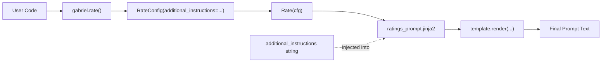
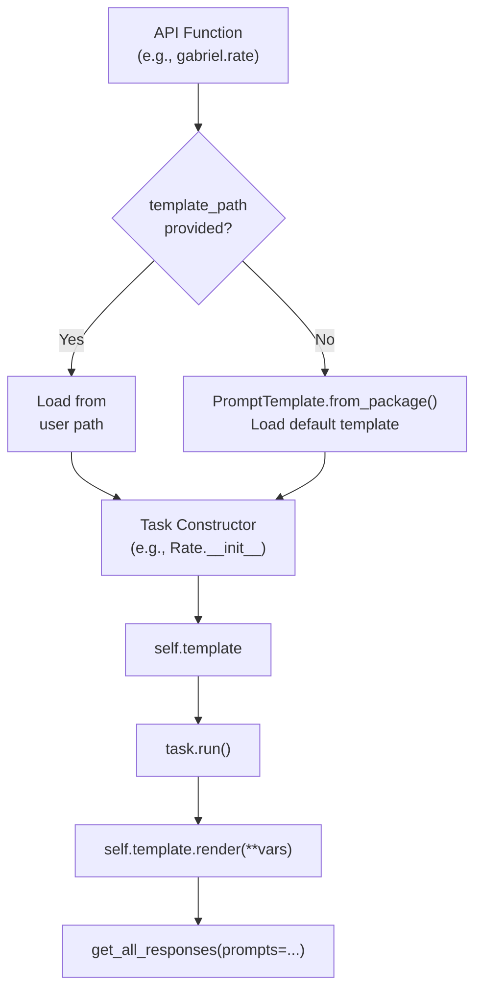
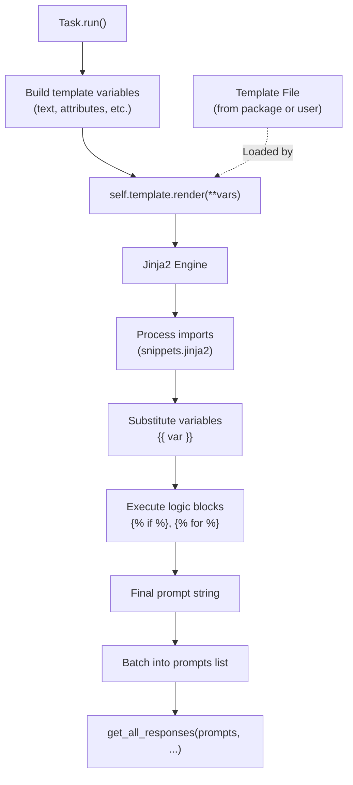
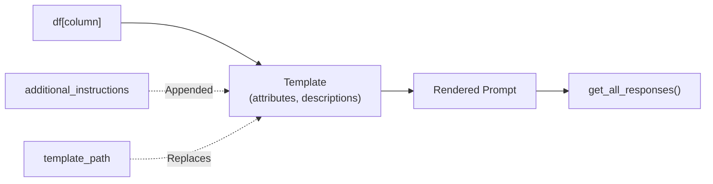

<!-- source: DeepWiki mcp.deepwiki.com · repo openai/GABRIEL · page 10.1 Prompt Customization · fetched 2026-10-26 -->

# Prompt Customization

<details>
<summary>Relevant source files</summary>

The following files were used as context for generating this wiki page:

- [src/gabriel/api.py](src/gabriel/api.py)
- [src/gabriel/prompts/paraphrase_prompt.jinja2](src/gabriel/prompts/paraphrase_prompt.jinja2)
- [src/gabriel/tasks/paraphrase.py](src/gabriel/tasks/paraphrase.py)
- [tests/test_basic.py](tests/test_basic.py)

</details>


This page describes how to customize the prompts sent to language models in GABRIEL. Prompt customization allows you to refine task behavior without replacing the entire task logic. GABRIEL provides three levels of customization: appending natural language instructions, replacing entire prompt templates, and writing custom Jinja2 templates.

For replacing the LLM invocation logic itself, see [Alternative LLM Backends](#10.3). For custom response parsing, see [Custom Response Parsing](#10.2). For arbitrary prompts with infrastructure support, see [gabriel.whatever](#10.4).

---

## Customization Levels

GABRIEL tasks support prompt customization through three progressively powerful mechanisms:

| Level | Parameter | Description | Use Case |
|-------|-----------|-------------|----------|
| 1 | `additional_instructions` | Append natural language guidance to default prompts | Minor adjustments, domain-specific clarifications |
| 2 | `template_path` | Replace entire prompt template with a custom Jinja2 file | Structural changes, new prompt formats |
| 3 | Custom Template Objects | Pass `PromptTemplate` instances directly | Programmatic template generation, testing |

All public API functions that involve LLM calls accept `additional_instructions` and `template_path` parameters. Task-level constructors accept `template` or `template_path` for more advanced scenarios.

Sources: [src/gabriel/api.py:105-216](), [src/gabriel/api.py:217-324](), [src/gabriel/api.py:433-551]()

---

## Additional Instructions

The simplest customization method appends your natural language guidance to the default prompt template. The system injects your instructions into a designated location in the base template, preserving the task's structural elements (input formatting, output requirements, attribute definitions).

### Usage Example

```python
import gabriel

df = pd.DataFrame({"speech": ["The economy is strong..."]})

# Basic usage
ratings = await gabriel.rate(
    df, "speech",
    attributes={"populism": "Degree of anti-elite rhetoric"},
    save_dir="outputs/",
)

# With additional instructions
ratings = await gabriel.rate(
    df, "speech",
    attributes={"populism": "Degree of anti-elite rhetoric"},
    additional_instructions=(
        "Focus specifically on economic populism. "
        "Ignore cultural or social dimensions. "
        "Score based on rhetoric against banks and corporations."
    ),
    save_dir="outputs/",
)
```

### How It Works



**Diagram: Additional Instructions Flow**

The `additional_instructions` parameter is stored in the task's configuration dataclass (e.g., `RateConfig`, `ClassifyConfig`) and passed to the template renderer. Default templates contain designated injection points where these instructions are inserted, typically near the end of the prompt to provide context-specific guidance after the core task description.

Sources: [src/gabriel/api.py:105-216](), [src/gabriel/tasks/paraphrase.py:185-196]()

---

## Template Path Replacement

For structural changes to prompts, use `template_path` to replace the entire default template. This allows you to reorganize prompt layout, change instruction phrasing, or add new template variables.

### Usage Example

```python
# Create custom template file: my_templates/custom_rating.jinja2
"""
You are evaluating content for research purposes.

Content: {{ text }}

Rate this content on the following attributes (0-100 scale):

- {{ attr }}: {{ desc }}


{{ additional_instructions }}

Output format: JSON with attribute names as keys, integer scores as values.
"""

# Use custom template
ratings = await gabriel.rate(
    df, "speech",
    attributes={"populism": "Anti-elite rhetoric"},
    template_path="my_templates/custom_rating.jinja2",
    save_dir="outputs/",
)
```

### Template Resolution Process



**Diagram: Template Resolution Path**

When `template_path` is provided, the task constructor loads the template from the specified file path using `resolve_template()`. Otherwise, it loads the default template from the package's `prompts/` directory. The resolved template is stored on the task instance and used for all prompt rendering during execution.

Sources: [src/gabriel/tasks/paraphrase.py:109-123]()

---

## Jinja2 Template Structure

GABRIEL templates use Jinja2 syntax with task-specific variables. Understanding the available variables and rendering conventions enables effective customization.

### Common Template Variables

All templates receive a standard set of variables during rendering:

| Variable | Type | Description | Example Value |
|----------|------|-------------|---------------|
| `text` | `str` | Primary input content (text modality only) | `"The economy is strong..."` |
| `attributes` | `List[str]` | Attribute names to evaluate | `["populism", "clarity"]` |
| `descriptions` | `List[str]` | Attribute descriptions (parallel to `attributes`) | `["Anti-elite rhetoric", "Easy to understand"]` |
| `additional_instructions` | `str` | User-provided custom guidance | `"Focus on economic factors"` |
| `modality` | `str` | Input type indicator | `"text"`, `"image"`, `"audio"`, `"pdf"`, `"entity"`, `"web"` |
| `json_mode` | `bool` | Whether JSON output is required | `True`, `False` |

Task-specific variables vary by task type. For example, `paraphrase` templates receive `instructions`, while `rank` templates receive `passage_a` and `passage_b` for pairwise comparisons.

Sources: [src/gabriel/prompts/paraphrase_prompt.jinja2:1-23]()

### Example: Default Paraphrase Template

The paraphrase template demonstrates typical structure:

```jinja2

{{ snip.single_entry(modality, text) }}

Task: rewrite the provided content according to the instructions below.

BEGIN INSTRUCTIONS
{{ instructions }}
END INSTRUCTIONS

Modality guidance:
- text: paraphrase/consolidate/modify the text
- entity: rewrite the entity name consistently
- web: paraphrase web content per instructions
- image/audio/pdf: paraphrase observed content into text


Always output JSON only in the indicated format.

Always output plain text only.


No preamble, no explanation, only the desired revised text.
```

**Template Structure Breakdown:**

1. **Import Statement**: `` imports reusable components for input formatting
2. **Input Rendering**: `{{ snip.single_entry(modality, text) }}` formats the input based on modality
3. **Variable Injection**: `{{ instructions }}` injects user-provided instructions
4. **Conditional Logic**: `` adapts output format requirements
5. **Static Guidance**: Fixed instructions that apply to all invocations

Sources: [src/gabriel/prompts/paraphrase_prompt.jinja2:1-23]()

---

## Template Rendering Flow

Understanding how templates are converted to final prompts helps debug customization issues and design effective templates.



**Diagram: Template Rendering Pipeline**

The rendering process occurs within each task's `run()` method. Tasks construct a dictionary of template variables from their configuration and input data, then call `self.template.render(**vars)`. The Jinja2 engine processes imports, substitutes variables, executes control flow logic, and returns a string. Tasks may render multiple prompts (e.g., when batching attributes or processing multiple rows), accumulating them into lists before passing to `get_all_responses()`.

Sources: [src/gabriel/tasks/paraphrase.py:185-196](), [src/gabriel/tasks/paraphrase.py:420-426]()

---

## Writing Custom Templates

Custom templates must provide all variables that `get_all_responses()` and downstream infrastructure expect. Following GABRIEL's template conventions ensures compatibility.

### Template Requirements

| Requirement | Description | Why It Matters |
|-------------|-------------|----------------|
| Output Format | Specify JSON or plain text expectations clearly | Response parsing depends on consistent format |
| Modality Support | Handle different input types (text, image, audio, etc.) | Templates must adapt to the `modality` parameter |
| Variable Usage | Use all provided variables or document which are optional | Missing variables cause rendering errors |
| No External State | Avoid references to external files or state | Templates must be self-contained for checkpointing |

### Custom Template Example: Strict Rating

```jinja2
CONTENT TO EVALUATE:
{{ text }}

RATING TASK:
You must assign integer scores (0-100) for the following attributes:


{{ loop.index }}. {{ attr }}
   Definition: {{ desc }}


SPECIAL INSTRUCTIONS:
{{ additional_instructions }}

OUTPUT FORMAT:
Return a JSON object with this exact structure:
{
  
  "{{ attr }}": <integer 0-100>{{ "," if not loop.last else "" }}
  
}

CONSTRAINTS:
- Use only integers from 0 to 100 (inclusive)
- Provide exactly one score per attribute
- Do not include explanations or justifications
- Output JSON only, no preamble
```

### Using Custom Templates in Code

```python
from pathlib import Path

# Option 1: Via API function with template_path
ratings = await gabriel.rate(
    df, "speech",
    attributes={"populism": "Anti-elite rhetoric"},
    template_path="templates/strict_rating.jinja2",
    save_dir="outputs/",
)

# Option 2: Via Task class for more control
from gabriel.tasks.rate import Rate, RateConfig
from gabriel.core.prompt_template import PromptTemplate

cfg = RateConfig(
    attributes={"populism": "Anti-elite rhetoric"},
    save_dir="outputs/",
)

# Load template manually
template = PromptTemplate.from_file("templates/strict_rating.jinja2")
task = Rate(cfg, template=template)
ratings = await task.run(df, "speech")
```

Sources: [src/gabriel/api.py:209-215](), [src/gabriel/tasks/paraphrase.py:119-123]()

---

## Customization Patterns by Task

Different tasks expose different template variables and rendering contexts. This section maps common customization patterns to task types.

### Measurement Tasks (Rate, Rank, Classify)



**Measurement Task Template Flow**

**Common variables:**
- `text` / `passage`: Input content
- `attributes`: List of attribute names
- `descriptions`: Parallel list of definitions
- `additional_instructions`: User guidance
- `modality`: Input type

**Customization use cases:**
- **Domain-specific scoring scales**: Replace 0-100 with industry-standard scales
- **Comparative evaluation**: Add reference examples to prompts
- **Attribute batching**: Control how multiple attributes are presented

Example customization for rating with reference anchors:

```jinja2
Rate the following content on these attributes:

- {{ attr }}: {{ desc }}


Use this reference scale:
0 = Equivalent to: "Minimal presence"
50 = Equivalent to: "Moderate presence"
100 = Equivalent to: "Dominant theme"

CONTENT:
{{ text }}

{{ additional_instructions }}
```

Sources: [src/gabriel/api.py:105-216](), [src/gabriel/api.py:433-551]()

### Text Transformation Tasks (Paraphrase, Deidentify)

**Common variables:**
- `text`: Original content
- `instructions`: Transformation specification
- `modality`: Input type
- `json_mode`: Output format flag

**Customization use cases:**
- **Style guides**: Enforce writing style requirements
- **Consistency rules**: Specify terminology or formatting conventions
- **Progressive refinement**: Structure multi-pass transformations

Example paraphrase template with style enforcement:

```jinja2
ORIGINAL TEXT:
{{ text }}

TRANSFORMATION INSTRUCTIONS:
{{ instructions }}

STYLE REQUIREMENTS:
- Use active voice exclusively
- Limit sentences to 20 words maximum
- Avoid jargon and technical terms


Output JSON: {"revised": "..."}

Output revised text only, no JSON.

```

Sources: [src/gabriel/prompts/paraphrase_prompt.jinja2:1-23]()

### Multi-Stage Tasks (Discover, Ideate)

Multi-stage tasks internally instantiate sub-tasks (e.g., `Discover` uses `Codify`, `Bucket`, `Classify`). Customizing these tasks requires:

1. Understanding which sub-task generates which prompts
2. Passing sub-task configuration overrides through `*_config_updates` parameters
3. Potentially customizing multiple templates (one per sub-task)

Example: Customizing the bucketing phase of `discover`:

```python
# Custom bucket template emphasizes hierarchical taxonomy
await gabriel.discover(
    df, "interview_text",
    save_dir="discovery/",
    bucket_config_updates={
        "template_path": "templates/hierarchical_bucket.jinja2",
    }
)
```

Sources: [src/gabriel/api.py:554-710]()

---

## Template Variables Reference

This table consolidates template variables across all tasks. Consult task-specific documentation for complete lists.

| Variable | Tasks | Type | Purpose |
|----------|-------|------|---------|
| `text` | Rate, Classify, Extract, Codify, Paraphrase | `str` | Primary text input (text modality) |
| `passage` | Rate, Rank | `str` | Synonym for `text` in some templates |
| `passage_a`, `passage_b` | Rank | `str` | Items for pairwise comparison |
| `attributes` | Rate, Classify, Extract, Rank | `List[str]` | Attribute names to evaluate |
| `descriptions` | Rate, Classify, Extract, Rank | `List[str]` | Attribute definitions |
| `labels` | Classify | `Dict[str, str]` | Classification labels and definitions |
| `instructions` | Paraphrase, Seed | `str` | Task-specific transformation guidance |
| `categories` | Codify | `Dict[str, str]` | Coding categories and definitions |
| `additional_instructions` | All | `str` | User-provided customization |
| `modality` | All | `str` | Input type: text, image, audio, pdf, entity, web |
| `json_mode` | All | `bool` | Whether JSON-only output is enforced |
| `object_category` | Rate | `str` | Noun for item being rated (e.g., "passage", "tweet") |
| `attribute_category` | Rate | `str` | Noun for attributes (e.g., "attribute", "dimension") |
| `scale` | Rate | `Optional[str]` | Custom scale definition (overrides default 0-100) |

Sources: [src/gabriel/prompts/paraphrase_prompt.jinja2:1-23]()

---

## Advanced Template Techniques

### Reusable Snippets

GABRIEL templates can import shared snippets from `snippets.jinja2` for common formatting patterns:

```jinja2


{# Format input based on modality #}
{{ snip.single_entry(modality, text) }}

{# Format paired inputs for comparison #}
{{ snip.paired_entries(modality, text_a, text_b) }}
```

Snippets handle modality-specific formatting (e.g., image placeholders, audio descriptions) consistently across templates.

### Conditional Modality Logic

Templates often need different instructions based on input type:

```jinja2

Analyze the following passage:
{{ text }}

Analyze the visual content shown in the provided image(s).

Analyze the audio content after listening to the provided recording(s).

Analyze the document content after reviewing the provided PDF(s).

```

This pattern ensures prompts adapt appropriately when users switch modalities.

### Dynamic Attribute Formatting

For tasks with variable numbers of attributes, use loops to avoid hardcoding:

```jinja2
Evaluate the following attributes:


{{ loop.index }}. **{{ attr }}**
   - Definition: {{ desc }}
   - Scale: 0 (absent) to 100 (dominant)

```

The `loop.index` variable provides 1-based numbering, `loop.first` and `loop.last` enable special formatting for edge cases.

Sources: [src/gabriel/prompts/paraphrase_prompt.jinja2:1-23]()

---

## Combining Customization Levels

The most effective customization strategies combine multiple levels:

```python
# Level 1: Quick adjustment via additional_instructions
ratings_v1 = await gabriel.rate(
    df, "speech",
    attributes={"populism": "Anti-elite rhetoric"},
    additional_instructions="Focus on economic themes only.",
    save_dir="outputs/v1/",
)

# Level 2: Structural change via template_path
ratings_v2 = await gabriel.rate(
    df, "speech",
    attributes={"populism": "Anti-elite rhetoric"},
    template_path="templates/anchored_scale.jinja2",  # Uses reference examples
    save_dir="outputs/v2/",
)

# Combined: Template + additional_instructions
ratings_v3 = await gabriel.rate(
    df, "speech",
    attributes={"populism": "Anti-elite rhetoric"},
    template_path="templates/anchored_scale.jinja2",
    additional_instructions="Weight rhetoric against corporations 2x.",
    save_dir="outputs/v3/",
)
```

This progression allows iterative refinement: start with `additional_instructions` for rapid prototyping, then create custom templates when structural changes prove necessary, and finally combine both for maximum control.

---

## Testing Custom Templates

Validate custom templates before running expensive LLM calls:

```python
from gabriel.core.prompt_template import PromptTemplate

# Load and inspect template
template = PromptTemplate.from_file("templates/custom_rating.jinja2")

# Render with test data
test_prompt = template.render(
    text="Test passage",
    attributes=["clarity", "engagement"],
    descriptions=["Easy to understand", "Holds attention"],
    additional_instructions="Focus on introductory paragraphs.",
    modality="text",
    json_mode=True,
)

# Verify output
print(test_prompt)
assert "clarity" in test_prompt
assert "engagement" in test_prompt
assert "JSON" in test_prompt  # Ensure format instructions present
```

Use dummy mode to test end-to-end without API costs:

```python
ratings = await gabriel.rate(
    test_df, "speech",
    attributes={"populism": "Anti-elite rhetoric"},
    template_path="templates/custom_rating.jinja2",
    save_dir="test_outputs/",
    use_dummy=True,  # Use synthetic responses
)
```

Sources: [src/gabriel/api.py:105-216]()

---

## Troubleshooting

### Common Template Errors

| Error | Cause | Solution |
|-------|-------|----------|
| `jinja2.exceptions.UndefinedError` | Template references missing variable | Check task-specific variable list; use `` guards |
| `TypeError: render() got unexpected keyword argument` | Task passes variables not in template signature | Ensure template accepts all variables the task provides |
| Empty or malformed prompts | Logic error in conditionals or loops | Test template rendering independently with `PromptTemplate.render()` |
| JSON parsing failures | Template doesn't enforce JSON format | Add explicit JSON format requirements and examples |

### Debugging Template Rendering

Enable verbose logging to inspect rendered prompts:

```python
ratings = await gabriel.rate(
    df, "speech",
    attributes={"populism": "Anti-elite rhetoric"},
    template_path="templates/custom_rating.jinja2",
    save_dir="outputs/",
    verbose=True,  # Prints example prompts to console
    print_example_prompt=True,  # Explicitly show first prompt
)
```

Check the `{save_dir}/` directory for raw responses CSV files, which include the `"Identifier"` column mapping back to which prompt generated each response.

### Validating Custom Templates

Before deploying custom templates in production:

1. **Render Test Cases**: Generate prompts for edge cases (empty text, many attributes, special characters)
2. **Compare with Defaults**: Render both default and custom templates with identical inputs to verify differences
3. **Dry Run with Dummy Mode**: Execute tasks with `use_dummy=True` to test end-to-end flow
4. **Inspect Raw Responses**: Check `{save_dir}/{file_name}_raw_responses.csv` to ensure LLM outputs match expected format

Sources: [src/gabriel/api.py:105-216]()

---

