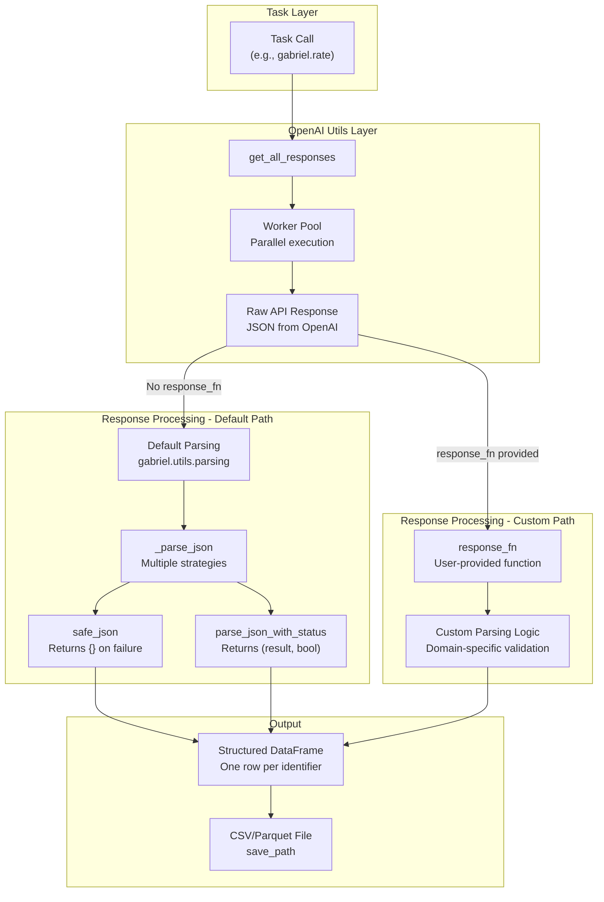
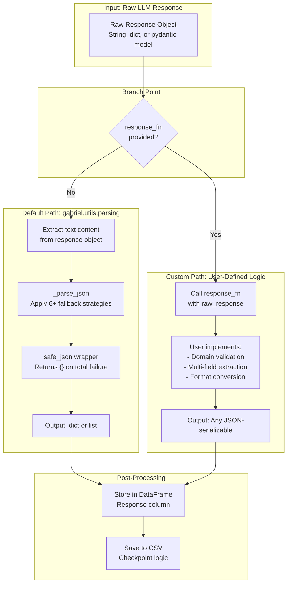
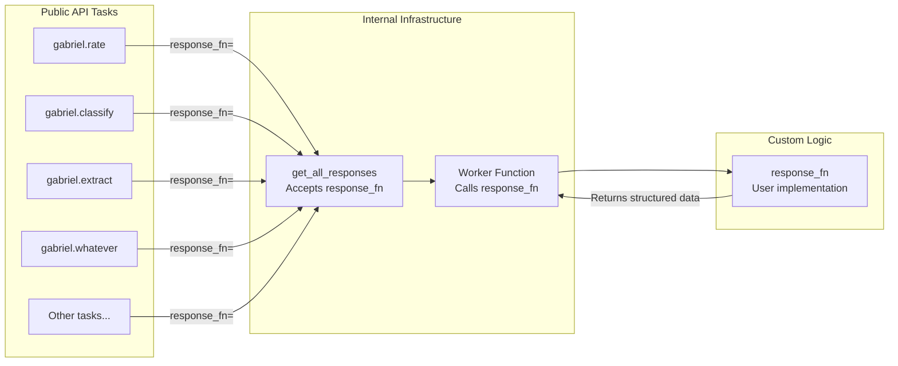
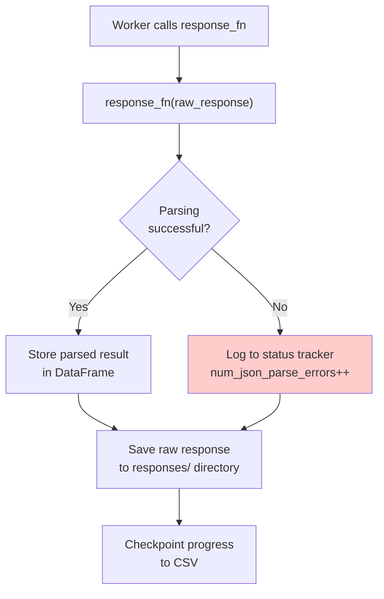

<!-- source: DeepWiki mcp.deepwiki.com · repo openai/GABRIEL · page 10.2 Custom Response Parsing · fetched 2026-10-26 -->

# Custom Response Parsing

<details>
<summary>Relevant source files</summary>

The following files were used as context for generating this wiki page:

- [README.md](README.md)
- [src/gabriel/utils/openai_utils.py](src/gabriel/utils/openai_utils.py)
- [src/gabriel/utils/parsing.py](src/gabriel/utils/parsing.py)

</details>


## Purpose and Scope

This page explains how to implement custom response parsing functions (`response_fn`) to handle non-standard LLM outputs in GABRIEL. When the default JSON parsing behavior is insufficient for your use case—such as when working with complex structured outputs, domain-specific formats, or multi-stage validation—you can provide a custom `response_fn` to control exactly how raw API responses are transformed into structured data.

For information about customizing prompts before responses are generated, see [Prompt Customization](#10.1). For replacing the entire LLM backend, see [Alternative LLM Backends](#10.3). For maximum flexibility with arbitrary prompts, see [gabriel.whatever](#10.4).

---

## Overview: Response Parsing in the Pipeline



**Sources:** [src/gabriel/utils/openai_utils.py:1-100](), [src/gabriel/utils/parsing.py:1-312]()

---

## Default Parsing Behavior

When no `response_fn` is provided, GABRIEL uses built-in JSON parsing utilities from `gabriel.utils.parsing`. The default behavior depends on whether JSON mode was requested:

| Scenario | Parsing Strategy | Output on Failure |
|----------|-----------------|-------------------|
| `json_mode=True` | `_parse_json` with multiple fallback strategies | Empty dict `{}` or parsing error |
| `json_mode=False` | Extract text content directly | Raw string response |
| List responses | Unwrap single-element lists, preserve multi-element | First element or full list |

### Default Parsing Strategies

The `_parse_json` function applies these heuristics in order:

1. **Direct JSON parsing** with `json.loads`
2. **Python literal evaluation** with `ast.literal_eval`
3. **Comment stripping** (removes `//` and `/* */` style comments)
4. **Markdown fence extraction** (extracts content from ` ```json ... ``` ` blocks)
5. **Brace/bracket extraction** (finds first `{...}` or `[...]` substring)
6. **Nested quote unwrapping** (handles `'["..."]'` patterns)

**Sources:** [src/gabriel/utils/parsing.py:17-118]()

---

## response_fn Interface

### Function Signature

```python
def custom_response_fn(
    raw_response: Any,
    *,
    identifier: Any,
    prompt: str,
    model: str,
    **kwargs: Any
) -> Any:
    """Parse raw API response into structured output.
    
    Parameters
    ----------
    raw_response:
        Raw response object or text from the LLM API. May be a string,
        dict, list, or pydantic model depending on the API.
    identifier:
        The identifier associated with this prompt (from the identifiers
        list passed to get_all_responses).
    prompt:
        The original prompt text sent to the model.
    model:
        Model name used for this request (e.g., "gpt-5-mini").
    **kwargs:
        Additional context that may be passed by the task layer.
    
    Returns
    -------
    Structured output that will be stored in the "Response" column of
    the output DataFrame. Can be any JSON-serializable type.
    """
    # Your custom parsing logic here
    pass
```

### Integration Point: get_all_responses

The `response_fn` parameter can be passed to `get_all_responses` and any task function that internally calls it:

```python
result_df = await gabriel.rate(
    data,
    column_name="text",
    attributes={"quality": "Overall quality"},
    response_fn=custom_response_fn,  # Replaces default parsing
    save_dir="output/",
)
```

**Sources:** [src/gabriel/utils/openai_utils.py:1-100]()

---

## Default vs. Custom Parsing Flow



**Sources:** [src/gabriel/utils/parsing.py:17-141](), [src/gabriel/utils/openai_utils.py:1-100]()

---

## Common Use Cases

### 1. Non-JSON Structured Outputs

When working with models that produce structured text in non-JSON formats (e.g., YAML, CSV, custom delimited formats):

```python
def parse_yaml_response(raw_response, **kwargs):
    """Extract YAML from response and convert to dict."""
    import yaml
    
    # Extract text content
    text = str(raw_response).strip()
    
    # Find YAML block
    yaml_match = re.search(r'```yaml\s*(.*?)\s*```', text, re.DOTALL)
    if yaml_match:
        text = yaml_match.group(1)
    
    try:
        return yaml.safe_load(text)
    except Exception as e:
        return {"error": f"YAML parsing failed: {e}"}
```

### 2. Multi-Field Validation

When you need to validate multiple fields and provide detailed error reporting:

```python
def validate_rating_response(raw_response, **kwargs):
    """Parse rating response with strict validation."""
    from gabriel.utils.parsing import safe_json
    
    data = safe_json(raw_response)
    
    # Validate expected structure
    errors = []
    if "rating" not in data:
        errors.append("Missing 'rating' field")
    elif not isinstance(data["rating"], (int, float)):
        errors.append(f"Rating must be numeric, got {type(data['rating'])}")
    elif not 0 <= data["rating"] <= 100:
        errors.append(f"Rating {data['rating']} out of range [0, 100]")
    
    if "explanation" not in data:
        errors.append("Missing 'explanation' field")
    
    if errors:
        return {
            "rating": None,
            "explanation": None,
            "errors": errors,
            "raw": str(raw_response)[:500]
        }
    
    return {
        "rating": float(data["rating"]),
        "explanation": data["explanation"],
        "errors": None
    }
```

### 3. Domain-Specific Extraction

For extracting information that requires domain knowledge or complex post-processing:

```python
def extract_medical_codes(raw_response, identifier=None, **kwargs):
    """Extract ICD-10 codes with validation."""
    from gabriel.utils.parsing import safe_json
    
    data = safe_json(raw_response)
    codes = data.get("codes", [])
    
    # Validate ICD-10 format
    valid_codes = []
    for code in codes:
        code = str(code).strip().upper()
        # ICD-10 format: Letter + 2 digits + optional decimal + digits
        if re.match(r'^[A-Z]\d{2}(\.\d+)?$', code):
            valid_codes.append(code)
    
    return {
        "identifier": identifier,
        "codes": valid_codes,
        "code_count": len(valid_codes),
        "raw_codes": codes
    }
```

### 4. Fallback with LLM Repair

Combine custom parsing with the LLM-based JSON repair utility:

```python
async def parse_with_llm_fallback(raw_response, model="gpt-5-mini", **kwargs):
    """Try custom parsing, fall back to LLM repair."""
    from gabriel.utils.parsing import parse_json_with_status, safest_json
    
    # First attempt: standard parsing
    result, success = parse_json_with_status(raw_response)
    if success and isinstance(result, dict):
        return result
    
    # Second attempt: LLM repair (async)
    repaired = await safest_json(
        raw_response,
        model=model,
        use_llm_fallback=True,
        llm_timeout=60.0
    )
    
    return repaired if repaired else {"error": "All parsing attempts failed"}
```

**Sources:** [src/gabriel/utils/parsing.py:121-188]()

---

## Response Parsing Utilities Reference

GABRIEL provides several parsing utilities that can be leveraged within custom `response_fn` implementations:

| Function | Return Type | Raises on Failure | Use Case |
|----------|-------------|-------------------|----------|
| `_parse_json(txt)` | `dict \| list` | ✓ (ValueError) | When you want exceptions for debugging |
| `safe_json(txt)` | `dict \| list` | ✗ (returns `{}`) | Production code, always succeeds |
| `parse_json_with_status(txt)` | `(dict\|list\|None, bool)` | ✗ | When you need to detect failure separately |
| `safest_json(txt, ...)` | `dict \| list \| None` | ✗ (async) | When LLM-based repair is acceptable |
| `clean_json_df(df, ...)` | `DataFrame` | ✗ (async) | Batch JSON cleaning on DataFrames |

### Example: Using Parsing Utilities

```python
def robust_response_fn(raw_response, **kwargs):
    """Use multiple parsing strategies in sequence."""
    from gabriel.utils.parsing import parse_json_with_status, safe_json
    
    # Strategy 1: Try strict parsing with status check
    result, success = parse_json_with_status(raw_response)
    if success:
        return result
    
    # Strategy 2: Fall back to safe_json (never fails)
    fallback = safe_json(raw_response)
    if fallback:  # Check if non-empty dict
        return fallback
    
    # Strategy 3: Return raw text for manual review
    return {
        "raw_text": str(raw_response),
        "parsing_failed": True
    }
```

**Sources:** [src/gabriel/utils/parsing.py:1-141]()

---

## Integration with Task Functions

All measurement and helper tasks that call `get_all_responses` internally accept `response_fn`:



Example of passing `response_fn` to `gabriel.classify`:

```python
def custom_classify_parser(raw_response, **kwargs):
    """Extract classification with confidence scores."""
    from gabriel.utils.parsing import safe_json
    
    data = safe_json(raw_response)
    
    return {
        "label": data.get("label", "unknown"),
        "confidence": float(data.get("confidence", 0.0)),
        "all_scores": data.get("scores", {}),
        "reasoning": data.get("reasoning", "")
    }

result = await gabriel.classify(
    data,
    column_name="text",
    labels=["positive", "negative", "neutral"],
    response_fn=custom_classify_parser,
    save_dir="output/",
)
```

**Sources:** [src/gabriel/utils/openai_utils.py:1-100]()

---

## Best Practices

### 1. Handle All Input Types

Raw responses may be strings, dicts, pydantic models, or lists. Always normalize first:

```python
def normalize_input(raw_response):
    """Convert various input types to string or dict."""
    if isinstance(raw_response, dict):
        return raw_response
    
    if isinstance(raw_response, list):
        if len(raw_response) == 1:
            return normalize_input(raw_response[0])
        return raw_response
    
    # Convert pydantic models
    if hasattr(raw_response, 'model_dump'):
        return raw_response.model_dump()
    
    # Fallback to string
    return str(raw_response)
```

### 2. Preserve Original Data on Errors

When parsing fails, include the raw response for debugging:

```python
def safe_custom_parser(raw_response, identifier=None, **kwargs):
    """Always return structured output, even on failure."""
    try:
        # Your parsing logic
        result = parse_complex_format(raw_response)
        return {
            "data": result,
            "success": True,
            "identifier": identifier
        }
    except Exception as e:
        return {
            "data": None,
            "success": False,
            "error": str(e),
            "raw": str(raw_response)[:1000],  # Truncate to avoid bloat
            "identifier": identifier
        }
```

### 3. Use Existing Parsing Utilities

Don't reimplement JSON parsing—leverage `gabriel.utils.parsing`:

```python
# ❌ Bad: Reimplementing JSON parsing
def bad_parser(raw_response, **kwargs):
    text = str(raw_response)
    return json.loads(text)  # Fragile, no fallbacks

# ✓ Good: Using existing utilities
def good_parser(raw_response, **kwargs):
    from gabriel.utils.parsing import safe_json
    return safe_json(raw_response)  # Robust with multiple strategies
```

### 4. Make response_fn Signature Compatible

Always accept `**kwargs` to remain compatible with future parameter additions:

```python
# ✓ Correct signature
def my_parser(raw_response, identifier=None, prompt="", model="", **kwargs):
    pass

# ❌ Will break if new parameters are added
def my_parser(raw_response, identifier, prompt):
    pass
```

### 5. Test with Dummy Mode

Use `model="dummy"` to test your `response_fn` without API calls:

```python
def test_custom_parser():
    """Test response_fn with synthetic responses."""
    from gabriel.utils.openai_utils import DummyResponseSpec
    
    def my_parser(raw_response, **kwargs):
        # Your parsing logic
        pass
    
    # Create dummy spec
    dummy_spec = DummyResponseSpec(
        responses='{"field": "value"}',
        successful=True
    )
    
    # Test parsing
    result = my_parser(dummy_spec.responses)
    assert result == {"field": "value"}
```

**Sources:** [src/gabriel/utils/openai_utils.py:214-228]()

---

## Advanced: Async Response Functions

For cases where response parsing itself requires async operations (e.g., database lookups, additional API calls):

```python
async def async_response_parser(raw_response, identifier=None, **kwargs):
    """Async response_fn for lookups during parsing."""
    from gabriel.utils.parsing import safe_json
    
    data = safe_json(raw_response)
    
    # Perform async lookup
    entity_id = data.get("entity_id")
    if entity_id:
        metadata = await fetch_entity_metadata(entity_id)
        data["metadata"] = metadata
    
    return data

# Use with get_all_responses
result = await get_all_responses(
    prompts=prompts,
    identifiers=ids,
    response_fn=async_response_parser,
    save_path="output.csv",
)
```

**Note:** The response_fn will be called within the async worker context, so async functions are fully supported.

**Sources:** [src/gabriel/utils/openai_utils.py:1-100]()

---

## Error Handling and Checkpointing

Custom `response_fn` implementations should be exception-safe. If a `response_fn` raises an exception:

1. The error is logged to the status tracker
2. The raw response is still saved in `responses/` directory
3. The checkpoint system allows resuming the run
4. The failed response can be manually reviewed and re-parsed



Implement defensive error handling:

```python
def defensive_response_fn(raw_response, **kwargs):
    """Wrap parsing logic with comprehensive error handling."""
    try:
        # Primary parsing logic
        return parse_my_format(raw_response)
    except json.JSONDecodeError as e:
        return {"error": "json_decode", "message": str(e)}
    except KeyError as e:
        return {"error": "missing_field", "field": str(e)}
    except Exception as e:
        # Catch-all for unexpected errors
        return {
            "error": "unknown",
            "message": str(e),
            "type": type(e).__name__
        }
```

**Sources:** [src/gabriel/utils/openai_utils.py:196-212]()

---

## Summary

Custom `response_fn` provides fine-grained control over how raw LLM outputs are transformed into structured data:

| Aspect | Detail |
|--------|--------|
| **When to use** | Non-JSON formats, domain validation, complex extraction |
| **Interface** | `fn(raw_response, identifier, prompt, model, **kwargs) -> Any` |
| **Replaces** | Default JSON parsing from `gabriel.utils.parsing` |
| **Available in** | All tasks that call `get_all_responses` |
| **Supports async** | ✓ Yes, can use `async def` |
| **Error handling** | Exceptions logged, raw responses preserved |
| **Testing** | Use `model="dummy"` for offline testing |

For simpler customizations like adding instructions to prompts, see [Prompt Customization](#10.1). For replacing the entire LLM backend while keeping response parsing, see [Alternative LLM Backends](#10.3).

**Sources:** [src/gabriel/utils/openai_utils.py:1-100](), [src/gabriel/utils/parsing.py:1-312](), [README.md:1-197]()

---

