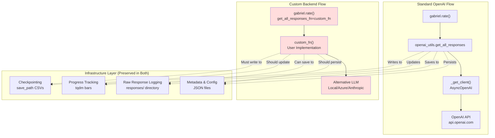
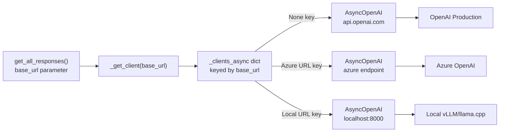
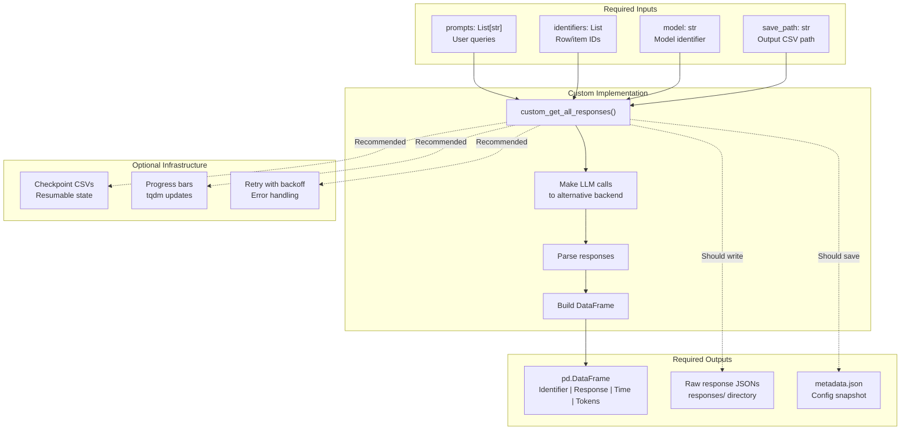
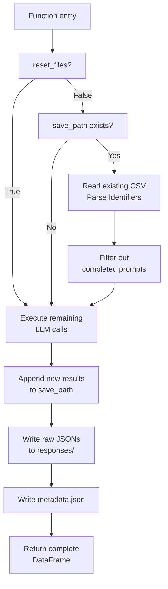
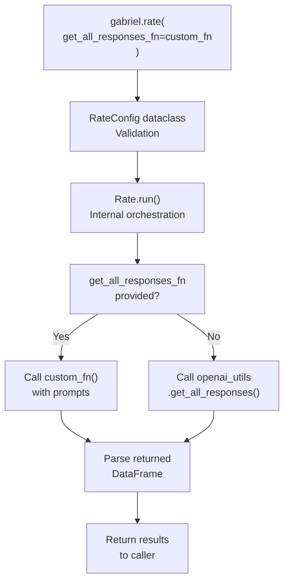

<!-- source: DeepWiki mcp.deepwiki.com · repo openai/GABRIEL · page 10.3 Alternative LLM Backends · fetched 2026-10-26 -->

# Alternative LLM Backends

<details>
<summary>Relevant source files</summary>

The following files were used as context for generating this wiki page:

- [README.md](README.md)
- [src/gabriel/utils/openai_utils.py](src/gabriel/utils/openai_utils.py)
- [src/gabriel/utils/parsing.py](src/gabriel/utils/parsing.py)

</details>


## Purpose and Scope

This page covers how to replace the default OpenAI backend with alternative LLM providers while retaining GABRIEL's operational infrastructure: rate limiting, retry logic, checkpointing, parallel execution, and progress tracking. Two approaches are supported: using the `base_url` parameter for OpenAI-compatible APIs, or implementing a custom `get_all_responses_fn` for complete backend replacement.

For customizing prompts sent to the default OpenAI backend, see [Prompt Customization](#10.1). For custom parsing of LLM outputs, see [Custom Response Parsing](#10.2). For maximum flexibility with arbitrary prompts, see [gabriel.whatever](#10.4).

---

## System Architecture: Default vs Custom Backend



**Diagram: Standard OpenAI flow vs custom backend flow showing preserved infrastructure**

The system's architecture separates task orchestration from LLM execution. In the standard flow, all tasks route through `openai_utils.get_all_responses`, which manages parallelism and API calls via `_get_client()`. When `get_all_responses_fn` is provided, the custom function replaces the entire LLM invocation layer but inherits responsibility for maintaining the same persistence contracts: writing results to `save_path`, updating progress bars, and logging raw responses.

**Sources:** [src/gabriel/utils/openai_utils.py:145-172](), [src/gabriel/utils/openai_utils.py:1532-2500]()

---

## Approach 1: Using `base_url` for OpenAI-Compatible APIs

The simplest backend replacement method uses the `base_url` parameter to point GABRIEL at OpenAI-compatible endpoints. This approach requires no custom code—the provider must implement the OpenAI API schema.

### Configuration

The `base_url` parameter is accepted by `get_all_responses()` and propagated to the `AsyncOpenAI` client constructor:

| Parameter | Purpose | Example Values |
|-----------|---------|----------------|
| `base_url` | Full URL to the API endpoint | `"https://api.openai.com/v1"` (default)<br/>`"https://your-org.openai.azure.com/"` (Azure)<br/>`"http://localhost:8000/v1"` (local vLLM) |
| Environment variable | `OPENAI_BASE_URL` | Set globally to avoid per-call specification |

The client caching logic in `_get_client()` maintains separate connection pools per base URL to support concurrent usage of multiple backends within the same process.



**Diagram: Client caching and connection pooling per base_url**

**Sources:** [src/gabriel/utils/openai_utils.py:145-172](), [src/gabriel/utils/openai_utils.py:124]()

### Compatible Providers

Providers that implement the OpenAI HTTP API contract work out-of-the-box:

| Provider | Configuration | Notes |
|----------|---------------|-------|
| **Azure OpenAI** | `base_url="https://your-resource.openai.azure.com/"` | Requires `OPENAI_API_KEY` set to Azure key |
| **Local vLLM** | `base_url="http://localhost:8000/v1"` | Start server with `vllm serve` |
| **llama.cpp server** | `base_url="http://localhost:8080/v1"` | Use `--api-key` flag or set dummy key |
| **Ollama** | `base_url="http://localhost:11434/v1"` | Requires Ollama 0.1.17+ with OpenAI compatibility |
| **Together AI** | `base_url="https://api.together.xyz/v1"` | Standard OpenAI client configuration |
| **Anyscale Endpoints** | `base_url="https://api.endpoints.anyscale.com/v1"` | Pass Anyscale API key as `OPENAI_API_KEY` |

The system attempts to fetch rate limit headers from the provider via `_get_rate_limit_headers()`. If headers are unavailable, conservative defaults are applied and a warning is logged. Custom concurrency caps can be specified via `n_parallels`.

**Sources:** [src/gabriel/utils/openai_utils.py:890-994](), [src/gabriel/utils/openai_utils.py:1224-1231]()

### Limitations

The `base_url` approach preserves all GABRIEL infrastructure but has constraints:

- **API schema compatibility**: Provider must match OpenAI's request/response structure
- **Feature support**: Non-standard features (reasoning_effort, web_search) may fail silently or raise errors
- **Rate limit introspection**: Providers without `x-ratelimit-*` headers trigger conservative throttling
- **Model naming**: Model strings passed to GABRIEL must match provider's catalog

---

## Approach 2: Custom `get_all_responses_fn`

For backends that do not implement the OpenAI API or require custom orchestration logic, implement a replacement function matching the `get_all_responses()` signature.

### Function Contract



**Diagram: Function contract for custom get_all_responses_fn implementations**

The minimal signature is:

```python
async def custom_get_all_responses(
    prompts: List[str],
    identifiers: List,
    model: str,
    save_path: str,
    **kwargs
) -> pd.DataFrame:
    """
    Required return columns:
    - Identifier: matches input identifiers
    - Response: LLM output text/JSON
    - Time (seconds): latency per call
    - Input tokens: count or estimate
    - Output tokens: count or estimate
    """
    ...
```

Additional keyword arguments from the calling task (e.g., `temperature`, `max_output_tokens`, `json_mode`) should be accepted via `**kwargs` and handled or ignored as appropriate for the backend.

**Sources:** [src/gabriel/utils/openai_utils.py:1532-1600]()

### Required DataFrame Schema

The returned DataFrame must contain these columns for downstream consumption:

| Column | Type | Description |
|--------|------|-------------|
| `Identifier` | Any | Matches the input `identifiers` list; used to join results back to source data |
| `Response` | str | Raw LLM output—text, JSON string, or structured object serialized to string |
| `Time (seconds)` | float | Latency per prompt; used for performance analysis |
| `Input tokens` | int | Token count or rough estimate; used for cost tracking |
| `Output tokens` | int | Token count or estimate; used for cost tracking |

Optional columns that enhance auditability:

| Column | Type | Description |
|--------|------|-------------|
| `Reasoning tokens` | int | Count of reasoning tokens if backend supports chain-of-thought |
| `Reasoning summary` | str | Natural language reasoning trace |
| `Error log` | str | Exception messages for failed calls |
| `Response ID` | str | Backend-specific request identifier for debugging |

**Sources:** [src/gabriel/utils/openai_utils.py:2400-2500]()

### Checkpointing and Persistence

To enable resumable runs, the custom function should:

1. **Check for existing checkpoint**: Read `save_path` if it exists and has `reset_files=False`
2. **Write incremental results**: Append new rows to the CSV as responses complete
3. **Save raw responses**: Write JSON files to `save_dir/responses/` directory
4. **Persist metadata**: Save a `metadata.json` with configuration parameters

The default `get_all_responses()` implementation demonstrates this pattern:



**Diagram: Checkpointing flow for resumable custom implementations**

**Sources:** [src/gabriel/utils/openai_utils.py:1700-1850]()

---

## Integration with Task System

Tasks accept `get_all_responses_fn` as a parameter and forward it to their internal `run()` methods:



**Diagram: Task integration flow with custom backend functions**

All measurement tasks (`rate`, `rank`, `classify`, `extract`, `discover`) and helper tasks (`codify`, `compare`, `bucket`, `whatever`) support this parameter. Complex pipelines like `ideate` pass the custom function through to their constituent sub-tasks.

**Sources:** [src/gabriel/utils/openai_utils.py:1532-1600]()

---

## Example: Anthropic Claude Backend

A minimal custom implementation for Anthropic's Claude API:

```python
import anthropic
import pandas as pd
from typing import List

async def anthropic_get_all_responses(
    prompts: List[str],
    identifiers: List,
    model: str,
    save_path: str,
    temperature: float = 0.0,
    max_output_tokens: int = 4096,
    **kwargs
) -> pd.DataFrame:
    """Custom backend using Anthropic Claude."""
    
    client = anthropic.AsyncAnthropic()
    
    results = []
    for identifier, prompt in zip(identifiers, prompts):
        try:
            response = await client.messages.create(
                model=model,  # e.g., "claude-3-5-sonnet-20241022"
                max_tokens=max_output_tokens,
                temperature=temperature,
                messages=[{"role": "user", "content": prompt}]
            )
            
            text = response.content[0].text
            usage = response.usage
            
            results.append({
                "Identifier": identifier,
                "Response": text,
                "Time (seconds)": 0.0,  # Estimate or measure
                "Input tokens": usage.input_tokens,
                "Output tokens": usage.output_tokens,
            })
        except Exception as e:
            results.append({
                "Identifier": identifier,
                "Response": "",
                "Time (seconds)": 0.0,
                "Input tokens": 0,
                "Output tokens": 0,
                "Error log": str(e),
            })
    
    df = pd.DataFrame(results)
    df.to_csv(save_path, index=False)
    return df

# Usage
import gabriel

results = await gabriel.rate(
    data,
    column_name="text",
    attributes={"toxicity": "How toxic is this content?"},
    model="claude-3-5-sonnet-20241022",
    get_all_responses_fn=anthropic_get_all_responses,
    save_dir="~/claude_ratings"
)
```

This example omits checkpointing, progress bars, and retry logic for brevity. Production implementations should add these features to match the reliability of the default backend.

**Sources:** [src/gabriel/utils/openai_utils.py:1532-2500]()

---

## Infrastructure Features Preserved

Regardless of backend, these GABRIEL features remain available:

### Automatic Feature Preservation

| Feature | Behavior with Custom Backend | Implementation Location |
|---------|------------------------------|-------------------------|
| **Checkpointing** | Tasks read `save_path` to skip completed items | Custom function should write CSV incrementally |
| **Raw response logging** | Tasks expect JSON files in `responses/` subdirectory | Custom function should save raw API payloads |
| **Configuration snapshots** | Tasks save metadata.json with all parameters | Custom function should persist `kwargs` |
| **Result DataFrames** | Tasks consume standard column schema | Custom function must return matching columns |

### User-Level Preservation

| Feature | Behavior | Task Layer Handling |
|---------|----------|---------------------|
| **`save_dir` expansion** | Tilde and env vars resolved before passing to custom function | Task handles before calling `get_all_responses_fn` |
| **`reset_files` logic** | Directory cleared if True, checkpoint loaded if False | Task implementation or custom function responsibility |
| **Column name handling** | Input DataFrame columns mapped to prompts before custom function | Task layer preprocesses data |
| **Multi-run averaging** | `n_runs > 1` calls custom function multiple times | Task orchestrates repeat calls |

**Sources:** [src/gabriel/utils/openai_utils.py:1532-1700]()

---

## Advanced: Hybrid Backends

For workflows requiring multiple LLM providers, pass different `get_all_responses_fn` implementations to different tasks:

```python
# Use OpenAI for initial rating
ratings = await gabriel.rate(
    data,
    attributes=attributes,
    model="gpt-5-mini",
    save_dir="~/ratings_openai"
)

# Use local model for classification
classes = await gabriel.classify(
    data,
    labels=labels,
    model="llama-3-70b",
    base_url="http://localhost:8000/v1",
    save_dir="~/classify_local"
)

# Use Anthropic for ideation
theories = await gabriel.ideate(
    topic="climate change mitigation",
    model="claude-3-opus-20240229",
    get_all_responses_fn=anthropic_get_all_responses,
    save_dir="~/ideate_anthropic"
)
```

Each task operates independently with its own backend, checkpoints, and logging. Results can be merged via standard pandas operations on the returned DataFrames.

**Sources:** [src/gabriel/utils/openai_utils.py:145-172]()

---

## Troubleshooting

### Rate Limit Headers Missing

**Symptom**: Console warning `"API did not return complete rate-limit headers"`

**Cause**: Provider does not implement `x-ratelimit-*` response headers

**Solution**: Override `n_parallels` to a conservative value (e.g., 10-50) and monitor backend logs for throttling errors. The system will use fixed concurrency instead of dynamic adjustment.

**Sources:** [src/gabriel/utils/openai_utils.py:1224-1231]()

### Invalid Request Format

**Symptom**: Pydantic validation errors or 400 Bad Request responses

**Cause**: Backend expects different JSON schema than OpenAI

**Solution**: Implement custom `get_all_responses_fn` that constructs requests matching the provider's API specification. Parse the alternative response format and map it to GABRIEL's DataFrame schema.

### Progress Bar Not Updating

**Symptom**: No tqdm progress bar during custom backend execution

**Cause**: Custom function does not call `tqdm.update()`

**Solution**: Wrap your batch processing loop with `tqdm` and call `update(1)` after each completed prompt. See `_progress_bar()` helper in `openai_utils.py` for integration example.

**Sources:** [src/gabriel/utils/openai_utils.py:127-132]()

### Checkpoint Resume Failures

**Symptom**: Re-running with `reset_files=False` re-processes all items

**Cause**: Custom function does not read existing `save_path` CSV or match identifiers correctly

**Solution**: At function entry, check if `save_path` exists. Load it, extract completed identifiers, and filter the input `prompts` and `identifiers` lists before making API calls. See the checkpoint loading logic in default `get_all_responses()` for reference pattern.

**Sources:** [src/gabriel/utils/openai_utils.py:1700-1850]()

---

**Sources for this page:** [src/gabriel/utils/openai_utils.py:145-172](), [src/gabriel/utils/openai_utils.py:890-994](), [src/gabriel/utils/openai_utils.py:1532-2500](), [README.md:165-170]()

---

