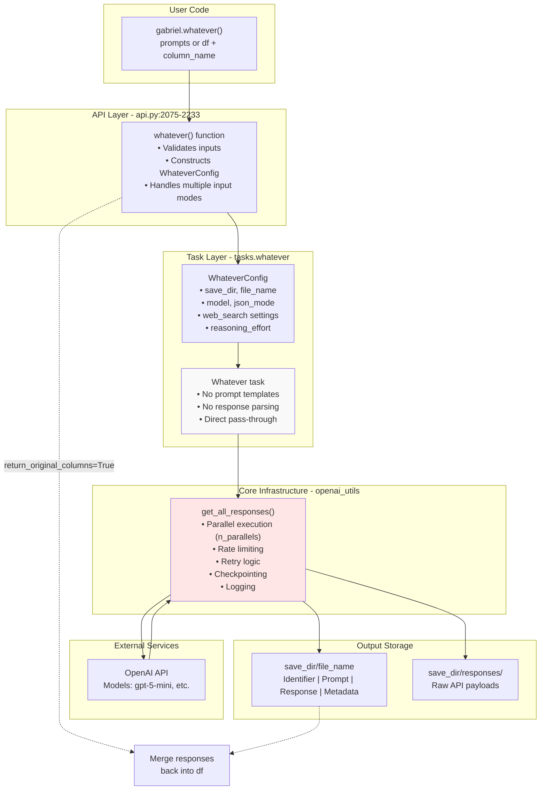
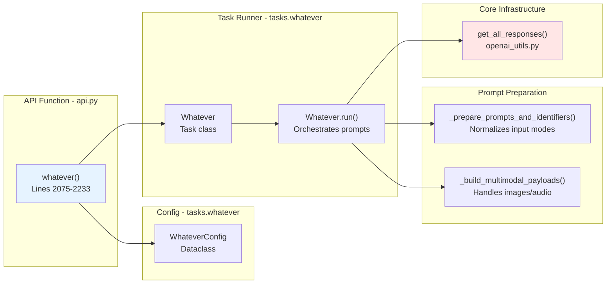

<!-- source: DeepWiki mcp.deepwiki.com · repo openai/GABRIEL · page 10.4 gabriel.whatever - Maximum Flexibility · fetched 2026-10-26 -->

# gabriel.whatever - Maximum Flexibility

<details>
<summary>Relevant source files</summary>

The following files were used as context for generating this wiki page:

- [README.md](README.md)
- [src/gabriel/api.py](src/gabriel/api.py)

</details>


## Purpose and Scope

`gabriel.whatever` provides an escape hatch for running arbitrary prompts through GABRIEL's infrastructure without task-specific prompt templates or response parsing logic. It preserves all operational benefits—parallel execution (up to 650 concurrent requests), automatic checkpointing, resumability, rate limit handling, and structured logging—while allowing complete freedom over prompt content and structure.

This page covers the `whatever` function and its underlying `Whatever` task implementation. For structured measurement workflows, see [Measurement Tasks](#4). For prompt customization within existing tasks, see [Prompt Customization](#10.1). For replacing the LLM backend entirely, see [Alternative LLM Backends](#10.3).

**Sources:** [src/gabriel/api.py:2075-2233](), [README.md:70-71]()

---

## When to Use gabriel.whatever

Use `gabriel.whatever` when:

| Scenario | Why gabriel.whatever |
|----------|---------------------|
| **Bespoke prompts** | Your workflow requires prompts that don't fit `rate`, `classify`, or other task templates |
| **Custom response formats** | You need non-standard outputs (e.g., multi-step reasoning, narrative text) |
| **Pipeline integration** | You want to inject custom LLM steps into a larger GABRIEL pipeline while maintaining consistent logging |
| **Rapid prototyping** | You're exploring a new analysis pattern before potentially formalizing it into a task |
| **Backend testing** | You're validating a custom `get_all_responses_fn` implementation with simple prompts |

**Do not use** `gabriel.whatever` if:
- A built-in task already handles your use case (e.g., use `gabriel.rate` for scoring, not manual prompts)
- You need automatic response parsing—`whatever` returns raw model outputs without post-processing

**Sources:** [src/gabriel/api.py:2103-2108](), [README.md:159]()

---

## Input Modes

`gabriel.whatever` accepts prompts in four distinct modes, providing maximum flexibility for different workflow patterns:

### Mode 1: Direct Prompt String or List

```python
# Single prompt
result = await gabriel.whatever(
    prompts="Summarize the key themes in quantum computing research.",
    save_dir="~/runs/custom",
)

# Multiple prompts
result = await gabriel.whatever(
    prompts=[
        "What are the top 3 risks in AI alignment?",
        "Explain transformer architecture in one sentence.",
        "List 5 applications of reinforcement learning.",
    ],
    identifiers=["q1", "q2", "q3"],  # Optional tracking
    save_dir="~/runs/custom",
)
```

### Mode 2: DataFrame of Prompts

```python
import pandas as pd

prompt_df = pd.DataFrame({
    "my_prompts": ["Prompt 1...", "Prompt 2...", "Prompt 3..."],
    "context": ["ctx_a", "ctx_b", "ctx_c"],
})

result = await gabriel.whatever(
    prompts=prompt_df,  # Pass DataFrame directly
    save_dir="~/runs/custom",
)
```

### Mode 3: DataFrame + Column Name

```python
# Most common for integrating with existing DataFrames
df = pd.DataFrame({
    "entity": ["Einstein", "Curie", "Feynman"],
    "prompt_text": [
        "Summarize Einstein's contributions to physics.",
        "Summarize Curie's contributions to chemistry.",
        "Summarize Feynman's contributions to quantum mechanics.",
    ],
})

result = await gabriel.whatever(
    df=df,
    column_name="prompt_text",
    identifier_column="entity",  # Use entity as identifier
    save_dir="~/runs/custom",
    return_original_columns=True,  # Merge responses back into df
)
```

### Mode 4: Multimodal Prompts

```python
# With image column
df_images = pd.DataFrame({
    "prompt": ["Describe this product", "Describe this product"],
    "image_path": ["product_a.jpg", "product_b.jpg"],
})

result = await gabriel.whatever(
    df=df_images,
    column_name="prompt",
    image_column="image_path",  # Add images to each prompt
    save_dir="~/runs/custom",
)

# With pre-constructed multimodal payloads
result = await gabriel.whatever(
    prompts=["Analyze this audio"],
    identifiers=["clip_001"],
    prompt_audio={
        "clip_001": [{"data": "base64_audio_data...", "format": "wav"}]
    },
    save_dir="~/runs/custom",
)
```

**Sources:** [src/gabriel/api.py:2111-2127](), [src/gabriel/api.py:2173-2174]()

---

## Architecture

### System Flow



**Diagram: gabriel.whatever Data Flow**

The key architectural distinction: `gabriel.whatever` **bypasses task-specific prompt rendering and response parsing**, flowing directly from user-provided prompts to `get_all_responses`. All other tasks (rate, classify, etc.) inject prompt templates via Jinja2 and parse structured JSON responses. This makes `whatever` the thinnest possible wrapper around the core infrastructure.

**Sources:** [src/gabriel/api.py:2075-2233]()

---

### Code Entity Mapping



**Diagram: Code Entity Relationships**

**Sources:** [src/gabriel/api.py:36](), [src/gabriel/api.py:2075-2233]()

---

## Core Parameters

### Essential Parameters

| Parameter | Type | Default | Description |
|-----------|------|---------|-------------|
| `prompts` | `str \| List[str] \| DataFrame` | `None` | Direct prompt(s) or DataFrame containing prompts |
| `identifiers` | `List[str]` | `None` | Optional tracking keys aligned with prompts |
| `save_dir` | `str` | **Required** | Directory for outputs and checkpoints |
| `df` | `DataFrame` | `None` | Alternative input: DataFrame to pull prompts from |
| `column_name` | `str` | `None` | Column in `df` containing prompts |
| `file_name` | `str` | `"custom_prompt_responses.csv"` | Output CSV filename |

### Multimodal Parameters

| Parameter | Type | Description |
|-----------|------|-------------|
| `image_column` | `str` | Column in `df` with image paths/URLs |
| `audio_column` | `str` | Column in `df` with audio file paths |
| `prompt_images` | `Dict[str, List[str]]` | Pre-constructed image payloads keyed by identifier |
| `prompt_audio` | `Dict[str, List[Dict]]` | Pre-constructed audio payloads keyed by identifier |

### Model and Behavior Parameters

| Parameter | Type | Default | Description |
|-----------|------|---------|-------------|
| `model` | `str` | `"gpt-5-mini"` | Model identifier passed to OpenAI API |
| `json_mode` | `bool` | `False` | Request JSON-formatted responses |
| `web_search` | `bool` | `None` | Enable web search augmentation |
| `web_search_filters` | `Dict[str, Any]` | `None` | Filters for web search (allowed domains, location hints) |
| `search_context_size` | `str` | `"medium"` | Context size for web search (`"small"`, `"medium"`, `"large"`) |
| `reasoning_effort` | `str` | `None` | Reasoning intensity: `"none"`, `"low"`, `"medium"`, `"high"` |
| `reasoning_summary` | `str` | `None` | Request summary of reasoning process |

### Infrastructure Parameters

| Parameter | Type | Default | Description |
|-----------|------|---------|-------------|
| `n_parallels` | `int` | `650` | Maximum concurrent requests |
| `reset_files` | `bool` | `False` | Ignore existing outputs and regenerate |
| `return_original_columns` | `bool` | `True` | When using `df`, merge responses back onto original DataFrame |
| `drop_prompts` | `bool` | `True` | Remove prompt column from output when merging |

### Advanced Customization Parameters

| Parameter | Type | Description |
|-----------|------|-------------|
| `response_fn` | `Callable` | Custom per-prompt response function (see [Custom Response Parsing](#10.2)) |
| `get_all_responses_fn` | `Callable` | Complete replacement for `get_all_responses` (see [Alternative LLM Backends](#10.3)) |
| `**kwargs` | `Any` | Additional parameters forwarded to `get_all_responses` |

**Sources:** [src/gabriel/api.py:2075-2102]()

---

## Integration with GABRIEL Infrastructure

Despite bypassing task-specific logic, `gabriel.whatever` **retains full access to GABRIEL's core infrastructure** by flowing through `get_all_responses`. This provides:

### 1. Massive Concurrency

```python
result = await gabriel.whatever(
    prompts=[f"Summarize document {i}" for i in range(10000)],
    save_dir="~/runs/large_batch",
    n_parallels=650,  # Up to 650 concurrent requests
)
```

The system automatically manages:
- Worker pool coordination via `asyncio.Queue`
- Dynamic rate limit adjustment based on API headers
- Active worker tracking to prevent over-subscription

**Implementation:** [gabriel.utils.openai_utils]() (importance: 195.93)

### 2. Automatic Checkpointing and Resumability

All progress is saved incrementally to `save_dir/file_name`. If a run is interrupted:

```python
# First run (interrupted after 500 items)
result = await gabriel.whatever(
    prompts=my_10000_prompts,
    save_dir="~/runs/batch",
    reset_files=False,  # Default: resume from checkpoint
)

# Re-run automatically continues from item 501
result = await gabriel.whatever(
    prompts=my_10000_prompts,
    save_dir="~/runs/batch",
    reset_files=False,
)
```

Checkpoint state includes:
- Completed prompt identifiers
- Partial CSV outputs (append-only writes)
- Raw API responses in `responses/` subdirectory

**Implementation:** See [Checkpointing and Resumability](#12.2)

### 3. Comprehensive Error Handling

The infrastructure classifies errors into categories:

| Error Type | Handling Strategy |
|------------|-------------------|
| `RateLimitError` | Global cooldown (pauses all workers) |
| `TimeoutError` | Exponential backoff with jitter |
| `ConnectionError` | Retry with increasing delays |
| `AuthenticationError` | Fail fast without retry |

**Implementation:** See [Error Handling and Retry Logic](#12.4)

### 4. Structured Logging and Auditability

Every run produces:

```
save_dir/
├── custom_prompt_responses.csv          # Main output
├── responses/
│   ├── custom_prompt_responses_raw_responses.csv   # Raw API payloads
│   └── metadata.json                   # Run configuration
└── .checkpoint_state                   # Resumability state
```

The raw responses file includes:
- Complete API request and response payloads
- Token counts and costs
- Timestamps for performance analysis

**Sources:** [src/gabriel/api.py:2075-2233](), Diagrams 4 and 6 from system overview

---

## Advanced Customization

### Combining with Custom Response Functions

`gabriel.whatever` can be combined with `response_fn` for custom response handling while keeping infrastructure:

```python
async def my_custom_parser(prompt, identifier, model, **kwargs):
    """Custom logic to call API and parse response."""
    # Your custom API call or parsing logic here
    return {
        "Response": parsed_output,
        "custom_field": additional_data,
    }

result = await gabriel.whatever(
    prompts=my_prompts,
    save_dir="~/runs/custom_fn",
    response_fn=my_custom_parser,
)
```

This is useful for:
- Non-OpenAI LLM backends that still want GABRIEL's parallelism
- Custom post-processing of responses
- A/B testing different API parameters

**For details:** See [Custom Response Parsing](#10.2)

### Replacing the Backend Entirely

For maximum control, provide `get_all_responses_fn` to replace the entire orchestration layer:

```python
async def my_backend(prompts, identifiers, model, json_mode, **kwargs):
    """Completely custom backend implementation."""
    # Your own parallelism, rate limiting, etc.
    return pd.DataFrame({
        "Identifier": identifiers,
        "Response": responses,
    })

result = await gabriel.whatever(
    prompts=my_prompts,
    save_dir="~/runs/custom_backend",
    get_all_responses_fn=my_backend,
)
```

This allows:
- Using non-OpenAI providers (Anthropic, local models, etc.)
- Custom rate limiting or concurrency strategies
- Integration with existing infrastructure

**For details:** See [Alternative LLM Backends](#10.3)

**Sources:** [src/gabriel/api.py:2099-2101](), [src/gabriel/api.py:2152-2159]()

---

## Use Cases and Examples

### Use Case 1: Multi-Step Reasoning Chains

When you need chain-of-thought prompts that don't fit structured outputs:

```python
prompts = [
    """Step 1: Identify the main claim in this text.
Step 2: List supporting evidence.
Step 3: Assess strength of evidence (weak/moderate/strong).

Text: {text}
""".format(text=t) for t in texts
]

result = await gabriel.whatever(
    prompts=prompts,
    save_dir="~/runs/reasoning_chain",
    reasoning_effort="high",  # Enable extended thinking
    model="gpt-5.2",
)
```

### Use Case 2: Narrative Summarization

When you need free-form text outputs rather than structured ratings:

```python
summarize_prompts = [
    f"Write a 3-sentence narrative summary of this meeting transcript:\n\n{transcript}"
    for transcript in meeting_transcripts
]

result = await gabriel.whatever(
    prompts=summarize_prompts,
    identifiers=meeting_ids,
    save_dir="~/runs/summaries",
    n_parallels=650,
)
```

### Use Case 3: Web-Augmented Custom Prompts

Combine web search with arbitrary prompts:

```python
research_prompts = [
    f"Using current web information, summarize recent developments in {topic}"
    for topic in research_topics
]

result = await gabriel.whatever(
    prompts=research_prompts,
    save_dir="~/runs/web_research",
    web_search=True,
    search_context_size="large",
    model="gpt-5-mini",
)
```

### Use Case 4: Pipeline Integration

Insert custom LLM steps into larger GABRIEL workflows:

```python
# Step 1: Discover features (built-in task)
features = await gabriel.discover(df, column_name="text", save_dir="~/runs/step1")

# Step 2: Custom prompt using discovered features
custom_prompts = [
    f"Given these features: {features}, analyze this text: {text}"
    for text in df["text"]
]

custom_results = await gabriel.whatever(
    prompts=custom_prompts,
    identifiers=df.index.tolist(),
    save_dir="~/runs/step2",
)

# Step 3: Rate based on custom analysis (built-in task)
final_ratings = await gabriel.rate(
    custom_results,
    column_name="Response",
    attributes={"quality": "Quality of analysis"},
    save_dir="~/runs/step3",
)
```

### Use Case 5: Backend Testing and Validation

Test a custom `get_all_responses_fn` implementation with simple prompts:

```python
async def my_experimental_backend(prompts, identifiers, **kwargs):
    # Your new backend implementation
    return pd.DataFrame(...)

# Validate with small test batch
test_result = await gabriel.whatever(
    prompts=["Test prompt 1", "Test prompt 2", "Test prompt 3"],
    save_dir="~/runs/backend_test",
    get_all_responses_fn=my_experimental_backend,
)

# Inspect outputs before scaling to production
print(test_result)
```

**Sources:** [src/gabriel/api.py:2103-2108](), [README.md:159]()

---

## Comparison with Other Customization Options

| Approach | Use When | Keeps Task Logic | Keeps Infrastructure |
|----------|----------|------------------|---------------------|
| **`additional_instructions`** | Minor prompt tweaks within existing tasks | ✅ Yes | ✅ Yes |
| **`template_path`** | Complete prompt replacement but same response format | ✅ Yes (response parsing) | ✅ Yes |
| **`gabriel.whatever`** | Arbitrary prompts, no structured responses | ❌ No | ✅ Yes |
| **`response_fn`** | Custom response handling per prompt | Task-dependent | ✅ Yes |
| **`get_all_responses_fn`** | Replace entire backend | ❌ No | ⚠️ Partial (your implementation) |

**Progressive customization hierarchy:**
1. Start with built-in task + `additional_instructions` ([Prompt Customization](#10.1))
2. If prompt structure is limiting, use `template_path` ([Prompt Customization](#10.1))
3. If response format doesn't fit, use `gabriel.whatever`
4. If API behavior needs changes, add `response_fn` ([Custom Response Parsing](#10.2))
5. If backend must change, implement `get_all_responses_fn` ([Alternative LLM Backends](#10.3))

**Sources:** [src/gabriel/api.py:122-124](), Diagram 6 from system overview

---

## Return Value and Output Structure

### DataFrame Output

`gabriel.whatever` returns a `pandas.DataFrame` with the following structure:

| Column | Type | Description |
|--------|------|-------------|
| `Identifier` | `str` | Unique identifier for each prompt (provided or auto-generated) |
| `Prompt` | `str` | The prompt text sent to the model (optional, see `drop_prompts`) |
| `Response` | `str` | Raw model response text |
| `[original_columns]` | Various | Original DataFrame columns (when `return_original_columns=True`) |

### Saved Files

The `save_dir` contains:

```
save_dir/
├── custom_prompt_responses.csv              # Main output (returned DataFrame)
└── responses/
    ├── custom_prompt_responses_raw_responses.csv  # Full API payloads
    └── metadata.json                        # Run configuration
```

The raw responses file includes additional metadata:

| Column | Description |
|--------|-------------|
| `Identifier` | Prompt identifier |
| `Response` | Raw API response |
| `Input_Tokens` | Token count for prompt |
| `Output_Tokens` | Token count for response |
| `Total_Tokens` | Sum of input and output tokens |
| `Time` | Response timestamp |
| `Model` | Model identifier used |

**Sources:** [src/gabriel/api.py:2164-2169]()

---

## Performance Considerations

### Throughput Optimization

`gabriel.whatever` inherits the same high-throughput capabilities as all GABRIEL tasks:

- **Default concurrency:** 650 parallel workers (configurable via `n_parallels`)
- **Dynamic rate limiting:** Automatically adjusts based on API rate limit headers
- **Efficient batching:** Distributes work across workers via `asyncio.Queue`

For maximum throughput:
1. Use `n_parallels=650` (default)
2. Enable checkpointing (`reset_files=False`) to recover from interruptions
3. Monitor `save_dir/responses/` for token usage patterns

### Cost Tracking

All runs log token counts in the raw responses file for cost analysis:

```python
import pandas as pd

# Load raw responses
raw = pd.read_csv("~/runs/custom/responses/custom_prompt_responses_raw_responses.csv")

# Calculate total cost (assuming gpt-5-mini pricing)
input_cost = (raw["Input_Tokens"].sum() / 1_000_000) * 0.15
output_cost = (raw["Output_Tokens"].sum() / 1_000_000) * 0.60
total_cost = input_cost + output_cost

print(f"Estimated cost: ${total_cost:.2f}")
```

**Sources:** [gabriel.utils.openai_utils]() (importance: 195.93), [Concurrency and Rate Limiting](#12.3)

---

## Limitations and Trade-offs

### What You Give Up

By using `gabriel.whatever` instead of task-specific functions, you lose:

1. **Automatic response parsing:** No JSON schema validation or structured output guarantees
2. **Default prompts:** Must construct all prompt text manually
3. **Task-specific features:** No automatic multi-run aggregation (e.g., `n_runs` in `rate`), recursive pruning (e.g., in `rank`), or iterative refinement (e.g., in `deduplicate`)
4. **Semantic validation:** No checks that responses match expected formats

### When This Is Acceptable

Use `gabriel.whatever` when:
- You need narrative/free-form outputs that structured tasks can't produce
- Your analysis is exploratory and doesn't require standardized outputs
- You're prototyping before formalizing into a custom task
- You're integrating GABRIEL into a larger pipeline with external parsing logic

### When to Avoid

Do **not** use `gabriel.whatever` if:
- You need 0-100 ratings → Use `gabriel.rate`
- You need classifications → Use `gabriel.classify`
- You need pairwise rankings → Use `gabriel.rank`
- You need structured extraction → Use `gabriel.extract`

Built-in tasks provide prompt engineering, response validation, and aggregation logic that are difficult to replicate manually.

**Sources:** [src/gabriel/api.py:2103-2108](), [README.md:40-46]()

---

