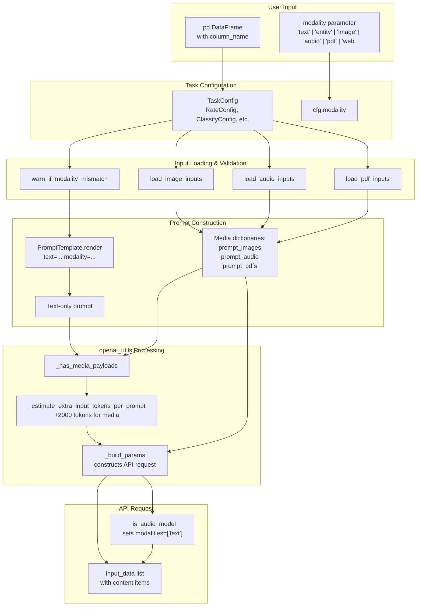
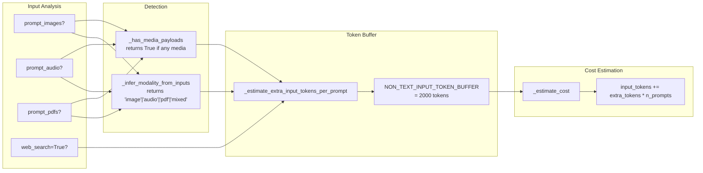
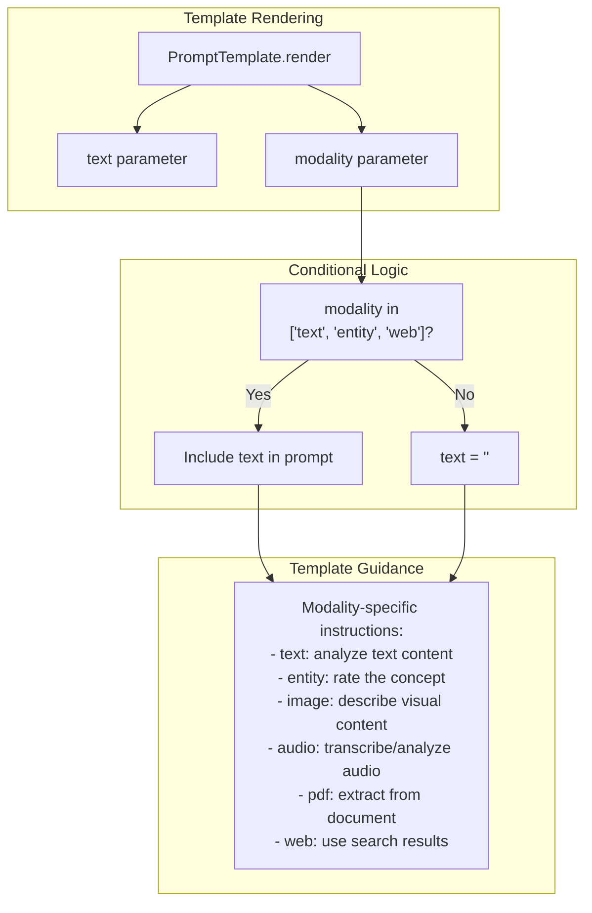
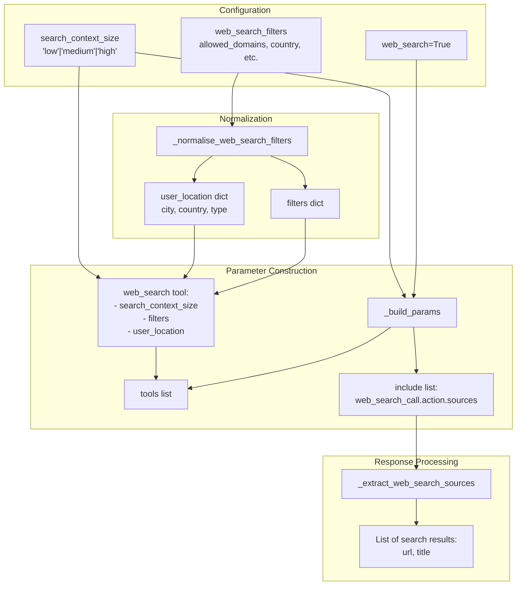

<!-- source: DeepWiki mcp.deepwiki.com · repo openai/GABRIEL · page 11 Multimodal Processing · fetched 2026-10-26 -->

# Multimodal Processing

<details>
<summary>Relevant source files</summary>

The following files were used as context for generating this wiki page:

- [README.md](README.md)
- [src/gabriel/prompts/paraphrase_prompt.jinja2](src/gabriel/prompts/paraphrase_prompt.jinja2)
- [src/gabriel/tasks/paraphrase.py](src/gabriel/tasks/paraphrase.py)
- [src/gabriel/utils/openai_utils.py](src/gabriel/utils/openai_utils.py)
- [src/gabriel/utils/parsing.py](src/gabriel/utils/parsing.py)
- [tests/test_basic.py](tests/test_basic.py)

</details>


## Purpose and Scope

This page describes how GABRIEL handles non-text inputs including images, audio files, PDFs, and web search augmentation. All measurement, cleaning, and helper tasks support multimodal processing through a unified `modality` parameter and standardized data structures. 

For specific implementation details of image and audio processing, see [Image and Audio Inputs](#11.1). For PDF extraction and web search integration, see [PDF Processing and Web Search](#11.2). For general task architecture patterns, see [Task System Architecture](#3.3).

---

## Modality Types

GABRIEL supports six modality types controlled by the `modality` parameter available in all task configurations:

| Modality | Input Type | Use Case |
|----------|-----------|----------|
| `text` | Plain text strings | Default mode for text analysis |
| `entity` | Entity names/terms | Concepts or items to be rated/classified |
| `image` | File paths or base64 data | Visual content analysis |
| `audio` | File paths or encoded audio | Speech, music, or sound analysis |
| `pdf` | File paths or encoded PDFs | Document content extraction |
| `web` | Search queries | Web-augmented context retrieval |

The modality determines how prompts are constructed, which helper functions preprocess inputs, and how token estimation accounts for non-text content.

**Sources:** [src/gabriel/utils/openai_utils.py:828-844](), [README.md:162-163](), [src/gabriel/tasks/paraphrase.py:81-82]()

---

## Modality Flow Through the System



**Diagram: Multimodal data flows from DataFrame inputs through preprocessing, prompt construction, and token estimation before reaching the API**

**Sources:** [src/gabriel/utils/openai_utils.py:328-346](), [src/gabriel/utils/openai_utils.py:847-861](), [src/gabriel/tasks/paraphrase.py:148-150]()

---

## Input Data Structures

### Image Inputs

Images are provided as dictionaries mapping identifiers to lists of image references:

```python
prompt_images: Dict[str, List[str]]
```

Each image reference can be:
- A local file path (e.g., `"/path/to/image.jpg"`)
- A base64-encoded data URI (e.g., `"data:image/png;base64,..."`)
- A URL (when supported by the API)

The `load_image_inputs` helper normalizes various input formats into this structure.

**Example from paraphrase task:**
```python
# src/gabriel/tasks/paraphrase.py:204-211
prompt_images: Optional[Dict[str, List[str]]] = None
if self.cfg.modality == "image":
    tmp: Dict[str, List[str]] = {}
    for idx, val in enumerate(values):
        imgs = load_image_inputs(val)
        if imgs:
            for j in range(1, n + 1):
                tmp[f"row_{idx}_rev{j}"] = imgs
    prompt_images = tmp or None
```

### Audio Inputs

Audio uses a similar structure with additional format metadata:

```python
prompt_audio: Dict[str, List[Dict[str, str]]]
```

Each audio item is a dictionary containing:
- `"data"`: Base64-encoded audio content or file path
- `"format"`: Audio format (e.g., `"mp3"`, `"wav"`, `"m4a"`)

The `load_audio_inputs` helper handles file reading and encoding.

**Example usage:**
```python
# tests/test_basic.py:920-925
data = pd.DataFrame(
    {
        "audio": [
            [{"data": "abcd", "format": "mp3"}],
            [{"data": "efgh", "format": "mp3"}],
        ]
    }
)
```

### PDF Inputs

PDFs follow the same pattern as audio with format specification:

```python
prompt_pdfs: Dict[str, List[Dict[str, str]]]
```

Each PDF item contains:
- `"data"`: Base64-encoded PDF content or file path
- `"format"`: Always `"pdf"`

The `load_pdf_inputs` helper processes PDF files.

**Sources:** [src/gabriel/utils/openai_utils.py:328-346](), [src/gabriel/tasks/paraphrase.py:200-227](), [tests/test_basic.py:920-925]()

---

## Media Payload Detection and Token Estimation

The system automatically detects multimodal inputs and adjusts token estimation:



**Diagram: Media detection triggers a fixed token buffer for cost estimation**

The `NON_TEXT_INPUT_TOKEN_BUFFER` constant adds 2000 tokens per prompt when multimodal inputs are detected. This conservative estimate accounts for image/audio/PDF processing costs that cannot be precisely calculated upfront.

```python
# src/gabriel/utils/openai_utils.py:180
NON_TEXT_INPUT_TOKEN_BUFFER = 2000
```

The `_is_multimodal_estimate` function determines when to display cost warnings:

```python
# src/gabriel/utils/openai_utils.py:863-876
def _is_multimodal_estimate(
    *,
    modality: Optional[str],
    web_search: bool,
    has_media: bool = False,
) -> bool:
    mode = (modality or "").lower()
    if web_search:
        return True
    if mode and mode not in {"text", "entity"}:
        return True
    if has_media:
        return True
    return False
```

**Sources:** [src/gabriel/utils/openai_utils.py:328-346](), [src/gabriel/utils/openai_utils.py:847-876](), [src/gabriel/utils/openai_utils.py:180]()

---

## Audio Model Selection

Audio inputs require specific model handling. The `_is_audio_model` function detects audio-compatible models:

```python
# src/gabriel/utils/openai_utils.py:322-325
def _is_audio_model(model_name: str) -> bool:
    """Return True when the model name indicates audio support."""
    return "audio" in (model_name or "").lower()
```

When using audio models (e.g., `gpt-audio`, `gpt-audio-mini`), the `_build_params` function automatically sets the `modalities` parameter:

```python
# _build_params sets modalities for audio models
params["modalities"] = ["text"]
```

This tells the API that text output is expected even when audio inputs are provided.

**Test example:**
```python
# tests/test_basic.py:353-388
def test_gpt_audio_modalities(monkeypatch):
    # ... setup ...
    asyncio.run(
        openai_utils.get_response(
            "hi",
            model="gpt-audio",
            audio=[{"data": "abcd", "format": "mp3"}],
            use_dummy=False,
        )
    )
    assert DummyClient.captured["modalities"] == ["text"]
```

**Sources:** [src/gabriel/utils/openai_utils.py:322-325](), [tests/test_basic.py:353-388]()

---

## Prompt Template Rendering

Prompt templates adapt to different modalities using the `modality` parameter:



**Diagram: Template rendering adapts text inclusion based on modality**

**Example from paraphrase template:**
```jinja2
{# src/gabriel/prompts/paraphrase_prompt.jinja2:10-14 #}
Modality guidance:
- text: paraphrase/consolidate/modify the text in accordance with the instructions
- entity: rewrite the entity name in a consistent way per the instructions
- web: paraphrase/consolidate the web content found for the search term per the instructions
- image/audio/pdf: paraphrase/summarize the observed content into text per instructions
```

For non-text modalities, the text parameter is often set to an empty string:

```python
# src/gabriel/tasks/paraphrase.py:185-188
prompt_text = (
    text
    if self.cfg.modality in {"text", "entity", "web"}
    else ""
)
```

**Sources:** [src/gabriel/prompts/paraphrase_prompt.jinja2:10-14](), [src/gabriel/tasks/paraphrase.py:185-188]()

---

## Web Search Integration

Web search is treated as a special modality that augments prompts with retrieved context:



**Diagram: Web search flow from configuration through API request to source extraction**

### Web Search Filters

Filters control which domains and locations the search considers:

```python
# tests/test_basic.py:59-87
params = openai_utils._build_params(
    # ...
    web_search=True,
    web_search_filters={
        "allowed_domains": ["openai.com"],
        "country": "GB",
        "type": "approximate",
    },
    search_context_size="high",
    # ...
)
```

The `_normalise_web_search_filters` function separates domain filters from location parameters:

```python
# Filter normalization produces:
{
    "filters": {"allowed_domains": ["openai.com"]},
    "user_location": {"country": "GB", "type": "approximate"}
}
```

### Context Size Aliases

The `search_context_size` parameter accepts both new and legacy values:

| User Value | Normalized Value |
|------------|------------------|
| `"low"` | `"low"` |
| `"medium"` | `"medium"` |
| `"high"` | `"high"` |
| `"large"` (legacy) | `"high"` |

### Parallel Workers Cap

Web search automatically limits parallel workers to prevent overwhelming the search API:

```python
# tests/test_basic.py:726-739
asyncio.run(
    openai_utils.get_all_responses(
        prompts=["search"],
        identifiers=["1"],
        save_path=str(tmp_path / "web.csv"),
        use_dummy=True,
        web_search=True,
        n_parallels=12,  # Will be capped
    )
)
captured = capsys.readouterr().out
assert "Web search is enabled" in captured
assert "automatically capped parallel workers" in captured
```

**Sources:** [src/gabriel/utils/openai_utils.py:40-100](), [tests/test_basic.py:59-87](), [tests/test_basic.py:726-739]()

---

## Per-Prompt Web Search Filters

Individual prompts can override global web search filters using `prompt_web_search_filters`:

```python
# tests/test_basic.py:788-820
asyncio.run(
    openai_utils.get_all_responses(
        prompts=["a", "b"],
        identifiers=["one", "two"],
        # ...
        web_search=True,
        web_search_filters={"allowed_domains": ["example.com"]},
        prompt_web_search_filters={"two": {"city": "Paris"}},
    )
)

# Results in:
# Prompt "a": filters = {"allowed_domains": ["example.com"]}
# Prompt "b": filters = {"allowed_domains": ["example.com"], "city": "Paris"}
```

The per-prompt filters are merged with global filters, with per-prompt values taking precedence.

**Sources:** [tests/test_basic.py:788-820]()

---

## Modality Mismatch Warnings

The `warn_if_modality_mismatch` helper validates that column values match the declared modality:

```python
warn_if_modality_mismatch(values, self.cfg.modality, column_name=column_name)
```

This function inspects the data types and file extensions to detect potential mismatches (e.g., declaring `modality="image"` but providing plain text strings). Warnings are logged to help users catch configuration errors early.

**Sources:** [src/gabriel/tasks/paraphrase.py:149]()

---

## Complete Multimodal Example

Here's how a rating task handles image inputs end-to-end:

```python
# tests/test_basic.py:889-902
def test_ratings_image_dummy(tmp_path):
    cfg = RateConfig(
        attributes={"clarity": ""},
        save_dir=str(tmp_path),
        file_name="ratings.csv",
        use_dummy=True,
        modality="image",  # Declare image modality
    )
    task = Rate(cfg)
    img_path = tmp_path / "test.png"
    img_path.write_bytes(b"abcd")
    data = pd.DataFrame({"image": [str(img_path)]})  # Column with file paths
    df = asyncio.run(task.run(data, column_name="image"))
    assert "clarity" in df.columns
```

The flow is:
1. Configure task with `modality="image"`
2. Create DataFrame with file paths in the target column
3. Task's `run` method loads images via `load_image_inputs`
4. Prompt template renders with `modality="image"` guidance
5. `get_all_responses` receives `prompt_images` dictionary
6. `_build_params` constructs API request with image content items
7. Results returned in DataFrame with rating columns

**Sources:** [tests/test_basic.py:889-902]()

---

## Summary Table: Modality Support Across Functions

| Function | Modality Support | Notes |
|----------|------------------|-------|
| `get_response` | `images`, `audio` parameters | Single response with media |
| `get_all_responses` | `prompt_images`, `prompt_audio`, `prompt_pdfs` | Batch processing with media dictionaries |
| `Rate.run` | `cfg.modality` | All modalities via config |
| `Classify.run` | `cfg.modality` | All modalities via config |
| `Extract.run` | `cfg.modality` | All modalities via config |
| `Rank.run` | `cfg.modality` | All modalities via config |
| `Paraphrase.run` | `cfg.modality` | All modalities via config |
| `_build_params` | All parameters | Constructs unified API request |

**Sources:** [src/gabriel/utils/openai_utils.py:1-2480](), [src/gabriel/tasks/paraphrase.py:28-94]()

---

