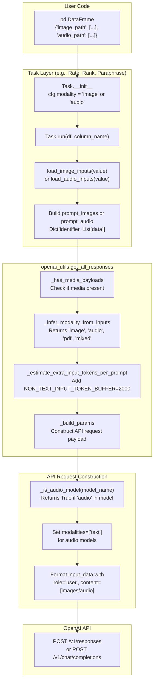
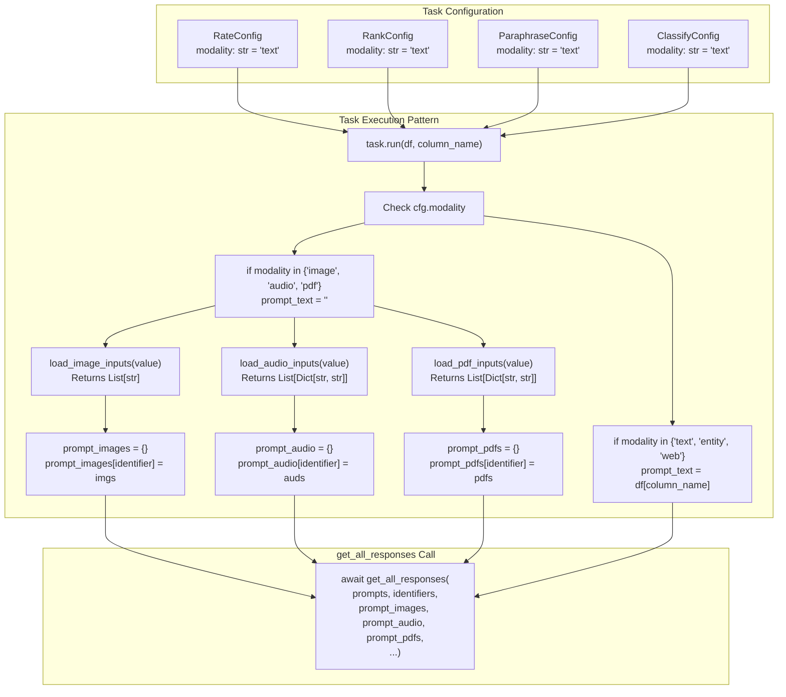

<!-- source: DeepWiki mcp.deepwiki.com · repo openai/GABRIEL · page 11.1 Image and Audio Inputs · fetched 2026-10-26 -->

# Image and Audio Inputs

<details>
<summary>Relevant source files</summary>

The following files were used as context for generating this wiki page:

- [src/gabriel/prompts/paraphrase_prompt.jinja2](src/gabriel/prompts/paraphrase_prompt.jinja2)
- [src/gabriel/tasks/paraphrase.py](src/gabriel/tasks/paraphrase.py)
- [src/gabriel/utils/openai_utils.py](src/gabriel/utils/openai_utils.py)
- [src/gabriel/utils/parsing.py](src/gabriel/utils/parsing.py)
- [tests/test_basic.py](tests/test_basic.py)

</details>


This page documents how GABRIEL processes visual and audio content across all tasks. It covers the data structures used to represent images and audio files, model-specific parameters, token estimation adjustments, and integration points with the task system.

For information about PDF processing and web search augmentation, see [PDF Processing and Web Search](#11.2). For general multimodal processing concepts, see [Multimodal Processing](#11).

---

## Overview

GABRIEL supports image and audio inputs through a unified multimodal infrastructure built into `openai_utils`. All measurement tasks (`rate`, `rank`, `classify`, etc.) and helper tasks (`paraphrase`, `codify`, etc.) can process visual and audio content alongside text by specifying a `modality` parameter.

The system handles three key responsibilities:

1. **Input loading**: Converting file paths or base64-encoded data into API-compatible formats
2. **Prompt construction**: Mapping identifiers to their associated media payloads
3. **Token estimation**: Adjusting cost and throughput calculations for non-text inputs

Sources: [src/gabriel/utils/openai_utils.py:328-346](), [src/gabriel/utils/openai_utils.py:828-844]()

---

## Image Input Format

Images are passed to `get_all_responses` via the `prompt_images` parameter, which maps row identifiers to lists of image data. Each image can be provided as:

- A file path (relative or absolute)
- A base64-encoded string
- A URL (supported by some models)

**Dictionary Structure:**

```python
prompt_images = {
    "row_0": ["path/to/image1.png", "path/to/image2.jpg"],
    "row_1": ["data:image/png;base64,iVBORw0KG..."],
    "row_2": ["https://example.com/image.jpg"]
}
```

The dictionary key must match an entry in the `identifiers` list passed to `get_all_responses`. When a task runs with `modality="image"`, it automatically constructs this dictionary by calling `load_image_inputs` for each row value.

**Example usage:**

```python
# Direct usage in openai_utils
df = await openai_utils.get_all_responses(
    prompts=["Describe this image", "What color is this?"],
    identifiers=["img1", "img2"],
    prompt_images={
        "img1": ["photo1.jpg"],
        "img2": ["photo2.png"]
    },
    model="gpt-5-mini",
    save_path="image_analysis.csv"
)

# Task-level usage with automatic loading
df = await gabriel.rate(
    data=pd.DataFrame({"image_path": ["photo1.jpg", "photo2.png"]}),
    column_name="image_path",
    attributes={"clarity": "How clear is the image?"},
    modality="image",
    save_dir="ratings"
)
```

Sources: [src/gabriel/utils/openai_utils.py:328-346](), [src/gabriel/tasks/paraphrase.py:204-211](), [tests/test_basic.py:889-902]()

---

## Audio Input Format

Audio inputs follow the same dictionary pattern but with additional format metadata. Each audio entry is a dictionary containing `data` and `format` keys:

```python
prompt_audio = {
    "row_0": [
        {"data": "base64_encoded_audio", "format": "mp3"},
        {"data": "path/to/audio.wav", "format": "wav"}
    ],
    "row_1": [
        {"data": "audio_file.m4a", "format": "m4a"}
    ]
}
```

**Supported formats**: `mp3`, `wav`, `m4a`, `flac`, `ogg`, `webm`

**Model requirements**: Audio processing requires models with audio support. The function `_is_audio_model` [openai_utils.py:322-325]() checks whether a model name contains "audio" to enable audio-specific handling. For example, `gpt-audio` and `gpt-audio-mini` are recognized as audio-capable models.

**Modality parameter**: When using audio models, the API request automatically sets `modalities=["text"]` to indicate the model should output text responses (not audio). This is handled in `_build_params` when constructing the request payload.

**Example usage:**

```python
# Pre-encoded audio data
audio_data = [
    {"data": "encoded_bytes", "format": "mp3"},
    {"data": "encoded_bytes", "format": "wav"}
]

df = await gabriel.rank(
    data=pd.DataFrame({"audio": audio_data}),
    column_name="audio",
    attributes={"clarity": "Audio quality", "tone": "Emotional tone"},
    modality="audio",
    model="gpt-audio-mini",
    save_dir="audio_rankings"
)
```

Sources: [src/gabriel/utils/openai_utils.py:322-325](), [src/gabriel/tasks/paraphrase.py:212-219](), [tests/test_basic.py:905-927](), [tests/test_basic.py:353-387]()

---

## Multimodal Data Flow

The following diagram shows how image and audio inputs flow from user code through the task layer to the OpenAI API:



**Key functions:**

- `load_image_inputs` / `load_audio_inputs`: Convert column values to API-compatible formats
- `_has_media_payloads` [openai_utils.py:328-346](): Determines if any identifier has associated media
- `_infer_modality_from_inputs` [openai_utils.py:828-844](): Returns "image", "audio", "pdf", "mixed", or "text"
- `_estimate_extra_input_tokens_per_prompt` [openai_utils.py:847-860](): Adds 2000 token buffer per prompt
- `_is_audio_model` [openai_utils.py:322-325](): Checks model name for audio support

Sources: [src/gabriel/utils/openai_utils.py:328-346](), [src/gabriel/utils/openai_utils.py:828-860](), [src/gabriel/tasks/paraphrase.py:204-227]()

---

## Task Integration

All GABRIEL tasks support multimodal inputs through a common pattern. Tasks accept a `modality` parameter that controls:

1. **Prompt construction**: Text-based modalities include the column value in the prompt; non-text modalities leave the prompt text empty or minimal
2. **Media loading**: The task calls `load_image_inputs` or `load_audio_inputs` to prepare media payloads
3. **Dictionary construction**: Maps row identifiers to their media lists

The following diagram shows how different tasks integrate multimodal support:



**Implementation example from `Paraphrase.run`:**

```python
# Check modality and determine prompt text
prompt_text = text if self.cfg.modality in {"text", "entity", "web"} else ""

# Build media dictionaries based on modality
if self.cfg.modality == "image":
    prompt_images = {}
    for idx, val in enumerate(values):
        imgs = load_image_inputs(val)
        if imgs:
            prompt_images[f"row_{idx}_rev{j}"] = imgs
            
elif self.cfg.modality == "audio":
    prompt_audio = {}
    for idx, val in enumerate(values):
        auds = load_audio_inputs(val)
        if auds:
            prompt_audio[f"row_{idx}_rev{j}"] = auds
```

Sources: [src/gabriel/tasks/paraphrase.py:186-227](), [tests/test_basic.py:873-902](), [tests/test_basic.py:905-927]()

---

## Token Estimation and Cost Calculation

Multimodal inputs require special token estimation logic because images and audio consume significantly more tokens than their text equivalents. GABRIEL handles this through two mechanisms:

### 1. Extra Input Token Buffer

When `_has_media_payloads` returns `True` or when `modality` is not "text" or "entity", the system adds `NON_TEXT_INPUT_TOKEN_BUFFER = 2000` tokens per prompt for cost estimation and rate limiting purposes.

| Modality | Extra Tokens per Prompt |
|----------|-------------------------|
| `text` | 0 |
| `entity` | 0 |
| `image` | 2000 |
| `audio` | 2000 |
| `pdf` | 2000 |
| `web` | 2000 (if web_search=True) |
| `mixed` | 2000 |

### 2. Cost Estimate Disclaimer

When printing the run overview, GABRIEL checks `_is_multimodal_estimate` [openai_utils.py:863-876]() and displays a warning:

```
Note: multimedia/web inputs can make cost estimates unreliable. Monitor usage in the OpenAI dashboard.
```

This warning appears because:
- Image token counts vary significantly based on resolution and content
- Audio duration directly affects token consumption
- Web search results add unpredictable token amounts
- The 2000-token buffer is a conservative estimate, not a precise calculation

**Implementation:**

```python
# From _estimate_extra_input_tokens_per_prompt
def _estimate_extra_input_tokens_per_prompt(
    *,
    modality: Optional[str],
    web_search: bool,
    has_media: bool,
) -> int:
    """Return the extra input tokens to add per prompt for non-text inputs."""
    mode = (modality or "").lower()
    if mode and mode not in {"text", "entity"}:
        return NON_TEXT_INPUT_TOKEN_BUFFER
    if web_search or has_media:
        return NON_TEXT_INPUT_TOKEN_BUFFER
    return 0
```

Sources: [src/gabriel/utils/openai_utils.py:180](), [src/gabriel/utils/openai_utils.py:847-860](), [src/gabriel/utils/openai_utils.py:863-876](), [src/gabriel/utils/openai_utils.py:818-821]()

---

## Input Loading Helpers

GABRIEL provides three utility functions for converting file paths or encoded data into API-compatible formats:

| Function | Purpose | Return Type |
|----------|---------|-------------|
| `load_image_inputs(value)` | Convert image paths/data to list of strings | `List[str]` |
| `load_audio_inputs(value)` | Convert audio paths/data to list of dicts | `List[Dict[str, str]]` |
| `load_pdf_inputs(value)` | Convert PDF paths/data to list of dicts | `List[Dict[str, str]]` |

These functions are imported from `gabriel.utils` and handle multiple input formats:

- **Single file path**: `"image.jpg"` → `["image.jpg"]`
- **List of paths**: `["img1.jpg", "img2.png"]` → `["img1.jpg", "img2.png"]`
- **Pre-encoded data**: `[{"data": "...", "format": "mp3"}]` → `[{"data": "...", "format": "mp3"}]`
- **Mixed formats**: Automatically normalizes to the expected structure

**Usage example from tasks:**

```python
from gabriel.utils import load_audio_inputs, load_image_inputs, load_pdf_inputs

# In task.run method
if self.cfg.modality == "image":
    prompt_images = {}
    for idx, val in enumerate(df[column_name]):
        imgs = load_image_inputs(val)
        if imgs:
            prompt_images[f"row_{idx}"] = imgs
```

Sources: [src/gabriel/tasks/paraphrase.py:14-19](), [src/gabriel/tasks/paraphrase.py:204-227]()

---

## Modality Parameter and Prompt Templates

The `modality` parameter affects how Jinja2 templates render prompts. Templates can check the modality value and adjust their output accordingly.

**Example from `paraphrase_prompt.jinja2`:**

```jinja2

{{ snip.single_entry(modality, text) }}

Task: rewrite the provided content according to the instructions below.

Modality guidance:
- text: paraphrase/consolidate/modify the text in accordance with the instructions
- entity: rewrite the entity name in a consistent way per the instructions
- web: paraphrase/consolidate the web content found for the search term per instructions
- image/audio/pdf: paraphrase/summarize the observed content into text per instructions
```

The `snip.single_entry` macro (defined in `snippets.jinja2`) handles modality-specific formatting:
- For `text`, `entity`, `web`: Includes the text content in the prompt
- For `image`, `audio`, `pdf`: Includes instructional text without the media data (since media is attached separately via `prompt_images`, `prompt_audio`, or `prompt_pdfs`)

**Modality mismatch warnings**: Tasks call `warn_if_modality_mismatch(values, modality, column_name)` to detect configuration errors, such as setting `modality="image"` when the column contains text strings rather than file paths.

Sources: [src/gabriel/prompts/paraphrase_prompt.jinja2:1-23](), [src/gabriel/tasks/paraphrase.py:149]()

---

## Audio Model-Specific Handling

Models with "audio" in their name receive special treatment to ensure proper audio processing:

### Model Detection

```python
def _is_audio_model(model_name: str) -> bool:
    """Return True when the model name indicates audio support."""
    return "audio" in (model_name or "").lower()
```

### Modality Configuration

When an audio model is detected, `_build_params` automatically sets `modalities=["text"]` in the API request. This instructs the model to output text responses rather than audio responses, which is the expected behavior for all GABRIEL tasks.

**From `_build_params`:**

```python
if _is_audio_model(model):
    params["modalities"] = ["text"]
```

### Legacy vs. Modern APIs

Audio models may use different API endpoints:
- **Legacy models** (e.g., `gpt-4o-audio`): Use `/v1/chat/completions` endpoint
- **Modern models** (e.g., `gpt-audio`, `gpt-audio-mini`): Use `/v1/responses` endpoint

The system handles this automatically based on model detection and feature flags. No user configuration is required.

Sources: [src/gabriel/utils/openai_utils.py:322-325](), [tests/test_basic.py:353-387]()

---

## Complete Example: Rating Images

This example demonstrates rating image clarity using the `Rate` task with image inputs:

```python
import pandas as pd
import gabriel

# Prepare dataset with image paths
df = pd.DataFrame({
    "image_path": [
        "photos/image1.jpg",
        "photos/image2.png",
        "photos/image3.jpg"
    ],
    "description": ["Landscape", "Portrait", "Still life"]
})

# Rate image clarity
result = await gabriel.rate(
    data=df,
    column_name="image_path",
    attributes={
        "clarity": "How sharp and clear is the image? Rate on a scale of 0-100.",
        "composition": "How well-composed is the image? Rate on a scale of 0-100."
    },
    modality="image",
    model="gpt-5-mini",
    save_dir="image_ratings"
)

# Result DataFrame includes original columns plus rating columns
print(result[["description", "clarity", "composition"]])
```

**What happens internally:**

1. `Rate.__init__` receives `modality="image"` in the config
2. `Rate.run` calls `load_image_inputs` for each row value
3. Constructs `prompt_images = {"batch0_row0": ["photos/image1.jpg"], ...}`
4. Renders prompts with `text=""` (empty) since modality is "image"
5. Calls `get_all_responses` with `prompt_images` dictionary
6. `_infer_modality_from_inputs` returns `"image"`
7. `_estimate_extra_input_tokens_per_prompt` adds 2000 tokens per prompt
8. `_build_params` constructs API request with image data in `input_data`
9. Responses are parsed and merged back into the DataFrame

Sources: [tests/test_basic.py:889-902](), [src/gabriel/tasks/paraphrase.py:186-250]()

---

## Performance Considerations

### Parallel Request Limits

When using web search or multimodal inputs, the system automatically caps parallel workers to prevent overwhelming the API:

```python
# From get_all_responses
if web_search:
    n_parallels_capped = min(n_parallels, 10)
    print(f"Web search is enabled; automatically capped parallel workers to {n_parallels_capped}")
```

This cap applies to all media types (image, audio, PDF) to ensure stable throughput and avoid rate limit errors.

### Token Budget Calculation

The rate limiter uses the extra token buffer when calculating throughput:

```python
tokens_per_call = avg_input_tokens + estimated_output_tokens + extra_tokens
allowed_tok_pm = rate_limit_tokens_per_minute
throughput_ppm = allowed_tok_pm / tokens_per_call
```

This conservative estimation ensures the system doesn't underestimate token consumption and hit rate limits mid-run.

Sources: [src/gabriel/utils/openai_utils.py:180](), [src/gabriel/utils/openai_utils.py:847-860]()

---

