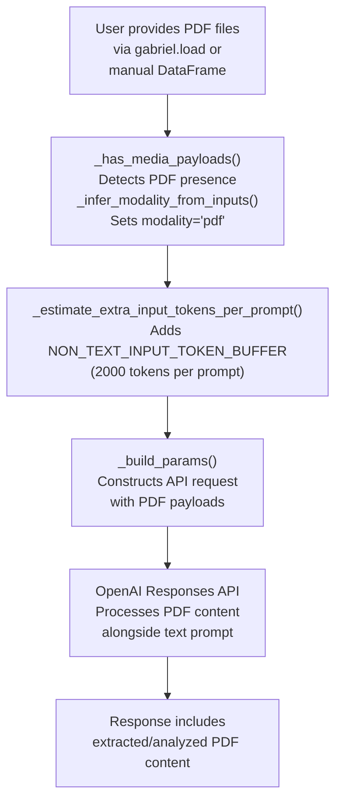
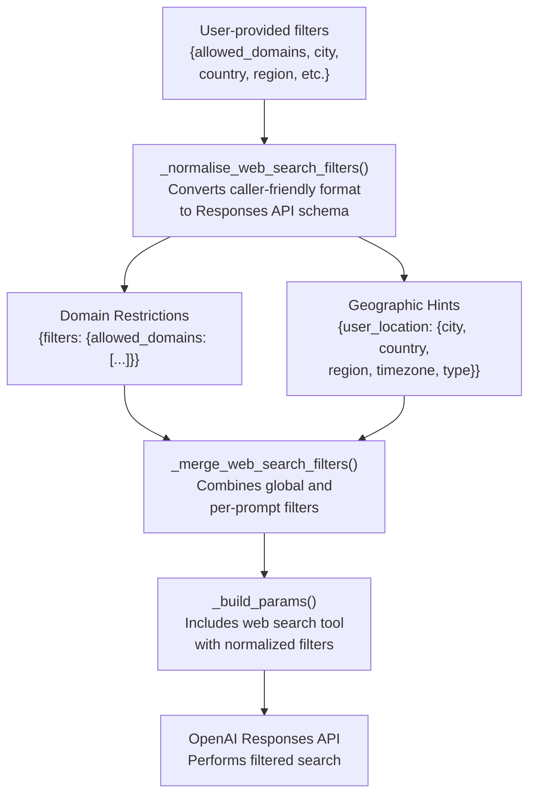
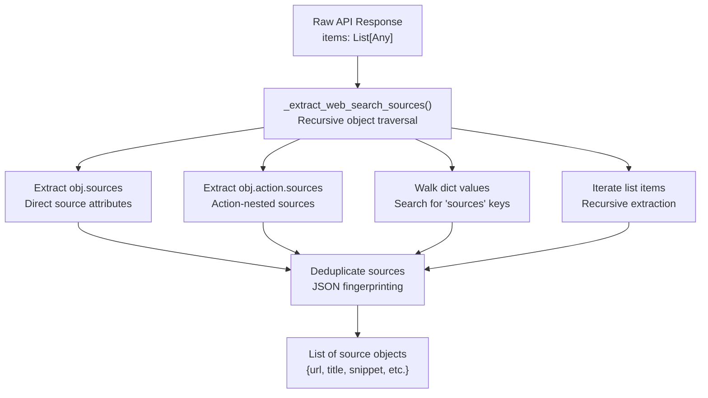
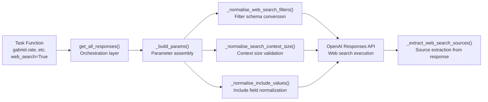

<!-- source: DeepWiki mcp.deepwiki.com · repo openai/GABRIEL · page 11.2 PDF Processing and Web Search · fetched 2026-10-26 -->

# PDF Processing and Web Search

<details>
<summary>Relevant source files</summary>

The following files were used as context for generating this wiki page:

- [README.md](README.md)
- [src/gabriel/utils/openai_utils.py](src/gabriel/utils/openai_utils.py)
- [src/gabriel/utils/parsing.py](src/gabriel/utils/parsing.py)

</details>


This page documents GABRIEL's support for PDF documents and web search augmentation. PDF processing enables the system to extract and analyze content from PDF files as part of multimodal tasks, while web search allows LLM prompts to be augmented with fresh information retrieved from the web at inference time. For information about other multimodal inputs (images and audio), see [Image and Audio Inputs](#11.1).

Both capabilities are implemented in the core infrastructure layer and are available across all GABRIEL tasks that accept the `modality` and `web_search` parameters.

---

## PDF Processing

### PDF Input Format

PDFs are processed similarly to audio inputs in GABRIEL. The system expects PDF files to be provided through a dictionary mapping identifiers to lists of PDF file references.

**PDF File Structure**

```
prompt_pdfs: Dict[str, List[Dict[str, str]]]
```

Each PDF reference is a dictionary with file metadata. The outer dictionary maps string identifiers (matching the task's identifier column) to lists of PDF dictionaries. This structure allows multiple PDFs to be associated with a single prompt.

**Modality Detection**

The system automatically detects when PDFs are present through the `_has_media_payloads` function [src/gabriel/utils/openai_utils.py:328-346]() and `_infer_modality_from_inputs` function [src/gabriel/utils/openai_utils.py:828-844](). When PDFs are detected, the modality is set to "pdf" (or "mixed" if combined with other media types).

**Token Estimation**

When PDFs are present, GABRIEL adds a buffer of `NON_TEXT_INPUT_TOKEN_BUFFER` (2000) tokens per prompt to cost estimates [src/gabriel/utils/openai_utils.py:180]() and [src/gabriel/utils/openai_utils.py:847-860](). This accounts for the additional tokens consumed by PDF content beyond the text prompt.

### PDF Processing Flow



**Sources:**
- [src/gabriel/utils/openai_utils.py:328-346]()
- [src/gabriel/utils/openai_utils.py:828-844]()
- [src/gabriel/utils/openai_utils.py:847-860]()
- [src/gabriel/utils/openai_utils.py:1532-1626]()

---

## Web Search Integration

Web search augmentation allows GABRIEL to retrieve and incorporate real-time web information into prompts before sending them to the LLM. This is particularly useful for tasks requiring current information, fact-checking, or entity disambiguation.

### Enabling Web Search

Web search is enabled by setting `web_search=True` on any GABRIEL task function. When enabled, the system automatically appends a web search tool to the request and includes `web_search_call.action.sources` in the response fields.

**Configuration Parameters:**

| Parameter | Type | Default | Description |
|-----------|------|---------|-------------|
| `web_search` | `bool` | `False` | Enable web search augmentation |
| `web_search_filters` | `Dict[str, Any]` | `None` | Domain and location constraints |
| `search_context_size` | `str` | `"medium"` | Amount of search context ("low", "medium", "high") |

### Web Search Filters and Constraints

Web search filters control which domains are queried and provide geographic context for location-specific searches. Filters are specified as dictionaries with two main categories of constraints:

**Domain Filtering**

```python
web_search_filters = {
    "allowed_domains": ["example.com", "wikipedia.org", "scholar.google.com"]
}
```

The `allowed_domains` key restricts searches to specific domains. The system normalizes domain specifications to handle various input formats (strings, lists, comma-separated values).

**Geographic Context**

```python
web_search_filters = {
    "city": "San Francisco",
    "country": "United States",
    "region": "California",
    "timezone": "America/Los_Angeles",
    "type": "approximate"
}
```

Geographic hints guide the search engine to prioritize location-relevant results. The `type` field should be set to `"approximate"` to match the Responses API schema.

**Filter Normalization Process**



**Filter Merging Logic**

The system supports both global filters (applied to all prompts) and per-prompt filters (specified for individual items). The `_merge_web_search_filters` function [src/gabriel/utils/openai_utils.py:1343-1382]() combines these, with per-prompt filters taking precedence. Domain lists are normalized and deduplicated.

**Sources:**
- [src/gabriel/utils/openai_utils.py:1297-1340]()
- [src/gabriel/utils/openai_utils.py:1343-1382]()
- [src/gabriel/utils/openai_utils.py:1532-1626]()

### Search Context Size

The `search_context_size` parameter controls how much web content is retrieved and included in the prompt context. The Responses API accepts three canonical values:

| Value | Description | Legacy Alias |
|-------|-------------|--------------|
| `"low"` | Minimal context, faster | `"small"` |
| `"medium"` | Balanced context | (default) |
| `"high"` | Maximum context, comprehensive | `"large"` |

The system normalizes legacy aliases (`"small"` → `"low"`, `"large"` → `"high"`) for backward compatibility [src/gabriel/utils/openai_utils.py:1412-1441](). Invalid values raise `ValueError` to prevent configuration errors from propagating silently.

**Context Size Normalization:**

```python
def _normalise_search_context_size(value: Optional[str]) -> str:
    """Clamp web-search context size to the Responses API's allowed values."""
    if value is None:
        return "medium"
    
    normalised = str(value).strip().lower()
    aliases = {"small": "low", "medium": "medium", "large": "high", "high": "high"}
    resolved = aliases.get(normalised, normalised)
    
    if resolved not in {"low", "medium", "high"}:
        raise ValueError("search_context_size must be one of {'low', 'medium', 'high'}")
    
    return resolved
```

**Sources:**
- [src/gabriel/utils/openai_utils.py:1412-1441]()

### Retrieving Web Search Sources

When web search is enabled, the system automatically requests and extracts the sources used by the model. This provides transparency and allows users to audit which web pages influenced the response.

**Include Fields**

The system adds `"web_search_call.action.sources"` to the `include` parameter [src/gabriel/utils/openai_utils.py:1385-1409]() to retrieve source information. If the user hasn't specified any include fields, this is set as the default.

**Source Extraction Process**

The `_extract_web_search_sources` function [src/gabriel/utils/openai_utils.py:1444-1530]() walks through the response objects to collect all source references:



**Source Deduplication**

Sources are deduplicated using JSON fingerprinting (canonical JSON serialization with sorted keys) to prevent the same source from appearing multiple times [src/gabriel/utils/openai_utils.py:1459-1466](). The function handles various object types (Pydantic models, plain dicts, objects with `__dict__`) through polymorphic conversion.

**Sources:**
- [src/gabriel/utils/openai_utils.py:1385-1409]()
- [src/gabriel/utils/openai_utils.py:1444-1530]()

---

## Implementation Details

### Request Construction in _build_params

The `_build_params` function [src/gabriel/utils/openai_utils.py:1532-1626]() is responsible for assembling all API request parameters, including web search configuration. When `web_search=True`, the function:

1. **Normalizes filters** using `_normalise_web_search_filters`
2. **Sets search context size** via `_normalise_search_context_size`
3. **Adds include fields** to retrieve source information
4. **Constructs the web search tool** specification

**Web Search Tool Structure:**

```python
# Simplified representation from _build_params
if web_search:
    tools = tools or []
    web_tool = {"type": "web_search_2025_01"}
    
    if web_search_filters:
        normalized = _normalise_web_search_filters(web_search_filters)
        if "filters" in normalized:
            web_tool["filters"] = normalized["filters"]
        if "user_location" in normalized:
            web_tool["user_location"] = normalized["user_location"]
    
    web_tool["search_context_size"] = _normalise_search_context_size(search_context_size)
    tools.append(web_tool)
    
    # Ensure source retrieval
    include_list = _normalise_include_values(include)
    if "web_search_call.action.sources" not in include_list:
        include_list.append("web_search_call.action.sources")
```

**Multi-Stage Processing Architecture:**



**Sources:**
- [src/gabriel/utils/openai_utils.py:1532-1626]()
- [src/gabriel/utils/openai_utils.py:1297-1340]()
- [src/gabriel/utils/openai_utils.py:1412-1441]()
- [src/gabriel/utils/openai_utils.py:1385-1409]()

### Cost and Performance Implications

Web search and PDF processing both impact cost estimates and throughput:

**Token Estimation Adjustments:**

- **PDFs and Web Search**: `NON_TEXT_INPUT_TOKEN_BUFFER` (2000 tokens) added per prompt [src/gabriel/utils/openai_utils.py:180]()
- **Cost Warning**: When multimodal or web search is detected, GABRIEL prints a warning about unreliable estimates [src/gabriel/utils/openai_utils.py:818-821]()

**Concurrency Implications:**

Web search requests may have different latency characteristics than pure text requests. The system's rate limiting [src/gabriel/utils/openai_utils.py:1008-1034]() and concurrency management remain active, but actual throughput may be lower due to search execution time.

**Sources:**
- [src/gabriel/utils/openai_utils.py:180]()
- [src/gabriel/utils/openai_utils.py:818-821]()
- [src/gabriel/utils/openai_utils.py:847-860]()
- [src/gabriel/utils/openai_utils.py:863-876]()

---

## Usage Examples

### Basic Web Search

```python
import gabriel
import pandas as pd

df = pd.DataFrame({"entity": ["quantum computing", "CRISPR", "fusion energy"]})

results = await gabriel.rate(
    df,
    column_name="entity",
    attributes={"commercial_readiness": "How ready is this technology for market"},
    modality="entity",
    web_search=True,  # Enable web search
    search_context_size="high",  # Maximum context
    model="gpt-5-mini",
    save_dir="~/gabriel_web_search"
)
```

### Web Search with Domain Restrictions

```python
results = await gabriel.extract(
    df,
    column_name="company_name",
    instructions="Extract the current CEO name and headquarters location",
    modality="entity",
    web_search=True,
    web_search_filters={
        "allowed_domains": ["linkedin.com", "crunchbase.com", "wikipedia.org"]
    },
    model="gpt-5-mini",
    save_dir="~/gabriel_company_extract"
)
```

### Web Search with Geographic Context

```python
df = pd.DataFrame({"restaurant": ["best pizza", "top sushi", "fine dining"]})

results = await gabriel.rate(
    df,
    column_name="restaurant",
    attributes={"popularity": "How popular is this type of restaurant locally"},
    modality="text",
    web_search=True,
    web_search_filters={
        "city": "San Francisco",
        "country": "United States",
        "region": "California",
        "type": "approximate"
    },
    search_context_size="medium",
    model="gpt-5-mini",
    save_dir="~/gabriel_local_restaurants"
)
```

### PDF Processing with gabriel.load

```python
# Load PDF files from directory
pdf_df = gabriel.load(
    "~/documents/research_papers/",
    modality="pdf"
)

# Rate the papers
results = await gabriel.rate(
    pdf_df,
    column_name="identifier",
    attributes={
        "novelty": "How novel are the research findings",
        "rigor": "Quality of the experimental methodology"
    },
    modality="pdf",
    model="gpt-5",
    save_dir="~/gabriel_paper_analysis"
)
```

### Combined PDF and Web Search

```python
# When you need both PDF content and supplementary web information
results = await gabriel.classify(
    pdf_df,
    column_name="identifier",
    labels=["computer_science", "biology", "physics", "chemistry"],
    differentiate_labels=True,
    modality="pdf",
    web_search=True,  # Augment PDF analysis with web context
    search_context_size="low",  # Minimal web context to supplement PDF
    model="gpt-5-mini",
    save_dir="~/gabriel_paper_classification"
)
```

**Sources:**
- [README.md:162-163]()
- [src/gabriel/utils/openai_utils.py:1532-1626]()

---

## Key Functions Reference

| Function | Location | Purpose |
|----------|----------|---------|
| `_has_media_payloads` | [openai_utils.py:328-346]() | Detect PDF/image/audio presence |
| `_infer_modality_from_inputs` | [openai_utils.py:828-844]() | Determine modality from inputs |
| `_estimate_extra_input_tokens_per_prompt` | [openai_utils.py:847-860]() | Add token buffer for non-text inputs |
| `_normalise_web_search_filters` | [openai_utils.py:1297-1340]() | Convert filters to API schema |
| `_merge_web_search_filters` | [openai_utils.py:1343-1382]() | Combine global and per-prompt filters |
| `_normalise_search_context_size` | [openai_utils.py:1412-1441]() | Validate and normalize context size |
| `_normalise_include_values` | [openai_utils.py:1385-1409]() | Normalize include field specifications |
| `_extract_web_search_sources` | [openai_utils.py:1444-1530]() | Extract source references from responses |
| `_build_params` | [openai_utils.py:1532-1626]() | Assemble complete API request |

**Sources:**
- [src/gabriel/utils/openai_utils.py:328-346]()
- [src/gabriel/utils/openai_utils.py:828-844]()
- [src/gabriel/utils/openai_utils.py:847-860]()
- [src/gabriel/utils/openai_utils.py:1297-1340]()
- [src/gabriel/utils/openai_utils.py:1343-1382]()
- [src/gabriel/utils/openai_utils.py:1385-1409]()
- [src/gabriel/utils/openai_utils.py:1412-1441]()
- [src/gabriel/utils/openai_utils.py:1444-1530]()
- [src/gabriel/utils/openai_utils.py:1532-1626]()

---

