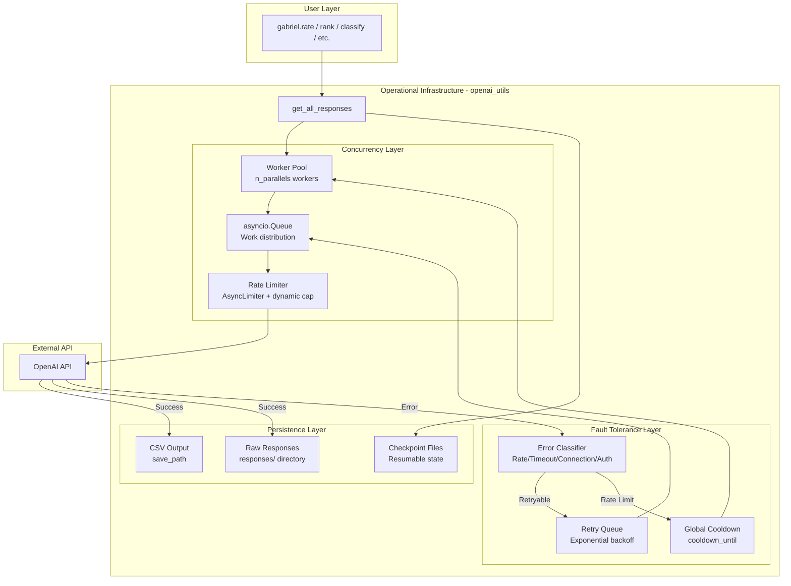
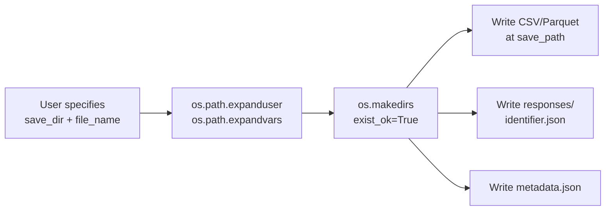
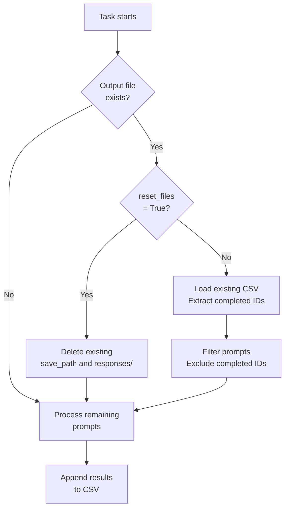
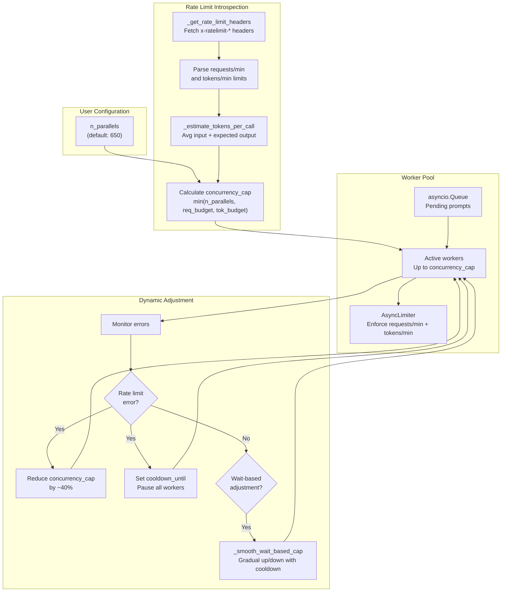
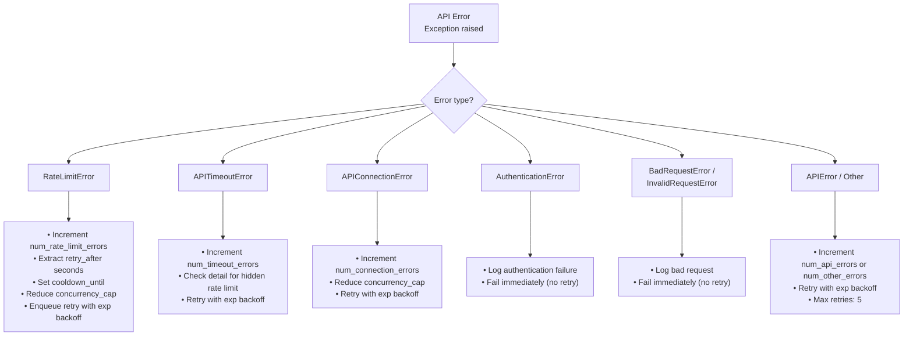

<!-- source: DeepWiki mcp.deepwiki.com · repo openai/GABRIEL · page 12 Operational Topics · fetched 2026-10-26 -->

# Operational Topics

<details>
<summary>Relevant source files</summary>

The following files were used as context for generating this wiki page:

- [README.md](README.md)
- [src/gabriel/utils/openai_utils.py](src/gabriel/utils/openai_utils.py)
- [src/gabriel/utils/parsing.py](src/gabriel/utils/parsing.py)

</details>


## Purpose and Scope

This page covers the operational infrastructure that enables GABRIEL to scale reliably: persistence patterns, resumability mechanisms, concurrency management, rate limiting, and error handling. These systems work automatically behind the scenes but understanding them helps when tuning performance, debugging interrupted runs, or auditing model outputs.

For information about configuring prompts and model parameters, see [Advanced Configuration](#10). For details on the LLM orchestration engine itself, see [LLM Orchestration Infrastructure](#3.1).

---

## Overview: Operational Infrastructure Layers

GABRIEL's operational infrastructure operates across three layers: **persistence** (saving outputs and checkpoints), **concurrency** (parallel execution and rate limiting), and **fault tolerance** (error classification and retries). All tasks funnel through `openai_utils.get_all_responses`, which provides these guarantees uniformly.



**Sources:** [src/gabriel/utils/openai_utils.py:1-100](), [src/gabriel/utils/openai_utils.py:196-237]()

---

## Save Directory Structure

Every GABRIEL task writes outputs to a `save_dir` (expanded from tildes and environment variables). The directory contains:

| Path | Content | Purpose |
|------|---------|---------|
| `<file_name>.csv` or `.parquet` | Structured outputs | Primary results DataFrame with identifiers and response columns |
| `responses/` | Raw JSON responses | Full API payloads for auditability and debugging |
| `responses/<identifier>.json` | Individual response | One file per prompt, named by identifier |
| `metadata.json` | Run configuration | Model, parameters, timestamps for reproducibility |
| Checkpoint files | Resumable state | Partial progress for interrupted runs (implementation varies by task) |

### Directory Creation and File Naming



The `file_name` parameter controls the output filename. When omitted, tasks generate a default name (e.g., `rate_results.csv` for `gabriel.rate`). The `save_path` variable combines `save_dir` and `file_name` to produce the full output path.

**Example:**
```python
# User specifies
save_dir = "~/Documents/gabriel_runs/experiment_01"
file_name = "toxicity_ratings.csv"

# System expands to
save_path = "/home/user/Documents/gabriel_runs/experiment_01/toxicity_ratings.csv"
# And creates
# - /home/user/Documents/gabriel_runs/experiment_01/toxicity_ratings.csv
# - /home/user/Documents/gabriel_runs/experiment_01/responses/*.json
# - /home/user/Documents/gabriel_runs/experiment_01/metadata.json
```

**Sources:** [src/gabriel/utils/openai_utils.py:1532-1600]() (save_path usage in get_all_responses)

---

## Checkpointing and Resumability

GABRIEL writes outputs incrementally to enable resumption from interruptions (crashes, rate limit exhaustion, manual cancellation). The checkpoint mechanism varies by implementation but follows a common pattern: append-only writes with existence checks.

### Checkpoint Flow



### reset_files Parameter

The `reset_files` parameter controls checkpoint behavior:

| Value | Behavior |
|-------|----------|
| `True` | Delete existing outputs and start fresh |
| `False` (default) | Resume from last checkpoint by skipping completed identifiers |

**Implementation Details:**

The checkpoint system reads the existing CSV (if present), extracts all identifiers with responses, and excludes them from the work queue. This happens in `get_all_responses` before dispatching to workers:

```python
# Pseudocode from get_all_responses
if os.path.exists(save_path) and not reset_files:
    existing_df = pd.read_csv(save_path)
    completed_ids = set(existing_df['Identifier'])
    prompts = [p for i, p in enumerate(prompts) if identifiers[i] not in completed_ids]
    identifiers = [i for i in identifiers if i not in completed_ids]
```

Results append to the CSV after every N completions (configurable checkpoint frequency). This append-only pattern ensures partial progress persists even if the process terminates unexpectedly.

**Sources:** [src/gabriel/utils/openai_utils.py:1532-1900]() (get_all_responses checkpoint logic)

---

## Concurrency and Rate Limiting

GABRIEL manages concurrency at two levels: **user-specified parallelism** (`n_parallels`) and **dynamic rate-limit-aware capping**. The system balances throughput with API constraints by continuously adjusting concurrency based on observed rate limits.

### Concurrency Architecture



### Rate Limit Introspection

Before starting work, `get_all_responses` calls `_get_rate_limit_headers` [src/gabriel/utils/openai_utils.py:890-994]() to probe the API and retrieve rate limit headers:

- `x-ratelimit-limit-requests`: Total requests per minute
- `x-ratelimit-remaining-requests`: Requests remaining in current window
- `x-ratelimit-limit-tokens`: Total tokens per minute  
- `x-ratelimit-remaining-tokens`: Tokens remaining in current window

The system prefers `remaining` values (current availability) over `limit` values (maximum capacity) to avoid saturating a partially depleted quota.

### Concurrency Cap Calculation

The concurrency cap combines three constraints [src/gabriel/utils/openai_utils.py:1080-1157]():

1. **Request budget**: `remaining_requests` (or `limit_requests` if remaining unavailable)
2. **Token budget**: `remaining_tokens / tokens_per_call` (where `tokens_per_call` estimates input + output per request)
3. **User-specified limit**: `n_parallels`

The final cap is `min(n_parallels, request_budget, token_budget)`, applying headroom factors [src/gabriel/utils/openai_utils.py:183-190]() to avoid edge-case overruns:

```python
RATE_LIMIT_HEADROOM = 0.85
PLANNING_RATE_LIMIT_BUFFER = 0.85
OUTPUT_TOKEN_HEADROOM_INITIAL = 2.0
OUTPUT_TOKEN_HEADROOM_STEADY = 1.0
```

### Dynamic Adjustment

During execution, the system adjusts `concurrency_cap` in response to errors:

| Error Type | Action | Implementation |
|------------|--------|----------------|
| `RateLimitError` | Reduce cap by 40%, set global cooldown | `_rate_limit_decrement` [src/gabriel/utils/openai_utils.py:1245-1248]() |
| `ConnectionError` | Reduce cap by 40% | `_connection_error_decrement` [src/gabriel/utils/openai_utils.py:1251-1254]() |
| Wait-based signals | Gradual adjustment with cooldown periods | `_smooth_wait_based_cap` [src/gabriel/utils/openai_utils.py:1257-1294]() |

The global cooldown mechanism (`cooldown_until` timestamp) pauses all workers when rate limit errors occur, preventing thundering herd effects.

**Sources:** [src/gabriel/utils/openai_utils.py:890-994](), [src/gabriel/utils/openai_utils.py:1080-1157](), [src/gabriel/utils/openai_utils.py:1245-1294]()

---

## Error Handling and Retry Logic

GABRIEL classifies errors into categories and applies tailored retry strategies. The system distinguishes between transient failures (retry with backoff) and fatal errors (fail fast).

### Error Classification



### Error Types and Handling

| Error Class | Counter | Retry Strategy | Concurrency Impact |
|-------------|---------|----------------|-------------------|
| `RateLimitError` | `num_rate_limit_errors` | Exponential backoff + jitter, respect `retry_after` header | Reduce cap by 40%, set global cooldown |
| `APITimeoutError` | `num_timeout_errors` | Exponential backoff, classify detail for hidden rate limits | None (unless detail suggests rate limit) |
| `APIConnectionError` | `num_connection_errors` | Exponential backoff | Reduce cap by 40% |
| `AuthenticationError` | N/A | Fail immediately | None |
| `BadRequestError` / `InvalidRequestError` | N/A | Fail immediately | None |
| `APIError` / Other | `num_api_errors` / `num_other_errors` | Exponential backoff (max 5 retries) | None |

**Sources:** [src/gabriel/utils/openai_utils.py:102-119]() (error class imports), [src/gabriel/utils/openai_utils.py:196-212]() (StatusTracker definition)

### Retry-After Extraction

When the API returns a `retry_after` hint (in seconds or milliseconds), the system respects it [src/gabriel/utils/openai_utils.py:247-268]():

```python
def _extract_retry_after_seconds(error: Exception) -> Optional[float]:
    """Return a retry-after duration in seconds when available."""
    
    for attr in ("retry_after", "retry_after_s", "retry_after_seconds"):
        retry_value = getattr(error, attr, None)
        if isinstance(retry_value, (int, float)) and retry_value > 0:
            return float(retry_value)
    retry_ms = getattr(error, "retry_after_ms", None)
    if isinstance(retry_ms, (int, float)) and retry_ms > 0:
        return float(retry_ms) / 1000.0
    # Fallback: parse error message for "after X seconds"
    message = str(error)
    match = re.search(r"after\s+([0-9]+(?:\.[0-9]+)?)\s*seconds", message)
    if match:
        return float(match.group(1))
    return None
```

### Exponential Backoff with Jitter

Retries use exponential backoff [src/gabriel/utils/openai_utils.py:17-19]() (strategy described in comments):

```
wait_time = min(base_delay * (2 ** attempt), max_delay) + random.uniform(0, jitter)
```

This spreads retries over time to avoid synchronized thundering herds. The implementation follows OpenAI's guidelines for handling 429 responses.

**Sources:** [src/gabriel/utils/openai_utils.py:247-300](), [src/gabriel/utils/openai_utils.py:102-119](), [src/gabriel/utils/openai_utils.py:17-19]()

### Global Cooldown Mechanism

When a `RateLimitError` occurs, the system sets `time_of_last_rate_limit_error` in `StatusTracker` [src/gabriel/utils/openai_utils.py:210]() and computes a `cooldown_until` timestamp. All workers check this timestamp before sending requests; if the current time is before `cooldown_until`, they sleep and re-check. This prevents parallel workers from continuing to hammer the API during a rate limit event.

**Sources:** [src/gabriel/utils/openai_utils.py:196-212]()

---

## Background Polling Mode

For long-running requests (when `timeout=None` is specified), GABRIEL uses **background mode**: it submits the request and polls a separate retrieval endpoint until the response is ready [src/gabriel/utils/openai_utils.py:230-237]():

```python
class BackgroundTimeoutError(asyncio.TimeoutError):
    """Timeout raised while polling a background response."""
    
    def __init__(self, response_id: Optional[str], last_response: Any, message: str):
        super().__init__(message)
        self.response_id = response_id
        self.last_response = last_response
```

This prevents HTTP connection timeouts for prompts that may take minutes to complete. The system tracks the `response_id` and polls periodically, surfacing `BackgroundTimeoutError` if the wait exceeds a separate background timeout threshold.

**Sources:** [src/gabriel/utils/openai_utils.py:230-237]()

---

## Usage Overview and Cost Estimation

Before starting work, `get_all_responses` prints a summary [src/gabriel/utils/openai_utils.py:996-1243]() showing:

- **Prompt count and word/token estimates** (sampled from first 5000 prompts to keep startup fast)
- **Rate limit budgets** (requests/min and tokens/min from introspection)
- **Concurrency cap** (calculated from budgets and `n_parallels`)
- **Cost estimate** (based on `MODEL_PRICING` table [src/gabriel/utils/openai_utils.py:363-407]())
- **Tier qualifications** (requirements for moving to higher usage tiers [src/gabriel/utils/openai_utils.py:349-360]())

### Example Output

```
===== OpenAI API usage summary =====
Prompts: 10,000
Approx. input words: 250,000
Requests per minute: 5,000
Tokens per minute: 2,000,000
Approx. words per minute: 1,000,000
We can run up to 650 requests at the same time with your current settings.

Usage tiers (higher tier = faster runs):
  • Free: qualify by User must be in an allowed geography; monthly quota $100 / month
  • Tier 1: qualify by $5 added
  • Tier 2: qualify by $50 added and 7+ days since first payment
  ...

Estimated synchronous cost: $12.50 (input: $2.50, output: $10.00)
```

**Sources:** [src/gabriel/utils/openai_utils.py:996-1243](), [src/gabriel/utils/openai_utils.py:363-407](), [src/gabriel/utils/openai_utils.py:349-360]()

---

## Tuning Recommendations

| Scenario | Recommendation | Rationale |
|----------|---------------|-----------|
| **Slow processing** | Increase `n_parallels` beyond 650 | Default cap may be below your rate limits |
| **Frequent rate limit errors** | Decrease `n_parallels` to 100-200 | System may be overshooting your quota |
| **Connection errors** | Decrease `n_parallels`, check network stability | High concurrency can overwhelm connections |
| **Resuming interrupted run** | Use `reset_files=False` (default) | Skips completed identifiers |
| **Starting fresh** | Use `reset_files=True` | Deletes existing outputs |
| **Cost overruns** | Use `max_output_tokens` to cap generation length | Prevents unexpectedly long responses |
| **Multimodal inputs** | Increase `extra_input_tokens_per_prompt` in estimates | Images/audio/PDFs add hidden token costs |

**Sources:** [src/gabriel/utils/openai_utils.py:174-190]() (constants and headroom factors), [src/gabriel/utils/openai_utils.py:1245-1294]() (concurrency adjustment logic)

---

## Summary

GABRIEL's operational infrastructure provides:

1. **Persistence**: Structured CSV outputs, raw JSON responses, and metadata for auditability
2. **Resumability**: Checkpoint-based recovery with `reset_files` control
3. **Concurrency**: Dynamic rate-limit-aware parallelism balancing throughput and API constraints
4. **Fault Tolerance**: Error classification, exponential backoff, and global cooldown for reliability
5. **Transparency**: Pre-run cost estimates, tier guidance, and progress tracking

All tasks inherit these guarantees through `openai_utils.get_all_responses`, ensuring consistent operational behavior across the library.

**Sources:** [src/gabriel/utils/openai_utils.py:1-100](), [src/gabriel/utils/openai_utils.py:196-237](), [src/gabriel/utils/openai_utils.py:890-994](), [src/gabriel/utils/openai_utils.py:1245-1294](), [README.md:1-197]()

---

