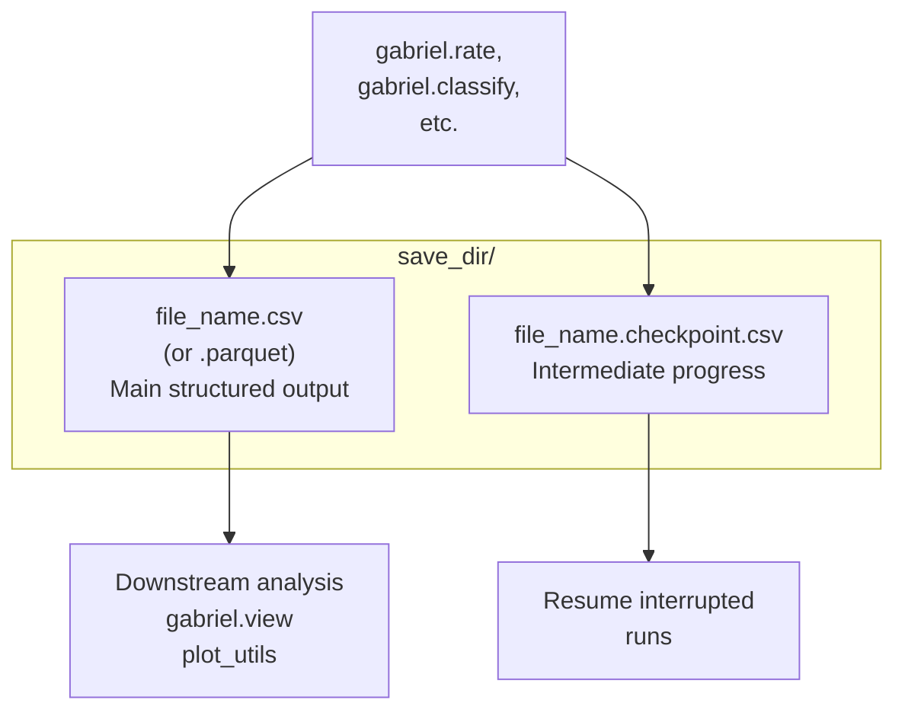
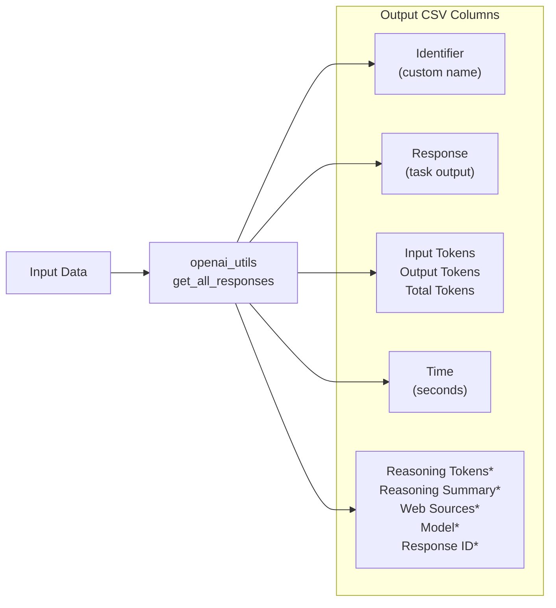
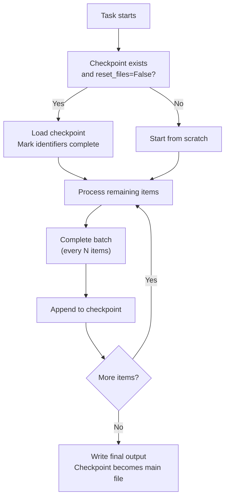
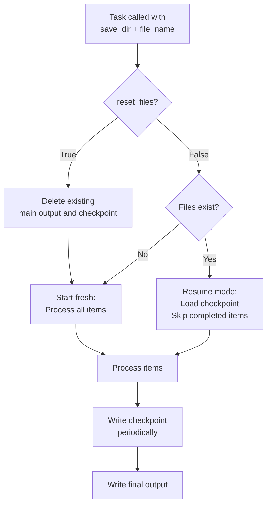
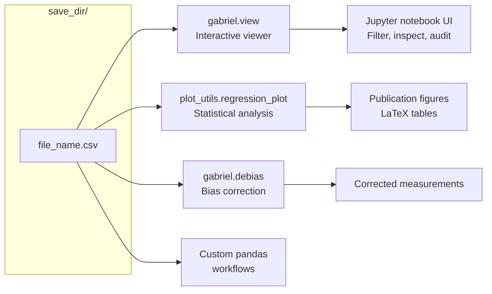

<!-- source: DeepWiki mcp.deepwiki.com · repo openai/GABRIEL · page 12.1 Save Directory Structure · fetched 2026-10-26 -->

# Save Directory Structure

<details>
<summary>Relevant source files</summary>

The following files were used as context for generating this wiki page:

- [README.md](README.md)
- [src/gabriel/utils/openai_utils.py](src/gabriel/utils/openai_utils.py)
- [src/gabriel/utils/parsing.py](src/gabriel/utils/parsing.py)

</details>


This page documents the file system layout created by GABRIEL tasks when processing data. Understanding this structure is essential for resuming interrupted runs, auditing model responses, and integrating GABRIEL outputs into downstream workflows. For information about resuming runs and managing checkpoints, see [Checkpointing and Resumability](#12.2).

---

## Overview

Every GABRIEL task accepts a `save_dir` parameter that determines where outputs are written. The system creates a predictable directory structure containing:

1. **Main output file** - Structured CSV or Parquet with task results
2. **Checkpoint file** - Intermediate progress for resumability
3. **Metadata** - Column definitions and usage statistics embedded in the main output

The `save_dir` path supports tilde expansion (`~`) and environment variable substitution, making it easy to configure paths across different environments.



**Sources:** [src/gabriel/utils/openai_utils.py:1830-1960](), [README.md:173]()

---

## Directory and File Naming

### Path Construction

The full output path is constructed from two parameters:

| Parameter | Purpose | Default Behavior |
|-----------|---------|------------------|
| `save_dir` | Root directory for all outputs | Required; no default |
| `file_name` | Base name for output files | Task-specific (e.g., `"rate_results.csv"`) |

The system combines these to create `save_path = os.path.join(save_dir, file_name)`.

**Path Expansion:**
- Tilde (`~`) expands to user home directory
- Environment variables like `$HOME` or `${WORKSPACE}` are resolved
- Parent directories are created automatically if they don't exist

**Example:**
```python
await gabriel.rate(
    df,
    column_name="text",
    attributes={"toxicity": "How toxic the content is"},
    save_dir="~/research/toxicity_study",  # Expands to /home/user/research/toxicity_study
    file_name="toxicity_ratings.csv",
    model="gpt-5-mini"
)
```

This creates:
```
/home/user/research/toxicity_study/
├── toxicity_ratings.csv
└── toxicity_ratings.checkpoint.csv
```

**Sources:** [src/gabriel/utils/openai_utils.py:1830-1843](), [src/gabriel/utils/openai_utils.py:1916-1930](), [src/gabriel/utils/openai_utils.py:1940-1960]()

---

## Main Output File

### Format and Location

The main output file contains the final structured results in tabular format. The system supports two formats:

| Format | Extension | When Used |
|--------|-----------|-----------|
| CSV | `.csv` | Default for all tasks |
| Parquet | `.parquet` | When `save_path` ends with `.parquet` |

The format is auto-detected from the file extension specified in `file_name`.

### Column Schema

The output schema varies by task but always includes these core columns:



**Core Columns (always present):**

| Column | Type | Description |
|--------|------|-------------|
| `Identifier` | string | User-provided identifier; column name matches `identifier_col_name` parameter |
| `Response` | string/json | Task-specific output (ratings, classifications, extractions, etc.) |
| `Input Tokens` | integer | Token count of prompt sent to model |
| `Output Tokens` | integer | Token count of model's response |
| `Total Tokens` | integer | Sum of input and output tokens |
| `Time` | float | Elapsed seconds for this request (including retries) |

**Optional Columns (when applicable):**

| Column | Present When | Description |
|--------|--------------|-------------|
| `Reasoning Tokens` | Reasoning models used | Additional tokens consumed during reasoning phase |
| `Reasoning Summary` | `reasoning_summary` requested | Model's explanation of its reasoning process |
| `Web Sources` | `web_search=True` | JSON array of web sources consulted (URLs and snippets) |
| `Model` | Multiple models in use | Model name that generated this response |
| `Response ID` | API provides it | OpenAI's internal response identifier |

**Example Output:**

For `gabriel.rate`:
```
Identifier,Response,Input Tokens,Output Tokens,Total Tokens,Time
text_001,"{'quality': 75, 'clarity': 82}",145,23,168,1.23
text_002,"{'quality': 45, 'clarity': 67}",152,21,173,0.98
```

For `gabriel.classify`:
```
Identifier,Response,Input Tokens,Output Tokens,Total Tokens,Time,Model
doc_001,"['politics', 'economics']",201,12,213,1.45,gpt-5-mini
doc_002,"['sports']",198,8,206,0.87,gpt-5-mini
```

**Sources:** [src/gabriel/utils/openai_utils.py:1880-1910](), [src/gabriel/utils/openai_utils.py:1940-1960]()

---

## Checkpoint Files

### Purpose and Structure

Checkpoint files enable resumability by saving intermediate results as the task progresses. They use the same schema as the main output but are written incrementally.

**Naming Convention:**
```
{base_name}.checkpoint{extension}
```

Examples:
- `ratings.csv` → `ratings.checkpoint.csv`
- `classifications.parquet` → `classifications.checkpoint.parquet`

### Checkpoint Writing Logic



The system writes checkpoints:
1. **On startup** - Loads existing checkpoint unless `reset_files=True`
2. **During processing** - Saves progress periodically (not after every item, but in batches)
3. **On completion** - Final results written to main output file

**Checkpoint Loading:**
When resuming, the system:
1. Reads all identifiers from the checkpoint file
2. Marks them as already completed
3. Skips them in the input queue
4. Appends new results to the checkpoint

**Example Usage:**
```python
# First run (interrupted after 500/1000 items)
await gabriel.rate(
    df,  # 1000 items
    column_name="id",
    attributes={"quality": "Overall quality"},
    save_dir="./outputs",
    file_name="quality_scores.csv",
    reset_files=True  # Start fresh
)
# Creates: quality_scores.checkpoint.csv with 500 rows

# Resume run (processes remaining 500 items)
await gabriel.rate(
    df,  # Same 1000 items
    column_name="id",
    attributes={"quality": "Overall quality"},
    save_dir="./outputs",
    file_name="quality_scores.csv",
    reset_files=False  # Resume from checkpoint
)
# Loads checkpoint, processes 500 remaining, writes complete quality_scores.csv
```

**Sources:** [src/gabriel/utils/openai_utils.py:1830-1843](), [src/gabriel/utils/openai_utils.py:1916-1930]()

---

## File Lifecycle and reset_files Parameter

The `reset_files` parameter controls how the system handles existing files:



| `reset_files` | Behavior | Use Case |
|---------------|----------|----------|
| `True` | Delete existing outputs and start fresh | First run, parameter changes, debugging |
| `False` | Resume from checkpoint if present | Long runs, interrupted processes, incremental updates |

**Important:** When `reset_files=False` and a checkpoint exists, the system **appends** to it. If you've changed task parameters (attributes, model, prompts), you should use `reset_files=True` to avoid mixing results from different configurations.

**Sources:** [src/gabriel/utils/openai_utils.py:1830-1843]()

---

## Directory Creation and Permissions

GABRIEL automatically creates parent directories as needed:

```python
os.makedirs(os.path.dirname(os.path.abspath(save_path)), exist_ok=True)
```

This means:
- `save_dir="./a/b/c"` creates all intermediate directories
- No need to pre-create directories manually
- Uses system default permissions (respects umask)

**Permission Errors:** If the process lacks write permissions, tasks fail with an `OSError` or `PermissionError`. Ensure:
- The process user has write access to `save_dir`
- Parent directories are writable
- File system quotas aren't exceeded

**Sources:** [src/gabriel/utils/openai_utils.py:1916-1930](), [src/gabriel/utils/openai_utils.py:1940-1960]()

---

## Integration with Analysis Tools

The structured output files integrate directly with GABRIEL's analysis ecosystem:



**Common Patterns:**

1. **Load results for visualization:**
```python
import pandas as pd
results = pd.read_csv("~/outputs/ratings.csv")
gabriel.view(results, identifier_col="Identifier")
```

2. **Load for statistical analysis:**
```python
from gabriel.utils.plot_utils import regression_plot
results = pd.read_csv("~/outputs/ratings.csv")
# Parse Response column containing JSON ratings
results['quality'] = results['Response'].apply(lambda x: json.loads(x)['quality'])
regression_plot(results, x='quality', y='outcome')
```

3. **Resume interrupted run:**
```python
# Checkpoint exists from previous run
await gabriel.rate(
    df,
    column_name="id",
    attributes={"quality": "Quality score"},
    save_dir="~/outputs",
    file_name="ratings.csv",
    reset_files=False  # Resume from checkpoint
)
```

**Sources:** [README.md:173]()

---

## Best Practices

### Organizing Multiple Runs

Structure your save directories by experiment or dataset:

```
research_project/
├── pilot_study/
│   ├── toxicity_ratings.csv
│   └── toxicity_ratings.checkpoint.csv
├── full_dataset/
│   ├── toxicity_ratings.csv
│   ├── clarity_ratings.csv
│   └── ...
└── model_comparison/
    ├── gpt5_results.csv
    └── gpt4_results.csv
```

### Version Control Considerations

**Do not commit:**
- `.checkpoint.csv` files (they're transient)
- Large output CSVs (store in data directories or S3)

**Do commit:**
- Notebook code that generates outputs
- Scripts specifying `save_dir` and `file_name` parameters
- Small example outputs for documentation

### Storage Requirements

Estimate disk space needed:

| Factor | Typical Size |
|--------|--------------|
| Input tokens | ~1-2 KB per item (text) |
| Output tokens | ~100-500 bytes per rating |
| Checkpoint overhead | ~2x final file size during processing |
| Metadata columns | ~50-100 bytes per item |

**Example:** 100,000 items with 500-token inputs and 50-token outputs = ~75 MB final CSV.

### Cleanup Strategy

Checkpoints can be deleted after successful completion:

```bash
# Remove all checkpoint files after confirming runs succeeded
find ~/research -name "*.checkpoint.csv" -delete
```

Or keep them briefly as a backup:
```bash
# Remove checkpoints older than 7 days
find ~/research -name "*.checkpoint.csv" -mtime +7 -delete
```

**Sources:** [README.md:173]()

---

## Troubleshooting

### Common Issues

| Problem | Cause | Solution |
|---------|-------|----------|
| `FileNotFoundError` | Parent directory doesn't exist | Check that `save_dir` path is valid; system auto-creates dirs but needs write permission |
| `PermissionError` | Insufficient write access | Verify user permissions on `save_dir` |
| Checkpoint not resuming | Wrong `file_name` or `save_dir` | Ensure exact same paths used across runs |
| Mixed results in output | `reset_files=False` with parameter changes | Use `reset_files=True` when changing task configuration |
| Disk full | Large dataset + insufficient space | Check `df -h`, clean old outputs, or increase disk quota |

### Debugging File Paths

Print the full save path before running:

```python
import os

save_dir = "~/research/study1"
file_name = "ratings.csv"
save_path = os.path.join(os.path.expanduser(save_dir), file_name)
print(f"Output will be written to: {save_path}")
print(f"Checkpoint will be at: {os.path.splitext(save_path)[0]}.checkpoint.csv")

# Then run task
await gabriel.rate(...)
```

**Sources:** [src/gabriel/utils/openai_utils.py:1830-1960]()

---

