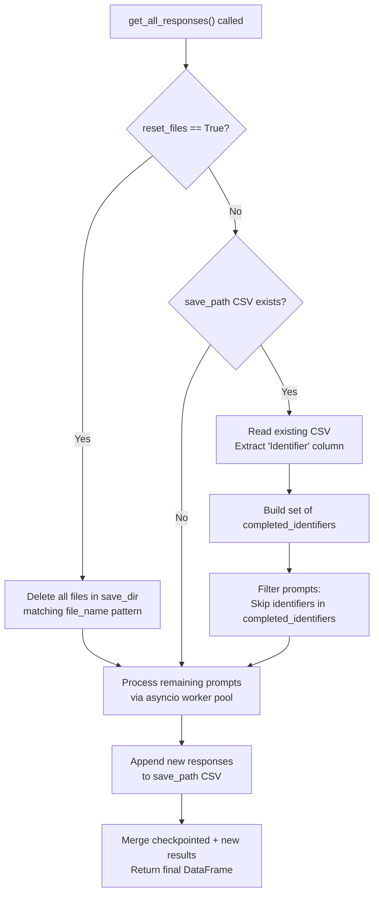
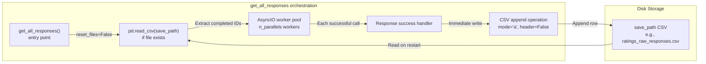
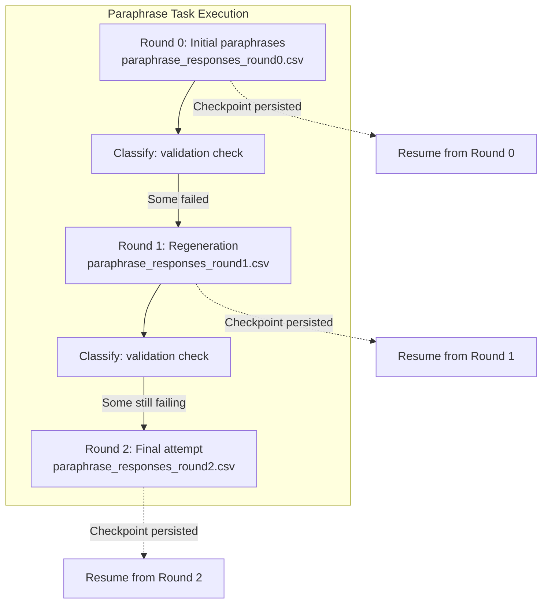

<!-- source: DeepWiki mcp.deepwiki.com · repo openai/GABRIEL · page 12.2 Checkpointing and Resumability · fetched 2026-10-26 -->

# Checkpointing and Resumability

<details>
<summary>Relevant source files</summary>

The following files were used as context for generating this wiki page:

- [src/gabriel/prompts/paraphrase_prompt.jinja2](src/gabriel/prompts/paraphrase_prompt.jinja2)
- [src/gabriel/tasks/paraphrase.py](src/gabriel/tasks/paraphrase.py)
- [src/gabriel/utils/openai_utils.py](src/gabriel/utils/openai_utils.py)
- [src/gabriel/utils/parsing.py](src/gabriel/utils/parsing.py)
- [tests/test_basic.py](tests/test_basic.py)

</details>


This page describes how GABRIEL persists intermediate results during long-running tasks and how interrupted runs can be resumed from the last saved checkpoint. Understanding checkpointing is essential for running large-scale experiments that may take hours or days to complete.

For information about the directory structure where checkpoints are stored, see [Save Directory Structure](#12.1). For details on how errors trigger retries without losing progress, see [Error Handling and Retry Logic](#12.4).

---

## Overview

GABRIEL implements **incremental checkpointing** to ensure that progress is never lost during long-running API calls. Every task that interacts with the LLM writes responses to disk as they arrive, creating an append-only log of completed work. When a run is interrupted—due to network failures, user cancellation, script crashes, or system shutdowns—the system can resume from the last checkpoint without re-processing items that already succeeded.

The checkpointing mechanism operates at two levels:

1. **Automatic persistence**: Every successful response is immediately appended to a CSV file at `save_path`, creating a durable record
2. **Resume logic**: When `get_all_responses` starts, it reads existing checkpoint files, identifies completed identifiers, and skips them

This design ensures **fault tolerance** and **cost efficiency**: users pay only for new API calls, not for recomputing work that already finished.

**Sources:** [src/gabriel/utils/openai_utils.py:1-1253]()

---

## Checkpoint File Format

Checkpoint files are **raw response CSVs** written to `save_path` during execution. Each row represents a single completed API call and contains the following columns:

| Column | Type | Description |
|--------|------|-------------|
| `Identifier` | str | Unique key for the prompt (user-provided or auto-generated) |
| `Response` | serialized list | LLM output(s); serialized as JSON string via `_ser()` |
| `Time Taken` | float | Duration in seconds |
| `Input Tokens` | int | Number of input tokens consumed |
| `Output Tokens` | int | Number of output tokens generated |
| `Reasoning Tokens` | int | Number of reasoning tokens (for models with reasoning capabilities) |
| `Reasoning Effort` | str or None | Reasoning effort level used |
| `Successful` | bool | Whether the call succeeded |
| `Error Log` | serialized | Error details if the call failed; serialized via `_ser()` |
| `Reasoning Summary` | str or None | Summary of reasoning (if requested) |
| `Web Search Sources` | serialized | Web search source metadata (if web search was used) |

Rows are appended **immediately** after each successful or failed API call, ensuring that crashes cannot lose completed work.

**Sources:** [src/gabriel/utils/openai_utils.py:1-1253]()

---

## The `reset_files` Parameter

The `reset_files` parameter controls whether existing checkpoint files are **preserved** or **discarded** when a task starts:

```python
reset_files: bool = False  # Default behavior
```

### Behavior

- **`reset_files=False` (default)**: Existing checkpoint files are **read** at startup. Identifiers already present in the checkpoint are **skipped**, and only new or incomplete prompts are sent to the API. This is the **resume** mode.
  
- **`reset_files=True`**: All existing checkpoint files in `save_dir` are **deleted** before execution begins. The task starts from scratch, re-processing all prompts. Use this when you want to **overwrite** previous results.

### Example: Resuming After Interruption

```python
import gabriel

# Initial run: processes all 10,000 rows
df = await gabriel.rate(
    data,
    "text",
    attributes={"clarity": "Is this clear?"},
    save_dir="experiment_1",
    file_name="ratings.csv",
    reset_files=False,  # Default
)
# Suppose the run crashes after 7,000 completions
```

When you re-run the **exact same code**, GABRIEL:

1. Reads `experiment_1/ratings_raw_responses.csv`
2. Identifies the 7,000 completed identifiers
3. Skips them in the queue
4. Processes only the remaining 3,000 rows

**No re-computation occurs**. The final output merges checkpointed results with newly generated responses.

### Example: Starting Fresh

```python
# Force a clean slate
df = await gabriel.rate(
    data,
    "text",
    attributes={"clarity": "Is this clear?"},
    save_dir="experiment_1",
    file_name="ratings.csv",
    reset_files=True,  # Delete all previous checkpoints
)
```

All checkpoint files in `experiment_1/` are removed, and the task re-processes all 10,000 rows from the beginning.

**Sources:** [src/gabriel/utils/openai_utils.py:1-1253](), [tests/test_basic.py:538-544](), [src/gabriel/tasks/paraphrase.py:131,247,271,507,565]()

---

## Resumption Flow

### Diagram: Checkpoint Read and Resume Logic



**Sources:** [src/gabriel/utils/openai_utils.py:1-1253]()

### Step-by-Step Resumption Process

1. **Initialization**: `get_all_responses()` receives `prompts`, `identifiers`, and `save_path`

2. **Reset check**: If `reset_files=True`, delete all matching checkpoint files in `save_dir`

3. **Checkpoint scan**: If `reset_files=False`, read the CSV at `save_path` (if it exists)

4. **Identifier extraction**: Build a set of all identifiers present in the checkpoint file

5. **Queue filtering**: Remove any `(prompt, identifier)` pairs from the work queue where the identifier already exists in the checkpoint

6. **Execution**: Process only the remaining prompts through the worker pool (see [Concurrency and Rate Limiting](#12.3))

7. **Append mode**: New responses are **appended** to the existing CSV file using `mode='a'` (append mode)

8. **Merge**: The final DataFrame combines checkpointed responses (read from disk) with newly generated responses

This design ensures that **every successful API call is preserved**, even if the script terminates unexpectedly during execution.

**Sources:** [src/gabriel/utils/openai_utils.py:1-1253]()

---

## Code-Level Checkpoint Mechanism

### Diagram: File I/O Operations for Checkpointing



**Sources:** [src/gabriel/utils/openai_utils.py:1-1253]()

### Key Implementation Details

The checkpoint mechanism relies on several implementation choices:

- **CSV format**: Plain text, human-readable, and easily inspected with standard tools
- **Append-only writes**: Each response triggers a single append operation, minimizing the risk of file corruption
- **Serialization**: Complex objects (lists, dicts) are serialized via `_ser()` helper before writing
- **Identifier uniqueness**: Tasks must provide unique identifiers; duplicates will cause the first result to be reused

When multiple runs are requested (e.g., `n_runs=5` for rating tasks), each run gets a distinct identifier suffix, ensuring that all runs are independently checkpointed.

**Sources:** [src/gabriel/utils/openai_utils.py:1-1253]()

---

## Handling Partial Responses

When a response **partially completes** (e.g., the LLM returns output but a timeout occurs during polling in background mode), the behavior depends on whether the call was marked as successful:

- **Successful=True**: The partial response is written to the checkpoint and treated as complete on resume
- **Successful=False**: The identifier is written with an error log, and the prompt is **retried** on the next run (unless it has exceeded the retry limit)

This ensures that transient failures do not permanently block progress, while also preventing the system from silently using incomplete results.

**Sources:** [src/gabriel/utils/openai_utils.py:230-237]()

---

## Multi-Stage Tasks and Checkpointing

Complex tasks that orchestrate multiple sub-tasks (e.g., `gabriel.ideate`, `gabriel.discover`, `gabriel.paraphrase` with recursive validation) create **separate checkpoint files** for each stage. This allows partial progress within multi-stage pipelines to be preserved.

### Example: Paraphrase with Recursive Validation

The `Paraphrase` task with `n_rounds > 1` generates multiple checkpoint files:

```
paraphrase_responses_round0.csv  # Initial generation
paraphrase_responses_round1.csv  # First validation round
paraphrase_responses_round2.csv  # Second validation round
```

Each round reads its own checkpoint file independently. If the script crashes during round 2, round 0 and round 1 are fully preserved, and only round 2 needs to be resumed.

**Sources:** [src/gabriel/tasks/paraphrase.py:447-450]()

### Diagram: Multi-Stage Checkpoint Files



**Sources:** [src/gabriel/tasks/paraphrase.py:300-626]()

---

## Checkpoint File Locations

All checkpoint files are written to the **`save_dir`** specified in the task configuration. The primary checkpoint file is named according to the `file_name` parameter (typically `*_raw_responses.csv`), but auxiliary files may also exist:

| File | Purpose |
|------|---------|
| `{file_name}` | Raw responses with all metadata |
| `{file_name_base}_cleaned.csv` | Processed results (for some tasks) |
| `{file_name_base}_full_disaggregated.csv` | Multi-run disaggregated results (for tasks with `n_runs > 1`) |
| `{file_name_base}_round{N}.csv` | Per-round checkpoints (for multi-stage tasks) |

The exact structure depends on the task; see [Save Directory Structure](#12.1) for complete details.

**Sources:** [src/gabriel/tasks/paraphrase.py:293-296](), [tests/test_basic.py:837-839]()

---

## Best Practices

### 1. Always Use Unique Identifiers

When calling `get_all_responses()` directly, ensure that `identifiers` are **globally unique** within a task:

```python
# Good: unique per-row identifier
identifiers = [f"row_{i}" for i in range(len(prompts))]

# Bad: reusing the same identifier
identifiers = ["prompt"] * len(prompts)  # All checkpoints overwrite each other
```

Tasks like `gabriel.rate` and `gabriel.classify` automatically generate unique identifiers by combining row indices with run numbers.

### 2. Use `reset_files=True` for Experiments

When **changing prompts, attributes, or task parameters**, always set `reset_files=True` to avoid mixing results from different configurations:

```python
# Iteration 1: first attempt
await gabriel.rate(data, "text", attributes={"clarity": "..."}, save_dir="exp1")

# Iteration 2: CHANGED attribute definition
await gabriel.rate(
    data, 
    "text", 
    attributes={"clarity": "...NEW DEFINITION..."},  # Different prompt!
    save_dir="exp1",
    reset_files=True,  # Force re-computation
)
```

Without `reset_files=True`, the second run would **reuse** results from the first run, producing inconsistent outputs.

### 3. Monitor Checkpoint Files During Execution

Checkpoint files are human-readable CSVs. You can inspect them **while the task is running** to verify progress:

```bash
# Check how many rows have been completed
wc -l experiment_1/ratings_raw_responses.csv

# Inspect recent results
tail -20 experiment_1/ratings_raw_responses.csv

# Count failures
grep "False" experiment_1/ratings_raw_responses.csv | wc -l
```

### 4. Preserve Checkpoint Files for Auditing

Even after a task completes, checkpoint files remain valuable for:

- **Debugging**: Reviewing raw LLM responses to understand unexpected outputs
- **Cost tracking**: Summing token usage from the `Input Tokens` and `Output Tokens` columns
- **Reproducibility**: Archiving the exact responses used in published analyses

Do not delete checkpoint files until you are certain they are no longer needed.

**Sources:** [src/gabriel/utils/openai_utils.py:1-1253](), [tests/test_basic.py:841-870]()

---

## Interaction with Error Handling

Checkpointing is tightly integrated with GABRIEL's retry logic. When a prompt **fails** due to a transient error (rate limits, timeouts, connection issues), the system:

1. Logs the failure in the checkpoint file with `Successful=False`
2. Retries the prompt using exponential backoff (see [Error Handling and Retry Logic](#12.4))
3. Overwrites the checkpoint row with the successful result once the retry succeeds

If the script terminates before a retry succeeds, the failed prompt is **retried on the next run** because its identifier is marked as unsuccessful in the checkpoint.

**Permanent failures** (authentication errors, invalid requests) are written to the checkpoint with `Successful=False` and are **not** retried. These rows remain in the checkpoint as a record of the error.

**Sources:** [src/gabriel/utils/openai_utils.py:247-268]()

---

## Summary

GABRIEL's checkpointing system provides **automatic fault tolerance** for long-running LLM-powered tasks:

- **Incremental persistence**: Every successful API call is immediately written to disk
- **Resume from checkpoint**: Interrupted runs skip completed identifiers and process only remaining work
- **Multi-stage support**: Complex pipelines checkpoint each sub-task independently
- **Human-readable logs**: Checkpoint files are plain CSVs that can be inspected and audited

The `reset_files` parameter controls whether to **resume** existing work or **start fresh**. For production workflows, always use unique identifiers and preserve checkpoint files for reproducibility.

**Sources:** [src/gabriel/utils/openai_utils.py:1-1253](), [tests/test_basic.py:438-544](), [src/gabriel/tasks/paraphrase.py:1-637]()

---

