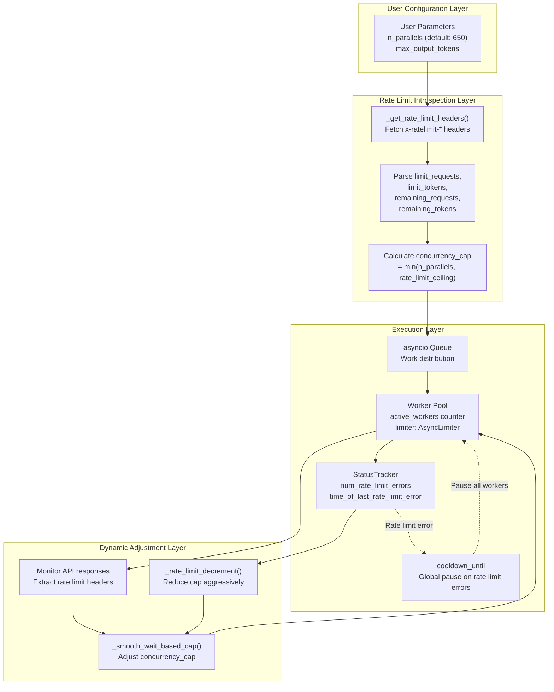
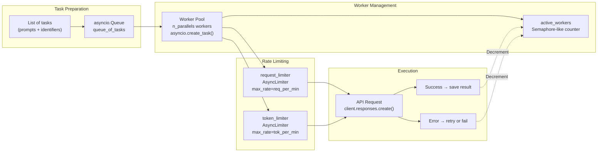
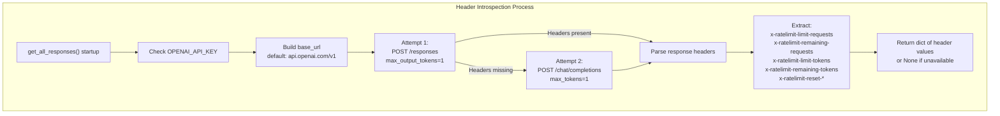
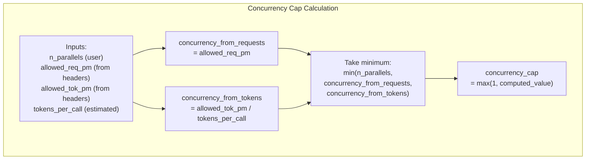
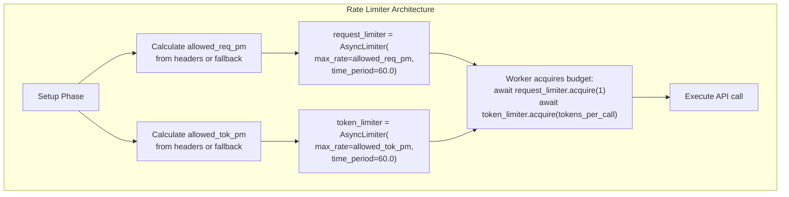
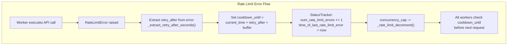
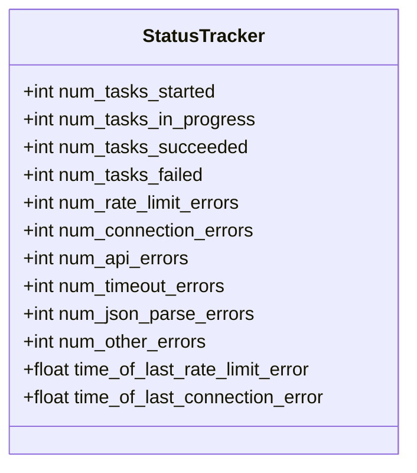
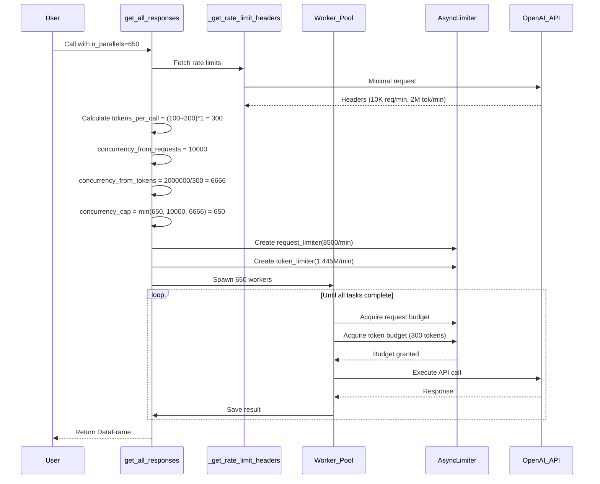

<!-- source: DeepWiki mcp.deepwiki.com · repo openai/GABRIEL · page 12.3 Concurrency and Rate Limiting · fetched 2026-10-26 -->

# Concurrency and Rate Limiting

<details>
<summary>Relevant source files</summary>

The following files were used as context for generating this wiki page:

- [src/gabriel/utils/openai_utils.py](src/gabriel/utils/openai_utils.py)
- [src/gabriel/utils/parsing.py](src/gabriel/utils/parsing.py)

</details>


## Purpose and Scope

This page explains how GABRIEL manages concurrent API requests and respects OpenAI rate limits to maximize throughput while avoiding errors. The system implements **intelligent concurrency control** that dynamically adjusts the number of parallel requests based on observed rate limits and real-time API feedback.

For information about error handling and retry logic after rate limit errors occur, see [Error Handling and Retry Logic](#12.4). For details on checkpointing and resuming interrupted runs, see [Checkpointing and Resumability](#12.2). For the broader orchestration infrastructure, see [LLM Orchestration Infrastructure](#3.1).

---

## High-Level Architecture

GABRIEL's concurrency and rate limiting system operates within the `openai_utils` module, which serves as the single orchestration layer for all LLM interactions. The system balances two competing goals:

1. **Maximize throughput** by running many requests in parallel
2. **Avoid rate limit errors** by respecting the API's per-minute quotas

The architecture consists of three layers:



**Sources:** [src/gabriel/utils/openai_utils.py:196-212](), [src/gabriel/utils/openai_utils.py:549-584](), [src/gabriel/utils/openai_utils.py:1245-1254](), [src/gabriel/utils/openai_utils.py:1257-1294]()

---

## Concurrency Control: The Worker Pool

### Worker Pool Architecture

GABRIEL uses an **asyncio-based worker pool** pattern to manage concurrent API requests. The core implementation resides in the `get_all_responses` function, which creates multiple worker coroutines that consume tasks from a shared queue.



### Key Parameters

| Parameter | Type | Default | Description |
|-----------|------|---------|-------------|
| `n_parallels` | `int` | `650` | Maximum number of concurrent workers. Users can increase this for faster runs if machine and rate limits allow. |
| `concurrency_cap` | `int` | *dynamic* | Actual ceiling computed from rate limits. Updated during execution based on API feedback. |
| `active_workers` | `int` | *runtime* | Current count of in-flight requests. Decrements as tasks complete. |
| `max_attempts` | `int` | `5` | Maximum retry attempts per task before failure. |

**Sources:** [src/gabriel/utils/openai_utils.py:2543-2679](), [src/gabriel/utils/openai_utils.py:2681-2900]()

### Worker Lifecycle

Each worker follows this lifecycle:

1. **Acquire rate limit budget** from `request_limiter` and `token_limiter`
2. **Pop task** from `queue_of_tasks`
3. **Check cooldown** - wait if `cooldown_until > current_time`
4. **Execute API call** via `get_response()`
5. **Handle response** - save on success, retry on recoverable error
6. **Update trackers** - increment success/failure counters
7. **Decrement** `active_workers` counter
8. **Repeat** until queue is empty

**Sources:** [src/gabriel/utils/openai_utils.py:2902-3148]()

---

## Rate Limit Detection and Introspection

### Fetching Rate Limit Headers

Before executing a batch of prompts, GABRIEL proactively queries the OpenAI API to discover current rate limits. The `_get_rate_limit_headers()` function sends a minimal request (1 token output) to retrieve the `x-ratelimit-*` headers.



### Rate Limit Header Schema

The introspection returns a dictionary with these keys:

| Header Key | Description |
|------------|-------------|
| `limit_requests` | Total requests allowed per minute for this tier |
| `remaining_requests` | Requests remaining in current minute window |
| `reset_requests` | Time string indicating when request quota resets |
| `limit_tokens` | Total tokens allowed per minute (usage-based or standard) |
| `remaining_tokens` | Tokens remaining in current minute window |
| `reset_tokens` | Time string indicating when token quota resets |

**Example return value:**
```json
{
  "limit_requests": "10000",
  "remaining_requests": "9998",
  "reset_requests": "42s",
  "limit_tokens": "2000000",
  "remaining_tokens": "1995432",
  "reset_tokens": "38s"
}
```

**Sources:** [src/gabriel/utils/openai_utils.py:890-993](), [src/gabriel/utils/openai_utils.py:1045-1089]()

### Conservative Budget Planning

GABRIEL applies **multiple layers of headroom** to avoid hitting limits:

```python
# Constants for buffer calculation
RATE_LIMIT_HEADROOM = 0.85  # Use 85% of reported limit
PLANNING_RATE_LIMIT_BUFFER = 0.85  # Additional 85% planning buffer
OUTPUT_TOKEN_HEADROOM_INITIAL = 2.0  # 2x expected output tokens initially
OUTPUT_TOKEN_HEADROOM_STEADY = 1.0  # 1x after observing real usage
```

The **allowed budget** is computed as:
```
allowed_requests = remaining_requests * RATE_LIMIT_HEADROOM * PLANNING_RATE_LIMIT_BUFFER
allowed_tokens = remaining_tokens * RATE_LIMIT_HEADROOM * PLANNING_RATE_LIMIT_BUFFER
```

**Sources:** [src/gabriel/utils/openai_utils.py:182-190]()

---

## Dynamic Concurrency Adjustment

### Initial Concurrency Cap Calculation

At startup, `get_all_responses()` calculates the initial `concurrency_cap` by determining the limiting factor (requests or tokens):



### Estimation of Tokens Per Call

To determine token budget constraints, GABRIEL estimates the total tokens consumed by each API call:

```
tokens_per_call = (avg_input_tokens + expected_output_tokens * headroom) * n
```

Where:
- `avg_input_tokens`: computed from prompt sampling or full scan
- `expected_output_tokens`: `max_output_tokens` if specified, else `ESTIMATED_OUTPUT_TOKENS_PER_PROMPT` (500)
- `headroom`: `OUTPUT_TOKEN_HEADROOM_INITIAL` (2.0) initially, relaxed to `OUTPUT_TOKEN_HEADROOM_STEADY` (1.0) after observing real usage
- `n`: number of responses requested per prompt

**Sources:** [src/gabriel/utils/openai_utils.py:529-546](), [src/gabriel/utils/openai_utils.py:1093-1157]()

### Runtime Adjustment with Smoothing

During execution, the system periodically re-evaluates `concurrency_cap` based on fresh rate limit data extracted from API response headers. The `_smooth_wait_based_cap()` function applies damping to prevent thrashing:

| Adjustment Parameter | Value | Purpose |
|---------------------|-------|---------|
| `min_delta` | varies | Minimum change required to trigger adjustment |
| `cooldown_up` | varies | Minimum seconds between upward adjustments |
| `cooldown_down` | varies | Minimum seconds between downward adjustments |
| `max_step_up_ratio` | `0.18` | Maximum increase per adjustment (18% of current cap) |
| `max_step_down_ratio` | `0.08` | Maximum decrease per adjustment (8% of current cap) |

**Sources:** [src/gabriel/utils/openai_utils.py:1257-1294]()

### Aggressive Reduction on Rate Limit Errors

When a `RateLimitError` is encountered, the system immediately reduces `concurrency_cap` using `_rate_limit_decrement()`:

```python
def _rate_limit_decrement(concurrency_cap: int) -> int:
    """Return a downward step that curbs rate-limit thrash aggressively."""
    return max(2, int(math.ceil(max(concurrency_cap * 0.4, 3))))
```

This aggressive decrement (40% of current cap, minimum 2) ensures the system backs off quickly to avoid cascading rate limit errors.

**Sources:** [src/gabriel/utils/openai_utils.py:1245-1254]()

---

## Rate Limiter Implementation: AsyncLimiter

GABRIEL uses the `aiolimiter.AsyncLimiter` library to implement token-bucket rate limiting. Two independent limiters control requests and tokens:



### Fallback Defaults

If rate limit headers are unavailable (API doesn't return them, or network error), GABRIEL falls back to conservative defaults:

| Scenario | Request Limit | Token Limit |
|----------|--------------|-------------|
| Headers present | Use `remaining_*` or `limit_*` values | Use `remaining_*` or `limit_*` values |
| Headers absent | `n_parallels / 4` | `n_parallels * estimated_tokens_per_call / 4` |

**Sources:** [src/gabriel/utils/openai_utils.py:2681-2900]()

---

## Error Handling and Cooldown Mechanism

### Global Cooldown on Rate Limit Errors

When any worker encounters a `RateLimitError`, a **global cooldown** is triggered:



### Retry-After Extraction

The `_extract_retry_after_seconds()` function intelligently parses retry timing from multiple sources:

1. **Error attributes**: `retry_after`, `retry_after_s`, `retry_after_seconds`, `retry_after_ms`
2. **Error message regex**: Searches for "after X seconds" patterns
3. **Default**: Returns `None` if no hint is found

**Sources:** [src/gabriel/utils/openai_utils.py:247-268]()

### Cooldown Enforcement

Every worker checks the global `cooldown_until` timestamp before making an API call:

```python
if cooldown_until is not None and time.time() < cooldown_until:
    remaining = cooldown_until - time.time()
    await asyncio.sleep(remaining)
```

This ensures **all workers pause simultaneously** during cooldown periods, preventing further rate limit errors.

**Sources:** [src/gabriel/utils/openai_utils.py:2902-3148]()

---

## StatusTracker: Monitoring Request Statistics

The `StatusTracker` dataclass maintains real-time counters for all request outcomes:



These counters drive:
- **Progress bars**: tqdm displays success/failure counts
- **Logging**: detailed error breakdowns
- **Cooldown decisions**: `time_of_last_rate_limit_error` prevents premature resumption
- **Retry logic**: different error types trigger different backoff strategies

**Sources:** [src/gabriel/utils/openai_utils.py:196-212]()

---

## Configuration Parameters and Tuning

### User-Facing Parameters

| Parameter | Location | Default | Impact on Concurrency/Rate Limiting |
|-----------|----------|---------|-------------------------------------|
| `n_parallels` | `get_all_responses()` | `650` | Maximum concurrent workers. Increase for faster runs (if rate limits allow). |
| `max_output_tokens` | `get_all_responses()` | `None` | Affects token budget estimation. Specify to avoid over-conservative defaults. |
| `model` | `get_all_responses()` | varies | Different models have different rate limits per tier. |
| `timeout` | `get_response()` | `None` | Per-request timeout. Does not affect concurrency but impacts error handling. |

### Internal Constants

| Constant | Value | Purpose |
|----------|-------|---------|
| `RATE_LIMIT_HEADROOM` | `0.85` | Use 85% of reported rate limits to provide safety margin |
| `PLANNING_RATE_LIMIT_BUFFER` | `0.85` | Additional 85% buffer for initial planning |
| `OUTPUT_TOKEN_HEADROOM_INITIAL` | `2.0` | Assume 2x expected output tokens during startup |
| `OUTPUT_TOKEN_HEADROOM_STEADY` | `1.0` | Relax to 1x after observing real usage patterns |
| `ESTIMATED_OUTPUT_TOKENS_PER_PROMPT` | `500` | Default assumption for output length when `max_output_tokens` is unspecified |
| `NON_TEXT_INPUT_TOKEN_BUFFER` | `2000` | Extra input tokens to add for images/audio/PDFs/web search |

**Sources:** [src/gabriel/utils/openai_utils.py:174-190]()

---

## Practical Workflow Example

### Scenario: Processing 10,000 Prompts with Tier 3 Limits

**Given:**
- Tier 3 account: 10,000 requests/min, 2,000,000 tokens/min
- 10,000 prompts, average 100 tokens input, 200 tokens output expected
- User sets `n_parallels=650`

**Execution Flow:**



**Estimated Performance:**
- **Throughput**: Limited by `n_parallels=650`, not rate limits
- **Estimated time**: ~15 minutes (650 requests at a time, ~0.5s per request)
- **Utilization**: Token limiter is limiting factor (650 * 300 = 195K tokens/min < 1.445M budget)

**Sources:** [src/gabriel/utils/openai_utils.py:2543-2679](), [src/gabriel/utils/openai_utils.py:2681-2900]()

---

## Summary: Key Design Principles

GABRIEL's concurrency and rate limiting system follows these principles:

1. **Proactive Planning**: Fetch rate limits before executing to calculate optimal concurrency
2. **Conservative Budgeting**: Apply multiple layers of headroom to avoid hitting limits
3. **Dynamic Adjustment**: Re-evaluate concurrency during execution based on real-time feedback
4. **Aggressive Backoff**: Reduce concurrency immediately on rate limit errors
5. **Global Coordination**: Use shared cooldown to pause all workers simultaneously
6. **Transparent Monitoring**: Display estimated throughput and limiting factors to users

This architecture enables GABRIEL to process hundreds of thousands of prompts reliably while maximizing API utilization and minimizing cost from failed requests.

**Sources:** [src/gabriel/utils/openai_utils.py:1-24](), [src/gabriel/utils/openai_utils.py:996-1243]()

---

