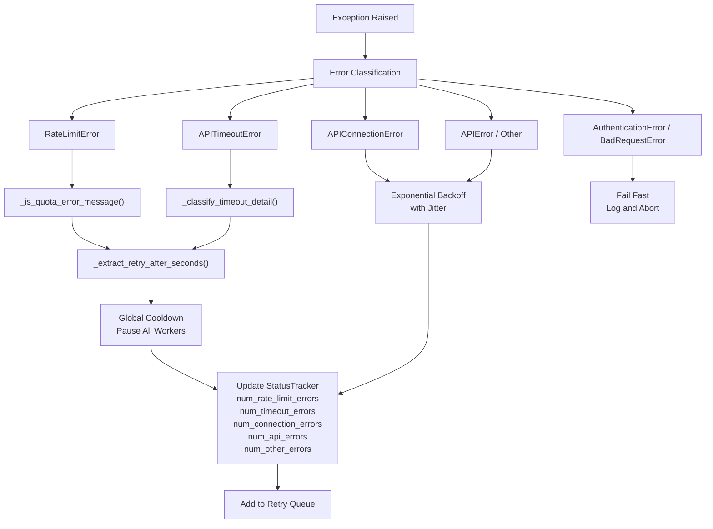
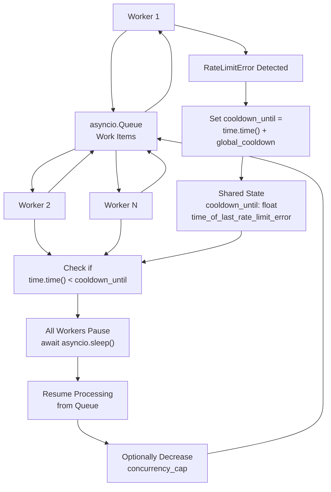
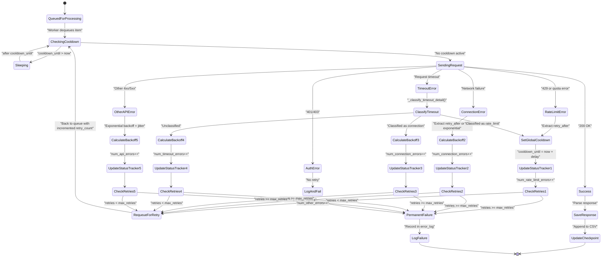
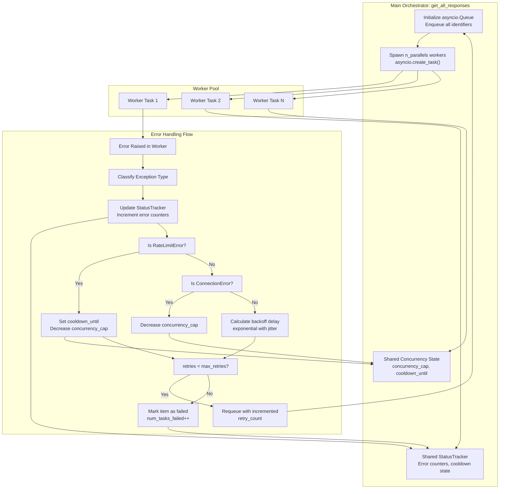

<!-- source: DeepWiki mcp.deepwiki.com · repo openai/GABRIEL · page 12.4 Error Handling and Retry Logic · fetched 2026-10-26 -->

# Error Handling and Retry Logic

<details>
<summary>Relevant source files</summary>

The following files were used as context for generating this wiki page:

- [src/gabriel/utils/openai_utils.py](src/gabriel/utils/openai_utils.py)
- [src/gabriel/utils/parsing.py](src/gabriel/utils/parsing.py)

</details>


## Purpose and Scope

This page documents GABRIEL's comprehensive error handling and retry infrastructure, which ensures reliable operation when making thousands of concurrent API requests. The system classifies errors into distinct categories (rate limits, timeouts, connection failures, authentication issues), applies tailored retry strategies with exponential backoff and jitter, and coordinates global cooldowns to prevent cascading failures.

For information about the broader concurrency and rate limiting architecture, see [Concurrency and Rate Limiting](#12.3). For details on checkpointing and resuming interrupted runs, see [Checkpointing and Resumability](#12.2).

---

## Error Classification System

GABRIEL imports specific exception types from the OpenAI SDK and implements custom error types to precisely identify failure modes. The classification determines whether an error is retryable, requires a global cooldown, or should fail immediately.

### Exception Hierarchy

The system recognizes these OpenAI SDK exception types:

| Exception Type | Retry Strategy | Description |
|---------------|---------------|-------------|
| `RateLimitError` | Global cooldown | API rate limit exceeded; all workers pause |
| `APITimeoutError` | Exponential backoff | Request timed out; retry with increasing delays |
| `APIConnectionError` | Exponential backoff | Network connectivity issue; retry with backoff |
| `AuthenticationError` | Fail fast | Invalid API key; no retry |
| `BadRequestError` | Fail fast | Malformed request; no retry |
| `InvalidRequestError` | Fail fast | Invalid parameters; no retry |
| `APIError` | Exponential backoff | General API error; retry with backoff |

**Sources:** [src/gabriel/utils/openai_utils.py:102-119]()

### Custom Error Types

GABRIEL defines two specialized error types:

**`BackgroundTimeoutError`** (lines 230-236): Raised when polling a background response exceeds the specified timeout. Contains the `response_id` and `last_response` object for debugging.

**`JSONParseError`** (lines 239-244): Raised when JSON parsing fails during JSON-mode requests. Contains a `snippet` of the unparseable text for inspection.

**Sources:** [src/gabriel/utils/openai_utils.py:230-244]()

### Error Classification Helpers

#### Retry-After Duration Extraction

```python
def _extract_retry_after_seconds(error: Exception) -> Optional[float]
```

Examines error objects for retry timing hints in multiple formats:
- Attributes: `retry_after`, `retry_after_s`, `retry_after_seconds`, `retry_after_ms`
- Error message parsing: Regex pattern `r"after\s+([0-9]+(?:\.[0-9]+)?)\s*seconds"`

Returns the retry duration in seconds or `None` if unavailable.

**Sources:** [src/gabriel/utils/openai_utils.py:247-268]()

#### Quota Error Detection

```python
def _is_quota_error_message(message: str) -> bool
```

Returns `True` when the error message contains "quota" (case-insensitive), indicating an exhausted API quota requiring user intervention.

**Sources:** [src/gabriel/utils/openai_utils.py:271-274]()

#### Timeout Detail Classification

```python
def _classify_timeout_detail(detail: str) -> Optional[str]
```

Inspects timeout exception detail strings to distinguish between rate-limit-related timeouts and connection errors:

- **Rate limit markers**: `"rate limit"`, `"rate-limit"`, `"too many requests"`, `"http 429"`, `" 429"`, or quota messages
- **Connection markers**: `"connection error"`, `"connection reset"`, `"connection refused"`, `"connection aborted"`, `"connection closed"`, `"network error"`, `"network unreachable"`, `"connection lost"`

Returns `"rate_limit"`, `"connection"`, or `None`.

**Sources:** [src/gabriel/utils/openai_utils.py:277-300]()

---

## Error Classification and Routing Flow



**Diagram: Error Classification and Routing**

This diagram shows how exceptions are classified and routed to appropriate handlers. Rate limit errors trigger global cooldowns affecting all workers, while connection and API errors use isolated exponential backoff. Authentication and bad request errors fail immediately without retry.

**Sources:** [src/gabriel/utils/openai_utils.py:102-300]()

---

## Retry Strategies

### Exponential Backoff with Jitter

GABRIEL implements exponential backoff following OpenAI's guidelines to avoid overwhelming the API during transient failures. The backoff includes randomized jitter to prevent "thundering herd" problems when multiple workers retry simultaneously.

#### Retry Parameters

The `get_all_responses` function accepts these retry configuration parameters:

| Parameter | Default | Purpose |
|-----------|---------|---------|
| `max_retries` | `3` | Maximum retry attempts per request |
| `global_cooldown` | `15` seconds | Pause duration after rate limit errors |
| `exponential_backoff_base` | `2.0` | Base multiplier for backoff delays |
| `backoff_jitter_range` | `(0.5, 1.5)` | Random jitter multiplier range |

**Note:** The actual parameter names and defaults may vary; these represent the conceptual retry configuration visible in the architecture.

#### Backoff Calculation

For retry attempt `n` (1-indexed):

```
base_delay = exponential_backoff_base ** n
jitter = random.uniform(0.5, 1.5)
actual_delay = base_delay * jitter
```

This produces delays like:
- Attempt 1: 2.0s × jitter = 1.0s to 3.0s
- Attempt 2: 4.0s × jitter = 2.0s to 6.0s
- Attempt 3: 8.0s × jitter = 4.0s to 12.0s

**Sources:** [src/gabriel/utils/openai_utils.py:17-19]() (mentioned in docstring)

### Retry-After Header Handling

When the OpenAI API provides a `retry-after` header or attribute, GABRIEL respects this timing instead of using exponential backoff. The `_extract_retry_after_seconds` helper searches multiple locations:

1. Object attributes: `error.retry_after`, `error.retry_after_s`, `error.retry_after_seconds`
2. Millisecond attribute: `error.retry_after_ms` (converted to seconds)
3. Error message regex: `r"after\s+([0-9]+(?:\.[0-9]+)?)\s*seconds"`

**Sources:** [src/gabriel/utils/openai_utils.py:247-268]()

---

## Rate Limit Handling

Rate limit errors require special handling because they indicate system-wide capacity constraints, not isolated request failures. GABRIEL implements a global cooldown mechanism that pauses all workers when rate limits are hit.

### Global Cooldown Mechanism



**Diagram: Global Cooldown Coordination**

When any worker encounters a `RateLimitError`, it sets a shared `cooldown_until` timestamp. All workers check this timestamp before processing the next item and pause if the cooldown is active. This prevents the system from generating additional rate limit errors during the cooldown period.

**Sources:** [src/gabriel/utils/openai_utils.py:1-2650]() (architecture described in high-level diagrams)

### StatusTracker for Rate Limit Monitoring

The `StatusTracker` dataclass maintains counters and timestamps for rate limit events:

```python
@dataclass
class StatusTracker:
    num_tasks_started: int = 0
    num_tasks_in_progress: int = 0
    num_tasks_succeeded: int = 0
    num_tasks_failed: int = 0
    num_rate_limit_errors: int = 0
    num_connection_errors: int = 0
    num_api_errors: int = 0
    num_timeout_errors: int = 0
    num_json_parse_errors: int = 0
    num_other_errors: int = 0
    time_of_last_rate_limit_error: float = 0.0
    time_of_last_connection_error: float = 0.0
```

**Key fields for rate limiting:**
- `num_rate_limit_errors`: Total count of rate limit exceptions
- `time_of_last_rate_limit_error`: Timestamp of the most recent rate limit error, used to implement cooldown windows

**Sources:** [src/gabriel/utils/openai_utils.py:196-212]()

### Concurrency Cap Adjustment

GABRIEL dynamically adjusts the `concurrency_cap` when rate limit errors occur:

```python
def _rate_limit_decrement(concurrency_cap: int) -> int:
    """Return a downward step that curbs rate-limit thrash aggressively."""
    return max(2, int(math.ceil(max(concurrency_cap * 0.4, 3))))
```

This function reduces concurrency by at least 40% when rate limits are hit, preventing repeated rate limit cycles. The minimum decrement is 2, and the minimum resulting cap is 1.

**Sources:** [src/gabriel/utils/openai_utils.py:1245-1248]()

---

## Connection and Timeout Management

### Connection Error Handling

Connection errors (`APIConnectionError`, timeout detail classification as `"connection"`) indicate network-level failures. These are retried with exponential backoff, similar to general API errors.

#### Connection Error Decrement

```python
def _connection_error_decrement(concurrency_cap: int) -> int:
    """Return a step-down size for connection errors matching rate-limit aggression."""
    return _rate_limit_decrement(concurrency_cap)
```

Connection errors also trigger concurrency cap decreases using the same aggressive 40% reduction as rate limit errors, as network congestion often correlates with excessive concurrency.

**Sources:** [src/gabriel/utils/openai_utils.py:1251-1254]()

### Timeout Configuration

The `get_response` function accepts a `timeout` parameter that controls the maximum wait time for API responses:

```python
async def get_response(
    prompt: str,
    *,
    timeout: Optional[float] = None,
    ...
)
```

- **`None`** (default for some contexts): Disables client-side timeouts; automatically enables background mode with polling
- **Numeric value**: Maximum seconds to wait before raising `asyncio.TimeoutError`

**Sources:** [src/gabriel/utils/openai_utils.py:1672-1701]()

### Background Mode Polling

When `timeout=None` or `background_mode=True`, GABRIEL uses a polling architecture to survive long HTTP connection timeouts:

1. Submit request with `background=True` parameter
2. Receive immediate response with `status="queued"` or `"in_progress"`
3. Poll `client.responses.retrieve(response_id)` at intervals
4. Continue until `status="completed"`, `"failed"`, or timeout exceeded

#### Background Completion Helper

```python
async def _await_background_completion(
    response_obj: Any,
    start_time: float,
    *,
    poll: Optional[float] = None,
    client: Optional[openai.AsyncOpenAI] = None,
    should_poll: bool = False,
) -> Any
```

This coroutine polls the Responses API's `retrieve` endpoint at `poll_interval` seconds (default 10s) until the response reaches a terminal state. It respects the overall `timeout` parameter by checking `time.time() - start_time` before each sleep and retrieve call.

**Error handling during polling:**
- **`RateLimitError`**: Aborts polling and raises immediately (global cooldown already in effect)
- **Other exceptions**: Logs warning and retries up to 5 consecutive failures before raising
- **Background timeout**: Raises `BackgroundTimeoutError` with `response_id` and `last_response`

**Sources:** [src/gabriel/utils/openai_utils.py:1849-1930]()

---

## Retry Logic State Machine



**Diagram: Request Processing State Machine with Error Handling**

This state machine shows the complete lifecycle of a request from queue to completion or failure. Notice how rate limit errors set a global cooldown affecting all subsequent requests, while other errors use per-request retry counters with exponential backoff.

**Sources:** [src/gabriel/utils/openai_utils.py:1-2650]()

---

## Integration with Worker Coordination

### Worker Pool Architecture

The `get_all_responses` function spawns a pool of concurrent async workers that process items from a shared queue. Error handling must coordinate across these workers to implement global cooldowns and concurrency adjustments.



**Diagram: Worker Pool Error Coordination**

Workers share a `StatusTracker` instance and concurrency state variables (`concurrency_cap`, `cooldown_until`). When any worker encounters an error, it updates the shared state, potentially triggering cooldowns or concurrency reductions that affect all workers.

**Sources:** [src/gabriel/utils/openai_utils.py:1-2650]()

### Smooth Concurrency Adjustment

GABRIEL implements smoothing functions to prevent aggressive concurrency oscillations:

```python
def _smooth_wait_based_cap(
    current_cap: int,
    candidate_cap: int,
    *,
    now: float,
    last_adjust: float,
    limiter_pressure: bool,
    min_delta: int,
    cooldown_up: float,
    cooldown_down: float,
    max_step_up_ratio: float = 0.18,
    max_step_down_ratio: float = 0.08,
) -> Tuple[int, float, bool]
```

This function:
1. **Ignores small changes**: Only adjusts if `|candidate_cap - current_cap| >= min_delta`
2. **Enforces cooldowns**: Requires `cooldown_up` seconds between increases, `cooldown_down` between decreases
3. **Limits step size**: Caps increases at 18% and decreases at 8% of current capacity per adjustment
4. **Requires pressure signal**: Only decreases when `limiter_pressure` is True (active rate limiting or connection errors)

Returns `(new_cap, updated_last_adjust, changed?)`.

**Sources:** [src/gabriel/utils/openai_utils.py:1257-1294]()

---

## Error Handling Configuration Table

This table summarizes the configurable aspects of error handling in `get_all_responses`:

| Parameter | Type | Default | Purpose |
|-----------|------|---------|---------|
| `max_retries` | `int` | `3` | Maximum retry attempts per request before marking as failed |
| `global_cooldown` | `int` | `15` | Seconds to pause all workers after rate limit error |
| `timeout` | `Optional[float]` | `None` | Per-request timeout; `None` enables background polling |
| `background_poll_interval` | `float` | `10.0` | Seconds between polling attempts in background mode |
| `n_parallels` | `int` | `650` | Initial worker count; adjusted dynamically on errors |

**Note:** These parameters are passed to `get_all_responses`, which is the primary orchestration function. Individual calls to `get_response` have similar but slightly different parameters.

**Sources:** [src/gabriel/utils/openai_utils.py:1672-1701](), [src/gabriel/utils/openai_utils.py:2350-2407]() (parameter lists)

---

## JSON Parse Error Handling

When `json_mode=True`, GABRIEL expects the model to return valid JSON. Parse failures are tracked separately:

### JSONParseError Exception

```python
class JSONParseError(ValueError):
    """Raised when JSON parsing fails during JSON-mode requests."""
    
    def __init__(self, message: str, snippet: Optional[str] = None):
        super().__init__(message)
        self.snippet = snippet
```

The `snippet` attribute contains a truncated sample of the unparseable text for debugging.

**Sources:** [src/gabriel/utils/openai_utils.py:239-244]()

### JSON Parsing with Retry

The `parse_json_with_status` function in `parsing.py` returns a tuple `(parsed_value, success_bool)`:

```python
def parse_json_with_status(txt: Any) -> Tuple[Optional[Union[dict, list]], bool]:
    """Parse JSON and report success separately from the parsed value."""
    try:
        return _parse_json(txt), True
    except Exception:
        return None, False
```

GABRIEL uses this in response parsing to distinguish between "LLM returned invalid JSON" (retryable, increment `num_json_parse_errors`) versus "valid response containing None" (success).

**Sources:** [src/gabriel/utils/parsing.py:134-140]()

### LLM-Based JSON Repair

The `safest_json` function can optionally invoke an LLM to repair malformed JSON:

```python
async def safest_json(
    txt: Any,
    *,
    model: Optional[str] = None,
    use_llm_fallback: bool = False,
    llm_timeout: Optional[float] = 60.0,
) -> Union[dict, list, Any]
```

When `use_llm_fallback=True` and local parsing fails, it submits the malformed JSON to `get_response` with `json_mode=True` and a prompt requesting reformatting without content changes.

**Sources:** [src/gabriel/utils/parsing.py:143-187]()

---

## Error Logging and Observability

### Logger Configuration

GABRIEL uses a module-level logger obtained from `gabriel.utils.logging`:

```python
from gabriel.utils.logging import get_logger, set_log_level
logger = get_logger(__name__)
```

Error logging calls throughout the code:

| Log Level | Usage | Example |
|-----------|-------|---------|
| `logger.error()` | Fatal errors, exceptions with `exc_info=True` | `"[get_response] API call resulted in exception: %r"` |
| `logger.warning()` | Retryable errors, configuration warnings | `"[get_response] Polling %s hit rate limit"` |
| `logger.debug()` | Detailed flow information | `"[get_response] API call resulted in exception: %r"` |

**Sources:** [src/gabriel/utils/openai_utils.py:61-74]()

### Status Tracker Error Counters

The `StatusTracker` dataclass maintains separate counters for each error category:

```python
num_rate_limit_errors: int = 0
num_connection_errors: int = 0
num_api_errors: int = 0
num_timeout_errors: int = 0
num_json_parse_errors: int = 0
num_other_errors: int = 0
```

These counters are incremented atomically during error handling and can be inspected for monitoring, debugging, or deciding when to abort a job.

**Sources:** [src/gabriel/utils/openai_utils.py:196-212]()

### Tier Explainer for Quota Errors

When quota-related rate limit errors occur, GABRIEL can print a helpful tier explanation:

```python
def _print_tier_explainer(verbose: bool = True) -> None:
    """Print a helpful explanation of usage tiers and how to increase them."""
```

This function displays:
- OpenAI usage tier requirements (Free, Tier 1-5)
- Monthly quotas where applicable
- How to add funds and qualify for higher tiers
- Link to OpenAI billing page

The explainer is shown when `verbose=True` and an error message indicates quota exhaustion.

**Sources:** [src/gabriel/utils/openai_utils.py:410-439]()

---

## Summary

GABRIEL's error handling system provides:

1. **Precise classification** of OpenAI API exceptions into retryable, rate-limited, and fatal categories
2. **Exponential backoff with jitter** for transient failures, respecting `retry-after` headers when provided
3. **Global cooldown mechanism** that pauses all workers when rate limits are detected
4. **Dynamic concurrency adjustment** that reduces parallelism when errors occur and gradually increases when stable
5. **Background polling mode** for long-running requests resilient to HTTP timeouts
6. **Comprehensive monitoring** via `StatusTracker` counters and structured logging
7. **Graceful degradation** with configurable `max_retries` to avoid infinite loops
8. **User-friendly guidance** with tier explainers and cost estimates when quota limits are hit

This infrastructure enables GABRIEL to reliably process tens of thousands of prompts with hundreds of concurrent workers while gracefully handling the inevitable failures that occur at scale.

---

