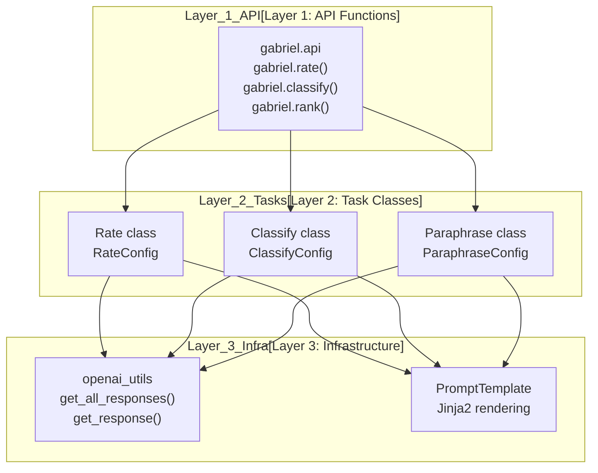
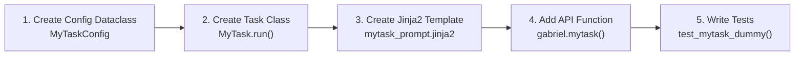
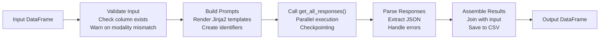
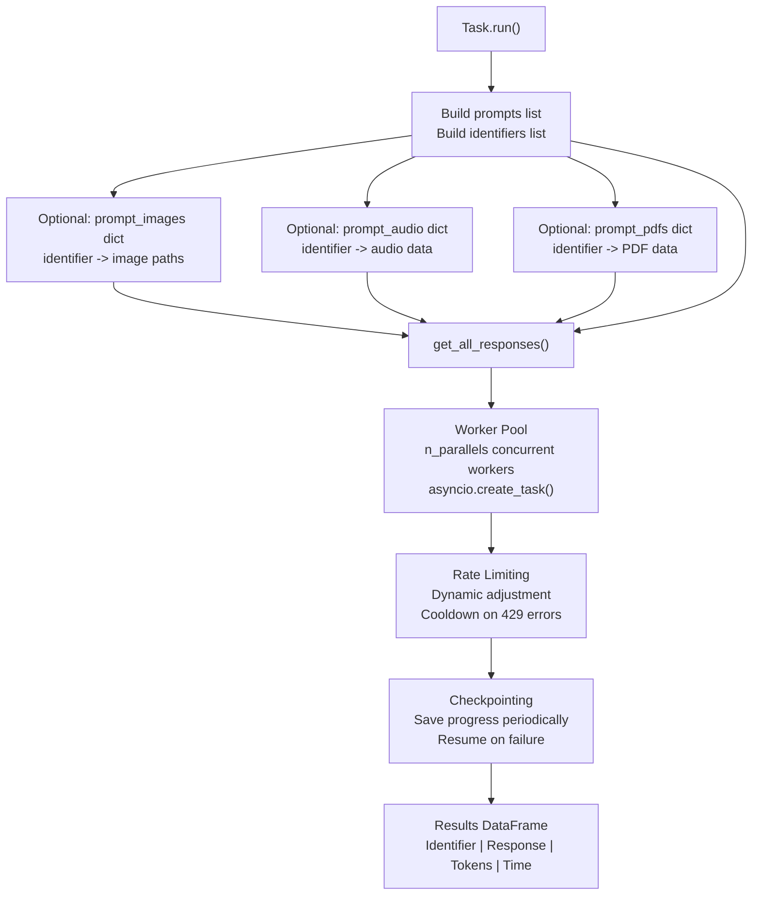
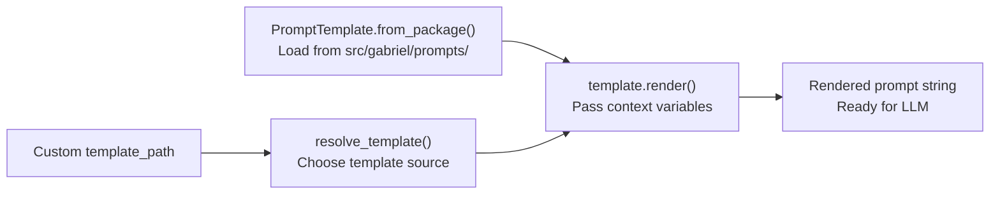
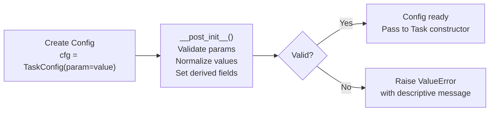
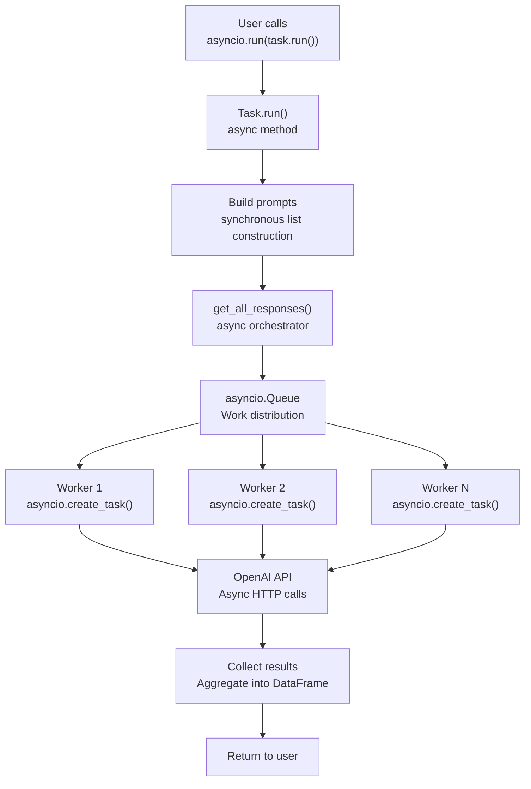

<!-- source: DeepWiki mcp.deepwiki.com · repo openai/GABRIEL · page 13 Development and Contributing · fetched 2026-10-26 -->

# Development and Contributing

<details>
<summary>Relevant source files</summary>

The following files were used as context for generating this wiki page:

- [pyproject.toml](pyproject.toml)
- [src/gabriel/_version.py](src/gabriel/_version.py)
- [src/gabriel/prompts/paraphrase_prompt.jinja2](src/gabriel/prompts/paraphrase_prompt.jinja2)
- [src/gabriel/tasks/paraphrase.py](src/gabriel/tasks/paraphrase.py)
- [tests/test_basic.py](tests/test_basic.py)

</details>


This page provides guidance for developers who want to understand GABRIEL's internals, contribute code, or extend the system with new functionality. It covers development environment setup, codebase organization, testing practices, and contribution workflows.

For installation and basic usage, see [Installation and Setup](#2).  
For architecture details, see [Core Architecture](#3).  
For information about the testing framework specifically, see [Testing Framework](#13.1).  
For detailed project structure, see [Project Structure](#13.2).

## Development Environment Setup

### Prerequisites

- Python 3.7 or higher
- Git for version control
- OpenAI API key (optional when using dummy mode for development)

### Installation for Development

Clone the repository:

```bash
git clone https://github.com/openai/GABRIEL.git
cd GABRIEL
```

Install with development dependencies:

```bash
pip install -e ".[dev]"
```

The `dev` optional dependency group includes testing tools (`pytest`, `pytest-asyncio`, `pytest-cov`), linting tools (`ruff`), and type checking (`mypy`).

### Running Tests

Execute the full test suite:

```bash
pytest tests/
```

Run with coverage reporting:

```bash
pytest --cov=gabriel tests/
```

Run specific test files:

```bash
pytest tests/test_basic.py
```

Most tests use `use_dummy=True` to avoid real API calls during development, enabling fast iteration without incurring costs.

**Sources:** [pyproject.toml:66-74](), [tests/test_basic.py:1-23]()

## Codebase Organization

The repository follows a standard Python package structure with clear separation between user-facing APIs, task implementations, and infrastructure:

```
GABRIEL/
├── src/gabriel/           # Main package source
│   ├── __init__.py       # Public API exports
│   ├── api.py            # User-facing functions
│   ├── core/             # Core infrastructure
│   │   └── prompt_template.py
│   ├── tasks/            # Task implementations
│   │   ├── rate.py
│   │   ├── rank.py
│   │   ├── classify.py
│   │   └── ...
│   ├── utils/            # Shared utilities
│   │   ├── openai_utils.py
│   │   ├── parsing.py
│   │   └── ...
│   ├── prompts/          # Jinja2 templates
│   │   └── *.jinja2
│   └── cli/              # Command-line interface
├── tests/                # Test suite
│   └── test_basic.py
├── pyproject.toml        # Build configuration
└── README.md
```

### Key Directories

| Directory | Purpose | Key Files |
|-----------|---------|-----------|
| `src/gabriel/` | Main package root | `api.py`, `__init__.py` |
| `src/gabriel/core/` | Shared infrastructure | `prompt_template.py` |
| `src/gabriel/tasks/` | Task implementations | `rate.py`, `rank.py`, `classify.py`, etc. |
| `src/gabriel/utils/` | Helper modules | `openai_utils.py`, `parsing.py`, `file_utils.py` |
| `src/gabriel/prompts/` | Jinja2 templates | `*.jinja2` files |
| `tests/` | Test suite | `test_basic.py` |

**Sources:** [pyproject.toml:91-100]()

## Architecture Overview for Contributors

Understanding the three-layer architecture is essential for contributing. Each layer has distinct responsibilities and clear interfaces:



**Layer 1 (API)**: User-facing functions in `gabriel.api` provide simple, high-level interfaces. These functions construct config objects and delegate to task classes.

**Layer 2 (Tasks)**: Task classes implement specific operations. Each task has:
- A config dataclass (e.g., `RateConfig`, `ClassifyConfig`) with validation in `__post_init__`
- A main class (e.g., `Rate`, `Classify`) with an async `run()` method
- A Jinja2 prompt template

**Layer 3 (Infrastructure)**: Core utilities used by all tasks:
- `openai_utils.get_all_responses()` - Central orchestration engine handling concurrency, rate limiting, retries, and checkpointing
- `PromptTemplate` - Type-safe Jinja2-based prompt rendering

**Sources:** [tests/test_basic.py:14-22](), [src/gabriel/tasks/paraphrase.py:28-104]()

## Contributing a New Task

Follow this pattern to add a new task to GABRIEL:

### Task Implementation Pattern



### 1. Create Config Dataclass

Define configuration with task-specific and standard parameters:

```python
from dataclasses import dataclass
from typing import Optional

@dataclass
class MyTaskConfig:
    """Configuration for MyTask."""
    
    # Task-specific parameters
    my_param: str
    
    # Standard parameters present in all tasks
    save_dir: str = "mytask"
    file_name: str = "mytask.csv"
    model: str = "gpt-5-mini"
    n_parallels: int = 650
    use_dummy: bool = False
    
    def __post_init__(self) -> None:
        """Validate parameters after initialization."""
        if not self.my_param:
            raise ValueError("my_param is required")
```

### 2. Create Task Class

Implement the task with standard lifecycle methods:

```python
from gabriel.core.prompt_template import PromptTemplate, resolve_template
from gabriel.utils.openai_utils import get_all_responses
import pandas as pd

class MyTask:
    """Brief description of what this task does."""
    
    def __init__(
        self,
        cfg: MyTaskConfig,
        template: Optional[PromptTemplate] = None,
        template_path: Optional[str] = None,
    ):
        self.cfg = cfg
        self.template = resolve_template(
            template=template,
            template_path=template_path,
            reference_filename="mytask_prompt.jinja2",
        )
    
    async def run(
        self,
        df: pd.DataFrame,
        column_name: str,
        *,
        reset_files: bool = False,
        **kwargs,
    ) -> pd.DataFrame:
        """Process DataFrame and return results.
        
        Standard task lifecycle:
        1. Validate input
        2. Build prompts
        3. Call get_all_responses
        4. Process results
        5. Return DataFrame
        """
        # Validate that column exists
        if column_name not in df.columns:
            raise ValueError(f"Column '{column_name}' not found")
        
        # Build prompts for each row
        texts = df[column_name].tolist()
        prompts = [
            self.template.render(text=str(t), my_param=self.cfg.my_param)
            for t in texts
        ]
        identifiers = [f"row_{i}" for i in range(len(texts))]
        
        # Call infrastructure layer
        save_path = os.path.join(self.cfg.save_dir, self.cfg.file_name)
        resp_df = await get_all_responses(
            prompts=prompts,
            identifiers=identifiers,
            save_path=save_path,
            model=self.cfg.model,
            n_parallels=self.cfg.n_parallels,
            use_dummy=self.cfg.use_dummy,
            reset_files=reset_files,
            **kwargs,
        )
        
        # Process and join results
        df_result = df.copy()
        df_result["result"] = resp_df["Response"].apply(
            lambda x: x[0] if isinstance(x, list) else x
        )
        
        return df_result
```

### 3. Create Prompt Template

Create `src/gabriel/prompts/mytask_prompt.jinja2`:

```jinja

{{ snip.single_entry(modality, text) }}

Task: [describe what the LLM should do]

[Task-specific instructions using {{ my_param }} and other variables]


Output JSON only in the following format: {"result": "value"}

Output plain text only.


No preamble, no explanation, only the desired output.
```

### 4. Add API Function

In `src/gabriel/api.py`:

```python
async def mytask(
    df: pd.DataFrame,
    column_name: str,
    *,
    my_param: str,
    save_dir: str = "mytask",
    **kwargs,
) -> pd.DataFrame:
    """Brief description of task functionality.
    
    Args:
        df: Input DataFrame
        column_name: Column to process
        my_param: Task-specific parameter
        save_dir: Directory for output files
        **kwargs: Additional parameters passed to task
    
    Returns:
        DataFrame with results appended
    """
    cfg = MyTaskConfig(
        my_param=my_param,
        save_dir=save_dir,
        **kwargs,
    )
    task = MyTask(cfg)
    return await task.run(df, column_name, **kwargs)
```

### 5. Write Tests

In `tests/test_basic.py`:

```python
def test_mytask_dummy(tmp_path):
    """Test mytask with dummy responses."""
    cfg = MyTaskConfig(
        my_param="test_value",
        save_dir=str(tmp_path),
        file_name="mytask.csv",
        use_dummy=True,
    )
    task = MyTask(cfg)
    data = pd.DataFrame({"text": ["hello", "world"]})
    df = asyncio.run(task.run(data, column_name="text"))
    
    assert not df.empty
    assert "result" in df.columns
    assert len(df) == 2
```

**Sources:** [src/gabriel/tasks/paraphrase.py:28-137](), [tests/test_basic.py:822-828]()

## Task Implementation Patterns

### Standard Task Lifecycle

Every task follows a consistent five-stage pattern:



1. **Validate Input**: Check that the specified column exists and warn if modality doesn't match data type
2. **Build Prompts**: Render Jinja2 templates with task-specific context for each row
3. **Call get_all_responses**: Use the central orchestration engine with concurrency and error handling
4. **Parse Responses**: Extract structured data from LLM outputs, handling JSON and text formats
5. **Assemble Results**: Join results with input data and persist to CSV files

**Sources:** [src/gabriel/tasks/paraphrase.py:125-298]()

### Using `get_all_responses`

The core orchestration happens in `openai_utils.get_all_responses()`, which handles all infrastructure concerns:



Key parameters for `get_all_responses`:

| Parameter | Purpose | Default |
|-----------|---------|---------|
| `prompts` | List of prompt strings | Required |
| `identifiers` | List of unique IDs for each prompt | Auto-generated from prompts |
| `save_path` | CSV path for persisting results | Required |
| `model` | OpenAI model name | "gpt-5-mini" |
| `n_parallels` | Number of concurrent workers | 650 |
| `use_dummy` | Use synthetic responses for testing | False |
| `reset_files` | Clear existing checkpoint files | False |
| `json_mode` | Enforce JSON output from LLM | False |
| `prompt_images` | Dict mapping identifiers to image paths | None |
| `prompt_audio` | Dict mapping identifiers to audio data | None |

**Sources:** [tests/test_basic.py:438-448](), [src/gabriel/tasks/paraphrase.py:236-250]()

### Handling Multiple Runs

For tasks that need multiple independent runs per row (e.g., `n_runs=3` for stochastic sampling):

```python
prompts: List[str] = []
identifiers: List[str] = []

# Generate n_runs prompts per row
for idx, text in enumerate(texts):
    for run_idx in range(1, n_runs + 1):
        prompts.append(render_prompt(text))
        identifiers.append(f"row_{idx}_run{run_idx}")

# Single call to get_all_responses handles all prompts
resp_df = await get_all_responses(
    prompts=prompts,
    identifiers=identifiers,
    save_path=save_path,
    **kwargs,
)

# Parse responses back into (row, run) structure
results: Dict[Tuple[int, int], str] = {}
for ident, resp in zip(resp_df["Identifier"], resp_df["Response"]):
    m = re.match(r"row_(\d+)_run(\d+)", ident)
    if m:
        row = int(m.group(1))
        run = int(m.group(2))
        text = resp[0] if isinstance(resp, list) else resp
        results[(row, run)] = text

# Assemble into output columns
for run_idx in range(1, n_runs + 1):
    df[f"result_{run_idx}"] = [
        results.get((i, run_idx), "") for i in range(len(df))
    ]
```

**Sources:** [src/gabriel/tasks/paraphrase.py:181-258](), [tests/test_basic.py:831-838]()

### Multimodal Support

To support images, audio, or PDFs, use the modality-specific loading utilities:

```python
from gabriel.utils import (
    load_image_inputs,
    load_audio_inputs,
    load_pdf_inputs,
)

# For image modality
if cfg.modality == "image":
    prompt_images: Dict[str, List[str]] = {}
    for idx, val in enumerate(values):
        imgs = load_image_inputs(val)  # Handles paths or base64
        if imgs:
            prompt_images[f"row_{idx}"] = imgs

# For audio modality
if cfg.modality == "audio":
    prompt_audio: Dict[str, List[Dict[str, str]]] = {}
    for idx, val in enumerate(values):
        auds = load_audio_inputs(val)  # Returns list of {data, format} dicts
        if auds:
            prompt_audio[f"row_{idx}"] = auds

# For PDF modality
if cfg.modality == "pdf":
    prompt_pdfs: Dict[str, List[Dict[str, str]]] = {}
    for idx, val in enumerate(values):
        pdfs = load_pdf_inputs(val)  # Returns list of {data, format} dicts
        if pdfs:
            prompt_pdfs[f"row_{idx}"] = pdfs

# Pass to get_all_responses
resp_df = await get_all_responses(
    prompts=prompts,
    identifiers=identifiers,
    prompt_images=prompt_images or None,
    prompt_audio=prompt_audio or None,
    prompt_pdfs=prompt_pdfs or None,
    save_path=save_path,
    **kwargs,
)
```

**Sources:** [src/gabriel/tasks/paraphrase.py:200-227]()

## Testing Strategies

### Dummy Mode for Fast Tests

Almost all tests use `use_dummy=True` to avoid real API calls, enabling fast iteration:

```python
def test_my_feature(tmp_path):
    """Test using dummy mode for speed."""
    cfg = MyConfig(
        save_dir=str(tmp_path),
        use_dummy=True,  # Key flag for synthetic responses
    )
    task = MyTask(cfg)
    df = asyncio.run(task.run(data, "text"))
    assert expected_behavior
```

Dummy mode generates synthetic responses that match expected structure:
- **For text:** Returns `"DUMMY RESPONSE: {prompt[:50]}"`
- **For JSON:** Returns valid JSON matching expected schema
- **For embeddings:** Returns random normalized vectors

**Sources:** [tests/test_basic.py:221-239](), [tests/test_basic.py:822-828]()

### Testing Async Functions

Use `asyncio.run()` to execute async methods in synchronous test functions:

```python
def test_async_task(tmp_path):
    """Test an async task method."""
    cfg = TaskConfig(save_dir=str(tmp_path), use_dummy=True)
    task = Task(cfg)
    data = pd.DataFrame({"text": ["hello", "world"]})
    
    # Call async method from sync test function
    result = asyncio.run(task.run(data, "text"))
    
    assert len(result) == 2
    assert "output_column" in result.columns
```

**Sources:** [tests/test_basic.py:822-828]()

### Testing Error Handling

Test retry logic and error classification by injecting failures:

```python
def test_error_recovery(tmp_path, monkeypatch):
    """Test that transient errors are retried."""
    call_count = {"n": 0}
    
    async def failing_fn(prompt: str, **kwargs):
        call_count["n"] += 1
        if call_count["n"] < 2:
            # Fail on first call
            raise Exception("Transient error")
        # Succeed on retry
        return ["success"]
    
    df = asyncio.run(
        openai_utils.get_all_responses(
            prompts=["test"],
            identifiers=["1"],
            save_path=str(tmp_path / "retry.csv"),
            response_fn=failing_fn,
        )
    )
    
    # Verify retry occurred
    assert call_count["n"] >= 2
    assert df["Successful"].iloc[0]
```

**Sources:** [tests/test_basic.py:525-544]()

### Testing with Custom Response Functions

Replace the LLM backend for isolated testing:

```python
def test_custom_response_fn(tmp_path):
    """Test with custom response function."""
    seen_prompts = []
    
    async def custom(prompt: str, **kwargs):
        seen_prompts.append(prompt)
        return [f"CUSTOM::{prompt}"]
    
    df = asyncio.run(
        openai_utils.get_all_responses(
            prompts=["x", "y"],
            identifiers=["1", "2"],
            save_path=str(tmp_path / "custom.csv"),
            response_fn=custom,
        )
    )
    
    # Verify custom function was called
    assert seen_prompts == ["x", "y"]
    assert df["Response"].iloc[0] == ["CUSTOM::x"]
```

**Sources:** [tests/test_basic.py:525-544]()

### Testing File Persistence

Verify that output files are created correctly:

```python
def test_saves_to_disk(tmp_path):
    """Test that results are persisted to CSV."""
    save_path = tmp_path / "output.csv"
    
    asyncio.run(
        openai_utils.get_all_responses(
            prompts=["test"],
            identifiers=["1"],
            save_path=str(save_path),
            use_dummy=True,
        )
    )
    
    # Verify file exists and has expected structure
    assert save_path.exists()
    df = pd.read_csv(save_path)
    assert "Identifier" in df.columns
    assert "Response" in df.columns
    assert len(df) == 1
```

**Sources:** [tests/test_basic.py:438-448]()

## Code Style and Conventions

### Type Hints

Use type hints for all function signatures to enable static analysis:

```python
from typing import Optional, List, Dict, Any
import pandas as pd

async def run(
    self,
    df: pd.DataFrame,
    column_name: str,
    *,
    reset_files: bool = False,
    **kwargs: Any,
) -> pd.DataFrame:
    """Process DataFrame with typed parameters."""
    pass
```

### Dataclass Configs

Use dataclasses for configuration with validation in `__post_init__`:

```python
from dataclasses import dataclass
from typing import Optional

@dataclass
class MyConfig:
    """Configuration with validation."""
    required_param: str
    optional_param: Optional[str] = None
    
    def __post_init__(self) -> None:
        """Validate after initialization."""
        if not self.required_param:
            raise ValueError("required_param must be set")
        # Normalize values
        self.required_param = self.required_param.strip()
```

**Sources:** [src/gabriel/tasks/paraphrase.py:28-104]()

### Async/Await Patterns

Follow async best practices consistently:

```python
# Good: Use async/await consistently
async def process_data(data: pd.DataFrame) -> pd.DataFrame:
    result = await get_all_responses(...)
    return result

# Call with asyncio.run() from sync context (e.g., tests)
df = asyncio.run(process_data(my_data))

# Or await directly in async context (e.g., within another async function)
df = await process_data(my_data)
```

### Error Handling

Handle errors gracefully and provide informative context:

```python
try:
    result = await get_all_responses(...)
except Exception as e:
    print(f"Error processing {identifier}: {e}")
    # Log error but allow processing to continue
    # Infrastructure layer will retry transient errors automatically
```

**Sources:** [tests/test_basic.py:1-23]()

## Build and Package Management

### Project Configuration

The project uses `pyproject.toml` for modern Python packaging:

```toml
[build-system]
requires = ["setuptools>=64"]
build-backend = "setuptools.build_meta"

[project]
name = "openai-gabriel"
version = "1.0.7"
requires-python = ">=3.7"
```

**Sources:** [pyproject.toml:1-15]()

### Dependencies

Core dependencies (always installed):

| Package | Purpose | Min Version |
|---------|---------|-------------|
| `openai` | OpenAI API client | 1.0.0 |
| `pandas` | Data manipulation | 1.0.0 |
| `numpy` | Numerical operations | 1.18.0 |
| `Jinja2` | Prompt templating | 3.0.0 |
| `tqdm` | Progress bars | 4.40.0 |
| `aiohttp` | Async HTTP client | 3.7.0 |
| `matplotlib` | Plotting utilities | 3.6.0 |
| `statsmodels` | Statistical analysis | 0.14.0 |

Development dependencies (installed with `pip install -e ".[dev]"`):

| Package | Purpose |
|---------|---------|
| `pytest` | Testing framework |
| `pytest-asyncio` | Async test support |
| `pytest-cov` | Coverage reporting |
| `ruff` | Fast Python linter |
| `mypy` | Static type checker |

**Sources:** [pyproject.toml:46-74]()

### Building the Package

Build distribution files for PyPI:

```bash
python -m build
```

This creates:
- `dist/openai_gabriel-1.0.7-py3-none-any.whl` (wheel distribution)
- `dist/openai-gabriel-1.0.7.tar.gz` (source distribution)

### Version Management

Update version in two synchronized locations:

1. `src/gabriel/_version.py`:
```python
__version__ = "1.0.7"
```

2. `pyproject.toml`:
```toml
[project]
version = "1.0.7"
```

**Sources:** [src/gabriel/_version.py:1-2](), [pyproject.toml:7]()

## Contribution Workflow

### 1. Fork and Clone

```bash
git clone https://github.com/YOUR_USERNAME/GABRIEL.git
cd GABRIEL
git remote add upstream https://github.com/openai/GABRIEL.git
```

### 2. Create a Feature Branch

```bash
git checkout -b feature/my-new-feature
```

### 3. Make Changes

- Follow existing code patterns and architecture
- Add comprehensive type hints
- Write tests for new functionality
- Update documentation if adding user-facing features

### 4. Run Tests Locally

```bash
# Run all tests
pytest tests/

# Run specific test
pytest tests/test_basic.py::test_my_feature

# Check coverage
pytest --cov=gabriel tests/

# Generate HTML coverage report
pytest --cov=gabriel --cov-report=html tests/
```

### 5. Lint Code

```bash
ruff check src/
ruff format src/  # Auto-format if needed
```

### 6. Commit and Push

```bash
git add .
git commit -m "Add feature: brief description of changes"
git push origin feature/my-new-feature
```

### 7. Create Pull Request

- Navigate to GitHub and create a pull request from your branch
- Provide clear description of changes and motivation
- Reference any related issues
- Wait for review and address feedback

## Understanding Key Components

### PromptTemplate System

The `PromptTemplate` class provides type-safe Jinja2 rendering:



Usage pattern in tasks:

```python
from gabriel.core.prompt_template import PromptTemplate

# Load from package prompts directory
template = PromptTemplate.from_package("my_template.jinja2")

# Render with context variables
prompt = template.render(
    text="input text",
    instructions="transformation instructions",
    json_mode=True,
)
```

**Sources:** [tests/test_basic.py:202-218](), [src/gabriel/tasks/paraphrase.py:119-123]()

### Config Validation Pattern

All task configs use `__post_init__` for validation and normalization:



Example pattern:

```python
@dataclass
class TaskConfig:
    param: int
    
    def __post_init__(self) -> None:
        # Validate constraints
        if self.param < 1:
            raise ValueError("param must be >= 1")
        
        # Normalize values
        self.param = max(1, int(self.param))
        
        # Set derived fields
        self.effective_param = self.param * 2
```

**Sources:** [src/gabriel/tasks/paraphrase.py:95-104]()

### Async Execution Flow

Understanding the async execution model for infrastructure development:



Key async concepts:
- `asyncio.run()` creates event loop and runs until completion
- Workers execute concurrently using `asyncio.create_task()`
- API calls are truly parallel (not just concurrent Python code)
- Results are collected and aggregated into a single DataFrame
- Errors in individual workers don't crash the entire execution

**Sources:** [tests/test_basic.py:639-671]()

## Extending GABRIEL

### Custom LLM Backend

Replace OpenAI with another provider by implementing `get_all_responses_fn`:

```python
async def custom_llm_backend(
    prompts: List[str],
    identifiers: List[str],
    model: str = "my-model",
    **kwargs,
) -> pd.DataFrame:
    """Custom backend returns same format as get_all_responses."""
    responses = []
    for prompt in prompts:
        # Call your LLM API
        resp = await my_llm_api.generate(prompt, model=model)
        responses.append([resp])
    
    return pd.DataFrame({
        "Identifier": identifiers,
        "Response": responses,
        "Successful": [True] * len(prompts),
        "Time Taken": [0.5] * len(prompts),
        "Input Tokens": [100] * len(prompts),
        "Output Tokens": [50] * len(prompts),
        "Error Log": [None] * len(prompts),
    })

# Use in any task
df = await gabriel.rate(
    data,
    "text",
    attributes={"quality": "Rate quality"},
    get_all_responses_fn=custom_llm_backend,
    save_dir="output",
)
```

**Sources:** [tests/test_basic.py:583-621]()

### Custom Response Parsing

Override default response parsing for non-standard outputs:

```python
async def custom_parser(prompt: str, **kwargs) -> List[str]:
    """Parse non-standard LLM outputs."""
    # Get raw response
    raw_response, duration = await openai_utils.get_response(prompt, **kwargs)
    
    # Custom parsing logic
    parsed = my_custom_parse(raw_response[0])
    
    return [parsed]

# Use in get_all_responses
df = await get_all_responses(
    prompts=["test"],
    identifiers=["1"],
    response_fn=custom_parser,
    save_path="output.csv",
)
```

**Sources:** [tests/test_basic.py:525-565]()

### Multi-Stage Pipelines

Compose multiple tasks in sequence for complex workflows:

```python
async def multi_stage_pipeline(df: pd.DataFrame) -> pd.DataFrame:
    """Compose multiple tasks into a pipeline."""
    
    # Stage 1: Classify into categories
    df = await gabriel.classify(
        df, "text",
        labels={"topic": "What is the main topic?"},
        save_dir="stage1_classify",
    )
    
    # Stage 2: Rate quality only for science topics
    science_df = df[df["topic"] == "science"].copy()
    if not science_df.empty:
        rated = await gabriel.rate(
            science_df, "text",
            attributes={"quality": "Rate scientific quality"},
            save_dir="stage2_rate",
        )
        # Merge back into main dataframe
        df = df.merge(
            rated[["quality"]], 
            left_index=True, 
            right_index=True, 
            how="left"
        )
    
    # Stage 3: Extract structured data
    df = await gabriel.extract(
        df, "text",
        attributes={"author": "Extract author name"},
        save_dir="stage3_extract",
    )
    
    return df
```

**Sources:** [src/gabriel/tasks/paraphrase.py:300-636]()

## Troubleshooting Development Issues

### Import Errors

If you encounter `ModuleNotFoundError: No module named 'gabriel'`:

```bash
# Ensure editable install is active
pip install -e .

# Or with dev dependencies
pip install -e ".[dev]"

# Verify installation
python -c "import gabriel; print(gabriel.__version__)"
```

### Test Failures

Common test failure patterns and solutions:

| Issue | Solution |
|-------|----------|
| Async not awaited | Use `asyncio.run()` to call async functions in tests |
| File permissions | Use `tmp_path` fixture instead of hardcoded paths |
| Stale checkpoint files | Use `reset_files=True` in test calls |
| Race conditions in async tests | Use proper synchronization with `asyncio.Event` |

Example of proper async test structure:

```python
def test_async_feature(tmp_path):
    """Proper async test structure."""
    async def _test():
        # Async test logic here
        result = await my_async_function()
        return result
    
    # Execute async test
    result = asyncio.run(_test())
    assert result == expected
```

### Type Errors

Run type checker to identify type issues:

```bash
mypy src/gabriel
```

Common type error fixes:
- Add missing type hints: `def func(x: int) -> str:`
- Use `Optional[T]` for nullable values: `Optional[str] = None`
- Import types from typing: `from typing import Optional, List, Dict, Any`
- Use `Any` for truly dynamic values: `kwargs: Any`

**Sources:** [tests/test_basic.py:1-23]()

## Next Steps for Contributors

- Review [Testing Framework](#13.1) for detailed test patterns and practices
- Explore [Project Structure](#13.2) for complete codebase organization
- Study existing tasks in `src/gabriel/tasks/` for implementation examples
- Examine [Core Architecture](#3) for system design principles
- Check [LLM Orchestration Infrastructure](#3.1) for infrastructure details

For questions, discussions, or bug reports, open an issue at: https://github.com/openai/GABRIEL/issues

**Sources:** [pyproject.toml:82-86]()

---

