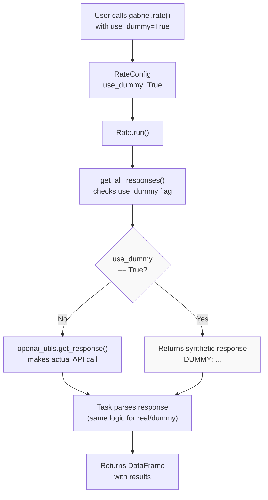
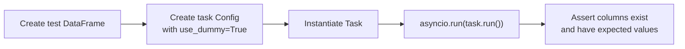
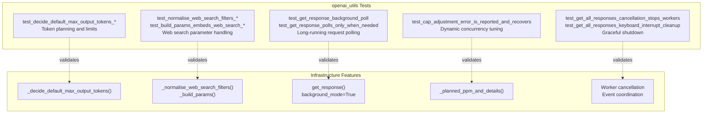
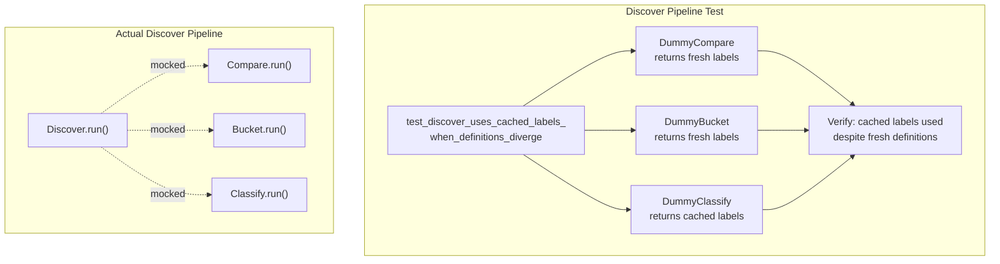
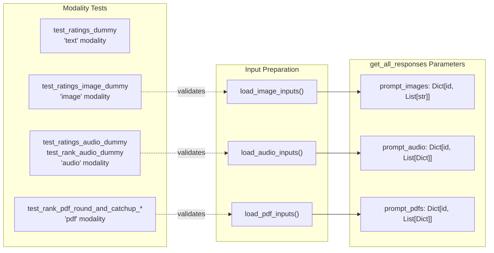
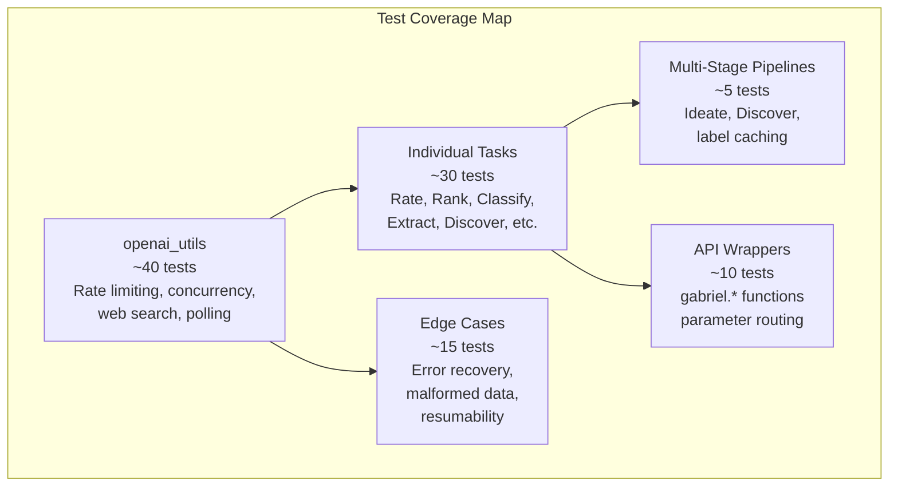

<!-- source: DeepWiki mcp.deepwiki.com · repo openai/GABRIEL · page 13.1 Testing Framework · fetched 2026-10-26 -->

# Testing Framework

<details>
<summary>Relevant source files</summary>

The following files were used as context for generating this wiki page:

- [src/gabriel/prompts/paraphrase_prompt.jinja2](src/gabriel/prompts/paraphrase_prompt.jinja2)
- [src/gabriel/tasks/paraphrase.py](src/gabriel/tasks/paraphrase.py)
- [tests/test_basic.py](tests/test_basic.py)

</details>


## Purpose and Scope

This document covers GABRIEL's testing infrastructure, including the dummy mode for development and testing without API calls, test organization, and patterns for testing async tasks. For information about the actual task implementations being tested, see the task-specific pages (sections [4](#4) through [7](#7)). For details about the LLM orchestration infrastructure, see [LLM Orchestration Infrastructure](#3.1).

## Dummy Mode Overview

GABRIEL provides a **dummy mode** (`use_dummy=True`) that generates synthetic responses without making real API calls. This mode is essential for:

- **Rapid development**: Test task logic without API latency or costs
- **CI/CD pipelines**: Run automated tests without OpenAI credentials
- **Reproducible testing**: Generate deterministic outputs for validation
- **Offline development**: Work without network connectivity

Dummy mode is implemented throughout the system, from low-level `openai_utils` functions up to high-level API wrappers. When enabled, it bypasses actual HTTP requests and returns placeholder responses that match the expected structure.

**Sources:** [tests/test_basic.py:221-240](), [tests/test_basic.py:401-404](), [tests/test_basic.py:822-828]()

---

## How Dummy Mode Works



**How it works:**

1. **Configuration propagation**: The `use_dummy` flag is passed through config dataclasses (e.g., `RateConfig`, `ClassifyConfig`) down to `get_all_responses`
2. **Response generation**: At the `get_response()` level, dummy mode generates synthetic text like `"DUMMY: response for prompt [first 50 chars]"`
3. **Identical parsing**: Task-specific parsing logic operates identically on dummy and real responses
4. **File persistence**: Dummy responses are still written to CSV files in `save_dir`, maintaining the same checkpoint/resume behavior

**Sources:** [tests/test_basic.py:221-240](), [src/gabriel/tasks/paraphrase.py:91](), [tests/test_basic.py:438-448]()

---

## Test File Organization

Tests are organized in `tests/test_basic.py` as a monolithic suite covering all major components:

| Test Category | Example Functions | Purpose |
|---------------|-------------------|---------|
| **openai_utils infrastructure** | `test_decide_default_max_output_tokens_respects_user_choice` | Rate limiting, token planning, web search |
| **Prompt templates** | `test_prompt_template`, `test_shuffled_dict_rendering` | Jinja2 rendering, parameter injection |
| **Low-level API functions** | `test_get_response_dummy`, `test_get_embedding_dummy` | Single request/response cycle |
| **Batch orchestration** | `test_get_all_responses_dummy`, `test_get_all_responses_custom_callable` | Parallel execution, checkpointing |
| **Individual tasks** | `test_ratings_dummy`, `test_rank_audio_dummy`, `test_classification_dummy` | Task-specific logic |
| **Multi-stage pipelines** | `test_discover_uses_cached_labels_when_definitions_diverge` | Complex orchestration (Ideate, Discover) |
| **API wrappers** | `test_api_wrappers`, `test_api_rank_hides_raw_columns` | Public `gabriel.*` functions |
| **Error handling** | `test_cap_adjustment_error_is_reported_and_recovers` | Retry logic, concurrency tuning |
| **Resumability** | `test_ratings_ignore_stale_ids`, `test_rank_resume_ignores_nan_batch_rows` | Checkpoint recovery |

**Sources:** [tests/test_basic.py:1-1832]()

---

## Running Tests

### Basic Test Execution

```bash
# Run all tests
pytest tests/test_basic.py

# Run with verbose output
pytest tests/test_basic.py -v

# Run specific test
pytest tests/test_basic.py::test_ratings_dummy -v

# Run tests matching pattern
pytest tests/test_basic.py -k "dummy" -v

# Show print statements
pytest tests/test_basic.py -s

# Stop at first failure
pytest tests/test_basic.py -x
```

### Test Requirements

Tests require:
- `pytest` (test runner)
- `asyncio` (for async test execution)
- `monkeypatch` fixture (for mocking external dependencies)
- `tmp_path` fixture (for isolated file system operations)
- `capsys` fixture (for capturing stdout/stderr)

**Sources:** [tests/test_basic.py:1-22]()

---

## Testing Patterns

### Pattern 1: Basic Async Task Test



**Example:**

```python
def test_ratings_dummy(tmp_path):
    cfg = RateConfig(
        attributes={"helpfulness": ""},
        save_dir=str(tmp_path),
        file_name="ratings.csv",
        use_dummy=True
    )
    task = Rate(cfg)
    data = pd.DataFrame({"text": ["hello"]})
    df = asyncio.run(task.run(data, column_name="text"))
    assert not df.empty
    assert "helpfulness" in df.columns
```

**Key elements:**
- `tmp_path` fixture provides isolated directory for each test
- `use_dummy=True` avoids real API calls
- `asyncio.run()` executes async task functions
- Assertions verify output structure and content

**Sources:** [tests/test_basic.py:822-828]()

---

### Pattern 2: Monkeypatching External Dependencies

Tests often need to mock OpenAI API responses or internal functions. The `monkeypatch` fixture enables this:

```python
def test_get_response_background_poll(monkeypatch):
    monkeypatch.setenv("OPENAI_API_KEY", "test-key")
    openai_utils._clients_async.clear()

    class DummyResponse:
        def __init__(self, status: str, text: str = ""):
            self.status = status
            self.id = "resp-test"
            self.output_text = text
            # ... usage fields ...

    class FakeResponses:
        async def create(self, **kwargs):
            return DummyResponse("in_progress")

        async def retrieve(self, response_id: str, **kwargs):
            return DummyResponse("completed", text="final-answer")

    fake_client = type("FakeClient", (), {"responses": FakeResponses()})()
    monkeypatch.setattr(
        openai_utils, "_get_client", lambda base_url=None, **kwargs: fake_client
    )

    texts, duration, raw = asyncio.run(
        openai_utils.get_response(
            "hello",
            use_dummy=False,
            timeout=None,
            background_mode=True,
            background_poll_interval=0.01,
            return_raw=True,
        )
    )

    assert texts == ["final-answer"]
```

**When to use monkeypatching:**
- Testing error recovery paths (e.g., rate limits, timeouts)
- Testing background polling behavior
- Testing concurrency edge cases
- Simulating specific API behaviors

**Sources:** [tests/test_basic.py:242-298]()

---

### Pattern 3: Custom Response Functions

For testing task-specific logic in isolation, custom response functions can replace `get_all_responses`:

```python
def test_get_all_responses_custom_callable(tmp_path):
    calls = []

    async def custom(prompt: str, *, n: int) -> list:
        calls.append((prompt, n))
        return [f"CUSTOM::{prompt}"]

    df = asyncio.run(
        openai_utils.get_all_responses(
            prompts=["x", "y"],
            identifiers=["1", "2"],
            save_path=str(tmp_path / "custom.csv"),
            response_fn=custom,
            reset_files=True,
        )
    )
    assert sorted(calls) == [("x", 1), ("y", 1)]
    assert df.loc[0, "Response"] == ["CUSTOM::x"]
```

**Custom response function requirements:**
- Must be `async def` (coroutine)
- Must accept `prompt` parameter (positional or keyword)
- Must return `List[str]` (list of response texts)
- Can optionally return `Tuple[List[str], float, List[Dict]]` for usage tracking

**Sources:** [tests/test_basic.py:525-544](), [tests/test_basic.py:742-786]()

---

### Pattern 4: Custom Drivers

For full control over batch orchestration, `get_all_responses_fn` can replace the entire driver:

```python
def test_get_all_responses_custom_driver_receives_kwargs(tmp_path):
    calls = []

    async def custom_driver(prompts, identifiers, json_mode=False, model=None, **kwargs):
        calls.append({
            "prompts": prompts,
            "identifiers": identifiers,
            "json_mode": json_mode,
            "model": model,
        })
        return pd.DataFrame({
            "Identifier": identifiers,
            "Response": [[f"resp:{ident}"] for ident in identifiers]
        })

    df = asyncio.run(
        openai_utils.get_all_responses(
            prompts=["p1", "p2"],
            identifiers=None,
            json_mode=True,
            model="demo-model",
            get_all_responses_fn=custom_driver,
            save_path=str(tmp_path / "custom_driver.csv"),
        )
    )

    assert calls[0]["json_mode"] is True
    assert calls[0]["model"] == "demo-model"
```

**Custom driver requirements:**
- Must accept `prompts` and `identifiers` parameters
- Must return `pd.DataFrame` with `Identifier` and `Response` columns
- Receives all kwargs passed to `get_all_responses`

**Sources:** [tests/test_basic.py:583-622]()

---

## Testing Component Categories

### Infrastructure Layer Tests

These tests validate the core `openai_utils` module that all tasks depend on:



**Key infrastructure tests:**

- **Token planning**: [tests/test_basic.py:25-38]() validates that user-specified `max_output_tokens` is respected and defaults are calculated correctly
- **Web search**: [tests/test_basic.py:40-87]() tests normalization of filters, location types, and embedding in request params
- **Background mode**: [tests/test_basic.py:242-351]() validates polling for long-running requests with timeout tracking
- **Rate limit handling**: [tests/test_basic.py:450-482]() ensures concurrency tuning errors are reported and recovered gracefully
- **Worker cancellation**: [tests/test_basic.py:639-704]() validates that task cancellation and KeyboardInterrupt stop workers cleanly

**Sources:** [tests/test_basic.py:25-704]()

---

### Individual Task Tests

Each task type has dedicated tests covering its unique behavior:

| Task | Test Functions | Key Validations |
|------|---------------|-----------------|
| **Rate** | `test_ratings_dummy`, `test_ratings_multirun`, `test_ratings_audio_dummy`, `test_ratings_image_dummy` | Column creation, multi-run disaggregation, modalities |
| **Rank** | `test_rank_audio_dummy`, `test_rank_outputs_zscores_and_raw_columns`, `test_recursive_rank_outputs` | Bradley-Terry scores, standard errors, recursive stages |
| **Classify** | `test_classification_dummy`, `test_classification_multirun`, `test_classify_parse_dict` | Label application, confidence thresholds, multi-run |
| **Extract** | `test_extraction_dummy`, `test_extraction_multiple_entities` | Attribute extraction, entity splitting |
| **Deidentify** | `test_deidentifier_dummy`, `test_deidentifier_respects_punctuation_in_real_forms` | PII replacement, mapping consistency |
| **Discover** | `test_discover_uses_cached_labels_when_definitions_diverge`, `test_discover_single_column_uses_cached_labels` | Label caching across runs, definition matching |
| **Bucket** | `test_bucket_reuses_final_state` | State persistence and reuse |
| **Paraphrase** | `test_paraphrase_api`, `test_paraphrase_modalities_forward_media`, `test_paraphrase_approval_column_recursive` | Text rewriting, media forwarding, validation |

**Sources:** [tests/test_basic.py:822-1751]()

---

### Multi-Stage Pipeline Tests

Complex tasks that orchestrate multiple sub-tasks require integration testing:



**Example: Testing label caching in Discover**

The Discover task runs a 3-stage pipeline (Codify/Compare → Bucket → Classify). Tests validate that when definitions change between runs, cached classification results are reused:

```python
def test_discover_uses_cached_labels_when_definitions_diverge(monkeypatch, tmp_path):
    df = pd.DataFrame({"circle": ["alpha"], "square": ["beta"]})
    cached_combined = {
        "circle cached label more than square": "cached desc circle",
        "square cached label more than square": "cached desc square",
    }
    new_bucket = {
        "circle fresh label more than square": "fresh desc",
    }

    # Mock each sub-task to return controlled outputs
    monkeypatch.setattr(discover_module, "Compare", DummyCompare)
    monkeypatch.setattr(discover_module, "Bucket", DummyBucket)
    monkeypatch.setattr(discover_module, "Classify", DummyClassify)

    cfg = DiscoverConfig(save_dir=str(tmp_path / "disc"), use_dummy=True)
    result = asyncio.run(
        Discover(cfg).run(df, circle_column_name="circle", square_column_name="square")
    )

    # Verify cached labels are used despite fresh bucket definitions
    expected_label = "circle cached label more than square"
    assert list(result["buckets"].keys()) == [expected_label]
```

**Why this matters:** Discover can take hours to run. Reusing cached results when only definitions (not raw terms) change saves significant time.

**Sources:** [tests/test_basic.py:1193-1272]()

---

### API Wrapper Tests

High-level `gabriel.*` functions are tested to ensure they provide the correct user-facing interface:

```python
def test_api_wrappers(tmp_path):
    df = pd.DataFrame({"txt": ["hello"]})
    
    # Test gabriel.rate
    rated = asyncio.run(
        gabriel.rate(
            df, "txt",
            attributes={"clarity": ""},
            save_dir=str(tmp_path / "rate"),
            use_dummy=True,
        )
    )
    assert "clarity" in rated.columns

    # Test gabriel.classify
    classified = asyncio.run(
        gabriel.classify(
            df, "txt",
            labels={"yes": ""},
            save_dir=str(tmp_path / "cls"),
            use_dummy=True,
        )
    )
    assert "yes" in classified.columns

    # Test gabriel.extract
    extracted = asyncio.run(
        gabriel.extract(
            df, "txt",
            attributes={"year": ""},
            save_dir=str(tmp_path / "extr"),
            use_dummy=True,
        )
    )
    assert "year" in extracted.columns
```

**Key validations:**
- Correct parameter routing from API to config
- Column naming conventions
- Return value structure
- `return_raw_scores` behavior for Rank

**Sources:** [tests/test_basic.py:1374-1428]()

---

## Advanced Testing Techniques

### Testing Error Recovery

```python
def test_cap_adjustment_error_is_reported_and_recovers(monkeypatch, capsys, tmp_path):
    """Ensure concurrency tuning errors are surfaced once and runs continue."""
    
    real_planner = openai_utils._planned_ppm_and_details
    call_count = {"n": 0}

    def boom(*args, **kwargs):
        call_count["n"] += 1
        if call_count["n"] <= 2:
            return real_planner(*args, **kwargs)
        raise RuntimeError("synthetic cap failure")

    monkeypatch.setattr(openai_utils, "_planned_ppm_and_details", boom)
    
    df = asyncio.run(
        openai_utils.get_all_responses(
            prompts=["prompt {i}" for i in range(4)],
            identifiers=[f"id{i}" for i in range(4)],
            use_dummy=True,
            save_path=str(tmp_path / "cap_failure.csv"),
        )
    )
    
    captured = capsys.readouterr().out
    assert len(df) == 4  # All requests succeeded despite error
    assert "Error while updating concurrency cap dynamically" in captured
```

**Pattern:** Inject failures at specific points, verify graceful degradation and completion.

**Sources:** [tests/test_basic.py:450-482]()

---

### Testing Concurrency Limits

```python
def test_get_all_responses_cancellation_stops_workers(tmp_path):
    prompts = [f"p{i}" for i in range(6)]
    call_log = []
    post_cancel_calls = []
    cancel_flag = asyncio.Event()
    blocker = asyncio.Event()

    async def stalled_response(prompt: str, **kwargs):
        call_log.append(prompt)
        if cancel_flag.is_set():
            post_cancel_calls.append(prompt)
        await blocker.wait()  # Never completes

    async def runner():
        task = asyncio.create_task(
            openai_utils.get_all_responses(
                prompts=prompts,
                identifiers=[f"id{i}" for i in range(len(prompts))],
                save_path=str(tmp_path / "cancel.csv"),
                response_fn=stalled_response,
                n_parallels=3,
            )
        )
        # Wait for 3 workers to start
        while len(call_log) < 3:
            await asyncio.sleep(0.01)
        # Cancel and verify no new workers start
        cancel_flag.set()
        task.cancel()
        with pytest.raises(asyncio.CancelledError):
            await task
        assert not post_cancel_calls  # No calls after cancellation

    asyncio.run(runner())
```

**Pattern:** Block workers with `asyncio.Event`, trigger cancellation, verify no new work starts.

**Sources:** [tests/test_basic.py:639-672]()

---

### Testing Checkpointing and Resumability

```python
def test_ratings_ignore_stale_ids(tmp_path):
    """Ensure stale identifiers in existing files are ignored."""
    cfg = RateConfig(
        attributes={"helpfulness": ""},
        save_dir=str(tmp_path),
        file_name="ratings.csv",
        use_dummy=True,
    )
    
    # Pre-create a raw responses file with an unrelated identifier
    raw_path = tmp_path / "ratings_raw_responses.csv"
    stale = pd.DataFrame([{
        "Identifier": "stale_batch0",
        "Response": openai_utils._ser(["{\"helpfulness\": 1}"]),
        "Time Taken": 0.1,
        "Input Tokens": 1,
        "Reasoning Tokens": 0,
        "Output Tokens": 1,
        "Successful": True,
        "Error Log": openai_utils._ser(None),
    }])
    stale.to_csv(raw_path, index=False)
    
    task = Rate(cfg)
    data = pd.DataFrame({"text": ["hello"]})
    df = asyncio.run(task.run(data, column_name="text"))
    
    # New run should ignore stale data and succeed
    assert "helpfulness" in df.columns
```

**Pattern:** Pre-populate checkpoint files with unrelated data, verify tasks resume correctly.

**Sources:** [tests/test_basic.py:841-871]()

---

## Testing Multimodal Inputs



**Image testing:**
```python
def test_ratings_image_dummy(tmp_path):
    cfg = RateConfig(
        attributes={"clarity": ""},
        save_dir=str(tmp_path),
        file_name="ratings.csv",
        use_dummy=True,
        modality="image",
    )
    task = Rate(cfg)
    img_path = tmp_path / "test.png"
    img_path.write_bytes(b"abcd")  # Dummy image data
    data = pd.DataFrame({"image": [str(img_path)]})
    df = asyncio.run(task.run(data, column_name="image"))
    assert "clarity" in df.columns
```

**Audio testing:**
```python
def test_rank_audio_dummy(tmp_path):
    cfg = RankConfig(
        attributes={"clear": "", "inspiring": ""},
        save_dir=str(tmp_path),
        file_name="rankings.csv",
        use_dummy=True,
        modality="audio",
        n_rounds=1,
        matches_per_round=1,
    )
    task = Rank(cfg)
    # Provide pre-encoded audio
    data = pd.DataFrame({
        "audio": [
            [{"data": "abcd", "format": "mp3"}],
            [{"data": "efgh", "format": "mp3"}],
        ]
    })
    df = asyncio.run(task.run(data, column_name="audio"))
    assert "clear" in df.columns and "inspiring" in df.columns
```

**Sources:** [tests/test_basic.py:873-928]()

---

## Specialized Test Scenarios

### Testing Output Validation

**Rank outputs standard errors:**
```python
def test_rank_outputs_standard_errors(tmp_path):
    cfg = RankConfig(
        attributes={"clarity": ""},
        save_dir=str(tmp_path),
        use_dummy=True,
    )
    task = Rank(cfg)
    data = pd.DataFrame({"text": ["first", "second"]})
    df = asyncio.run(task.run(data, column_name="text"))
    
    assert "clarity_se" in df.columns
    assert np.isfinite(df["clarity_se"].fillna(0.0)).all()
```

**Classify prediction collection:**
```python
def test_collect_predictions_np_bool():
    row = pd.Series({
        "speech": np.bool_(True),
        "beeps": np.bool_(False),
        "space": None
    })
    assert _collect_predictions(row) == ["speech"]
```

**Sources:** [tests/test_basic.py:950-965](), [tests/test_basic.py:1343-1346]()

---

### Testing Data Validation

**Rank drops malformed rows:**
```python
def test_rank_drops_malformed_rows_in_text_mode(tmp_path, capsys):
    cfg = RankConfig(
        attributes={"clarity": ""},
        save_dir=str(tmp_path),
        use_dummy=True,
    )
    task = Rank(cfg)
    data = pd.DataFrame({"text": ["good", 3.14, None, "great"]})
    df = asyncio.run(task.run(data, column_name="text"))
    
    captured = capsys.readouterr().out
    assert "Dropping 2/4 rows" in captured
    assert len(df) == 2
    assert set(df["text"]) == {"good", "great"}
```

**Pattern:** Non-string values in text columns are filtered with warnings.

**Sources:** [tests/test_basic.py:967-1006]()

---

### Testing State Management

**Bucket state reuse:**
```python
def test_bucket_reuses_final_state(tmp_path):
    cfg = BucketConfig(
        save_dir=str(tmp_path / "bucket_state"),
        use_dummy=True,
        bucket_count=1
    )
    task = Bucket(cfg)
    
    # Pre-populate state file
    state = {
        "terms_signature": "...",
        "finalized": True,
        "final_buckets": [{"bucket": "cached", "definition": "saved"}],
    }
    state_path = Path(cfg.save_dir) / "bucket_state.json"
    state_path.parent.mkdir(parents=True, exist_ok=True)
    state_path.write_text(json.dumps(state))
    
    df = pd.DataFrame({"term": ["alpha", "beta"]})
    result = asyncio.run(task.run(df, column_name="term"))
    
    # Should return cached state without recomputing
    assert result.to_dict(orient="records") == state["final_buckets"]
```

**Sources:** [tests/test_basic.py:1348-1365]()

---

## Test Utilities and Fixtures

### pytest Fixtures Used

| Fixture | Purpose | Example Usage |
|---------|---------|---------------|
| `tmp_path` | Provides isolated temporary directory | `save_dir=str(tmp_path)` |
| `monkeypatch` | Mocks functions, attributes, environment variables | `monkeypatch.setattr(module, "func", mock)` |
| `capsys` | Captures stdout/stderr for assertion | `captured = capsys.readouterr().out` |
| `caplog` | Captures log messages | `assert "warning" in caplog.records` |

### Custom Test Helpers

**DummyResponseSpec:**
Used to control dummy responses for specific identifiers:

```python
def test_extraction_multiple_entities(tmp_path):
    cfg = ExtractConfig(
        attributes={"year": "", "price": ""},
        save_dir=str(tmp_path),
        use_dummy=True,
    )
    task = Extract(cfg)
    df = pd.DataFrame({"txt": ["listing"]})
    
    # Provide custom dummy response
    payload = json.dumps({
        "Alpha": {"year": "1990", "price": "10"},
        "Beta": {"year": "2000", "price": "20"},
    })
    specs = {"*": DummyResponseSpec(responses=[payload])}
    
    res = asyncio.run(
        task.run(df, column_name="txt", dummy_responses=specs, reset_files=True)
    )
    
    assert res.shape[0] == 2  # Two entities extracted
    assert sorted(res["entity_name"].dropna()) == ["Alpha", "Beta"]
```

**Sources:** [tests/test_basic.py:1152-1180](), [tests/test_basic.py:13]()

---

## Coverage Summary



**By component:**
- **openai_utils**: Comprehensive coverage of rate limiting, token planning, web search, background polling, error handling
- **Prompt templates**: Jinja2 rendering, parameter injection, format validation
- **Individual tasks**: All major tasks (Rate, Rank, Classify, Extract, Discover, Merge, Dedupe, etc.) have dummy mode tests
- **Multi-stage pipelines**: Discover and Ideate orchestration, state caching
- **API wrappers**: All public `gabriel.*` functions tested
- **Multimodal inputs**: Text, image, audio, PDF modalities covered
- **Error scenarios**: Cancellation, timeouts, malformed data, stale checkpoints

**Sources:** [tests/test_basic.py:1-1832]()

---

