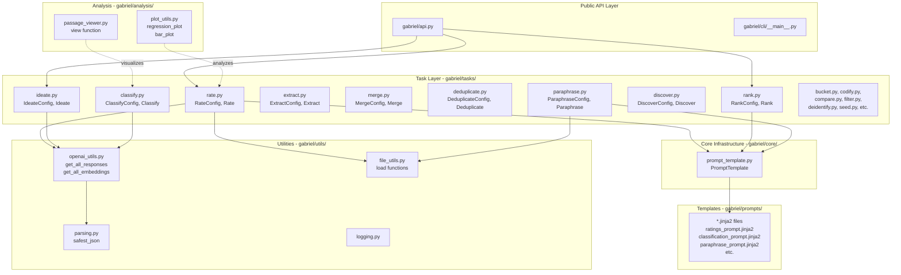
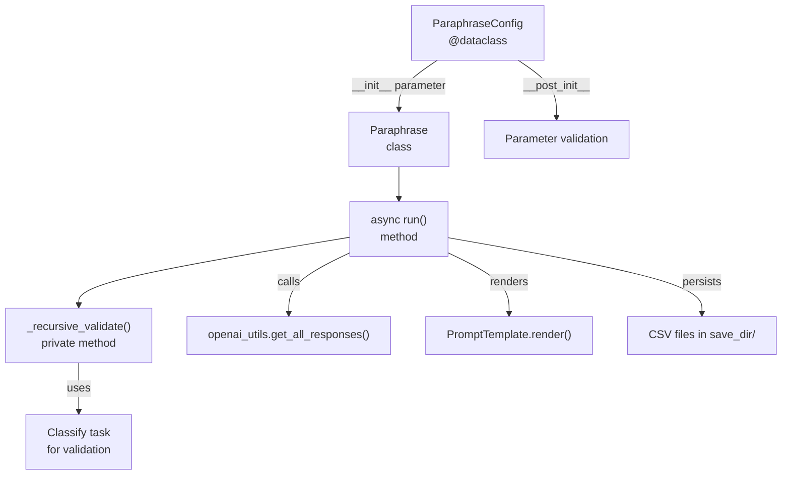
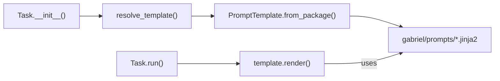
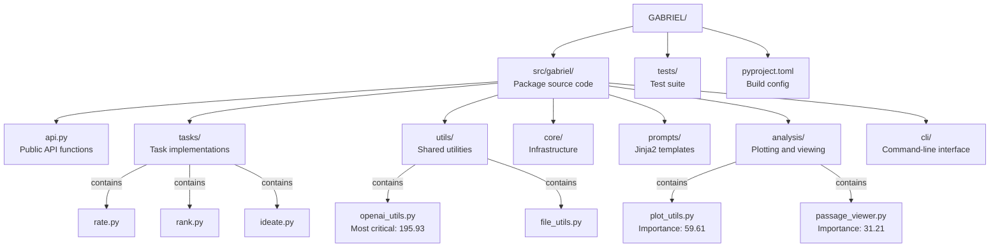

<!-- source: DeepWiki mcp.deepwiki.com · repo openai/GABRIEL · page 13.2 Project Structure · fetched 2026-10-26 -->

# Project Structure

<details>
<summary>Relevant source files</summary>

The following files were used as context for generating this wiki page:

- [pyproject.toml](pyproject.toml)
- [src/gabriel/_version.py](src/gabriel/_version.py)
- [src/gabriel/prompts/paraphrase_prompt.jinja2](src/gabriel/prompts/paraphrase_prompt.jinja2)
- [src/gabriel/tasks/paraphrase.py](src/gabriel/tasks/paraphrase.py)
- [tests/test_basic.py](tests/test_basic.py)

</details>


This page documents the physical organization of the GABRIEL codebase, including the package layout, build system configuration, module structure, and key directories. For information about the logical architecture and how components interact, see [Core Architecture](#3). For details about specific subsystems, see their respective pages in the table of contents.

---

## Package Layout

GABRIEL follows a standard Python package layout with source code under `src/` and tests under `tests/`. The package is distributed as `openai-gabriel` on PyPI but imported as `gabriel` in Python code.

```
GABRIEL/
├── src/
│   └── gabriel/
│       ├── __init__.py           # Public API exports
│       ├── _version.py           # Version string
│       ├── api.py                # User-facing functions
│       ├── cli/                  # Command-line interface
│       ├── core/                 # Shared infrastructure
│       ├── tasks/                # Task implementations
│       ├── utils/                # Utilities and helpers
│       ├── prompts/              # Jinja2 templates
│       └── analysis/             # Analysis tools
├── tests/                        # Test suite
├── pyproject.toml                # Build configuration
├── README.md
└── LICENSE
```

**Sources:** [pyproject.toml:91-97]()

---

## Build System Configuration

GABRIEL uses a modern Python build system based on PEP 517/518 standards. The `pyproject.toml` file defines all build and package metadata.

### Build Backend

The project uses `setuptools>=64` as the build backend with a `pyproject.toml`-first configuration approach (no `setup.py` required).

```toml
[build-system]
requires = ["setuptools>=64"]
build-backend = "setuptools.build_meta"
```

**Sources:** [pyproject.toml:1-3]()

### Package Metadata

| Field | Value | Purpose |
|-------|-------|---------|
| Package name (PyPI) | `openai-gabriel` | Distribution name |
| Import name | `gabriel` | Python import |
| Version | `1.0.7` | Semantic version |
| Python requirement | `>=3.7` | Minimum Python version |
| License | Apache 2.0 | Open source license |

The version is also stored separately in `src/gabriel/_version.py` for runtime access.

**Sources:** [pyproject.toml:6-15](), [src/gabriel/_version.py:1]()

### Dependency Categories

GABRIEL declares three categories of dependencies:

**Core Dependencies (always installed):**
- `openai>=1.0.0` - LLM API client
- `pandas>=1.0.0` - DataFrame operations
- `numpy>=1.18.0` - Numerical arrays
- `Jinja2>=3.0.0` - Template rendering
- `tqdm>=4.40.0` - Progress bars
- `aiohttp>=3.7.0`, `aiolimiter>=1.0.0`, `httpx>=0.23.0` - Async HTTP
- `matplotlib>=3.6.0`, `plotly>=5.0.0` - Plotting
- `statsmodels>=0.14.0`, `scipy>=1.8.0` - Statistics
- `tiktoken>=0.2.0` - Token counting
- `pydantic>=1.10.0` - Data validation
- `pypdf>=4.0.0`, `python-docx>=1.1.0` - Document parsing

**Optional Dependencies (install with extras):**
- `dev` - Testing and linting (`pytest`, `ruff`, `mypy`, etc.)
- `analysis` - Additional analysis tools (`tabulate`)
- `notebook` - Jupyter notebook support (`ipython`)

**Sources:** [pyproject.toml:46-80]()

### Command-Line Entry Point

The package registers a `gabriel` CLI command that invokes `gabriel.cli.__main__:main`:

```toml
[project.scripts]
gabriel = "gabriel.cli.__main__:main"
```

**Sources:** [pyproject.toml:88-89]()

---

## Module Organization

The following diagram maps GABRIEL's logical layers to physical directories and key files:

**Diagram: Module-to-File Mapping**



**Sources:** [pyproject.toml:91-100]()

### Core Modules

**`gabriel/api.py`**
- Exports all public functions (`gabriel.rate`, `gabriel.rank`, etc.)
- Routes function calls to task implementations
- Handles parameter validation at the API boundary
- See [API Layer and Function Router](#3.2) for details

**`gabriel/core/`**
- `prompt_template.py` - Template loading and rendering system
- Shared infrastructure used by all tasks
- See [Task System Architecture](#3.3) for details

**`gabriel/utils/`**
- `openai_utils.py` - LLM orchestration engine (195.93 importance)
- `file_utils.py` - File loading and aggregation
- `parsing.py` - JSON extraction and parsing
- `logging.py` - Logging and progress reporting
- See [LLM Orchestration Infrastructure](#3.1) for details

**Sources:** See high-level architecture diagrams

---

## Task Implementation Pattern

All tasks follow a consistent structure. Each task module contains:

1. **Config dataclass** - Defines parameters with validation
2. **Task class** - Implements business logic
3. **`run()` method** - Async entry point returning a DataFrame

The `paraphrase.py` file illustrates this pattern:

**Diagram: Task Module Structure (paraphrase.py example)**



**Sources:** [src/gabriel/tasks/paraphrase.py:28-104]()

### Config Dataclass Pattern

Every task config follows this structure:

```python
@dataclass
class ParaphraseConfig:
    # Required parameters
    instructions: str
    
    # Optional parameters with defaults
    revised_column_name: Optional[str] = None
    n_rounds: int = 1
    
    # Infrastructure parameters
    save_dir: str = "paraphrase"
    file_name: str = "paraphrase_responses.csv"
    model: str = "gpt-5-mini"
    n_parallels: int = 650
    use_dummy: bool = False
    
    def __post_init__(self) -> None:
        # Validation logic
        ...
```

The `__post_init__` method validates and normalizes parameters after initialization.

**Sources:** [src/gabriel/tasks/paraphrase.py:28-104]()

### Task Class Pattern

```python
class Paraphrase:
    def __init__(
        self,
        cfg: ParaphraseConfig,
        template: Optional[PromptTemplate] = None,
        template_path: Optional[str] = None,
    ) -> None:
        self.cfg = cfg
        self.template = resolve_template(...)
    
    async def run(
        self,
        df: pd.DataFrame,
        column_name: str,
        *,
        reset_files: bool = False,
        **kwargs: Any,
    ) -> pd.DataFrame:
        # 1. Prepare data
        # 2. Render prompts
        # 3. Call get_all_responses()
        # 4. Parse responses
        # 5. Persist results
        # 6. Return DataFrame
        ...
```

**Sources:** [src/gabriel/tasks/paraphrase.py:106-298]()

---

## Template System

Jinja2 templates are stored in `gabriel/prompts/` and loaded via the `PromptTemplate` class. Each task typically has a corresponding `.jinja2` file.

### Template Structure

Templates are declaratively configured in `pyproject.toml` as package data:

```toml
[tool.setuptools.package-data]
"gabriel.prompts" = ["*.jinja2"]
```

This ensures templates are included in the distribution package.

**Sources:** [pyproject.toml:99-100]()

### Example Template

The `paraphrase_prompt.jinja2` template demonstrates the pattern:

```jinja2

{{ snip.single_entry(modality, text) }}

Task: rewrite the provided content according to the instructions below.

BEGIN INSTRUCTIONS
{{ instructions }}
END INSTRUCTIONS

Modality guidance:
- text: paraphrase/consolidate/modify the text
- entity: rewrite the entity name consistently
- web: paraphrase web content found for the search term
- image/audio/pdf: paraphrase/summarize observed content


Always output JSON only in the indicated format.

Always output plain text only.

```

Templates use:
- Variable interpolation (`{{ instructions }}`)
- Conditional rendering (``)
- Template imports (``)

**Sources:** [src/gabriel/prompts/paraphrase_prompt.jinja2:1-23]()

**Diagram: Template Loading Flow**



**Sources:** [src/gabriel/tasks/paraphrase.py:119-123]()

---

## Test Organization

Tests are organized in the `tests/` directory with a flat structure. The main test file is `test_basic.py`, which contains unit and integration tests for core functionality.

### Test Structure

Tests use `pytest` with async support (`pytest-asyncio`) and follow naming conventions:

- `test_<functionality>_<scenario>` for individual test cases
- `test_<task>_<feature>` for task-specific tests

Example test categories from `test_basic.py`:

| Test Category | Example Function | Purpose |
|---------------|------------------|---------|
| Core utilities | `test_decide_default_max_output_tokens_respects_user_choice` | Validate token calculation |
| Web search | `test_build_params_embeds_web_search_tool_payload` | Verify API parameter construction |
| Prompt templates | `test_prompt_template` | Template rendering |
| Dummy mode | `test_get_response_dummy` | Test infrastructure without API calls |
| Task execution | `test_ratings_dummy` | Task-level integration tests |
| Error handling | `test_cap_adjustment_error_is_reported_and_recovers` | Resilience testing |

**Sources:** [tests/test_basic.py:25-1149]()

### Dummy Mode for Testing

GABRIEL provides a `use_dummy=True` parameter that generates synthetic responses without making API calls. This is used extensively in tests:

```python
def test_ratings_dummy(tmp_path):
    cfg = RateConfig(
        attributes={"helpfulness": ""},
        save_dir=str(tmp_path),
        file_name="ratings.csv",
        use_dummy=True
    )
    task = Rate(cfg)
    data = pd.DataFrame({"text": ["hello"]})
    df = asyncio.run(task.run(data, column_name="text"))
    assert "helpfulness" in df.columns
```

**Sources:** [tests/test_basic.py:822-829]()

### Test Fixtures and Helpers

Tests use:
- `tmp_path` - Pytest fixture for temporary directories
- `monkeypatch` - Mocking dependencies
- `capsys` - Capturing stdout for validation
- `asyncio.run()` - Running async functions in tests

**Sources:** [tests/test_basic.py:1-23]()

---

## Key Directories and Their Roles

**Diagram: Directory Responsibilities**



**Sources:** [pyproject.toml:91-100]()

### Runtime Save Directory Structure

When tasks execute, they create output directories with a standardized structure:

```
<save_dir>/
├── <file_name>.csv                    # Final results
├── <file_name>_raw_responses.csv      # Raw API responses
├── <file_name>_full_disaggregated.csv # Per-run breakdown (if n_runs > 1)
├── <file_name>_checkpoint.csv         # Resumption checkpoint
└── validation/                        # Validation outputs (if applicable)
    └── classification_*.csv
```

See [Save Directory Structure](#12.1) for details.

**Sources:** See Task System Architecture documentation

---

## Version Management

Version information is maintained in two locations:

1. **`pyproject.toml`** - Distribution version for PyPI
   ```toml
   [project]
   version = "1.0.7"
   ```

2. **`src/gabriel/_version.py`** - Runtime version string
   ```python
   __version__ = "1.0.7"
   ```

Both must be updated together when releasing new versions. The version follows semantic versioning (MAJOR.MINOR.PATCH).

**Sources:** [pyproject.toml:7](), [src/gabriel/_version.py:1]()

---

## Import Hierarchy and Circular Dependencies

GABRIEL carefully manages imports to avoid circular dependencies. The import hierarchy flows downward:

```
gabriel.api
  └─> gabriel.tasks.*
        └─> gabriel.core.*
        └─> gabriel.utils.*
              └─> (external dependencies)
```

- **`api.py`** imports task classes but tasks never import `api.py`
- **Task modules** may import other tasks for composition (e.g., `paraphrase.py` imports `classify.py` for validation)
- **`utils/`** modules never import from tasks or api
- **`core/`** modules only import from utils and external dependencies

**Sources:** [src/gabriel/tasks/paraphrase.py:22-25]()

---

## Development Workflow

### Running Tests

```bash
# Install with dev dependencies
pip install -e ".[dev]"

# Run all tests
pytest

# Run with coverage
pytest --cov=gabriel --cov-report=html

# Run specific test
pytest tests/test_basic.py::test_ratings_dummy -v
```

**Sources:** [pyproject.toml:66-74]()

### Building the Package

```bash
# Install build tool
pip install build

# Build distribution
python -m build

# Creates dist/openai_gabriel-1.0.7-py3-none-any.whl
#     and dist/openai-gabriel-1.0.7.tar.gz
```

**Sources:** [pyproject.toml:1-3]()

### Installing from Source

```bash
# Development install (editable)
pip install -e .

# With optional dependencies
pip install -e ".[dev,analysis,notebook]"
```

**Sources:** [pyproject.toml:66-80]()