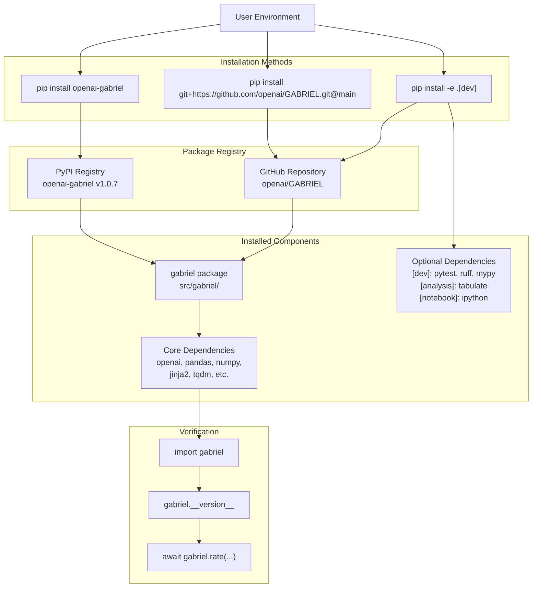
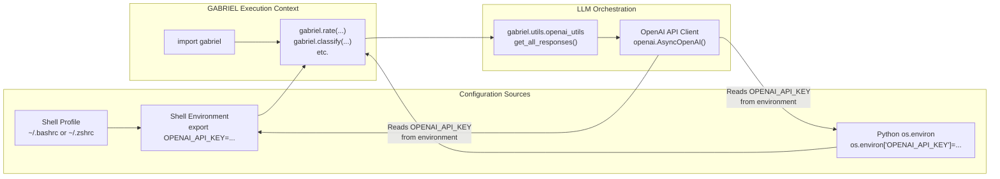
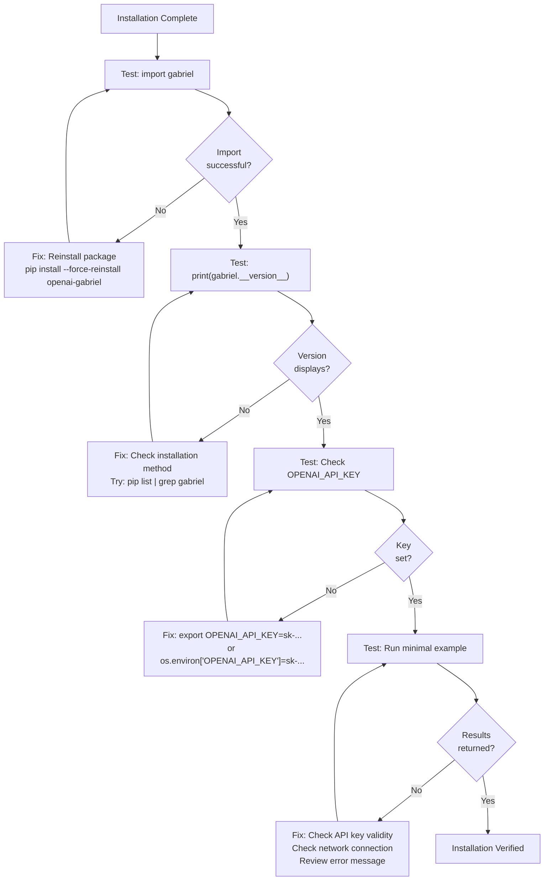

<!-- source: DeepWiki mcp.deepwiki.com · repo openai/GABRIEL · page 2 Installation and Setup · fetched 2026-10-26 -->

# Installation and Setup

<details>
<summary>Relevant source files</summary>

The following files were used as context for generating this wiki page:

- [README.md](README.md)
- [pyproject.toml](pyproject.toml)
- [src/gabriel/_version.py](src/gabriel/_version.py)

</details>


## Purpose and Scope

This page provides instructions for installing GABRIEL, configuring API credentials, and verifying the installation is working correctly. It covers system requirements, installation methods (PyPI, GitHub, development mode), API key configuration, and dependency management.

For information about the overall system architecture and how components interact, see [Core Architecture](#3). For development-specific setup including testing and contributing, see [Development and Contributing](#13).

---

## System Requirements

GABRIEL requires Python 3.7 or higher and is compatible with major operating systems (Linux, macOS, Windows).

**Python Version Requirement:**

| Requirement | Value |
|-------------|-------|
| Minimum Python | 3.7 |
| Supported versions | 3.7, 3.8, 3.9, 3.10, 3.11, 3.12 |
| Package name | `openai-gabriel` |
| Current version | 1.0.7 |

**Sources:** [pyproject.toml:15](), [pyproject.toml:37-42](), [src/gabriel/_version.py:1]()

---

## Installation Methods

### Standard Installation (PyPI)

The recommended installation method is via PyPI using `pip`:

```bash
pip install openai-gabriel
```

This installs the core GABRIEL package with all required dependencies. After installation, import the library in Python:

```python
import gabriel
```

**Sources:** [README.md:75](), [pyproject.toml:6]()

### GitHub Installation (Latest Development Version)

To install the latest development version directly from the GitHub repository:

```bash
pip install \
  --force-reinstall \
  git+https://github.com/openai/GABRIEL.git@main
```

The `--force-reinstall` flag ensures you get the latest version even if GABRIEL is already installed.

**Sources:** [README.md:78-80]()

### Development Installation

For contributors or users who want to modify GABRIEL's source code, install in editable mode with development extras:

```bash
# Clone the repository
git clone https://github.com/openai/GABRIEL.git
cd GABRIEL

# Install in editable mode with development dependencies
pip install -e .[dev]
```

This installs additional tools for testing, linting, and type checking (pytest, ruff, mypy).

**Sources:** [README.md:180](), [pyproject.toml:67-74]()

### Installation Flow Diagram



**Sources:** [pyproject.toml:1-101](), [README.md:74-83]()

---

## Core Dependencies

GABRIEL has several categories of dependencies that are automatically installed with the core package:

### LLM and API Infrastructure

| Package | Version | Purpose |
|---------|---------|---------|
| `openai` | >=1.0.0 | OpenAI API client for LLM interactions |
| `aiohttp` | >=3.7.0 | Async HTTP for concurrent API calls |
| `aiolimiter` | >=1.0.0 | Rate limiting for API requests |
| `httpx` | >=0.23.0 | Alternative HTTP client with timeout support |
| `tiktoken` | >=0.2.0 | Token counting for prompt construction |

### Data Processing

| Package | Version | Purpose |
|---------|---------|---------|
| `pandas` | >=1.0.0 | DataFrame manipulation and CSV I/O |
| `numpy` | >=1.18.0 | Numerical operations |
| `scipy` | >=1.8.0 | Statistical computations |
| `statsmodels` | >=0.14.0 | Regression analysis in plot_utils |

### Template and Output Handling

| Package | Version | Purpose |
|---------|---------|---------|
| `Jinja2` | >=3.0.0 | Prompt template rendering |
| `pydantic` | >=1.10.0 | Config validation via dataclasses |
| `tqdm` | >=4.40.0 | Progress bars for long-running tasks |

### Multimodal and Visualization

| Package | Version | Purpose |
|---------|---------|---------|
| `pypdf` | >=4.0.0 | PDF text extraction |
| `python-docx` | >=1.1.0 | Word document processing |
| `plotly` | >=5.0.0 | Interactive visualizations |
| `matplotlib` | >=3.6.0 | Statistical plots in plot_utils |
| `requests` | >=2.0.0 | HTTP requests for web search |

**Sources:** [pyproject.toml:46-64]()

### Optional Dependencies

Optional dependency groups can be installed with bracket notation:

```bash
# Development tools (testing, linting, type checking)
pip install openai-gabriel[dev]

# Analysis tools (tabulate for LaTeX tables)
pip install openai-gabriel[analysis]

# Notebook support (IPython for interactive viewing)
pip install openai-gabriel[notebook]

# Multiple groups
pip install openai-gabriel[dev,analysis,notebook]
```

**Sources:** [pyproject.toml:66-80]()

### Dependency Architecture

```mermaid
graph TB
    subgraph "Core Package"
        Gabriel["gabriel package<br/>pyproject.toml:name=openai-gabriel"]
    end
    
    subgraph "LLM Infrastructure Layer"
        OpenAIClient["openai>=1.0.0<br/>API client"]
        AsyncHTTP["aiohttp>=3.7.0<br/>httpx>=0.23.0<br/>Concurrent requests"]
        RateLimit["aiolimiter>=1.0.0<br/>Rate limiting"]
        Tokens["tiktoken>=0.2.0<br/>Token counting"]
    end
    
    subgraph "Data Processing Layer"
        DataFrames["pandas>=1.0.0<br/>DataFrames"]
        Numerical["numpy>=1.18.0<br/>scipy>=1.8.0<br/>Numerical ops"]
        Stats["statsmodels>=0.14.0<br/>Regressions"]
    end
    
    subgraph "Template and Config Layer"
        Templates["Jinja2>=3.0.0<br/>Prompt rendering"]
        Validation["pydantic>=1.10.0<br/>Config validation"]
        Progress["tqdm>=4.40.0<br/>Progress tracking"]
    end
    
    subgraph "Multimodal Layer"
        PDFs["pypdf>=4.0.0<br/>python-docx>=1.1.0<br/>Document extraction"]
        Plots["matplotlib>=3.6.0<br/>plotly>=5.0.0<br/>Visualizations"]
        Web["requests>=2.0.0<br/>Web search"]
    end
    
    subgraph "Optional Dependencies"
        Dev["[dev]<br/>pytest, ruff, mypy"]
        Analysis["[analysis]<br/>tabulate"]
        Notebook["[notebook]<br/>ipython"]
    end
    
    Gabriel --> OpenAIClient
    Gabriel --> AsyncHTTP
    Gabriel --> RateLimit
    Gabriel --> Tokens
    Gabriel --> DataFrames
    Gabriel --> Numerical
    Gabriel --> Stats
    Gabriel --> Templates
    Gabriel --> Validation
    Gabriel --> Progress
    Gabriel --> PDFs
    Gabriel --> Plots
    Gabriel --> Web
    
    Gabriel -.->|optional| Dev
    Gabriel -.->|optional| Analysis
    Gabriel -.->|optional| Notebook
```



**Sources:** [pyproject.toml:46-80]()

---

## API Key Configuration

GABRIEL requires an OpenAI API key to make LLM requests. The key must be set before executing any GABRIEL tasks.

### Environment Variable (Recommended)

Set the `OPENAI_API_KEY` environment variable in your shell:

```bash
export OPENAI_API_KEY="sk-..."
```

This makes the key available to all Python processes in that shell session.

**Sources:** [README.md:88]()

### Python Environment (Notebooks)

In Jupyter notebooks or interactive Python sessions, set the environment variable programmatically:

```python
import os
os.environ['OPENAI_API_KEY'] = "sk-..."
```

This must be executed before importing or using GABRIEL functions.

**Sources:** [README.md:89]()

### Persistent Configuration

For persistent configuration across sessions, add the export statement to your shell profile:

```bash
# For bash
echo 'export OPENAI_API_KEY="sk-..."' >> ~/.bashrc

# For zsh
echo 'export OPENAI_API_KEY="sk-..."' >> ~/.zshrc

# Then reload
source ~/.bashrc  # or source ~/.zshrc
```

### API Key Flow



**Sources:** [README.md:86-90]()

---

## Verifying Installation

### Basic Import Test

Verify GABRIEL is installed correctly by importing the package:

```python
import gabriel

# Check version
print(gabriel.__version__)  # Should print: 1.0.7
```

If the import succeeds without errors, the core package is installed correctly.

**Sources:** [README.md:82](), [src/gabriel/_version.py:1]()

### Minimal Working Example

The following minimal example verifies the full pipeline (API key, dependencies, LLM orchestration):

```python
import os
import pandas as pd
import gabriel

# Set API key (if not already in environment)
# os.environ['OPENAI_API_KEY'] = "sk-..."

# Create toy dataset
toy_data = pd.DataFrame({
    "entity": [
        "turkey",
        "pumpkin pie",
        "green bean casserole",
        "cornbread",
    ]
})

# Define attributes
attributes = {
    "savory taste": "How savory the dish is",
    "sweet taste": "Dessert-like sweetness",
    "tangy taste": "Notes of tartness or acidity",
}

# Run rating task
rate_results = await gabriel.rate(
    toy_data,
    column_name="entity",
    attributes=attributes,
    save_dir=os.path.expanduser("~/Documents/gabriel_runs/toy_rate"),
    model="gpt-5-mini",
    n_runs=1,
    modality="entity",
    reset_files=True,
)

# View results
print(rate_results.head())
```

**Expected output:** A DataFrame with columns for each attribute (`savory taste`, `sweet taste`, `tangy taste`) containing 0-100 ratings.

**Sources:** [README.md:96-130]()

### Running in Different Environments

**Jupyter Notebook / Google Colab:**
The example above works directly in notebook cells, as notebooks support top-level `await`.

**Python Script:**
Wrap the async call with `asyncio.run()`:

```python
import asyncio

# ... (same setup as above)

rate_results = asyncio.run(gabriel.rate(
    toy_data,
    column_name="entity",
    attributes=attributes,
    save_dir=os.path.expanduser("~/Documents/gabriel_runs/toy_rate"),
    model="gpt-5-mini",
    n_runs=1,
    modality="entity",
    reset_files=True,
))
```

**Sources:** [README.md:133]()

### Verification Checklist



**Sources:** [README.md:74-133]()

---

## Common Installation Issues

### Issue: `ModuleNotFoundError: No module named 'gabriel'`

**Cause:** Package not installed or installed in different Python environment.

**Fix:**
```bash
# Check which Python pip is using
which pip
which python

# Ensure pip matches your Python environment
python -m pip install openai-gabriel

# Or use pip3 explicitly
pip3 install openai-gabriel
```

### Issue: `ImportError: cannot import name 'AsyncOpenAI'`

**Cause:** Outdated `openai` package (version <1.0.0).

**Fix:**
```bash
pip install --upgrade openai>=1.0.0
```

**Sources:** [pyproject.toml:47]()

### Issue: API Key Not Found

**Error message:** `AuthenticationError` or `OpenAI API key not found`

**Fix:**
1. Verify key is set: `echo $OPENAI_API_KEY` (bash) or `print(os.environ.get('OPENAI_API_KEY'))` (Python)
2. Ensure key starts with `sk-`
3. Set key before importing GABRIEL
4. For notebooks, set in same cell or earlier cell

**Sources:** [README.md:86-90]()

### Issue: Dependency Conflicts

**Cause:** Conflicting package versions in environment.

**Fix:**
```bash
# Create fresh virtual environment
python -m venv gabriel_env
source gabriel_env/bin/activate  # On Windows: gabriel_env\Scripts\activate

# Install GABRIEL
pip install openai-gabriel
```

### Issue: Development Mode Installation Not Working

**Cause:** Missing build dependencies or incorrect directory.

**Fix:**
```bash
# Ensure you're in repository root
cd GABRIEL

# Check pyproject.toml exists
ls pyproject.toml

# Install build dependencies first
pip install --upgrade setuptools build

# Then install in editable mode
pip install -e .[dev]
```

**Sources:** [pyproject.toml:1-3](), [README.md:180]()

---

## Next Steps

After successful installation and verification:

1. **Learn Core Concepts:** Read [Core Architecture](#3) to understand how GABRIEL's layers interact
2. **Run Your First Task:** See [gabriel.rate - Absolute Scoring](#4.1) for detailed usage examples
3. **Explore Tutorials:** Work through the Colab notebook referenced in [README.md:5]()
4. **Configure Advanced Options:** See [Advanced Configuration](#10) for customization

For troubleshooting runtime issues related to rate limiting, retries, or checkpointing, see [Operational Topics](#12).

**Sources:** [README.md:1-197](), [pyproject.toml:1-101]()

---

