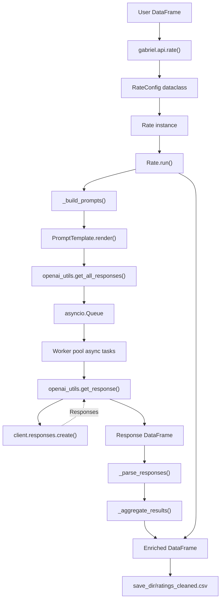
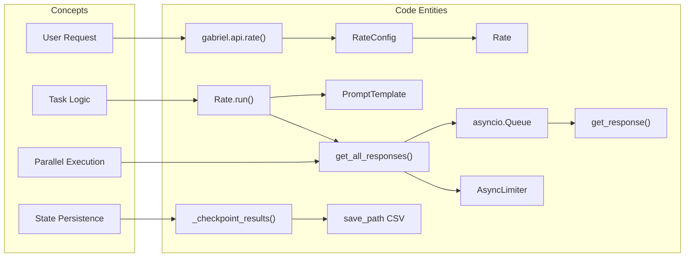
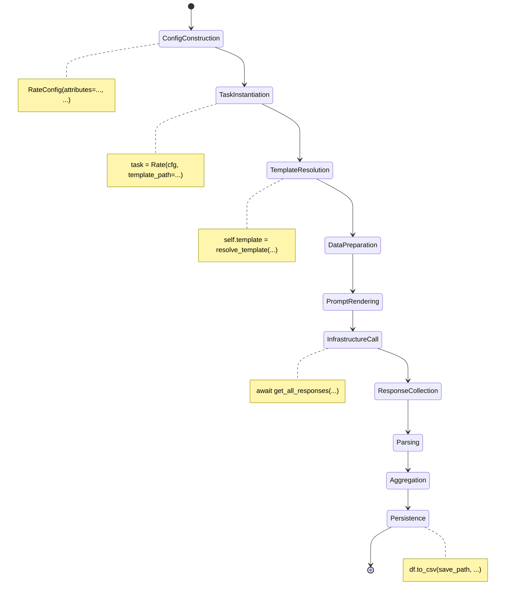

<!-- source: DeepWiki mcp.deepwiki.com · repo openai/GABRIEL · page 3 Core Architecture · fetched 2026-10-26 -->

# Core Architecture

<details>
<summary>Relevant source files</summary>

The following files were used as context for generating this wiki page:

- [src/gabriel/api.py](src/gabriel/api.py)
- [src/gabriel/prompts/paraphrase_prompt.jinja2](src/gabriel/prompts/paraphrase_prompt.jinja2)
- [src/gabriel/tasks/paraphrase.py](src/gabriel/tasks/paraphrase.py)
- [src/gabriel/utils/openai_utils.py](src/gabriel/utils/openai_utils.py)
- [src/gabriel/utils/parsing.py](src/gabriel/utils/parsing.py)
- [tests/test_basic.py](tests/test_basic.py)

</details>


## Purpose and Scope

This page provides an overview of GABRIEL's three-layer architecture: the **API Layer**, the **Task Execution Layer**, and the **Infrastructure Layer**. It explains how user requests flow through public API functions, are routed to task-specific implementations, and ultimately execute via the centralized LLM orchestration infrastructure.

For detailed information about specific layers, see:
- LLM orchestration engine implementation: [LLM Orchestration Infrastructure](#3.1)
- Public API function signatures and routing logic: [API Layer and Function Router](#3.2)
- Task system patterns and lifecycle: [Task System Architecture](#3.3)

---

## Architectural Overview

GABRIEL is organized into three distinct layers that separate concerns and provide clean abstraction boundaries:

| Layer | Primary Components | Responsibility |
|-------|-------------------|----------------|
| **API Layer** | `gabriel.api`, CLI | User-facing functions that accept natural language parameters |
| **Task Execution Layer** | Task classes (`Rate`, `Rank`, `Classify`, etc.) | Prompt construction, response parsing, result aggregation |
| **Infrastructure Layer** | `openai_utils`, `parsing` | LLM communication, concurrency, rate limiting, error handling, checkpointing |

Each layer communicates through well-defined interfaces. User code never directly interacts with the infrastructure layer; all LLM calls are mediated by task implementations that delegate to `openai_utils.get_all_responses()`.

**Sources:** [src/gabriel/api.py](), [src/gabriel/utils/openai_utils.py:1-100](), System Architecture Diagrams

---

## Three-Layer Architecture Diagram

```mermaid
graph TB
    subgraph "API_Layer[API Layer - gabriel.api]"
        rate_fn["gabriel.rate()"]
        classify_fn["gabriel.classify()"]
        rank_fn["gabriel.rank()"]
        extract_fn["gabriel.extract()"]
        merge_fn["gabriel.merge()"]
        dedupe_fn["gabriel.deduplicate()"]
        ideate_fn["gabriel.ideate()"]
        discover_fn["gabriel.discover()"]
        other_fn["...other API functions"]
    end
    
    subgraph "Task_Layer[Task Execution Layer - gabriel.tasks.*]"
        RateTask["Rate"]
        ClassifyTask["Classify"]
        RankTask["Rank"]
        ExtractTask["Extract"]
        MergeTask["Merge"]
        DedupeTask["Deduplicate"]
        IdeateTask["Ideate"]
        DiscoverTask["Discover"]
        
        RateConfig["RateConfig"]
        ClassifyConfig["ClassifyConfig"]
        RankConfig["RankConfig"]
        OtherConfigs["...other Config dataclasses"]
        
        PromptTemplate["PromptTemplate"]
    end
    
    subgraph "Infra_Layer[Infrastructure Layer - gabriel.utils.*]"
        get_all_responses["get_all_responses()"]
        get_response["get_response()"]
        RateLimiter["AsyncLimiter"]
        ErrorHandler["Error Classification & Retry"]
        Checkpointer["Checkpoint Manager"]
        parsing["parse_json_with_status()"]
    end
    
    subgraph "External[External Services]"
        OpenAI_API["OpenAI Responses API"]
    end
    
    rate_fn --> RateConfig
    classify_fn --> ClassifyConfig
    rank_fn --> RankConfig
    
    RateConfig --> RateTask
    ClassifyConfig --> ClassifyTask
    RankConfig --> RankTask
    
    RateTask --> PromptTemplate
    ClassifyTask --> PromptTemplate
    RankTask --> PromptTemplate
    
    RateTask --> get_all_responses
    ClassifyTask --> get_all_responses
    RankTask --> get_all_responses
    ExtractTask --> get_all_responses
    MergeTask --> get_all_responses
    DedupeTask --> get_all_responses
    IdeateTask --> get_all_responses
    DiscoverTask --> get_all_responses
    
    get_all_responses --> get_response
    get_all_responses --> RateLimiter
    get_all_responses --> ErrorHandler
    get_all_responses --> Checkpointer
    
    get_response --> OpenAI_API
    get_all_responses --> parsing
    
    OpenAI_API -.->|"Responses"| get_response
```



**Sources:** [src/gabriel/api.py:1-71](), [src/gabriel/tasks/](), [src/gabriel/utils/openai_utils.py:1-100]()

---

## Request Flow Lifecycle

A typical GABRIEL operation follows this sequence:

### 1. User Invocation (API Layer)

User calls an async function from `gabriel.api`:

```python
result = await gabriel.rate(
    df=data,
    column_name="text",
    attributes={"clarity": "Is the text clear and understandable?"},
    save_dir="output/",
    model="gpt-5-mini"
)
```

**Sources:** [src/gabriel/api.py:105-215]()

### 2. Configuration Construction

The API function constructs a configuration dataclass and instantiates the corresponding task class:

```python
cfg = RateConfig(
    attributes=attributes,
    save_dir=save_dir,
    model=model,
    n_parallels=n_parallels,
    ...
)
task = Rate(cfg, template_path=template_path)
```

**Sources:** [src/gabriel/api.py:195-209](), [src/gabriel/tasks/rate.py]()

### 3. Task Execution

The task's `.run()` method orchestrates:
- Prompt construction using Jinja2 templates
- Identifier generation for tracking
- Delegation to `get_all_responses()`

**Sources:** [src/gabriel/tasks/rate.py](), [src/gabriel/core/prompt_template.py]()

### 4. Infrastructure Processing

`get_all_responses()` in `openai_utils`:
- Estimates tokens and cost
- Configures rate limiters
- Spawns worker pool (default: 650 parallel)
- Handles retries, checkpointing, error classification
- Returns DataFrame with responses

**Sources:** [src/gabriel/utils/openai_utils.py:1250-1700]()

### 5. Response Aggregation

The task parses LLM responses, aggregates across runs, and returns the enriched DataFrame.

**Sources:** [src/gabriel/tasks/rate.py](), [src/gabriel/utils/parsing.py:134-141]()

---

## Data Flow Through Code Entities



**Sources:** [src/gabriel/api.py:105-215](), [src/gabriel/tasks/rate.py](), [src/gabriel/utils/openai_utils.py:1250-1700]()

---

## Key Design Principles

### Separation of Concerns

Each layer has distinct responsibilities:

- **API Layer**: Parameter validation, user-friendly defaults
- **Task Layer**: Domain logic (prompt templates, parsing rules, aggregation strategies)
- **Infrastructure Layer**: Reliability (rate limiting, retries, concurrency, persistence)

This separation allows tasks to focus on *what* to compute while the infrastructure handles *how* to execute reliably at scale.

**Sources:** [src/gabriel/api.py:1-71](), [src/gabriel/utils/openai_utils.py:1-24]()

### Single Point of LLM Orchestration

All tasks funnel through `openai_utils.get_all_responses()`, which provides:

- Consistent rate limiting and retry logic
- Unified checkpoint/resume semantics
- Shared concurrency management
- Centralized error classification

This bottleneck pattern ensures all tasks benefit from infrastructure improvements without code duplication.

**Sources:** [src/gabriel/utils/openai_utils.py:1-100](), System Architecture Diagram 1

### Configuration-Driven Execution

Every task is configured through a dataclass (e.g., `RateConfig`, `ClassifyConfig`) that:

- Validates parameters in `__post_init__()`
- Encapsulates all task-specific settings
- Is easily serializable for provenance tracking

**Sources:** [src/gabriel/tasks/rate.py](), [src/gabriel/tasks/classify.py](), [tests/test_basic.py:823-828]()

### Template-Based Prompt Construction

Prompts are constructed via Jinja2 templates stored in `src/gabriel/prompts/`:

- `ratings_prompt.jinja2`
- `classification_prompt.jinja2`
- `paraphrase_prompt.jinja2`
- ...and others

Tasks call `PromptTemplate.render()` with context variables. Users can override templates via `template_path` parameter.

**Sources:** [src/gabriel/core/prompt_template.py](), [src/gabriel/prompts/paraphrase_prompt.jinja2:1-23](), [tests/test_basic.py:202-205]()

---

## Component Interaction Map

This diagram maps high-level concepts to specific code entities:



**Sources:** [src/gabriel/api.py:105-215](), [src/gabriel/tasks/rate.py](), [src/gabriel/utils/openai_utils.py:1250-1700]()

---

## Configuration Dataclass Pattern

All tasks follow a consistent configuration pattern. Each task has an associated `Config` dataclass:

| Task | Config Class | Key Parameters |
|------|--------------|----------------|
| Rate | `RateConfig` | `attributes`, `n_runs`, `n_attributes_per_run` |
| Classify | `ClassifyConfig` | `labels`, `differentiate`, `min_frequency` |
| Rank | `RankConfig` | `n_rounds`, `matches_per_round`, `power_matching` |
| Extract | `ExtractConfig` | `attributes`, `types` |
| Merge | `MergeConfig` | `left_on`, `right_on`, `strategy` |
| Deduplicate | `DeduplicateConfig` | `similarity_threshold`, `iterative` |

Configuration objects validate parameters in `__post_init__()` and are immutable after construction.

**Sources:** [src/gabriel/tasks/rate.py](), [src/gabriel/tasks/classify.py](), [src/gabriel/tasks/rank.py](), [src/gabriel/api.py:1-71]()

---

## Infrastructure Layer Core Functions

The infrastructure layer provides three primary entry points:

### `get_all_responses()`

Batch processing function that accepts lists of prompts and identifiers:

```python
df = await get_all_responses(
    prompts=["prompt1", "prompt2", ...],
    identifiers=["id1", "id2", ...],
    save_path="output/responses.csv",
    model="gpt-5-mini",
    n_parallels=650,
    ...
)
```

Returns DataFrame with columns: `Identifier`, `Response`, `Time Taken`, `Input Tokens`, `Output Tokens`, `Successful`, `Error Log`.

**Sources:** [src/gabriel/utils/openai_utils.py:1250-1280]()

### `get_response()`

Single-prompt function for individual requests:

```python
responses, duration = await get_response(
    prompt="...",
    model="gpt-5-mini",
    ...
)
```

Returns `(List[str], float)` tuple.

**Sources:** [src/gabriel/utils/openai_utils.py:1700-1850]()

### `parse_json_with_status()`

Response parsing with error reporting:

```python
parsed, success = parse_json_with_status(response_text)
```

Returns `(Optional[Union[dict, list]], bool)`.

**Sources:** [src/gabriel/utils/parsing.py:134-141]()

---

## Task Lifecycle

Every task follows this execution pattern:



**Sources:** [src/gabriel/tasks/rate.py](), [src/gabriel/tasks/paraphrase.py:125-298]()

---

## Extensibility Points

GABRIEL provides multiple levels of customization:

### Level 1: Natural Language Parameters

Users modify behavior through `additional_instructions`:

```python
await gabriel.rate(
    ...,
    additional_instructions="Focus on technical accuracy over readability"
)
```

**Sources:** [src/gabriel/api.py:111]()

### Level 2: Custom Templates

Users override default prompts via `template_path`:

```python
await gabriel.rate(
    ...,
    template_path="custom_rating_prompt.jinja2"
)
```

**Sources:** [src/gabriel/api.py:121](), [src/gabriel/core/prompt_template.py]()

### Level 3: Custom Response Functions

Users replace per-prompt LLM invocation:

```python
async def custom_llm(prompt: str, **kwargs):
    # Custom model call
    return ["response"]

await gabriel.rate(
    ...,
    response_fn=custom_llm
)
```

**Sources:** [src/gabriel/api.py:122](), [tests/test_basic.py:525-543]()

### Level 4: Custom Driver Functions

Users replace entire `get_all_responses()` logic:

```python
async def custom_driver(prompts, identifiers, **kwargs):
    # Custom batch processing
    return pd.DataFrame(...)

await gabriel.rate(
    ...,
    get_all_responses_fn=custom_driver
)
```

**Sources:** [src/gabriel/api.py:123](), [tests/test_basic.py:583-622]()

---

## Persistence Model

All tasks persist results to disk with consistent structure:

```
save_dir/
├── <file_name>_raw_responses.csv       # Raw API responses
├── <file_name>_cleaned.csv              # Aggregated results
├── <file_name>_full_disaggregated.csv  # Multi-run details (if n_runs > 1)
└── .checkpoint_<file_name>.pkl          # Resume state
```

The `save_dir` parameter controls output location. Setting `reset_files=True` ignores existing state and regenerates all outputs.

**Sources:** [src/gabriel/utils/openai_utils.py:1250-1280](), [tests/test_basic.py:831-838]()

---

## Summary

GABRIEL's three-layer architecture provides:

1. **Simple API surface** - Natural language parameters, sensible defaults
2. **Composable task system** - Mix simple tasks into complex pipelines (e.g., `ideate` = `seed` + `generate` + `rank` + `rate` + `deduplicate`)
3. **Robust infrastructure** - Rate limiting, retries, checkpointing, and concurrency management handled transparently

All layers communicate through well-defined interfaces, allowing each to evolve independently while maintaining backward compatibility.

**Sources:** [src/gabriel/api.py:1-71](), [src/gabriel/utils/openai_utils.py:1-100](), System Architecture Diagrams

---

