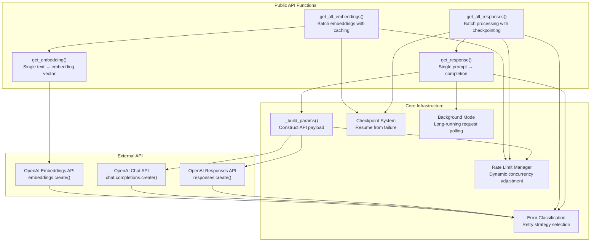
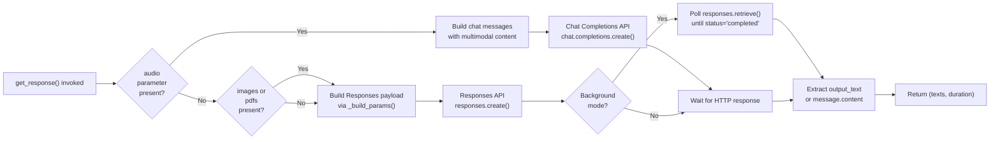
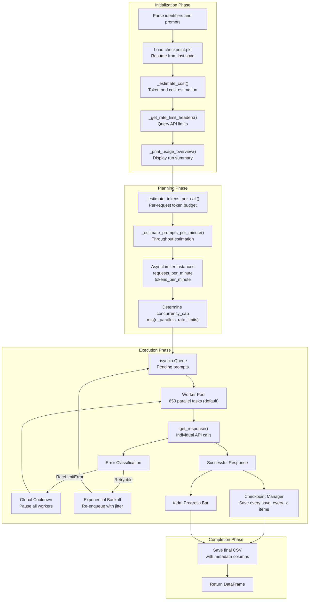
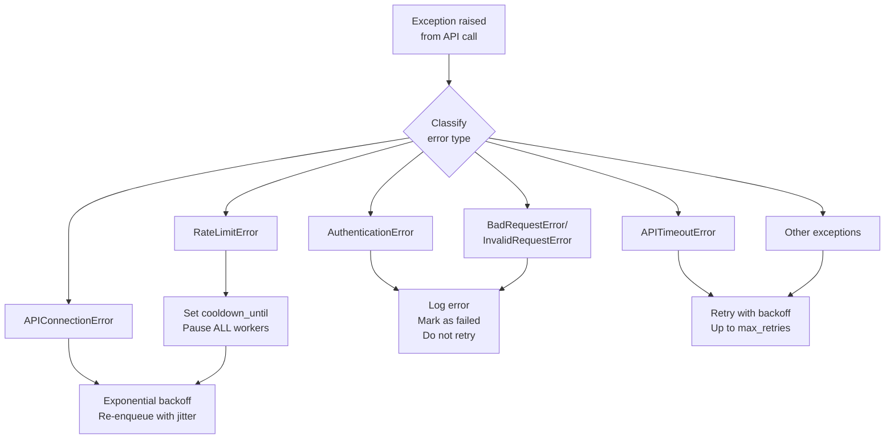
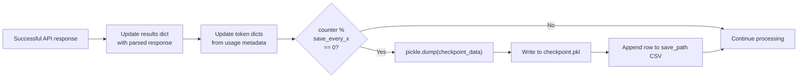
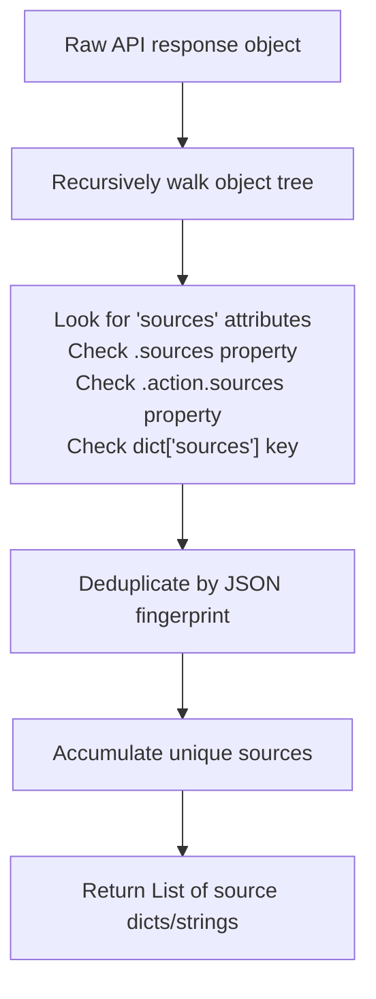
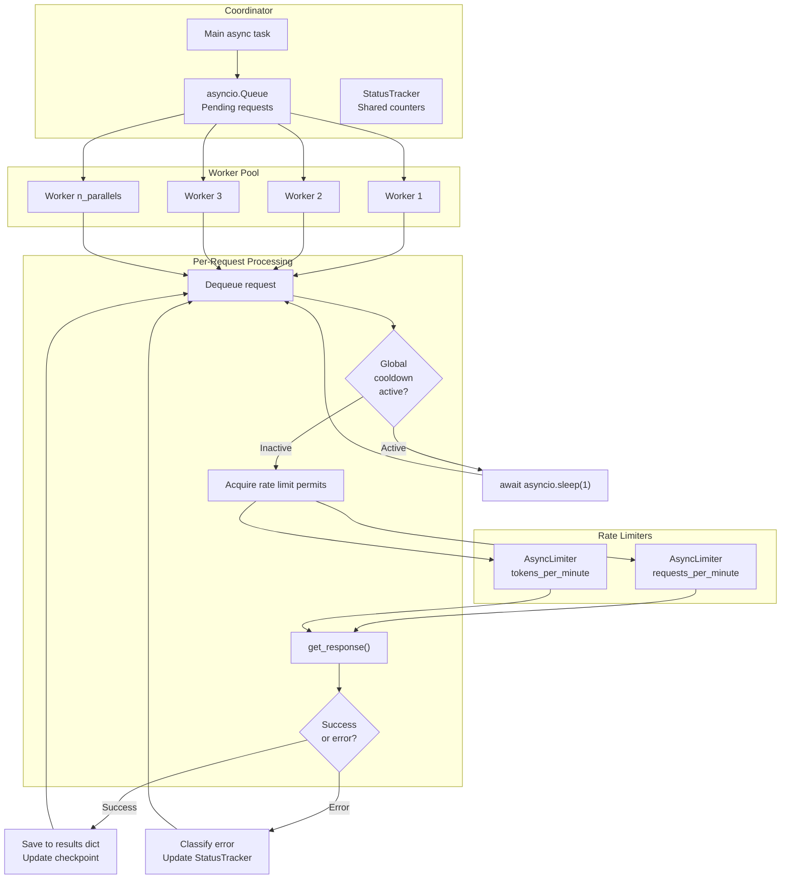

<!-- source: DeepWiki mcp.deepwiki.com · repo openai/GABRIEL · page 3.1 LLM Orchestration Infrastructure · fetched 2026-10-26 -->

# LLM Orchestration Infrastructure

<details>
<summary>Relevant source files</summary>

The following files were used as context for generating this wiki page:

- [src/gabriel/utils/openai_utils.py](src/gabriel/utils/openai_utils.py)
- [src/gabriel/utils/parsing.py](src/gabriel/utils/parsing.py)

</details>


This page documents the core infrastructure layer that powers all LLM interactions in GABRIEL. The `openai_utils` module serves as the single point of orchestration for every task in the system, providing rate limiting, concurrency management, retry logic, checkpointing, and fault tolerance.

For information about the high-level API functions that users interact with, see [API Layer and Function Router](#3.2). For details on how individual tasks use this infrastructure, see [Task System Architecture](#3.3).

---

## Purpose and Architecture

The `openai_utils` module ([src/gabriel/utils/openai_utils.py]()) is the most critical component in GABRIEL with an importance score of 195.93. Every task—from simple operations like `rate` and `classify` to complex multi-stage pipelines like `ideate` and `discover`—funnels through this module to interact with the OpenAI API.

**Key responsibilities:**
- Concurrent request execution (up to 650 parallel workers by default)
- Dynamic rate limiting based on API response headers
- Exponential backoff retry logic with jitter
- Automatic checkpointing for resumability
- Background polling for long-running requests
- Cost estimation and usage reporting
- Multimodal input handling (images, audio, PDFs)
- Web search integration

### High-Level Entry Points



**Sources:** [src/gabriel/utils/openai_utils.py:1672-2189](), [src/gabriel/utils/openai_utils.py:2250-2339](), [src/gabriel/utils/openai_utils.py:2342-2579]()

---

## Single Request Processing: `get_response()`

The `get_response()` function ([src/gabriel/utils/openai_utils.py:1672-2189]()) is the foundational async coroutine for sending a single prompt to the OpenAI API. It handles both the newer Responses API and the legacy Chat Completions API, automatically selecting the appropriate endpoint based on input modality.

### Function Signature and Key Parameters

| Parameter | Type | Default | Purpose |
|-----------|------|---------|---------|
| `prompt` | `str` | required | User question or instruction |
| `model` | `str` | `"gpt-5-mini"` | Model identifier |
| `n` | `int` | `1` | Number of parallel completions |
| `max_output_tokens` | `Optional[int]` | `None` | Output length cap |
| `timeout` | `Optional[float]` | `None` | Client-side timeout in seconds |
| `json_mode` | `bool` | `False` | Request structured JSON output |
| `web_search` | `bool` | `False` | Enable built-in web search tool |
| `reasoning_effort` | `Optional[str]` | `None` | Reasoning intensity (`"low"`, `"medium"`, `"high"`) |
| `images` | `Optional[List[str]]` | `None` | Base64-encoded images |
| `audio` | `Optional[List[Dict]]` | `None` | Audio input payloads |
| `pdfs` | `Optional[List[Dict]]` | `None` | PDF document payloads |
| `background_mode` | `Optional[bool]` | `None` | Enable background polling (auto-enabled when `timeout=None`) |

### API Routing Logic



**Sources:** [src/gabriel/utils/openai_utils.py:1935-2017](), [src/gabriel/utils/openai_utils.py:2018-2188]()

### Background Mode Polling

When `background_mode=True` or `timeout=None`, the function uses background polling ([src/gabriel/utils/openai_utils.py:1849-1930]()) to handle long-running requests that exceed typical HTTP connection timeouts:

1. Submit request with `background=True` parameter
2. Receive immediate response with `status="queued"` or `status="in_progress"`
3. Poll `responses.retrieve(response_id)` every `background_poll_interval` seconds (default: 10s)
4. Continue until `status="completed"` or timeout exceeded
5. Extract final result from completed response object

This prevents connection timeouts for requests that may take minutes to complete (e.g., deep research models with high reasoning effort).

**Sources:** [src/gabriel/utils/openai_utils.py:1849-1930](), [src/gabriel/utils/openai_utils.py:2116-2178]()

---

## Batch Processing: `get_all_responses()`

The `get_all_responses()` function ([src/gabriel/utils/openai_utils.py:2582-3638]()) orchestrates parallel execution of hundreds or thousands of prompts with sophisticated concurrency control, fault tolerance, and progress persistence.

### Core Architecture



**Sources:** [src/gabriel/utils/openai_utils.py:2582-3638]()

### Key Data Structures

#### StatusTracker

The `StatusTracker` dataclass ([src/gabriel/utils/openai_utils.py:196-212]()) maintains runtime counters:

```python
@dataclass
class StatusTracker:
    num_tasks_started: int = 0
    num_tasks_in_progress: int = 0
    num_tasks_succeeded: int = 0
    num_tasks_failed: int = 0
    num_rate_limit_errors: int = 0
    num_connection_errors: int = 0
    num_api_errors: int = 0
    num_timeout_errors: int = 0
    num_json_parse_errors: int = 0
    num_other_errors: int = 0
    time_of_last_rate_limit_error: float = 0.0
    time_of_last_connection_error: float = 0.0
```

**Sources:** [src/gabriel/utils/openai_utils.py:196-212]()

#### Request Payload Structure

Individual requests are represented as dictionaries with metadata:

| Field | Purpose |
|-------|---------|
| `identifier` | Unique key for result lookup |
| `prompt` | Text prompt to send |
| `prompt_images` | Optional image payloads (base64) |
| `prompt_audio` | Optional audio payloads |
| `prompt_pdfs` | Optional PDF document payloads |
| `web_search_filters` | Per-prompt web search configuration |
| `attempts_left` | Remaining retry attempts |
| `errors` | Accumulated error messages |

**Sources:** [src/gabriel/utils/openai_utils.py:2742-2821]()

---

## Rate Limiting System

The rate limiting system dynamically adjusts concurrency based on real-time API feedback to maximize throughput while respecting quota boundaries.

### Rate Limit Discovery

```mermaid
graph LR
    Start["get_all_responses() starts"]
    
    FetchHeaders["_get_rate_limit_headers(model)<br/>Make cheap API call"]
    
    ParseHeaders["Extract x-ratelimit-* headers<br/>limit_requests<br/>remaining_requests<br/>limit_tokens<br/>remaining_tokens"]
    
    EstimateTokens["_estimate_tokens_per_call()<br/>avg_input + output_headroom"]
    
    CalcThroughput["_estimate_prompts_per_minute()<br/>min(req_limit, tok_limit/tokens_per_call)"]
    
    SetConcurrency["concurrency_cap = min(<br/>n_parallels,<br/>throughput,<br/>available_budget<br/>)"]
    
    InitLimiters["Create AsyncLimiter instances<br/>requests: HEADROOM × req_limit<br/>tokens: HEADROOM × tok_limit"]
    
    Start --> FetchHeaders
    FetchHeaders --> ParseHeaders
    ParseHeaders --> EstimateTokens
    EstimateTokens --> CalcThroughput
    CalcThroughput --> SetConcurrency
    SetConcurrency --> InitLimiters
```



**Sources:** [src/gabriel/utils/openai_utils.py:890-994](), [src/gabriel/utils/openai_utils.py:549-621]()

### Dynamic Concurrency Adjustment

The system continuously monitors error rates and adjusts the concurrency cap in response:

| Event | Adjustment Strategy | Implementation |
|-------|---------------------|----------------|
| **Rate Limit Error** | Decrease aggressively: `max(2, ceil(cap × 0.4))` | [src/gabriel/utils/openai_utils.py:1245-1248]() |
| **Connection Error** | Decrease aggressively: same as rate limit | [src/gabriel/utils/openai_utils.py:1251-1254]() |
| **Successful Burst** | Increase gradually: `cap × 1.18` (max step) | [src/gabriel/utils/openai_utils.py:1257-1294]() |
| **Timeout Warning** | No immediate change; log warning | Tracked via `StatusTracker.num_timeout_errors` |

The `_smooth_wait_based_cap()` function ([src/gabriel/utils/openai_utils.py:1257-1294]()) implements cooldown periods to prevent oscillation:
- **Upward adjustments:** 20-second cooldown
- **Downward adjustments:** 10-second cooldown

**Sources:** [src/gabriel/utils/openai_utils.py:1245-1294](), [src/gabriel/utils/openai_utils.py:3203-3304]()

### Headroom Constants

```python
RATE_LIMIT_HEADROOM = 0.85  # Apply to limiter budgets for safety margin
PLANNING_RATE_LIMIT_BUFFER = 0.85  # Apply to initial concurrency calculation
OUTPUT_TOKEN_HEADROOM_INITIAL = 2.0  # Conservative output estimate
OUTPUT_TOKEN_HEADROOM_STEADY = 1.0  # Relaxed after observing real usage
```

**Sources:** [src/gabriel/utils/openai_utils.py:183-191]()

---

## Error Handling and Retry Logic

### Error Classification

The system categorizes exceptions into distinct classes with tailored retry strategies:



**Sources:** [src/gabriel/utils/openai_utils.py:3364-3594]()

### Retry Strategy Implementation

**Exponential Backoff with Jitter:**

```python
# Simplified logic from the actual implementation
base_delay = 2 ** attempt  # 2, 4, 8, 16, 32 seconds...
jitter = random.uniform(0, 0.3 * base_delay)  # Up to 30% jitter
actual_delay = base_delay + jitter
```

**Global Cooldown for Rate Limits:**

When a `RateLimitError` occurs:
1. Extract `retry_after` seconds from error headers ([src/gabriel/utils/openai_utils.py:247-268]())
2. Set `cooldown_until = time.time() + retry_after`
3. All workers check this timestamp before dequeuing new work
4. Pause progress bar to indicate cooldown state

**Sources:** [src/gabriel/utils/openai_utils.py:247-268](), [src/gabriel/utils/openai_utils.py:3364-3450]()

### Error Message Extraction

The `_extract_retry_after_seconds()` helper ([src/gabriel/utils/openai_utils.py:247-268]()) attempts multiple strategies:
1. Check exception attributes: `retry_after`, `retry_after_s`, `retry_after_seconds`, `retry_after_ms`
2. Parse error message with regex: `r"after\s+([0-9]+(?:\.[0-9]+)?)\s*seconds"`
3. Return `None` if no retry timing is found

**Sources:** [src/gabriel/utils/openai_utils.py:247-268]()

---

## Checkpointing and Resumability

### Checkpoint File Structure

The checkpoint system saves state to `{save_path}_checkpoint.pkl` containing:

| Key | Type | Contents |
|-----|------|----------|
| `results` | `Dict[str, Any]` | Mapping from identifier to response data |
| `prompt_tokens_dict` | `Dict[str, int]` | Token counts per identifier |
| `completion_tokens_dict` | `Dict[str, int]` | Output token counts per identifier |
| `duration_dict` | `Dict[str, float]` | API call durations per identifier |
| `token_usage_dict` | `Dict[str, Dict[str, int]]` | Detailed usage breakdown |

**Sources:** [src/gabriel/utils/openai_utils.py:2702-2741]()

### Checkpoint Save Logic



**Sources:** [src/gabriel/utils/openai_utils.py:3450-3560]()

### Resume Behavior

On startup, `get_all_responses()`:
1. Checks for `{save_path}_checkpoint.pkl`
2. If `reset_files=False` and checkpoint exists:
   - Load `results` dictionary
   - Skip prompts with identifiers already in `results`
   - Continue from where previous run stopped
3. If `reset_files=True` or no checkpoint:
   - Delete existing checkpoint and CSV files
   - Start fresh

**Sources:** [src/gabriel/utils/openai_utils.py:2702-2741](), [src/gabriel/utils/openai_utils.py:2652-2701]()

---

## Cost Estimation and Usage Reporting

### Pricing Table

The module maintains a pricing dictionary ([src/gabriel/utils/openai_utils.py:362-407]()) with per-million-token costs:

```python
MODEL_PRICING: Dict[str, Dict[str, float]] = {
    "gpt-5-mini": {
        "input": 0.25,
        "cached_input": 0.025,
        "output": 2.00,
        "batch": 0.5
    },
    "gpt-5-nano": {
        "input": 0.05,
        "cached_input": 0.005,
        "output": 0.40,
        "batch": 0.5
    },
    # ... more models
}
```

Lookup uses longest prefix matching to handle model variants (e.g., `"gpt-5-mini-2025-01-20"` matches `"gpt-5-mini"`).

**Sources:** [src/gabriel/utils/openai_utils.py:362-407](), [src/gabriel/utils/openai_utils.py:458-468]()

### Usage Summary Banner

Before execution begins, `_print_usage_overview()` ([src/gabriel/utils/openai_utils.py:996-1243]()) displays:

**Prompt Statistics:**
- Total prompt count
- Approximate input words and tokens (sampled for large datasets)
- Words per prompt average

**Rate Limit Information:**
- Requests per minute (from API headers)
- Tokens per minute (from API headers)
- Calculated concurrency cap: `min(n_parallels, rate_limits)`

**Cost Estimate:**
- Estimated input tokens: `sum(tokens per prompt) × n`
- Estimated output tokens: `max_output_tokens × prompts × n` or `500 × prompts × n` (default assumption)
- Total estimated cost: `(input_cost + output_cost) × batch_factor`

**Throughput Forecast:**
- Expected prompts per minute
- Estimated total runtime in minutes
- Limiting factor: requests/minute or tokens/minute

**Usage Tier Information:**
- Current tier qualification table
- Suggestions for upgrading to higher tiers

**Sources:** [src/gabriel/utils/openai_utils.py:996-1243](), [src/gabriel/utils/openai_utils.py:410-440]()

### Token Counting

Token estimation uses multiple strategies:
1. **Exact counting:** `tiktoken.encoding_for_model(model).encode(text)` ([src/gabriel/utils/openai_utils.py:303-312]())
2. **Approximate heuristic:** `len(text.split()) × 1.5` ([src/gabriel/utils/openai_utils.py:442-444]())
3. **Sampling:** For datasets with >5000 prompts, sample and scale ([src/gabriel/utils/openai_utils.py:689-724]())

**Sources:** [src/gabriel/utils/openai_utils.py:303-312](), [src/gabriel/utils/openai_utils.py:442-444](), [src/gabriel/utils/openai_utils.py:689-724]()

---

## Request Parameter Construction: `_build_params()`

The `_build_params()` function ([src/gabriel/utils/openai_utils.py:1532-1669]()) assembles the JSON payload for the Responses API, handling:

### Core Parameters

| Parameter | Mapping |
|-----------|---------|
| `model` | Direct passthrough |
| `input` | Conversation history as list of role/content dicts |
| `truncation` | Always set to `"auto"` |
| `max_output_tokens` | Optional output length cap |

### JSON Mode

When `json_mode=True`:
```python
params["text"] = {
    "format": {
        "type": "json_schema" if expected_schema else "json_object",
        "schema": expected_schema  # if provided
    }
}
```

**Sources:** [src/gabriel/utils/openai_utils.py:1619-1624]()

### Tool Configuration

**Regular Tools:**
```python
if tools:
    params["tools"] = tools
if tool_choice is not None:
    params["tool_choice"] = tool_choice
```

**Web Search Tool:**
```python
if web_search:
    tool = {
        "type": "web_search",
        "search_context_size": "low" | "medium" | "high",
        "filters": {
            "allowed_domains": ["example.com", ...]
        },
        "user_location": {
            "city": "...",
            "country": "...",
            "type": "approximate"
        }
    }
    params["tools"].append(tool)
```

Web search automatically adds `"web_search_call.action.sources"` to the `include` parameter to retrieve source URLs.

**Sources:** [src/gabriel/utils/openai_utils.py:1625-1667]()

### Reasoning Parameters

For modern models (non-legacy GPT-3/4):
```python
params["reasoning"] = {
    "effort": reasoning_effort,  # "low", "medium", "high"
    "summary": reasoning_summary  # "auto", "concise", "detailed"
}
```

Legacy models use `temperature` instead.

**Sources:** [src/gabriel/utils/openai_utils.py:1642-1655]()

---

## Multimodal Input Handling

### Image Processing

Images are embedded in the `input` list as content objects:

```python
{
    "type": "input_image",
    "image_url": "data:image/jpeg;base64,<base64_string>"
}
```

If the provided image string doesn't start with `"data:"`, the prefix is automatically added ([src/gabriel/utils/openai_utils.py:2023-2028]()).

**Sources:** [src/gabriel/utils/openai_utils.py:2019-2028]()

### PDF Processing

PDFs are sent as file content objects:

```python
{
    "type": "input_file",
    "filename": "document.pdf",
    "file_data": "data:application/pdf;base64,<base64_string>"
    # OR
    "file_url": "https://example.com/document.pdf"
}
```

**Sources:** [src/gabriel/utils/openai_utils.py:2029-2045]()

### Audio Processing

Audio inputs route through the Chat Completions API instead of Responses API:

```python
{
    "type": "input_audio",
    "input_audio": {
        "data": "<base64_audio>",
        "format": "wav"
    }
}
```

Audio models automatically set `modalities=["text"]` to request text output.

**Sources:** [src/gabriel/utils/openai_utils.py:1935-1972]()

---

## Embedding Infrastructure

### Single Embedding: `get_embedding()`

The `get_embedding()` function ([src/gabriel/utils/openai_utils.py:2250-2339]()) is a lightweight async wrapper:

```python
embed, duration = await get_embedding(
    text="Sample text to embed",
    model="text-embedding-3-small",
    timeout=30.0
)
# embed: List[float] - typically 1536 dimensions
# duration: float - seconds elapsed
```

**Sources:** [src/gabriel/utils/openai_utils.py:2250-2339]()

### Batch Embeddings: `get_all_embeddings()`

The `get_all_embeddings()` function ([src/gabriel/utils/openai_utils.py:2342-2579]()) provides parallel embedding computation with checkpointing:

**Key Features:**
- Concurrent requests up to `n_parallels` (default: 150)
- Results saved to `save_path` (pickle format)
- Automatic resume from checkpoint
- Exponential backoff retry logic
- Per-request timeout handling
- Global cooldown after rate limit errors

**Output Format:**
```python
{
    "identifier_1": [0.123, -0.456, ...],  # 1536 floats
    "identifier_2": [0.789, -0.012, ...],
    ...
}
```

**Sources:** [src/gabriel/utils/openai_utils.py:2342-2579]()

---

## Web Search Integration

### Web Search Sources Extraction

When `web_search=True`, the `_extract_web_search_sources()` helper ([src/gabriel/utils/openai_utils.py:1444-1529]()) recursively walks response objects to collect source URLs:



This works with both Pydantic models and plain dictionaries, handling various API response formats.

**Sources:** [src/gabriel/utils/openai_utils.py:1444-1529]()

### Web Search Filters

The `_normalise_web_search_filters()` function ([src/gabriel/utils/openai_utils.py:1297-1340]()) transforms user-friendly filter dicts:

**Input format:**
```python
{
    "allowed_domains": ["wikipedia.org", "britannica.com"],
    "city": "New York",
    "country": "US",
    "type": "approximate"
}
```

**Output format (Responses API schema):**
```python
{
    "filters": {
        "allowed_domains": ["wikipedia.org", "britannica.com"]
    },
    "user_location": {
        "city": "New York",
        "country": "US",
        "type": "approximate"
    }
}
```

**Sources:** [src/gabriel/utils/openai_utils.py:1297-1340]()

---

## Worker Concurrency Model

### Worker Pool Architecture



**Sources:** [src/gabriel/utils/openai_utils.py:3085-3636]()

### Worker Lifecycle

Each worker ([src/gabriel/utils/openai_utils.py:3085-3594]()) runs in an infinite loop:

1. **Dequeue:** Wait for next request from queue
2. **Cooldown Check:** If global cooldown active, sleep 1 second and retry
3. **Rate Limit Acquisition:** 
   - `await request_limiter.acquire()`
   - `await token_limiter.acquire(tokens_per_call)`
4. **API Call:** `await get_response(prompt, **params)`
5. **Result Handling:**
   - Success: Save result, update counters, checkpoint if needed
   - Error: Classify, potentially re-enqueue with backoff
6. **Loop:** Return to step 1

Workers are spawned via `asyncio.create_task()` and run concurrently until the queue is exhausted.

**Sources:** [src/gabriel/utils/openai_utils.py:3085-3594]()

---

## Dummy Mode for Testing

### DummyResponseSpec

The `DummyResponseSpec` dataclass ([src/gabriel/utils/openai_utils.py:214-228]()) configures synthetic responses:

```python
@dataclass
class DummyResponseSpec:
    responses: Optional[Any] = None  # Pre-defined response text/list
    duration: Optional[float] = None  # Simulated latency
    input_tokens: Optional[int] = None  # Fake usage stats
    output_tokens: Optional[int] = None
    reasoning_tokens: Optional[int] = None
    response_id: Optional[str] = None
    successful: Optional[bool] = None  # Force success/failure
    error_log: Optional[Union[str, List[str]]] = None  # Simulated errors
```

**Sources:** [src/gabriel/utils/openai_utils.py:214-228]()

### Dummy Behavior

When `use_dummy=True`:
- `get_response()` returns `["DUMMY {prompt}"]` immediately ([src/gabriel/utils/openai_utils.py:1799-1803]())
- `get_all_responses()` uses `dummy_responses` mapping or generates `f"DUMMY {prompt}"` ([src/gabriel/utils/openai_utils.py:2996-3045]())
- No network calls are made
- Progress bars and checkpointing still function normally
- Useful for integration tests and notebook demonstrations

**Sources:** [src/gabriel/utils/openai_utils.py:1799-1803](), [src/gabriel/utils/openai_utils.py:2996-3045]()

---

## JSON Parsing Integration

The module integrates with `gabriel.utils.parsing` for robust JSON extraction.

### JSON Mode Validation

When `json_mode=True`, responses are validated with `parse_json_with_status()` ([src/gabriel/utils/parsing.py:134-141]()]:

```python
from gabriel.utils.parsing import parse_json_with_status

parsed_obj, success = parse_json_with_status(response_text)
if not success:
    status_tracker.num_json_parse_errors += 1
    # Mark request as failed or retry
```

This handles:
- Markdown code fences: ` ```json ... ``` `
- Quoted JSON strings
- JavaScript-style comments
- Embedded JSON within larger text blocks

**Sources:** [src/gabriel/utils/openai_utils.py:121](), [src/gabriel/utils/parsing.py:134-141]()

---

## Logging and Verbosity Control

### Logger Configuration

The module uses a dedicated logger ([src/gabriel/utils/openai_utils.py:74]()):

```python
from gabriel.utils.logging import get_logger, set_log_level

logger = get_logger(__name__)
```

**Log Level Control:**
```python
await get_response(..., logging_level="debug")  # Per-call override
set_log_level("warning")  # Module-wide setting
```

**Sources:** [src/gabriel/utils/openai_utils.py:61-74](), [src/gabriel/utils/openai_utils.py:1804-1805]()

### Verbose Output Control

The `verbose` parameter controls user-facing output:
- **Progress bars:** Disabled when `verbose=False` ([src/gabriel/utils/openai_utils.py:127-132]())
- **Usage summaries:** Skipped when `verbose=False` ([src/gabriel/utils/openai_utils.py:1027-1028]())
- **Example prompts:** Hidden when `verbose=False` ([src/gabriel/utils/openai_utils.py:135-143]())

**Sources:** [src/gabriel/utils/openai_utils.py:127-143](), [src/gabriel/utils/openai_utils.py:1027-1028]()

---

## Performance Tuning Parameters

### Concurrency Settings

| Parameter | Default | Recommended Range | Impact |
|-----------|---------|-------------------|--------|
| `n_parallels` | `650` | `50-1000` | Max concurrent requests |
| `timeout` | `60.0` | `30.0-300.0` | Per-request timeout (seconds) |
| `save_every_x` | `1000` | `100-5000` | Checkpoint frequency |
| `max_retries` | `3` | `1-10` | Retry attempts per request |
| `global_cooldown` | `15` | `10-60` | Cooldown after rate limit (seconds) |

**Sources:** [src/gabriel/utils/openai_utils.py:2582-2650]()

### Memory and Disk Considerations

**Checkpoint File Size:**
- Roughly `500 bytes × num_prompts` for small responses
- Can grow to several GB for datasets with 100K+ prompts and long responses

**Queue Memory:**
- Each queued request: ~2-10 KB depending on prompt length
- Total queue memory: `remaining_prompts × avg_request_size`

**CSV Output:**
- Appended incrementally, so disk usage is proportional to completed prompts
- Safe for datasets with millions of rows

**Sources:** [src/gabriel/utils/openai_utils.py:3450-3560]()

---

## Client Connection Pooling

### AsyncOpenAI Client Cache

A module-level dictionary ([src/gabriel/utils/openai_utils.py:124]()) maintains one client per `base_url`:

```python
_clients_async: Dict[Optional[str], openai.AsyncOpenAI] = {}

def _get_client(base_url: Optional[str] = None) -> openai.AsyncOpenAI:
    url = base_url or os.getenv("OPENAI_BASE_URL")
    client = _clients_async.get(url)
    if client is None:
        kwargs = {}
        if url:
            kwargs["base_url"] = url
        if httpx is not None:
            kwargs["timeout"] = httpx.Timeout(
                connect=10.0,
                read=None,  # No read timeout
                write=None,
                pool=None
            )
        client = openai.AsyncOpenAI(**kwargs)
        _clients_async[url] = client
    return client
```

**Benefits:**
- Connection reuse across multiple calls
- HTTP/2 multiplexing for parallelism
- Reduced overhead from TLS handshakes

**Sources:** [src/gabriel/utils/openai_utils.py:124](), [src/gabriel/utils/openai_utils.py:145-172]()

---

## Summary Table: Key Functions

| Function | Purpose | Input | Output | Key Features |
|----------|---------|-------|--------|--------------|
| `get_response()` | Single prompt completion | `prompt: str` | `(texts, duration)` | Background polling, multimodal, web search |
| `get_all_responses()` | Batch parallel processing | `prompts: List[str]` | `DataFrame` | Checkpointing, rate limiting, retry logic |
| `get_embedding()` | Single text embedding | `text: str` | `(embedding, duration)` | Async, timeout support |
| `get_all_embeddings()` | Batch embedding computation | `texts: List[str]` | `Dict[str, List[float]]` | Parallel execution, pickle cache |
| `_build_params()` | Construct API payload | Model, input, tools | `Dict[str, Any]` | Web search, JSON mode, reasoning |
| `_get_rate_limit_headers()` | Fetch API limits | `model: str` | `Dict[str, str]` | Probes Responses/Chat endpoints |
| `_estimate_cost()` | Calculate token usage & cost | `prompts`, `model` | `Dict[str, float]` | Samples large datasets |

**Sources:** [src/gabriel/utils/openai_utils.py:1672-2189](), [src/gabriel/utils/openai_utils.py:2582-3638](), [src/gabriel/utils/openai_utils.py:2250-2339](), [src/gabriel/utils/openai_utils.py:2342-2579](), [src/gabriel/utils/openai_utils.py:1532-1669](), [src/gabriel/utils/openai_utils.py:890-994](), [src/gabriel/utils/openai_utils.py:471-527]()

---

