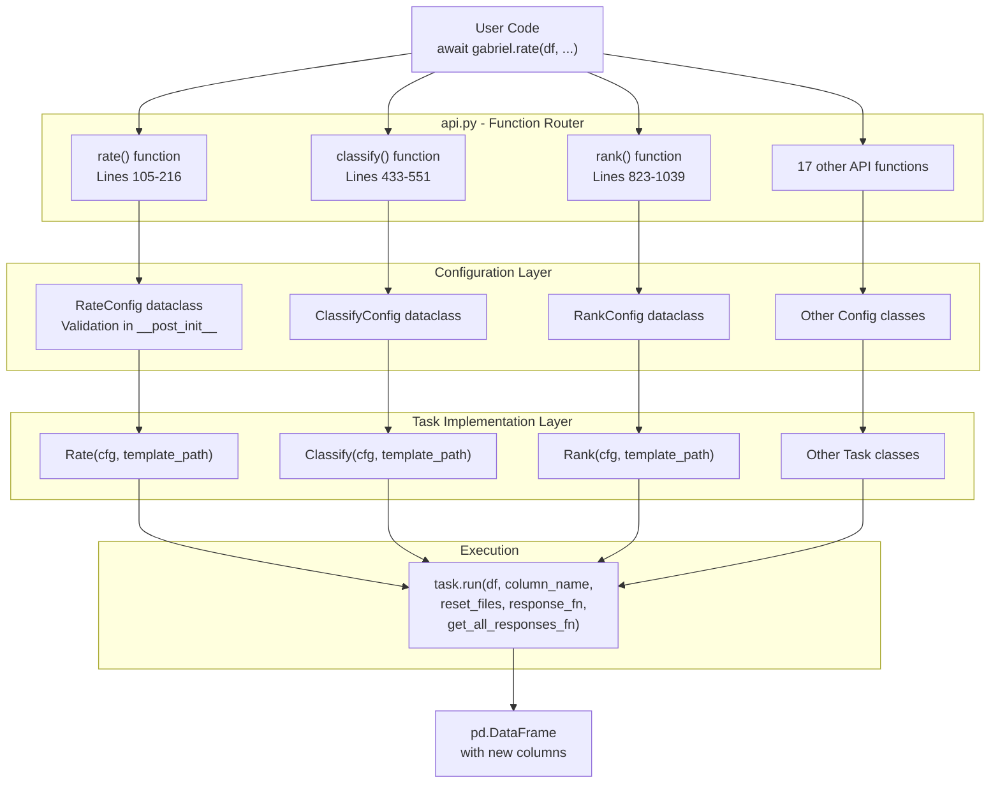
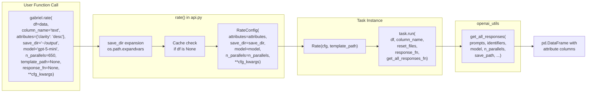
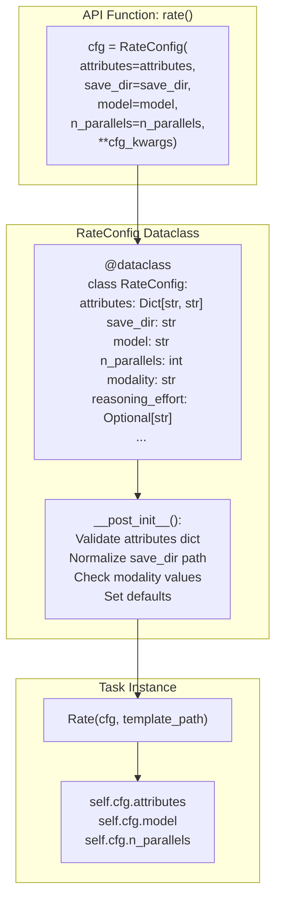
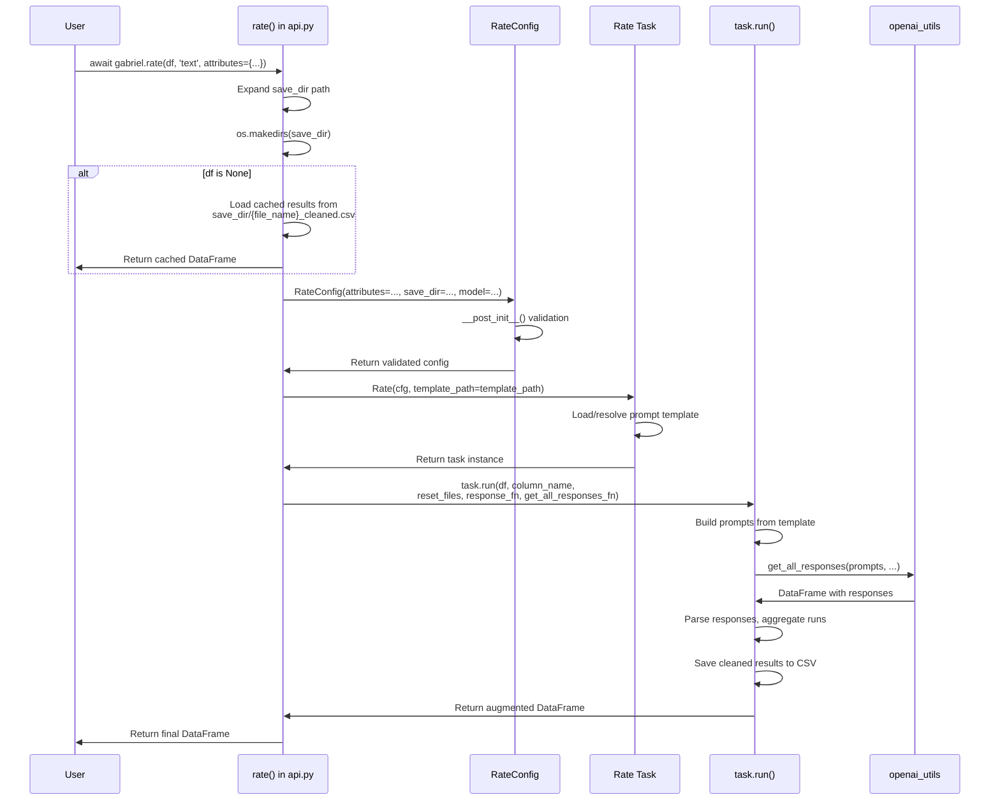
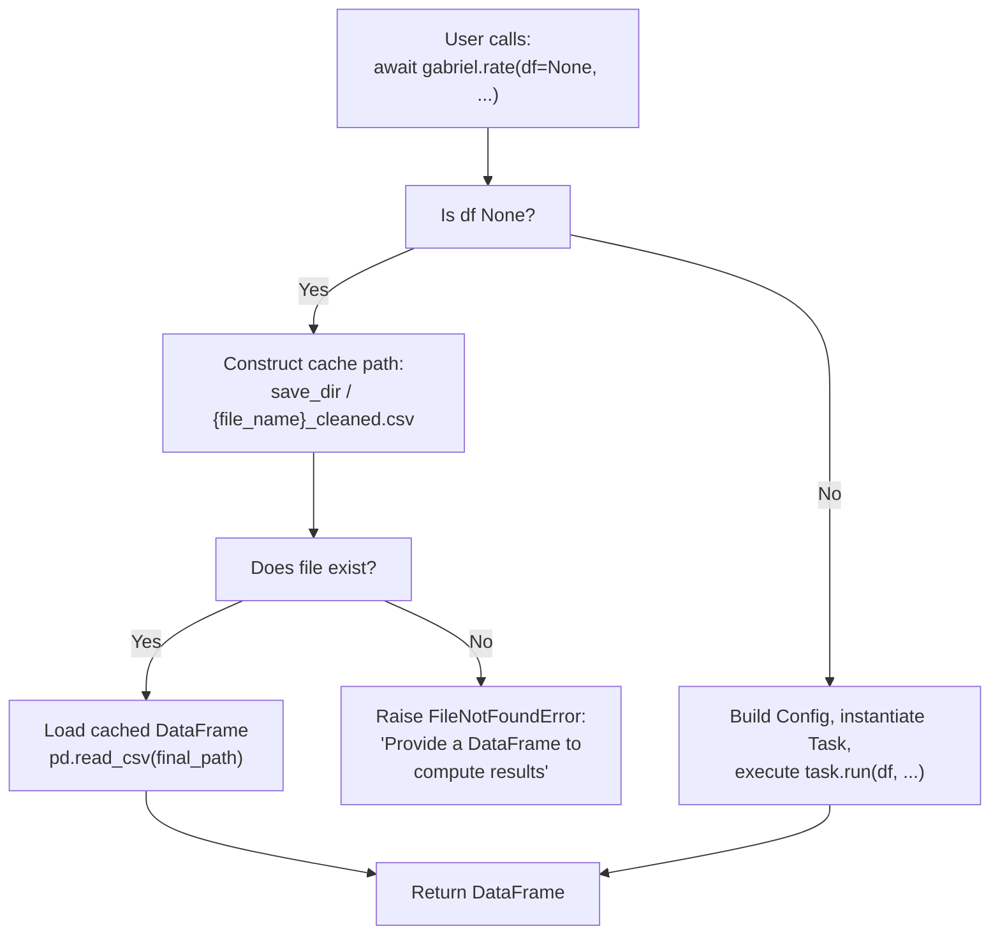
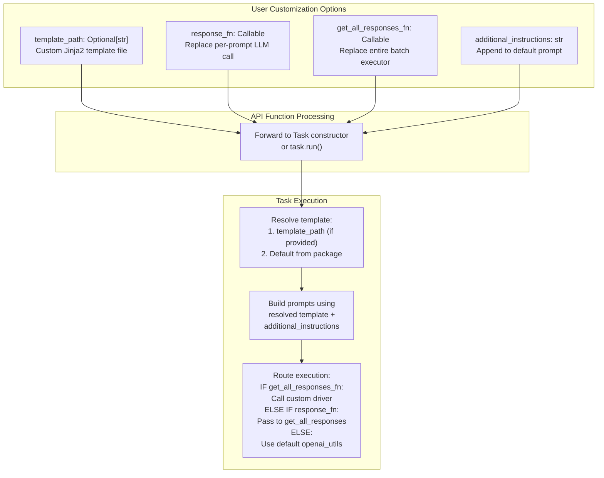
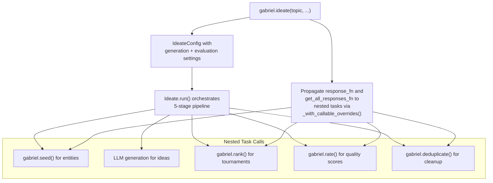
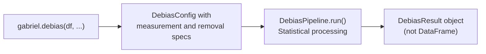

<!-- source: DeepWiki mcp.deepwiki.com · repo openai/GABRIEL · page 3.2 API Layer and Function Router · fetched 2026-10-26 -->

# API Layer and Function Router

<details>
<summary>Relevant source files</summary>

The following files were used as context for generating this wiki page:

- [README.md](README.md)
- [src/gabriel/api.py](src/gabriel/api.py)
- [src/gabriel/prompts/paraphrase_prompt.jinja2](src/gabriel/prompts/paraphrase_prompt.jinja2)
- [src/gabriel/tasks/paraphrase.py](src/gabriel/tasks/paraphrase.py)
- [tests/test_basic.py](tests/test_basic.py)

</details>


## Purpose and Scope

This page documents the **public API layer** in `src/gabriel/api.py`, which provides the user-facing entry points for all GABRIEL functionality. The API layer acts as a thin routing and parameter-validation facade that translates natural-language function calls into properly configured Task objects. This page covers how API functions map to task implementations, common parameter patterns, configuration dataclasses, and customization hooks.

For the underlying task execution mechanics (Config dataclasses, PromptTemplate system, Task.run() lifecycle), see [Task System Architecture](#3.3). For the LLM orchestration infrastructure that handles concurrency and retries, see [LLM Orchestration Infrastructure](#3.1).

---

## API Function Inventory

The API layer exports 19 public functions, all defined in `src/gabriel/api.py` and listed in the `__all__` variable:

| Function | Purpose | Return Type | Task Class |
|----------|---------|-------------|------------|
| `gabriel.rate` | Score items 0-100 on natural language attributes | `pd.DataFrame` | `Rate` |
| `gabriel.rank` | Pairwise rankings producing ELO-like z-scores | `pd.DataFrame` | `Rank` |
| `gabriel.classify` | Apply categorical labels with confidence thresholds | `pd.DataFrame` | `Classify` |
| `gabriel.extract` | Extract structured facts into columns | `pd.DataFrame` | `Extract` |
| `gabriel.discover` | Multi-stage feature discovery pipeline | `pd.DataFrame` | `Discover` |
| `gabriel.merge` | Fuzzy matching crosswalks between datasets | `pd.DataFrame` | `Merge` |
| `gabriel.deduplicate` | Find and consolidate semantic duplicates | `pd.DataFrame` | `Deduplicate` |
| `gabriel.filter` | Boolean screening with natural language conditions | `pd.DataFrame` | `Filter` |
| `gabriel.deidentify` | Replace PII with consistent fake identifiers | `pd.DataFrame` | `Deidentifier` |
| `gabriel.codify` | Highlight passages matching qualitative codes | `pd.DataFrame` | `Codify` |
| `gabriel.compare` | Identify similarities/differences in paired items | `pd.DataFrame` | `Compare` |
| `gabriel.bucket` | Build taxonomies from many terms | `pd.DataFrame` | `Bucket` |
| `gabriel.paraphrase` | Rewrite texts consistently per instructions | `pd.DataFrame` | `Paraphrase` |
| `gabriel.seed` | Generate diverse representative entities | `pd.DataFrame` | `Seed` |
| `gabriel.ideate` | Theory generation and evaluation pipeline | `pd.DataFrame` | `Ideate` |
| `gabriel.debias` | Statistical post-processing for bias removal | `DebiasResult` | `DebiasPipeline` |
| `gabriel.whatever` | Arbitrary prompts with infrastructure support | `pd.DataFrame` | `Whatever` |
| `gabriel.view` | Interactive notebook viewer for auditing | HTML display | `_view_passages` |
| `gabriel.id8` | Alias for `gabriel.ideate` | `pd.DataFrame` | `Ideate` |

Sources: [src/gabriel/api.py:51-71](), [src/gabriel/api.py:7-40]()

---

## Function Router Architecture

Each API function follows a consistent routing pattern: parameter collection → Config instantiation → Task instantiation → execution. The diagram below shows how user calls flow through the API layer:



**Routing Flow Details**:

1. **API Function Entry**: User calls `await gabriel.rate(df, column_name, ...)` with natural-language parameters
2. **Save Directory Expansion**: Path variables expanded via `os.path.expandvars(os.path.expanduser(save_dir))`
3. **Cache Check**: If `df is None`, attempts to load cached results from `save_dir/{file_name}_cleaned.csv`
4. **Config Construction**: Function builds a Config dataclass (e.g., `RateConfig`) from parameters
5. **Task Instantiation**: Task object created with Config and optional `template_path`
6. **Execution**: `task.run()` called with DataFrame and runtime parameters
7. **Return**: Augmented DataFrame returned to user

Sources: [src/gabriel/api.py:105-216](), [src/gabriel/api.py:189-215]()

---

## Common Parameter Patterns

API functions share a consistent parameter vocabulary. The table below categorizes parameters by frequency and purpose:

| Parameter Category | Parameters | Appears In | Purpose |
|-------------------|------------|------------|---------|
| **Data Input** | `df`, `column_name` | Most functions | Source DataFrame and target column |
| **Output Control** | `save_dir`, `file_name` | All functions | Persistence location and naming |
| **Model Selection** | `model`, `reasoning_effort` | All measurement tasks | LLM routing and reasoning intensity |
| **Concurrency** | `n_parallels` | All functions | Max concurrent API requests (default 650) |
| **Execution Control** | `reset_files` | All functions | Force regeneration vs. resume |
| **Modality** | `modality`, `search_context_size` | Measurement tasks | Content type (text/image/audio/pdf/web/entity) |
| **Task Configuration** | `attributes`, `labels`, `instructions` | Task-specific | Natural language specifications |
| **Repetition** | `n_runs`, `n_rounds` | Measurement tasks | Multiple passes for robustness |
| **Customization Hooks** | `template_path`, `response_fn`, `get_all_responses_fn`, `additional_instructions` | All functions | User customization points |

Sources: [src/gabriel/api.py:105-125](), [src/gabriel/api.py:433-456]()

---

## Parameter Flow: API Function to Task Execution

The diagram below traces how parameters flow from an API function call through to task execution:



**Parameter Destinations**:

- **Config Parameters**: `attributes`, `model`, `n_parallels`, `save_dir`, `modality`, `reasoning_effort` → stored in Config dataclass
- **Runtime Parameters**: `df`, `column_name`, `reset_files` → passed directly to `task.run()`
- **Customization Parameters**: `template_path` → passed to Task constructor; `response_fn`, `get_all_responses_fn` → passed to `task.run()`

Sources: [src/gabriel/api.py:195-215](), [src/gabriel/api.py:209-215]()

---

## Configuration Dataclass Pattern

Every API function constructs a **Config dataclass** that encapsulates task-specific settings. These dataclasses live in `src/gabriel/tasks/{task_name}.py` and follow a consistent pattern:

### Config Dataclass Structure



**Key Characteristics**:

1. **Immutable After Construction**: Config objects are built once and not modified during execution
2. **Validation in `__post_init__`**: Type checking, range validation, and normalization happens automatically
3. **Default Values**: Configs provide defaults for optional parameters
4. **Serializable**: Configs can be saved alongside results for reproducibility

Sources: [src/gabriel/api.py:195-208]()

---

## Task Instantiation and Execution Flow

The typical execution pattern for any API function follows these steps:

### Step-by-Step Execution (Example: `gabriel.rate`)



Sources: [src/gabriel/api.py:105-216]()

---

## Cached Results and Resume Logic

API functions support **resumable execution** through a caching mechanism. When `df=None`, the function attempts to load previously computed results instead of rerunning the task.

### Cache Loading Pattern



**Implementation Details**:

- Helper function `_load_cached_dataframe()` [src/gabriel/api.py:74-92]() handles path construction and error messages
- Cache paths follow pattern: `{save_dir}/{base_name}_cleaned.csv`
- Recursive `rank` uses different path: `{save_dir}/{file_name}_recursive/recursive_final.csv` [src/gabriel/api.py:939-944]()
- User must provide `save_dir` even when loading cached results (it's a required parameter)

Sources: [src/gabriel/api.py:74-92](), [src/gabriel/api.py:191-194]()

---

## Customization Hooks

API functions expose three primary customization points that allow users to override default behavior while retaining infrastructure benefits:

### Customization Hook Architecture



### Hook Descriptions

| Hook | Passed To | Purpose | Example Use Case |
|------|-----------|---------|------------------|
| `template_path` | Task constructor | Replace default Jinja2 template | Domain-specific prompt engineering |
| `additional_instructions` | Config dataclass | Append text to default prompt | "Labels are mutually exclusive" |
| `response_fn` | `task.run()` → `get_all_responses()` | Replace per-prompt LLM call | Use local model, add logging |
| `get_all_responses_fn` | `task.run()` | Replace entire batch executor | Route to non-OpenAI provider |

**Key Implementation Details**:

1. **`template_path`**: Passed to Task constructor, resolved in Task `__init__` via `resolve_template()` [src/gabriel/api.py:209]()
2. **`response_fn`**: Forwarded to `get_all_responses()` via `task.run()` kwargs [src/gabriel/api.py:213-214]()
3. **`get_all_responses_fn`**: Replaces the entire `openai_utils.get_all_responses` call [src/gabriel/api.py:214]()
4. **`additional_instructions`**: Stored in Config, injected into prompt template during rendering

Sources: [src/gabriel/api.py:111-124](), [src/gabriel/api.py:209-215]()

---

## Special Handling: Ideate and Debias

Two API functions deviate from the standard pattern due to their complex multi-stage nature:

### `gabriel.ideate` - Nested Task Orchestration



**Implementation Notes**:

- `ideate()` accepts `*_config_updates` and `*_run_kwargs` dicts to customize nested tasks [src/gabriel/api.py:576-585]()
- Helper `_with_callable_overrides()` ensures `response_fn` and `get_all_responses_fn` propagate to all nested calls [src/gabriel/api.py:679-691]()

Sources: [src/gabriel/api.py:554-710](), [src/gabriel/api.py:679-691]()

### `gabriel.debias` - Non-Task Function



**Unique Aspects**:

- Does **not** follow the Task pattern; no prompts or LLM calls
- Performs statistical regression to remove confounds
- Returns `DebiasResult` dataclass, not `pd.DataFrame`
- No `template_path`, `response_fn`, or `get_all_responses_fn` parameters

Sources: [src/gabriel/api.py:1040-1128]()

---

## Example Walkthrough: `gabriel.rate`

Let's trace a complete execution from user call to returned DataFrame:

### Code Flow with Line References

```python
# User code
result = await gabriel.rate(
    df=my_data,
    column_name="speech_text",
    attributes={"populism": "Degree of populist rhetoric"},
    save_dir="~/experiments/populism",
    model="gpt-5-mini",
    n_runs=3,
    template_path=None,
    response_fn=None,
)
```

**Execution Steps**:

1. **Entry Point** [src/gabriel/api.py:105](): `async def rate(df, column_name, *, attributes, save_dir, ...)`

2. **Path Expansion** [src/gabriel/api.py:189-190]():
   ```python
   save_dir = os.path.expandvars(os.path.expanduser(save_dir))
   os.makedirs(save_dir, exist_ok=True)
   ```

3. **Cache Check** [src/gabriel/api.py:191-194]():
   ```python
   if df is None:
       base_name = os.path.splitext(file_name)[0]
       final_path = os.path.join(save_dir, f"{base_name}_cleaned.csv")
       return _load_cached_dataframe(final_path, task_name="Rate")
   ```
   → Skipped (df is not None)

4. **Config Construction** [src/gabriel/api.py:195-208]():
   ```python
   cfg = RateConfig(
       attributes=attributes,
       save_dir=save_dir,
       file_name=file_name,
       model=model,
       n_parallels=n_parallels,
       n_runs=n_runs,
       # ... other parameters
       **cfg_kwargs,
   )
   ```

5. **Task Instantiation** [src/gabriel/api.py:209]():
   ```python
   return await Rate(cfg, template_path=template_path).run(...)
   ```
   - `Rate.__init__` loads template from `ratings_prompt.jinja2`
   - Config validation runs in `RateConfig.__post_init__`

6. **Task Execution** [src/gabriel/api.py:209-215]():
   ```python
   .run(
       df,
       column_name,
       reset_files=reset_files,
       response_fn=response_fn,
       get_all_responses_fn=get_all_responses_fn,
   )
   ```
   - `Rate.run()` builds prompts for each (item, attribute, run) tuple
   - Calls `get_all_responses()` with prompts
   - Parses JSON responses
   - Averages across runs
   - Saves to `{save_dir}/ratings_cleaned.csv`

7. **Return** [src/gabriel/api.py:209](): Returns augmented DataFrame with attribute columns

Sources: [src/gabriel/api.py:105-216]()

---

## API Function Signatures by Category

### Measurement Tasks

All accept `df`, `column_name`, `attributes`/`labels`, `save_dir`, and return `pd.DataFrame`:

| Function | First Positional | Required Keyword Args | Unique Parameters |
|----------|------------------|----------------------|-------------------|
| `rate` | `df, column_name` | `attributes, save_dir` | `n_attributes_per_run` |
| `rank` | `df, column_name` | `attributes, save_dir` | `n_rounds, matches_per_round, recursive, primer_scores` |
| `classify` | `df, column_name` | `labels, save_dir` | `differentiate, min_frequency, circle_column_name, square_column_name` |
| `extract` | `df, column_name` | `attributes, save_dir` | `types` (type hints for extracted values) |
| `discover` | `df, column_name` | `attribute, save_dir` | `true_value` (class discriminator) |

Sources: [src/gabriel/api.py:105-125](), [src/gabriel/api.py:433-456](), [src/gabriel/api.py:823-862]()

### Data Cleaning Tasks

| Function | First Positional | Required Keyword Args | Unique Parameters |
|----------|------------------|----------------------|-------------------|
| `merge` | `df_left, df_right, column_left, column_right` | `save_dir` | `auto_match_threshold, max_comparisons_per_source` |
| `deduplicate` | `df, column_name` | `save_dir` | `initial_sample_size, recursive_sample_size` |
| `filter` | `df, column_name` | `condition, save_dir` | `output_column_name` |
| `deidentify` | `df, column_name` | `save_dir` | `grouping_column, mapping_column, n_passes` |

Sources: [src/gabriel/api.py:1041-1128](), [src/gabriel/api.py:719-821]()

### Helper Tasks

| Function | First Positional | Required Keyword Args | Unique Parameters |
|----------|------------------|----------------------|-------------------|
| `codify` | `df, column_name` | `codes, save_dir` | None |
| `compare` | `df, circle_column_name, square_column_name` | `save_dir` | None |
| `bucket` | `df, column_name` | `instructions, save_dir` | `sample_size, max_buckets` |
| `paraphrase` | `df, column_name` | `instructions, save_dir` | `n_rounds, validation_attribute` |
| `seed` | `instructions` | `save_dir` | `num_entities, deduplicate` |
| `ideate` | `topic` | `save_dir` | `scientific_theory, evaluation_mode, use_seed_entities` |
| `whatever` | `df, column_name` | `instructions, save_dir` | None |

Sources: [src/gabriel/api.py:327-430](), [src/gabriel/api.py:554-710]()

---

## File Organization

The API layer is entirely contained in a single file:

```
src/gabriel/
├── api.py                  # All public API functions (92.98 importance)
│   ├── Imports (lines 1-49)
│   ├── Exports __all__ (lines 51-71)
│   ├── Helper functions (lines 74-103)
│   ├── Measurement functions (lines 105-551)
│   ├── Generation functions (lines 554-716)
│   ├── Cleaning functions (lines 719-1039)
│   ├── Advanced functions (lines 1040-1260)
│   └── View/utility functions (lines 1262-1283)
└── tasks/                  # Task implementations (imported by api.py)
    ├── rate.py
    ├── classify.py
    ├── rank.py
    └── ... (other tasks)
```

Sources: [src/gabriel/api.py:1-71]()

---

## Summary

The API layer serves as the **user-facing contract** for GABRIEL, providing:

1. **Consistent Interface**: All measurement tasks follow the pattern `async def task(df, column_name, *, attributes/labels, save_dir, ...)`
2. **Parameter Translation**: Natural-language function parameters are translated into validated Config dataclasses
3. **Caching Support**: `df=None` enables loading previously computed results
4. **Customization Hooks**: `template_path`, `response_fn`, and `get_all_responses_fn` allow surgical overrides
5. **Thin Routing**: API functions are deliberately simple (~50-100 lines each), delegating complex logic to Task implementations

The next page ([Task System Architecture](#3.3)) covers how Task classes execute the actual work after receiving their Config objects from this API layer.

Sources: [src/gabriel/api.py:1-1283]()

---

