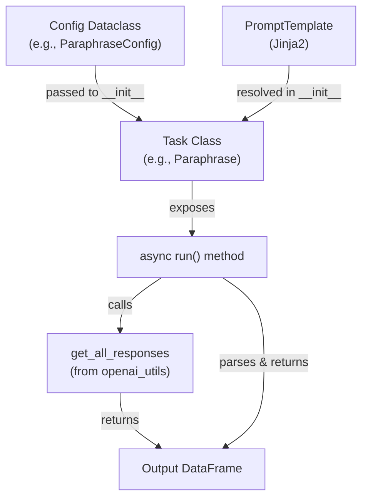
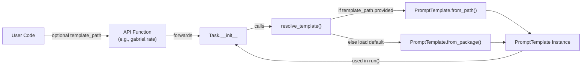
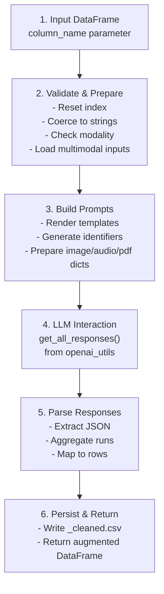
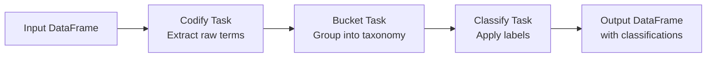
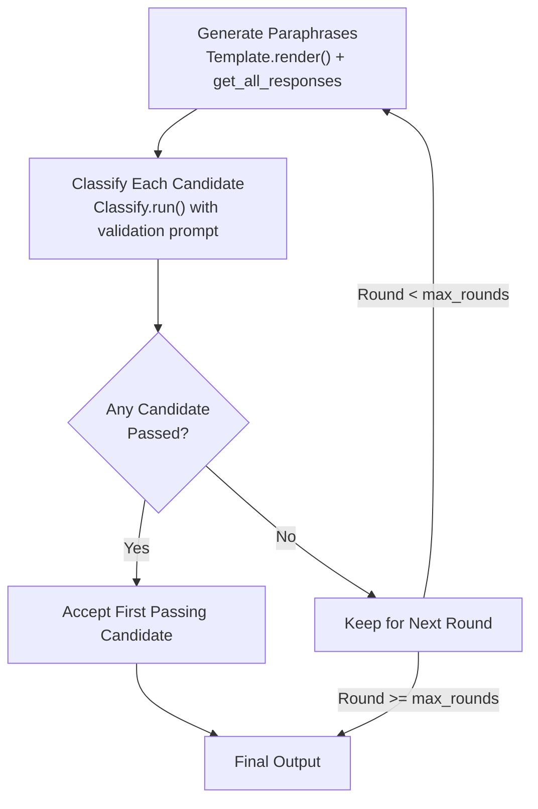
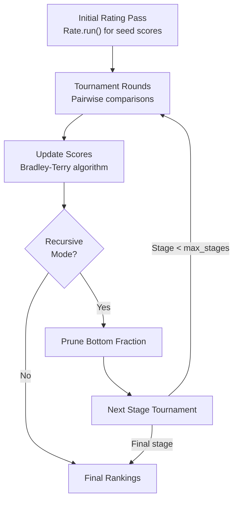
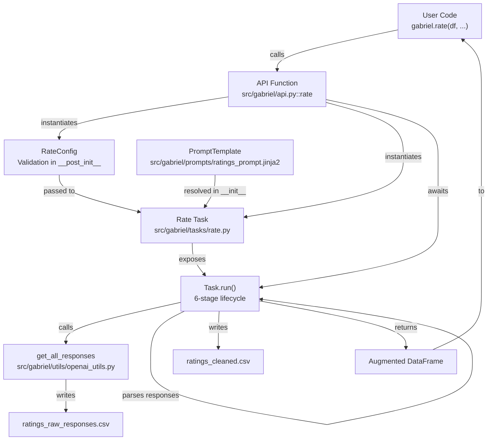

<!-- source: DeepWiki mcp.deepwiki.com · repo openai/GABRIEL · page 3.3 Task System Architecture · fetched 2026-10-26 -->

# Task System Architecture

<details>
<summary>Relevant source files</summary>

The following files were used as context for generating this wiki page:

- [src/gabriel/api.py](src/gabriel/api.py)
- [src/gabriel/prompts/paraphrase_prompt.jinja2](src/gabriel/prompts/paraphrase_prompt.jinja2)
- [src/gabriel/tasks/paraphrase.py](src/gabriel/tasks/paraphrase.py)
- [tests/test_basic.py](tests/test_basic.py)

</details>


## Purpose and Scope

This page documents the common architectural patterns shared across all tasks in GABRIEL. Every task—whether simple (Rate, Classify) or complex (Ideate, Discover)—follows a consistent structure built around Config dataclasses, Task classes, and the PromptTemplate system. This uniformity enables reliable composition, extensibility, and maintainable code.

For details on how tasks interact with the LLM orchestration layer, see [LLM Orchestration Infrastructure](#3.1). For information on how the public API functions route to tasks, see [API Layer and Function Router](#3.2). For specifics on individual task implementations, see sections [4](#4) through [7](#7).

---

## Config Dataclass Pattern

Every task defines a `Config` dataclass that encapsulates all parameters required for task execution. These configs provide type safety, validation, and a single source of truth for task behavior.

### Structure

Config dataclasses are defined as Python `@dataclass` objects with explicit type annotations. They reside alongside their corresponding Task class in the task module (e.g., `RateConfig` in `src/gabriel/tasks/rate.py`, `ClassifyConfig` in `src/gabriel/tasks/classify.py`).

| Config Class | Location | Key Responsibilities |
|--------------|----------|---------------------|
| `RateConfig` | `src/gabriel/tasks/rate.py` | Attributes to rate, scale settings, n_runs |
| `ClassifyConfig` | `src/gabriel/tasks/classify.py` | Labels, differentiate mode, min_frequency |
| `RankConfig` | `src/gabriel/tasks/rank.py` | Tournament parameters, recursive settings |
| `ParaphraseConfig` | `src/gabriel/tasks/paraphrase.py` | Instructions, validation settings, n_rounds |
| `ExtractConfig` | `src/gabriel/tasks/extract.py` | Attributes, types, entity handling |
| `IdeateConfig` | `src/gabriel/tasks/ideate.py` | Evaluation mode, recursive ranking parameters |

**Sources:** [src/gabriel/api.py:28-39](), [src/gabriel/tasks/paraphrase.py:28-104](), [tests/test_basic.py:823-824]()

### Validation via __post_init__

Configs implement validation logic in `__post_init__` methods. This ensures that invalid configurations are caught immediately at construction time rather than during task execution.

```python
def __post_init__(self) -> None:
    try:
        rounds = int(self.n_rounds)
    except (TypeError, ValueError):
        rounds = 1
    if rounds < 1:
        rounds = 1
    self.n_rounds = rounds
```

Common validation patterns include:
- Type coercion (converting strings to integers, etc.)
- Boundary checks (ensuring counts are positive)
- Dependency validation (ensuring required fields are present)
- Default value normalization

**Sources:** [src/gabriel/tasks/paraphrase.py:95-103]()

### Common Parameters

Most Config dataclasses share a core set of parameters inherited from a common design pattern:

| Parameter | Type | Purpose | Default |
|-----------|------|---------|---------|
| `save_dir` | `str` | Directory for outputs and checkpoints | Task-specific |
| `file_name` | `str` | Base name for CSV outputs | Task-specific |
| `model` | `str` | OpenAI model identifier | `"gpt-5-mini"` |
| `n_parallels` | `int` | Maximum concurrent API requests | `650` |
| `use_dummy` | `bool` | Use dummy responses for testing | `False` |
| `modality` | `str` | Content type: text/image/audio/pdf/entity/web | `"text"` |
| `reasoning_effort` | `Optional[str]` | Reasoning intensity: none/low/medium/high | `None` |
| `additional_instructions` | `Optional[str]` | Appended to prompt templates | `None` |

**Sources:** [src/gabriel/tasks/paraphrase.py:28-94](), [src/gabriel/api.py:195-208]()

---

## Task Class Pattern

Each task is implemented as a Python class that accepts a Config at initialization and exposes an async `run()` method for execution.

### Task Class Structure



**Sources:** [src/gabriel/tasks/paraphrase.py:106-124](), [src/gabriel/api.py:209-215]()

### Constructor Pattern

Task constructors accept a Config, an optional pre-constructed `PromptTemplate`, and an optional `template_path` for custom templates:

```python
def __init__(
    self,
    cfg: ParaphraseConfig,
    template: Optional[PromptTemplate] = None,
    template_path: Optional[str] = None,
) -> None:
    self.cfg = cfg
    expanded = Path(os.path.expandvars(os.path.expanduser(cfg.save_dir)))
    expanded.mkdir(parents=True, exist_ok=True)
    cfg.save_dir = str(expanded)
    self.template = resolve_template(
        template=template,
        template_path=template_path,
        reference_filename="paraphrase_prompt.jinja2",
    )
```

The constructor:
1. Stores the Config
2. Expands and creates the `save_dir`
3. Resolves the prompt template using `resolve_template()`

**Sources:** [src/gabriel/tasks/paraphrase.py:109-123]()

### run() Method Signature

The `run()` method is async and accepts:
- A DataFrame (`df`)
- A column name identifying the target content (`column_name`)
- Optional keyword arguments for customization (`**kwargs`)

```python
async def run(
    self,
    df: pd.DataFrame,
    column_name: str,
    *,
    reset_files: bool = False,
    **kwargs: Any,
) -> pd.DataFrame:
```

The method returns an augmented DataFrame with task-specific columns added.

**Sources:** [src/gabriel/tasks/paraphrase.py:125-138]()

---

## Prompt Template System

GABRIEL uses Jinja2 templates stored in `src/gabriel/prompts/` to render prompts. This separates prompt engineering from code logic and enables easy customization.

### Template Resolution Flow



**Sources:** [src/gabriel/tasks/paraphrase.py:119-123](), [src/gabriel/api.py:209-215]()

### Template Context Variables

Templates receive context dictionaries during rendering. Common variables include:

| Variable | Type | Purpose |
|----------|------|---------|
| `text` | `str` | The passage or entity to process |
| `attributes` | `dict` or `list` | Attributes to evaluate |
| `instructions` | `str` | Task-specific instructions |
| `modality` | `str` | Content type (text/image/audio/pdf/entity/web) |
| `json_mode` | `bool` | Whether to request JSON-only output |
| `additional_instructions` | `str` | User-provided guidance appended to prompt |

Example rendering call:

```python
prompt = self.template.render(
    text=base_text,
    instructions=self.cfg.instructions,
    modality=self.cfg.modality,
    json_mode=self.cfg.json_mode,
)
```

**Sources:** [src/gabriel/tasks/paraphrase.py:184-196](), [src/gabriel/tasks/paraphrase.py:420-426]()

### Template Example

The paraphrase template illustrates typical structure:

```jinja2

{{ snip.single_entry(modality, text) }}

Task: rewrite the provided content according to the instructions below.

BEGIN INSTRUCTIONS
{{ instructions }}
END INSTRUCTIONS

Modality guidance:
- text: paraphrase/consolidate/modify the text
- entity: rewrite the entity name consistently
- ...
```

Templates use imports (like `snippets.jinja2`) to share common patterns across tasks.

**Sources:** [src/gabriel/prompts/paraphrase_prompt.jinja2:1-23]()

---

## Task.run() Lifecycle

The `run()` method follows a consistent six-stage lifecycle across all tasks:

### Lifecycle Flow Diagram



**Sources:** [src/gabriel/tasks/paraphrase.py:125-298]()

### Stage 1: Input DataFrame Handling

Tasks reset the DataFrame index to ensure contiguous integer indices for deterministic response mapping:

```python
df_proc = df.reset_index(drop=True).copy()
values = df_proc[column_name].tolist()
texts: List[str] = [str(v) for v in values]
```

Modality validation warns if the column content doesn't match the specified modality:

```python
warn_if_modality_mismatch(values, self.cfg.modality, column_name=column_name)
```

**Sources:** [src/gabriel/tasks/paraphrase.py:140-149]()

### Stage 2: Multimodal Input Loading

For non-text modalities, tasks load file references into structured formats:

```python
if self.cfg.modality == "image":
    prompt_images: Dict[str, List[str]] = {}
    for idx, val in enumerate(values):
        imgs = load_image_inputs(val)
        if imgs:
            prompt_images[f"row_{idx}_rev{j}"] = imgs
elif self.cfg.modality == "audio":
    prompt_audio: Dict[str, List[Dict[str, str]]] = {}
    for idx, val in enumerate(values):
        auds = load_audio_inputs(val)
        # ...
```

**Sources:** [src/gabriel/tasks/paraphrase.py:204-227]()

### Stage 3: Prompt Construction

Prompts are constructed using template rendering with unique identifiers:

```python
prompts: List[str] = []
identifiers: List[str] = []
for idx, text in enumerate(texts):
    prompt_text = text if self.cfg.modality in {"text", "entity", "web"} else ""
    for j in range(1, n + 1):
        prompts.append(
            self.template.render(
                text=prompt_text,
                instructions=self.cfg.instructions,
                modality=self.cfg.modality,
                json_mode=self.cfg.json_mode,
            )
        )
        identifiers.append(f"row_{idx}_rev{j}")
```

Identifiers encode row indices and run numbers for later parsing.

**Sources:** [src/gabriel/tasks/paraphrase.py:181-198]()

### Stage 4: LLM Interaction

All tasks delegate to `get_all_responses` from `openai_utils`:

```python
resp_df = await get_all_responses(
    prompts=prompts,
    identifiers=identifiers,
    prompt_images=prompt_images,
    prompt_audio=prompt_audio,
    prompt_pdfs=prompt_pdfs,
    save_path=save_path,
    model=self.cfg.model,
    json_mode=self.cfg.json_mode,
    n_parallels=self.cfg.n_parallels,
    use_dummy=self.cfg.use_dummy,
    reset_files=reset_files,
    reasoning_effort=self.cfg.reasoning_effort,
    **kwargs,
)
```

This function handles all concurrency, rate limiting, retries, and checkpointing. See [LLM Orchestration Infrastructure](#3.1) for details.

**Sources:** [src/gabriel/tasks/paraphrase.py:236-250]()

### Stage 5: Response Parsing

Responses are mapped back to rows using identifier parsing:

```python
resp_map: Dict[Tuple[int, int], str] = {}
for ident, resp in zip(resp_df["Identifier"], resp_df["Response"]):
    main = resp[0] if isinstance(resp, list) and resp else resp
    m = re.match(r"row_(\d+)_rev(\d+)", ident)
    if m:
        row = int(m.group(1))
        rev = int(m.group(2)) - 1
        resp_map[(row, rev)] = main
```

Tasks typically use regex to decode identifiers and reconstruct the (row, run) mapping.

**Sources:** [src/gabriel/tasks/paraphrase.py:252-259]()

### Stage 6: Output Persistence

Tasks write two files:
1. Raw responses CSV (from `get_all_responses`)
2. Cleaned output CSV with augmented columns

```python
out_path = os.path.join(
    self.cfg.save_dir,
    f"{os.path.splitext(self.cfg.file_name)[0]}_cleaned.csv",
)
df_proc.to_csv(out_path, index=False)
return df_proc
```

**Sources:** [src/gabriel/tasks/paraphrase.py:290-298]()

---

## Persistence Conventions

Tasks follow consistent file naming and directory structure conventions to enable resumability and auditability.

### Directory Structure

```
save_dir/
├── {file_name}                          # Raw responses CSV from get_all_responses
├── {file_name}_cleaned.csv              # Cleaned output with task-specific columns
├── {file_name}_full_disaggregated.csv   # Optional: disaggregated multi-run data
└── validation/                          # Optional: nested task outputs (e.g., Paraphrase)
    └── ...
```

**Sources:** [src/gabriel/tasks/paraphrase.py:199](), [src/gabriel/tasks/paraphrase.py:293-297]()

### File Naming Patterns

| File Suffix | Purpose | Contains |
|-------------|---------|----------|
| (base name) | Raw responses | Identifier, Response, Time Taken, Input Tokens, Output Tokens, Successful, Error Log |
| `_cleaned.csv` | Final output | Original DataFrame columns + task-specific result columns |
| `_full_disaggregated.csv` | Disaggregated runs | Multi-index with (row_id, run) for n_runs > 1 |
| `_raw_responses.csv` | Explicit raw | Used by some tasks (e.g., Rate) for clarity |
| `_final.csv` | Final rankings | Used by Rank task for z-scores and metadata |

**Sources:** [src/gabriel/api.py:192-194](), [tests/test_basic.py:837-838]()

### Checkpoint Resumability

The raw response CSV doubles as a checkpoint. When `reset_files=False` (default), `get_all_responses` loads existing responses and skips identifiers already present. This enables fault-tolerant resumption after crashes or interruptions.

**Sources:** See [Checkpointing and Resumability](#12.2) for details.

---

## Extension Points

The Task system exposes multiple extension points for customization without forking the codebase.

### Custom Template Path

Users can override default templates by providing `template_path`:

```python
await gabriel.rate(
    df, "text",
    attributes={"clarity": "Is it clear?"},
    save_dir="outputs",
    template_path="/path/to/custom_ratings.jinja2"
)
```

The custom template must accept the same context variables as the default.

**Sources:** [src/gabriel/api.py:171](), [src/gabriel/tasks/paraphrase.py:112-113]()

### Custom Response Function

The `response_fn` parameter allows replacing the per-prompt LLM call:

```python
async def custom_response(prompt: str, **kwargs) -> list:
    # Custom logic here
    return ["custom response"]

await gabriel.rate(
    df, "text",
    attributes={"clarity": ""},
    save_dir="outputs",
    response_fn=custom_response
)
```

The function must accept a `prompt` parameter and return a list of strings.

**Sources:** [src/gabriel/api.py:122](), [tests/test_basic.py:528-543]()

### Custom Driver Function

The `get_all_responses_fn` parameter replaces the entire orchestration layer:

```python
async def custom_driver(prompts, identifiers, **kwargs) -> pd.DataFrame:
    # Custom bulk processing
    return pd.DataFrame({
        "Identifier": identifiers,
        "Response": [[f"resp:{i}"] for i in identifiers]
    })

await gabriel.rate(
    df, "text",
    attributes={"clarity": ""},
    save_dir="outputs",
    get_all_responses_fn=custom_driver
)
```

The function must accept `prompts` and `identifiers` and return a DataFrame with `Identifier` and `Response` columns.

**Sources:** [src/gabriel/api.py:123](), [tests/test_basic.py:583-621]()

---

## Task Composition Patterns

Complex tasks orchestrate multiple simpler tasks to achieve sophisticated pipelines. This section illustrates common composition patterns.

### Sequential Pipeline Pattern

Tasks like Discover run a sequence of sub-tasks:



Each stage instantiates a nested Task with its own Config and calls its `run()` method.

**Sources:** See [gabriel.discover](#4.5) for implementation details.

### Recursive Validation Pattern

The Paraphrase task uses a classifier in a feedback loop:



**Sources:** [src/gabriel/tasks/paraphrase.py:300-637]()

### Tournament Pattern

The Rank task implements Bradley-Terry tournaments with recursive pruning:



**Sources:** See [gabriel.rank](#4.2) for implementation details.

---

## Summary: Task Architecture Map

This diagram maps the relationship between user code, API functions, configs, tasks, templates, and infrastructure:



**Sources:** [src/gabriel/api.py:105-215](), [src/gabriel/tasks/paraphrase.py:106-298]()

---

