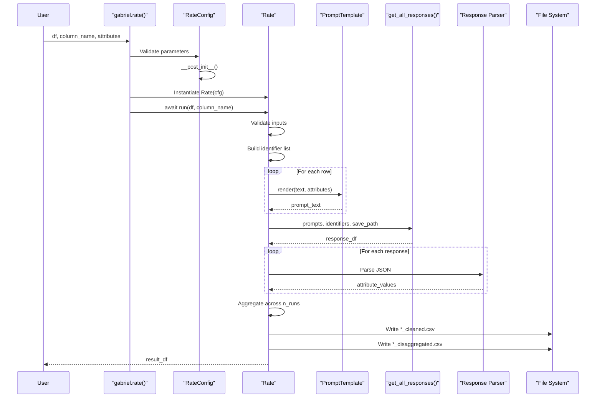
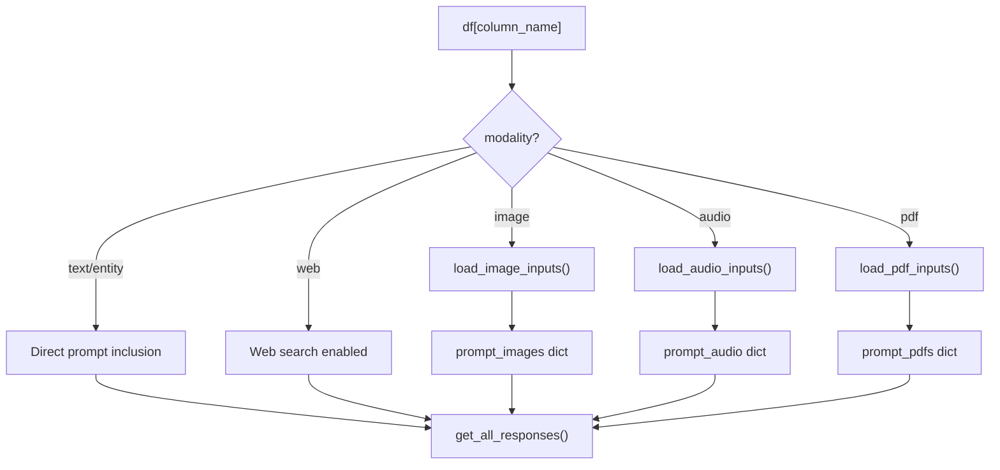
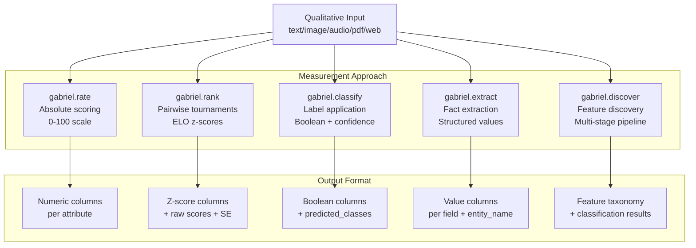
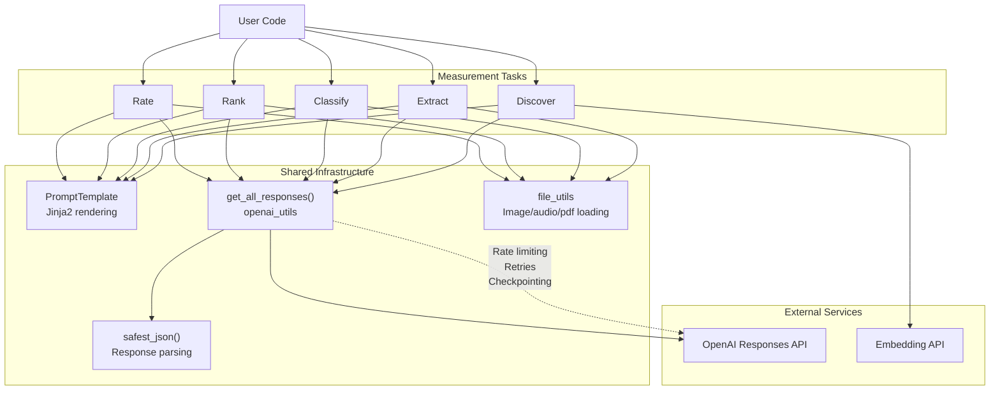

<!-- source: DeepWiki mcp.deepwiki.com · repo openai/GABRIEL · page 4 Measurement Tasks · fetched 2026-10-26 -->

# Measurement Tasks

<details>
<summary>Relevant source files</summary>

The following files were used as context for generating this wiki page:

- [README.md](README.md)
- [src/gabriel/api.py](src/gabriel/api.py)
- [src/gabriel/prompts/paraphrase_prompt.jinja2](src/gabriel/prompts/paraphrase_prompt.jinja2)
- [src/gabriel/tasks/paraphrase.py](src/gabriel/tasks/paraphrase.py)
- [tests/test_basic.py](tests/test_basic.py)

</details>


## Purpose and Scope

Measurement tasks quantify qualitative data by applying natural language attributes to text, images, audio, PDFs, or web-sourced content. They produce structured numerical or categorical outputs suitable for downstream statistical analysis. This page covers the shared architecture, configuration patterns, and execution lifecycle common to all measurement tasks.

For specific measurement task details, see:
- [gabriel.rate - Absolute Scoring](#4.1)
- [gabriel.rank - Pairwise Ranking](#4.2)
- [gabriel.classify - Categorical Labeling](#4.3)
- [gabriel.extract - Structured Extraction](#4.4)
- [gabriel.discover - Feature Discovery](#4.5)

For data preparation and cleaning operations, see [Data Cleaning Tasks](#5). For auxiliary operations like qualitative coding or taxonomy building, see [Helper and Composition Tasks](#6).

Sources: [src/gabriel/api.py:1-100](), [README.md:38-46]()

---

## Task Categories

GABRIEL provides five core measurement tasks:

| Task | Function | Config Class | Output Type | Primary Use |
|------|----------|--------------|-------------|-------------|
| **Rate** | `gabriel.rate()` | `RateConfig` | Numeric scores (0-100) | Absolute attribute scoring |
| **Rank** | `gabriel.rank()` | `RankConfig` | Z-scores and rankings | Relative pairwise comparisons |
| **Classify** | `gabriel.classify()` | `ClassifyConfig` | Boolean labels + confidence | Categorical tagging |
| **Extract** | `gabriel.extract()` | `ExtractConfig` | Structured values | Fact extraction into columns |
| **Discover** | `gabriel.discover()` | `DiscoverConfig` | Feature taxonomy | Discriminating attribute discovery |

Sources: [src/gabriel/api.py:7-40](), [README.md:40-46]()

---

## Common Architecture

All measurement tasks follow a three-layer architecture:

```mermaid
graph TB
    subgraph "API Layer"
        rate_api["gabriel.rate()<br/>src/gabriel/api.py:105-216"]
        rank_api["gabriel.rank()<br/>src/gabriel/api.py:823-983"]
        classify_api["gabriel.classify()<br/>src/gabriel/api.py:433-551"]
        extract_api["gabriel.extract()<br/>src/gabriel/api.py:217-324"]
        discover_api["gabriel.discover()<br/>src/gabriel/api.py:1034-1141"]
    end
    
    subgraph "Task Implementation Layer"
        RateTask["Rate.run()<br/>src/gabriel/tasks/rate.py"]
        RankTask["Rank.run()<br/>src/gabriel/tasks/rank.py"]
        ClassifyTask["Classify.run()<br/>src/gabriel/tasks/classify.py"]
        ExtractTask["Extract.run()<br/>src/gabriel/tasks/extract.py"]
        DiscoverTask["Discover.run()<br/>src/gabriel/tasks/discover.py"]
    end
    
    subgraph "Configuration Layer"
        RateConfig["RateConfig<br/>dataclass"]
        RankConfig["RankConfig<br/>dataclass"]
        ClassifyConfig["ClassifyConfig<br/>dataclass"]
        ExtractConfig["ExtractConfig<br/>dataclass"]
        DiscoverConfig["DiscoverConfig<br/>dataclass"]
    end
    
    subgraph "Infrastructure Layer"
        PromptTemplate["PromptTemplate<br/>Jinja2 rendering"]
        get_all_responses["get_all_responses()<br/>openai_utils.py"]
    end
    
    rate_api --> RateConfig
    rate_api --> RateTask
    rank_api --> RankConfig
    rank_api --> RankTask
    classify_api --> ClassifyConfig
    classify_api --> ClassifyTask
    extract_api --> ExtractConfig
    extract_api --> ExtractTask
    discover_api --> DiscoverConfig
    discover_api --> DiscoverTask
    
    RateTask --> PromptTemplate
    RankTask --> PromptTemplate
    ClassifyTask --> PromptTemplate
    ExtractTask --> PromptTemplate
    DiscoverTask --> PromptTemplate
    
    RateTask --> get_all_responses
    RankTask --> get_all_responses
    ClassifyTask --> get_all_responses
    ExtractTask --> get_all_responses
    DiscoverTask --> get_all_responses
```



**API Layer**: Public async functions that accept natural language parameters and return DataFrames. Each function constructs a Config dataclass and instantiates the corresponding Task.

**Task Implementation Layer**: Task classes implement prompt construction, multimodal input handling, response parsing, and result aggregation. Each exposes a `run()` method that orchestrates the full pipeline.

**Configuration Layer**: Dataclasses validate parameters via `__post_init__` methods and provide type safety for task-specific settings.

**Infrastructure Layer**: All tasks funnel through `get_all_responses()` for LLM orchestration and use `PromptTemplate` for Jinja2-based prompt rendering.

Sources: [src/gabriel/api.py:7-40](), [src/gabriel/tasks/rate.py:1-50](), [README.md:38-70]()

---

## Task Configuration Pattern

Every measurement task follows the same configuration lifecycle:

```mermaid
graph LR
    UserCall["User calls gabriel.rate()"]
    BuildConfig["Construct RateConfig<br/>validate parameters"]
    InstantiateTask["Instantiate Rate(cfg)"]
    RunTask["await Rate.run(df, col)"]
    ValidateConfig["__post_init__<br/>type checking"]
    ExpandPaths["os.path.expanduser<br/>os.path.expandvars"]
    CreateDirs["os.makedirs(save_dir)"]
    
    UserCall --> BuildConfig
    BuildConfig --> ValidateConfig
    ValidateConfig --> ExpandPaths
    ExpandPaths --> CreateDirs
    CreateDirs --> InstantiateTask
    InstantiateTask --> RunTask
```



### Configuration Dataclass Structure

All Config classes share common fields:

| Field | Type | Purpose |
|-------|------|---------|
| `save_dir` | `str` | Output directory for responses and results |
| `file_name` | `str` | Base filename for CSV outputs |
| `model` | `str` | OpenAI model identifier (default: `"gpt-5-mini"`) |
| `n_parallels` | `int` | Concurrent request limit (default: 650) |
| `modality` | `str` | Input type: `text`, `entity`, `image`, `audio`, `pdf`, `web` |
| `additional_instructions` | `Optional[str]` | Natural language prompt augmentation |
| `reasoning_effort` | `Optional[str]` | `none`/`low`/`medium`/`high` for extended reasoning |
| `use_dummy` | `bool` | Testing flag to bypass real API calls |

Task-specific fields are documented on individual task pages.

Sources: [src/gabriel/tasks/rate.py:14-95](), [src/gabriel/api.py:195-208]()

---

## Task Execution Lifecycle

All measurement tasks follow this execution pattern:



### Key Lifecycle Phases

1. **Input Validation**: Tasks drop malformed rows (non-string values in text mode, missing files in image/audio mode)
2. **Identifier Generation**: Each prompt receives a unique identifier (e.g., `row_0_attr_helpfulness_run_1`)
3. **Prompt Construction**: `PromptTemplate.render()` generates model inputs from Jinja2 templates
4. **Parallel Execution**: `get_all_responses()` manages concurrency, retries, rate limiting, and checkpointing
5. **Response Parsing**: Task-specific parsers extract structured data from LLM outputs
6. **Aggregation**: Results are averaged/merged across multiple runs when `n_runs > 1`
7. **Persistence**: Both raw responses and cleaned outputs are written to `save_dir`

Sources: [src/gabriel/tasks/rate.py:97-300](), [tests/test_basic.py:822-838]()

---

## Input Modalities

All measurement tasks support six modality types, controlled by the `modality` parameter:

| Modality | Input Format | Processing |
|----------|--------------|------------|
| `text` | String content | Passed directly to prompt |
| `entity` | Short names/terms | Treated as entities rather than passages |
| `image` | File paths or base64 | Loaded via `load_image_inputs()` |
| `audio` | File paths or encoded dicts | Loaded via `load_audio_inputs()` |
| `pdf` | File paths or encoded dicts | Loaded via `load_pdf_inputs()` |
| `web` | Search queries | Model performs web search before responding |

### Multimodal Input Handling

Tasks use helper functions to prepare non-text inputs:



For image modality, file paths are read and base64-encoded. For audio, paths are converted to `{"data": base64_str, "format": "mp3"}` dictionaries. Web modality enables search context retrieval before rating/classification.

Sources: [src/gabriel/tasks/rate.py:150-220](), [src/gabriel/utils/file_utils.py:1-200]()

---

## Output Structure

Measurement tasks produce three categories of output files:

### 1. Raw Responses

Located at `{save_dir}/{file_name}_raw_responses.csv`, containing:

| Column | Description |
|--------|-------------|
| `Identifier` | Unique prompt identifier (e.g., `row_0_attr_clarity_run_1`) |
| `Response` | Serialized list of LLM outputs |
| `Time Taken` | API call duration in seconds |
| `Input Tokens` | Prompt token count |
| `Output Tokens` | Response token count |
| `Reasoning Tokens` | Extended reasoning token count (when applicable) |
| `Successful` | Boolean indicating call success |
| `Error Log` | Serialized error details for failed calls |

### 2. Cleaned Results

Located at `{save_dir}/{file_name}_cleaned.csv`:
- Original DataFrame columns
- One column per measured attribute
- Aggregated values when `n_runs > 1`
- Task-specific metadata (e.g., `predicted_classes` for classify)

### 3. Disaggregated Results

Located at `{save_dir}/{file_name}_full_disaggregated.csv`:
- Multi-index with `(id, run)` or `(id, attribute, run)` 
- Individual scores for each run before averaging
- Used for reliability analysis and measurement validation

Sources: [src/gabriel/tasks/rate.py:250-300](), [tests/test_basic.py:837-839]()

---

## Customization Points

All measurement tasks expose four levels of customization:

### Level 1: Additional Instructions

```python
await gabriel.rate(
    df, "text",
    attributes={"clarity": "How clear is the writing?"},
    additional_instructions="Focus on technical clarity, not literary style.",
    save_dir="output"
)
```

The `additional_instructions` string is injected into the prompt template via `{{ additional_instructions }}` placeholders.

Sources: [src/gabriel/api.py:111](), [src/gabriel/prompts/ratings_prompt.jinja2:1-30]()

### Level 2: Custom Templates

```python
await gabriel.rate(
    df, "text",
    attributes={"clarity": ""},
    template_path="my_custom_rating_prompt.jinja2",
    save_dir="output"
)
```

Custom Jinja2 templates replace default prompts while preserving infrastructure (retries, checkpointing, multimodal handling). Templates receive context variables like `text`, `attributes`, `modality`, and `additional_instructions`.

Sources: [src/gabriel/api.py:171](), [src/gabriel/core/prompt_template.py:1-100]()

### Level 3: Custom Response Functions

```python
async def my_parser(prompt: str, **kwargs) -> list:
    # Custom LLM call or local model
    return ["custom response"]

await gabriel.rate(
    df, "text",
    attributes={"clarity": ""},
    response_fn=my_parser,
    save_dir="output"
)
```

The `response_fn` replaces individual LLM calls while retaining parallelism, checkpointing, and progress tracking from `get_all_responses()`.

Sources: [src/gabriel/api.py:172-175](), [tests/test_basic.py:525-544]()

### Level 4: Custom Driver Functions

```python
async def my_driver(prompts, identifiers, **kwargs) -> pd.DataFrame:
    # Fully custom backend (e.g., local models, alternative APIs)
    return pd.DataFrame({
        "Identifier": identifiers,
        "Response": [["result"] for _ in identifiers]
    })

await gabriel.rate(
    df, "text",
    attributes={"clarity": ""},
    get_all_responses_fn=my_driver,
    save_dir="output"
)
```

The `get_all_responses_fn` replaces the entire orchestration layer, allowing complete control over parallelism and execution while preserving task-specific logic (prompt construction, response parsing, aggregation).

Sources: [src/gabriel/api.py:176-179](), [tests/test_basic.py:583-621]()

---

## Shared Parameters

These parameters are consistent across all measurement tasks:

| Parameter | Type | Default | Description |
|-----------|------|---------|-------------|
| `df` | `Optional[pd.DataFrame]` | - | Input data; `None` loads cached results |
| `column_name` | `str` | - | Column containing passages to measure |
| `save_dir` | `str` | - | Output directory (tilde/env vars expanded) |
| `model` | `str` | `"gpt-5-mini"` | OpenAI model identifier |
| `n_parallels` | `int` | 650 | Maximum concurrent requests |
| `n_runs` | `int` | 1 | Repeat measurements for reliability |
| `reset_files` | `bool` | `False` | Regenerate outputs (ignore checkpoints) |
| `modality` | `str` | `"text"` | Input type (see Input Modalities section) |
| `reasoning_effort` | `Optional[str]` | `None` | Extended reasoning intensity |
| `additional_instructions` | `Optional[str]` | `None` | Natural language prompt augmentation |
| `template_path` | `Optional[str]` | `None` | Custom Jinja2 template file |
| `response_fn` | `Optional[Callable]` | `None` | Custom per-prompt function |
| `get_all_responses_fn` | `Optional[Callable]` | `None` | Custom orchestration driver |

Sources: [src/gabriel/api.py:105-216]()

---

## Comparison: Measurement Tasks



### Key Differences

| Dimension | Rate | Rank | Classify | Extract | Discover |
|-----------|------|------|----------|---------|----------|
| **Output Scale** | Continuous (0-100) | Relative (z-scores) | Categorical (boolean) | Mixed (strings/numbers) | Taxonomy + labels |
| **Comparison Type** | Absolute | Pairwise | Absolute | N/A | Contrastive |
| **Prompt Strategy** | Attribute descriptions | Tournament pairs | Label definitions | Field descriptions | Multi-stage codify/bucket/classify |
| **N Runs Impact** | Averaged scores | Tournament rounds | Consensus voting | Averaged when applicable | N/A (fixed pipeline) |
| **Primary Use** | Scaled measurement | Relative ranking | Tagging | Structured extraction | Feature discovery |

Sources: [src/gabriel/api.py:105-1141](), [README.md:40-46]()

---

## Error Handling and Validation

Measurement tasks implement defensive input validation:

### Pre-execution Validation

1. **Datatype Checks**: Tasks in text mode drop rows where `df[column_name]` contains non-string values (floats, NaN, None)
2. **File Existence**: Image/audio/pdf modes verify file paths exist and are readable
3. **Column Existence**: Tasks raise `KeyError` if `column_name` is not in `df.columns`
4. **Empty DataFrame Handling**: Tasks return immediately with empty results if `df` has zero rows

Example from Rank task:

```python
# From src/gabriel/tasks/rank.py (simplified)
if modality in {"text", "entity"}:
    valid_mask = df[column_name].apply(
        lambda x: isinstance(x, str) and len(str(x).strip()) > 0
    )
    dropped = len(df) - valid_mask.sum()
    if dropped > 0:
        print(f"Dropping {dropped}/{len(df)} rows with invalid text")
    df = df[valid_mask].reset_index(drop=True)
```

Sources: [tests/test_basic.py:967-983](), [tests/test_basic.py:986-1005]()

### Runtime Error Handling

All tasks inherit error handling from `get_all_responses()`:
- **Rate Limit Errors**: Global cooldown pauses all workers
- **Timeout Errors**: Exponential backoff with jitter
- **Connection Errors**: Retry with backoff
- **Authentication Errors**: Fail immediately

See [Error Handling and Retry Logic](#12.4) for infrastructure details.

Sources: [src/gabriel/utils/openai_utils.py:1-500]()

---

## Performance Characteristics

### Concurrency

Default `n_parallels=650` supports massive parallelism. Web search mode automatically caps to 10 concurrent workers to respect search API limits.

### Token Estimation

Tasks estimate token counts for rate limit planning:
- **Rate/Classify**: Samples first prompt, estimates based on attribute count
- **Rank**: Estimates based on passage length and match count
- **Extract/Discover**: Samples representative prompts

### Checkpointing

All tasks support resumable execution:
- Progress saved every N items (configurable in `get_all_responses()`)
- Setting `reset_files=False` (default) resumes from last checkpoint
- Identifiers are deterministic, allowing safe restarts

Sources: [src/gabriel/utils/openai_utils.py:200-400](), [README.md:171-173]()

---

## Relationship to Infrastructure



All measurement tasks are thin wrappers around shared infrastructure. Task-specific logic focuses on:
- Prompt construction (via templates)
- Response parsing (via task-specific extractors)
- Result aggregation (averaging, voting, merging)

The heavy lifting (concurrency, retries, rate limiting, persistence) is handled by `openai_utils.get_all_responses()`, documented in [LLM Orchestration Infrastructure](#3.1).

Sources: [src/gabriel/api.py:1-100](), [src/gabriel/utils/openai_utils.py:1-100]()

---

