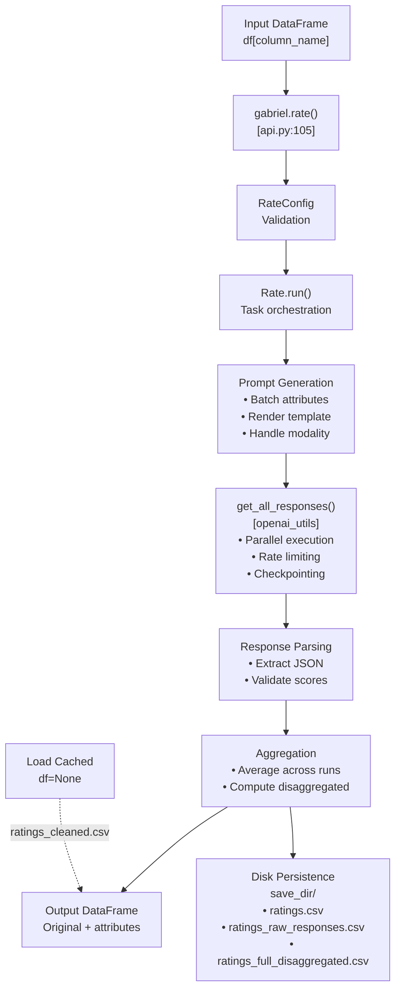
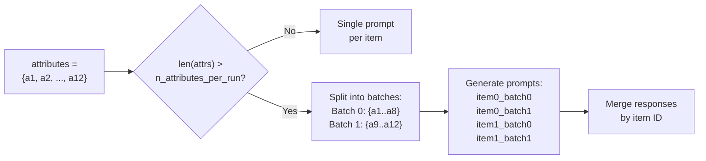
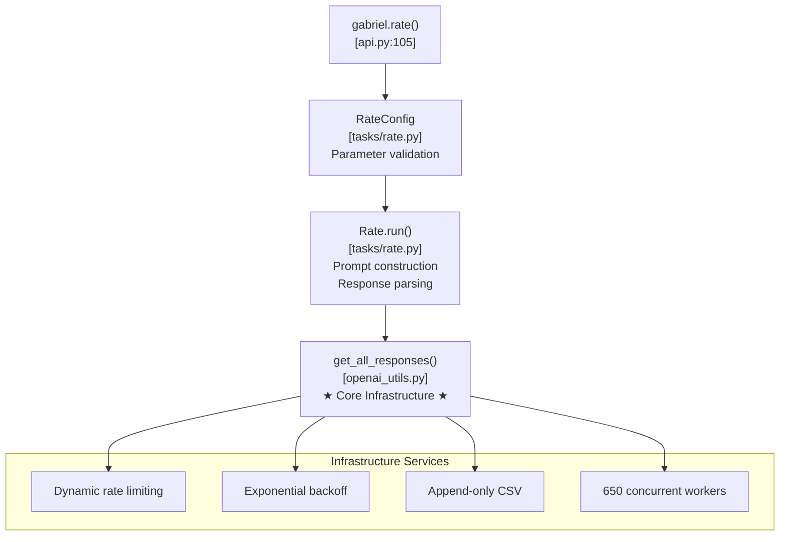

<!-- source: DeepWiki mcp.deepwiki.com · repo openai/GABRIEL · page 4.1 gabriel.rate - Absolute Scoring · fetched 2026-10-26 -->

# gabriel.rate - Absolute Scoring

<details>
<summary>Relevant source files</summary>

The following files were used as context for generating this wiki page:

- [src/gabriel/api.py](src/gabriel/api.py)
- [src/gabriel/prompts/paraphrase_prompt.jinja2](src/gabriel/prompts/paraphrase_prompt.jinja2)
- [src/gabriel/tasks/paraphrase.py](src/gabriel/tasks/paraphrase.py)
- [tests/test_basic.py](tests/test_basic.py)

</details>


## Purpose and Scope

This page documents the `gabriel.rate` function, which assigns absolute numeric scores (0-100 scale) to items based on natural language attribute definitions. The function evaluates each item independently against specified criteria, making it suitable for measuring subjective qualities where no reference points are needed.

For relative comparisons between items, see [gabriel.rank - Pairwise Ranking](#4.2). For categorical labeling, see [gabriel.classify - Categorical Labeling](#4.3). For extracting specific structured facts, see [gabriel.extract - Structured Extraction](#4.4).

**Sources:** [src/gabriel/api.py:105-215]()

---

## Core Concept

The `rate` task measures items on natural language attributes using a fixed 0-100 scale. Unlike ranking (which compares items against each other), rating evaluates each item in isolation. The LLM receives the item content and attribute definitions, then returns numeric scores.

**Common use cases:**
- Measuring "populist rhetoric" intensity in political speeches
- Scoring "toxicity" levels in social media posts
- Evaluating "luxury" perception in advertisement images
- Assessing "clarity" of technical documentation

The scores are interpretable as absolute measurements where 0 represents complete absence of the attribute and 100 represents maximum presence.

**Sources:** [src/gabriel/api.py:126-130]()

---

## Basic Usage Pattern

```python
import gabriel
import pandas as pd

df = pd.DataFrame({
    "text": [
        "This product revolutionizes everything!",
        "A reliable tool for daily tasks.",
        "Mediocre quality, not recommended."
    ]
})

result = await gabriel.rate(
    df=df,
    column_name="text",
    attributes={
        "enthusiasm": "How enthusiastic is the tone?",
        "credibility": "How credible does this sound?"
    },
    save_dir="./ratings_output"
)

# Result DataFrame includes original columns plus:
# - enthusiasm: float (0-100)
# - credibility: float (0-100)
```

**Sources:** [src/gabriel/api.py:105-215](), [tests/test_basic.py:822-828]()

---

## Data Flow Architecture



**Diagram: Rating Pipeline from DataFrame Input to Scored Output**

**Key steps:**
1. **Configuration validation**: `RateConfig.__post_init__` ensures parameters are valid
2. **Prompt batching**: Attributes split into groups of `n_attributes_per_run` (default 8)
3. **Parallel execution**: Up to `n_parallels` (default 650) concurrent LLM calls
4. **Score extraction**: JSON responses parsed to extract numeric scores
5. **Multi-run aggregation**: When `n_runs > 1`, scores are averaged across runs

**Sources:** [src/gabriel/api.py:189-215]()

---

## Configuration Parameters

| Parameter | Type | Default | Description |
|-----------|------|---------|-------------|
| `df` | `Optional[pd.DataFrame]` | Required | Source DataFrame. When `None`, loads cached results from `save_dir`. |
| `column_name` | `str` | Required | Column containing items to rate (text/images/audio/PDFs depending on `modality`). |
| `attributes` | `Dict[str, str]` | Required | Mapping of attribute names to natural language descriptions. Keys become output column names. |
| `save_dir` | `str` | Required | Directory for persisting raw responses, aggregated results, and metadata. Created if absent. |
| `additional_instructions` | `Optional[str]` | `None` | Free-form text appended to the prompt template for context-specific guidance. |
| `model` | `str` | `"gpt-5-mini"` | Model identifier passed to OpenAI Responses API. |
| `n_parallels` | `int` | `650` | Maximum concurrent requests. Dynamically adjusted based on rate limits. |
| `n_runs` | `int` | `1` | Number of independent rating passes per item. Results averaged to improve reliability. |
| `n_attributes_per_run` | `int` | `8` | Maximum attributes evaluated per prompt. Larger sets split across multiple prompts. |
| `reset_files` | `bool` | `False` | When `True`, ignores existing outputs in `save_dir` and regenerates from scratch. |
| `file_name` | `str` | `"ratings.csv"` | Base filename for saved artifacts (without automatic suffixes like `_raw_responses`). |
| `modality` | `str` | `"text"` | Input type: `"text"`, `"entity"`, `"web"`, `"image"`, `"audio"`, or `"pdf"`. Controls prompt rendering. |
| `reasoning_effort` | `Optional[str]` | `None` | Reasoning intensity for GPT-5 models: `"low"`, `"medium"`, or `"high"`. Higher is slower but more accurate. |
| `search_context_size` | `str` | `"medium"` | Web search context size when `modality="web"`. Options: `"low"`, `"medium"`, `"high"`. |
| `template_path` | `Optional[str]` | `None` | Path to custom Jinja2 template overriding the default `ratings_prompt.jinja2`. See [Prompt Customization](#10.1). |
| `response_fn` | `Optional[Callable]` | `None` | Custom callable replacing per-prompt LLM invocation. See [Custom Response Parsing](#10.2). |
| `get_all_responses_fn` | `Optional[Callable]` | `None` | Custom callable replacing entire `get_all_responses` infrastructure. See [Alternative LLM Backends](#10.3). |

**Additional keyword arguments** are forwarded to `RateConfig.__init__`, enabling advanced configuration like custom dummy response specifications for testing.

**Sources:** [src/gabriel/api.py:132-187]()

---

## Attribute Batching Logic

When the number of attributes exceeds `n_attributes_per_run`, the system automatically splits them across multiple prompts per item. This prevents token overflow and maintains response quality.



**Diagram: Attribute Batching Strategy**

**Implementation details:**
- Batches constructed in [`Rate._build_prompts()`](src/gabriel/tasks/rate.py) (referenced in task implementation)
- Batch identifiers encoded as `{hash}_batch{N}` where N is zero-indexed
- Responses merged by stripping batch suffix from identifiers
- Final DataFrame contains all attributes regardless of batching

**Example:** Rating 15 attributes with `n_attributes_per_run=8` creates 2 prompts per item:
- Prompt 1: attributes 0-7
- Prompt 2: attributes 8-14

**Sources:** [src/gabriel/api.py:154-156]()

---

## Multiple Runs and Aggregation

Setting `n_runs > 1` generates multiple independent ratings for each item-attribute pair, improving measurement reliability by reducing single-call variance.

### Aggregation Output Structure

| File | Content | Use Case |
|------|---------|----------|
| `ratings_raw_responses.csv` | Raw LLM responses with identifiers, timestamps, token counts | Debugging, auditability |
| `ratings_full_disaggregated.csv` | Individual scores indexed by `(id, run)` | Analyzing inter-run variance |
| `ratings_cleaned.csv` | Mean scores per attribute | Primary analysis, returned by `rate()` |

### Disaggregated Index Structure

```python
# Example disaggregated output (n_runs=3)
#                    attribute1  attribute2
# id        run                            
# text_hash 0              45          67
#           1              48          65
#           2              46          68
```

**Access patterns:**
```python
# Load disaggregated scores
disagg = pd.read_csv("save_dir/ratings_full_disaggregated.csv", 
                     index_col=[0, 1])

# Calculate variance for quality assessment
variance = disagg.groupby(level=0).var()

# Identify high-variance items requiring re-rating
uncertain = variance[variance['attribute1'] > 100].index
```

**Sources:** [tests/test_basic.py:831-838]()

---

## Multimodal Input Support

The `rate` function adapts prompt construction based on the `modality` parameter, enabling scoring of diverse content types.

### Modality-Specific Behavior

```mermaid
graph TB
    subgraph "Text/Entity/Web"
        TextCol["df[column_name]<br/>strings"]
        TextPrompt["Inline in prompt<br/>as text content"]
    end
    
    subgraph "Image"
        ImageCol["df[column_name]<br/>file paths"]
        ImageLoad["load_image_inputs()<br/>Base64 encoding"]
        ImagePrompt["prompt_images dict<br/>passed to API"]
    end
    
    subgraph "Audio"
        AudioCol["df[column_name]<br/>file paths or dicts"]
        AudioLoad["load_audio_inputs()<br/>Base64 + format"]
        AudioPrompt["prompt_audio dict<br/>passed to API"]
    end
    
    subgraph "PDF"
        PDFCol["df[column_name]<br/>file paths or dicts"]
        PDFLoad["load_pdf_inputs()<br/>Base64 + page info"]
        PDFPrompt["prompt_pdfs dict<br/>passed to API"]
    end
    
    TextCol --> TextPrompt
    ImageCol --> ImageLoad --> ImagePrompt
    AudioCol --> AudioLoad --> AudioPrompt
    PDFCol --> PDFLoad --> PDFPrompt
```



**Diagram: Modality-Specific Input Processing**

### Example: Rating Image Clarity

```python
# DataFrame with image file paths
df = pd.DataFrame({
    "image_path": [
        "/path/to/image1.jpg",
        "/path/to/image2.png"
    ]
})

result = await gabriel.rate(
    df=df,
    column_name="image_path",
    attributes={
        "clarity": "How clear and sharp is the image?",
        "composition": "Quality of visual composition"
    },
    save_dir="./image_ratings",
    modality="image"  # Triggers image-specific handling
)
```

### Example: Rating Audio Clips

```python
# Pre-encoded audio (no file I/O)
df = pd.DataFrame({
    "audio": [
        [{"data": base64_audio, "format": "mp3"}],
        [{"data": base64_audio2, "format": "wav"}]
    ]
})

result = await gabriel.rate(
    df=df,
    column_name="audio",
    attributes={"clarity": "", "background_noise": ""},
    save_dir="./audio_ratings",
    modality="audio"
)
```

**Sources:** [tests/test_basic.py:873-902](), [src/gabriel/api.py:163-165]()

---

## Output DataFrame Structure

The returned DataFrame extends the input with computed attribute columns and preserves original row order.

### Column Additions

| Column Pattern | Type | Description |
|----------------|------|-------------|
| `{attribute_name}` | `float` | Mean score across `n_runs` repetitions (0-100 scale) |

### Example Transformation

**Input DataFrame:**
```
   text
0  "Revolutionary product!"
1  "Reliable and steady."
```

**After `rate()` with `attributes={"enthusiasm": "", "credibility": ""}`:**
```
   text                      enthusiasm  credibility
0  "Revolutionary product!"      92.0        65.0
1  "Reliable and steady."        45.0        88.0
```

### Handling Missing/Invalid Scores

- Failed LLM calls: Column contains `NaN` for affected rows
- Invalid JSON responses: Parsed using `safest_json()` with fallback to `None` → `NaN`
- Out-of-range scores: Not automatically clipped; downstream analysis should validate

**Sources:** [src/gabriel/api.py:183-187]()

---

## Caching and Resumability

The `rate` function implements automatic checkpointing and supports loading cached results without re-computation.

### Cache Directory Structure

```
save_dir/
├── ratings.csv                      # Legacy format (if exists)
├── ratings_raw_responses.csv        # All LLM responses with metadata
├── ratings_full_disaggregated.csv   # Per-run scores indexed by (id, run)
└── ratings_cleaned.csv              # Aggregated means (loaded when df=None)
```

### Loading Cached Results

```python
# Initial computation
await gabriel.rate(
    df=df,
    column_name="text",
    attributes={"score": ""},
    save_dir="./cache"
)

# Later: load without recomputing
cached_df = await gabriel.rate(
    df=None,  # Triggers cache load
    column_name="text",  # Still required but unused
    attributes={"score": ""},  # Still required but unused
    save_dir="./cache"
)
```

### Resuming Interrupted Runs

When a run is interrupted (e.g., network failure, process termination), re-executing with the same parameters automatically resumes from the last checkpoint:

```python
# Run interrupted after processing 500/1000 rows
await gabriel.rate(...)

# Re-run with identical parameters (reset_files=False)
# Detects existing responses for rows 0-499
# Continues from row 500
await gabriel.rate(...)
```

**Checkpoint granularity:** Controlled by `checkpoint_interval` in `get_all_responses` (inherited from infrastructure layer).

**Force regeneration:** Set `reset_files=True` to ignore all cached outputs.

**Sources:** [src/gabriel/api.py:189-194](), [tests/test_basic.py:841-870]()

---

## Advanced Customization

### Custom Prompt Templates

Override the default Jinja2 template to inject domain-specific logic or modify the rating instructions.

**Default template location:** `src/gabriel/prompts/ratings_prompt.jinja2`

**Custom template example:**
```python
# custom_rate.jinja2
Rate the following {{ modality }} on a 0-100 scale.
Focus on {{ domain_context }}.

Content: {{ text }}

Attributes:

- {{ attr }}: {{ desc }}


Return JSON: {{"{"}}"{{ attr }}": <score>{{ "," if not loop.last }}{{"}"}}.

await gabriel.rate(
    df=df,
    column_name="text",
    attributes={"quality": "Overall quality"},
    save_dir="./custom",
    template_path="./custom_rate.jinja2"
)
```

**Available template variables:**
- `text`: Item content (empty for non-text modalities)
- `attributes`: List of attribute names
- `descriptions`: List of attribute descriptions (parallel to `attributes`)
- `modality`: Input modality string
- `additional_instructions`: User-provided extra guidance
- `json_mode`: Boolean indicating JSON output mode

**Sources:** [src/gabriel/api.py:171](), [tests/test_basic.py:202-205]()

---

### Custom Response Functions

Replace the default LLM invocation with a custom callable for testing or alternative backends.

**Signature requirements:**
```python
from typing import List, Awaitable

async def custom_response_fn(
    prompt: str,
    *,
    n: int = 1,
    model: str = "gpt-5-mini",
    json_mode: bool = False,
    **kwargs
) -> List[str]:
    """Return list of response strings."""
    ...
```

**Example: Mock responses for testing**
```python
async def mock_scorer(prompt: str, **kwargs) -> List[str]:
    return ['{"enthusiasm": 50, "credibility": 75}']

result = await gabriel.rate(
    df=df,
    column_name="text",
    attributes={"enthusiasm": "", "credibility": ""},
    save_dir="./mock",
    response_fn=mock_scorer
)
```

**Sources:** [src/gabriel/api.py:122-123](), [tests/test_basic.py:525-543]()

---

### Alternative LLM Backends

Replace the entire `get_all_responses` infrastructure to use non-OpenAI LLM providers while retaining all task-level logic.

**Required signature:**
```python
async def custom_driver(
    prompts: List[str],
    identifiers: List[str],
    *,
    model: str,
    json_mode: bool,
    **kwargs
) -> pd.DataFrame:
    """Return DataFrame with columns: Identifier, Response"""
    ...
```

**Example: Anthropic Claude backend**
```python
async def anthropic_driver(prompts, identifiers, **kwargs):
    import anthropic
    client = anthropic.AsyncAnthropic()
    
    responses = []
    for prompt in prompts:
        msg = await client.messages.create(
            model="claude-3-5-sonnet-20241022",
            messages=[{"role": "user", "content": prompt}]
        )
        responses.append([msg.content[0].text])
    
    return pd.DataFrame({
        "Identifier": identifiers,
        "Response": responses
    })

result = await gabriel.rate(
    df=df,
    column_name="text",
    attributes={"score": ""},
    save_dir="./anthropic",
    get_all_responses_fn=anthropic_driver
)
```

**Note:** Custom drivers bypass GABRIEL's built-in rate limiting, retry logic, and checkpointing. Implement these features in the custom driver if needed.

**Sources:** [src/gabriel/api.py:123-124](), [tests/test_basic.py:583-621]()

---

## Integration with Core Infrastructure

The `rate` function is a thin wrapper around the `Rate` task class, which delegates infrastructure concerns to the LLM orchestration layer.



**Diagram: Rate Task Infrastructure Delegation**

### Inherited Infrastructure Features

From `get_all_responses` (see [LLM Orchestration Infrastructure](#3.1)):

1. **Rate limit management**: Automatically queries `x-ratelimit-*` headers and adjusts `concurrency_cap`
2. **Error classification**: Distinguishes rate limit errors, timeouts, connection failures, and auth errors with tailored retry strategies
3. **Checkpointing**: Saves progress every N items (configurable via `checkpoint_interval`)
4. **Background mode**: For long-running requests, polls completion status to survive HTTP timeouts
5. **Token tracking**: Records input/output/reasoning token counts for cost analysis

### Performance Tuning

**Maximize throughput:**
```python
await gabriel.rate(
    ...,
    n_parallels=650,  # Default: near rate limit
    n_runs=1,         # Reduce for faster results
    n_attributes_per_run=8  # Balance prompt size vs. parallelism
)
```

**Maximize reliability:**
```python
await gabriel.rate(
    ...,
    n_runs=3,         # Triple-check scores
    reasoning_effort="high",  # Slower but more accurate
    n_parallels=100   # Reduce load on rate limits
)
```

**Sources:** [src/gabriel/api.py:209-215]()

---

## Relationship to Other Measurement Tasks

| Task | Output Type | Comparison Mode | Best For |
|------|-------------|-----------------|----------|
| **rate** (this page) | Absolute scores (0-100) | None (independent evaluation) | Measuring intensity/presence of attributes |
| [rank](#4.2) | Relative z-scores | Pairwise tournaments | Ordering items by subjective quality |
| [classify](#4.3) | Boolean labels | None (independent evaluation) | Applying predefined category labels |
| [extract](#4.4) | Structured values | None (independent evaluation) | Pulling specific facts/entities |
| [discover](#4.5) | Feature taxonomy | Contrastive analysis | Finding discriminating attributes |

**When to use `rate` vs. `rank`:**
- Use `rate` when absolute magnitude matters (e.g., toxicity levels for moderation thresholds)
- Use `rank` when relative ordering matters (e.g., top 10 candidates for funding)

**Sources:** [src/gabriel/api.py:105-215]()

---

