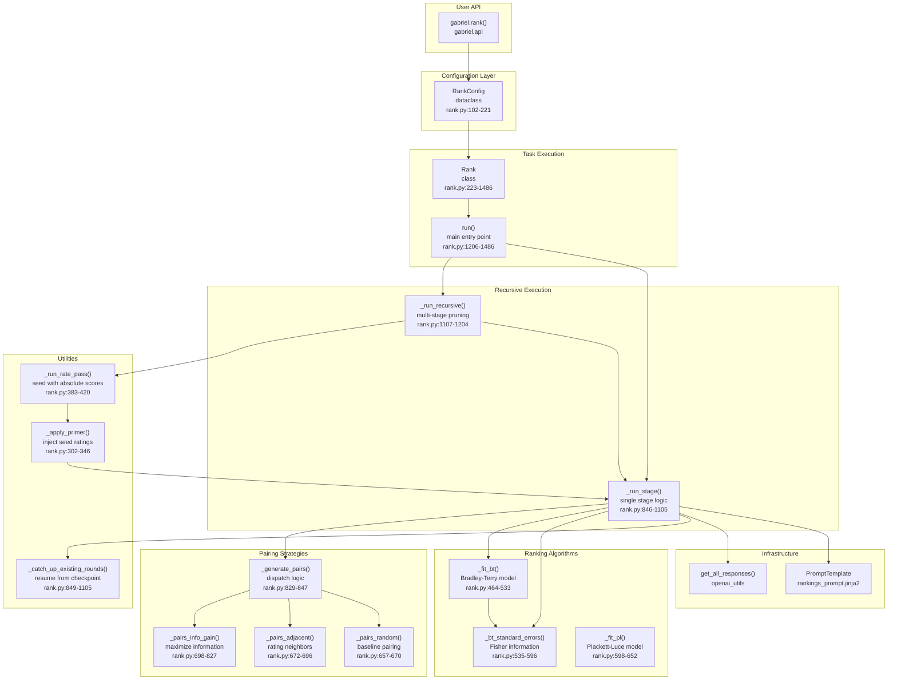
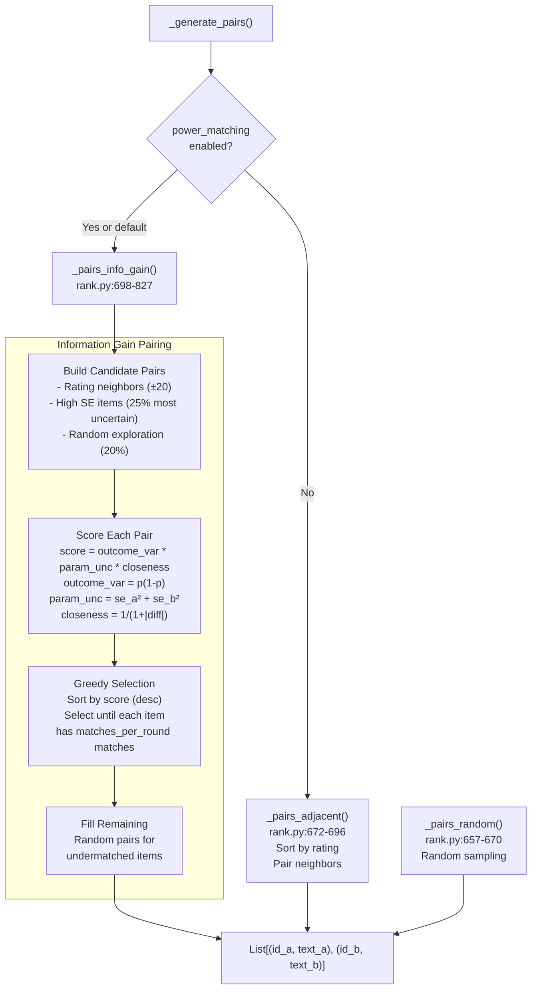
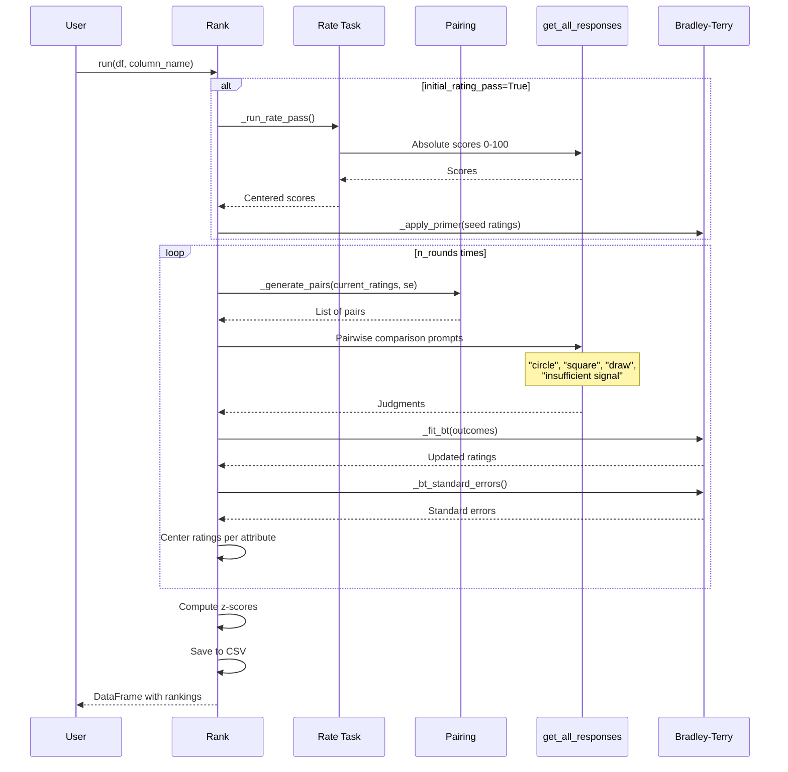
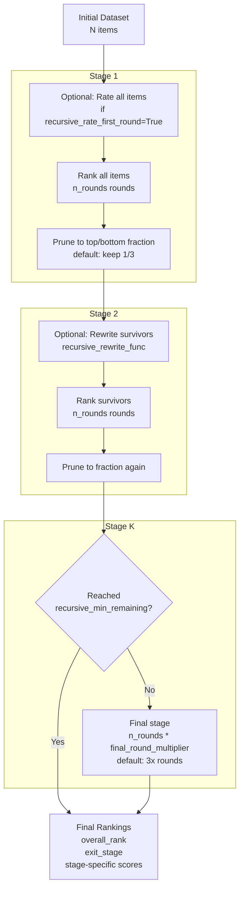
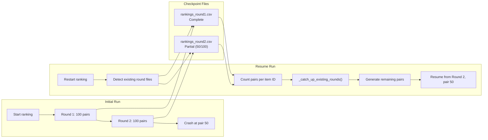

<!-- source: DeepWiki mcp.deepwiki.com · repo openai/GABRIEL · page 4.2 gabriel.rank - Pairwise Ranking · fetched 2026-10-26 -->

# gabriel.rank - Pairwise Ranking

<details>
<summary>Relevant source files</summary>

The following files were used as context for generating this wiki page:

- [src/gabriel/prompts/paraphrase_prompt.jinja2](src/gabriel/prompts/paraphrase_prompt.jinja2)
- [src/gabriel/tasks/paraphrase.py](src/gabriel/tasks/paraphrase.py)
- [src/gabriel/tasks/rank.py](src/gabriel/tasks/rank.py)
- [tests/test_basic.py](tests/test_basic.py)

</details>


## Purpose and Scope

This page documents the `gabriel.rank` task, which performs pairwise ranking of items using the Bradley-Terry model. Instead of assigning absolute scores to individual items (see [gabriel.rate](#4.1) for absolute scoring), this task compares pairs of items head-to-head to establish a relative ranking. The system generates tournament-style matchups, collects LLM judgments on which item better exhibits each attribute, and fits a Bradley-Terry model to produce z-scores with standard errors.

For feature discovery workflows that rank discovered attributes, see [gabriel.discover](#4.5). For multi-stage theory generation pipelines that use ranking as a component, see [gabriel.ideate](#7.1).

**Sources:** [src/gabriel/tasks/rank.py:1-41]()

---

## System Architecture



**Diagram: Rank Task Architecture**

The `Rank` class orchestrates the entire pairwise ranking workflow. The user-facing API routes through `RankConfig` to configure behavior, then delegates to either `_run_recursive()` for multi-stage pruning or directly to the internal stage runner. Each stage generates pairs using information gain heuristics, collects LLM judgments via `get_all_responses()`, and fits a Bradley-Terry model to produce rankings with standard errors.

**Sources:** [src/gabriel/tasks/rank.py:223-263](), [src/gabriel/tasks/rank.py:1206-1486]()

---

## Configuration

The `RankConfig` dataclass exposes parameters for controlling ranking behavior:

| Parameter | Type | Default | Description |
|-----------|------|---------|-------------|
| `attributes` | `Dict[str, str]` or `List[str]` | Required | Mapping from attribute names to definitions |
| `n_rounds` | `int` | `5` | Number of rounds of pairwise comparisons |
| `matches_per_round` | `int` | `5` | Number of matches per item per round |
| `power_matching` | `bool` | `True` | Use information gain pairing heuristics |
| `learning_rate` | `float` | `0.1` | Pseudo-count for BT regularization |
| `model` | `str` | `"gpt-5-mini"` | Language model identifier |
| `n_parallels` | `int` | `650` | Number of concurrent API calls |
| `save_dir` | `str` | `"~/Documents/runs"` | Directory for output files |
| `file_name` | `str` | `"rankings"` | Stem for output CSV files |
| `initial_rating_pass` | `bool` | `True` | Run absolute rating before pairwise comparisons |
| `recursive` | `bool` | `False` | Enable multi-stage pruning |
| `recursive_fraction` | `float` | `1/3` | Fraction of items to retain per stage |
| `recursive_min_remaining` | `int` | `30` | Minimum items in final stage |
| `recursive_rate_first_round` | `bool` | `True` | Rate items before first recursive stage |
| `primer_scores` | `Dict` | `None` | Manual seed ratings by identifier |

**Sources:** [src/gabriel/tasks/rank.py:102-221]()

### Example Usage

```python
import gabriel
import pandas as pd

df = pd.DataFrame({"text": ["First passage", "Second passage", "Third passage"]})

# Basic pairwise ranking
result = await gabriel.rank(
    df,
    "text",
    attributes={"clarity": "How clear is the writing?", "originality": "How novel is the idea?"},
    n_rounds=5,
    matches_per_round=5,
    save_dir="ranking_output"
)
```

**Sources:** [tests/test_basic.py:1044-1068]()

---

## Core Algorithm: Bradley-Terry Model

```mermaid
graph LR
    subgraph "Input Data"
        Outcomes["Pairwise Outcomes<br/>List[(winner, loser)]"]
    end
    
    subgraph "BT Fitting Process"
        WinMatrix["Win Matrix<br/>wins[i,j] = times i beat j"]
        Pseudo["Add Pseudo-count<br/>learning_rate=0.1"]
        FixedPoint["Fixed-Point Iteration<br/>p_new = w_i / sum(n_ij/(p_i+p_j))"]
        Converge{"Converged?<br/>|p_new - p| < 1e-6"}
        LogScale["Log Transform<br/>s = log(p)"]
        Center["Center at Zero<br/>s -= mean(s)"]
    end
    
    subgraph "Standard Error Computation"
        FisherInfo["Fisher Information Matrix<br/>I = diag(q*1) - q<br/>q = n_ij * p_ij * (1-p_ij)"]
        Project["Project to Constrained Subspace<br/>proj = I - 1*1'/n"]
        Ridge["Add Ridge Term<br/>I_proj += 1e-5 * I"]
        Invert["Pseudo-inverse<br/>cov = pinv(I_proj)"]
        SE["Standard Errors<br/>se = sqrt(diag(cov))"]
    end
    
    subgraph "Output"
        Scores["BT Scores<br/>Dict[item_id, float]"]
        Errors["Standard Errors<br/>Dict[item_id, float]"]
        ZScores["Z-Scores<br/>(score - mean) / std"]
    end
    
    Outcomes --> WinMatrix
    WinMatrix --> Pseudo
    Pseudo --> FixedPoint
    FixedPoint --> Converge
    Converge -->|No| FixedPoint
    Converge -->|Yes| LogScale
    LogScale --> Center
    Center --> Scores
    
    Converge --> FisherInfo
    FisherInfo --> Project
    Project --> Ridge
    Ridge --> Invert
    Invert --> SE
    SE --> Errors
    
    Scores --> ZScores
    Errors --> ZScores
```



**Diagram: Bradley-Terry Model Fitting and Standard Error Computation**

The Bradley-Terry model estimates log-skill parameters for each item by fitting pairwise comparison outcomes. The implementation uses iterative fixed-point updates with pseudo-count regularization (`learning_rate` parameter) to stabilize estimates when items have few comparisons.

**Sources:** [src/gabriel/tasks/rank.py:464-533]()

### Fixed-Point Iteration

The core BT update rule is implemented in [src/gabriel/tasks/rank.py:517-524]():

```python
for _ in range(max_iter):
    denom = (n_ij / (p[:, None] + p[None, :])).sum(axis=1)
    p_new = w_i / denom
    if np.max(np.abs(p_new - p)) < tol:
        p = p_new
        break
    p = p_new
```

Each iteration recomputes the skill parameter `p[i]` as the ratio of total wins to the sum of expected win probabilities across all opponents. Convergence typically occurs within 10-20 iterations with the default tolerance of `1e-6`.

**Sources:** [src/gabriel/tasks/rank.py:517-524]()

### Standard Error Estimation

Standard errors are computed from the observed Fisher information matrix [src/gabriel/tasks/rank.py:535-596]():

```
I = diag(q·1) - q
q[i,j] = n_ij * p_ij * (1 - p_ij)
```

Where:
- `n_ij` is the total number of comparisons between items i and j
- `p_ij` is the predicted win probability for i versus j under the BT model
- `q[i,j]` encodes the information contributed by each pairwise comparison

The BT estimates satisfy a sum-to-zero constraint, making the Fisher information rank-deficient. The implementation projects `I` onto the constrained subspace and computes the Moore-Penrose pseudoinverse with a ridge term (`1e-5` by default) for numerical stability:

```python
proj = np.eye(n) - ones @ ones.T / n
I_proj = proj @ I @ proj
I_proj[np.diag_indices(n)] += ridge
cov = np.linalg.pinv(I_proj, rcond=1e-12)
se = np.sqrt(np.clip(np.diag(cov), 0.0, None))
```

**Sources:** [src/gabriel/tasks/rank.py:535-596]()

### Z-Score Normalization

After fitting, raw BT scores are standardized to z-scores for interpretability. The final output includes three columns per attribute:
- `<attribute>`: z-score (mean=0, std=1)
- `<attribute>_raw`: raw BT log-skill parameter (zero-centered)
- `<attribute>_se`: standard error of the raw parameter

**Sources:** [tests/test_basic.py:930-948]()

---

## Pairing Strategies



**Diagram: Pairing Strategy Decision Flow**

The pairing strategy determines which items are compared in each round. Information gain pairing (`power_matching=True`) maximizes the expected reduction in uncertainty by:

1. **Building Candidate Pairs** [src/gabriel/tasks/rank.py:735-765](): Each item considers neighbors within ±20 positions in the current rating order, plus random exploration pairs (20% of total matches).

2. **Scoring Pairs** [src/gabriel/tasks/rank.py:783-797](): Each candidate pair `(a, b)` receives a score based on:
   - **Outcome variance**: `p(1-p)` where `p` is the predicted win probability
   - **Parameter uncertainty**: `se_a² + se_b²` from current standard errors
   - **Closeness**: `1/(1 + |rating_a - rating_b|)` to favor similar-rated items

3. **Greedy Selection** [src/gabriel/tasks/rank.py:799-810](): Pairs are selected in descending score order, ensuring each item participates in exactly `matches_per_round` comparisons.

4. **Random Fill** [src/gabriel/tasks/rank.py:811-826](): If any item has fewer than `matches_per_round` matches after greedy selection, random pairs are added to satisfy the quota.

**Sources:** [src/gabriel/tasks/rank.py:698-847]()

### Scalability Constraints

For large datasets (10,000+ items), evaluating all possible pairs becomes intractable. The implementation caps the total candidate pairs at 200,000 [src/gabriel/tasks/rank.py:292-299]():

```python
self._MAX_CANDIDATE_PAIRS_PER_ROUND = 200_000
```

This translates to approximately 20 neighbors per item for a 10,000-item dataset. Items with high standard errors receive additional random exploration matches to accelerate convergence [src/gabriel/tasks/rank.py:738-755]().

**Sources:** [src/gabriel/tasks/rank.py:292-299](), [src/gabriel/tasks/rank.py:721-765]()

---

## Workflow and Execution



**Diagram: Rank Task Execution Flow**

### Step-by-Step Process

1. **Data Preparation** [src/gabriel/tasks/rank.py:1206-1258]():
   - Reset DataFrame indices for deterministic mapping
   - Hash text values to stable identifiers (8-character SHA1 prefix)
   - Load multimodal inputs (images, audio, PDFs) if specified
   - Drop rows with malformed values in strict text mode

2. **Optional Initial Rating Pass** [src/gabriel/tasks/rank.py:383-420]():
   - If `initial_rating_pass=True`, run `Rate` task on all items
   - Center scores per attribute (subtract mean)
   - Use centered scores as primer for BT initialization
   - Helps pairing focus on refinement rather than initial exploration

3. **Iterative Ranking Rounds** [src/gabriel/tasks/rank.py:1318-1445]():
   - For each round (default: 5 rounds):
     - Generate pairs using information gain strategy
     - Render prompts with `rankings_prompt.jinja2` template
     - Call `get_all_responses()` with 650 parallel workers
     - Parse LLM judgments: "circle"/"square"/"draw"/"insufficient signal"
     - Fit Bradley-Terry model to cumulative outcomes
     - Compute standard errors from Fisher information
     - Center ratings per attribute (subtract mean)

4. **Output Generation** [src/gabriel/tasks/rank.py:1446-1486]():
   - Compute z-scores: `(raw_score - mean) / std`
   - Create columns: `<attr>`, `<attr>_raw`, `<attr>_se`
   - Write to `{save_dir}/{file_name}_final.csv`
   - Write intermediate round data to `{save_dir}/{file_name}_round{N}.csv`

**Sources:** [src/gabriel/tasks/rank.py:1206-1486]()

### Prompt Template

The `rankings_prompt.jinja2` template presents two passages (labeled "circle" and "square") and asks the LLM to judge which better exhibits each attribute. The LLM returns JSON with keys for each attribute and values:
- `"circle"`: First passage wins
- `"square"`: Second passage wins
- `"draw"`: Tie or indistinguishable
- `"insufficient signal"`: Cannot judge

Both "draw" and "insufficient signal" are treated as ties, contributing equally to both items in the BT model [src/gabriel/tasks/rank.py:1058-1065]().

**Sources:** [src/gabriel/tasks/rank.py:20-25](), [src/gabriel/tasks/rank.py:1058-1065]()

---

## Recursive Ranking



**Diagram: Recursive Ranking Multi-Stage Pipeline**

Recursive ranking enables pruning of large datasets by ranking in stages. After each stage, only a fraction of items (default: 1/3) advances to the next stage, reducing computational cost while focusing comparisons on the top/bottom candidates.

**Sources:** [src/gabriel/tasks/rank.py:1107-1204]()

### Configuration

| Parameter | Type | Default | Description |
|-----------|------|---------|-------------|
| `recursive` | `bool` | `False` | Enable multi-stage pruning |
| `recursive_fraction` | `float` | `1/3` | Fraction to retain per stage |
| `recursive_min_remaining` | `int` | `30` | Stop pruning at this size |
| `recursive_final_round_multiplier` | `int` | `3` | Extra rounds in final stage |
| `recursive_cut_attr` | `str` | First attribute | Which attribute to prune on |
| `recursive_cut_side` | `str` | `"top"` | Keep `"top"` or `"bottom"` items |
| `recursive_rate_first_round` | `bool` | `True` | Rate before first stage |
| `recursive_rewrite_func` | `Callable` | `None` | Optional passage rewriter |
| `recursive_keep_stage_columns` | `bool` | `True` | Merge stage outputs |
| `recursive_add_stage_suffix` | `bool` | `True` | Prefix columns with `stage{N}_` |

**Sources:** [src/gabriel/tasks/rank.py:194-216]()

### Stage Execution

Each recursive stage follows the same workflow as non-recursive ranking [src/gabriel/tasks/rank.py:1161-1204]():

1. **Pruning Decision**: After fitting the BT model, items are sorted by the `recursive_cut_attr` score. The top (or bottom) `recursive_fraction` advance.

2. **Passage Rewriting** (optional): If `recursive_rewrite_func` is provided, each surviving passage is rewritten. The callable signature is:
   ```python
   def rewrite(original_text: str, current_text: str, stage_number: int) -> str
   ```
   This allows progressive refinement (e.g., shortening passages in later stages).

3. **Stage Metadata**: Output DataFrame includes:
   - `overall_rank`: Final rank across all stages (1 = best)
   - `exit_stage`: Which stage the item was eliminated (survivors have final stage number)
   - `stage{N}_{attr}`: Per-stage scores for each attribute
   - `stage{N}_{attr}_raw`, `stage{N}_{attr}_se`: Per-stage raw scores and standard errors

4. **Final Stage Multiplier**: The last stage runs `n_rounds * recursive_final_round_multiplier` rounds to maximize differentiation among finalists.

**Sources:** [src/gabriel/tasks/rank.py:1161-1204](), [tests/test_basic.py:1018-1042]()

### Example: Tournament-Style Ranking

```python
# Rank 1000 items in 3 stages
df = pd.DataFrame({"text": [...] * 1000})

result = await gabriel.rank(
    df,
    "text",
    attributes={"quality": ""},
    recursive=True,
    recursive_fraction=0.3,        # Keep top 30% each stage
    recursive_min_remaining=50,     # Stop at 50 items
    recursive_rate_first_round=True,# Rate before first pruning
    recursive_final_round_multiplier=3,  # 15 rounds in final stage
    n_rounds=5,
    matches_per_round=5
)

# Stage 1: 1000 items → rank → keep top 300
# Stage 2: 300 items → rank → keep top 90
# Stage 3: 90 items → rank → keep top 50 (hit min_remaining)
# Stage 4: 50 items → 15 rounds (5 * 3 multiplier)
```

**Sources:** [src/gabriel/tasks/rank.py:194-216]()

---

## Output Format

The ranking task produces multiple output files in `save_dir`:

### Primary Output: `{file_name}_final.csv`

Contains one row per item with columns:

| Column Pattern | Type | Description |
|----------------|------|-------------|
| `{text_column}` | `str` | Original text or identifier |
| `{attribute}` | `float` | Z-score for attribute (mean=0, std=1) |
| `{attribute}_raw` | `float` | Raw BT log-skill (zero-centered) |
| `{attribute}_se` | `float` | Standard error of raw score |

By default, the API function `gabriel.rank()` hides `_raw` and `_se` columns in the returned DataFrame but persists them to CSV [tests/test_basic.py:1044-1068]().

**Sources:** [tests/test_basic.py:930-948](), [tests/test_basic.py:1044-1068]()

### Intermediate Round Files: `{file_name}_round{N}.csv`

Each round's raw LLM responses are saved with columns:

| Column | Type | Description |
|--------|------|-------------|
| `Identifier` | `str` | Format: `{batch_idx}\|{pair_idx}\|{id_a}\|{id_b}` |
| `Response` | `List[str]` | JSON with attribute judgments |
| `Batch` | `int` | Attribute batch index |
| `Pair` | `int` | Pair index within batch |
| `IdA`, `IdB` | `str` | Item identifiers |
| `Time Taken` | `float` | API latency in seconds |
| `Input Tokens`, `Output Tokens` | `int` | Token counts |
| `Successful` | `bool` | Whether API call succeeded |
| `Error Log` | `str` | Error message if failed |

These files enable checkpoint-based resumption and debugging.

**Sources:** [src/gabriel/tasks/rank.py:1008-1020]()

### Recursive Output: Additional Columns

When `recursive=True`, the output includes:

| Column | Type | Description |
|--------|------|-------------|
| `overall_rank` | `int` | Final rank (1 = best) |
| `exit_stage` | `int` | Stage where item was eliminated |
| `stage{N}_{attribute}` | `float` | Z-score from stage N |
| `stage{N}_{attribute}_raw` | `float` | Raw score from stage N |
| `stage{N}_{attribute}_se` | `float` | Standard error from stage N |

**Sources:** [tests/test_basic.py:1018-1042]()

---

## Checkpoint and Resumability



**Diagram: Checkpoint-Based Resumption**

The ranking task automatically resumes from interruptions by examining existing round files [src/gabriel/tasks/rank.py:849-1105]():

1. **Count Existing Matches**: For each round file, parse identifiers to count how many matches each item has participated in.

2. **Generate Missing Pairs**: For items with fewer than `matches_per_round` matches, generate additional pairs to satisfy the quota [src/gabriel/tasks/rank.py:894-903]().

3. **Catch-Up API Calls**: Submit missing comparisons to `get_all_responses()` with `reset_files=False` to append to existing round files [src/gabriel/tasks/rank.py:992-1007]().

4. **Refit Model**: After catching up, refit the Bradley-Terry model on all outcomes (existing + new) to produce updated rankings [src/gabriel/tasks/rank.py:1067-1105]().

This mechanism enables resumption even if the process crashes mid-round. When `reset_files=True`, all checkpoint files are deleted before starting [src/gabriel/api.py]().

**Sources:** [src/gabriel/tasks/rank.py:849-1105](), [src/gabriel/tasks/rank.py:1318-1445]()

---

## Multimodal Support

The ranking task supports text, images, audio, PDFs, and web search:

### Modality Configuration

| Modality | `modality` Value | Behavior |
|----------|------------------|----------|
| Text | `"text"` | Default; passages are embedded in prompt |
| Entity | `"entity"` | Short text strings (e.g., names) |
| Web | `"web"` | Search terms; uses web search augmentation |
| Image | `"image"` | Loads images from file paths |
| Audio | `"audio"` | Loads audio from file paths; uses `gpt-audio` model |
| PDF | `"pdf"` | Loads PDFs from file paths |

**Sources:** [src/gabriel/tasks/rank.py:191]()

### Image Ranking Example

```python
df = pd.DataFrame({"image_path": ["img1.png", "img2.jpg", "img3.png"]})

result = await gabriel.rank(
    df,
    "image_path",
    attributes={"visual_quality": "How aesthetically pleasing is the image?"},
    modality="image",
    n_rounds=3,
    matches_per_round=5
)
```

Images are loaded via [src/gabriel/utils/__init__.py:load_image_inputs]() and passed to `get_all_responses()` as `prompt_images` [src/gabriel/tasks/rank.py:943-957]().

**Sources:** [tests/test_basic.py:905-928](), [src/gabriel/tasks/rank.py:943-957]()

### Audio Ranking Example

```python
df = pd.DataFrame({"audio": [
    [{"data": "base64...", "format": "mp3"}],  # Pre-encoded
    [{"data": "base64...", "format": "wav"}]
]})

result = await gabriel.rank(
    df,
    "audio",
    attributes={"clarity": "", "inspiring": ""},
    modality="audio",
    n_rounds=1,
    matches_per_round=1
)
```

Audio inputs can be file paths (loaded and encoded automatically) or pre-encoded dictionaries with `data` and `format` keys [tests/test_basic.py:905-928]().

**Sources:** [tests/test_basic.py:905-928](), [src/gabriel/tasks/rank.py:958-973]()

---

## Implementation Details

### Hash-Based Identifiers

When no explicit `id_column` is provided, items are identified by hashing their text content [src/gabriel/tasks/rank.py:85-99]():

```python
def _hash_text_identifier(value: Any, *, strict: bool) -> Optional[str]:
    text = str(value).strip()
    return hashlib.sha1(text.encode("utf-8")).hexdigest()[:8]
```

The 8-character SHA1 prefix provides collision resistance for typical datasets (< 100k items) while maintaining readability in output files.

**Sources:** [src/gabriel/tasks/rank.py:85-99]()

### Primer Mechanism

Manual seed ratings can be injected via `primer_scores` [src/gabriel/tasks/rank.py:302-346]():

```python
primer = {
    "item_id_1": {"clarity": 10.0, "originality": 30.0},
    "item_id_2": {"clarity": -5.0, "originality": 15.0}
}

result = await gabriel.rank(
    df, "text",
    attributes={"clarity": "", "originality": ""},
    primer_scores=primer,
    primer_center=True,   # Center per attribute
    primer_scale=1.0       # Scaling factor
)
```

Primers are centered per attribute (subtract mean) if `primer_center=True`, then scaled by `primer_scale` before injection into the initial BT state [src/gabriel/tasks/rank.py:313-346]().

**Sources:** [src/gabriel/tasks/rank.py:302-346](), [tests/test_basic.py:1008-1016]()

### Attribute Batching

When ranking on many attributes, prompts are batched to avoid exceeding model context limits. The `n_attributes_per_run` parameter (default: 8) controls batch size [src/gabriel/tasks/rank.py:192]():

```python
# Rank on 20 attributes in batches of 8
result = await gabriel.rank(
    df, "text",
    attributes={f"attr_{i}": "" for i in range(20)},
    n_attributes_per_run=8
)
# Creates 3 batches: [0-7], [8-15], [16-19]
```

Each batch receives separate API calls, but outcomes are merged when fitting the BT model [src/gabriel/tasks/rank.py:1364-1385]().

**Sources:** [src/gabriel/tasks/rank.py:192](), [src/gabriel/tasks/rank.py:1364-1385]()

### Plackett-Luce Extension

The `_fit_pl()` method [src/gabriel/tasks/rank.py:598-652]() implements the Plackett-Luce model for multiway rankings (rankings of length > 2). Currently unused, but supports the `add_multiway_ranking()` API [src/gabriel/tasks/rank.py:351-360]() for potential future extensions.

**Sources:** [src/gabriel/tasks/rank.py:598-652](), [src/gabriel/tasks/rank.py:351-360]()

### Internal Constants

Several hyperparameters are hardcoded as instance variables to avoid cluttering the public API [src/gabriel/tasks/rank.py:273-299]():

| Constant | Value | Purpose |
|----------|-------|---------|
| `_EXPLORE_FRAC` | `0.2` | Fraction of random pairs per round |
| `_CANDIDATE_NEIGHBORS` | `20` | Neighborhood size for info gain pairing |
| `_HIGH_SE_FRAC` | `0.25` | Fraction of high-uncertainty items |
| `_MAX_ITER` | `1000` | Maximum BT iterations |
| `_TOL` | `1e-6` | BT convergence tolerance |
| `_SE_RIDGE` | `1e-5` | Ridge term for Fisher info inversion |
| `_MAX_CANDIDATE_PAIRS_PER_ROUND` | `200000` | Maximum candidate pairs per round |

These values were chosen empirically and rarely need adjustment. For custom behavior, modify the instance variables after instantiation.

**Sources:** [src/gabriel/tasks/rank.py:273-299]()

---

## Relationship to Other Tasks

- **gabriel.rate** ([#4.1](#4.1)): Absolute scoring alternative; often used as `initial_rating_pass` to seed rankings
- **gabriel.ideate** ([#7.1](#7.1)): Uses recursive ranking to select top theories from generated candidates
- **gabriel.discover** ([#4.5](#4.5)): Can use ranking to prioritize discovered features
- **LLM Orchestration Infrastructure** ([#3.1](#3.1)): All API calls route through `get_all_responses()` for rate limiting, retries, and checkpointing

**Sources:** [src/gabriel/tasks/rank.py:1-41](), [src/gabriel/tasks/rank.py:71]()

---

