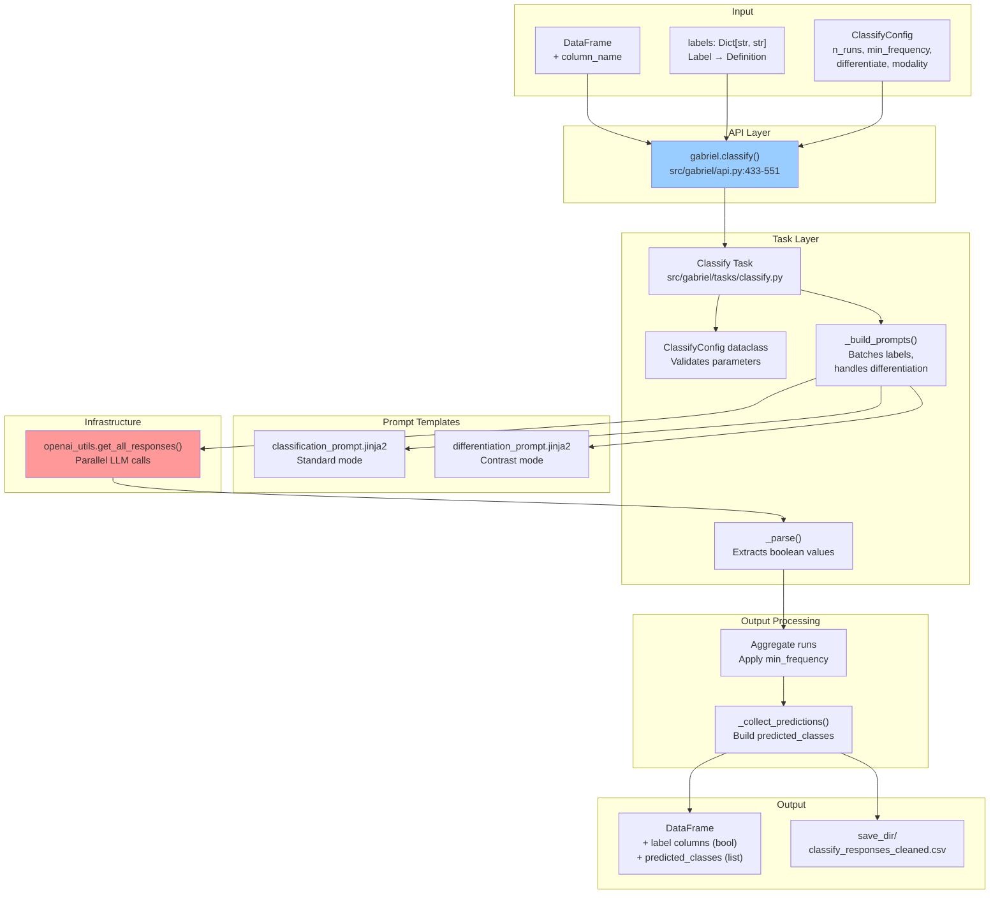
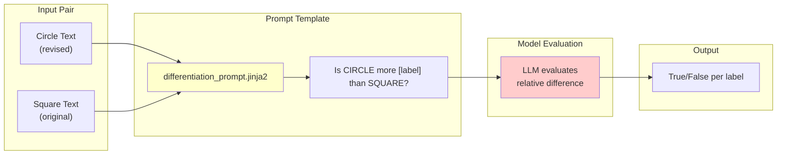
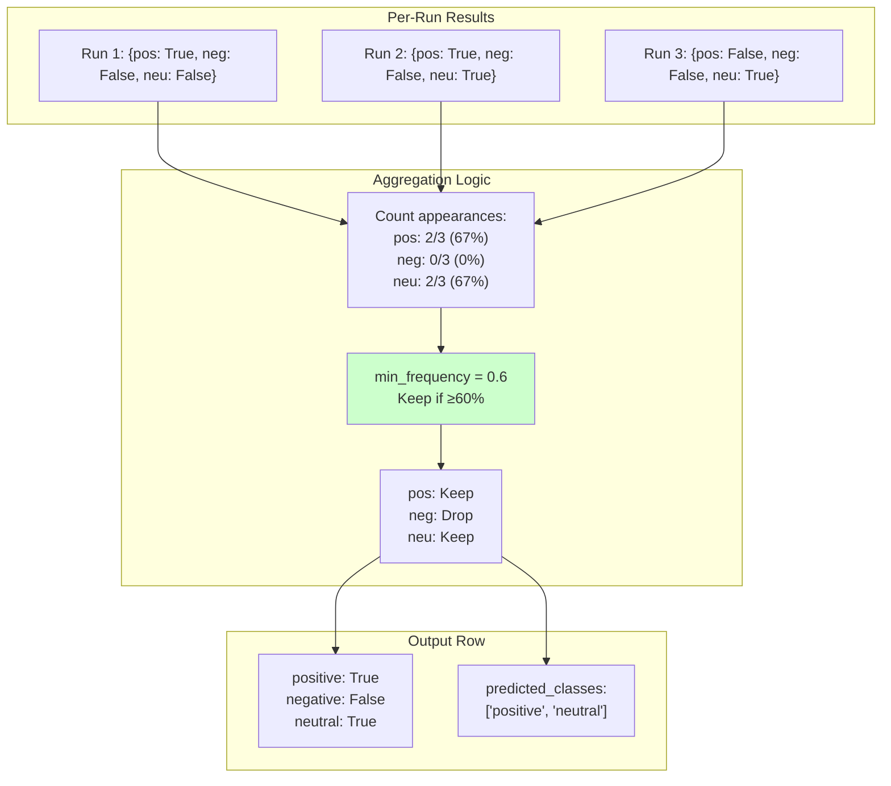
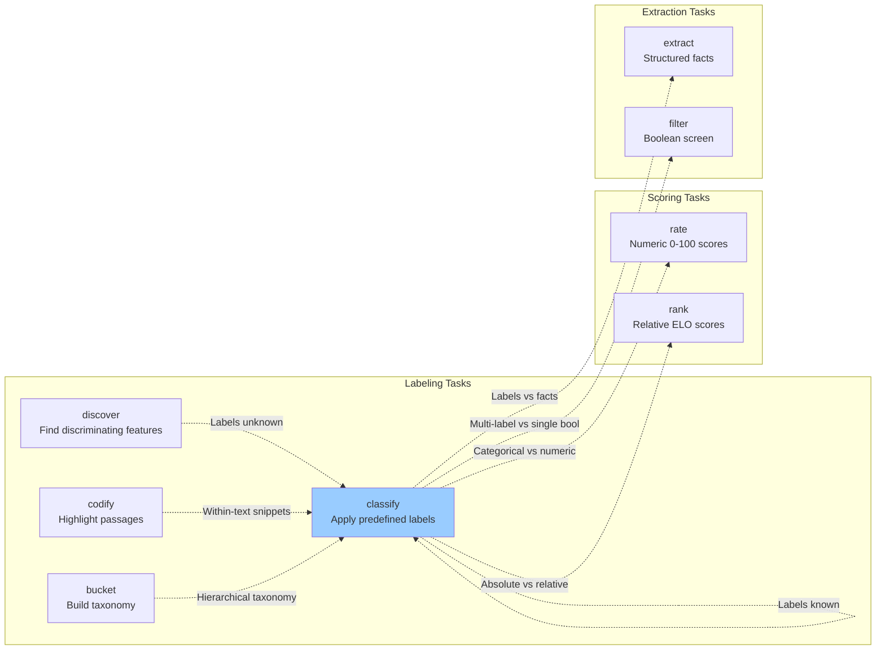

<!-- source: DeepWiki mcp.deepwiki.com · repo openai/GABRIEL · page 4.3 gabriel.classify - Categorical Labeling · fetched 2026-10-26 -->

# gabriel.classify - Categorical Labeling

<details>
<summary>Relevant source files</summary>

The following files were used as context for generating this wiki page:

- [src/gabriel/api.py](src/gabriel/api.py)
- [src/gabriel/prompts/paraphrase_prompt.jinja2](src/gabriel/prompts/paraphrase_prompt.jinja2)
- [src/gabriel/tasks/paraphrase.py](src/gabriel/tasks/paraphrase.py)
- [tests/test_basic.py](tests/test_basic.py)

</details>


## Purpose and Scope

This page documents the `gabriel.classify` task, which applies predefined categorical labels to items in a DataFrame. Unlike `gabriel.rate` which produces numeric scores (see [#4.1](#4.1)) or `gabriel.extract` which extracts arbitrary structured facts (see [#4.4](#4.4)), `classify` determines which labels from a fixed set apply to each item. The task supports multi-label classification (items can receive multiple labels), confidence thresholds, and a specialized "differentiation" mode for contrastive classification.

For feature discovery where labels are not predefined, see `gabriel.discover` ([#4.5](#4.5)).

---

## Core Concept

The `classify` task evaluates each item against a dictionary of label definitions and returns boolean indicators showing which labels apply. The system implements several key features:

1. **Multi-label classification**: Each item can receive zero, one, or multiple labels
2. **Confidence thresholds**: Labels must appear in a minimum fraction of runs (`min_frequency`) to be included
3. **Differentiation mode**: Highlights contrasts between paired items (e.g., "more assertive than the alternative")
4. **Multiple runs**: Repeat classification passes to assess label reliability

**Sources:** [src/gabriel/api.py:433-551]()

---

## Basic Usage Pattern

```python
import gabriel
import pandas as pd

# Prepare data
df = pd.DataFrame({
    "text": [
        "The product exceeded my expectations.",
        "Terrible service, would not recommend.",
        "It's okay, nothing special."
    ]
})

# Define labels
labels = {
    "positive_sentiment": "The text expresses satisfaction or positive emotion",
    "negative_sentiment": "The text expresses dissatisfaction or negative emotion",
    "mentions_service": "The text explicitly references customer service"
}

# Run classification
result = await gabriel.classify(
    df,
    column_name="text",
    labels=labels,
    save_dir="./classification_output",
    min_frequency=0.6,  # Label must appear in 60% of runs to be kept
    n_runs=3            # Run classification 3 times per item
)

# Result includes boolean columns for each label + aggregated predictions
# result["positive_sentiment"]  → [True, False, False]
# result["negative_sentiment"]  → [False, True, False]
# result["predicted_classes"]   → [["positive_sentiment"], ["negative_sentiment"], []]
```

**Sources:** [src/gabriel/api.py:433-551](), [tests/test_basic.py:1132-1140]()

---

## Data Flow Architecture



**Sources:** [src/gabriel/api.py:433-551](), [src/gabriel/tasks/classify.py:1-300]()

---

## Configuration Parameters

The `classify` function accepts the following parameters:

| Parameter | Type | Default | Description |
|-----------|------|---------|-------------|
| `df` | `Optional[pd.DataFrame]` | Required | Input DataFrame. When `None`, loads cached results from `save_dir` |
| `column_name` | `Optional[str]` | Required* | Column containing content to classify. Can be `None` in differentiate mode |
| `labels` | `Dict[str, str]` | Required | Mapping of label names to natural language definitions |
| `save_dir` | `str` | Required | Directory for outputs (CSV, raw responses, checkpoints) |
| `additional_instructions` | `Optional[str]` | `None` | Extra guidance appended to prompts |
| `model` | `str` | `"gpt-5-mini"` | OpenAI model identifier |
| `differentiate` | `bool` | `False` | Enable contrastive classification mode |
| `circle_column_name` | `Optional[str]` | `None` | First column in differentiation pairs |
| `square_column_name` | `Optional[str]` | `None` | Second column in differentiation pairs |
| `n_parallels` | `int` | `650` | Maximum concurrent API requests |
| `n_runs` | `int` | `1` | Number of independent classification passes |
| `n_attributes_per_run` | `int` | `8` | Maximum labels evaluated per prompt (labels split into batches) |
| `min_frequency` | `float` | `0.6` | Minimum fraction of runs a label must appear in to be retained |
| `reset_files` | `bool` | `False` | When `True`, regenerates all outputs ignoring cached files |
| `file_name` | `str` | `"classify_responses.csv"` | Base filename for saved artifacts |
| `modality` | `str` | `"text"` | Content type: `"text"`, `"image"`, `"audio"`, `"pdf"`, `"entity"`, `"web"` |
| `reasoning_effort` | `Optional[str]` | `None` | Reasoning intensity: `"none"`, `"low"`, `"medium"`, `"high"` |
| `search_context_size` | `str` | `"medium"` | Web search context size when `modality="web"` |
| `template_path` | `Optional[str]` | `None` | Custom Jinja2 template path to override defaults |
| `response_fn` | `Optional[Callable]` | `None` | Custom function replacing per-prompt model calls |
| `get_all_responses_fn` | `Optional[Callable]` | `None` | Custom function replacing entire orchestration layer |

*Required unless using differentiate mode with paired columns

**Sources:** [src/gabriel/api.py:433-551]()

---

## Label Definition Guidelines

Effective label definitions are critical for classification accuracy. The model evaluates each label independently, so definitions should be:

### 1. Self-Contained and Explicit

```python
# ✓ Good: Explicit criteria
labels = {
    "technical_jargon": "The text contains specialized terminology from fields like "
                        "engineering, medicine, or computer science that would be "
                        "unfamiliar to a general audience"
}

# ✗ Poor: Vague
labels = {
    "technical_jargon": "Contains jargon"
}
```

### 2. Mutually Compatible (for Multi-Label)

Since items can receive multiple labels, avoid mutually exclusive definitions:

```python
# ✓ Good: Compatible labels
labels = {
    "mentions_price": "Text discusses cost, pricing, or monetary value",
    "mentions_quality": "Text discusses durability, craftsmanship, or quality",
    "positive_tone": "Text expresses satisfaction or approval"
}

# ✗ Poor: Exclusive labels (use separate runs instead)
labels = {
    "short": "Text has fewer than 50 words",
    "medium": "Text has 50-150 words",
    "long": "Text has more than 150 words"
}
```

### 3. Boundary-Aware for Edge Cases

```python
labels = {
    "question": "Text asks a question, identified by interrogative words "
                "(who, what, when, where, why, how) or question marks. "
                "Rhetorical questions count as questions."
}
```

**Sources:** [src/gabriel/prompts/classification_prompt.jinja2:1-30]()

---

## Standard vs. Differentiation Mode

### Standard Mode

Evaluates each item independently against all labels:

```python
df = pd.DataFrame({"review": ["Great product!", "Terrible experience."]})

result = await gabriel.classify(
    df,
    column_name="review",
    labels={
        "positive": "Expresses satisfaction",
        "negative": "Expresses dissatisfaction"
    },
    save_dir="./standard_classify"
)
# result["positive"]  → [True, False]
# result["negative"]  → [False, True]
```

### Differentiation Mode

Highlights contrasts between paired items (e.g., "circle is MORE assertive than square"):

```python
df = pd.DataFrame({
    "original": ["I think we should proceed.", "Perhaps we might consider moving forward."],
    "revised": ["We must proceed immediately.", "We should proceed."]
})

result = await gabriel.classify(
    df,
    column_name=None,  # Not used in differentiation mode
    circle_column_name="revised",
    square_column_name="original",
    labels={
        "assertiveness": "The speaker expresses confidence and directness",
        "formality": "The language uses formal register and polite constructions"
    },
    differentiate=True,
    save_dir="./diff_classify"
)
# Labels are evaluated as "revised is MORE [label] than original"
```

**Differentiation Mode Prompt Structure:**



**Sources:** [src/gabriel/api.py:433-551](), [src/gabriel/tasks/classify.py:200-280]()

---

## Output Format and Predicted Classes

The returned DataFrame contains the original columns plus:

### Label Columns (Boolean)

One column per label with boolean values indicating whether the label applies:

```python
result["positive_sentiment"]  # Boolean column
result["mentions_price"]      # Boolean column
```

### Predicted Classes Column (List)

The `predicted_classes` column contains a list of label names that apply to each item:

```python
result["predicted_classes"]
# Example output:
# [
#   ["positive_sentiment", "mentions_quality"],  # Row 0: both labels apply
#   ["mentions_price"],                           # Row 1: one label applies
#   []                                            # Row 2: no labels apply
# ]
```

### Disaggregated Runs (When n_runs > 1)

If `n_runs > 1`, a separate disaggregated CSV is saved showing results from each individual run:

```
save_dir/
├── classify_responses_cleaned.csv          # Aggregated results
└── classify_responses_full_disaggregated.csv  # Per-run results (multi-index)
```

The disaggregated file uses a multi-index with levels `(text, run)` to preserve all individual classifications before aggregation.

**Sources:** [src/gabriel/tasks/classify.py:300-450](), [tests/test_basic.py:1182-1190]()

---

## Multi-Run Aggregation and Confidence Thresholds

### Frequency-Based Filtering

When `n_runs > 1`, each item is classified multiple times. Labels are only retained if they appear in at least `min_frequency` fraction of runs:

```python
# Run classification 5 times per item
result = await gabriel.classify(
    df,
    column_name="text",
    labels={"positive": "...", "urgent": "..."},
    n_runs=5,
    min_frequency=0.6,  # Label must appear in ≥60% of runs (≥3 of 5)
    save_dir="./multi_run"
)

# If "positive" appeared in runs [1, 2, 5] → 3/5 = 60% → Kept
# If "urgent" appeared in runs [1] → 1/5 = 20% → Dropped
```

### The `_collect_predictions` Function

After aggregating runs, the system collects labels that passed the threshold:



**Sources:** [src/gabriel/tasks/classify.py:400-480](), [tests/test_basic.py:1343-1346]()

---

## Label Batching

When the number of labels exceeds `n_attributes_per_run`, labels are split into multiple prompts to avoid overwhelming the model:

```python
labels = {
    "label_1": "...",
    "label_2": "...",
    # ... 12 total labels
}

result = await gabriel.classify(
    df,
    column_name="text",
    labels=labels,
    n_attributes_per_run=5,  # Max 5 labels per prompt
    save_dir="./batched"
)
# System automatically creates 3 prompts per item:
# Batch 1: labels 1-5
# Batch 2: labels 6-10
# Batch 3: labels 11-12
```

The batching is handled transparently by the task implementation and does not affect the output format.

**Sources:** [src/gabriel/tasks/classify.py:150-250]()

---

## Internal Classification Pipeline

```mermaid
graph TB
    subgraph "Input Processing"
        LoadDF["Load DataFrame"]
        ValidateCols["Validate columns<br/>handle differentiation mode"]
        PrepLabels["Prepare label dictionary<br/>enforce ordering"]
    end
    
    subgraph "Prompt Construction"
        BatchLabels["Batch labels<br/>(n_attributes_per_run)"]
        MultiRun["Replicate for n_runs"]
        RenderTemplate["Render Jinja2 template<br/>classification_prompt.jinja2<br/>OR differentiation_prompt.jinja2"]
    end
    
    subgraph "LLM Orchestration"
        BuildIdentifiers["Build identifiers<br/>format: {hash}_batch{n}"]
        GetResponses["openai_utils.get_all_responses()<br/>JSON mode enabled"]
    end
    
    subgraph "Response Parsing"
        ParseJSON["Parse JSON response<br/>extract boolean values"]
        HandleMissing["Handle None/missing<br/>default to False"]
        ValidateSchema["Validate label keys<br/>match expected"]
    end
    
    subgraph "Multi-Run Aggregation"
        CountOccurrences["Count label occurrences<br/>across runs"]
        ApplyThreshold["Apply min_frequency<br/>threshold"]
        BuildPredicted["Call _collect_predictions()<br/>build predicted_classes"]
    end
    
    subgraph "Persistence"
        SaveRaw["Save raw responses<br/>{file_name}"]
        SaveDisagg["Save disaggregated<br/>{file_name}_full_disaggregated.csv"]
        SaveCleaned["Save cleaned results<br/>{file_name}_cleaned.csv"]
    end
    
    LoadDF --> ValidateCols
    ValidateCols --> PrepLabels
    PrepLabels --> BatchLabels
    
    BatchLabels --> MultiRun
    MultiRun --> RenderTemplate
    RenderTemplate --> BuildIdentifiers
    BuildIdentifiers --> GetResponses
    
    GetResponses --> ParseJSON
    ParseJSON --> HandleMissing
    HandleMissing --> ValidateSchema
    
    ValidateSchema --> CountOccurrences
    CountOccurrences --> ApplyThreshold
    ApplyThreshold --> BuildPredicted
    
    BuildPredicted --> SaveRaw
    SaveRaw --> SaveDisagg
    SaveDisagg --> SaveCleaned
    
    style GetResponses fill:#ff9999
    style ApplyThreshold fill:#ccffcc
```



**Sources:** [src/gabriel/tasks/classify.py:1-550]()

---

## Advanced Features

### Custom Response Functions

Replace the default LLM call with a custom function:

```python
async def custom_classifier(prompt: str, **kwargs) -> list:
    # Custom classification logic
    return ['{"label_1": true, "label_2": false}']

result = await gabriel.classify(
    df,
    column_name="text",
    labels={"label_1": "...", "label_2": "..."},
    save_dir="./custom",
    response_fn=custom_classifier
)
```

### Custom Backend Driver

Replace the entire orchestration layer:

```python
async def custom_driver(prompts, identifiers, **kwargs):
    # Custom batch processing
    responses = my_batch_api(prompts)
    return pd.DataFrame({
        "Identifier": identifiers,
        "Response": responses
    })

result = await gabriel.classify(
    df,
    column_name="text",
    labels={"label": "..."},
    save_dir="./driver",
    get_all_responses_fn=custom_driver
)
```

**Sources:** [src/gabriel/api.py:505-551](), [tests/test_basic.py:1431-1476]()

---

## Multimodal Classification

The `classify` task supports various input modalities through the `modality` parameter:

| Modality | Input Format | Example Use Case |
|----------|--------------|------------------|
| `"text"` | Plain text strings | Classify news articles, reviews |
| `"image"` | File paths to images | Tag photos, identify objects |
| `"audio"` | File paths or encoded audio | Classify speech tone, music genre |
| `"pdf"` | File paths to PDFs | Categorize documents |
| `"entity"` | Short entity names | Classify company types, person roles |
| `"web"` | Search queries | Classify web search results |

```python
# Image classification
df_images = pd.DataFrame({
    "image_path": ["/path/to/image1.jpg", "/path/to/image2.png"]
})

result = await gabriel.classify(
    df_images,
    column_name="image_path",
    labels={
        "contains_people": "Image shows one or more human figures",
        "outdoor_scene": "Image depicts an outdoor setting"
    },
    modality="image",
    save_dir="./image_classify"
)
```

**Sources:** [src/gabriel/api.py:496-502](), [src/gabriel/tasks/classify.py:100-150]()

---

## Common Patterns

### Pattern 1: Topical Tagging

```python
topics = {
    "technology": "Discusses computers, software, gadgets, or digital innovation",
    "politics": "References government, elections, policy, or political figures",
    "business": "Covers companies, markets, economy, or commerce",
    "science": "Addresses scientific research, discoveries, or natural phenomena"
}

tagged = await gabriel.classify(
    articles_df,
    column_name="article_text",
    labels=topics,
    n_runs=3,
    min_frequency=0.67,
    save_dir="./topic_tags"
)

# Filter to technology articles
tech_articles = tagged[tagged["technology"] == True]
```

### Pattern 2: Content Moderation

```python
moderation_labels = {
    "spam": "Content is unsolicited advertising or promotional material",
    "offensive": "Contains hate speech, profanity, or aggressive language",
    "off_topic": "Does not relate to the forum's stated purpose",
    "low_quality": "Is poorly written, uninformative, or lacks substance"
}

moderated = await gabriel.classify(
    posts_df,
    column_name="post_content",
    labels=moderation_labels,
    n_runs=2,
    min_frequency=0.5,
    save_dir="./moderation"
)

# Flag posts needing review
moderated["needs_review"] = moderated["predicted_classes"].apply(len) > 0
```

### Pattern 3: Feature Detection

```python
features = {
    "mentions_competitor": "References rival companies or competing products",
    "requests_feature": "Asks for new functionality or capabilities",
    "reports_bug": "Describes unexpected behavior or errors",
    "expresses_urgency": "Indicates time pressure or immediate need"
}

classified = await gabriel.classify(
    feedback_df,
    column_name="customer_feedback",
    labels=features,
    save_dir="./feedback_features"
)

# Route to appropriate teams
urgent_bugs = classified[
    classified["reports_bug"] & classified["expresses_urgency"]
]
```

**Sources:** [src/gabriel/api.py:458-551]()

---

## Relationship to Other Tasks



**Key Distinctions:**

- **classify vs. rate**: `classify` returns boolean (label applies or not), `rate` returns numeric scores (0-100)
- **classify vs. discover**: `classify` requires predefined labels, `discover` generates labels automatically
- **classify vs. extract**: `classify` applies categorical labels, `extract` extracts structured facts with arbitrary values
- **classify vs. filter**: `classify` is multi-label (multiple can apply), `filter` is single boolean (item passes or fails)
- **classify vs. codify**: `classify` labels entire items, `codify` highlights specific passages within text

**Sources:** [src/gabriel/api.py:1-552]()

---

## Save Directory Structure

```
save_dir/
├── classify_responses.csv                    # Raw API responses with metadata
├── classify_responses_cleaned.csv             # Aggregated results (main output)
├── classify_responses_full_disaggregated.csv  # Per-run results (if n_runs > 1)
└── responses/
    └── checkpoint_*.json                      # Resumability checkpoints
```

**File Contents:**

1. **Raw responses**: Identifier, Response (JSON), Time Taken, Token counts, Success status
2. **Cleaned**: Original DataFrame columns + boolean label columns + `predicted_classes`
3. **Disaggregated**: Multi-indexed by (text_hash, run_number) showing individual run results

**Sources:** [src/gabriel/tasks/classify.py:500-550]()

---

## Code Entity Reference

| Concept | Code Entity | Location |
|---------|-------------|----------|
| Public API | `gabriel.classify()` | [src/gabriel/api.py:433-551]() |
| Configuration | `ClassifyConfig` dataclass | [src/gabriel/tasks/classify.py:20-80]() |
| Task Implementation | `Classify` class | [src/gabriel/tasks/classify.py:100-550]() |
| Prompt Template (Standard) | `classification_prompt.jinja2` | [src/gabriel/prompts/classification_prompt.jinja2:1-30]() |
| Prompt Template (Differentiation) | `differentiation_prompt.jinja2` | [src/gabriel/prompts/differentiation_prompt.jinja2:1-25]() |
| Prediction Collector | `_collect_predictions()` | [src/gabriel/tasks/classify.py:400-420]() |
| Response Parser | `Classify._parse()` | [src/gabriel/tasks/classify.py:350-380]() |
| LLM Orchestration | `openai_utils.get_all_responses()` | [src/gabriel/utils/openai_utils.py:500-1000]() |

**Sources:** [src/gabriel/api.py:433-551](), [src/gabriel/tasks/classify.py:1-550]()

---

