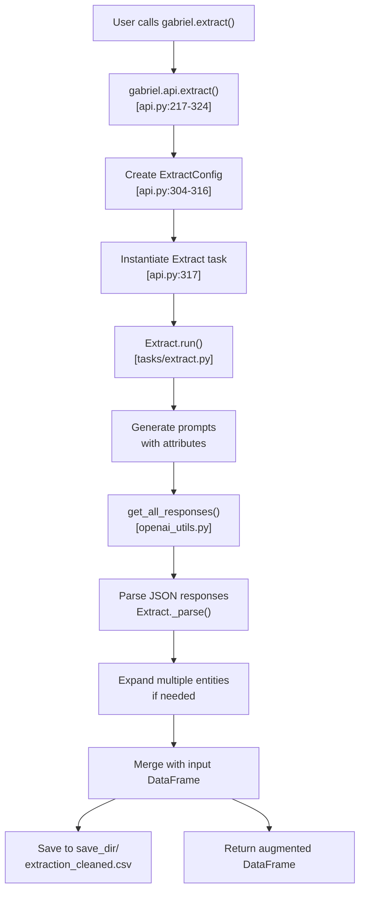
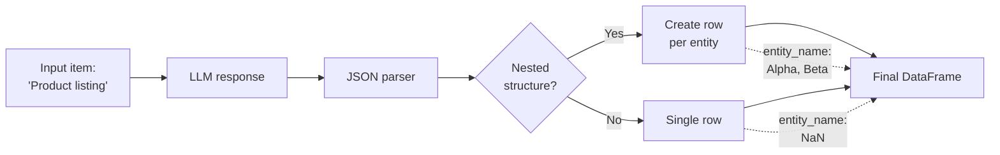
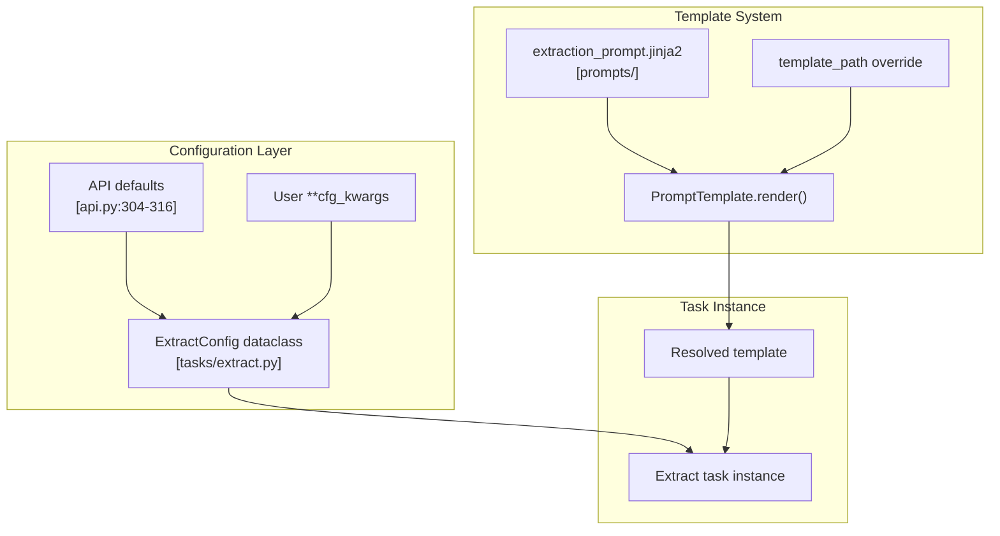
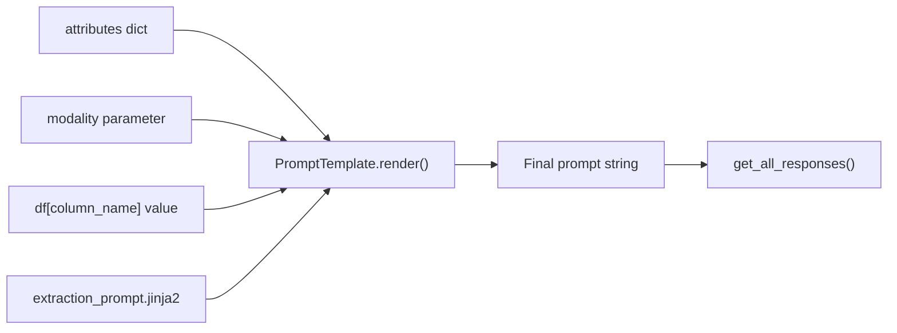
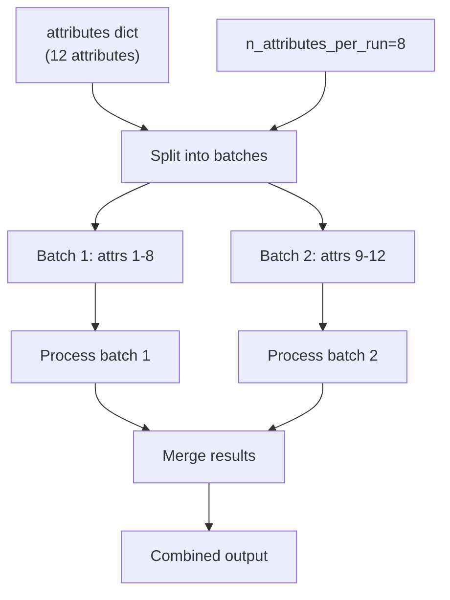
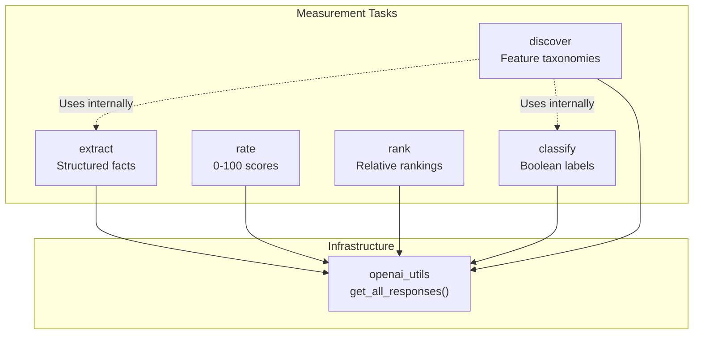

<!-- source: DeepWiki mcp.deepwiki.com · repo openai/GABRIEL · page 4.4 gabriel.extract - Structured Extraction · fetched 2026-10-26 -->

# gabriel.extract - Structured Extraction

<details>
<summary>Relevant source files</summary>

The following files were used as context for generating this wiki page:

- [src/gabriel/api.py](src/gabriel/api.py)
- [src/gabriel/prompts/paraphrase_prompt.jinja2](src/gabriel/prompts/paraphrase_prompt.jinja2)
- [src/gabriel/tasks/paraphrase.py](src/gabriel/tasks/paraphrase.py)
- [tests/test_basic.py](tests/test_basic.py)

</details>


## Purpose and Scope

`gabriel.extract` performs **structured fact extraction** from qualitative data, parsing each input item to extract specific values (strings, numbers, dates, etc.) into dedicated columns. Unlike **rating** ([4.1](#4.1)), which produces numeric scores, or **classification** ([4.3](#4.3)), which applies categorical labels, extraction pulls out precise factual information based on field definitions.

For example, given a product description, extract the "company name", "CEO", and "founding year" into separate structured columns.

This page documents the public API function `gabriel.extract`, the underlying `Extract` task class, configuration options, and how extraction handles single vs. multiple entities per input.

---

## Core Execution Flow

The following diagram shows how user calls flow through the API layer to the task implementation and LLM orchestration:



**Sources:** [src/gabriel/api.py:217-324](), [tests/test_basic.py:1142-1180]()

---

## Basic Usage Pattern

```python
import pandas as pd
import gabriel

df = pd.DataFrame({
    "product": ["iPhone 15", "Tesla Model S", "ChatGPT Plus"]
})

result = await gabriel.extract(
    df,
    column_name="product",
    attributes={
        "company": "The company that makes this product",
        "ceo": "Current CEO of the company",
        "year_founded": "Year the company was founded"
    },
    save_dir="./extraction_output"
)

# result now has columns: product, company, ceo, year_founded, entity_name
```

The output DataFrame augments the input with one column per attribute. An additional `entity_name` column identifies which entity each row corresponds to when multiple entities are extracted from a single input.

**Sources:** [src/gabriel/api.py:238-296](), [tests/test_basic.py:1142-1149]()

---

## Key Configuration Parameters

| Parameter | Type | Default | Description |
|-----------|------|---------|-------------|
| `attributes` | `Dict[str, str]` | Required | Field names → extraction descriptions |
| `modality` | `str` | `"entity"` | Input type: entity/text/image/audio/pdf/web |
| `n_runs` | `int` | `1` | Number of extraction passes (results averaged) |
| `n_attributes_per_run` | `int` | `8` | Max attributes per prompt; splits into batches |
| `types` | `Optional[Dict[str, Any]]` | `None` | Type hints for extracted values |
| `save_dir` | `str` | Required | Output directory for CSVs |
| `file_name` | `str` | `"extraction.csv"` | Base filename for raw responses |
| `model` | `str` | `"gpt-5-mini"` | OpenAI model to use |
| `n_parallels` | `int` | `650` | Max concurrent API calls |
| `reset_files` | `bool` | `False` | Regenerate outputs even if cached |
| `reasoning_effort` | `Optional[str]` | `None` | LLM reasoning intensity (none/low/medium/high) |
| `template_path` | `Optional[str]` | `None` | Custom Jinja2 template override |

**Default Modality:** Unlike `gabriel.rate` and `gabriel.classify` which default to `modality="text"`, extraction defaults to `modality="entity"` because it typically operates on entity names or short identifiers rather than full passages.

**Sources:** [src/gabriel/api.py:244-290](), [src/gabriel/api.py:304-316]()

---

## Extraction vs. Rating vs. Classification

The following table clarifies when to use each measurement task:

| Task | Output Type | Use Case | Example |
|------|-------------|----------|---------|
| **extract** | Strings/numbers | Pull specific facts | Extract "CEO name", "revenue", "founding date" |
| **rate** ([4.1](#4.1)) | 0-100 scores | Quantify subjective attributes | Rate "innovation level" or "brand prestige" |
| **classify** ([4.3](#4.3)) | Boolean labels | Apply categorical tags | Tag as "B2B", "Consumer", "Enterprise" |
| **discover** ([4.5](#4.5)) | Feature taxonomy | Find discriminating patterns | Discover what distinguishes successful products |

Extraction is the only task designed to handle **structured multi-field output** where each field can contain arbitrary text or numeric values.

**Sources:** [src/gabriel/api.py:105-551]()

---

## Task Execution Lifecycle

```mermaid
graph TB
    subgraph "Extract Task Lifecycle"
        Init["Extract.__init__<br/>Load template"]
        Run["Extract.run()<br/>Entry point"]
        Validate["Validate DataFrame<br/>and column_name"]
        BuildPrompts["Build prompts<br/>per row × n_runs"]
        BatchAttrs["Split attributes<br/>into batches if > n_attributes_per_run"]
        GetResp["get_all_responses()<br/>Parallel LLM calls"]
        ParseJSON["Extract._parse()<br/>JSON → Python dict"]
        HandleMulti["Detect multiple entities<br/>per input"]
        ExpandRows["Expand DataFrame<br/>if multiple entities found"]
        AggRuns["Average across n_runs<br/>if n_runs > 1"]
        SaveClean["Save *_cleaned.csv"]
        Return["Return DataFrame"]
    end
    
    Init --> Run
    Run --> Validate
    Validate --> BuildPrompts
    BuildPrompts --> BatchAttrs
    BatchAttrs --> GetResp
    GetResp --> ParseJSON
    ParseJSON --> HandleMulti
    HandleMulti --> ExpandRows
    ExpandRows --> AggRuns
    AggRuns --> SaveClean
    SaveClean --> Return
```



**Sources:** [src/gabriel/api.py:317-324](), [tests/test_basic.py:1142-1149]()

---

## Multiple Entity Extraction

A unique feature of `gabriel.extract` is its ability to **detect and expand multiple entities** within a single input item. When the LLM returns a nested JSON structure with multiple entity keys, the task automatically expands these into separate DataFrame rows.

### Single Entity Response (Default)

```json
{
  "company": "Apple Inc.",
  "ceo": "Tim Cook",
  "year_founded": "1976"
}
```

Result: 1 row with columns `company`, `ceo`, `year_founded`, and `entity_name=NaN`

### Multiple Entity Response

```json
{
  "Alpha": {
    "company": "Alpha Corp",
    "ceo": "Jane Doe",
    "year_founded": "1990"
  },
  "Beta": {
    "company": "Beta Industries",
    "ceo": "John Smith",
    "year_founded": "2000"
  }
}
```

Result: 2 rows with `entity_name` column containing "Alpha" and "Beta"

**Expansion Logic:**
1. Parse JSON response
2. Detect if top-level keys are entity identifiers (nested dicts)
3. If yes: create one row per entity, populate `entity_name` column
4. If no: treat as single entity, `entity_name=NaN`

**Sources:** [tests/test_basic.py:1152-1180]()

---

## Multiple Entity Extraction Flow



**Example Test Case:**
```python
# Input: 1 row
df = pd.DataFrame({"txt": ["listing"]})

# LLM returns multiple entities
payload = json.dumps({
    "Alpha": {"year": "1990", "price": "10"},
    "Beta": {"year": "2000", "price": "20"}
})

# Output: 2 rows with entity_name column
result = await extract(df, "txt", attributes={"year": "", "price": ""}, ...)
# result.shape[0] == 2
# result["entity_name"] == ["Alpha", "Beta"]
```

**Sources:** [tests/test_basic.py:1152-1180]()

---

## Configuration and Template System



**Config Validation:** The `ExtractConfig` dataclass performs validation in `__post_init__` to ensure:
- `attributes` is a non-empty dictionary
- `n_runs` and `n_attributes_per_run` are positive integers
- `modality` is a recognized value
- File paths are expanded (environment variables and `~`)

**Sources:** [src/gabriel/api.py:304-316]()

---

## Output Structure

The extract task produces two CSV files in `save_dir`:

### 1. Raw Responses: `{file_name}_raw_responses.csv`

Contains low-level API interaction details:

| Column | Description |
|--------|-------------|
| `Identifier` | Row identifier (e.g., `"abc123_batch0"`) |
| `Response` | Raw JSON list from LLM |
| `Time Taken` | API call duration (seconds) |
| `Input Tokens` | Token count for prompt |
| `Reasoning Tokens` | Tokens used for reasoning (if reasoning_effort set) |
| `Output Tokens` | Token count for response |
| `Successful` | Boolean success flag |
| `Error Log` | Serialized error details if failed |

### 2. Cleaned Output: `{file_name}_cleaned.csv`

The primary output file returned by `extract()`:

| Column | Description |
|--------|-------------|
| Original columns | All columns from input DataFrame |
| `entity_name` | Entity identifier (populated when multiple entities extracted) |
| `{attr1}`, `{attr2}`, ... | One column per attribute in `attributes` dict |

**Aggregation Across Runs:** When `n_runs > 1`, responses are averaged for numeric attributes. For string attributes, the most common response is selected. The disaggregated results (one row per run) are saved to `{file_name}_full_disaggregated.csv`.

**Sources:** [src/gabriel/api.py:297-298](), [tests/test_basic.py:1152-1180]()

---

## Prompt Template and Customization

### Default Template Flow



### Custom Template Override

Users can replace the default prompt by passing `template_path`:

```python
result = await gabriel.extract(
    df,
    "product",
    attributes={"company": "...", "ceo": "..."},
    template_path="./my_extraction_template.jinja2",
    save_dir="./output"
)
```

The custom template receives these Jinja2 variables:
- `text`: The value from `df[column_name]` (for text/entity/web modalities)
- `attributes`: List of attribute names
- `descriptions`: List of attribute descriptions
- `modality`: The modality string
- `json_mode`: Boolean indicating JSON output requirement

**Sources:** [src/gabriel/api.py:279-280](), [src/gabriel/api.py:317-324]()

---

## Advanced Customization Hooks

For users needing deeper control, `gabriel.extract` supports the same customization hooks as other tasks (see [10](#10) for details):

### Response Function Override

Replace per-prompt LLM invocation:

```python
async def custom_parser(prompt: str, **kwargs):
    # Custom logic here
    return ['{"company": "CustomCorp"}']

result = await gabriel.extract(
    df, "product",
    attributes={"company": ""},
    response_fn=custom_parser,
    save_dir="./output"
)
```

### Full Driver Replacement

Replace the entire orchestration layer:

```python
async def custom_driver(prompts, identifiers, **kwargs):
    # Custom parallelization, caching, etc.
    return pd.DataFrame({
        "Identifier": identifiers,
        "Response": [['{"company": "X"}'] for _ in identifiers]
    })

result = await gabriel.extract(
    df, "product",
    attributes={"company": ""},
    get_all_responses_fn=custom_driver,
    save_dir="./output"
)
```

**Sources:** [src/gabriel/api.py:234-235](), [src/gabriel/api.py:285-288](), [tests/test_basic.py:1431-1477]()

---

## Attribute Batching

When `len(attributes) > n_attributes_per_run`, the task automatically **splits attributes across multiple prompts** to avoid overwhelming the LLM. Each prompt batch is processed independently, and results are merged before returning.



**Default Value:** `n_attributes_per_run=8` balances prompt complexity with API efficiency. Increase for simpler attributes, decrease for complex extraction logic.

**Sources:** [src/gabriel/api.py:263-266]()

---

## Caching and Resumability

Like all GABRIEL tasks, extraction supports **checkpointing and resumption**:

1. **First Run:** Results saved to `save_dir/{file_name}_raw_responses.csv`
2. **Subsequent Runs:** Existing identifiers are skipped unless `reset_files=True`
3. **Partial Completion:** If interrupted, re-running continues from the last checkpoint

```python
# Initial run processes 100 items, crashes at item 50
result = await gabriel.extract(df, "text", attributes={...}, save_dir="./out")

# Re-run automatically resumes from item 50
result = await gabriel.extract(df, "text", attributes={...}, save_dir="./out")

# Force full regeneration
result = await gabriel.extract(df, "text", attributes={...}, save_dir="./out", reset_files=True)
```

**Checkpoint Mechanism:** The task builds identifiers by hashing input values and appending a batch suffix (e.g., `"abc123_batch0"`). If this identifier exists in the raw responses CSV, the prompt is skipped. See [12.2](#12.2) for complete checkpointing details.

**Sources:** [src/gabriel/api.py:267-268]()

---

## Loading Cached Results

The `extract` API function supports loading previously computed results without re-running the task:

```python
# Pass df=None to load cached results
result = await gabriel.extract(
    df=None,
    column_name="text",  # Not used, but required by signature
    attributes={"company": ""},
    save_dir="./output"
)
# Loads from ./output/extraction_cleaned.csv
```

This pattern allows workflows to separate computation from analysis:
1. **Computation phase:** Run extract with `df` parameter
2. **Analysis phase:** Load cached results with `df=None`

**Sources:** [src/gabriel/api.py:300-303](), [src/gabriel/api.py:74-92]()

---

## Multimodal Extraction

Extraction works across all GABRIEL modalities:

| Modality | Input Format | Example |
|----------|--------------|---------|
| `entity` | Short text/name | `"Apple Inc."` |
| `text` | Full passages | `"The company was founded..."` |
| `image` | File paths | `"/path/to/product.jpg"` |
| `audio` | File paths | `"/path/to/earnings_call.mp3"` |
| `pdf` | File paths | `"/path/to/report.pdf"` |
| `web` | Search queries | `"Apple Inc. founding history"` |

For multimodal inputs, the LLM analyzes the visual/audio/document content and extracts requested attributes.

**Sources:** [src/gabriel/api.py:270-273]()

---

## Type Hints and Validation

The `types` parameter provides optional type hints for extracted values:

```python
result = await gabriel.extract(
    df,
    "product",
    attributes={
        "revenue": "Annual revenue",
        "founded": "Founding year"
    },
    types={
        "revenue": float,
        "founded": int
    },
    save_dir="./output"
)
```

While GABRIEL does not automatically cast values (extraction returns strings from JSON), the `types` parameter:
1. Documents expected types for downstream consumers
2. Can be used by custom response functions for validation
3. Serves as metadata for analysis tools

**Note:** The default extraction logic does not enforce or cast to these types. Users should perform type conversion in post-processing if needed.

**Sources:** [src/gabriel/api.py:276-278]()

---

## Relationship to Other Tasks



**Discover Pipeline:** The `gabriel.discover` task ([4.5](#4.5)) uses extraction internally during its feature discovery phase to identify discriminating terms and patterns.

**Sources:** [src/gabriel/api.py:7-40]()

---

## Common Patterns

### Pattern 1: Extract then Analyze

```python
# Step 1: Extract structured data
df = await gabriel.extract(
    products_df,
    "description",
    attributes={
        "price_range": "Low/Medium/High price tier",
        "target_market": "B2B or B2C",
        "tech_level": "Technology sophistication (Low/Medium/High)"
    },
    save_dir="./extraction"
)

# Step 2: Analyze distributions
print(df["price_range"].value_counts())
print(df.groupby("target_market")["tech_level"].value_counts())
```

### Pattern 2: Multimodal Entity Extraction

```python
# Extract from product images
df = pd.DataFrame({"image_path": ["/path/to/img1.jpg", "/path/to/img2.jpg"]})

result = await gabriel.extract(
    df,
    "image_path",
    attributes={
        "brand_name": "Brand visible in the image",
        "product_category": "Type of product",
        "color_scheme": "Dominant colors"
    },
    modality="image",
    save_dir="./image_extraction"
)
```

### Pattern 3: Custom Types for Validation

```python
result = await gabriel.extract(
    df,
    "company_text",
    attributes={
        "founded_year": "Year company was founded (YYYY format)",
        "employee_count": "Number of employees (integer)",
        "revenue_millions": "Annual revenue in millions USD"
    },
    types={
        "founded_year": int,
        "employee_count": int,
        "revenue_millions": float
    },
    save_dir="./extraction"
)

# Post-processing: convert and validate
result["founded_year"] = pd.to_numeric(result["founded_year"], errors="coerce")
result = result[result["founded_year"].between(1800, 2024)]
```

**Sources:** [src/gabriel/api.py:238-242](), [tests/test_basic.py:1398-1408]()

---

