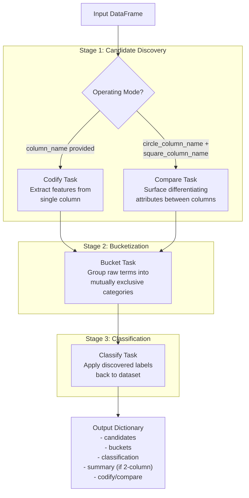
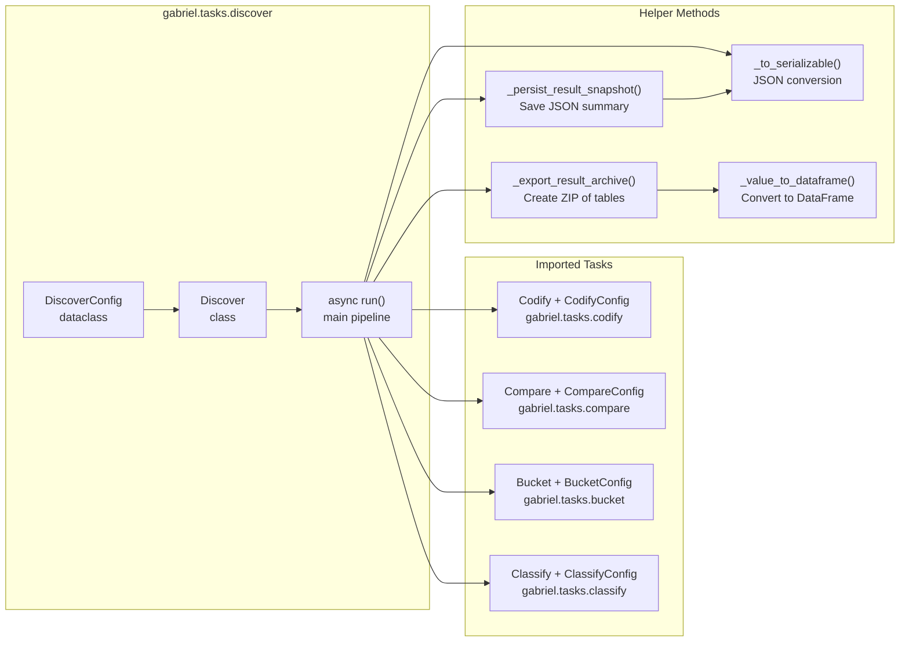
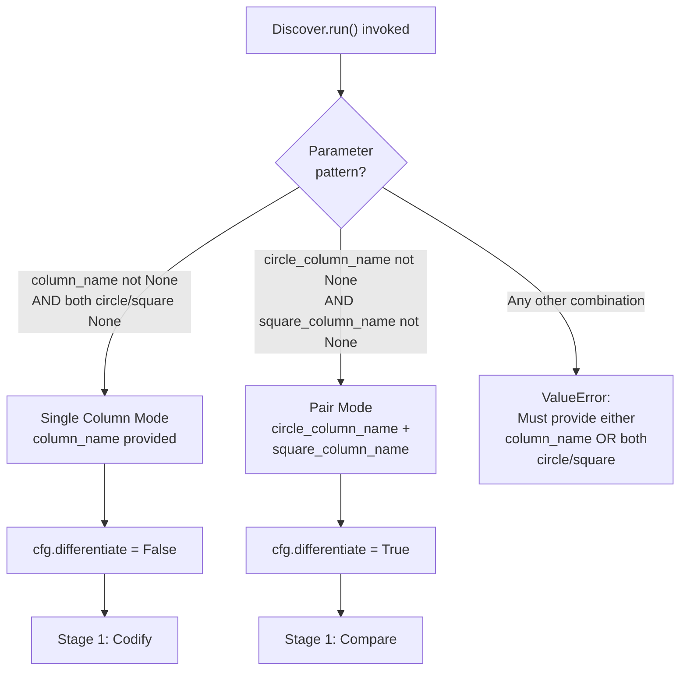
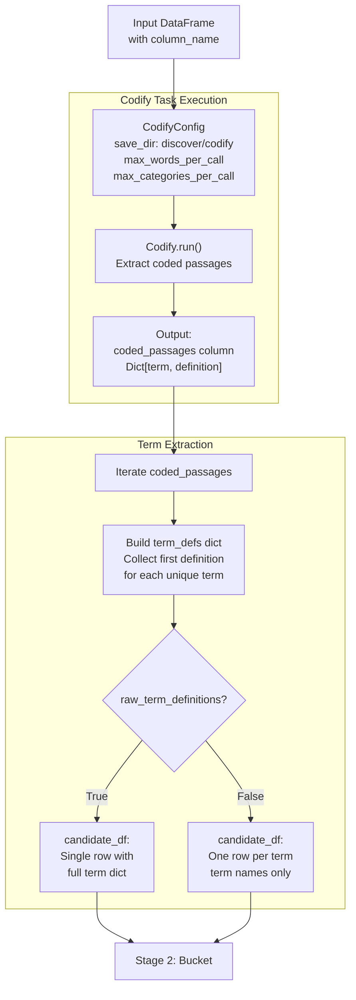
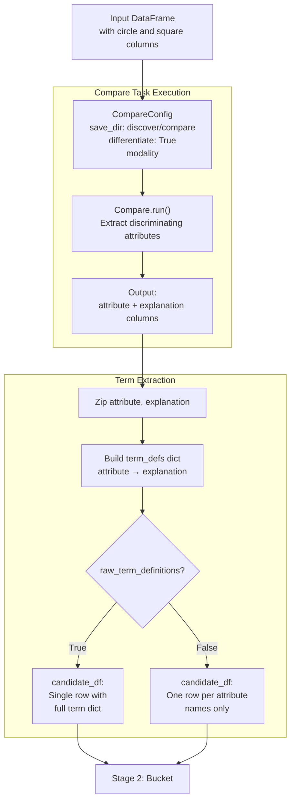
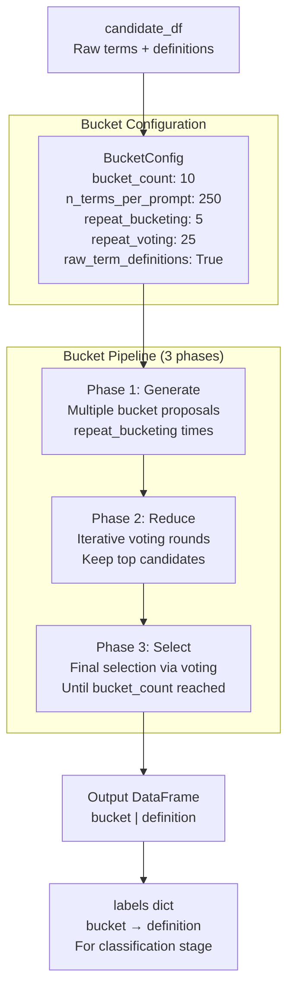
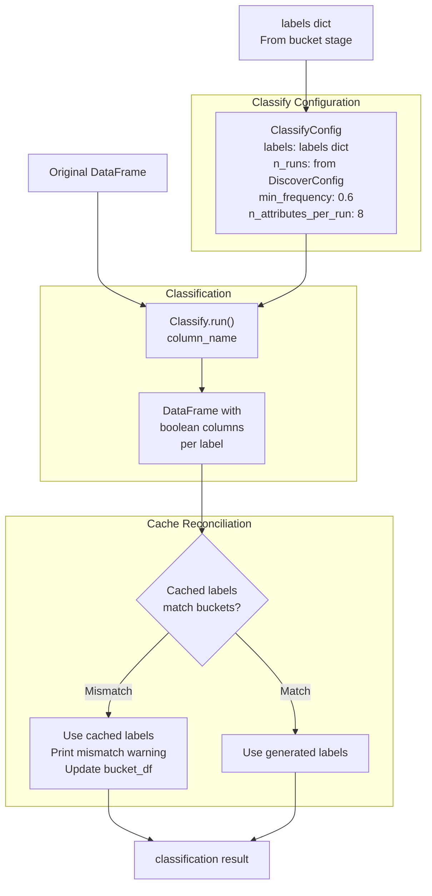
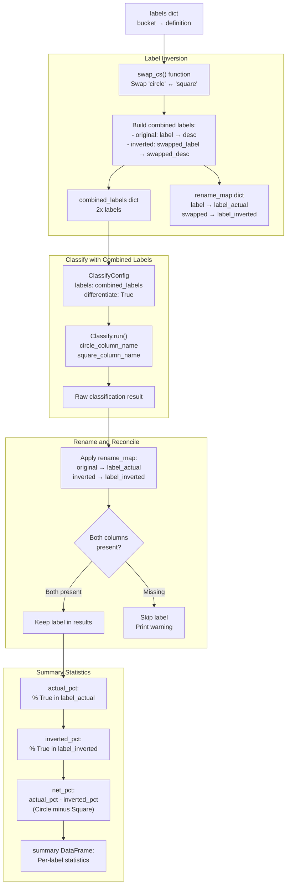
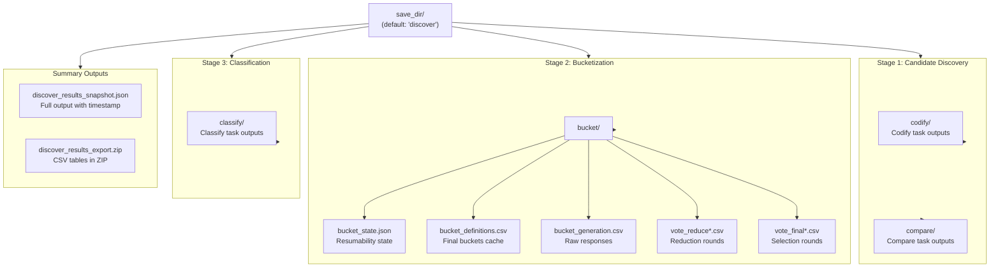

<!-- source: DeepWiki mcp.deepwiki.com · repo openai/GABRIEL · page 4.5 gabriel.discover - Feature Discovery · fetched 2026-10-26 -->

# gabriel.discover - Feature Discovery

<details>
<summary>Relevant source files</summary>

The following files were used as context for generating this wiki page:

- [src/gabriel/prompts/paraphrase_prompt.jinja2](src/gabriel/prompts/paraphrase_prompt.jinja2)
- [src/gabriel/tasks/bucket.py](src/gabriel/tasks/bucket.py)
- [src/gabriel/tasks/discover.py](src/gabriel/tasks/discover.py)
- [src/gabriel/tasks/paraphrase.py](src/gabriel/tasks/paraphrase.py)
- [tests/test_basic.py](tests/test_basic.py)

</details>


## Purpose and Scope

This page documents the **Discover** task, a multi-stage pipeline for automated feature discovery and taxonomy construction. Discover identifies discriminating attributes in qualitative data through a three-stage process: **candidate generation** → **bucketization** → **classification**. The pipeline can operate on a single text column to extract latent features, or on two columns to surface differentiating attributes between groups.

For applying pre-defined labels to data, see [gabriel.classify - Categorical Labeling](#4.3). For generating diverse sets of entities, see [gabriel.seed - Diverse Generation](#6.3). For the underlying bucketing logic, see [gabriel.bucket - Taxonomy Building](#6.1).

**Sources:** [src/gabriel/tasks/discover.py:1-518]()

---

## Pipeline Architecture Overview

The Discover pipeline orchestrates three specialized tasks in sequence, each building on the outputs of the previous stage:



**Diagram: Three-stage pipeline flow with mode selection**

The pipeline automatically selects between two operating modes based on input parameters. Single-column mode uses `Codify` to extract open-ended features. Two-column mode uses `Compare` to identify attributes that differentiate between groups.

**Sources:** [src/gabriel/tasks/discover.py:51-60](), [src/gabriel/tasks/discover.py:146-174](), [src/gabriel/tasks/discover.py:176-187]()

---

## Core Implementation Structure



**Diagram: Discover class structure and dependencies**

**Sources:** [src/gabriel/tasks/discover.py:1-20](), [src/gabriel/tasks/discover.py:51-66](), [src/gabriel/tasks/discover.py:68-144]()

---

## Configuration Reference

The `DiscoverConfig` dataclass consolidates parameters for all three pipeline stages:

| Parameter | Type | Default | Description |
|-----------|------|---------|-------------|
| `save_dir` | `str` | `"discover"` | Root directory for all outputs and intermediate files |
| `model` | `str` | `"gpt-5-mini"` | OpenAI model for all LLM calls across stages |
| `n_parallels` | `int` | `650` | Maximum concurrent API requests |
| `n_runs` | `int` | `1` | Number of classification runs for confidence estimation |
| `min_frequency` | `float` | `0.6` | Minimum label frequency threshold for classification |
| `bucket_count` | `int` | `10` | Target number of final buckets/categories |
| `additional_instructions` | `Optional[str]` | `None` | Natural language guidance appended to all prompts |
| `differentiate` | `bool` | `True` | Enable contrast-focused prompts (auto-set by mode) |
| `max_words_per_call` | `int` | `1000` | Token limit for codify chunks |
| `max_categories_per_call` | `int` | `8` | Maximum categories per codify call |
| `use_dummy` | `bool` | `False` | Use dummy responses for testing |
| `modality` | `str` | `"text"` | Input type: text, image, audio, pdf, entity, web |
| `n_terms_per_prompt` | `int` | `250` | Terms per bucket generation/voting prompt |
| `repeat_bucketing` | `int` | `5` | Number of bucket generation repetitions |
| `repeat_voting` | `int` | `25` | Number of voting rounds per bucket stage |
| `next_round_frac` | `float` | `0.25` | Fraction of candidates retained per reduction round |
| `top_k_per_round` | `int` | `1` | Buckets selected per final selection round |
| `raw_term_definitions` | `bool` | `True` | Include term definitions in bucket prompts |
| `reasoning_effort` | `Optional[str]` | `None` | Reasoning effort for LLM (low/medium/high) |

**Table: DiscoverConfig parameters**

Configuration validation occurs in `__post_init__`, which sanitizes `additional_instructions` by stripping whitespace and converting empty strings to `None`.

**Sources:** [src/gabriel/tasks/discover.py:21-49]()

---

## Operating Modes

### Mode Selection Logic



**Diagram: Mode selection based on input parameters**

The `run()` method enforces mutual exclusivity: exactly one of `column_name` or the pair `(circle_column_name, square_column_name)` must be provided. The `differentiate` flag is automatically overridden to match the selected mode.

**Sources:** [src/gabriel/tasks/discover.py:176-186]()

---

## Stage 1: Candidate Discovery

### Single Column Mode (Codify)

When `column_name` is provided, the pipeline uses the `Codify` task to extract latent features from passages:



**Diagram: Single column candidate generation flow**

The `Codify` task is configured with a dedicated subdirectory `discover/codify/` and inherits model, parallelism, and dummy settings from the parent config. Coded passages are parsed to extract unique terms and their definitions. The `raw_term_definitions` flag controls whether definitions are preserved for downstream bucketing.

**Sources:** [src/gabriel/tasks/discover.py:192-229]()

---

### Two Column Mode (Compare)

When `circle_column_name` and `square_column_name` are provided, the pipeline uses the `Compare` task to surface differentiating attributes:



**Diagram: Two column candidate generation flow**

The `Compare` task identifies attributes where the two columns differ systematically. The `differentiate` flag is automatically set to `True`, which instructs prompts to focus on contrasting features. The optional `modality` parameter supports multimodal comparisons (images, audio, PDFs).

**Sources:** [src/gabriel/tasks/discover.py:230-262]()

---

## Stage 2: Bucketization

The `Bucket` task consolidates raw candidate terms into a smaller, mutually exclusive set of categories:



**Diagram: Bucketization sub-pipeline**

The bucket task operates in three phases:

1. **Generation**: Creates multiple bucket proposals by shuffling terms and generating `bucket_count` categories repeatedly (`repeat_bucketing` times)
2. **Reduction**: Iteratively filters candidates through voting rounds until the pool reaches roughly `3 × bucket_count`
3. **Final Selection**: Uses voting with awareness of already-selected buckets to choose the final set

The `raw_term_definitions` flag controls whether term definitions (not just names) are included in prompts, providing richer context for categorization. All intermediate results are persisted to `discover/bucket/` with resumability via state files.

**Sources:** [src/gabriel/tasks/discover.py:264-291](), [src/gabriel/tasks/bucket.py:1-425]()

---

## Stage 3: Classification

The final stage applies discovered buckets as labels to the original dataset:

### Single Column Classification

For single-column mode, classification is straightforward:



**Diagram: Single-column classification flow**

The classification stage creates boolean columns for each discovered bucket. The `n_attributes_per_run` parameter is hardcoded to 8 to limit prompt complexity. If cached classification results exist with different labels (from a previous run), the cached labels take precedence and the bucket definitions are retroactively updated.

**Sources:** [src/gabriel/tasks/discover.py:466-501]()

---

### Two Column Classification with Inversion

For two-column mode, classification is more sophisticated, applying both "actual" and "inverted" perspectives:



**Diagram: Two-column classification with inversion and summary**

The inversion mechanism works by:

1. **Label Doubling**: Each bucket label generates two classification labels—the original and an inverted version where "circle" and "square" are swapped in both the label name and definition
2. **Differentiated Classification**: The classifier applies both perspectives simultaneously, producing `label_actual` and `label_inverted` columns
3. **Summary Statistics**: Per-label statistics compute `net_pct` as the percentage point difference (circle minus square), quantifying which group exhibits each attribute more strongly

This approach surfaces bidirectional differences without bias toward either column.

**Sources:** [src/gabriel/tasks/discover.py:304-464]()

---

## Output Format

The `run()` method returns a dictionary with the following keys:

| Key | Type | Description | Always Present |
|-----|------|-------------|----------------|
| `candidates` | `pd.DataFrame` | Raw candidate terms/attributes from Stage 1. Single row with dict (if `raw_term_definitions=True`) or one row per term. | Yes |
| `buckets` | `Dict[str, str]` | Final bucket labels mapped to definitions. Used as input to classification. | Yes |
| `classification` | `pd.DataFrame` | Original DataFrame with added boolean columns for each discovered label. For two-column mode, includes `_actual` and `_inverted` suffixes. | Yes |
| `bucket_df` | `pd.DataFrame` | Tabular representation of buckets with columns `bucket` and `definition`. Only present if buckets are non-empty. | Conditional |
| `summary` | `pd.DataFrame` | Per-label summary statistics for two-column mode. Columns: `label`, `actual_true`, `inverted_true`, `total`, `actual_pct`, `inverted_pct`, `net_pct`. | Two-column only |
| `compare` | `pd.DataFrame` | Full output from the Compare task, including `attribute` and `explanation` columns. | Two-column only |
| `codify` | `pd.DataFrame` | Full output from the Codify task, including `coded_passages` column. | Single-column only |

**Table: Output dictionary structure**

Two additional files are written to the `save_dir`:

- **`discover_results_snapshot.json`**: Complete JSON serialization of the output dictionary with timestamp metadata
- **`discover_results_export.zip`**: ZIP archive containing CSV exports of all DataFrame values in the output dictionary

**Sources:** [src/gabriel/tasks/discover.py:502-517](), [src/gabriel/tasks/discover.py:89-143]()

---

## Cache and State Management

### Checkpoint Files by Stage

Each stage writes persistent state to enable resumability:



**Diagram: Directory structure and checkpoint files**

### Resumability Behavior

The `reset_files` parameter controls cache behavior:

- **`reset_files=False`** (default): Each stage checks for existing results and resumes from the last completed checkpoint. Bucket state is preserved across runs.
- **`reset_files=True`**: All caches and state files are cleared before execution. Forces complete re-execution of all stages.

The bucket stage implements the most sophisticated state tracking via `bucket_state.json`, which records:
- `terms_signature`: SHA-1 hash of input terms to detect changes
- `stage`: Current progress (candidates, reduce, finalizing, complete)
- `candidate_defs`, `current_candidates`, `selected`: Intermediate bucket lists
- `reduce_round`, `final_loop`: Round counters for resumption

**Sources:** [src/gabriel/tasks/discover.py:146-154](), [src/gabriel/tasks/bucket.py:71-96](), [src/gabriel/tasks/bucket.py:120-136]()

---

## Label Reconciliation in Classification

When cached classification results exist from a previous run, label mismatches may occur if the bucket stage produced different categories:

### Single Column Reconciliation

```python
# From discover.py lines 486-500
actual_labels = dict(clf.cfg.labels)
if actual_labels != labels:
    print(
        "[Discover] Detected mismatch between cached classifier labels "
        "and generated buckets; using cached labels from the "
        "classification cache instead."
    )
    labels = actual_labels
    if labels:
        bucket_df = pd.DataFrame(
            {"bucket": list(labels.keys()), "definition": list(labels.values())}
        )
    else:
        bucket_df = pd.DataFrame(columns=["bucket", "definition"])
```

The cached labels take precedence, and the `bucket_df` is reconstructed to match.

### Two Column Reconciliation

For two-column mode, the reconciliation is more complex due to the inversion mechanism:

```python
# From discover.py lines 389-429
actual_combined_labels = dict(clf.cfg.labels)
if set(actual_combined_labels.keys()) != set(combined_labels.keys()):
    print("[Discover] Detected mismatch...")
    combined_labels = actual_combined_labels
    labels, rename_map = derive_base_from_combined(combined_labels)
    # Rebuild bucket_df from cached labels

# Check for missing columns after renaming
available: Dict[str, str] = {}
missing: List[str] = []
for lab, desc in labels.items():
    actual_col = f"{lab}_actual"
    inverted_col = f"{lab}_inverted"
    if actual_col not in classify_result.columns or inverted_col not in classify_result.columns:
        missing.append(lab)
        continue
    available[lab] = desc

if missing:
    print("[Discover] Warning: classification cache is missing the following labels...")
    bucket_df = bucket_df[bucket_df["bucket"].isin(available.keys())]
```

The `derive_base_from_combined()` helper function reverses the inversion process to reconstruct original bucket definitions from the cached combined labels.

**Sources:** [src/gabriel/tasks/discover.py:389-429](), [src/gabriel/tasks/discover.py:486-500](), [src/gabriel/tasks/discover.py:340-369]()

---

## Advanced Configuration Patterns

### Differentiate Mode

The `differentiate` flag controls prompt tone across all stages:

- **`differentiate=False`**: Prompts emphasize comprehensive feature extraction without contrasting
- **`differentiate=True`**: Prompts emphasize discriminating attributes that distinguish between groups

This flag is automatically set based on operating mode but can be manually overridden in the config. It affects:
- Compare task prompts (Stage 1)
- Bucket prompts (Stage 2)
- Classify prompts with `circle_column_name`/`square_column_name` (Stage 3)

**Sources:** [src/gabriel/tasks/discover.py:32](), [src/gabriel/tasks/discover.py:184-186](), [src/gabriel/tasks/discover.py:276](), [src/gabriel/tasks/discover.py:314]()

### Raw Term Definitions

The `raw_term_definitions` flag determines how candidate terms are passed to the bucket stage:

- **`True`** (default): Candidate DataFrame contains a single row with a dictionary mapping terms to definitions. Bucket prompts receive both term names and explanations.
- **`False`**: Candidate DataFrame contains one row per term with names only. Bucket prompts receive term names without context.

This trades off prompt length (and cost) against categorization quality. Raw definitions provide richer semantic context for grouping.

**Sources:** [src/gabriel/tasks/discover.py:42](), [src/gabriel/tasks/discover.py:222-229](), [src/gabriel/tasks/discover.py:255-262](), [src/gabriel/tasks/bucket.py:98-103](), [src/gabriel/tasks/bucket.py:226-228]()

### Modality Support

The `modality` parameter supports multiple input types:

- **`text`**: Standard text analysis (default)
- **`image`**: Feature discovery from images
- **`audio`**: Feature discovery from audio files
- **`pdf`**: Feature discovery from PDF documents
- **`entity`**: Entity-focused feature extraction
- **`web`**: Web search result analysis

Modality is forwarded to both Compare (if used) and Classify stages. Single-column Codify mode currently only supports text.

**Sources:** [src/gabriel/tasks/discover.py:36](), [src/gabriel/tasks/discover.py:238](), [src/gabriel/tasks/discover.py:311](), [src/gabriel/tasks/discover.py:475]()

---

## Example Usage Patterns

### Single Column Feature Discovery

```python
import pandas as pd
from gabriel.tasks.discover import Discover, DiscoverConfig

df = pd.DataFrame({"feedback": [
    "Great service, friendly staff",
    "Slow response times, unhelpful",
    "Product quality exceeded expectations",
    # ... more rows
]})

cfg = DiscoverConfig(
    save_dir="feedback_discovery",
    bucket_count=5,
    min_frequency=0.7,
    n_runs=3  # Multiple runs for confidence
)

discover = Discover(cfg)
result = await discover.run(df, column_name="feedback")

# Access outputs
print(result["buckets"])  # Dict of discovered feature categories
classified_df = result["classification"]  # Original data + labels
```

### Two Column Contrast Discovery

```python
df = pd.DataFrame({
    "positive_reviews": ["Excellent quality", "Fast shipping", ...],
    "negative_reviews": ["Poor packaging", "Delayed delivery", ...]
})

cfg = DiscoverConfig(
    save_dir="review_contrast",
    bucket_count=8,
    differentiate=True  # Auto-set, but explicit here
)

discover = Discover(cfg)
result = await discover.run(
    df,
    circle_column_name="positive_reviews",
    square_column_name="negative_reviews"
)

# Examine differences
summary = result["summary"]
# Columns: label, actual_pct, inverted_pct, net_pct
# net_pct > 0 means more common in positive reviews
top_positive = summary.sort_values("net_pct", ascending=False).head(3)
```

**Sources:** [src/gabriel/tasks/discover.py:146-174]()

---

## Integration with Other Tasks

Discover can be chained with other GABRIEL tasks for advanced workflows:

### Pre-processing with Merge

```python
# Match entities across datasets before discovery
merged = await gabriel.merge(df1, df2, ...)
result = await discover.run(merged, column_name="matched_text")
```

### Post-processing with Debias

```python
# Discover features, then correct for confounds
result = await discover.run(df, circle_column_name="A", square_column_name="B")
classified = result["classification"]

# Apply bias correction to discovered labels
debiased = await gabriel.debias(
    classified,
    target_columns=list(result["buckets"].keys()),
    confound_columns=["demographic", "region"]
)
```

### Iterative Refinement with Filter

```python
# First pass: discover broad features
result1 = await discover.run(df, column_name="text", bucket_count=15)

# Filter to high-signal subset
filtered = await gabriel.filter(
    result1["classification"],
    criteria="Has any of the top 5 labels"
)

# Second pass: discover finer-grained features
result2 = await discover.run(filtered, column_name="text", bucket_count=10)
```

**Sources:** [src/gabriel/tasks/discover.py:1-20]()

---

