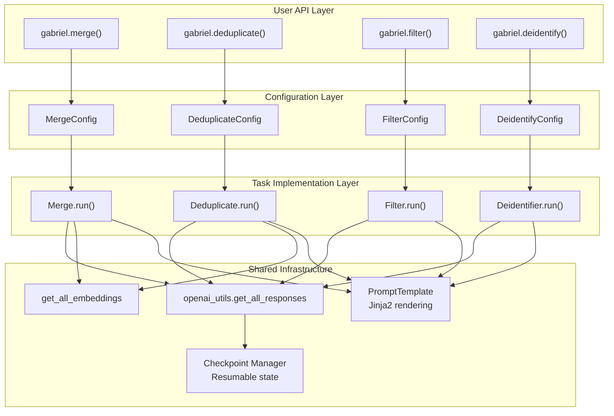
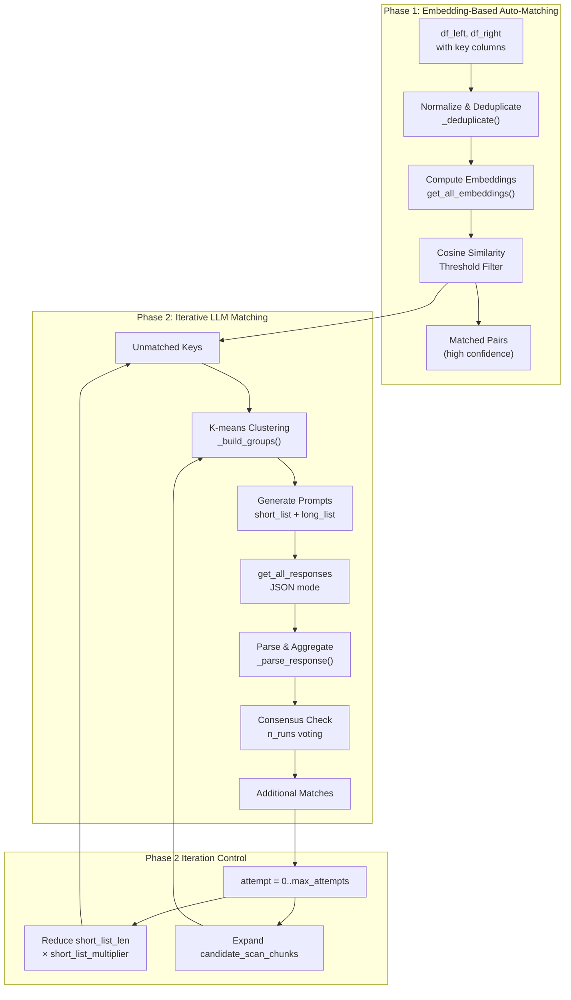
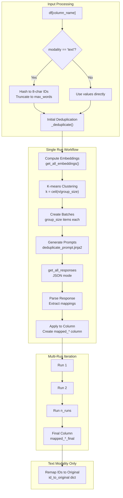
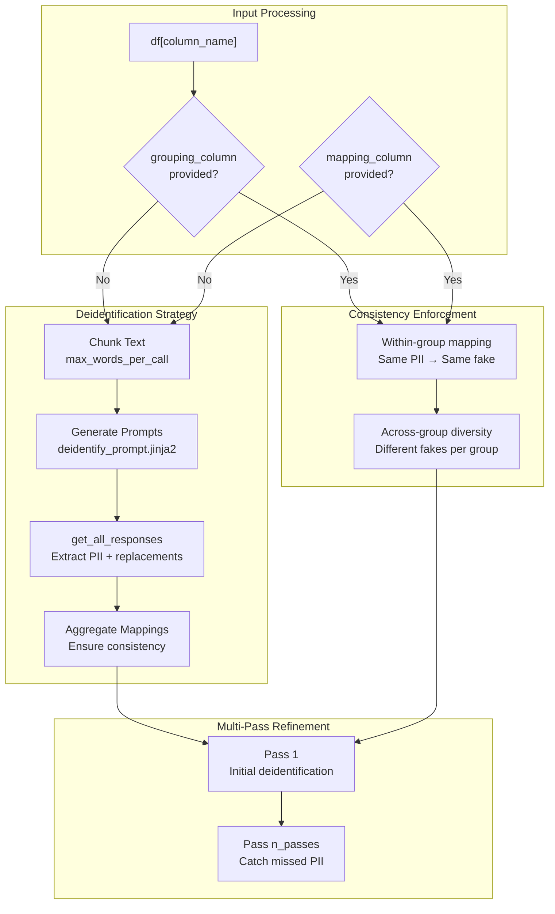

<!-- source: DeepWiki mcp.deepwiki.com · repo openai/GABRIEL · page 5 Data Cleaning Tasks · fetched 2026-10-26 -->

# Data Cleaning Tasks

<details>
<summary>Relevant source files</summary>

The following files were used as context for generating this wiki page:

- [README.md](README.md)
- [src/gabriel/api.py](src/gabriel/api.py)
- [src/gabriel/tasks/deduplicate.py](src/gabriel/tasks/deduplicate.py)
- [src/gabriel/tasks/merge.py](src/gabriel/tasks/merge.py)

</details>


## Purpose and Scope

This page documents the four data cleaning tasks in GABRIEL that prepare, transform, and standardize data before measurement or analysis. These tasks handle fuzzy matching (`gabriel.merge`), duplicate consolidation (`gabriel.deduplicate`), boolean screening (`gabriel.filter`), and privacy protection (`gabriel.deidentify`).

For measurement tasks that quantify attributes, see [Measurement Tasks](#4). For multi-stage workflows like `gabriel.ideate`, see [Complex Multi-Stage Pipelines](#7). For loading data from files, see [Data Loading and Preparation](#8).

---

## Task Overview and Characteristics

The data cleaning tasks share common infrastructure but differ in their primary objectives:

| Task | Primary Use Case | Input | Output | Key Feature |
|------|------------------|-------|--------|-------------|
| `gabriel.merge` | Fuzzy joins between DataFrames | Two DataFrames with key columns | Merged DataFrame with matched records | Two-phase: embeddings + LLM validation |
| `gabriel.deduplicate` | Consolidate semantically similar items | Single DataFrame column | Mapping to canonical representatives | Iterative consensus across multiple runs |
| `gabriel.filter` | High-throughput boolean screening | DataFrame with items to screen | Subset meeting natural language criteria | Fast, parallelized yes/no decisions |
| `gabriel.deidentify` | Replace PII with consistent fakes | DataFrame with sensitive text | Anonymized text + replacement mappings | Consistent within-group substitution |

All four tasks route through `openai_utils.get_all_responses` for LLM orchestration and leverage the same concurrency, retry, and checkpointing infrastructure described in [LLM Orchestration Infrastructure](#3.1).

**Sources:** [src/gabriel/api.py:1-100](), [README.md:48-56]()

---

## Common Architecture Patterns



**Diagram: Data Cleaning Task Architecture**

Each task follows the standard GABRIEL pattern:
1. **Config dataclass** validates parameters in `__post_init__`
2. **Task class** wraps configuration and template resolution
3. **Task.run()** method orchestrates the workflow
4. **Shared infrastructure** handles parallelism, retries, and persistence

The key architectural decision is when to use embeddings versus pure LLM calls. Tasks like `merge` and `deduplicate` use embeddings for initial clustering or similarity scoring, then invoke the LLM only for ambiguous cases. Tasks like `filter` and `deidentify` rely primarily on LLM calls with minimal preprocessing.

**Sources:** [src/gabriel/api.py:7-40](), [src/gabriel/tasks/merge.py:25-50](), [src/gabriel/tasks/deduplicate.py:26-47]()

---

## gabriel.merge - Fuzzy Joins Between DataFrames

### Overview

`gabriel.merge` creates crosswalks between two DataFrames by matching similar but non-identical keys. It implements a two-phase strategy: embedding-based automatic matches for high-confidence pairs, followed by iterative LLM-based fuzzy matching for ambiguous cases.

### Two-Phase Matching Strategy



**Diagram: Two-Phase Merge Workflow**

**Phase 1: Embedding-Based Auto-Matching** ([src/gabriel/tasks/merge.py:169-183]()):
- Computes embeddings for all unique keys in both DataFrames
- Calculates cosine similarity matrix between short (left) and long (right) keys
- Auto-matches pairs where similarity ≥ `auto_match_threshold` (default 0.75)
- If multiple candidates exceed threshold, selects highest if `use_best_auto_match=True`

**Phase 2: Iterative LLM Matching** ([src/gabriel/tasks/merge.py:185-262]()):
- Groups remaining unmatched keys using k-means clustering on embeddings
- For each group, presents a `short_list` (items to match) and `long_list` (candidates) to the LLM
- Runs `n_runs` independent matching attempts and aggregates via voting
- Repeats for `max_attempts` iterations, progressively reducing `short_list_len` and expanding candidate search space

**Sources:** [src/gabriel/tasks/merge.py:99-463]()

---

### Configuration and Key Parameters

```python
@dataclass
class MergeConfig:
    save_dir: str = "merge"
    file_name: str = "merge_responses.csv"
    model: str = "gpt-5-nano"  # Faster model for matching
    n_parallels: int = 650
    n_runs: int = 1  # Voting runs per prompt
    use_embeddings: bool = True
    short_list_len: int = 16  # Items to match per prompt
    long_list_len: int = 256  # Candidate pool size
    max_attempts: int = 4  # Iteration count
    short_list_multiplier: float = 0.5  # Shrinkage per iteration
    auto_match_threshold: float = 0.75  # Cosine similarity cutoff
    use_best_auto_match: bool = False  # Allow ties in auto-match
    candidate_scan_chunks: int = 5  # Expand search in later attempts
```

| Parameter | Purpose | Tuning Guidance |
|-----------|---------|-----------------|
| `use_embeddings` | Enable/disable embedding-based matching | Always `True` for large datasets (>256 items) |
| `auto_match_threshold` | Cosine similarity cutoff for automatic matches | Lower (0.65-0.70) for lenient matching; higher (0.80-0.85) for strict |
| `short_list_len` | Items per LLM prompt | Smaller (8-12) for complex matching; larger (16-20) for simple |
| `long_list_len` | Candidate pool per prompt | Must be large enough to include true match |
| `max_attempts` | Number of refinement iterations | Increase for difficult matching problems |
| `short_list_multiplier` | Shrinkage factor per iteration | 0.5 = halve group size each round |
| `candidate_scan_chunks` | Embedding neighborhood scans | Increase to search wider in embedding space |

**Sources:** [src/gabriel/tasks/merge.py:25-50]()

---

### Merge API and Usage

The public API in `gabriel.merge` handles configuration, invokes the task, and returns a merged DataFrame:

```python
async def merge(
    df_left: pd.DataFrame,
    df_right: pd.DataFrame,
    *,
    on: Optional[str] = None,
    left_on: Optional[str] = None,
    right_on: Optional[str] = None,
    how: str = "left",  # or "right"
    reset_files: bool = False,
    **kwargs
) -> pd.DataFrame
```

**Merge Direction:**
- `how="left"`: df_left keys drive matching; df_left rows preserved
- `how="right"`: df_right keys drive matching; df_right rows preserved

**Internal Logic** ([src/gabriel/tasks/merge.py:99-463]()):
1. Deduplicates keys using `_normalize()` (strips non-alphanumeric, lowercases, handles HTML entities)
2. Tracks original→representative mappings to handle variants ("F-18" vs "f-18 hornet")
3. Builds match dictionary, expands to all variants, then performs pandas merge
4. Writes progress CSV tracking matches per attempt

**Output Structure:**
- Returns merged DataFrame with all columns from both inputs
- Unmatched left-hand keys have null right-hand columns
- Duplicate columns receive `_y` suffix (standard pandas behavior)

**Sources:** [src/gabriel/api.py:1273-1458]() (function signature in api.py, though implementation details are in merge.py)

---

### Normalization and Deduplication

Before matching, `Merge._deduplicate()` ([src/gabriel/tasks/merge.py:72-96]()) consolidates lexically similar keys:

```python
@staticmethod
def _normalize(val: str) -> str:
    """Normalize strings for fuzzy matching."""
    txt = html.unescape(val).lower()
    txt = unicodedata.normalize("NFKD", txt)
    return "".join(ch for ch in txt if ch.isalnum())
```

This collapses variations like:
- "Company, Inc." → "companyinc"
- "Über" → "uber"
- "F-18" → "f18"

The method returns `(unique_values, rep_to_group, norm_to_rep)` where:
- `unique_values`: List of representative keys
- `rep_to_group`: Maps representative → all variants
- `norm_to_rep`: Maps normalized form → representative

After LLM matching, results are expanded back to all variants before the final pandas merge.

**Sources:** [src/gabriel/tasks/merge.py:72-96]()

---

### Prompt Structure and LLM Response Format

The merge prompt template (`merge_prompt.jinja2`) presents:
- **Short list**: Dictionary of items to match (keys with empty string values)
- **Long list**: Array of candidate targets
- **Task**: Return JSON mapping short→long keys, or "no_certain_match" for unclear cases

Example prompt structure:
```
Match each item in the short list to the most appropriate item in the long list.
If no clear match exists, use "no_certain_match".

Short list: {"Apple Inc.": "", "Microsoft Corp": ""}
Long list: ["Apple Computer", "Microsoft Corporation", "Google LLC", ...]

Return JSON: {"Apple Inc.": "Apple Computer", "Microsoft Corp": "Microsoft Corporation"}
```

**Response Parsing** ([src/gabriel/tasks/merge.py:264-285]()):
- `_parse_response()` handles nested lists, stringified JSON, and dictionary responses
- Normalizes keys to handle case/spacing variations
- Filters out "no_certain_match" or similar null indicators
- Aggregates across `n_runs` using majority voting

**Sources:** [src/gabriel/tasks/merge.py:264-285](), [src/gabriel/core/prompt_template.py]() (template resolution)

---

### Performance and Checkpointing

**Checkpointing Strategy:**
- Embeddings cached in `save_dir/short_embeddings.pkl` and `long_embeddings.pkl`
- LLM responses saved per attempt: `merge_groups_attempt0.json`, `merge_groups_attempt1.json`, etc.
- Progress tracked in `merge_progress.csv` with columns: `attempt`, `matches_this_round`, `total_matches`, `remaining`

**Performance Characteristics:**
- Embedding computation: O(n) API calls via `get_all_embeddings` with batching
- Auto-matching phase: O(n×m) cosine similarity matrix (fast, local computation)
- LLM phase: O(remaining_items / short_list_len) prompts per attempt
- Total cost dominated by LLM calls on ambiguous cases

**Resumability:**
If `reset_files=False`:
- Reuses existing embeddings
- Skips attempts with existing `merge_groups_attempt*.json` files
- Appends to progress CSV

**Sources:** [src/gabriel/tasks/merge.py:287-426]()

---

## gabriel.deduplicate - Semantic Duplicate Detection

### Overview

`gabriel.deduplicate` identifies semantically similar items in a single DataFrame column and maps them to canonical representatives. Unlike exact deduplication, it handles conceptual equivalence (e.g., "F-18", "Super Hornet Fighter Jet", "f-18 hornet" → "F-18").

### Clustering and Multi-Run Consensus



**Diagram: Deduplicate Workflow with Multi-Run Consensus**

**Key Design Decisions:**

1. **Modality Handling** ([src/gabriel/tasks/deduplicate.py:254-290]()):
   - `modality="entity"`: Works directly with values (e.g., product names, technology terms)
   - `modality="text"`: Hashes long texts to 8-character IDs, truncates to `max_words_per_text`, then remaps at the end

2. **Embedding-Based Clustering** ([src/gabriel/tasks/deduplicate.py:119-152]()):
   - Only triggers if `use_embeddings=True` and `len(uniques) >= group_size`
   - Uses k-means to create semantically coherent batches
   - Ensures related items appear in the same prompt for better LLM performance

3. **Multi-Run Consensus** ([src/gabriel/tasks/deduplicate.py:291-322]()):
   - Each run creates a new `mapped_*_run{i}` column
   - Final column uses last run's output: `mapped_*_final`
   - Iterative refinement: run i+1 deduplicates the output of run i

**Sources:** [src/gabriel/tasks/deduplicate.py:105-340]()

---

### Configuration Options

```python
@dataclass
class DeduplicateConfig:
    save_dir: str = "deduplicate"
    file_name: str = "deduplicate_responses.csv"
    model: str = "gpt-5-mini"
    n_parallels: int = 650
    n_runs: int = 3  # Iterative refinement passes
    use_embeddings: bool = True
    group_size: int = 500  # Items per prompt
    modality: str = "entity"  # "entity" or "text"
    max_words_per_text: int = 500  # Truncation for text mode
```

| Parameter | Purpose | Typical Values |
|-----------|---------|----------------|
| `n_runs` | Number of iterative refinement passes | 3 for high quality; 1 for speed |
| `group_size` | Items per LLM prompt | 500 for entities; 25 for text mode |
| `use_embeddings` | Enable clustering before prompting | `True` for large datasets |
| `modality` | How to interpret values | `"entity"` for short strings; `"text"` for passages |
| `max_words_per_text` | Truncation limit in text mode | 500 typical; adjust based on prompt budget |

**Text Mode Considerations:**
- When `modality="text"`, system automatically warns if `group_size > 25` ([src/gabriel/tasks/deduplicate.py:255-259]())
- Long texts are truncated, but original values preserved and restored at the end
- Truncation stats printed: `"Truncated X/Y texts (Z%) to max_words_per_text=500"`

**Sources:** [src/gabriel/tasks/deduplicate.py:26-47]()

---

### Prompt Structure and Response Parsing

The deduplicate prompt template (`deduplicate_prompt.jinja2`) presents a list of items and asks the LLM to group duplicates under representative terms.

**Expected Response Formats** ([src/gabriel/tasks/deduplicate.py:197-219]()):

Format 1 (preferred):
```json
{
  "F-18": ["F-18", "Super Hornet", "f-18 hornet"],
  "Apache Helicopter": ["Apache", "AH-64"]
}
```

Format 2 (alternative):
```json
[
  {"input": "Super Hornet", "mapped": "F-18"},
  {"input": "f-18 hornet", "mapped": "F-18"},
  {"input": "Apache", "mapped": "Apache Helicopter"}
]
```

**Parsing Logic:**
- Handles nested lists, stringified JSON, and mixed formats
- Ensures all items not explicitly mapped default to themselves
- Validates that mapped keys exist in the original batch

**Sources:** [src/gabriel/tasks/deduplicate.py:197-231]()

---

### Statistics and Progress Tracking

After each run, `_print_stats()` ([src/gabriel/tasks/deduplicate.py:88-102]()) reports:
```
[Deduplicate] Run 1/3: 47 deduplications (4.70% of 1000).
[Deduplicate] Unique mapped terms: 953; avg terms per mapping: 1.05.
```

Metrics:
- **Deduplications**: Items whose mapped value differs from input
- **Unique mapped terms**: Distinct representatives after deduplication
- **Avg terms per mapping**: Total items / unique representatives (ideally > 1.0)

These statistics help diagnose whether the task is:
- Under-deduplicating (avg ≈ 1.0, few changes)
- Over-deduplicating (avg >> 1.0, too aggressive)
- Converging across runs (decreasing deduplications in later runs)

**Sources:** [src/gabriel/tasks/deduplicate.py:88-102]()

---

### Checkpointing and File Structure

**File Layout:**
```
save_dir/
├── deduplicate_embeddings.pkl          # Cached embeddings (if use_embeddings=True)
├── deduplicate_responses.csv           # LLM responses (if n_runs=1)
├── deduplicate_responses_run1.csv      # Run-specific responses (if n_runs>1)
├── deduplicate_responses_run2.csv
├── deduplicate_responses_run3.csv
└── deduplicate_responses_raw_responses/  # Raw JSON payloads per identifier
```

**Resumability:**
- If `reset_files=False`, reuses embeddings from previous runs
- Each run creates its own response CSV to avoid conflicts
- Embedding cache shared across runs but regenerated if `reset_files=True` on first run

**Sources:** [src/gabriel/tasks/deduplicate.py:125-130](), [src/gabriel/tasks/deduplicate.py:171-176]()

---

## gabriel.filter and gabriel.deidentify

### gabriel.filter - High-Throughput Boolean Screening

`gabriel.filter` applies natural language screening criteria to a DataFrame, returning only rows that meet the condition. It's optimized for high throughput on large datasets (millions of items).

**Key Characteristics:**
- Simple boolean logic: item passes or fails the filter
- Minimal prompt overhead: single criterion per call
- Parallel processing across all items simultaneously
- Returns filtered DataFrame with original columns intact

**Typical Use Cases:**
- Subset 18M Wikipedia titles to only technologies
- Filter product descriptions to FDA-regulated items
- Screen job postings for remote-eligible positions

**Configuration:** Similar to other tasks, with `FilterConfig` dataclass defining `save_dir`, `model`, `n_parallels`, and filter-specific parameters.

**Sources:** [README.md:54](), [src/gabriel/api.py:34]() (import reference)

---

### gabriel.deidentify - Consistent PII Replacement

`gabriel.deidentify` replaces personally identifiable information (PII) with realistic but fake substitutes, maintaining consistency within groups.

**Architecture:**



**Diagram: Deidentify Workflow with Consistency Guarantees**

**Key Features:**

1. **Grouping Strategy** ([src/gabriel/api.py:719-821]()):
   - `grouping_column`: Rows with same group ID share PII mappings (e.g., all interviews from same person)
   - `mapping_column`: Explicit deterministic seed for replacements
   - Without grouping: Each row processed independently

2. **Multi-Pass Refinement:**
   - `n_passes`: Number of deidentification rounds (default 1)
   - Each pass scans for PII missed by previous passes
   - Useful for nested references or complex name patterns

3. **Mapping Persistence:**
   - Saves PII→fake mappings to enable consistent re-deidentification
   - `use_existing_mappings_only=True`: Apply saved mappings without new LLM calls

4. **Chunking:**
   - `max_words_per_call`: Splits long texts to fit within prompt budget
   - Maintains context across chunks via mapping dictionary

**Output Columns:**
- Deidentified text in new column (e.g., `deidentified_text`)
- Mapping metadata showing original→replacement pairs
- Provenance tracking for auditability

**Sources:** [src/gabriel/api.py:719-821](), [README.md:55]()

---

## Persistence and File Organization

All data cleaning tasks follow a consistent persistence strategy:

```
save_dir/
├── {file_name}.csv                      # Main output (e.g., merge_responses.csv)
├── {file_name}_raw_responses/           # Raw JSON per identifier
│   ├── merge_00_00000.json
│   ├── merge_00_00001.json
│   └── ...
├── short_embeddings.pkl                 # Merge-specific: left keys
├── long_embeddings.pkl                  # Merge-specific: right keys
├── deduplicate_embeddings.pkl           # Deduplicate-specific
├── merge_groups_attempt0.json           # Merge-specific: clustering metadata
├── merge_progress.csv                   # Merge-specific: iteration stats
└── metadata.json                        # Config snapshot
```

**Checkpoint Behavior:**
- `reset_files=True`: Deletes all files in `save_dir` and regenerates
- `reset_files=False`: Resumes from existing checkpoints, skipping completed work

**Embedding Caches:**
- Stored as pickled dictionaries: `{identifier: [float, float, ...]}`
- Reused across runs unless `reset_files=True`
- Computed via `get_all_embeddings()` with same parallelism as LLM calls

**Sources:** [src/gabriel/tasks/merge.py:140-165](), [src/gabriel/tasks/deduplicate.py:125-130]()

---

## Integration with Measurement Tasks

Data cleaning tasks often precede measurement workflows:

**Example Pipeline:**
1. **Load** raw datasets with `gabriel.load`
2. **Merge** datasets using `gabriel.merge` to create unified entity table
3. **Deduplicate** merged entities with `gabriel.deduplicate`
4. **Filter** to relevant subset using `gabriel.filter`
5. **Deidentify** sensitive fields with `gabriel.deidentify`
6. **Rate** or **classify** cleaned data with measurement tasks (see [Measurement Tasks](#4))

**Data Flow:**
- Cleaning tasks return modified DataFrames that can be directly passed to measurement functions
- All tasks preserve original columns, adding new columns with prefixes like `mapped_*` or `deidentified_*`
- Use `save_dir` outputs for auditability and debugging before proceeding to measurement

**Sources:** [README.md:48-70](), architecture diagrams

---

