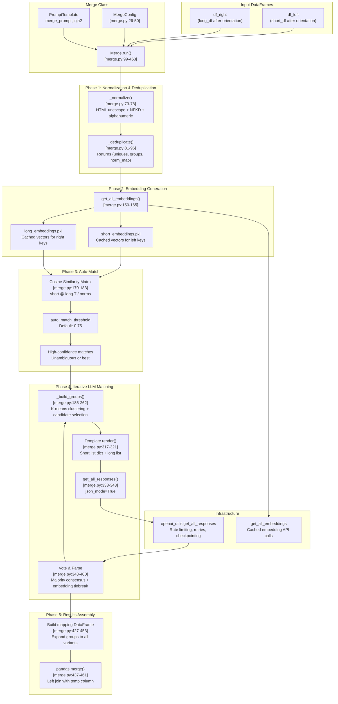
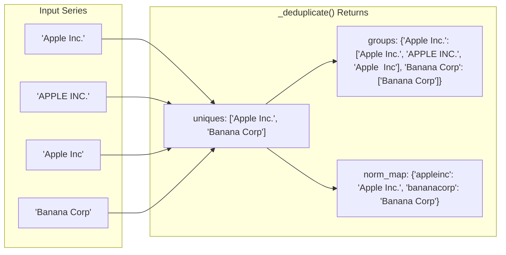
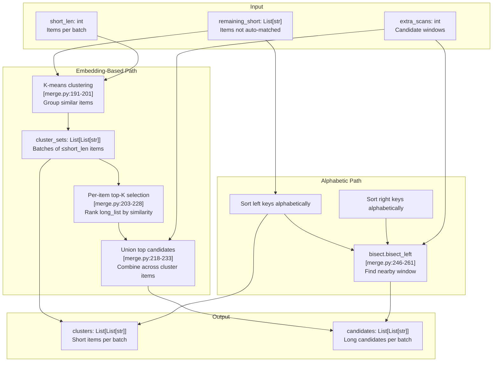
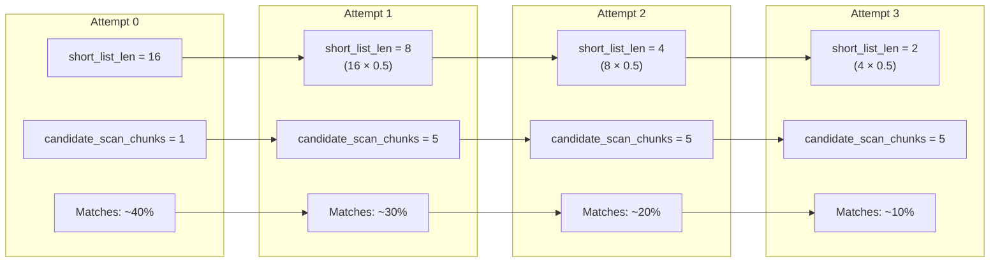

<!-- source: DeepWiki mcp.deepwiki.com · repo openai/GABRIEL · page 5.1 gabriel.merge - Fuzzy Joins · fetched 2026-10-26 -->

# gabriel.merge - Fuzzy Joins

<details>
<summary>Relevant source files</summary>

The following files were used as context for generating this wiki page:

- [src/gabriel/tasks/deduplicate.py](src/gabriel/tasks/deduplicate.py)
- [src/gabriel/tasks/merge.py](src/gabriel/tasks/merge.py)

</details>


## Purpose and Scope

This page documents the `gabriel.merge` task, which performs LLM-assisted fuzzy joins between two DataFrames when exact key matching is insufficient. The system creates crosswalks between datasets using a hybrid approach: embedding-based similarity for high-confidence matches, followed by iterative LLM-based fuzzy matching with clustering for ambiguous cases.

For duplicate detection within a single DataFrame, see [gabriel.deduplicate - Duplicate Detection](#5.2). For other data cleaning tasks, see [Data Cleaning Tasks](#5).

**Sources:** [src/gabriel/tasks/merge.py:1-464]()

---

## Overview: Two-Phase Hybrid Matching

The merge system combines two complementary techniques to maximize accuracy while minimizing LLM calls:

1. **Embedding-Based Auto-Matching**: Fast, deterministic matching for unambiguous cases using cosine similarity
2. **LLM-Based Fuzzy Matching**: Intelligent matching for complex cases where embeddings alone are insufficient

The process iterates through multiple attempts with progressively smaller batches and wider candidate searches to handle increasingly difficult matches.

**Sources:** [src/gabriel/tasks/merge.py:99-463]()

---

## Architecture and Data Flow



**Diagram: Merge Pipeline Architecture**

The system flows through five distinct phases: (1) normalization removes variations in whitespace/casing/encoding, (2) embeddings are generated and cached, (3) auto-matching handles unambiguous cases, (4) iterative LLM matching processes remaining items with progressively finer granularity, and (5) results are assembled into a merged DataFrame.

**Sources:** [src/gabriel/tasks/merge.py:99-463](), [src/gabriel/tasks/merge.py:26-50](), [src/gabriel/tasks/merge.py:73-96]()

---

## Configuration Options

The `MergeConfig` dataclass [merge.py:26-50]() controls all aspects of the merge process:

| Parameter | Type | Default | Description |
|-----------|------|---------|-------------|
| `save_dir` | `str` | `"merge"` | Directory for outputs, embeddings, checkpoints |
| `file_name` | `str` | `"merge_responses.csv"` | Name for LLM response CSV |
| `model` | `str` | `"gpt-5-nano"` | LLM model for fuzzy matching prompts |
| `n_parallels` | `int` | `650` | Concurrent LLM requests |
| `n_runs` | `int` | `1` | Number of runs per batch for voting |
| `use_embeddings` | `bool` | `True` | Enable embedding-based matching |
| `short_list_len` | `int` | `16` | Items from left DataFrame per LLM call |
| `long_list_len` | `int` | `256` | Candidate items from right DataFrame per LLM call |
| `max_attempts` | `int` | `4` | Number of iterative refinement passes |
| `short_list_multiplier` | `float` | `0.5` | Reduction factor per attempt (e.g., 16→8→4→2) |
| `auto_match_threshold` | `float` | `0.75` | Cosine similarity threshold for auto-matching |
| `use_best_auto_match` | `bool` | `False` | Auto-match even with multiple high-similarity candidates |
| `candidate_scan_chunks` | `int` | `5` | Additional candidate windows to scan in later attempts |
| `additional_instructions` | `str?` | `None` | Custom instructions appended to prompts |
| `verbose` | `bool` | `True` | Progress logging |

**Sources:** [src/gabriel/tasks/merge.py:26-50]()

---

## Key Normalization and Deduplication

Before any matching occurs, the system normalizes and deduplicates keys to handle minor variations:

### Normalization [merge.py:73-78]()

The `_normalize()` method canonicalizes strings:
1. HTML entity decoding (e.g., `&amp;` → `&`)
2. Unicode NFKD normalization (decomposes accented characters)
3. Lowercase conversion
4. Retain only alphanumeric characters

**Example:**
- Input: `"Café & Bar™"`
- Output: `"cafebar"`

### Deduplication [merge.py:81-96]()

The `_deduplicate()` method groups equivalent variations:



**Diagram: Deduplication Groups Equivalent Variants**

The representative (first occurrence) becomes the canonical form. All variants map back to the representative for matching.

**Sources:** [src/gabriel/tasks/merge.py:73-96]()

---

## Embedding-Based Auto-Matching

### When Enabled

Auto-matching activates when `use_embeddings=True` and the right DataFrame has at least `long_list_len` (default 256) unique keys [merge.py:138]().

### Algorithm [merge.py:169-183]()

1. **Generate embeddings**: Calls `get_all_embeddings()` for both DataFrames, caching results in `short_embeddings.pkl` and `long_embeddings.pkl`
2. **Compute similarity matrix**: Cosine similarity between all left keys and all right keys
3. **Threshold filtering**: For each left key, find right keys with similarity ≥ `auto_match_threshold`
4. **Disambiguation**:
   - If exactly 1 candidate: auto-match
   - If >1 candidates and `use_best_auto_match=True`: pick highest similarity
   - Otherwise: defer to LLM phase

### Similarity Calculation

```
similarity[i, j] = (short_vec[i] · long_vec[j]) / (||short_vec[i]|| × ||long_vec[j]||)
```

Implemented at [merge.py:174]():
```python
sims = (short_matrix @ long_matrix.T) / (short_norms[:, None] * long_norms[None, :])
```

**Example Impact:**

For a dataset with 1,000 left keys and 10,000 right keys where 60% have unambiguous high-similarity matches:
- Auto-matched: 600 items (0 LLM calls)
- Remaining: 400 items (requires LLM matching)

**Sources:** [src/gabriel/tasks/merge.py:138-183]()

---

## LLM-Based Fuzzy Matching

### Clustering and Candidate Selection

The `_build_groups()` function [merge.py:185-262]() prepares batches for LLM matching:



**Diagram: Clustering and Candidate Selection Logic**

**Two Modes:**

1. **Embedding-based** (when `use_embeddings=True` and embeddings available):
   - K-means clustering groups semantically similar left keys
   - For each cluster batch, compute union of top-K similar right keys
   - `extra_scans` parameter enables scanning multiple candidate windows

2. **Alphabetic fallback** (when embeddings disabled or unavailable):
   - Sort both lists alphabetically
   - Use binary search (`bisect`) to find nearby window in right list
   - Assumes alphabetic proximity correlates with semantic similarity

**Sources:** [src/gabriel/tasks/merge.py:185-262]()

### Prompt Rendering

For each batch, the template renders a prompt with the structure [merge.py:317-321]():

```python
prompt = self.template.render(
    short_list=short_dict,          # Dict[str, str] with empty values
    long_list=list(long_terms),     # List[str] of candidates
    additional_instructions=self.cfg.additional_instructions or "",
)
```

The default template `merge_prompt.jinja2` asks the LLM to return a JSON mapping from left keys to right keys, or `"no certain match"` if uncertain.

**Sources:** [src/gabriel/tasks/merge.py:311-331]()

### Voting and Consensus

When `n_runs > 1`, the system runs each batch multiple times and uses majority voting [merge.py:348-400]():

1. **Parse responses**: Extract JSON mappings from each run
2. **Normalize keys**: Apply `_normalize()` to both keys and values
3. **Count votes**: For each left key, tally right key selections across runs
4. **Tie-breaking**: 
   - If single winner: select it
   - If multiple winners with equal votes: use embedding similarity to pick best
   - Implemented at [merge.py:381-393]()

**Example:**

For left key `"Apple Inc"` across 3 runs:
- Run 1: `"Apple Incorporated"`
- Run 2: `"Apple Inc."`
- Run 3: `"Apple Inc."`

Result: `"Apple Inc."` wins with 2/3 votes.

**Sources:** [src/gabriel/tasks/merge.py:348-400]()

---

## Iterative Refinement Strategy

The merge process iterates up to `max_attempts` times (default 4) with progressively finer granularity:

### Attempt Progression



**Diagram: Progressive Refinement Across Attempts**

### Rationale

- **Attempt 0**: Large batches (16 items) for easy matches
- **Attempt 1+**: Smaller batches allow LLM to focus on fewer items, plus wider candidate scanning to find obscure matches
- **Stopping**: Process terminates early if `remaining=[]` [merge.py:295-296]()

### Checkpoint Management

Each attempt saves its groupings to `merge_groups_attempt{N}.json` [merge.py:299-309]():

```python
with open(group_path, "w", encoding="utf-8") as f:
    json.dump({"clusters": clusters, "candidates": candidates}, f)
```

This enables resumption if the process is interrupted. The groupings are deterministic given the embeddings.

### Progress Tracking

After each attempt, the system logs and saves progress [merge.py:406-425]():

```
[Merge] Attempt 0: 47 matches this round, 47 total, 153 remaining
[Merge] Attempt 1: 32 matches this round, 79 total, 121 remaining
[Merge] Attempt 2: 19 matches this round, 98 total, 102 remaining
```

Saved to `merge_progress.csv`:

| attempt | matches_this_round | total_matches | remaining |
|---------|-------------------|---------------|-----------|
| 0       | 47                | 47            | 153       |
| 1       | 32                | 79            | 121       |
| 2       | 19                | 98            | 102       |

**Sources:** [src/gabriel/tasks/merge.py:294-425]()

---

## Output Format and Results

### Crosswalk Expansion

The final `matches` dictionary maps representative keys. The system expands this to all variants [merge.py:427-453]():

```python
for short_rep, long_rep in matches.items():
    for s in short_groups.get(short_rep, []):      # All left variants
        for l in long_groups.get(long_rep, []):    # All right variants
            records.append({short_key: s, long_key: l})
```

**Example:**

Given:
- `matches = {"Apple Inc.": "Apple Corporation"}`
- `short_groups = {"Apple Inc.": ["Apple Inc.", "APPLE INC."]}`
- `long_groups = {"Apple Corporation": ["Apple Corporation", "Apple Corp"]}`

Produces 4 mapping records:
1. `"Apple Inc." → "Apple Corporation"`
2. `"Apple Inc." → "Apple Corp"`
3. `"APPLE INC." → "Apple Corporation"`
4. `"APPLE INC." → "Apple Corp"`

### Final Merge

The system performs a pandas left join [merge.py:437-461]():

1. Create mapping DataFrame from expanded records
2. Merge `short_df` with mapping
3. Merge result with `long_df`
4. Drop duplicate rows
5. Return merged DataFrame with original column order

**Column Name Handling:**

- If `short_key == long_key`: uses temporary column `{key}_match` to avoid conflicts
- If different: merges directly on both keys

**Sources:** [src/gabriel/tasks/merge.py:427-463]()

---

## Performance Considerations

### Cost-Performance Tradeoffs

| Strategy | LLM Calls | Accuracy | Use Case |
|----------|-----------|----------|----------|
| `auto_match_threshold=0.90` | Minimal | Lower | High-quality embeddings, tolerant of false negatives |
| `auto_match_threshold=0.75` | Moderate | Higher | Balanced (default) |
| `auto_match_threshold=0.0` | Maximum | Highest | No auto-matching, all LLM |
| `use_embeddings=False` | Maximum | Moderate | Small datasets (<256 right keys) |

### Scaling Characteristics

**Left DataFrame Size:**
- Linear impact on auto-matching phase (matrix multiplication)
- Linear impact on LLM calls (each item processed once per attempt)

**Right DataFrame Size:**
- Linear impact on auto-matching (matrix size)
- Sublinear impact on LLM calls (candidate selection via clustering)

**Example Benchmark:**
- 1,000 left keys × 50,000 right keys
- With `use_embeddings=True` and `auto_match_threshold=0.75`:
  - Auto-matched: ~600 items (0 LLM calls)
  - LLM phase: ~400 items → ~25 batches × 4 attempts = 100 LLM calls

### Checkpointing and Resumability

Three checkpoint types enable resumption:

1. **Embeddings**: `short_embeddings.pkl`, `long_embeddings.pkl` [merge.py:150-165]()
2. **Groupings**: `merge_groups_attempt{N}.json` [merge.py:299-309]()
3. **Responses**: `merge_responses.csv` via `get_all_responses()` [merge.py:333-343]()

To restart from scratch: `reset_files=True` [merge.py:108]()

**Sources:** [src/gabriel/tasks/merge.py:99-463]()

---

## Usage Example

```python
import asyncio
from gabriel.tasks.merge import Merge, MergeConfig

async def run_merge():
    cfg = MergeConfig(
        save_dir="./merge_output",
        model="gpt-5-nano",
        auto_match_threshold=0.75,
        short_list_len=16,
        max_attempts=4,
        n_runs=3,  # Use voting for higher accuracy
    )
    
    merger = Merge(cfg)
    
    result_df = await merger.run(
        df_left=companies_df,
        df_right=financial_data_df,
        left_on="company_name",
        right_on="entity_name",
        how="left",
        reset_files=False,  # Resume from checkpoints
    )
    
    return result_df

result = asyncio.run(run_merge())
```

**Sources:** [src/gabriel/tasks/merge.py:99-463]()

---

## Relation to Other Tasks

- **Deduplicate** ([#5.2](#5.2)): Similar clustering and voting logic, but operates on single DataFrame
- **Classify** ([#4.3](#4.3)): Also uses JSON mode and response parsing
- **LLM Orchestration** ([#3.1](#3.1)): Relies on `get_all_responses()` for rate limiting and checkpointing

**Sources:** [src/gabriel/tasks/merge.py:1-464](), [src/gabriel/tasks/deduplicate.py:1-341]()

---

