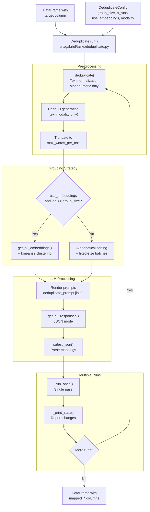
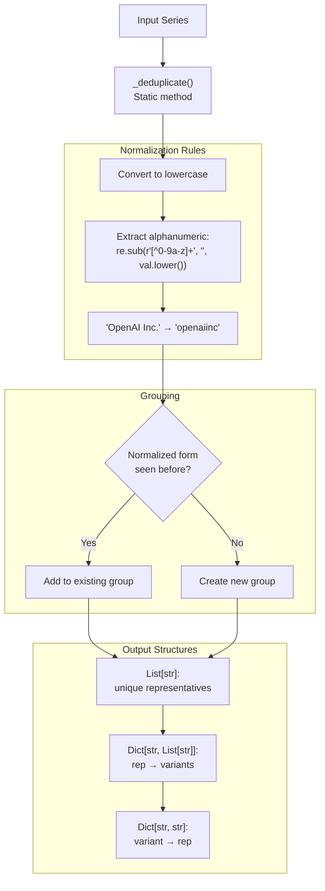
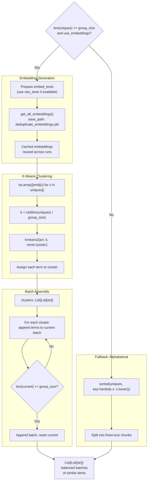
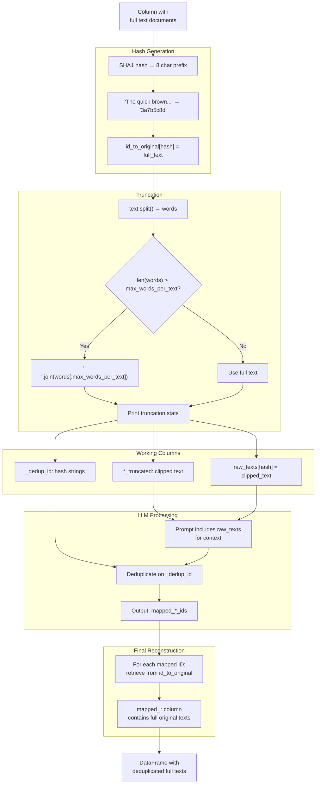
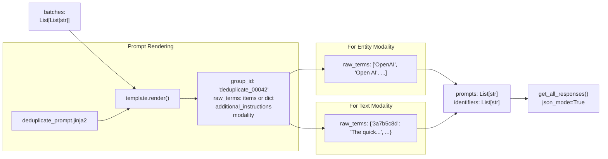
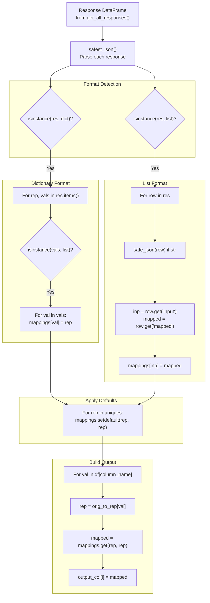
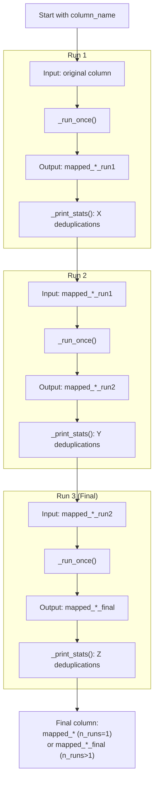
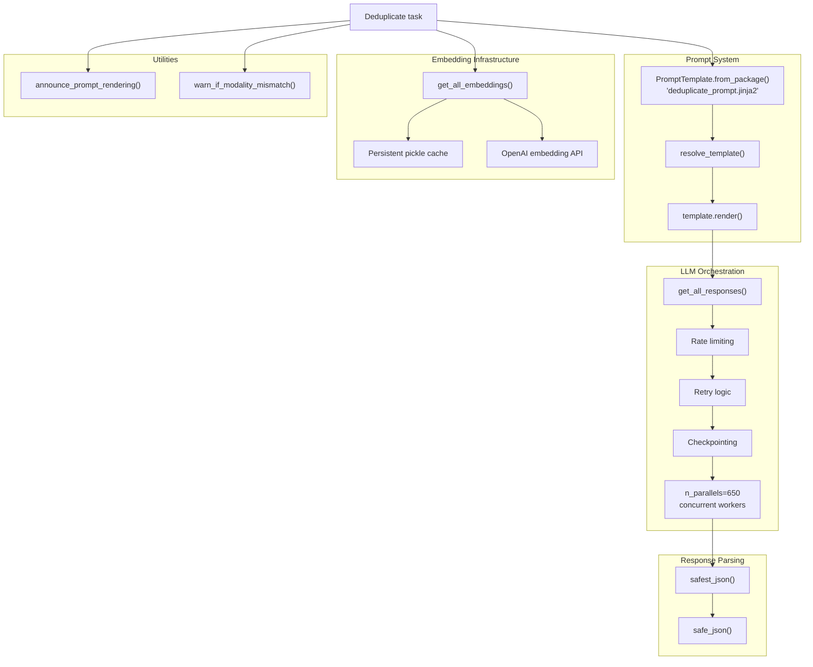

<!-- source: DeepWiki mcp.deepwiki.com · repo openai/GABRIEL · page 5.2 gabriel.deduplicate - Duplicate Detection · fetched 2026-10-26 -->

# gabriel.deduplicate - Duplicate Detection

<details>
<summary>Relevant source files</summary>

The following files were used as context for generating this wiki page:

- [src/gabriel/prompts/paraphrase_prompt.jinja2](src/gabriel/prompts/paraphrase_prompt.jinja2)
- [src/gabriel/tasks/deduplicate.py](src/gabriel/tasks/deduplicate.py)
- [src/gabriel/tasks/merge.py](src/gabriel/tasks/merge.py)
- [src/gabriel/tasks/paraphrase.py](src/gabriel/tasks/paraphrase.py)
- [tests/test_basic.py](tests/test_basic.py)

</details>


## Purpose and Scope

The `gabriel.deduplicate` task identifies and consolidates semantically similar or duplicate items within a single DataFrame column using LLM-assisted analysis. Unlike [gabriel.merge](#5.1) which creates crosswalks between two separate datasets, `deduplicate` operates on one column to find and map variants to canonical representatives.

Common use cases include normalizing entity names, consolidating near-duplicate text passages, and standardizing terminology lists. The task supports multiple modalities (entity names, full texts, images, audio, PDFs) and can perform iterative refinement through multiple passes.

---

## System Overview



**Sources:** [src/gabriel/tasks/deduplicate.py:49-340]()

---

## Configuration Parameters

The `DeduplicateConfig` dataclass controls all aspects of the deduplication process:

| Parameter | Type | Default | Description |
|-----------|------|---------|-------------|
| `save_dir` | `str` | `"deduplicate"` | Directory for outputs and embeddings cache |
| `file_name` | `str` | `"deduplicate_responses.csv"` | Base name for raw LLM responses |
| `model` | `str` | `"gpt-5-mini"` | OpenAI model for duplicate detection |
| `n_parallels` | `int` | `650` | Concurrent API requests |
| `n_runs` | `int` | `3` | Number of iterative deduplication passes |
| `use_dummy` | `bool` | `False` | Use dummy responses for testing |
| `additional_instructions` | `Optional[str]` | `None` | Extra natural language guidance |
| `use_embeddings` | `bool` | `True` | Enable embedding-based clustering |
| `group_size` | `int` | `500` | Maximum items per LLM prompt batch |
| `modality` | `str` | `"entity"` | Input type: entity/text/image/audio/pdf |
| `max_words_per_text` | `int` | `500` | Truncation limit for text modality |
| `verbose` | `bool` | `True` | Enable progress logging |

**Key Design Choices:**

- **`n_runs=3`**: Multiple passes allow iterative refinement as initial mappings provide better clusters
- **`group_size=500`**: Balances prompt length constraints with clustering efficiency
- **`modality="entity"`**: Default assumes short strings (company names, product IDs, etc.) rather than full documents

**Sources:** [src/gabriel/tasks/deduplicate.py:26-46]()

---

## Core Processing Workflow

### Entry Point: `Deduplicate.run()`

```mermaid
graph LR
    Run["run(df, column_name)"]
    
    subgraph "Input Preparation"
        ResetIndex["df.reset_index(drop=True)"]
        WarnCheck["warn_if_modality_mismatch()"]
        ModalityBranch{"modality == 'text'?"}
    end
    
    subgraph "Text Modality Path"
        GenHash["Generate SHA1 hashes<br/>(8 char prefix)"]
        TruncText["Truncate to max_words"]
        CreateID["Add _dedup_id column"]
        StoreRaw["Store id_to_original<br/>mapping"]
    end
    
    subgraph "Iteration Loop"
        RunIdx["For i in range(n_runs)"]
        CallRunOnce["_run_once()"]
        PrintLoop["_print_stats()"]
        UpdateCol["current_col = output_col"]
    end
    
    subgraph "Text Modality Reconstruction"
        TextCheck{"modality == 'text'?"}
        MapBack["Map IDs back to<br/>original texts"]
        CreateFinal["Create mapped_* column<br/>with full texts"]
    end
    
    FinalDF["Return DataFrame<br/>with mapped columns"]
    
    Run --> ResetIndex
    ResetIndex --> WarnCheck
    WarnCheck --> ModalityBranch
    
    ModalityBranch -->|Yes| GenHash
    GenHash --> TruncText
    TruncText --> CreateID
    CreateID --> StoreRaw
    StoreRaw --> RunIdx
    
    ModalityBranch -->|No| RunIdx
    
    RunIdx --> CallRunOnce
    CallRunOnce --> PrintLoop
    PrintLoop --> UpdateCol
    UpdateCol --> RunIdx
    
    UpdateCol --> TextCheck
    TextCheck -->|Yes| MapBack
    MapBack --> CreateFinal
    CreateFinal --> FinalDF
    
    TextCheck -->|No| FinalDF
```



**Sources:** [src/gabriel/tasks/deduplicate.py:235-340]()

---

## Text Normalization and Initial Deduplication

Before LLM processing, the system performs fast, deterministic deduplication using text normalization:



This normalization catches exact duplicates modulo case, punctuation, and whitespace before LLM analysis. The first variant encountered becomes the representative for its normalized form.

**Sources:** [src/gabriel/tasks/deduplicate.py:70-85]()

---

## Embedding-Based Clustering Strategy

When `use_embeddings=True` and the unique item count exceeds `group_size`, the system uses semantic clustering to group similar items:



**Key Implementation Details:**

- **Embedding Model**: Uses `text-embedding-3` (via `get_all_embeddings`)
- **Caching**: Embeddings saved to `deduplicate_embeddings.pkl` and reused across runs
- **K Calculation**: `k = max(1, ceil(len(uniques) / group_size))` ensures roughly equal-sized batches
- **Cluster Ordering**: Terms within each cluster are kept together but clusters themselves are processed sequentially
- **Fallback**: If embeddings disabled or item count below threshold, uses simple alphabetical sorting

**Sources:** [src/gabriel/tasks/deduplicate.py:118-152]()

---

## Modality-Specific Handling

### Text Modality: Hash-Based Indirection

For `modality="text"`, full documents are too long for efficient batching. The system uses hash IDs as proxies:



**Design Rationale:**
- Sending 500 full documents per prompt would exceed token limits
- Hash IDs enable efficient batching while preserving semantic content in `raw_texts` dictionary
- Truncation to `max_words_per_text=500` keeps prompts manageable
- Original texts preserved for final output reconstruction

**Sources:** [src/gabriel/tasks/deduplicate.py:254-290](), [src/gabriel/tasks/deduplicate.py:323-337]()

### Entity Modality: Direct Processing

For `modality="entity"` (default), short strings are sent directly to the LLM without hash indirection:

**Sources:** [src/gabriel/tasks/deduplicate.py:157-169]()

---

## LLM Interaction and Response Parsing

### Prompt Construction



**Sources:** [src/gabriel/tasks/deduplicate.py:154-169]()

### Response Parsing and Mapping

The LLM returns JSON in one of two formats, both parsed by the same logic:

**Format 1: Dictionary (representative → list of variants)**
```json
{
  "OpenAI": ["OpenAI", "Open AI", "open ai"],
  "Anthropic": ["Anthropic", "Antropic"]
}
```

**Format 2: List of objects (input → mapped)**
```json
[
  {"input": "Open AI", "mapped": "OpenAI"},
  {"input": "open ai", "mapped": "OpenAI"}
]
```



**Fallback Behavior:** If a term appears in a batch but receives no mapping from the LLM, it maps to itself (identity mapping).

**Sources:** [src/gabriel/tasks/deduplicate.py:192-231]()

---

## Iterative Refinement with Multiple Runs

The `n_runs` parameter enables iterative improvement:



**Why Multiple Runs Help:**

1. **First Pass**: Initial mappings consolidate obvious variants (e.g., "OpenAI" ← "Open AI")
2. **Second Pass**: Operates on partially-deduplicated data, enabling detection of transitive relationships
3. **Third Pass**: Further consolidation as cluster quality improves with reduced unique count

**Statistics Output Example:**
```
[Deduplicate] Run 1/3: 127 deduplications (15.23% of 834).
[Deduplicate] Unique mapped terms: 707; avg terms per mapping: 1.18.
[Deduplicate] Run 2/3: 43 deduplications (5.16% of 834).
[Deduplicate] Unique mapped terms: 664; avg terms per mapping: 1.26.
[Deduplicate] Run 3/3: 12 deduplications (1.44% of 834).
[Deduplicate] Unique mapped terms: 652; avg terms per mapping: 1.28.
```

**Sources:** [src/gabriel/tasks/deduplicate.py:291-322]()

---

## Output Structure

### Column Naming Conventions

| Modality | n_runs=1 | n_runs>1 (intermediate) | n_runs>1 (final) |
|----------|----------|-------------------------|------------------|
| `entity` | `mapped_<column>` | `mapped_<column>_run1`, `mapped_<column>_run2` | `mapped_<column>_final` |
| `text` | `mapped_<column>_ids`, `mapped_<column>` | `mapped_<column>_ids_run1`, etc. | `mapped_<column>_ids_final`, `mapped_<column>` |

### Intermediate Artifacts

The `save_dir` contains:

- **`deduplicate_responses.csv`** (or `*_run1.csv`, `*_run2.csv`, etc.): Raw LLM responses with metadata
- **`deduplicate_embeddings.pkl`**: Cached embeddings (reused across runs)
- **`_dedup_id`** column (text modality): Hash identifiers
- **`<column>_truncated`** column (text modality): Clipped text for prompt inclusion

**Sources:** [src/gabriel/tasks/deduplicate.py:171-176](), [src/gabriel/tasks/deduplicate.py:293-306]()

---

## Integration with Core Infrastructure



**Key Integration Points:**

- **Prompt Templates**: Uses Jinja2 system from `gabriel.core.prompt_template`
- **Embedding Layer**: Leverages `get_all_embeddings()` from `gabriel.utils` with automatic caching
- **LLM Orchestration**: Relies on `get_all_responses()` in `gabriel.utils.openai_utils` for all rate limiting, retry, and concurrency management (see [3.1](#3.1))
- **JSON Parsing**: Uses `safest_json()` and `safe_json()` with fallback handling for malformed responses

**Sources:** [src/gabriel/tasks/deduplicate.py:1-23](), [src/gabriel/tasks/deduplicate.py:52-66](), [src/gabriel/tasks/deduplicate.py:178-195]()

---

## Advanced Configuration and Customization

### Custom Prompt Templates

Override the default template via `template_path`:

```python
from gabriel.tasks.deduplicate import Deduplicate, DeduplicateConfig

cfg = DeduplicateConfig(
    save_dir="custom_dedup",
    modality="entity"
)

task = Deduplicate(
    cfg,
    template_path="path/to/custom_deduplicate_prompt.jinja2"
)
```

The template receives:
- `group_id`: Unique batch identifier
- `raw_terms`: List or dict of terms to deduplicate
- `additional_instructions`: Optional user guidance
- `modality`: Processing mode hint

**Sources:** [src/gabriel/tasks/deduplicate.py:52-66]()

### Adjusting Group Size for Different Modalities

| Modality | Recommended `group_size` | Rationale |
|----------|-------------------------|-----------|
| `entity` | 500 (default) | Short strings allow large batches |
| `text` | 25-50 | Full documents require smaller batches despite truncation |
| `image`/`audio`/`pdf` | 10-25 | Multimodal tokens consume more context |

The system warns when using `modality="text"` with `group_size > 25`.

**Sources:** [src/gabriel/tasks/deduplicate.py:254-259]()

### Disabling Embeddings

Set `use_embeddings=False` to force alphabetical grouping:

```python
cfg = DeduplicateConfig(
    use_embeddings=False,
    group_size=100
)
```

Useful when:
- Semantic similarity not needed (e.g., purely spelling variants)
- Avoiding OpenAI embedding API costs
- Debugging or testing with deterministic ordering

**Sources:** [src/gabriel/tasks/deduplicate.py:118-152]()

---

## Comparison with Related Tasks

| Feature | `gabriel.deduplicate` | `gabriel.merge` |
|---------|----------------------|-----------------|
| **Input** | Single DataFrame column | Two separate DataFrames |
| **Goal** | Find duplicates within one dataset | Match rows across two datasets |
| **Output** | `mapped_*` column in same DataFrame | Joined DataFrame with columns from both sides |
| **Auto-matching** | Via text normalization | Via embedding similarity threshold |
| **Iterative refinement** | `n_runs` parameter | `max_attempts` parameter |
| **Use case** | Entity normalization, text deduplication | Fuzzy joins, crosswalk creation |

For information about joining two datasets with fuzzy matching, see [gabriel.merge](#5.1).

**Sources:** [src/gabriel/tasks/deduplicate.py](), [src/gabriel/tasks/merge.py]()

---

## Performance Considerations

### Scaling Characteristics

- **Small datasets** (< 100 items): Fast, typically single pass sufficient
- **Medium datasets** (100-10,000 items): Embedding clustering provides significant speedup
- **Large datasets** (> 10,000 items): Multiple k-means clusters, parallel LLM calls, embedding cache critical

### Caching Strategy

Embeddings are cached to `deduplicate_embeddings.pkl` and reused across:
- Multiple `n_runs` iterations
- Subsequent executions with `reset_files=False`

This eliminates redundant embedding API calls for unchanged terms.

**Sources:** [src/gabriel/tasks/deduplicate.py:125-132]()

### Parallel Processing

The system leverages `n_parallels=650` concurrent workers via `get_all_responses()`:
- Each batch is an independent prompt
- With 100 batches and 650 workers, all batches process simultaneously
- Subject to OpenAI rate limits (handled by underlying infrastructure)

For details on concurrency management, see [12.3](#12.3).

**Sources:** [src/gabriel/tasks/deduplicate.py:32](), [src/gabriel/tasks/deduplicate.py:178-188]()

---

