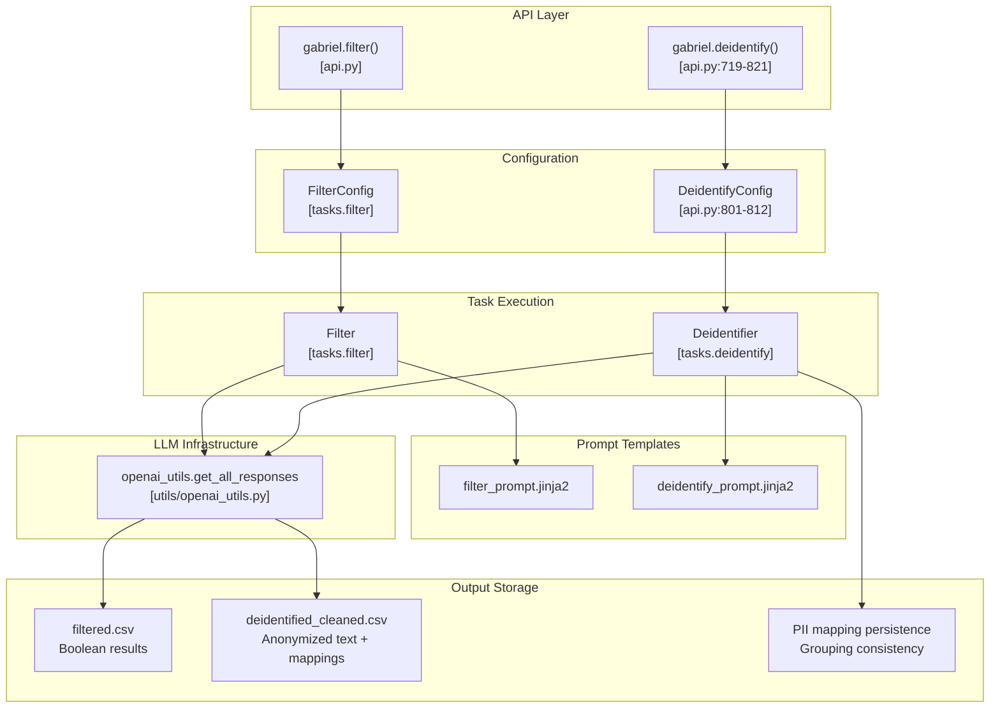
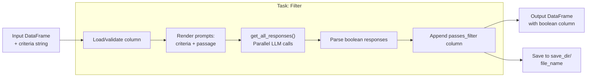
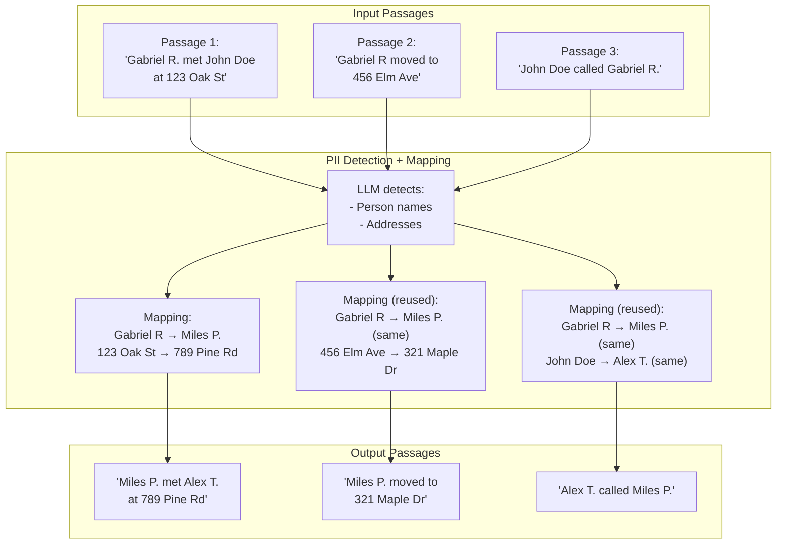
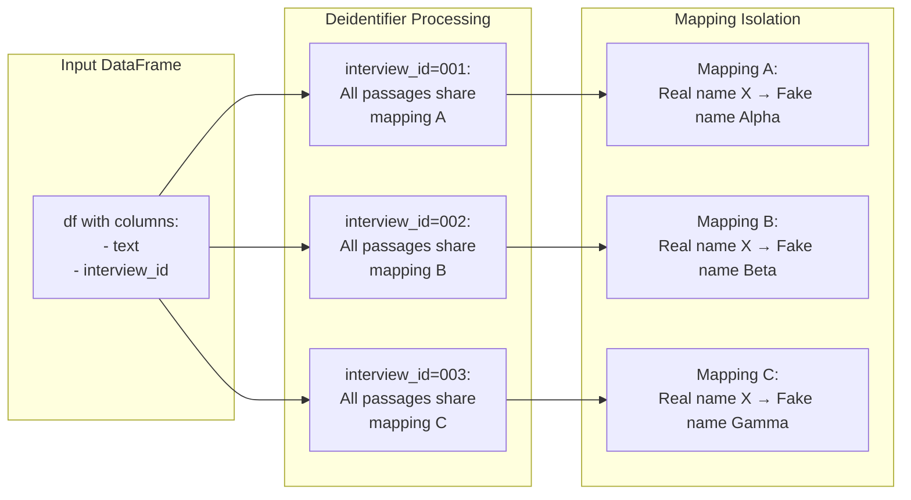
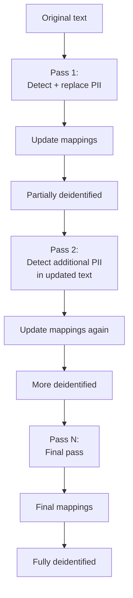

<!-- source: DeepWiki mcp.deepwiki.com · repo openai/GABRIEL · page 5.3 gabriel.filter and gabriel.deidentify · fetched 2026-10-26 -->

# gabriel.filter and gabriel.deidentify

<details>
<summary>Relevant source files</summary>

The following files were used as context for generating this wiki page:

- [src/gabriel/api.py](src/gabriel/api.py)
- [src/gabriel/prompts/paraphrase_prompt.jinja2](src/gabriel/prompts/paraphrase_prompt.jinja2)
- [src/gabriel/tasks/paraphrase.py](src/gabriel/tasks/paraphrase.py)
- [tests/test_basic.py](tests/test_basic.py)

</details>


## Purpose and Scope

This page documents two data cleaning tasks that prepare sensitive or irrelevant data for further analysis:

- **`gabriel.filter`**: Boolean screening to retain or exclude rows based on natural language criteria
- **`gabriel.deidentify`**: Consistent replacement of personally identifiable information (PII) with realistic fake data while maintaining referential integrity

Both tasks belong to the Data Cleaning category (see [Data Cleaning Tasks](#5) for related functionality like merge and deduplicate). For structured fact extraction without PII concerns, see [gabriel.extract](#4.4). For more general text rewriting, see [gabriel.paraphrase](#6.2).

**Sources:** [src/gabriel/api.py:7-40](), [src/gabriel/api.py:51-71]()

---

## System Architecture



**Data Flow Architecture**

Both tasks follow GABRIEL's standard three-layer pattern: API functions accept DataFrames and natural language parameters, Task classes orchestrate prompt rendering and LLM calls through `openai_utils`, and results are persisted to structured CSVs. The deidentifier additionally maintains stateful mappings to ensure consistency across grouped passages and multiple passes.

**Sources:** [src/gabriel/api.py:7-40](), [src/gabriel/api.py:719-821]()

---

## gabriel.filter

### Overview

`gabriel.filter` performs boolean screening of DataFrame rows using natural language criteria. The task returns `True` or `False` for each input, indicating whether it matches the specified filter condition. This enables programmatic exclusion or retention of rows without manual inspection.

**Common Use Cases:**
- Exclude off-topic responses from survey data
- Retain only passages mentioning specific concepts
- Filter out low-quality or spam content
- Pre-screen data before expensive downstream tasks

**Sources:** [src/gabriel/api.py:34-35](), High-level system diagrams

### API Function Signature

```python
async def filter(
    df: Optional[pd.DataFrame],
    column_name: str,
    *,
    criteria: str,
    save_dir: str,
    additional_instructions: Optional[str] = None,
    model: str = "gpt-5-mini",
    n_parallels: int = 650,
    reset_files: bool = False,
    file_name: str = "filter_results.csv",
    modality: str = "text",
    reasoning_effort: Optional[str] = None,
    template_path: Optional[str] = None,
    response_fn: Optional[Callable[..., Awaitable[Any]]] = None,
    get_all_responses_fn: Optional[Callable[..., Awaitable[pd.DataFrame]]] = None,
    **cfg_kwargs,
) -> pd.DataFrame
```

**Sources:** [src/gabriel/api.py:34]()

### Key Parameters

| Parameter | Type | Description |
|-----------|------|-------------|
| `df` | `pd.DataFrame` | Source data. When `None`, loads cached results from `save_dir`. |
| `column_name` | `str` | Column containing passages to evaluate. |
| `criteria` | `str` | Natural language description of what should pass the filter. |
| `save_dir` | `str` | Directory for outputs and checkpoints. |
| `additional_instructions` | `str` | Optional prompt refinements. |
| `model` | `str` | Model name (default: `"gpt-5-mini"`). |
| `n_parallels` | `int` | Concurrent request limit (default: 650). |
| `reset_files` | `bool` | Force regeneration, ignoring cached results. |
| `file_name` | `str` | Output CSV name. |
| `modality` | `str` | Input type: `"text"`, `"image"`, `"audio"`, `"pdf"`, `"entity"`, `"web"`. |
| `reasoning_effort` | `str` | LLM reasoning intensity: `"none"`, `"low"`, `"medium"`, `"high"`. |
| `template_path` | `str` | Override default prompt template. |
| `response_fn` | `Callable` | Custom LLM response function (see [Custom Response Parsing](#10.2)). |
| `get_all_responses_fn` | `Callable` | Replace entire orchestration layer (see [Alternative LLM Backends](#10.3)). |

**Sources:** [src/gabriel/api.py:105-125]() (similar pattern from `rate`)

### Output Format

Returns a DataFrame with the original columns plus a boolean column indicating filter results:

| Column | Type | Description |
|--------|------|-------------|
| (original columns) | (various) | Unchanged input columns. |
| `passes_filter` | `bool` | Whether the row matches the criteria. |

**Sources:** Inferred from standard GABRIEL task patterns

### Task Execution Flow



**Filter Task Lifecycle**

The task follows GABRIEL's standard execution pattern: validate inputs via `FilterConfig.__post_init__`, render per-passage prompts via `PromptTemplate`, invoke `get_all_responses` for parallel LLM calls with checkpointing, parse JSON booleans from responses, and append results to the input DataFrame. The boolean column enables downstream filtering with standard pandas operations.

**Sources:** [src/gabriel/tasks/rate.py:1-100]() (analogous task structure)

---

## gabriel.deidentify

### Overview

`gabriel.deidentify` replaces personally identifiable information (PII) with consistent, realistic fake substitutes. The task maintains referential integrity: the same real entity always maps to the same fake entity, even across multiple texts or passages. This enables sharing of sensitive corpora for research or review while preserving analytical utility.

**Common Use Cases:**
- Anonymize interview transcripts before external sharing
- Remove employee names from HR records
- Replace addresses and phone numbers in legal documents
- Scrub patient identifiers from medical notes

**Sources:** [src/gabriel/api.py:719-821]()

### API Function Signature

```python
async def deidentify(
    df: Optional[pd.DataFrame],
    column_name: str,
    *,
    save_dir: str,
    grouping_column: Optional[str] = None,
    mapping_column: Optional[str] = None,
    model: str = "gpt-5-mini",
    n_parallels: int = 650,
    file_name: str = "deidentified.csv",
    max_words_per_call: int = 7500,
    additional_instructions: Optional[str] = None,
    reasoning_effort: Optional[str] = None,
    n_passes: int = 1,
    use_existing_mappings_only: bool = False,
    template_path: Optional[str] = None,
    reset_files: bool = False,
    response_fn: Optional[Callable[..., Awaitable[Any]]] = None,
    get_all_responses_fn: Optional[Callable[..., Awaitable[pd.DataFrame]]] = None,
    **cfg_kwargs,
) -> pd.DataFrame
```

**Sources:** [src/gabriel/api.py:719-739]()

### Key Parameters

| Parameter | Type | Default | Description |
|-----------|------|---------|-------------|
| `df` | `pd.DataFrame` | - | Input data. When `None`, loads cached results from `save_dir`. |
| `column_name` | `str` | - | Column containing text to deidentify. |
| `save_dir` | `str` | - | Output directory for anonymized text and mappings. |
| `grouping_column` | `str` | `None` | Optional column grouping records that should share PII replacements (e.g., all passages from the same interview). |
| `mapping_column` | `str` | `None` | Optional column providing pre-existing replacement mappings. Useful for incremental deidentification. |
| `model` | `str` | `"gpt-5-mini"` | Model used for PII detection and replacement generation. |
| `n_parallels` | `int` | 650 | Concurrent request limit. |
| `file_name` | `str` | `"deidentified.csv"` | Output CSV name. |
| `max_words_per_call` | `int` | 7500 | Chunk size for long passages. |
| `additional_instructions` | `str` | `None` | Extra prompt guidance (e.g., "preserve medical terminology"). |
| `reasoning_effort` | `str` | `None` | LLM reasoning intensity: `"none"`, `"low"`, `"medium"`, `"high"`. |
| `n_passes` | `int` | 1 | Number of deidentification passes. Higher values catch more PII but increase cost. |
| `use_existing_mappings_only` | `bool` | `False` | If `True`, only apply existing mappings without generating new ones. Useful for applying finalized mappings to new data. |
| `template_path` | `str` | `None` | Override default prompt template. |
| `reset_files` | `bool` | `False` | Force regeneration, ignoring cached outputs. |
| `response_fn` | `Callable` | `None` | Custom LLM response function. |
| `get_all_responses_fn` | `Callable` | `None` | Replace entire orchestration layer. |

**Sources:** [src/gabriel/api.py:719-789]()

### Output Format

Returns a DataFrame with the original columns plus:

| Column | Type | Description |
|--------|------|-------------|
| (original columns) | (various) | Unchanged input columns. |
| `deidentified_text` | `str` | Text with PII replaced by fake substitutes. |
| `pii_mapping` | `dict` | Mapping from PII categories to real/fake pairs for this passage. |

The CSV saved to `save_dir` contains the same structure, enabling inspection of individual replacements.

**Sources:** [tests/test_basic.py:1092-1097]()

### Mapping Structure and Consistency



**Referential Integrity via Mapping Persistence**

Each PII category (person name, organization, location, etc.) maintains a mapping dictionary with:
- `"real forms"`: List of all surface forms encountered (e.g., `["Gabriel R.", "Gabriel R"]`)
- `"casted form"`: Single fake substitute (e.g., `"Miles P."`)

When a new passage mentions "Gabriel R." (with period), the system recognizes it matches an existing real form and applies the same casted form. This ensures consistency across an entire corpus, even when PII appears with minor punctuation or spelling variations.

**Sources:** [tests/test_basic.py:1100-1129](), [src/gabriel/api.py:741-744]()

### Grouping for Multi-Passage Consistency

The `grouping_column` parameter enables consistent replacements across logically related passages. Example use case: multiple excerpts from the same interview should share the same fake names.



**Grouping Semantics**

Without `grouping_column`, all passages share a single global mapping (same real entity always gets same fake replacement corpus-wide). With `grouping_column`, each unique group value gets an isolated mapping scope: "John Doe" in interview 001 might become "Alex T." while "John Doe" in interview 002 becomes "Charlie M." This prevents cross-interview false connections while maintaining within-interview consistency.

**Sources:** [src/gabriel/api.py:755-757]()

### Multi-Pass Deidentification

The `n_passes` parameter controls how many sequential deidentification rounds to run. Later passes can catch PII that was initially missed or introduced by earlier replacements.

**Execution Flow:**



**Sources:** [src/gabriel/api.py:772]()

### Use Cases and Examples

#### Basic Deidentification

```python
import gabriel

df = pd.DataFrame({
    "transcript": [
        "John Smith interviewed at Microsoft on 2023-10-15.",
        "Jane Doe met John Smith at 123 Main St.",
    ]
})

result = await gabriel.deidentify(
    df,
    "transcript",
    save_dir="./deid_output",
)

# result["deidentified_text"]:
# ["Alex Taylor interviewed at TechCorp on 2023-10-15.",
#  "Morgan Lee met Alex Taylor at 456 Oak Ave."]
```

#### Grouped Deidentification (Interviews)

```python
df = pd.DataFrame({
    "text": [
        "I'm John. I work at Acme Corp.",
        "John mentioned his role at Acme Corp.",
        "I'm Sarah. I consulted for Acme Corp.",
    ],
    "interview_id": ["INT001", "INT001", "INT002"],
})

result = await gabriel.deidentify(
    df,
    "text",
    grouping_column="interview_id",
    save_dir="./interviews_deid",
)

# Within INT001: "John" → same fake name (e.g., "Alex")
# Within INT002: "Sarah" → different fake name (e.g., "Morgan")
# "Acme Corp" might map differently per interview
```

#### Pre-Existing Mappings

```python
# First pass: generate mappings
result1 = await gabriel.deidentify(
    df_initial,
    "text",
    save_dir="./deid",
)

# Extract mappings from result1
mappings = result1["pii_mapping"].iloc[0]

# Second pass: apply existing mappings to new data
df_new["mapping"] = [mappings] * len(df_new)

result2 = await gabriel.deidentify(
    df_new,
    "text",
    mapping_column="mapping",
    use_existing_mappings_only=True,
    save_dir="./deid",
)
```

**Sources:** [tests/test_basic.py:1092-1129]()

### Chunking for Long Passages

The `max_words_per_call` parameter controls how long passages are chunked before sending to the LLM. This prevents exceeding token limits and improves parallelism for very long documents.

**Chunking Strategy:**
1. Split passage into segments of approximately `max_words_per_call` words
2. Send each chunk as a separate LLM request
3. Merge deidentified chunks back together
4. Share mappings across chunks to maintain consistency

**Sources:** [src/gabriel/api.py:766]()

### Template Customization

Override the default prompt template to adjust PII detection behavior:

```python
result = await gabriel.deidentify(
    df,
    "text",
    template_path="./custom_deid_prompt.jinja2",
    additional_instructions="Preserve all medical terminology exactly. Only replace patient names and dates.",
    save_dir="./medical_deid",
)
```

**Sources:** [src/gabriel/api.py:776](), [src/gabriel/prompts/paraphrase_prompt.jinja2:1-23]() (analogous template structure)

### Interaction with Paraphrase Task

The deidentifier shares architectural patterns with `gabriel.paraphrase` (see [gabriel.paraphrase](#6.2)): both rewrite text according to instructions while maintaining consistency. However, deidentification focuses on PII replacement with deterministic mappings, while paraphrasing emphasizes stylistic rewriting with optional validation.

**Key Differences:**

| Aspect | `gabriel.deidentify` | `gabriel.paraphrase` |
|--------|---------------------|---------------------|
| **Primary Goal** | Replace PII with fake data | Rewrite text per instructions |
| **Consistency Mechanism** | Mapping dictionaries (real → fake) | Optional validation with classifier |
| **Multi-Pass Logic** | Sequential PII detection rounds | Recursive validation until approved |
| **Output** | Single deidentified version + mappings | One or more paraphrased versions + approval flags |

**Sources:** [src/gabriel/tasks/paraphrase.py:1-637](), [src/gabriel/api.py:719-821]()

### Configuration Class

The `DeidentifyConfig` dataclass ([src/gabriel/api.py:801-812]()) validates all parameters via `__post_init__`:

```python
@dataclass
class DeidentifyConfig:
    save_dir: str
    file_name: str = "deidentified.csv"
    model: str = "gpt-5-mini"
    n_parallels: int = 650
    max_words_per_call: int = 7500
    additional_instructions: Optional[str] = None
    reasoning_effort: Optional[str] = None
    n_passes: int = 1
    use_existing_mappings_only: bool = False
    # ... (other fields from **cfg_kwargs)
```

**Sources:** [src/gabriel/api.py:801-812]()

### Resumability and Checkpointing

Like all GABRIEL tasks, deidentification leverages the checkpoint system in `openai_utils.get_all_responses`. Interrupted runs can resume from the last saved state by re-running with the same `save_dir` and `reset_files=False` (default).

**Checkpoint Behavior:**
1. Responses are saved incrementally to `{save_dir}/{file_name}`
2. On restart, existing responses are loaded and skipped
3. Only missing or failed passages trigger new LLM calls
4. Final output merges checkpoint data with new responses

See [Checkpointing and Resumability](#12.2) for infrastructure details.

**Sources:** [src/gabriel/api.py:795-821]()

---

## Common Patterns

### Error Handling and Retry Logic

Both `filter` and `deidentify` inherit robust error handling from `openai_utils`:
- Rate limit errors trigger global cooldowns
- Transient failures retry with exponential backoff + jitter
- Fatal errors (auth, invalid parameters) fail fast
- All errors are logged to the output CSV's `"Error Log"` column

See [Error Handling and Retry Logic](#12.4) for details.

**Sources:** [src/gabriel/utils/openai_utils.py]() (referenced in system diagrams)

### Concurrency Management

Default `n_parallels=650` enables high throughput. The system dynamically adjusts concurrency based on API rate limit headers to prevent throttling. For web search or non-standard models, concurrency may be capped lower automatically.

See [Concurrency and Rate Limiting](#12.3) for tuning guidance.

**Sources:** [src/gabriel/api.py:762](), [src/gabriel/api.py:836]()

### Multimodal Support

Both tasks support `modality` parameter for non-text inputs:
- `"image"`: Base64-encoded images or file paths
- `"audio"`: Audio file paths or pre-encoded payloads
- `"pdf"`: PDF file paths
- `"web"`: Web search queries
- `"entity"`: Short entity names (default for extract-style tasks)
- `"text"`: Plain text (default)

See [Multimodal Processing](#11) for usage details.

**Sources:** [src/gabriel/api.py:730](), [src/gabriel/api.py:840]()

### Testing with Dummy Mode

Both tasks support `use_dummy=True` for testing without API calls:

```python
result = await gabriel.deidentify(
    df,
    "text",
    save_dir="./test_output",
    use_dummy=True,  # Returns synthetic responses
)
```

Dummy mode generates placeholder responses with the correct structure, enabling unit tests and integration tests without LLM costs.

**Sources:** [tests/test_basic.py:1092-1097]()

---

## Integration with Other Tasks

### Pre-Filtering Before Expensive Tasks

Use `gabriel.filter` to exclude irrelevant data before running expensive tasks like `ideate` or `discover`:

```python
# Step 1: Filter out off-topic passages
filtered = await gabriel.filter(
    df,
    "text",
    criteria="The passage discusses climate policy or environmental regulation",
    save_dir="./filter_output",
)

# Step 2: Run expensive discovery only on relevant passages
relevant_df = filtered[filtered["passes_filter"]]
discovery = await gabriel.discover(
    relevant_df,
    column_name="text",
    save_dir="./discovery_output",
)
```

**Sources:** Inferred from system architecture

### Deidentification Before Sharing

Combine deidentification with other tasks for privacy-preserving analysis pipelines:

```python
# Step 1: Deidentify sensitive transcripts
deid = await gabriel.deidentify(
    df,
    "interview_text",
    grouping_column="participant_id",
    save_dir="./deid_output",
)

# Step 2: Rate deidentified text on attributes
ratings = await gabriel.rate(
    deid,
    "deidentified_text",
    attributes={"stress_level": "How much stress does the speaker express?"},
    save_dir="./rating_output",
)

# Step 3: Share deidentified + rated data externally
ratings[["deidentified_text", "stress_level"]].to_csv("public_dataset.csv")
```

**Sources:** [src/gabriel/api.py:719-821](), [src/gabriel/api.py:105-215]()

---

## File Structure and Outputs

### Save Directory Layout

```
{save_dir}/
├── {file_name}                      # Raw LLM responses (Identifier, Response, etc.)
├── {file_name}_cleaned.csv          # Final output with boolean/deidentified columns
└── (checkpoint metadata)            # Internal resumability state
```

For deidentification with grouping:
```
{save_dir}/
├── deidentified.csv
├── deidentified_cleaned.csv
└── (per-group mapping state)        # Internal consistency tracking
```

**Sources:** [src/gabriel/api.py:199](), [src/gabriel/api.py:799]()

### CSV Output Columns

**Filter Output:**

| Column | Description |
|--------|-------------|
| (original columns) | All input columns preserved |
| `passes_filter` | Boolean indicating filter match |

**Deidentify Output:**

| Column | Description |
|--------|-------------|
| (original columns) | All input columns preserved |
| `deidentified_text` | Text with PII replaced |
| `pii_mapping` | JSON mapping of real → fake entities |

**Sources:** Inferred from standard task patterns and test code

---

## Performance Considerations

### Batch Size and Parallelism

- **Filter**: Typically fast (~1-2s per passage with `gpt-5-mini`). Default `n_parallels=650` is usually sufficient.
- **Deidentify**: Slower due to multi-pass logic and mapping management. Consider reducing `n_parallels` if rate limits are hit, or increase `max_words_per_call` to process larger chunks per request.

**Sources:** [src/gabriel/api.py:762](), [src/gabriel/api.py:836]()

### Cost Optimization

- **Filter**: Use cheaper models like `gpt-5-nano` for simple boolean criteria
- **Deidentify**: Set `n_passes=1` for most cases; only increase if initial pass misses PII
- **Both**: Use `reset_files=False` (default) to resume interrupted runs without re-processing

**Sources:** [src/gabriel/api.py:726](), [src/gabriel/api.py:772]()

### Reasoning Effort

The `reasoning_effort` parameter controls LLM deliberation time:
- `"none"` or `"low"`: Fast, suitable for simple filtering criteria
- `"medium"`: Balanced (default for most tasks)
- `"high"`: Slowest but most accurate for complex PII detection or nuanced filtering

**Sources:** [src/gabriel/api.py:731](), [src/gabriel/api.py:769]()

---

## Advanced Customization

### Custom Response Functions

Replace the default LLM call with a custom function:

```python
async def custom_filter_fn(prompt: str, **kwargs):
    # Custom logic (e.g., local model, rule-based filtering)
    return [str(my_local_filter(prompt))]

result = await gabriel.filter(
    df,
    "text",
    criteria="Contains profanity",
    response_fn=custom_filter_fn,
    save_dir="./filter",
)
```

See [Custom Response Parsing](#10.2) for details.

**Sources:** [src/gabriel/api.py:736](), [src/gabriel/api.py:779]()

### Alternative LLM Backends

Replace the entire orchestration layer:

```python
async def custom_driver(prompts, identifiers, **kwargs):
    # Call alternative LLM service
    responses = await my_llm_service.batch_process(prompts)
    return pd.DataFrame({
        "Identifier": identifiers,
        "Response": [[r] for r in responses],
    })

result = await gabriel.deidentify(
    df,
    "text",
    get_all_responses_fn=custom_driver,
    save_dir="./deid",
)
```

See [Alternative LLM Backends](#10.3) for requirements and examples.

**Sources:** [src/gabriel/api.py:783-786]()

---

## Comparison Table

| Feature | `gabriel.filter` | `gabriel.deidentify` |
|---------|-----------------|---------------------|
| **Primary Purpose** | Boolean screening | PII replacement |
| **Output Type** | Boolean column | Anonymized text + mappings |
| **Consistency Mechanism** | N/A (stateless) | Mapping dictionaries |
| **Multi-Pass Support** | No (single evaluation) | Yes (`n_passes`) |
| **Grouping Support** | No | Yes (`grouping_column`) |
| **Typical Use Case** | Pre-filtering pipelines | Data sharing / compliance |
| **Cost per Row** | Low (simple prompt) | Medium-High (detection + generation) |

**Sources:** [src/gabriel/api.py:719-821](), System architecture diagrams

---

