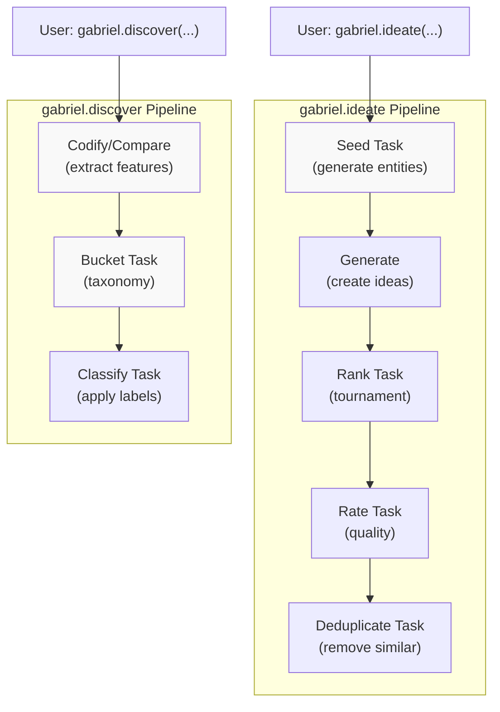
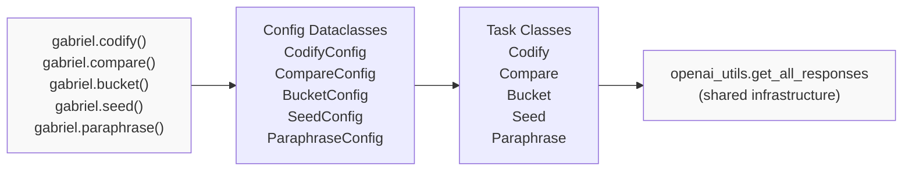
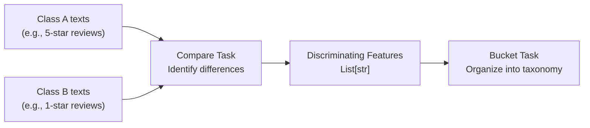
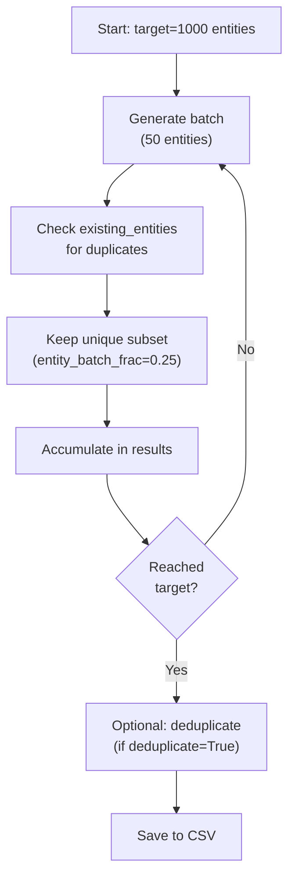
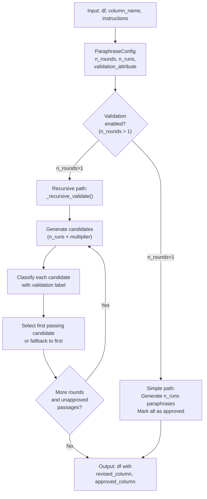
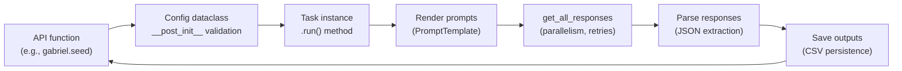

<!-- source: DeepWiki mcp.deepwiki.com · repo openai/GABRIEL · page 6 Helper and Composition Tasks · fetched 2026-10-26 -->

# Helper and Composition Tasks

<details>
<summary>Relevant source files</summary>

The following files were used as context for generating this wiki page:

- [README.md](README.md)
- [src/gabriel/api.py](src/gabriel/api.py)
- [src/gabriel/prompts/paraphrase_prompt.jinja2](src/gabriel/prompts/paraphrase_prompt.jinja2)
- [src/gabriel/tasks/paraphrase.py](src/gabriel/tasks/paraphrase.py)
- [tests/test_basic.py](tests/test_basic.py)

</details>


## Purpose and Scope

This page documents helper tasks that support qualitative analysis, text transformation, and data generation workflows. Unlike measurement tasks ([section 4](#4)) which quantify attributes or data cleaning tasks ([section 5](#5)) which prepare datasets, helper tasks provide building blocks for exploratory coding, content generation, and text manipulation that often feed into larger analytical pipelines.

The five core helper tasks are:
- **`gabriel.codify`**: Highlights text passages matching qualitative codes
- **`gabriel.compare`**: Identifies differences between paired items
- **`gabriel.bucket`**: Organizes terms into emergent taxonomies
- **`gabriel.seed`**: Generates diverse, representative entity distributions
- **`gabriel.paraphrase`**: Rewrites text with validation and approval tracking

For multi-stage pipelines that orchestrate multiple tasks (e.g., `gabriel.ideate`, `gabriel.discover`), see [section 7](#7). For arbitrary prompt execution, see `gabriel.whatever` in [section 10.4](#10.4).

---

## Overview: Role in the Task Ecosystem

Helper tasks occupy a distinct layer between direct measurement and complex orchestration. They transform, generate, or annotate content without necessarily producing numeric scores. Many complex pipelines compose these helpers as intermediate stages.

### Task Classification

| Task Type | Characteristics | Examples |
|-----------|----------------|-----------|
| **Measurement** | Quantify attributes → numeric outputs | `rate`, `rank`, `classify`, `extract` |
| **Cleaning** | Prepare/deduplicate data → cleaned datasets | `merge`, `deduplicate`, `filter`, `deidentify` |
| **Helper** | Transform/generate/annotate → qualitative outputs | `codify`, `compare`, `bucket`, `seed`, `paraphrase` |
| **Composition** | Multi-stage workflows → orchestrated results | `ideate`, `discover`, `debias` |

**Sources**: [README.md:36-71]()

---

## Composition Patterns in Complex Tasks

Helper tasks are frequently composed as building blocks in larger pipelines. The diagram below shows how `ideate` and `discover` orchestrate helpers with measurement tasks:



**Composition Architecture**: `Ideate` uses `Seed` to generate diverse seed entities before idea generation. `Discover` chains `Codify`/`Compare` → `Bucket` → `Classify` to learn discriminating features between labeled classes.

**Sources**: [src/gabriel/api.py:554-710](), [Diagram 3 from overview]()

---

## API Layer and Task Implementations

### Function Signatures

All helper tasks follow the standard GABRIEL pattern: an async function in `gabriel.api` wraps a task class from `gabriel.tasks.*`:



**Sources**: [src/gabriel/api.py:7-40](), [Diagram 6 from overview]()

---

## `gabriel.codify` - Passage Highlighting

### Purpose

Highlights text snippets matching qualitative codes, producing a mapping from code names to lists of relevant passages. Useful for thematic analysis, qualitative auditing, and exploratory coding.

### Configuration

| Parameter | Type | Default | Description |
|-----------|------|---------|-------------|
| `df` | `pd.DataFrame` | required | Source DataFrame |
| `column_name` | `str` | required | Column containing text passages |
| `codes` | `Dict[str, str]` | required | Mapping of code names to descriptions |
| `save_dir` | `str` | required | Output directory |
| `model` | `str` | `"gpt-5-mini"` | Model for extraction |
| `n_parallels` | `int` | `650` | Concurrent requests |
| `modality` | `str` | `"text"` | Input type (`text`, `pdf`, etc.) |

### Output Format

Returns DataFrame with one column per code. Each cell contains a list of highlighted snippets (strings) from the original passage.

### Example Usage Pattern

```python
codes = {
    "economic_insecurity": "Mentions of job loss, wage stagnation, or financial stress",
    "policy_proposals": "Specific legislative or regulatory recommendations"
}

coded_df = await gabriel.codify(
    df=speeches_df,
    column_name="transcript",
    codes=codes,
    save_dir="~/analysis/codify_results",
    n_runs=3  # Multiple runs for reliability
)

# coded_df contains columns: 'economic_insecurity', 'policy_proposals'
# Each cell is a list: ["snippet 1", "snippet 2", ...]
```

**Integration with `gabriel.view`**: Codified outputs are compatible with [gabriel.view](#9.2), enabling interactive exploration with snippet highlighting.

**Sources**: [src/gabriel/api.py:14-40](), [README.md:61]()

---

## `gabriel.compare` - Pairwise Comparison

### Purpose

Identifies similarities and differences between paired items (e.g., policy drafts, product descriptions, interview responses). Produces structured lists of contrasts for comparative analysis.

### Configuration

| Parameter | Type | Default | Description |
|-----------|------|---------|-------------|
| `df` | `pd.DataFrame` | required | Source DataFrame |
| `circle_column_name` | `str` | required | First item in comparison |
| `square_column_name` | `str` | required | Second item in comparison |
| `comparison_attributes` | `Dict[str, str]` | required | Aspects to compare |
| `save_dir` | `str` | required | Output directory |
| `model` | `str` | `"gpt-5-mini"` | Model for comparison |

### Comparison Modes

The task supports two comparison strategies:
1. **Differentiate mode**: Highlights what distinguishes the items
2. **Similarity mode**: Identifies commonalities

### Output Structure

Returns DataFrame with comparison results. Each attribute column contains structured differences/similarities, typically as JSON-formatted lists or strings.

### Usage in Discovery Pipelines

`Compare` is used alongside `Codify` in the `Discover` task ([section 4.5](#4.5)) to extract discriminating features between labeled classes:



**Sources**: [src/gabriel/api.py:22-23](), [README.md:62]()

---

## `gabriel.bucket` - Taxonomy Building

### Purpose

Organizes a list of terms, entities, or concepts into emergent taxonomies. Takes unstructured items and produces hierarchical or flat categorizations based on semantic similarity and thematic coherence.

### Configuration

| Parameter | Type | Default | Description |
|-----------|------|---------|-------------|
| `df` | `pd.DataFrame` | required | DataFrame containing items |
| `column_name` | `str` | required | Column with terms to bucket |
| `instructions` | `str` | required | Guidance for bucketing logic |
| `save_dir` | `str` | required | Output directory |
| `model` | `str` | `"gpt-5.2"` | Model (typically larger for taxonomy quality) |
| `n_buckets` | `Optional[int]` | `None` | Target number of buckets (auto if None) |

### Output Format

Returns DataFrame with:
- Original items preserved
- `bucket_label`: Assigned category name
- `bucket_description`: Explanation of category membership
- Optional `bucket_id`: Numeric identifier for programmatic grouping

### Iterative Refinement

Bucket results can be fed back into other tasks:
1. Generate initial taxonomy with `bucket`
2. Use bucket labels as classification targets in `classify`
3. Rate items within each bucket on finer-grained attributes

### Example Workflow

```python
# Step 1: Extract features from discover pipeline
features_df = pd.DataFrame({"feature": ["responsive UI", "fast loading", "modern design", ...]})

# Step 2: Organize into taxonomy
taxonomy_df = await gabriel.bucket(
    df=features_df,
    column_name="feature",
    instructions="Group into high-level UX categories",
    save_dir="~/taxonomy",
    n_buckets=5
)

# Step 3: Use taxonomy labels for classification
labels = {row["bucket_label"]: row["bucket_description"] 
          for _, row in taxonomy_df.drop_duplicates("bucket_label").iterrows()}

classified_df = await gabriel.classify(
    df=products_df,
    column_name="description",
    labels=labels,
    save_dir="~/classify_taxonomy"
)
```

**Sources**: [src/gabriel/api.py:28-29](), [README.md:63]()

---

## `gabriel.seed` - Diverse Entity Generation

### Purpose

Generates representative distributions of seed entities matching specified demographic, geographic, or conceptual criteria. Ensures diversity through iterative generation with anti-duplication mechanisms.

### Configuration

| Parameter | Type | Default | Description |
|-----------|------|---------|-------------|
| `instructions` | `str` | required | Domain description and sampling criteria |
| `save_dir` | `str` | required | Output directory |
| `num_entities` | `int` | `1000` | Target count |
| `entities_per_generation` | `int` | `50` | Batch size per API call |
| `entity_batch_frac` | `float` | `0.25` | Fraction kept per batch |
| `deduplicate` | `bool` | `False` | Enable post-generation deduplication |
| `existing_entities` | `Optional[List[str]]` | `None` | Exclude these from generation |
| `model` | `str` | `"gpt-5.2"` | Model for generation |

### Generation Strategy



**Diversity Enforcement**: Each generation batch receives the list of already-generated entities (capped at `existing_entities_cap` for performance), instructing the model to avoid duplication. The `entity_batch_frac` parameter controls how aggressively to prune each batch.

### Integration with Ideate

The `Ideate` task ([section 7.1](#7.1)) uses `Seed` as its first stage to generate diverse seed topics before generating ideas:

```python
# Simplified ideate workflow
async def ideate(topic: str, **kwargs):
    # Stage 1: Generate diverse seed entities
    seed_df = await seed(
        instructions=f"Generate diverse aspects of {topic}",
        num_entities=50,
        deduplicate=True,
        ...
    )
    
    # Stage 2: Generate ideas from each seed
    # (see section 7.1 for full pipeline)
```

**Sources**: [src/gabriel/api.py:327-430](), [README.md:64]()

---

## `gabriel.paraphrase` - Text Rewriting with Validation

### Purpose

Rewrites text passages according to instructions with optional recursive validation to ensure fidelity. Tracks approval status for each paraphrase, enabling quality control in text transformation workflows.

### Core Architecture



### Configuration

| Parameter | Type | Default | Description |
|-----------|------|---------|-------------|
| `df` | `pd.DataFrame` | required | Source DataFrame |
| `column_name` | `str` | required | Column to paraphrase |
| `instructions` | `str` | required | Rewriting instructions |
| `save_dir` | `str` | required | Output directory |
| `n_rounds` | `int` | `1` | Max validation rounds |
| `n_runs` | `int` | `1` | Paraphrases per passage |
| `later_round_run_multiplier` | `int` | `5` | Candidate multiplier for rounds 2+ |
| `use_modified_source` | `bool` | `False` | Rewrite from last paraphrase (vs. original) |
| `validation_attribute` | `Optional[Dict[str, str]]` | `None` | Custom validation label |

### Validation Workflow

When `n_rounds > 1`, the task enters recursive validation mode:

1. **Round 1**: Generate `n_runs` candidates per passage
2. **Classify**: Evaluate each candidate against validation criteria
3. **Select**: Choose first passing candidate; if none pass, keep first as fallback
4. **Iterate**: For unapproved passages, generate `n_runs × later_round_run_multiplier` new candidates
5. **Terminate**: Stop when all passages approved or `n_rounds` exhausted

### Validation Classifier

The validation label is constructed automatically unless overridden:

```python
# Default validation label (from ParaphraseConfig)
labels = {
    "instructions_followed": (
        "Return True if the modified text faithfully and thoroughly applies "
        "the spirit of the instructions to the original text. Allow for minor "
        "imperfections, but ensure core requirements are satisfied."
    )
}
```

The classifier compares:
- **Circle**: Original text
- **Square**: Modified text
- **Prompt**: Validation question with instructions embedded

**Sources**: [src/gabriel/tasks/paraphrase.py:106-637](), [src/gabriel/prompts/paraphrase_prompt.jinja2:1-23]()

### Output Structure

Returns DataFrame with original columns plus:
- `{column_name}_revised`: Paraphrased text (or `_revised_1`, `_revised_2`, ... for multiple runs)
- `{column_name}_revised_approved`: Boolean indicating validation status

Additional artifacts saved to `save_dir`:
- `paraphrase_responses.csv`: Raw LLM responses
- `paraphrase_responses_cleaned.csv`: Final outputs with approval flags
- `paraphrase_responses_round{N}.csv`: Intermediate generations per round
- `validation/`: Classification results from recursive validation

### Use Cases

| Scenario | Configuration | Example |
|----------|---------------|---------|
| **Summarization** | `n_rounds=1`, simple instructions | `instructions="Summarize in 2 sentences"` |
| **Style transfer** | `n_rounds=3`, validation enabled | `instructions="Rewrite in academic tone"` with quality checks |
| **Anonymization** | Combine with `deidentify` | First deidentify, then paraphrase to alter writing style |
| **Data augmentation** | `n_runs=5`, no validation | Generate multiple variants for training data |

### Template Rendering

The default template [src/gabriel/prompts/paraphrase_prompt.jinja2:1-23]() supports all modalities:
- **text/entity/web**: Rewrites the text content
- **image/audio/pdf**: Transcribes/summarizes multimodal content into text per instructions

Custom templates can be provided via `template_path`:

```python
paraphrase_df = await gabriel.paraphrase(
    df=df,
    column_name="transcript",
    instructions="Remove filler words and disfluencies",
    save_dir="~/paraphrase",
    template_path="custom_paraphrase.jinja2",
    n_rounds=3,
    validation_attribute={"clean_transcript": "No filler words like 'um', 'uh', 'like'"}
)
```

**Sources**: [src/gabriel/tasks/paraphrase.py:28-104](), [src/gabriel/tasks/paraphrase.py:300-637]()

---

## Common Patterns Across Helper Tasks

### Shared Infrastructure

All helper tasks inherit standard GABRIEL features:

| Feature | Implementation | Notes |
|---------|----------------|-------|
| **Concurrency** | `n_parallels` parameter | Default 650 parallel workers |
| **Checkpointing** | `reset_files` parameter | Resume interrupted runs |
| **Multimodal** | `modality` parameter | Supports text, image, audio, pdf, web |
| **Custom prompts** | `template_path` parameter | Override default Jinja2 templates |
| **Logging** | `save_dir` structure | Raw responses + cleaned outputs |

**Sources**: [src/gabriel/api.py:1-40](), [Diagram 4 from overview]()

### Task Lifecycle



**Sources**: [Diagram 3 from overview]()

### Parameter Inheritance

Helper tasks support the full set of `get_all_responses` parameters via `**kwargs`:

```python
# All tasks accept these advanced parameters
results = await gabriel.{task}(
    ...,
    response_fn=custom_response_function,  # Override LLM call
    get_all_responses_fn=custom_driver,    # Replace entire orchestrator
    web_search=True,                        # Enable web augmentation
    reasoning_effort="high",                # Intensify reasoning
    web_search_filters={"country": "US"},  # Constrain search
    **additional_kwargs                     # Forwarded to openai_utils
)
```

**Sources**: [src/gabriel/api.py:327-430](), [src/gabriel/utils/openai_utils.py (referenced in api.py)]()

---

## Helper Tasks vs. Composition Tasks

The line between "helper" and "composition" tasks is determined by orchestration complexity:

| Dimension | Helper Tasks | Composition Tasks |
|-----------|--------------|-------------------|
| **Stages** | Single LLM call per item | Multiple sequential tasks |
| **Output** | Qualitative annotations | Quantitative scores + qualitative |
| **Examples** | `codify`, `compare`, `bucket` | `ideate`, `discover` |
| **Complexity** | Direct prompt → response | Task1 → Task2 → ... → TaskN |
| **Config** | Single `{Task}Config` | Nested configs for sub-tasks |

For composition task details, see [section 7](#7).

**Sources**: [Diagram 2 from overview](), [Diagram 3 from overview]()

---

## Integration Examples

### Example 1: Thematic Analysis Pipeline

```python
# Step 1: Code passages for themes
coded = await gabriel.codify(
    df=interviews_df,
    column_name="response",
    codes={"stress": "Financial or emotional pressure", 
           "support": "Social or institutional help"},
    save_dir="~/themes/coded"
)

# Step 2: View coded passages interactively
gabriel.view(coded, identifier_column="respondent_id")

# Step 3: Bucket coded snippets into finer taxonomy
stress_snippets = coded.explode("stress").dropna(subset=["stress"])
taxonomy = await gabriel.bucket(
    df=stress_snippets,
    column_name="stress",
    instructions="Organize stressors into subcategories",
    save_dir="~/themes/taxonomy"
)
```

### Example 2: Paraphrase + Classify Quality Control

```python
# Generate multiple paraphrases with validation
paraphrased = await gabriel.paraphrase(
    df=summaries_df,
    column_name="summary",
    instructions="Remove company-specific details, keep factual content",
    save_dir="~/paraphrase",
    n_rounds=3,
    n_runs=1
)

# Classify approved paraphrases by sentiment
approved = paraphrased[paraphrased["summary_revised_approved"]]
sentiment = await gabriel.classify(
    df=approved,
    column_name="summary_revised",
    labels={"positive": "Optimistic tone", "negative": "Pessimistic tone"},
    save_dir="~/sentiment"
)
```

### Example 3: Seed → Generate → Deduplicate

```python
# Generate diverse seed topics
seeds = await gabriel.seed(
    instructions="Generate diverse research topics in behavioral economics",
    num_entities=100,
    deduplicate=True,
    save_dir="~/seeds"
)

# Generate hypotheses from each seed (using whatever for custom prompt)
hypotheses = await gabriel.whatever(
    prompts=[f"Generate 3 testable hypotheses about {row.entity}" 
             for _, row in seeds.iterrows()],
    identifiers=seeds["entity"].tolist(),
    save_dir="~/hypotheses"
)

# Deduplicate hypotheses
unique_hypotheses = await gabriel.deduplicate(
    df=hypotheses,
    column_name="Response",
    save_dir="~/deduped"
)
```

**Sources**: [README.md:93-134](), [src/gabriel/api.py:554-710]()

---

