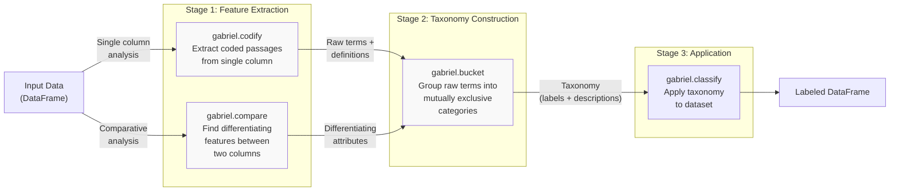
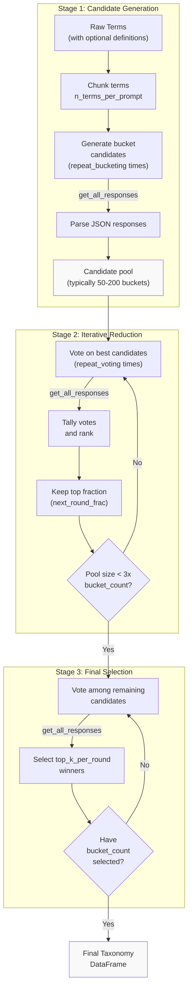
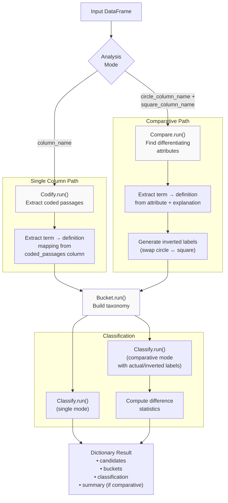

<!-- source: DeepWiki mcp.deepwiki.com · repo openai/GABRIEL · page 6.1 gabriel.codify, gabriel.compare, gabriel.bucket · fetched 2026-10-26 -->

# gabriel.codify, gabriel.compare, gabriel.bucket

<details>
<summary>Relevant source files</summary>

The following files were used as context for generating this wiki page:

- [src/gabriel/prompts/paraphrase_prompt.jinja2](src/gabriel/prompts/paraphrase_prompt.jinja2)
- [src/gabriel/tasks/bucket.py](src/gabriel/tasks/bucket.py)
- [src/gabriel/tasks/discover.py](src/gabriel/tasks/discover.py)
- [src/gabriel/tasks/paraphrase.py](src/gabriel/tasks/paraphrase.py)
- [tests/test_basic.py](tests/test_basic.py)

</details>


## Purpose and Scope

This page documents three helper tasks that extract and organize qualitative features from text data: **codify**, **compare**, and **bucket**. These tasks are typically composed together in multi-stage pipelines rather than called directly. For end-to-end feature discovery, see [gabriel.discover - Feature Discovery](#4.5). For applying discovered categories to data, see [gabriel.classify - Categorical Labeling](#4.3).

---

## Overview: Feature Extraction and Taxonomy Building

The three tasks form a complementary pipeline for discovering and organizing latent features in qualitative data:



| Task | Input | Output | Primary Use Case |
|------|-------|--------|------------------|
| **codify** | Single text column | Dictionary mapping terms to passage snippets | Extracting coded categories from qualitative data (e.g., themes in interview transcripts) |
| **compare** | Two text columns | List of differentiating attributes with explanations | Identifying features that distinguish two groups (e.g., successful vs. unsuccessful proposals) |
| **bucket** | List of raw terms (with optional definitions) | Fixed-size set of mutually exclusive categories | Consolidating many granular features into a coherent taxonomy |

**Sources:** [src/gabriel/tasks/discover.py:51-60](), [src/gabriel/tasks/discover.py:191-263](), [src/gabriel/tasks/bucket.py:49-66]()

---

## gabriel.codify - Passage Highlighting and Coding

### Purpose

`Codify` extracts and highlights passages in text that exemplify user-specified categories. It returns structured dictionaries mapping category names to relevant text snippets, similar to qualitative coding in grounded theory research.

### Task Configuration

The `CodifyConfig` dataclass controls codify behavior:

| Parameter | Type | Default | Description |
|-----------|------|---------|-------------|
| `save_dir` | `str` | `"codify"` | Directory for outputs and checkpoints |
| `model` | `str` | `"gpt-5-mini"` | LLM model identifier |
| `n_parallels` | `int` | `650` | Concurrent API requests |
| `max_words_per_call` | `int` | `1000` | Maximum words in a single prompt (controls chunking) |
| `max_categories_per_call` | `int` | `8` | Maximum categories to code simultaneously |
| `use_dummy` | `bool` | `False` | Use synthetic responses for testing |
| `reasoning_effort` | `Optional[str]` | `None` | Reasoning effort level passed to LLM |

**Note:** Unlike most tasks, `codify` does not expose a public API function in `gabriel.api`. It is typically invoked through the `Discover` pipeline.

### Output Format

Returns a DataFrame with a `coded_passages` column containing dictionaries where:
- **Keys**: Category names (strings)
- **Values**: Lists of passage snippets or single snippet strings

Example structure:
```python
{
    "Category A": ["snippet 1", "snippet 2"],
    "Category B": "single snippet",
    "Category C": []
}
```

When composed into `Discover`, these dictionaries are flattened into a term-to-definition mapping used for bucketing.

**Sources:** [src/gabriel/tasks/discover.py:193-230](), [tests/test_basic.py:20]()

---

## gabriel.compare - Pairwise Column Comparison

### Purpose

`Compare` identifies features that differentiate between two groups represented by separate text columns. It generates natural language descriptions of attributes that are more characteristic of one column ("circle") versus the other ("square").

### Task Configuration

The `CompareConfig` dataclass:

| Parameter | Type | Default | Description |
|-----------|------|---------|-------------|
| `save_dir` | `str` | `"compare"` | Directory for outputs |
| `model` | `str` | `"gpt-5-mini"` | LLM model identifier |
| `n_parallels` | `int` | `650` | Concurrent API requests |
| `use_dummy` | `bool` | `False` | Use synthetic responses for testing |
| `differentiate` | `bool` | `True` | Focus on differentiating features (vs. general themes) |
| `additional_instructions` | `Optional[str]` | `None` | Custom prompt guidance |
| `modality` | `str` | `"text"` | Input modality (text/image/audio/pdf) |
| `reasoning_effort` | `Optional[str]` | `None` | Reasoning effort level |

### Output Format

Returns a DataFrame with columns:
- `attribute`: Feature name (string)
- `explanation`: Natural language description of how this feature differentiates the groups

Example:
```
attribute                 | explanation
--------------------------|------------------------------------------
"Formal tone"             | "Circle texts use formal academic language while square texts use colloquial expressions"
"Technical complexity"    | "Circle passages contain more domain-specific jargon and technical concepts"
```

### Integration with Discover

When `Discover` is called with both `circle_column_name` and `square_column_name`, it:
1. Invokes `Compare` to extract differentiating attributes
2. Passes the `(attribute, explanation)` pairs to `Bucket` as raw terms with definitions
3. Generates inverted versions of each label (swapping "circle" and "square") to enable bidirectional classification

**Sources:** [src/gabriel/tasks/discover.py:231-263](), [src/gabriel/tasks/discover.py:318-339]()

---

## gabriel.bucket - Taxonomy Construction via Iterative Voting

### Purpose

`Bucket` reduces a large collection of raw feature terms into a small, coherent taxonomy of mutually exclusive categories. It uses a multi-stage voting mechanism to progressively refine candidates until a target number of high-quality buckets remain.

### Architecture: Three-Stage Pipeline



**Sources:** [src/gabriel/tasks/bucket.py:113-424]()

### Task Configuration

The `BucketConfig` dataclass:

| Parameter | Type | Default | Description |
|-----------|------|---------|-------------|
| `bucket_count` | `int` | `10` | Target number of final categories |
| `n_terms_per_prompt` | `int` | `250` | Terms per chunk during generation/voting |
| `repeat_bucketing` | `int` | `5` | Repetitions for candidate generation (with term shuffling) |
| `repeat_voting` | `int` | `25` | Repetitions for each voting round |
| `next_round_frac` | `float` | `0.25` | Fraction of candidates to retain after each reduction round |
| `top_k_per_round` | `int` | `1` | Winners selected per final selection iteration |
| `raw_term_definitions` | `bool` | `True` | Pass term definitions to LLM (vs. term names only) |
| `save_dir` | `str` | `"buckets"` | Directory for outputs and state persistence |
| `file_name` | `str` | `"bucket_definitions.csv"` | Output file name |
| `model` | `str` | `"gpt-5-mini"` | LLM model identifier |
| `n_parallels` | `int` | `650` | Concurrent API requests |
| `use_dummy` | `bool` | `False` | Use synthetic responses |
| `additional_instructions` | `Optional[str]` | `None` | Custom prompt guidance |
| `differentiate` | `bool` | `False` | Emphasize differentiating features (inherited from Compare) |
| `reasoning_effort` | `Optional[str]` | `None` | Reasoning effort level |

### Implementation Details

#### Candidate Generation

The generation phase creates an over-complete set of candidate buckets by:
1. Shuffling raw terms and splitting into chunks of size `n_terms_per_prompt` ([bucket.py:218-223]())
2. Repeating `repeat_bucketing` times with different random orderings
3. Rendering prompts using `bucket_prompt.jinja2` template ([bucket.py:230-239]())
4. Parsing JSON responses to extract `{bucket_name: definition}` dictionaries ([bucket.py:106-111]())

Typical candidate pool size: `repeat_bucketing × (n_terms / n_terms_per_prompt) × bucket_count ≈ 50-200` candidates.

#### Iterative Reduction

Reduction rounds continue while `len(candidates) >= 3 × bucket_count`:
1. Build voting prompts with:
   - Candidate buckets to evaluate
   - Random sample of raw terms as voting context
   - Currently selected buckets (empty during reduction) ([bucket.py:271-312]())
2. Parse votes and tally occurrences per bucket ([bucket.py:344-348]())
3. Sort by vote count (with random tiebreaker) and keep top `next_round_frac` fraction ([bucket.py:348-354]())

**Sources:** [src/gabriel/tasks/bucket.py:314-358]()

#### Final Selection

The selection phase iteratively picks winners from the reduced pool:
1. Generate voting prompts showing:
   - Remaining unselected candidates
   - Already-selected buckets (to avoid redundancy) ([bucket.py:369-411]())
2. Tally votes only for unselected candidates ([bucket.py:391-395]())
3. Select top `top_k_per_round` highest-voted candidates ([bucket.py:400-406]())
4. Repeat until `len(selected) == bucket_count` or pool exhausted

**Sources:** [src/gabriel/tasks/bucket.py:360-412]()

### State Persistence and Resumability

`Bucket` maintains a `bucket_state.json` file that checkpoints progress after each stage:

| State Field | Description |
|-------------|-------------|
| `terms_signature` | SHA-1 hash of input terms (detects changes requiring re-run) |
| `candidate_defs` | All generated bucket candidates with definitions |
| `current_candidates` | Candidates surviving the most recent reduction round |
| `reduce_round` | Index of last completed reduction round |
| `selected` | Buckets chosen during final selection |
| `final_buckets` | Complete taxonomy (only present when finalized) |
| `finalized` | Boolean flag indicating completion |

The state file enables resumption after crashes or cancellations. If `reset_files=True`, the state is deleted and bucketing restarts from scratch.

**Sources:** [src/gabriel/tasks/bucket.py:71-95](), [src/gabriel/tasks/bucket.py:137-193]()

### Output Format

Returns a DataFrame with columns:
```
bucket      | definition
------------|-------------------------------------------
"Category 1"| "Description of category 1..."
"Category 2"| "Description of category 2..."
...
```

This DataFrame is persisted to `<save_dir>/<file_name>` and serves as input to `Classify`.

**Sources:** [src/gabriel/tasks/bucket.py:413-424]()

---

## Composition Pattern: The Discover Pipeline

The `Discover` task orchestrates all three helpers to provide end-to-end feature discovery:



### Discover Configuration and Delegation

`DiscoverConfig` consolidates parameters for all sub-tasks:

| Parameter | Delegated To | Purpose |
|-----------|--------------|---------|
| `save_dir` | All tasks | Root directory (sub-tasks use subdirectories) |
| `model`, `n_parallels`, `use_dummy`, `reasoning_effort` | All tasks | Common LLM parameters |
| `max_words_per_call`, `max_categories_per_call` | `Codify` | Chunking controls |
| `differentiate`, `modality` | `Compare`, `Classify` | Analysis mode |
| `bucket_count`, `n_terms_per_prompt`, `repeat_bucketing`, `repeat_voting`, `next_round_frac`, `top_k_per_round`, `raw_term_definitions` | `Bucket` | Taxonomy construction |
| `n_runs`, `min_frequency` | `Classify` | Classification confidence |

**Sources:** [src/gabriel/tasks/discover.py:22-48]()

### Term Extraction and Flattening

#### From Codify

When using single-column analysis:
1. `Codify` returns a DataFrame with a `coded_passages` column containing dictionaries ([discover.py:213-214]())
2. `Discover` iterates through dictionaries and builds a flat `{term: definition}` map ([discover.py:215-221]())
3. If `raw_term_definitions=True`, the entire dictionary is passed to `Bucket` as a single row
4. If `raw_term_definitions=False`, only unique term names are extracted

**Sources:** [src/gabriel/tasks/discover.py:213-230]()

#### From Compare

When using comparative analysis:
1. `Compare` returns a DataFrame with `attribute` and `explanation` columns ([discover.py:250-252]())
2. `Discover` builds `{attribute: explanation}` mapping ([discover.py:249-254]())
3. Packaging follows the same `raw_term_definitions` logic as Codify

**Sources:** [src/gabriel/tasks/discover.py:249-263]()

### Label Inversion for Comparative Analysis

When `Discover` receives both `circle_column_name` and `square_column_name`, it generates inverted labels to enable bidirectional differentiation:

1. For each bucket from `Bucket`, create two labels:
   - **Actual**: Original bucket name and definition
   - **Inverted**: Swapped version where "circle" ↔ "square" in both name and description ([discover.py:318-338]())

2. Pass combined label set to `Classify` with `differentiate=True` and both column names ([discover.py:373-387]())

3. Rename classifier outputs using the pattern:
   - `{original_bucket}_actual` for non-inverted evaluations
   - `{original_bucket}_inverted` for inverted evaluations ([discover.py:407]())

4. Compute summary statistics showing the percentage point difference (actual - inverted) for each label ([discover.py:431-463]())

This approach ensures that discovered features are truly differentiating rather than universally present.

**Sources:** [src/gabriel/tasks/discover.py:318-464]()

### Result Dictionary Structure

`Discover.run()` returns a dictionary with the following keys:

| Key | Type | Content | Always Present? |
|-----|------|---------|-----------------|
| `candidates` | `DataFrame` | Raw terms extracted by Codify/Compare | Yes |
| `buckets` | `Dict[str, str]` | Final taxonomy (bucket names → definitions) | Yes |
| `classification` | `DataFrame` | Original data with label columns appended | Yes |
| `bucket_df` | `DataFrame` | Same as `buckets` but in DataFrame format | If buckets exist |
| `summary` | `DataFrame` | Comparative statistics with `net_pct` column | If comparative mode |
| `compare` | `DataFrame` | Raw output from Compare task | If comparative mode |
| `codify` | `DataFrame` | Raw output from Codify task | If single-column mode |

The result is also persisted as:
- `discover_results_snapshot.json`: Full JSON representation ([discover.py:89-99]())
- `discover_results_export.zip`: Multi-CSV archive for spreadsheet analysis ([discover.py:120-143]())

**Sources:** [src/gabriel/tasks/discover.py:502-517]()

---

## Usage Patterns and Best Practices

### When to Use Each Task Directly

| Scenario | Recommended Approach |
|----------|---------------------|
| Discover features and apply them to data | Use `gabriel.discover()` API (wraps all three tasks) |
| Build taxonomy from pre-extracted terms | Use `Bucket` directly with term list DataFrame |
| Compare two groups and get raw differentiating features | Use `Compare` directly (skip bucketing if granularity is desired) |
| Code passages with predefined categories | Use `Codify` with explicit `categories` parameter |

### Parameter Tuning Guidelines

**For faster but less thorough bucketing:**
- Decrease `repeat_bucketing` (default: 5 → 2-3)
- Decrease `repeat_voting` (default: 25 → 10-15)
- Increase `next_round_frac` (default: 0.25 → 0.33)

**For higher quality taxonomy:**
- Increase `repeat_bucketing` and `repeat_voting`
- Lower `next_round_frac` to prune more aggressively
- Set `raw_term_definitions=True` to provide context

**For large term sets (>1000 terms):**
- Increase `n_terms_per_prompt` to reduce total prompts
- Consider increasing `n_parallels` for faster execution
- May need to adjust `bucket_count` upward to accommodate diversity

**Sources:** [src/gabriel/tasks/bucket.py:23-46](), [src/gabriel/tasks/discover.py:22-48]()

---

## Integration with the LLM Orchestration Layer

All three tasks follow the standard GABRIEL task lifecycle:

1. **Configuration Validation**: `__post_init__` methods normalize parameters ([bucket.py:43-46]())
2. **Save Directory Expansion**: `Path.mkdir(parents=True, exist_ok=True)` ensures output directories exist ([bucket.py:58-60]())
3. **Template Resolution**: `resolve_template()` loads Jinja2 prompt templates ([bucket.py:62-66]())
4. **Prompt Construction**: Templates are rendered with task-specific variables
5. **LLM Invocation**: `get_all_responses()` handles batching, rate limiting, retries, and checkpointing (see [LLM Orchestration Infrastructure](#3.1))
6. **Response Parsing**: JSON extraction via `safest_json()` ([bucket.py:105-111]())
7. **Result Persistence**: CSV outputs and state files for resumability

These tasks benefit from all infrastructure features:
- **Checkpointing**: `save_path` in `get_all_responses()` enables resumption from crashes
- **Rate Limiting**: Dynamic concurrency adjustment based on API quota
- **Retry Logic**: Exponential backoff for transient failures
- **Parallel Execution**: Default `n_parallels=650` for high throughput

**Sources:** [src/gabriel/tasks/bucket.py:241-252](), [src/gabriel/utils/openai_utils.py]() (referenced in Diagram 4 of system overview)

---

