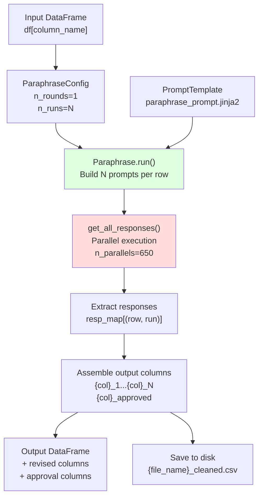
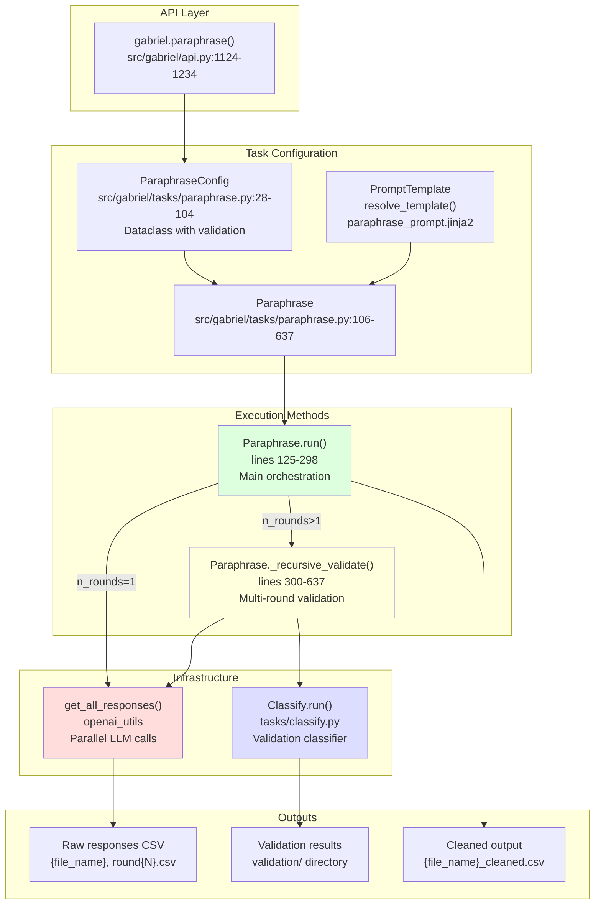

<!-- source: DeepWiki mcp.deepwiki.com · repo openai/GABRIEL · page 6.2 gabriel.paraphrase - Text Rewriting · fetched 2026-10-26 -->

# gabriel.paraphrase - Text Rewriting

<details>
<summary>Relevant source files</summary>

The following files were used as context for generating this wiki page:

- [src/gabriel/api.py](src/gabriel/api.py)
- [src/gabriel/prompts/paraphrase_prompt.jinja2](src/gabriel/prompts/paraphrase_prompt.jinja2)
- [src/gabriel/tasks/paraphrase.py](src/gabriel/tasks/paraphrase.py)
- [tests/test_basic.py](tests/test_basic.py)

</details>


## Purpose and Scope

This page documents the paraphrase task, which rewrites text consistently according to natural language instructions. The task supports simple one-pass rewriting as well as recursive validation workflows where candidates are automatically evaluated and regenerated until they satisfy the instructions.

For qualitative passage coding and snippet extraction, see [gabriel.codify, gabriel.compare, gabriel.bucket](#6.1). For generating diverse entities, see [gabriel.seed - Diverse Generation](#6.3).

---

## Overview

The paraphrase task transforms input text according to user-provided instructions while maintaining consistency across a dataset. Common use cases include:

- **Summarization**: Condensing earnings call transcripts while removing company-specific details
- **Entity normalization**: Rewriting entity names to a consistent format (e.g., abbreviating state names)
- **Style transformation**: Converting formal text to informal, or vice versa
- **Content filtering**: Removing or replacing specific types of information while preserving structure
- **Data augmentation**: Generating variations of text for training datasets

The task is exposed through the `gabriel.paraphrase()` API function and implemented by the `Paraphrase` class.

**Sources:** [src/gabriel/api.py:1124-1234](), [src/gabriel/tasks/paraphrase.py:106-637]()

---

## Basic Usage Pattern

```python
import gabriel

df = pd.DataFrame({
    "transcript": [
        "Apple Inc. reported revenue of $90B in Q3 2023...",
        "Microsoft Corporation saw earnings increase by 15%..."
    ]
})

result = await gabriel.paraphrase(
    df,
    column_name="transcript",
    instructions="Summarize the earnings information, removing all company names and replacing them with 'COMPANY'.",
    save_dir="paraphrase_output",
    n_rounds=1,  # Simple mode: no validation
    n_runs=1     # One paraphrase per row
)

# Result contains original columns plus:
# - transcript_revised: The paraphrased text
# - transcript_revised_approved: Always True in simple mode
```

**Sources:** [src/gabriel/api.py:1124-1234](), [src/gabriel/tasks/paraphrase.py:125-298]()

---

## Configuration Parameters

The paraphrase task accepts the following key parameters through `gabriel.paraphrase()`:

| Parameter | Type | Default | Description |
|-----------|------|---------|-------------|
| `df` | `pd.DataFrame` | Required | Input DataFrame containing passages to rewrite |
| `column_name` | `str` | Required | Column holding the text to paraphrase |
| `instructions` | `str` | Required | Natural language description of how to rewrite the text |
| `save_dir` | `str` | Required | Directory where outputs and intermediate files are saved |
| `model` | `str` | `"gpt-5-mini"` | Model used for both paraphrasing and validation |
| `modality` | `str` | `"text"` | Input type: `text`, `entity`, `web`, `image`, `audio`, or `pdf` |
| `n_rounds` | `int` | `1` | Maximum paraphrase/validation cycles. `1` = no validation; `>1` = recursive validation |
| `n_runs` | `int` | `1` | Number of paraphrases to generate per passage |
| `later_round_run_multiplier` | `int` | `5` | Multiplier applied to `n_runs` for validation rounds after the first |
| `revised_column_name` | `Optional[str]` | `None` | Custom name for output column; defaults to `{column_name}_revised` |
| `validation_attribute` | `Optional[Dict[str, str]]` | `None` | Custom classifier label for validation; first key/value pair is used if multiple provided |
| `use_modified_source` | `bool` | `False` | If `True`, subsequent rounds use the previous paraphrase as input instead of the original |
| `reset_files` | `bool` | `False` | Whether to regenerate outputs even if files exist |
| `json_mode` | `bool` | `False` | Request JSON output format from the model |
| `reasoning_effort` | `Optional[str]` | `None` | Reasoning intensity: `none`, `low`, `medium`, or `high` |
| `n_parallels` | `int` | `650` | Maximum concurrent API requests |

**Sources:** [src/gabriel/api.py:1124-1234](), [src/gabriel/tasks/paraphrase.py:28-104]()

---

## Execution Modes

### Simple Mode (n_rounds=1)

When `n_rounds=1`, the task generates paraphrases without validation. Each passage receives exactly `n_runs` paraphrases, and all are marked as approved.



**Workflow:**
1. `Paraphrase.run()` converts input rows to strings and builds prompts using `paraphrase_prompt.jinja2`
2. For each passage, `n_runs` prompts are generated with identifiers like `row_{idx}_rev{j}`
3. All prompts are sent to `get_all_responses()` for parallel execution
4. Responses are parsed and mapped back to `(row_index, run_index)` tuples
5. Output DataFrame includes `{revised_column_name}_{i}` and `{revised_column_name}_{i}_approved` columns
6. All approval flags are set to `True` since no validation occurred

**Sources:** [src/gabriel/tasks/paraphrase.py:176-298](), [src/gabriel/prompts/paraphrase_prompt.jinja2:1-23]()

---

### Recursive Validation Mode (n_rounds>1)

When `n_rounds > 1`, the task enters recursive validation mode. Candidates are generated, classified for compliance with instructions, and regenerated if they fail validation.

```mermaid
graph TB
    subgraph "Initialization"
        Keys["all_keys = [(row, run)]<br/>for all passages and runs"]
        ToCheck["to_check = list(all_keys)<br/>track pending validations"]
    end
    
    subgraph "Round Loop<br/>(while to_check and round < max_rounds)"
        DetermineCands["Determine candidates_per_key<br/>Round 0: n_runs<br/>Round N: n_runs * later_round_run_multiplier"]
        
        BuildPrompts["Build paraphrase prompts<br/>Choose base_text:<br/>- use_modified_source=False: original<br/>- use_modified_source=True: resp_map[key]"]
        
        Paraphrase["get_all_responses()<br/>Save to round{N}.csv<br/>identifiers: row_X_revY_roundZ_candW"]
        
        OrganizeCands["candidate_map[(row, run)] = [candidates]<br/>Parse identifiers to group by key"]
        
        BuildClassify["Build classification prompts<br/>Compare each candidate vs original<br/>Prompt: INSTRUCTIONS + ORIGINAL + MODIFIED"]
        
        Classify["classifier.run()<br/>Classify(ClassifyConfig)<br/>labels = validation_attribute or<br/>'instructions_followed'"]
        
        MapResults["cand_results_map[(row, run)] = [bool]<br/>Pass if True or None<br/>Fail if False"]
        
        ChooseBest["For each key:<br/>- Find first passing candidate<br/>- If none passed: use first candidate<br/>- Update resp_map[key]<br/>- Update approval_map[key]"]
        
        NextRound["Build next_to_check<br/>Include keys where no candidate passed<br/>to_check = next_to_check<br/>round_number += 1"]
    end
    
    subgraph "Finalization"
        Fallback["If to_check still has keys:<br/>Random choice from last_candidate_map<br/>approval_map[key] = False"]
        Output["Return resp_map and approval_map<br/>to Paraphrase.run()"]
    end
    
    Keys --> ToCheck
    ToCheck --> DetermineCands
    DetermineCands --> BuildPrompts
    BuildPrompts --> Paraphrase
    Paraphrase --> OrganizeCands
    OrganizeCands --> BuildClassify
    BuildClassify --> Classify
    Classify --> MapResults
    MapResults --> ChooseBest
    ChooseBest --> NextRound
    NextRound --> DetermineCands
    NextRound --> Fallback
    Fallback --> Output
    
    style Paraphrase fill:#ffdddd
    style Classify fill:#ddffdd
    style ChooseBest fill:#ffffdd
```



**Workflow:**
1. **Initialization**: Create list of all `(row_index, run_index)` keys that need paraphrases
2. **Round Loop**:
   - Generate `candidates_per_key` paraphrases for each pending key
   - First round uses `n_runs` candidates; later rounds use `n_runs * later_round_run_multiplier`
   - Classification prompts compare each candidate against the original using validation instructions
   - Run `Classify` task to determine if candidates follow instructions
   - Select first passing candidate; if none pass, use first candidate and schedule another round
3. **Termination**: Stop when all keys pass validation or `max_rounds` is reached
4. **Fallback**: Randomly choose from last candidates for any remaining unvalidated keys

**Sources:** [src/gabriel/tasks/paraphrase.py:300-637](), [src/gabriel/tasks/classify.py]()

---

## Validation Classifier Details

### Classification Prompt Structure

When `n_rounds > 1`, each candidate paraphrase is evaluated using the `Classify` task with a custom prompt:

```
INSTRUCTIONS:
{user-provided instructions}
END INSTRUCTIONS

BEGIN ORIGINAL TEXT:
{original passage}
END ORIGINAL TEXT

BEGIN MODIFIED TEXT:
{candidate paraphrase}
END MODIFIED TEXT

Previously, the original text was taken and modified, following the provided 
instructions, to create the modified text. Does the modified text faithfully 
apply the instructions as a transformation of the original text? Answer True 
if the modification follows the instructions to a satisfactory, though not 
necessarily perfect, degree...
```

**Sources:** [src/gabriel/tasks/paraphrase.py:539-557]()

---

### Validation Attribute

The classifier uses a single boolean label to determine if instructions were followed. By default, the label is:

```python
{
    "instructions_followed": (
        "Return True if the modified text faithfully and thoroughly applies "
        "the spirit of the instructions to the original text. Allow for minor "
        "imperfections, but ensure the core requirements are satisfied and the "
        "transformation is meaningfully aligned with the intent. Return False "
        "if key requirements are missing, contradicted, or only weakly addressed."
    )
}
```

Users can override this by providing `validation_attribute` with a custom label definition. If multiple entries are provided, the first key/value pair is used.

**Sources:** [src/gabriel/tasks/paraphrase.py:354-366]()

---

### Pass/Fail Logic

A candidate is considered to **pass validation** if:
- The classifier returns `True`, OR
- The classifier returns `None` (uncertain)

A candidate **fails validation** if:
- The classifier returns `False`

The lenient treatment of `None` reduces false rejection rates when the classifier is uncertain.

**Sources:** [src/gabriel/tasks/paraphrase.py:575-585]()

---

## Output Structure

### Column Naming

For a given `column_name` and `revised_column_name` (defaulting to `{column_name}_revised`):

| `n_runs` | Paraphrase Columns | Approval Columns |
|----------|-------------------|------------------|
| 1 | `{revised_column_name}` | `{revised_column_name}_approved` |
| N (>1) | `{revised_column_name}_1` ... `{revised_column_name}_N` | `{revised_column_name}_1_approved` ... `{revised_column_name}_N_approved` |

**Sources:** [src/gabriel/tasks/paraphrase.py:278-288]()

---

### Approval Flags

Each paraphrase column has a corresponding `_approved` column indicating whether the paraphrase passed validation:

- **Simple mode (`n_rounds=1`)**: All approval flags are `True` (no validation performed)
- **Recursive validation mode**: `True` if a candidate passed classification; `False` if the round limit was reached without finding a passing candidate

**Sources:** [src/gabriel/tasks/paraphrase.py:259-288](), [src/gabriel/tasks/paraphrase.py:612-636]()

---

### File Outputs

The task produces multiple files in `save_dir`:

| File | Description |
|------|-------------|
| `{file_name}` | Raw responses for simple mode or round 0 in recursive mode |
| `{file_name}_round{N}.csv` | Raw responses for validation round N (recursive mode only) |
| `{file_name}_cleaned.csv` | Final cleaned DataFrame with paraphrases and approval flags |
| `validation/` | Directory containing classification results (recursive mode only) |
| `validation/{classify_file_name}*` | Classifier outputs for validation rounds |

**Sources:** [src/gabriel/tasks/paraphrase.py:199-296](), [src/gabriel/tasks/paraphrase.py:447-450]()

---

## Code Entity Flow

### Paraphrase Task Execution



**Sources:** [src/gabriel/api.py:1124-1234](), [src/gabriel/tasks/paraphrase.py:28-637]()

---

## Advanced Features

### Multiple Paraphrases per Passage

Set `n_runs > 1` to generate multiple independent paraphrases per passage:

```python
result = await gabriel.paraphrase(
    df,
    column_name="text",
    instructions="Simplify to 8th grade reading level.",
    save_dir="multi_output",
    n_runs=3  # Generate 3 variants per row
)

# Result contains:
# - text_revised_1, text_revised_1_approved
# - text_revised_2, text_revised_2_approved
# - text_revised_3, text_revised_3_approved
```

**Sources:** [src/gabriel/tasks/paraphrase.py:154-288]()

---

### Incremental Refinement with use_modified_source

By default, recursive validation regenerates candidates from the original text in each round. Setting `use_modified_source=True` feeds the previously chosen paraphrase back as the input for subsequent rounds:

```python
result = await gabriel.paraphrase(
    df,
    column_name="text",
    instructions="Remove all personal opinions.",
    save_dir="incremental",
    n_rounds=5,
    n_runs=2,
    use_modified_source=True  # Build on previous paraphrase
)
```

**Behavior:**
- Round 0: Generate candidates from original text
- Round N (if failed): Generate candidates from `resp_map[(row, run)]` instead of original

**Note:** The classifier always compares candidates against the **original text** to ensure the original instructions are still satisfied.

**Sources:** [src/gabriel/tasks/paraphrase.py:60-61](), [src/gabriel/tasks/paraphrase.py:406-418]()

---

### Controlling Candidate Generation

The `later_round_run_multiplier` parameter controls how many candidates are generated in validation rounds after the first:

```python
result = await gabriel.paraphrase(
    df,
    column_name="text",
    instructions="Translate to formal academic style.",
    save_dir="tuning",
    n_rounds=3,
    n_runs=2,  # Round 0: 2 candidates per passage
    later_round_run_multiplier=5  # Round 1+: 10 candidates per passage
)
```

**Trade-offs:**
- Higher multiplier: More candidates to choose from, better chance of finding valid paraphrase, higher API cost
- Lower multiplier: Faster execution, lower cost, higher risk of hitting round limit without success

**Sources:** [src/gabriel/tasks/paraphrase.py:52-53](), [src/gabriel/tasks/paraphrase.py:383-391]()

---

### Custom Validation Labels

Override the default validation classifier with custom instructions:

```python
result = await gabriel.paraphrase(
    df,
    column_name="technical_doc",
    instructions="Simplify technical jargon for general audience.",
    save_dir="custom_validation",
    n_rounds=5,
    validation_attribute={
        "jargon_removed": (
            "Return True if the modified text has successfully removed or "
            "explained technical jargon while preserving the core meaning."
        )
    }
)
```

**Sources:** [src/gabriel/tasks/paraphrase.py:64-65](), [src/gabriel/tasks/paraphrase.py:354-366]()

---

### Multimodal Inputs

The paraphrase task supports all GABRIEL modalities:

| Modality | Input Format | Prompt Guidance |
|----------|--------------|-----------------|
| `text` | String content | "paraphrase/consolidate/modify the text" |
| `entity` | Entity name string | "rewrite the entity name in a consistent way" |
| `web` | Search term string | "paraphrase/consolidate the web content found" |
| `image` | File paths or URLs | "paraphrase/summarize the observed content into text" |
| `audio` | File paths or encoded audio | "paraphrase/summarize the observed content into text" |
| `pdf` | File paths or PDF objects | "paraphrase/summarize the observed content into text" |

**Sources:** [src/gabriel/prompts/paraphrase_prompt.jinja2:10-14](), [src/gabriel/tasks/paraphrase.py:149-227]()

---

## Implementation Details

### Identifier Encoding

The task uses structured identifiers to track paraphrases through the pipeline:

- **Simple mode**: `row_{row_idx}_rev{run_number}`
- **Recursive mode**: `row_{row_idx}_rev{run_number}_round{round_number}_cand{candidate_idx}`

Run numbers are 1-indexed in identifiers for backwards compatibility but 0-indexed internally.

**Sources:** [src/gabriel/tasks/paraphrase.py:198](), [src/gabriel/tasks/paraphrase.py:431-433]()

---

### Response Mapping

Responses are stored in `resp_map: Dict[Tuple[int, int], str]` where:
- Key: `(row_index, run_index)` tuple (both 0-indexed internally)
- Value: The chosen paraphrase text

Approval status is tracked separately in `approval_map: Dict[Tuple[int, int], bool]`.

**Sources:** [src/gabriel/tasks/paraphrase.py:251-259](), [src/gabriel/tasks/paraphrase.py:303-305]()

---

### Candidate Selection Logic

In recursive validation, the first passing candidate is chosen for each key. If no candidates pass:

1. Use the first candidate as a fallback
2. Mark as not approved: `approval_map[key] = False`
3. Add key to `next_to_check` for another round

If the round limit is reached, remaining keys receive a random choice from the last batch of candidates.

**Sources:** [src/gabriel/tasks/paraphrase.py:592-622](), [src/gabriel/tasks/paraphrase.py:630-636]()

---

### Validation Directory Structure

Recursive validation creates a dedicated subdirectory:

```
save_dir/
├── paraphrase_responses.csv              # Simple mode or round 0
├── paraphrase_responses_round0.csv       # Recursive mode round 0
├── paraphrase_responses_round1.csv       # Recursive mode round 1
├── paraphrase_responses_roundN.csv       # Additional rounds
├── paraphrase_responses_cleaned.csv      # Final output
└── validation/                           # Classifier outputs
    ├── classify_responses.csv
    └── classify_responses_cleaned.csv
```

**Sources:** [src/gabriel/tasks/paraphrase.py:348-350](), [src/gabriel/tasks/paraphrase.py:447-450]()

---

## Customization Hooks

The paraphrase task supports standard GABRIEL customization options:

| Parameter | Purpose |
|-----------|---------|
| `template_path` | Override default Jinja2 template with custom prompt |
| `response_fn` | Replace per-prompt LLM call with custom function |
| `get_all_responses_fn` | Replace entire LLM orchestration infrastructure |

These are passed through to both the paraphrasing and classification stages in recursive validation mode.

For details on customization, see [Prompt Customization](#10.1), [Custom Response Parsing](#10.2), and [Alternative LLM Backends](#10.3).

**Sources:** [src/gabriel/api.py:1143-1147](), [src/gabriel/api.py:1197-1205]()

---

