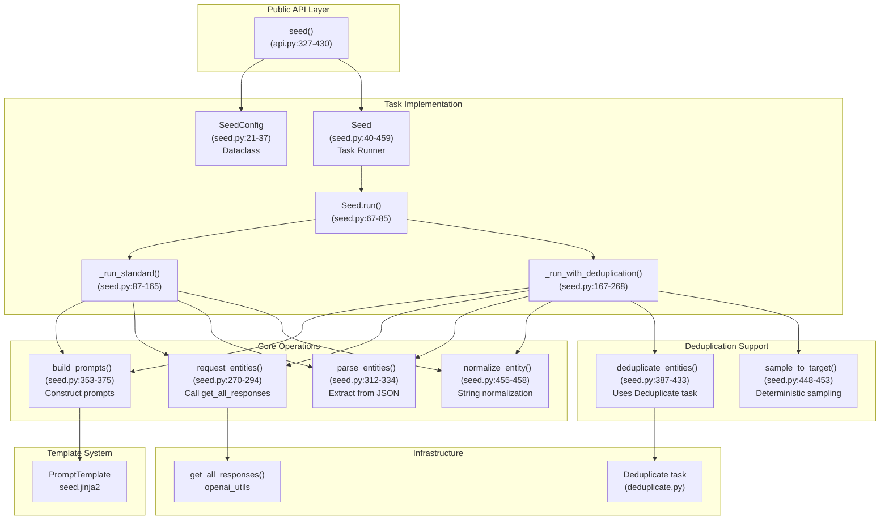
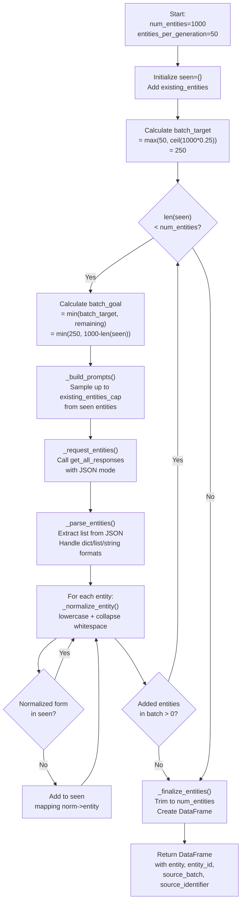
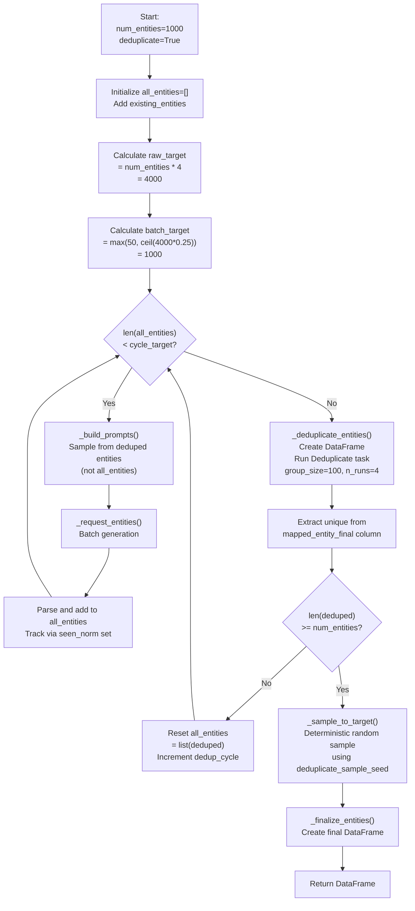
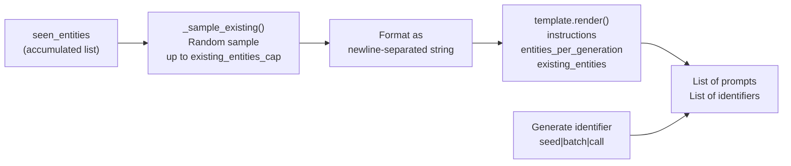
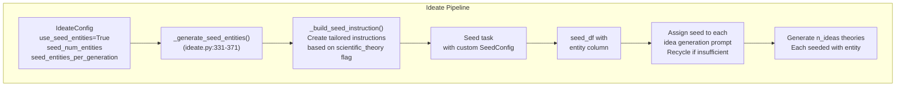

<!-- source: DeepWiki mcp.deepwiki.com · repo openai/GABRIEL · page 6.3 gabriel.seed - Diverse Generation · fetched 2026-10-26 -->

# gabriel.seed - Diverse Generation

<details>
<summary>Relevant source files</summary>

The following files were used as context for generating this wiki page:

- [src/gabriel/api.py](src/gabriel/api.py)
- [src/gabriel/tasks/ideate.py](src/gabriel/tasks/ideate.py)
- [src/gabriel/tasks/seed.py](src/gabriel/tasks/seed.py)

</details>


**Purpose**: This page documents the `gabriel.seed` task, which generates representative distributions of entities with enforced diversity and optional deduplication. Seed generation is commonly used to initialize other pipelines (especially [gabriel.ideate](#7.1)) or to create diverse starting points for data generation tasks.

For entity deduplication after generation, see [gabriel.deduplicate](#5.2). For multi-stage theory generation that uses seed entities, see [gabriel.ideate](#7.1).

---

## Overview

The `seed` task generates a target number of unique entities (e.g., personas, research angles, product ideas) by making iterative batched calls to an LLM. The system tracks previously generated entities and includes samples of them in subsequent prompts to encourage diversity and avoid duplication. Two modes are supported:

| Mode | Description | Use Case |
|------|-------------|----------|
| **Standard** | Normalizes entities and tracks via string matching | Fast generation when shallow deduplication suffices |
| **Deduplication** | Over-generates and applies LLM-based deduplication | High-quality results requiring semantic uniqueness |

The output is a DataFrame containing unique entities with provenance metadata, ready for downstream use.

**Sources**: [src/gabriel/api.py:327-430](), [src/gabriel/tasks/seed.py:40-86]()

---

## API Function Signature

```python
async def seed(
    instructions: str,
    *,
    save_dir: str,
    file_name: str = "seed_entities.csv",
    model: str = "gpt-5.2",
    n_parallels: int = 650,
    num_entities: int = 1000,
    entities_per_generation: int = 50,
    entity_batch_frac: float = 0.25,
    existing_entities_cap: int = 100,
    deduplicate: bool = False,
    deduplicate_sample_seed: int = 42,
    reasoning_effort: Optional[str] = None,
    template_path: Optional[str] = None,
    existing_entities: Optional[List[str]] = None,
    reset_files: bool = False,
    response_fn: Optional[Callable[..., Awaitable[Any]]] = None,
    get_all_responses_fn: Optional[Callable[..., Awaitable[pd.DataFrame]]] = None,
    **response_kwargs: Any,
) -> pd.DataFrame
```

The function returns a DataFrame with columns: `entity`, `entity_id`, `source_batch`, and `source_identifier`.

**Sources**: [src/gabriel/api.py:327-430]()

---

## Code Entity Relationships



**Sources**: [src/gabriel/api.py:327-430](), [src/gabriel/tasks/seed.py:21-459]()

---

## Configuration Parameters

The `SeedConfig` dataclass defines all configuration options:

| Parameter | Type | Default | Description |
|-----------|------|---------|-------------|
| `instructions` | `str` | *required* | Natural language description of desired entities |
| `save_dir` | `str` | `"~/Documents/runs"` | Directory for outputs and checkpoints |
| `file_name` | `str` | `"seed_entities.csv"` | Name of final output CSV |
| `model` | `str` | `"gpt-5.2"` | Model used for generation |
| `n_parallels` | `int` | `650` | Maximum concurrent requests |
| `num_entities` | `int` | `1000` | Target number of unique entities |
| `entities_per_generation` | `int` | `50` | Entities requested per API call |
| `entity_batch_frac` | `float` | `0.25` | Fraction of `num_entities` to generate per batch |
| `existing_entities_cap` | `int` | `100` | Max existing entities to include in prompts |
| `deduplicate` | `bool` | `False` | Enable deep deduplication mode |
| `deduplicate_sample_seed` | `int` | `42` | Random seed for deterministic sampling after deduplication |
| `reasoning_effort` | `Optional[str]` | `None` | Reasoning intensity (none/low/medium/high) |

**Sources**: [src/gabriel/tasks/seed.py:21-37]()

---

## Generation Workflow

### Standard Mode Algorithm



The standard mode uses string normalization ([src/gabriel/tasks/seed.py:455-458]()) to detect duplicates. Normalization converts entities to lowercase and collapses whitespace, providing fast but shallow deduplication.

**Sources**: [src/gabriel/tasks/seed.py:87-165]()

---

### Deduplication Mode Algorithm



Deduplication mode over-generates by 4× the target, then applies the `Deduplicate` task ([src/gabriel/tasks/deduplicate.py]()) with `group_size=100` and `n_runs=4` to achieve semantic uniqueness. The final sample is deterministic based on `deduplicate_sample_seed`.

**Sources**: [src/gabriel/tasks/seed.py:167-268](), [src/gabriel/tasks/seed.py:387-433]()

---

## Prompt Building and Response Parsing

### Prompt Construction

The `_build_prompts` method constructs prompts by:

1. Sampling up to `existing_entities_cap` entities from the seen set
2. Rendering the template with `instructions`, `entities_per_generation`, and `existing_entities`
3. Assigning identifiers of the form `"seed|{batch_index}|{call_index}"`



**Sources**: [src/gabriel/tasks/seed.py:353-375](), [src/gabriel/tasks/seed.py:377-385]()

### Response Parsing

The `_parse_entities` method handles multiple JSON formats:

| Input Format | Parsing Strategy | Example |
|--------------|------------------|---------|
| **Dictionary** | Extract values from sorted keys | `{"1": "entity1", "2": "entity2"}` |
| **List** | Extract each item | `["entity1", "entity2"]` |
| **String** | Return as single entity | `"entity1"` |

Empty strings, `None` values, and whitespace-only strings are filtered out.

**Sources**: [src/gabriel/tasks/seed.py:312-334]()

---

## Integration with Ideate Pipeline

The `ideate` task uses `seed` to generate diverse starting points for theory generation:



The seed instruction varies by context:

**Scientific Theory Mode** ([src/gabriel/tasks/ideate.py:376-390]()):
- Generates "concise, specific seed concepts that can anchor frontier scientific theories"
- Each seed describes "a sharply defined angle, mechanism, dataset, real world phenomena or scenario"
- Emphasizes genuine novelty, non-trivial subdomains, and diverse angles

**General Idea Mode** ([src/gabriel/tasks/ideate.py:391-401]()):
- Generates "seed concepts that can anchor strong, useful ideas"
- Each seed describes "a sharply defined angle, mechanism, workflow, dataset, or real-world scenario"
- Favors practical, significant directions with clear distinctions

**Sources**: [src/gabriel/tasks/ideate.py:331-407]()

---

## Output Structure

The returned DataFrame contains the following columns:

| Column | Type | Description |
|--------|------|-------------|
| `entity` | `str` | The generated entity text |
| `entity_id` | `str` | Unique identifier of form `"entity-{idx:05d}"` |
| `source_batch` | `int` | Batch number that generated this entity |
| `source_identifier` | `str` | Always `"seed"` for this task |

The DataFrame is saved to `{save_dir}/{file_name}` and also returned to the caller.

**Sources**: [src/gabriel/tasks/seed.py:296-310]()

---

## Persistence and Resumability

The seed task creates the following files in `save_dir`:

| File | Purpose |
|------|---------|
| `seed_raw_responses.csv` | Raw LLM responses with Identifier, Response, tokens, etc. |
| `{file_name}` (default: `seed_entities.csv`) | Final aggregated entities |
| `seed_deduplicate/` (if `deduplicate=True`) | Intermediate deduplication outputs per cycle |

Setting `reset_files=True` regenerates all outputs. The task does not support mid-execution resumption; it completes in a single run or starts over.

**Sources**: [src/gabriel/tasks/seed.py:105](), [src/gabriel/tasks/seed.py:195](), [src/gabriel/tasks/seed.py:405]()

---

## Template System

The seed prompt template is located at `seed.jinja2` and accepts three variables:

```jinja2
instructions: {{ instructions }}

Generate {{ entities_per_generation }} unique entities.


Already generated (avoid duplicates):
{{ existing_entities }}

```

Users can override the template via `template_path` parameter or by providing a `PromptTemplate` object to the `Seed` constructor.

**Sources**: [src/gabriel/tasks/seed.py:61-65](), [src/gabriel/tasks/seed.py:369-374]()

---

## Advanced Configuration

### Batch Size Control

The `entity_batch_frac` parameter controls how many entities to generate before checking for target completion:

- `batch_target = max(entities_per_generation, ceil(num_entities * entity_batch_frac))`
- Default: `0.25 * 1000 = 250` entities per batch
- Allows early stopping if deduplication is aggressive

### Existing Entities Cap

The `existing_entities_cap` parameter limits how many prior entities are included in prompts:

- Prevents prompt bloat as the seen set grows
- Default: `100` entities sampled randomly
- Larger values increase diversity awareness but lengthen prompts

### Deduplication Overgeneration Factor

In deduplication mode, the system generates `num_entities * 4` raw entities before deduplicating:

- Factor of 4 is hardcoded ([src/gabriel/tasks/seed.py:190]())
- Ensures sufficient unique entities survive deduplication
- Can be modified by editing the task implementation

**Sources**: [src/gabriel/tasks/seed.py:101-104](), [src/gabriel/tasks/seed.py:377-385](), [src/gabriel/tasks/seed.py:190]()

---

## Error Handling

The task validates configuration in `SeedConfig.__post_init__` (implicit) and raises `ValueError` for:

- `num_entities <= 0`
- `entities_per_generation <= 0`
- `entity_batch_frac` not in (0, 1]
- `existing_entities_cap < 0`

Runtime failures in `get_all_responses` propagate to the caller. The deduplication subprocess inherits retry and rate limiting from [openai_utils](#3.1).

**Sources**: [src/gabriel/tasks/seed.py:53-60]()

---

